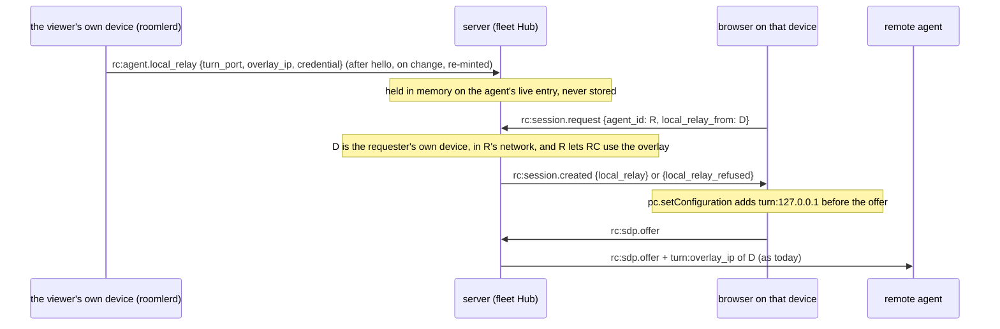

# FR-121: The viewer's own device's relay, from the server — no local-network permission

**Issue:** [#2862](https://github.com/gjovanov/roomler-ai/issues/2862) · **Status:** proposed 2026-10-25 — spec and
claim; P0 measured, nothing built yet · **Owner:** the agent, the fleet module's Hub and the viewer · **Anchors:**
master `9e236c2fb` · **Found by:** [FR-119](FR-119-high-refresh-streaming.md) (#2670), on its first Windows run

## 1. Goal

A viewer running on one of its owner's enrolled devices relays through that device's loopback TURN without the
browser ever fetching `http://127.0.0.1`:

- **The device tells the server about its relay** over the control connection it already holds.
- **The viewer says which of its owner's devices it runs on**, once per browser.
- **The server hands the browser the relay** in the session's own messages, so there is no local-network request for
  the browser to gate, prompt for, or block.

Everything after the hand-off stays as it is today: the browser dials `turn:127.0.0.1:<port>`, the remote agent dials
`turn:<overlay>:<port>`, and both relay ciphertext through the device over the mesh.

## 2. Evidence

### 2.1 How the viewer finds its relay today

The loopback-TURN corp relay (`agents/roomlerd/src/rc_local_turn.rs`) hosts a small TURN server on the device's
overlay address and loopback. It answers a probe on `127.0.0.1:47989` (`:44`), with fallback ports from `:41989`
(`:53`), returning a descriptor with freshly minted 1-hour credentials (`CRED_TTL`, `:68`; minted at `:268`). The
viewer probes the whole range before every session (`probeLocalRelay`, `ui/src/composables/useRemoteControl.ts:7322`,
called at `:9168`). It adds `turn:127.0.0.1:<port>` to its own ICE servers (`localRelayIceServer`, `:3810`) and
forwards the descriptor on `rc:session.request` (`:10620`; the wire field is `signaling.rs:1992`). The Hub stores it
on the session (`crates/modules/fleet/src/hub.rs:1803`) and hands the remote agent `turn:<overlay>:<port>` with the
offer (`forward_offer`, `:2133`, the relay at `:2173`), only for an overlay address (`is_overlay_relay_ip`, `:65`) and
only when the device lets remote desktop use the overlay (#1882's `rc_overlay`).

### 2.2 What it cost on the field (2026-10-24)

The MacBook's freshly installed Chrome viewing neo16 relayed every session through the far TURN. Two things had to be
done by hand before it ran direct:

1. neo16's `rc_overlay` was switched on (the Hub withholds the relay otherwise, by design).
2. Chrome's local-network permission was granted to the page: until then the probe's `fetch` to 127.0.0.1 was
   refused, so the viewer never learned it had a relay.

Then the sessions ran `carrier="overlay_direct"` (`relay=false`, the browser's relay on the MacBook to neo16's host
candidate over the mesh). The permission is a per-origin prompt a person meets with no idea what it is for. Managed
browsers can forbid it outright, and that leaves the corp viewer, the case the relay exists for, with no way in.

### 2.3 P0: the permission gates the probe, not the relay (2026-10-25)

Measured on neo16 with the MCP-driven Chrome 155. A peer connection with one ICE server, `turn:127.0.0.1:<port>`
(the Windows agent's relay), `iceTransportPolicy: 'relay'` and a deliberately invalid credential, so that a server that
is reached answers with an error:

| page | local-network permission | result |
|---|---|---|
| a non-public page (the control) | n/a | `icecandidateerror` 400 "TURN allocate error" at 59 ms, gathering complete at 121 ms |
| `https://example.com` | `prompt` (never granted) | the same 400 at **102 ms**, gathering complete at 165 ms, **no prompt**; the permission still `prompt` afterwards |

So Chrome lets a public page's WebRTC reach a TURN server on 127.0.0.1 without the permission. Only the probe's
`fetch` needs it, and the probe is the one step this FR takes out. ⚠️ A first run read nothing at all: the agent had
self-updated mid-test (0.4.166 → 0.4.167) and the relay's port had moved. A dead port is silence, not a refusal.
Safari and Firefox are owed (AC1).

## 3. Design

### 3.1 The device reports its relay

- `ClientMsg::AgentLocalRelay` (`rc:agent.local_relay`, Remote's namespace: agent-sent like `rc:session.stats`, and only a remote session reads it) carries
  `Option<LocalRelayDescriptor>`. The probe server's loop (`serve`, `rc_local_turn.rs:220`) already owns the TURN host
  and its per-run secret. It publishes a fresh descriptor on a `watch` whenever the host comes up or moves, and
  re-mints at half the credential's lifetime; `None` when the host goes away. The signalling loop sends the latest
  after the hello and on every change. The secret never leaves the process, exactly as for the probe.
- **Primary org only**: the relay sits on the primary overlay, and a secondary org's devices cannot reach it.
- A capability verb, `local-relay` in `AgentCaps.rpc` (equality-matched, unknown verbs ignored), lets the viewer list
  only devices that can serve.
- The Hub keeps the latest descriptor on the agent's live entry, in memory. It goes with the connection.

### 3.2 The viewer says where it runs

- A per-browser choice, **This browser runs on**: one of the signed-in person's own devices that advertise
  `local-relay`, or none. Stored in `localStorage`, beside today's `roomler-rc-local-relay` switch
  (`useRemoteControl.ts:3594`).
- **Suggested by the probe while the probe still works**: the probe's descriptor gains the device's `agent_id`, and
  the first successful probe records it unless the person chose none. That covers every browser that has the
  permission or does not ask for it. ⚠️ Only a device of the **person's own** is recorded: a browser on someone
  else's machine would otherwise be paired with a device whose relay the server refuses to hand over
  (`not_your_device`), and would trade a probe that works for that refusal on every later connect.
- **Once chosen, the viewer never probes again**: no request to 127.0.0.1, so nothing to prompt for. The request
  carries `local_relay_from: <agent_id>` instead of a descriptor.

### 3.3 The server resolves it

On `rc:session.request` with `local_relay_from` and no descriptor, the Hub answers on `rc:session.created` with either
`local_relay` (the descriptor) or `local_relay_refused`, with a reason the viewer can show:

| reason | when |
|---|---|
| `not_your_device` | the named device's `owner_user_id` is not the requester |
| `other_network` | the device is not in the target's organization, whose overlay the remote agent would have to reach |
| `device_offline` | not connected to this pod, or connected without a report (an agent that predates P1, or `ROOMLERD_LOCAL_TURN=0`) |
| `rc_overlay_off` | the target does not let remote desktop use the overlay, so its agent would discard the relay anyway |
| `same_device` | the viewer is looking at the device it runs on |

The descriptor is stored on the session exactly as a probed one is, so `forward_offer` hands the remote agent the
overlay relay as today, with the same overlay-range check. The browser adds `turn:127.0.0.1:<port>` with
`pc.setConfiguration` when `rc:session.created` arrives. The peer connection exists by then
(`useRemoteControl.ts:9341`) and has gathered nothing: the offer waits for `rc:ready` (`:8512`).

⚠️ The descriptor's credential lets its holder allocate on the device's relay, which the overlay and loopback reach.
It is minted by the device, valid for an hour, held only in the Hub's memory, and handed only to the device's owner's
browser and to the session's remote agent. Media through it is DTLS end to end, as it is through any relay. A browser
not on the device gets a loopback address it cannot use.

### 3.4 Why not the alternatives

- **Keep probing, and teach people to grant the permission**: it is a prompt with no stated purpose, managed browsers
  can forbid it, and the viewer that needs the relay most (the corp one) is the one most likely to be refused.
- **An ICE restart onto the relay after the session is up**: the same descriptor is still needed, and the session
  starts on the far TURN at a relay's cap for nothing.
- **Infer the browser's device** from its public address: two devices behind one NAT are indistinguishable, and a
  wrong guess hands the relay of someone else's device to the browser.

### 3.5 P1 to P3, as built (2026-10-25)

| piece | where |
|---|---|
| The probe server publishes the relay on a process-wide `watch` (`report_tx`) when the TURN host comes up, moves or goes away, re-minted every half credential lifetime (`REPORT_REMINT`, 30 min); `None` on exit. The probe and the report mint through one function, which names the device | `agents/roomlerd/src/rc_local_turn.rs:138`, `:150`, `:164`, `:176` |
| The primary org's connection subscribes after its hello, sends what it holds, then every change (`next_local_relay`, `send_local_relay`, `try_send`: a full queue waits for the next re-mint, and only the error's Display is logged) | `agents/roomlerd/src/signaling.rs:434`, `:453`, `:1979` |
| `local-relay` in `AgentCaps.rpc` while `ROOMLERD_LOCAL_TURN` is on | `agents/roomlerd/src/encode/caps.rs:2042` |
| The wire: `rc:agent.local_relay` (Remote's), `local_relay_from` on the request, `local_relay` / `local_relay_refused` on the answer, `LocalRelayRefusal`'s five words | `crates/remote_control/src/signaling.rs:1013`, `:2006`, `:3300`, `:5479` |
| The Hub keeps the report on the connection's entry (`set_agent_local_relay`), resolves a request against it (`resolve_local_relay`: same device, connected, owner, same organization, `rc_overlay`, a report), and echoes the relay or the refusal (`local_relay_reply`); a coalesced retry gets the live session's relay | `crates/modules/fleet/src/hub.rs:82`, `:3310`, `:3329`, `:3922`, `:3978` |
| The viewer decides per connect (`localRelayPlan`): name the device, probe while none is known, or neither. A probe naming one of the person's own devices fills the choice in (`deviceToPairFromProbe`; someone else's device keeps the probe). A named device's relay arrives on `rc:session.created` and goes in with `setConfiguration` (`withLocalRelay`) before the offer | `ui/src/composables/useRemoteControl.ts:3798`, `:3823`, `:3840`, `:3852`, `:7285`, `:8410`, `:10756` |
| Settings → "This browser runs on": the person's own devices that advertise `local-relay`, or none; the refusal in plain words beneath it | `ui/src/views/remote/RemoteControl.vue:1882`, `:3536` |

⚠️ One thing the design did not have to change: the probe server still binds its loopback port before it starts the
TURN host, so a device whose whole probe band is reserved (the Hyper-V case `PROBE_PORT_FALLBACK` exists for) reports
no relay either. Splitting the two is a later step if the field ever shows it.

## 4. Phases

| P | Scope | Kill switch | Status |
|---|---|---|---|
| P0 | Does the local-network permission gate a TURN server on 127.0.0.1? Chrome, then Safari and Firefox | none | **Chrome measured** (§2.3): it does not; Safari and Firefox owed |
| P1 | The agent reports its relay (`rc:agent.local_relay`, the `watch`, re-minting), the `local-relay` verb, the Hub's in-memory copy | `ROOMLERD_LOCAL_TURN=0` (stops the relay and the report) | **built** (§3.5) |
| P2 | `local_relay_from` on the request, `local_relay` / `local_relay_refused` on `rc:session.created`, every refusal; integration tests | the viewer's switch (it never sends the field) | **built** (§3.5): the hub's every arm and the end-to-end dispatch are unit tests; the integration lane runs the composition gate |
| P3 | The viewer: the choice, the probe's suggestion (the descriptor's `agent_id`), no probe once chosen, `setConfiguration`, the refusal's words | `roomler-rc-local-relay` | **built** (§3.5) |
| P4 | Field: the MacBook's Chrome with the permission back at "ask", red first | — | — |
| P5 | Docs | — | — |

## 5. Acceptance criteria

- [ ] **AC1 — P0.** Chrome's answer is recorded (§2.3), and Safari's and Firefox's are measured or stated with why not.
- [ ] **AC2 — the wire is additive.** An old agent sends no report and its sessions run as today; an old viewer sends no
  `local_relay_from`; an old server ignores the field, and the viewer falls back to its probe. Tests on each side.
- [ ] **AC3 — owner-only.** A request naming a device the requester does not own is refused `not_your_device`, and no
  descriptor leaves the server. Also tested for `other_network`, `device_offline`, `rc_overlay_off` and
  `same_device`, each its own reason.
- [ ] **AC4 — no probe once chosen.** A paired viewer makes no request to 127.0.0.1 on connect (unit test on the
  connect path), and a viewer that is not paired probes exactly as today.
- [ ] **AC5 — the field.** The MacBook's Chrome, the local-network permission reset to "ask", paired with the
  MacBook: a session to neo16 (`rc_overlay` on) runs `carrier="overlay_direct"` with no prompt. The red run, on
  today's build, is the same browser relaying through the far TURN (or prompting). Both runs on the issue.
- [ ] **AC6 — the credential stays where it belongs.** Server logs never print a descriptor's credential (key names
  only), and the descriptor is never written to Mongo (a test over the session row and the agent row).
- [ ] **AC7 — docs.** `docs/remote-control.md` (the loopback relay, both ways of finding it, the refusals) and
  `docs/security-baseline.md` (who holds the credential, for how long) updated, with this FR's row in
  `docs/README.md`'s index.

## 6. Open decisions

1. **Who may pair a browser with a device.** Recommended: the device's owner only (`owner_user_id`). The alternative,
   any member who may control the device, lets a member make their own sessions relay through a colleague's device.
2. **`rc_overlay`'s default.** It stays off (#1882): the relay is an overlay path, and the device's owner opts in.
   Recommended: no change here; the viewer says `rc_overlay_off` when that is the reason, so the person knows which
   switch it is.
3. **The probe.** Recommended: keep it as the pairing suggestion until a choice exists, then never probe. Retiring it
   would leave a browser that never asks for the permission with an extra step.

## 7. Out of scope

- A relay on a device of another organization: the remote agent could not reach it over its own mesh.
- Conference media: this is the remote-desktop path only.
- Changing `rc_overlay`'s default (§6.2).
- The probe's clipboard half (`/rc-clipboard`, `rc_local_turn.rs`), which keeps its own permission question.

## 8. Field-verification log

| Date | Build | Cell | Result |
|---|---|---|---|
| 2026-10-24 | agent 0.4.165 on neo16 | The MacBook's fresh Chrome viewing neo16 | **The red record.** Far TURN until `rc_overlay` was on and the local-network permission granted by hand; then `overlay_direct`, `relay=false` |
| 2026-10-25 | Chrome 155 on neo16, agent 0.4.167 | **P0** (§2.3) | The permission does not gate a TURN server on 127.0.0.1: reached from a public origin at 102 ms with the permission at `prompt`, no prompt shown |

## 9. Related

- [FR-119](FR-119-high-refresh-streaming.md): found it on its first Windows run; the overlay relay path it measured
  carries 311 Mbit/s.
- `docs/remote-control.md`: the loopback-TURN corp relay. `docs/security-baseline.md`: the CSP allowlist's loopback
  origins, which the probe needs and this path does not.
- #1882: `rc_overlay`, which decides whether the relay is offered at all.
