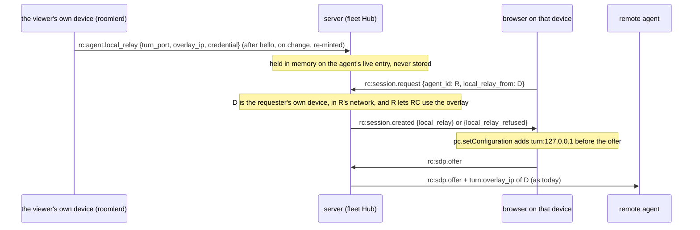
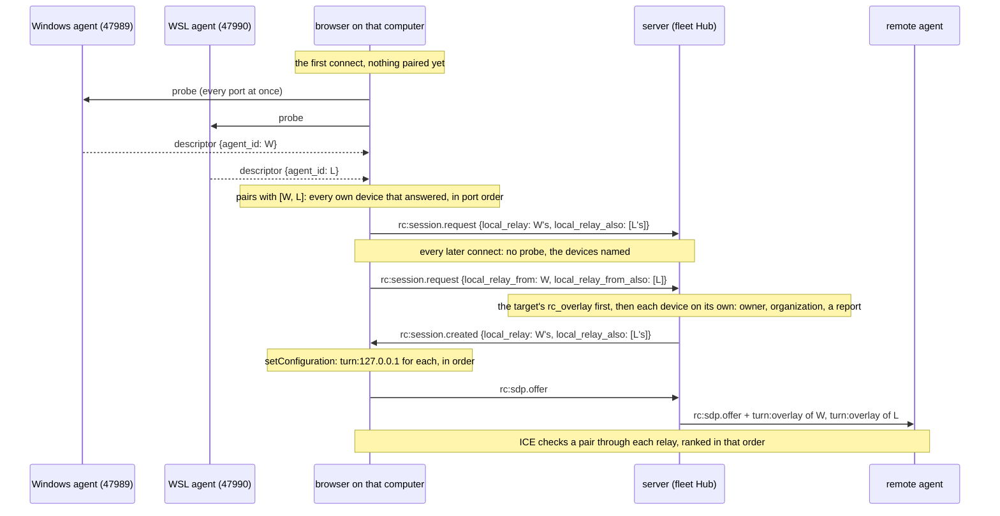

# FR-121: The viewer's own device's relay, from the server — no local-network permission

**Issue:** [#2862](https://github.com/gjovanov/roomler-ai/issues/2862) · **Status:** P1 to P3 built and live
(2026-10-25); P3b built (2026-10-28, #2774) and live (2026-10-29): AC8 and AC10 met, AC9 blocked because Chrome 156
reaches neither relay on 127.0.0.1 from roomler.ai (§3.7); P0's Safari and Firefox, P4 and P5 open · **Owner:** the agent, the fleet module's Hub and the viewer · **Anchors:**
master `a4d5f8e55` · **Found by:** [FR-119](FR-119-high-refresh-streaming.md) (#2670), on its first Windows run

## 1. Goal

A viewer running on one of its owner's enrolled devices relays through that device's loopback TURN without the
browser ever fetching `http://127.0.0.1`:

- **The device tells the server about its relay** over the control connection it already holds.
- **The viewer says which of its owner's devices it runs on**, once per browser.
- **The server hands the browser the relay** in the session's own messages, so there is no local-network request for
  the browser to gate, prompt for, or block.

Everything after the hand-off stays as it is today: the browser dials `turn:127.0.0.1:<port>`, the remote agent dials
`turn:<overlay>:<port>`, and both relay ciphertext through the device over the mesh.

One computer can run more than one enrolled agent: Windows and WSL, a container, a second test agent. Each has its
own relay and its own overlay path to the target, so the browser names every one, and the target is offered every
relay (P3b, §3.6).

## 2. Evidence

### 2.1 How the viewer finds its relay today

The loopback-TURN corp relay (`agents/roomlerd/src/rc_local_turn.rs`) hosts a small TURN server on the device's
overlay address and loopback. It answers a probe on `127.0.0.1:47989` (`:44`), with fallback ports from `:41989`
(`:53`), returning a descriptor with freshly minted 1-hour credentials (`CRED_TTL`, `:68`; minted at `:268`). The
viewer probes the whole range before every session (`probeLocalRelay`, `ui/src/composables/useRemoteControl.ts:7421`,
called at `:9168`). It adds `turn:127.0.0.1:<port>` to its own ICE servers (`localRelayIceServer`, `:3810`) and
forwards the descriptor on `rc:session.request` (`:10620`; the wire field is `signaling.rs:2049`). The Hub stores it
on the session (`crates/modules/fleet/src/hub.rs:1803`) and hands the remote agent `turn:<overlay>:<port>` with the
offer (`forward_offer`, `:2133`, the relay at `:2173`), only for an overlay address (`is_overlay_relay_ip`, `:65`) and
only when the device lets remote desktop use the overlay (#1882's `rc_overlay`).

### 2.2 What it cost on the field (2026-10-24)

The MacBook's freshly installed Chrome viewing neo16 relayed every session through the far TURN. Two things had to be
done by hand before it ran direct:

1. neo16's `rc_overlay` was switched on (the Hub withholds the relay otherwise, by design).
2. Chrome's local-network permission was granted to the page: until then the probe's `fetch` to 127.0.0.1 was
   refused, so the viewer never learned it had a relay.

Then the sessions ran `carrier="overlay_direct"` (`relay=false`, the browser's relay on the MacBook to neo16's host
candidate over the mesh). The permission is a per-origin prompt a person meets with no idea what it is for. Managed
browsers can forbid it outright, and that leaves the corp viewer, the case the relay exists for, with no way in.

### 2.3 P0: the permission gates the probe, not the relay (2026-10-25)

Measured on neo16 with the MCP-driven Chrome 155. A peer connection with one ICE server, `turn:127.0.0.1:<port>`
(the Windows agent's relay), `iceTransportPolicy: 'relay'` and a deliberately invalid credential, so that a server that
is reached answers with an error:

| page | local-network permission | result |
|---|---|---|
| a non-public page (the control) | n/a | `icecandidateerror` 400 "TURN allocate error" at 59 ms, gathering complete at 121 ms |
| `https://example.com` | `prompt` (never granted) | the same 400 at **102 ms**, gathering complete at 165 ms, **no prompt**; the permission still `prompt` afterwards |

So Chrome lets a public page's WebRTC reach a TURN server on 127.0.0.1 without the permission. Only the probe's
`fetch` needs it, and the probe is the one step this FR takes out. ⚠️ A first run read nothing at all: the agent had
self-updated mid-test (0.4.166 → 0.4.167) and the relay's port had moved. A dead port is silence, not a refusal.
Safari and Firefox are owed (AC1).

## 3. Design

### 3.1 The device reports its relay

- `ClientMsg::AgentLocalRelay` (`rc:agent.local_relay`, Remote's namespace: agent-sent like `rc:session.stats`, and only a remote session reads it) carries
  `Option<LocalRelayDescriptor>`. The probe server's loop (`serve`, `rc_local_turn.rs:220`) already owns the TURN host
  and its per-run secret. It publishes a fresh descriptor on a `watch` whenever the host comes up or moves, and
  re-mints at half the credential's lifetime; `None` when the host goes away. The signalling loop sends the latest
  after the hello and on every change. The secret never leaves the process, exactly as for the probe.
- **Primary org only**: the relay sits on the primary overlay, and a secondary org's devices cannot reach it.
- A capability verb, `local-relay` in `AgentCaps.rpc` (equality-matched, unknown verbs ignored), lets the viewer list
  only devices that can serve.
- The Hub keeps the latest descriptor on the agent's live entry, in memory. It goes with the connection.

### 3.2 The viewer says where it runs

- A per-browser choice, **This browser runs on**: one of the signed-in person's own devices that advertise
  `local-relay`, or none. Stored in `localStorage`, beside today's `roomler-rc-local-relay` switch
  (`useRemoteControl.ts:3634`).
- **Suggested by the probe while the probe still works**: the probe's descriptor gains the device's `agent_id`, and
  the first successful probe records it unless the person chose none. That covers every browser that has the
  permission or does not ask for it. ⚠️ Only a device of the **person's own** is recorded: a browser on someone
  else's machine would otherwise be paired with a device whose relay the server refuses to hand over
  (`not_your_device`), and would trade a probe that works for that refusal on every later connect.
- **Once chosen, the viewer never probes again**: no request to 127.0.0.1, so nothing to prompt for. The request
  carries `local_relay_from: <agent_id>` instead of a descriptor.

### 3.3 The server resolves it

On `rc:session.request` with `local_relay_from` and no descriptor, the Hub answers on `rc:session.created` with either
`local_relay` (the descriptor) or `local_relay_refused`, with a reason the viewer can show:

| reason | when |
|---|---|
| `not_your_device` | the named device's `owner_user_id` is not the requester |
| `other_network` | the device is not in the target's organization, whose overlay the remote agent would have to reach |
| `device_offline` | not connected to this pod, or connected without a report (an agent that predates P1, or `ROOMLERD_LOCAL_TURN=0`) |
| `rc_overlay_off` | the target does not let remote desktop use the overlay, so its agent would discard the relay anyway |
| `same_device` | the viewer is looking at the device it runs on |

The descriptor is stored on the session exactly as a probed one is, so `forward_offer` hands the remote agent the
overlay relay as today, with the same overlay-range check. The browser adds `turn:127.0.0.1:<port>` with
`pc.setConfiguration` when `rc:session.created` arrives. The peer connection exists by then
(`useRemoteControl.ts:9471`) and has gathered nothing: the offer waits for `rc:ready` (`:8642`).

⚠️ The descriptor's credential lets its holder allocate on the device's relay, which the overlay and loopback reach.
It is minted by the device, valid for an hour, held only in the Hub's memory, and handed only to the device's owner's
browser and to the session's remote agent. Media through it is DTLS end to end, as it is through any relay. A browser
not on the device gets a loopback address it cannot use.

### 3.4 Why not the alternatives

- **Keep probing, and teach people to grant the permission**: it is a prompt with no stated purpose, managed browsers
  can forbid it, and the viewer that needs the relay most (the corp one) is the one most likely to be refused.
- **An ICE restart onto the relay after the session is up**: the same descriptor is still needed, and the session
  starts on the far TURN at a relay's cap for nothing.
- **Infer the browser's device** from its public address: two devices behind one NAT are indistinguishable, and a
  wrong guess hands the relay of someone else's device to the browser.

### 3.5 P1 to P3, as built (2026-10-25)

| piece | where |
|---|---|
| The probe server publishes the relay on a process-wide `watch` (`report_tx`) when the TURN host comes up, moves or goes away, re-minted every half credential lifetime (`REPORT_REMINT`, 30 min); `None` on exit. The probe and the report mint through one function, which names the device | `agents/roomlerd/src/rc_local_turn.rs:138`, `:150`, `:164`, `:176` |
| The primary org's connection subscribes after its hello, sends what it holds, then every change (`next_local_relay`, `send_local_relay`, `try_send`: a full queue waits for the next re-mint, and only the error's Display is logged) | `agents/roomlerd/src/signaling.rs:434`, `:453`, `:1979` |
| `local-relay` in `AgentCaps.rpc` while `ROOMLERD_LOCAL_TURN` is on | `agents/roomlerd/src/encode/caps.rs:2042` |
| The wire: `rc:agent.local_relay` (Remote's), `local_relay_from` on the request, `local_relay` / `local_relay_refused` on the answer, `LocalRelayRefusal`'s five words | `crates/remote_control/src/signaling.rs:1013`, `:2006`, `:3300`, `:5479` |
| The Hub keeps the report on the connection's entry (`set_agent_local_relay`), resolves a request against it (`resolve_local_relay`: same device, connected, owner, same organization, `rc_overlay`, a report), and echoes the relay or the refusal (`local_relay_reply`); a coalesced retry gets the live session's relay | `crates/modules/fleet/src/hub.rs:82`, `:3310`, `:3329`, `:3922`, `:3978` |
| The viewer decides per connect (`localRelayPlan`): name the device, probe while none is known, or neither. A probe naming one of the person's own devices fills the choice in (`deviceToPairFromProbe`; someone else's device keeps the probe). A named device's relay arrives on `rc:session.created` and goes in with `setConfiguration` (`withLocalRelay`) before the offer | `ui/src/composables/useRemoteControl.ts:3798`, `:3823`, `:3840`, `:3852`, `:7285`, `:8410`, `:10756` |
| Settings → "This browser runs on": the person's own devices that advertise `local-relay`, or none; the refusal in plain words beneath it | `ui/src/views/remote/RemoteControl.vue:1882`, `:3536` |

⚠️ One thing the design did not have to change: the probe server still binds its loopback port before it starts the
TURN host, so a device whose whole probe band is reserved (the Hyper-V case `PROBE_PORT_FALLBACK` exists for) reports
no relay either. Splitting the two is a later step if the field ever shows it.

### 3.6 P3b — every relay on the computer, not the first to answer (#2774), as built (2026-10-28)

**The finding.** neo16 runs two enrolled agents that share loopback under WSL's mirrored networking: the Windows one
and the WSL one, each with its own relay on its own probe port. Their overlay paths differ completely. On 2026-10-28
`roomler peers` showed the Windows agent **direct** to every online peer (4–7 ms on the LAN, the MacBook at 5 ms)
and the WSL agent on `relay:derp/tcp` or `relay:turn/udp` to every one of them (the MacBook at 154 ms). A relay
reached over DERP is no relay for media. Two things made the first answer the one that counted:

- **The probe took the first descriptor.** On 2026-10-23 the WSL agent held 47989; the target gathered no candidate
  from its relay, and the session fell back to the far TURN at 30 fps on a LAN whose overlay pair was direct. The
  bind order is a start-order race. By 10-28 it had flipped (Windows on 47989, WSL on 47990).
- **P3 made that answer permanent.** The first successful probe pairs the browser with the device it named and never
  probes again (§3.2). neo16's own Chrome was found paired with the **WSL** agent on 10-28 (`roomler-rc-this-device`),
  with relay assist on by default, so every later connect named the device with the bad path.

**The choice: every relay, and ICE decides.** Options were set out on #2774; the operator chose this one on
2026-10-28. "Let the server choose" was ruled out because its premise failed: the server holds no live carrier for a
pair. The heartbeat carries each node's own facts, and the overlay verdict (`relay_verdict_core`) is a planned relay
strategy, not a measurement. "Prefer the native agent" was a guess that covers one layout.

| piece | where |
|---|---|
| The probe asks every port of the band at once, so a connect waits one timeout, not one per port, and keeps every answer in port order, one per relay, at most `LOCAL_RELAYS_MAX` (4) | `ui/src/composables/useRemoteControl.ts:3805`, `:3810`, `:3833` |
| "This browser runs on" holds a list: a new key, `roomler-rc-this-devices`, beside the old one, which still gets the first device for a tab on an older bundle. The list holds only while the old key echoes it, so a choice made since in such a tab wins. A probe pairs an unanswered browser with every own device it found (`devicesToPairFromProbe`) | `ui/src/composables/useRemoteControl.ts:3922`, `:3948`, `:3974`, `:4022` |
| A device stored before P3b is **legacy**. On a later connect the browser looks once more, only when the device list in view vouches for the stored device as the person's own (`mayLookAgain`; another organization in view, or a list that failed to load, waits for a later connect) and Chrome says the loopback permission is already granted (`loopback-network`, before the split `local-network-access`). It widens the pairing to every own device found, in probe order (the stored device was a race too), and that connect names them, so the Hub checks each. Found or not, the look happens once (`relayChoiceAfterProbe`) | `ui/src/composables/useRemoteControl.ts:4045`, `:4067`, `:4099`, `:9623` |
| The plan names every paired device except the one being viewed; the request carries the first of each list where an older server reads it, and the rest as `local_relay_also` / `local_relay_from_also`; the answer's relays all go in with `setConfiguration`, in order | `ui/src/composables/useRemoteControl.ts:4000`, `:4122`, `:4138`, `:4151`, `:8736`, `:11099` |
| The picker takes several devices; "Not set" or "None of my devices" picked wins over the rest | `ui/src/views/remote/RemoteControl.vue:1951`, `:3743`; `useRemoteControl.ts:4174` |
| The wire: the two `_also` lists on the request, `local_relay_also` on the answer, `LOCAL_RELAYS_MAX` | `crates/remote_control/src/signaling.rs:2047`, `:2054`, `:3359`, `:5583` |
| The Hub refuses a target whose `rc_overlay` is off first, whatever devices are named. Otherwise it resolves each named device on its own (`named_devices`, each once, at most four). The answer is `Ok` when any got a relay, else the **first** one's refusal. A probed list keeps one relay per address (`bounded_relays`); the session holds them all (`LiveSession::local_relays`); `forward_offer` hands the target each, behind the same overlay-range and `rc_overlay` gates; a coalesced retry gets the same list | `crates/modules/fleet/src/hub.rs:84`, `:104`, `:125`, `:1656`, `:1884`, `:2315`, `:4066`, `:4075`; `crates/remote_control/src/session.rs:63` |

⚠️ **ICE keeps the path that works, not the fastest one that works.** Chrome ranks its relay candidates by the order of
its TURN servers, the first highest, and nominates the best-ranked pair that succeeds. The browser puts the relays in
port order. If the slow agent's relay ranks first and its pair succeeds at all, it can still win. On 10-23 the WSL
agent's relay produced no working pair, but that is a field question, open as decision 4 and measured by AC9.

⚠️ The re-look of a legacy pairing is the one exception to AC4 ("no probe once chosen"). It runs once, only where the
permission is already granted and the device list in view vouches for the stored device. Where the permission cannot
be known (another browser, a Chrome that knows neither name), there is no re-look: such a browser keeps its one device
until the person picks again.

### 3.7 The field, 2026-10-29: Chrome reaches neither relay on loopback from roomler.ai

**The setup.** Both pods ran `hosted-20261029-2ae4ffd` (0.4.186, P3b included). On neo16, NEO16 (Windows, 0.4.186)
answered the probe on 47989 and NEO16-WSL (0.4.185) on 47990. `roomler peers` had the Windows agent direct to the
MacBook's daemon and the WSL agent on `relay:derp/tcp` at 156 ms. The viewer was neo16's Chrome 156, paired before P3b
with the WSL agent (`roomler-rc-this-device` set, `roomler-rc-this-devices` absent), with `loopback-network` granted.
The target was MacBook-1, `rc_overlay` on and idle. Each run forced `iceTransportPolicy: 'relay'` in the test tab,
because this Chrome gathers host candidates. Each run was read three ways: the nominated pair from `getStats()`, the
target's `session carrier recorded` line, and the Hub's `loopback-TURN: adding …` lines.

| run | what the tab did | request and answer | the browser's relay candidates | the session |
|---|---|---|---|---|
| A | the one look, with every probe made to fail, so the look finds none | names the WSL agent alone; its relay handed over; one Hub line | coturn only, none from `turn:127.0.0.1` | the far TURN, 64 ms, `carrier="turn"` |
| B | the shipped build, the relay-only policy the only change | the look found both agents and widened the pairing to the Windows one, then the WSL one; names both; both relays handed over; two Hub lines in that order; the target allocated on both | coturn only, none from either `turn:127.0.0.1` | the far TURN, 65 ms, `carrier="turn"` |
| C | an experiment: each handed-over `turn:127.0.0.1:<port>` rewritten to `turn:<that relay's overlay address>:<port>` | named, as B left the pairing | the Windows relay first, then coturn; none from the WSL relay | the Windows relay, 5 ms, `carrier="overlay_direct"`, `constrained=false`, HEVC at a 120 fps target, 60–73 Mbit/s |

So P3b holds everywhere it reaches: the pairing (AC10), the wire, the Hub and the target. The browser's half does not.
On this Chrome, a TURN server on 127.0.0.1 is no path from roomler.ai.

**Isolated.** These are bare peer connections with `iceTransportPolicy: 'relay'`. A TURN server that is reached answers
a bogus credential with a 400.

| page | ICE server | result |
|---|---|---|
| roomler.ai: the app, a fresh `/health` tab, and same-origin frames with the permission granted or denied by policy | `turn:127.0.0.1:<port>` and `turn:localhost:<port>`, both relays, real and bogus credentials | silence: no candidate and no error in 5–12 s |
| roomler.ai | the Windows relay on its overlay address | a relay candidate in 71 ms; a 400 in 61–76 ms with a bogus credential |
| example.com, with every local-network permission at `prompt` | `turn:127.0.0.1:<port>` (the Windows relay) | a 400 in 82–86 ms, as P0 measured on Chrome 155; the same after roomler.ai's `connect-src` was added by a `<meta>` |
| a plain UDP client on neo16 | a STUN Binding to each relay on 127.0.0.1 | answered in 1–9 ms |

The relay works, and Chrome reaches it on loopback from another origin. Something particular to roomler.ai silences
it. It is not the CSP: a `<meta>` copy of it changed nothing on example.com. It is not the Permissions Policy: a frame
denied by policy stays silent too. The one per-site difference not yet ruled out is the granted local-network
permission, and only the browser's owner can reset it. ⚠️ If that is the cause, P0 is turned around: the browsers it
silences are the ones whose owners granted the permission so that the probe would work. The MacBook's Chrome fits
that. Viewing neo16 through the MacBook's own relay, it ran `overlay_direct` on 2026-10-25, after the permission was
granted by hand. From 2026-10-26 00:31 it ran 5 sessions out of 5 on the far TURN (the note on #2862).

**The two directions can ride different pairs.** Run C was repeated, sampled once a second for 15 s. The target's
video arrived on the Windows relay's pair (2.5 MB, 6 ms). Chrome sent its own packets, input and the data channel's
acks, on the coturn pair (64 ms), which was its selected pair from the first second. The target's ICE agent keeps the
first pair nominated. It follows a later nomination only to a non-overlay pair of higher priority, or away from a pair
gone silent (`should_follow_renomination`, `crates/vendored/webrtc-ice/src/agent/agent_selector.rs:56`, the rule at
`:78`, applied at `:749`). The rule is narrow on purpose: following every renomination let Chrome steer the agent
onto a one-way pair on 2026-07-27, and SCTP died in every session. The coturn pair ranks below the relay's, so the
agent stayed, as designed. Why Chrome chose coturn for
its own sending is not known yet, and only `chrome://webrtc-internals` can show it (open decision 5).

## 4. Phases

| P | Scope | Kill switch | Status |
|---|---|---|---|
| P0 | Does the local-network permission gate a TURN server on 127.0.0.1? Chrome, then Safari and Firefox | none | **Chrome measured** (§2.3): it does not; Safari and Firefox owed |
| P1 | The agent reports its relay (`rc:agent.local_relay`, the `watch`, re-minting), the `local-relay` verb, the Hub's in-memory copy | `ROOMLERD_LOCAL_TURN=0` (stops the relay and the report) | **built** (§3.5) |
| P2 | `local_relay_from` on the request, `local_relay` / `local_relay_refused` on `rc:session.created`, every refusal; integration tests | the viewer's switch (it never sends the field) | **built** (§3.5): the hub's every arm and the end-to-end dispatch are unit tests; the integration lane runs the composition gate |
| P3 | The viewer: the choice, the probe's suggestion (the descriptor's `agent_id`), no probe once chosen, `setConfiguration`, the refusal's words | `roomler-rc-local-relay` | **built** (§3.5) |
| P3b | Every relay on the computer (#2774): the probe asks every port at once and keeps every answer, the browser pairs with every own device, the `_also` lists, the Hub resolves and forwards each, the one re-look of a pre-P3b pairing | per browser: pick one device in "This browser runs on"; `roomler-rc-local-relay` off for all of it | **built and live** (§3.6, live 2026-10-29): AC8 and AC10 met. AC9 is red on the shipped build, blocked by Chrome rather than by P3b (§3.7, open decision 5) |
| P4 | Field: the MacBook's Chrome with the permission back at "ask", red first | — | — |
| P5 | Docs | — | — |

## 5. Acceptance criteria

- [ ] **AC1 — P0.** Chrome's answer is recorded (§2.3), and Safari's and Firefox's are measured or stated with why not.
- [ ] **AC2 — the wire is additive.** An old agent sends no report and its sessions run as today; an old viewer sends no
  `local_relay_from`; an old server ignores the field, and the viewer falls back to its probe. Tests on each side.
- [ ] **AC3 — owner-only.** A request naming a device the requester does not own is refused `not_your_device`, and no
  descriptor leaves the server. Also tested for `other_network`, `device_offline`, `rc_overlay_off` and
  `same_device`, each its own reason.
- [ ] **AC4 — no probe once chosen.** A paired viewer makes no request to 127.0.0.1 on connect (unit test on the
  connect path), and a viewer that is not paired probes exactly as today.
- [ ] **AC5 — the field.** The MacBook's Chrome, the local-network permission reset to "ask", paired with the
  MacBook: a session to neo16 (`rc_overlay` on) runs `carrier="overlay_direct"` with no prompt. The red run, on
  today's build, is the same browser relaying through the far TURN (or prompting). Both runs on the issue.
- [ ] **AC6 — the credential stays where it belongs.** Server logs never print a descriptor's credential (key names
  only), and the descriptor is never written to Mongo (a test over the session row and the agent row).
- [ ] **AC7 — docs.** `docs/remote-control.md` (the loopback relay, both ways of finding it, the refusals) and
  `docs/security-baseline.md` (who holds the credential, for how long) updated, with this FR's row in
  `docs/README.md`'s index.
- [x] **AC8 — P3b, the wire stays additive.** An older server reads the first relay and the first device alone; an
  older viewer never sends the lists and gets the answer it got before; a refusal is sent only when no named device got
  a relay. Tests on each side, each shown to fail with the first-only behaviour put back.
  **Met 2026-10-29.** On the wire, `several_local_relays_are_additive_on_the_wire`. In the Hub (#3066): with only the
  first device resolved again, both dispatch tests fail, and with the `rc_overlay` guard off, the refusal test fails.
  In the viewer, run on master `e7c03c181`: with the probe keeping only its first answer, 3 of the 23 FR-121 cases
  fail; with the pairing taking only the first own device, 2 fail; with the request dropping its `_also` lists, 1
  fails. Restored, all 23 pass.
- [ ] **AC9 — P3b, the field.** On neo16 (the Windows agent direct, the WSL agent on DERP), a browser whose
  first-answering or only paired agent is the WSL one: red on today's build (the session rides the far TURN), green on
  P3b (the Windows agent's relay carries it, `carrier="overlay_*"`), the nominated pair read from
  `chrome://webrtc-internals` or `getStats()`. Both runs on #2774.
  *(2026-10-29, §3.7: red on the shipped build. The look widened the pairing, and the target got both relays and
  allocated on each. But Chrome 156 reaches neither relay on 127.0.0.1 from roomler.ai, so the session rode the far
  TURN. With the relays rewritten to their overlay addresses in the tab, the Windows relay carried the video at
  `overlay_direct`. The red run on the build before P3b was never made: the MacBook was in use both times it was
  tried, and the promote has since replaced that build. The red record is the 2026-10-23 row of §8. The box stays
  open until the browser's half works on a shipped build.)*
- [x] **AC10 — P3b, the re-pairing.** A browser paired with the WSL agent before P3b, the loopback permission granted,
  widens to both devices on its next connect with no prompt, and stays paired with its device when the look finds none
  of the person's own. **Met 2026-10-29** (§3.7, §8). The browser was neo16's Chrome 156, paired with the WSL agent
  before P3b, `loopback-network` granted. On the shipped build, the next connect probed all ten ports, widened the
  pairing to both agents in probe order with the Windows one first (`roomler-rc-this-devices` holds both,
  `roomler-rc-this-device` the Windows one), named both, and changed no permission. With every probe made to fail in
  the tab, the same look kept the WSL agent alone, stored the new way so that it does not look again.

## 6. Open decisions

1. **Who may pair a browser with a device.** Recommended: the device's owner only (`owner_user_id`). The alternative,
   any member who may control the device, lets a member make their own sessions relay through a colleague's device.
2. **`rc_overlay`'s default.** It stays off (#1882): the relay is an overlay path, and the device's owner opts in.
   Recommended: no change here; the viewer says `rc_overlay_off` when that is the reason, so the person knows which
   switch it is.
3. **The probe.** Recommended: keep it as the pairing suggestion until a choice exists, then never probe. Retiring it
   would leave a browser that never asks for the permission with an extra step.
4. **Which relay ranks first when several work** (P3b). Today: port order, which is the agents' start order. If AC9
   shows a slow relay's pair winning, the order needs a measured input. The likely one is each local agent's own
   carrier to the target, which only the agents hold: the probe could carry it, at the cost of an agent change. Not
   decided until the field says it is needed. *(2026-10-29, §3.7: the order decided nothing on neo16. The WSL relay
   gave the browser no candidate through either address, and once Chrome could reach the Windows relay, its pair
   carried the video.)*
5. **The address the browser dials, and the browser's own send path** (§3.7). Not decided. Two measurements come
   first. Does resetting roomler.ai's local-network permission to "ask" in neo16's Chrome make 127.0.0.1 answer (the
   bare test of §3.7)? And does the MacBook's Chrome show the same silence? The candidates are to hand the browser each
   relay on both addresses, `turn:127.0.0.1:<port>` first and `turn:<overlay>:<port>` after, so that Chrome gathers
   from whichever answers (a viewer-only change); or to hand the overlay address alone when the relay's agent is the
   browser's own OS. The WSL relay's overlay address is not local to Windows. Neither changes the split: with the local
   relay's pair working, Chrome still sent its own packets on the far TURN.

## 7. Out of scope

- A relay on a device of another organization: the remote agent could not reach it over its own mesh.
- Conference media: this is the remote-desktop path only.
- Changing `rc_overlay`'s default (§6.2).
- The probe's clipboard half (`/rc-clipboard`, `rc_local_turn.rs`), which keeps its own permission question.

## 8. Field-verification log

| Date | Build | Cell | Result |
|---|---|---|---|
| 2026-10-23 | the viewer before FR-121 (backfilled from #2774) | neo16's Chrome viewing the MacBook, `rc_overlay` on, during FR-119 P3 | **The red record for P3b.** The WSL agent answered the probe first (47989); the target gathered no candidate from its relay and the session rode the far TURN, constrained at 30 fps, while the overlay pair between the two machines was direct. With 47989 made to fail in the tab, the probe landed on the Windows agent (47992) and the assist used it |
| 2026-10-24 | agent 0.4.165 on neo16 | The MacBook's fresh Chrome viewing neo16 | **The red record.** Far TURN until `rc_overlay` was on and the local-network permission granted by hand; then `overlay_direct`, `relay=false` |
| 2026-10-25 | Chrome 155 on neo16, agent 0.4.167 | **P0** (§2.3) | The permission does not gate a TURN server on 127.0.0.1: reached from a public origin at 102 ms with the permission at `prompt`, no prompt shown |
| 2026-10-28 | agents 0.4.182 on neo16, Chrome 156 | neo16, read only (before P3b) | The Windows agent holds 47989 and the WSL agent 47990 (flipped since 10-23). `roomler peers`: Windows direct to all 13 online peers, WSL on `relay:derp/tcp` or `relay:turn/udp` to all of them. Chrome's `roomler-rc-this-device` names the WSL agent, `roomler-rc-local-relay` unset (on). Permissions: `loopback-network` granted, `local-network` prompt, `local-network-access` granted |
| 2026-10-29 | server `hosted-20261029-2ae4ffd` (0.4.186, P3b); NEO16 0.4.186, NEO16-WSL and MacBook-1 0.4.185; Chrome 156 | neo16's Chrome viewing MacBook-1 (`rc_overlay` on), relay-only forced in the tab, the pre-P3b pairing (the WSL agent) | **AC10 met; AC9 red** (§3.7). With every probe made to fail in the tab, the look kept the WSL agent alone, stored as a list of one so it will not look again. It named that agent and got its relay. The browser gathered no candidate from it, and the session rode the far TURN (`carrier="turn"`, 64 ms). The pre-P3b pairing was then put back and the shipped build run unchanged. The look widened the pairing to the Windows agent, then the WSL one, with no prompt. The Hub handed the target both relays in that order, and the target allocated on both. The browser again gathered from neither and rode the far TURN (`carrier="turn"`, 65 ms) |
| 2026-10-29 | Chrome 156 on neo16 | Bare peer connections with a bogus credential (a reached server answers 400) | From roomler.ai, a TURN server on 127.0.0.1 is silent: both relays, a fresh tab, and frames with the permission granted or denied by policy. The same relay on its overlay address answers in 61–76 ms. From example.com, 127.0.0.1 answers in 82–86 ms, also with roomler.ai's `connect-src` added. A plain UDP client gets a STUN answer from each relay in 1–9 ms |
| 2026-10-29 | the same, an experiment in the tab | neo16's Chrome viewing MacBook-1, the handed-over relays rewritten to their overlay addresses | The Windows relay carried the video (`carrier="overlay_direct"`, 5–6 ms, `constrained=false`, HEVC at a 120 fps target, 60–73 Mbit/s). The WSL relay gave no candidate. Chrome sent its own packets on the coturn pair, its selected pair from the first second, while the target kept the relay's pair (§3.7) |

## 9. Related

- [FR-119](FR-119-high-refresh-streaming.md): found it on its first Windows run; the overlay relay path it measured
  carries 311 Mbit/s.
- `docs/remote-control.md`: the loopback-TURN corp relay. `docs/security-baseline.md`: the CSP allowlist's loopback
  origins, which the probe needs and this path does not.
- #1882: `rc_overlay`, which decides whether the relay is offered at all.
- #2774: the probe took the first local agent's relay, whatever its path; P3b (§3.6).
