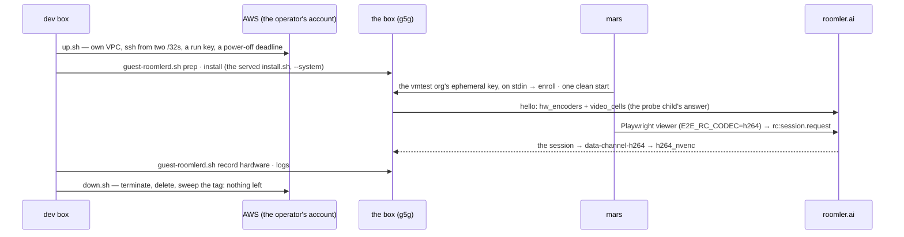
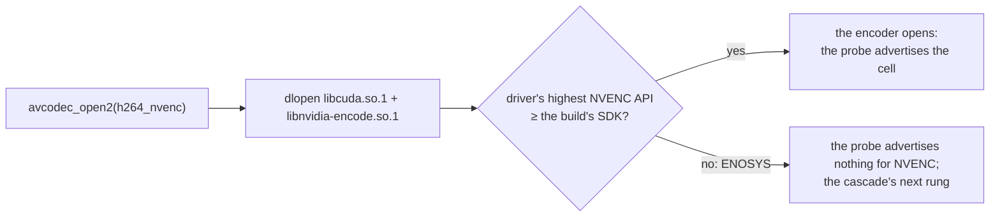

# FR-122: A hardware encoder cell on arm64 Linux, proven in a session

**Issue:** [#2875](https://github.com/gjovanov/roomler-ai/issues/2875) · **Status:** P0 decided 2026-10-29 (D1: the
operator's own AWS account); the rig is built and rehearsed end to end on a GPU-less arm64 box (§3.1, §8). The g5g
run waits on that account's G and VT quota (§2). P0c (2026-10-30): the released Linux trees needed NVIDIA driver
610, and the g5g's image ships 595, so the box could not have opened NVENC on any release to date; the Linux trees
now take Windows' NVENC SDK, driver 570 (§2, §3.2) · **Owner:** the agent's encoder surface ·
**Anchors:** master `589373574` · **Split from:** [FR-97](FR-97-os-feature-parity.md) P7a, by its D18 (the
operator, 2026-10-25: "ship AAC now, GPU later")

## 1. Goal

An arm64 Linux host with a hardware video encoder advertises that cell, and a remote-desktop session opens it.
This is the half of FR-97's P7a that the lab could not prove (FR-97 AC14's first clause).

## 2. Evidence

- **P7a ships the encoders.** FR-97 P7a vendors FFmpeg 9.0.1 for arm64 (`vendor-ffmpeg-windows.yml`,
  `build-linux-arm64-minimal`): `h264/hevc/av1_nvenc`, `h264/hevc/av1/vp9_vaapi`, `h264/hevc/av1_vulkan`, the
  h264 decoder and the aac encoder. The arm64 `.deb` and tarball bundle it, and the child-process probe decides
  per host whether any of it opens.
- **The lab's arm64 host has no encoder.** It is an Asahi M2 Pro. Asahi's GPU driver serves 3D (OpenGL, Vulkan),
  and Apple's video encoder has no Linux driver; Asahi's latest progress report covers decoding only. On P7a's
  candidate there, the probe advertised the software cells alone (`openh264-sw`, `libvpx-vp9-444-sw`), as on
  0.4.169. Recordings went from Opus to AAC (FR-97 §8, 2026-10-25).
- **The rentable host was blocked.** An AWS G5g (Graviton2 + NVIDIA T4G) runs NVENC on arm64 Linux, which
  FFmpeg's `nvenc` drives unchanged. The account offered refused it: an organisation policy explicitly denies
  `ec2:CreateInternetGateway`, and its only VPC is a private corporate network that a test box must not join.
  Every resource created there was removed the same hour (FR-97 §8).
- **The operator's own account refuses it too, as opened (2026-10-29).** It is a project of AWS's new sign-up
  (AWS Settings, the free plan), and each refusal names itself (§8):
  - the organisation's pre-configured SCP allows regional calls in the project's region only (`eu-north-1`),
    and `eu-north-1` offers no arm64 GPU type at all; `g5g` is in `eu-central-1`;
  - the free plan launches free-tier types only: `InvalidParameterCombination: The specified instance type is
    not eligible for Free Tier`;
  - the G and VT vCPU quota is 0, on-demand and spot.

  The operator then took the account to the paid plan, activated advanced features and opened `eu-central-1` in the
  SCP. AWS refused the quota request on 2026-10-29 ("gradually ramp up activity"), and the appeal is pending.
- **The released Linux trees could not have opened NVENC on that box anyway (2026-10-30).** The NVENC SDK a build
  is compiled against is the driver floor: FFmpeg asks the driver for its highest NVENC API and refuses to open
  when the build's is newer (`nvenc.c`, `nvenc_load_libraries`: "Driver does not support the required nvenc API
  version"). Both Linux jobs of `vendor-ffmpeg-windows.yml` pinned `nv-codec-headers` **n13.1.15.0**, and SDK 13.1
  needs driver **610.00** (`nvenc_print_driver_requirement`; NVIDIA's SDK 13.1 read-me says the same). The
  released 0.4.187 arm64 `libavcodec.so.63` carries exactly that string. AWS's G5g image, *Deep Learning ARM64
  Base OSS Nvidia Driver GPU AMI (Ubuntu 24.04) 20261028*, ships driver **595.112.07**. The Windows build was
  never affected: its `ffnvcodec` comes from the pinned vcpkg baseline, **13.0.19.0**, which needs 570.0. So on
  Linux, x86_64 and arm64 alike, every host on a 570–609 driver silently lost NVENC: NVIDIA's R580 long-term
  branch (supported until 2028), the cloud images, and the Maxwell, Pascal and Volta cards that R580 is the last
  branch for. The workflow's own
  comment said the pin kept "the driver floor reasonable". It had been 13.1 since the job was written (#473).

## 3. Key design

Nothing in the agent changes for NVENC: P7a's FFmpeg carries it, `libnvidia-encode` is dlopen'd, and the cascade
already dispatches `*_nvenc` on Linux. One line in the vendored build changes, the NVENC SDK the Linux trees are
compiled against (§3.2). Beyond that, what is missing is a host and a session, because **a probe proves an open,
and only a session proves a cell** (the `encoder-cells` skill; `docs/encoders.md`).

| Host | What it needs | Cost |
|---|---|---|
| AWS G5g (T4G) in an account that allows it (§2) | nothing in the agent; an isolated VPC for ~2 h, then deleted | a few dollars |
| NVIDIA Jetson | a backend: its encoder is not FFmpeg's `nvenc` | a board + M |
| RK3588 (rkmpp), Raspberry Pi 4 (V4L2 M2M) | a V4L2 M2M backend, the only route to SoC encoders | a board + M |

### 3.1 The rig

The box is rented and returned by [`scripts/aws-testbox/`](../../scripts/aws-testbox/README.md), and every step
below has run on a GPU-less arm64 box of the same CPU generation (§8).

| Step | How | Where it reads the truth |
|---|---|---|
| The box | `up.sh`: a VPC of its own, port 22 from the dev box and mars only, a key made for the run, a systemd timer that powers it off (= terminates it) at the deadline; `down.sh` deletes by id and sweeps by tag | `DOWN OK … nothing tagged … is left` |
| The agent | the **released** build through the served `install.sh --role daemon --system`, `ROOMLERD_VIRTUAL_DESKTOP=1` (Xvfb 1920×1080, openbox, a ticking clock, `top`), `ROOMLERD_AUTO_UPDATE=0`. Enrolled with the vmtest org's ephemeral key, which goes from mars to the box on stdin, so the row deletes itself when the daemon stops | `roomlerd --version`, the agent row |
| AC1 | the daemon's `caps probe: child reported … hw_encoders=[…]` ([`caps.rs:400-407`](../../agents/roomlerd/src/encode/caps.rs#L400-L407)), and `roomlerd caps-probe` run again for the cell list | `guest-roomlerd.sh caps` |
| AC2 | the vmtest remote-desktop spec from mars, steered onto the cell: `E2E_RC_CODEC=h264` seeds the picker's per-agent override ([`useRemoteControl.ts:2269`](../../ui/src/composables/useRemoteControl.ts#L2269)), which maps an explicit H.264 to `data-channel-h264` ([`peer.rs:2492`](../../agents/roomlerd/src/peer.rs#L2492)), an FFmpeg cascade with `h264_nvenc` first ([`peer.rs:5266`](../../agents/roomlerd/src/peer.rs#L5266)); `E2E_RC_EXPECT_ENCODER=h264_nvenc` fails the run unless the viewer's codec pill names it. Headless Chromium decodes H.264 in software; HEVC needs a viewer with hardware HEVC decode | the agent's `media pump:` line, the pill, decoded frames |
| AC3 | `roomlerd record --encoder hardware --system-audio` on a private Xvfb with a null sink: `hardware` is the FFmpeg H.264 cascade or a refusal, never a quiet software fallback ([`child.rs:315`](../../agents/roomlerd/src/recording/child.rs#L315)) | the `started` event's `encoder`, the MP4's `mp4a`/`esds` |

### 3.2 The NVENC driver floor (P0c)

FFmpeg's NVENC refuses a driver older than the SDK it was compiled against. The pin is therefore a product
decision about which hosts get NVENC at all, not a build detail.

| `nv-codec-headers` | NVENC API | Driver floor (FFmpeg 9.0.1) | Which build |
|---|---|---|---|
| n13.1.15.0 | 13.1 | 610.00 | Linux x86_64 and arm64, from #473 (2026-08-15) to P0c |
| **n13.0.19.0** | 13.0 | **570.0** | Windows always (the vcpkg baseline's `ffnvcodec`); Linux from P0c |
| n12.1.14.0 | 12.1 | 530.41.03 (Linux) | FFmpeg 9.0.1's own minimum (`configure`); AV1 encode needs ≥ 12.0 |

What P0c changes: both Linux jobs clone n13.0.19.0
([`vendor-ffmpeg-windows.yml:283`](../../.github/workflows/vendor-ffmpeg-windows.yml#L283),
[`:520`](../../.github/workflows/vendor-ffmpeg-windows.yml#L520)), and each asserts the floor in the binary it
built, because nvenc.c compiles in exactly one minimum-driver string
([`:443`](../../.github/workflows/vendor-ffmpeg-windows.yml#L443),
[`:617`](../../.github/workflows/vendor-ffmpeg-windows.yml#L617)). Nothing is lost by going back from 13.1. FFmpeg
9.0.1 gates two things on 13.1: an internal counter type, and AV1's hierarchical B-frame reference mode
(`NVENC_HAVE_AV1_HGOP_SUPPORT`). The agent opens every FFmpeg encoder with no B-frames
([`encoder.rs:1888`](../../agents/roomlerd/src/encode/ffmpeg/encoder.rs#L1888), and `bf=0` in NVENC's options,
[`encoder.rs:367`](../../agents/roomlerd/src/encode/ffmpeg/encoder.rs#L367)), and the Windows build's NVENC cells
have run on 13.0 since FFmpeg 9.0.1 arrived (FR-77 P0, #1472). A newer driver still opens an older SDK: the dev
box's 610.88 runs the Windows build's 13.0.

## 4. Phases

| Phase | What | Kill switch | Lab target | Size |
|---|---|---|---|---|
| **P0** | A host: **decided 2026-10-29, the operator's own AWS account (D1)** | — | — | — |
| **P0b** | The rig of §3.1, rehearsed on a GPU-less arm64 box: **done 2026-10-29** (§8) | — | `t4g.small`, `eu-north-1` | S |
| **P0c** | The Linux trees' NVENC driver floor, 610 → 570: `nv-codec-headers` n13.0.19.0 as on Windows, asserted in the binary (§3.2); the trees re-vendored and the LGPL offer republished before the merge | re-pin + re-vendor (the assets are replaced in place) | the g5g's own image (driver 595) | S |
| **P1** | On an NVENC host: the released arm64 build's hello names `ffmpeg-h264_nvenc` (and `hevc`), a session opens it, and a recording uses it with AAC | `encoder_cells_deny` | `g5g.xlarge`, `eu-central-1` | S |
| **P2** | Only if P0 picks a SoC board: a V4L2 M2M backend | its own deny cell | the board | M |
| **P3** | Docs, below | — | — | S |

## 5. Acceptance criteria

- [ ] **AC1.** An arm64 Linux host advertises a hardware cell (`hw_encoders` names it) from the release build.
- [ ] **AC2.** A session opens that cell. The agent log names the backend, the viewer receives frames, and the
  cell is recorded as proven.
- [ ] **AC3.** A recording on that host uses the hardware cell and writes AAC.
- [ ] **AC4 — docs.** `docs/encoders.md` (the arm64 cells and the NVENC driver floor), `docs/platform-support.md`
  row A3 and the user page, with this FR's row in `docs/README.md`'s index.

## 6. Open decisions

1. ~~**Which host** (P0): an AWS account of the operator's own, or lab hardware (and with it P2).~~ **D1, the
   operator, 2026-10-29: an AWS account of the operator's own.** As opened it refuses the box (§2). The operator
   chose to upgrade it to the paid plan and *activate advanced features*, which is irreversible and removes the
   spend limit, and then to open `eu-central-1` in the SCP's `RegionFloor` statement. That is a change to the
   organisation's security policy, so the operator makes it, not a session. After it, a G and VT quota of 4 vCPUs
   is requested in `eu-central-1`.
2. **Which NVENC SDK the Linux trees take** (P0c). **D2, 2026-10-30: 13.0 (driver 570), the Windows build's.** One
   floor for every NVENC the agent ships, every Windows NVENC cell already runs on it, and it admits NVIDIA's
   current long-term branch, R580. 12.1 would reach further back (530.41, the R535 branch), but R535 reached its
   end of life in June 2026 and the two builds would then differ. This is open to the operator: going lower is the
   same one-line pin plus a re-vendor.

## 7. Out of scope

- Apple's encoder under Linux: it waits on an Asahi driver.
- Windows ARM64 and Intel Macs (FR-97 D6).

## 8. Field-verification log

| Date | Build | Set-up | Result |
|---|---|---|---|
| 2026-10-29 | — | **The operator's own AWS account**, through `aws login` (short-lived credentials for the console session; no access keys) | Refused three ways, each by name. Every regional call outside `eu-north-1`: `UnauthorizedOperation … explicit deny in a service control policy`. `eu-north-1` lists 56 GPU types, every one x86_64. A `t4g.medium` launch: `InvalidParameterCombination: The specified instance type is not eligible for Free Tier` (the free-tier types are `t3.micro/small`, `t4g.micro/small`, `c7i-flex.large`, `m7i-flex.large`). The G and VT vCPU quota (`L-DB2E81BA`, spot `L-3819A6DF`) is 0. VPC, internet gateway and security group creation are allowed (dry runs) |
| 2026-10-29 | the released **0.4.186**, `roomlerd_0.4.186-1_arm64` | **P0b, the rig rehearsed with no GPU:** `up.sh` with `t4g.small` (Graviton2, as in the g5g), Canonical Ubuntu 24.04 arm64, in `eu-north-1`; the served `install.sh --system`; the virtual desktop; enrolled ephemeral in the vmtest org from mars; viewer = the vmtest spec in mars's Playwright container | **The control for P1, green on every step.** The probe: `child reported … hw_encoders=["openh264-sw", "libvpx-vp9-444-sw"] cells=2`, then `no hardware cell opened — not cached`, as on the Asahi box. Virtual desktop: Xvfb `:99` 1920×1080, openbox, capture on it. A session on Auto: `media pump: VP9-444 over DataChannel (… libvpx SW path)`, frames decoded and advancing, the picture lit 33.5 %. Steered with `E2E_RC_CODEC=h264`: the viewer asked for `["h264"]`, `encoder selected: openh264 (software)`, pill `H.264 SW`. A recording with `--encoder hardware`: refused, `encoder_unavailable: no hardware H.264 encoder opened for recording`. With `auto`: `openh264`, 299 frames in 10 s, the MP4 carries `avc1` and `mp4a` + `esds`, the sidecar says `audio.codec: aac`. Torn down: `DOWN OK … nothing tagged roomler-testbox=fr122-rehearsal is left`, and no FR-122 row in the vmtest org. Box time: 9 min |
| 2026-10-30 | the released **0.4.187**, `roomlerd-0.4.187-aarch64-unknown-linux-gnu.tar.gz` (sha256 `62db20a3…`, as published) | **No box: read before renting one.** The release's `libavcodec.so.63`, FFmpeg n9.0.1's `nvenc.c`, nv-codec-headers n13.1.15.0, AWS's release notes for the image `up.sh` picks | **The released Linux build could not have opened NVENC on the g5g (P0c).** The library names `h264/hevc/av1_nvenc` and dlopens `libcuda.so.1` + `libnvidia-encode.so.1`, and its one minimum-driver string is `610.00`: the header says `NVENCAPI_MAJOR_VERSION 13`, `MINOR 1`, and `nvenc.c` maps 13.1 to "610.00". The image, *Deep Learning ARM64 Base OSS Nvidia Driver GPU AMI (Ubuntu Pro 24.04) 20261028* (`ami-05aec1d9511cfe42b`, `eu-central-1`), ships `nvidia_driver 595.112.07`. Windows' vcpkg baseline (`2e6b9238`) carries `ffnvcodec` 13.0.19.0, floor 570.0. The dev box's driver is 610.88, which is why nothing on it showed the gap. Fixed by P0c; the box run will first show the refusal on 0.4.187 |
