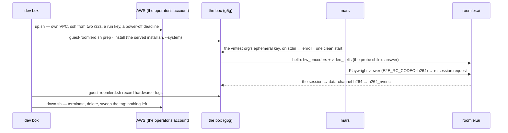
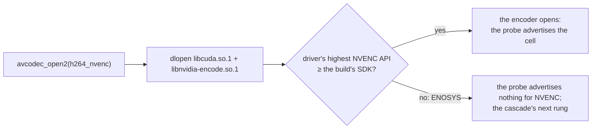

# FR-122: A hardware encoder cell on arm64 Linux, proven in a session

**Issue:** [#2875](https://github.com/gjovanov/roomler-ai/issues/2875) · **Status:** **done 2026-10-30, every
acceptance criterion field-verified on agent 0.4.189** (§5, §8). The proof ran on a rented DGX Spark, an arm64 NVIDIA
GB10 on NVIDIA's own driver (580), because the operator's AWS account never got its G and VT quota (§2; D1,
amended). P0c (2026-10-30): the released Linux trees needed NVIDIA driver 610, so no host below it, the g5g's image
(595) and the GB10's (580) included, could open NVENC on any release before 0.4.188. The Linux trees now need 530.41,
the oldest floor FFmpeg 9.0.1 builds against (D2, the operator); Windows needs 570 (§2, §3.2). On the GB10 the last
release before P0c refused NVENC and 0.4.189 opened every NVENC cell, a session ran on H.264 4:4:4 and on AV1, and
a recording wrote H.264 and AAC (§8) ·
**Owner:** the agent's encoder surface ·
**Anchors:** master `01520c8af` · **Split from:** [FR-97](FR-97-os-feature-parity.md) P7a, by its D18 (the
operator, 2026-10-25: "ship AAC now, GPU later")

## 1. Goal

An arm64 Linux host with a hardware video encoder advertises that cell, and a remote-desktop session opens it.
This is the half of FR-97's P7a that the lab could not prove (FR-97 AC14's first clause).

## 2. Evidence

- **P7a ships the encoders.** FR-97 P7a vendors FFmpeg 9.0.1 for arm64 (`vendor-ffmpeg-windows.yml`,
  `build-linux-arm64-minimal`): `h264/hevc/av1_nvenc`, `h264/hevc/av1/vp9_vaapi`, `h264/hevc/av1_vulkan`, the
  h264 decoder and the aac encoder. The arm64 `.deb` and tarball bundle it, and the child-process probe decides
  per host whether any of it opens.
- **The lab's arm64 host has no encoder.** It is an Asahi M2 Pro. Asahi's GPU driver serves 3D (OpenGL, Vulkan),
  and Apple's video encoder has no Linux driver; Asahi's latest progress report covers decoding only. On P7a's
  candidate there, the probe advertised the software cells alone (`openh264-sw`, `libvpx-vp9-444-sw`), as on
  0.4.169. Recordings went from Opus to AAC (FR-97 §8, 2026-10-25).
- **The rentable host was blocked.** An AWS G5g (Graviton2 + NVIDIA T4G) runs NVENC on arm64 Linux, which
  FFmpeg's `nvenc` drives unchanged. The account offered refused it: an organisation policy explicitly denies
  `ec2:CreateInternetGateway`, and its only VPC is a private corporate network that a test box must not join.
  Every resource created there was removed the same hour (FR-97 §8).
- **The operator's own account refuses it too, as opened (2026-10-29).** It is a project of AWS's new sign-up
  (AWS Settings, the free plan), and each refusal names itself (§8):
  - the organisation's pre-configured SCP allows regional calls in the project's region only (`eu-north-1`),
    and `eu-north-1` offers no arm64 GPU type at all; `g5g` is in `eu-central-1`;
  - the free plan launches free-tier types only: `InvalidParameterCombination: The specified instance type is
    not eligible for Free Tier`;
  - the G and VT vCPU quota is 0, on-demand and spot.

  The operator then took the account to the paid plan, activated advanced features and opened `eu-central-1` in the
  SCP. AWS refused the quota request on 2026-10-29 ("gradually ramp up activity"), and the appeal still had no
  answer a day later, on-demand and spot quotas at 0 in every region with a `g5g`.
- **A DGX Spark can be rented by the minute (2026-10-30).** NVIDIA's GB10 pairs 20 arm64 cores with a Blackwell
  GPU that has an NVENC engine, on NVIDIA's standard Linux driver, so FFmpeg's `nvenc` drives it unchanged, as on
  the T4G. Several providers rent one with SSH for under a dollar an hour. The operator chose one (D1, amended),
  and the whole run cost $0.33 (§8).
- **The released Linux trees could not have opened NVENC on that box anyway (2026-10-30).** The NVENC SDK a build
  is compiled against is the driver floor: FFmpeg asks the driver for its highest NVENC API and refuses to open
  when the build's is newer (`nvenc.c`, `nvenc_load_libraries`: "Driver does not support the required nvenc API
  version"). Both Linux jobs of `vendor-ffmpeg-windows.yml` pinned `nv-codec-headers` **n13.1.15.0**, and SDK 13.1
  needs driver **610.00** (`nvenc_print_driver_requirement`; NVIDIA's SDK 13.1 read-me says the same). The
  released 0.4.187 arm64 `libavcodec.so.63` carries exactly that string. AWS's G5g image, *Deep Learning ARM64
  Base OSS Nvidia Driver GPU AMI (Ubuntu Pro 24.04) 20261028*, ships driver **595.112.07**. The Windows build was
  never affected: its `ffnvcodec` comes from the pinned vcpkg baseline, **13.0.19.0**, which needs 570.0. So on
  Linux, x86_64 and arm64 alike, every host below driver 610 silently lost NVENC, including the 570–609 range
  Windows serves: NVIDIA's R580 long-term branch (supported until 2028), the cloud images, and the Maxwell, Pascal
  and Volta cards that R580 is the last branch for. The workflow's own comment said the pin kept "the driver floor
  reasonable". It had been 13.1 since the job was written (#473).

## 3. Key design

Nothing in the agent changes for NVENC: P7a's FFmpeg carries it, `libnvidia-encode` is dlopen'd, and the cascade
already dispatches `*_nvenc` on Linux. One line in the vendored build changes, the NVENC SDK the Linux trees are
compiled against (§3.2). Beyond that, what is missing is a host and a session, because **a probe proves an open,
and only a session proves a cell** (the `encoder-cells` skill; `docs/encoders.md`).

| Host | What it needs | Cost |
|---|---|---|
| AWS G5g (T4G) in an account that allows it (§2) | nothing in the agent; an isolated VPC for ~2 h, then deleted | a few dollars |
| **A DGX Spark (GB10), rented by the minute — the host that proved it** | nothing in the agent; the rental's container must carry the driver's video libraries (§3.1) | $0.33 (§8) |
| NVIDIA Jetson | Orin: a backend, because its encoder is not FFmpeg's `nvenc`. Thor: NVIDIA's Video Codec SDK since JetPack 7.1 (NVIDIA's note), which FFmpeg's `nvenc` may drive; unproven here | a board + M |
| RK3588 (rkmpp), Raspberry Pi 4 (V4L2 M2M) | a V4L2 M2M backend, the only route to SoC encoders | a board + M |

### 3.1 The rig

The box is rented and returned by [`scripts/aws-testbox/`](../../scripts/aws-testbox/README.md), and every step
below has run on a GPU-less arm64 box of the same CPU generation (§8).

| Step | How | Where it reads the truth |
|---|---|---|
| The box | `up.sh`: a VPC of its own, port 22 from the dev box and mars only, a key made for the run, a systemd timer that powers it off (= terminates it) at the deadline; `down.sh` deletes by id and sweeps by tag | `DOWN OK … nothing tagged … is left` |
| The agent | the **released** build through the served `install.sh --role daemon --system`, `ROOMLERD_VIRTUAL_DESKTOP=1` (Xvfb 1920×1080, openbox, a ticking clock, `top`), `ROOMLERD_AUTO_UPDATE=0`. Enrolled with the vmtest org's ephemeral key, which goes from mars to the box on stdin, so the row deletes itself when the daemon stops | `roomlerd --version`, the agent row |
| AC1 | the daemon's `caps probe: child reported … hw_encoders=[…]` ([`caps.rs:400-407`](../../agents/roomlerd/src/encode/caps.rs#L400-L407)), and `roomlerd caps-probe` run again for the cell list | `guest-roomlerd.sh caps` |
| AC2 | the vmtest remote-desktop spec from mars, steered onto the cell: `E2E_RC_CODEC=h264` seeds the picker's per-agent override ([`useRemoteControl.ts:2270`](../../ui/src/composables/useRemoteControl.ts#L2270)), which maps an explicit H.264 to `data-channel-h264` ([`peer.rs:2492`](../../agents/roomlerd/src/peer.rs#L2492)), an FFmpeg cascade with `h264_nvenc` first ([`peer.rs:5275`](../../agents/roomlerd/src/peer.rs#L5275)); `E2E_RC_EXPECT_ENCODER=h264_nvenc` fails the run unless the viewer's codec pill names it. Headless Chromium decodes H.264 in software; HEVC needs a viewer with hardware HEVC decode | the agent's `media pump:` line, the pill, decoded frames |
| AC3 | `roomlerd record --encoder hardware --system-audio` on a private Xvfb with a null sink: `hardware` is the FFmpeg H.264 cascade or a refusal, never a quiet software fallback ([`child.rs:330`](../../agents/roomlerd/src/recording/child.rs#L330)) | the `started` event's `encoder`, the MP4's `mp4a`/`esds` |

**On the rented DGX Spark (the run that proved the cells).** The same guest script ran over SSH from the dev box,
and the same spec ran from mars, with no `up.sh`/`down.sh`: the provider's console starts and terminates the
instance. The rental is a system container (LXC, systemd as PID 1, root), and five things differed from the AWS
image, each found on the box (§8):

| What | Why | What the run did |
|---|---|---|
| No `libnvidia-encode.so.1` | the provider's NVIDIA Container Toolkit mounts the driver's **compute** libraries only, read-only; NVENC's two (`libnvidia-encode`, `libnvcuvid`) come with the `video` capability (`docs/encoders.md`) | unpacked NVIDIA's own `libnvidia-encode-580` and `libnvidia-decode-580` at the host driver's exact version into a directory of their own on the loader path. Never `dpkg -i`: its dependencies would overwrite the toolkit's read-only mounts |
| The tarball's binary would not start (`undefined symbol: snd_pcm_status_get_trigger_htstamp`) | the image's `libasound.so.2` is `liboss4-salsa-asound2`'s | installed `libasound2t64` |
| Enrolled by a single-use token | the host is someone else's, so the vmtest org's reusable ephemeral key must not reach it | mars mints `POST …/agent/enroll-token` (10 min, one use) and pipes it to `enroll` over SSH; the row it makes is permanent, so it is deleted at the end |
| `record` as a non-root user | as root the recorder takes the seat user's sound and refuses with no seat session (`system_audio_unavailable`), and PipeWire's user units refuse root (`ConditionUser=!root`) | a throwaway user with lingering ran `guest-roomlerd.sh record` |
| The first session was black | the virtual desktop's startup apps never got managed by the window manager (§8) | the apps were started again; #3188 fixes it from 0.4.190 (§8) |

### 3.2 The NVENC driver floor (P0c)

FFmpeg's NVENC refuses a driver older than the SDK it was compiled against. The pin is therefore a product
decision about which hosts get NVENC at all, not a build detail.

| `nv-codec-headers` | NVENC API | Driver floor (FFmpeg 9.0.1) | Which build |
|---|---|---|---|
| n13.1.15.0 | 13.1 | 610.00 | Linux x86_64 and arm64, from #473 (2026-08-15) to P0c |
| n13.0.19.0 | 13.0 | 570.0 | Windows always (the vcpkg baseline's `ffnvcodec`); Linux for a morning (#3135, never released) |
| **n12.1.14.0** | 12.1 | **530.41.03** (Linux) | Linux from P0c (D2); FFmpeg 9.0.1's own minimum (`configure`); AV1 encode needs ≥ 12.0 |

What P0c changes: both Linux jobs clone n12.1.14.0
([`vendor-ffmpeg-windows.yml:285`](../../.github/workflows/vendor-ffmpeg-windows.yml#L285),
[`:522`](../../.github/workflows/vendor-ffmpeg-windows.yml#L522)), and each asserts the floor in the binary it
built, because nvenc.c compiles in exactly one minimum-driver string
([`:445`](../../.github/workflows/vendor-ffmpeg-windows.yml#L445),
[`:619`](../../.github/workflows/vendor-ffmpeg-windows.yml#L619)). The first cut (#3135) took Windows' 13.0; the
operator chose to reach further back, to 12.1, which admits the R535 and R550 branches as well. Nothing is lost by
going back from 13.1 to 12.1, because what FFmpeg 9.0.1 gates on the newer SDKs is nothing the agent asks for:

| SDK | What FFmpeg 9.0.1 gates on it | The agent |
|---|---|---|
| 13.1 | the timecode SEI's counting-type layout (`NVENC_NEW_COUNTING_TYPE`); AV1 hierarchical B-frames | never attaches a timecode; no B-frames |
| 13.0 | H.264 10-bit, 4:2:2, AV1 UHQ tuning, H.264/AV1 temporal filter, mastering metadata, MV-HEVC, a **4-strip** split | 8-bit 4:2:0 and 4:4:4 only; the split is `forced` (the driver's count) unless `nvenc_split` is set |
| 12.2 | the new bit-depth fields, temporal filter, lookahead level, UHQ tuning, unidirectional B, timecodes | `rc-lookahead=0`, `tune=ll`, 8-bit (the old bit-depth field describes the same 8 bits) |

No B-frames anywhere ([`encoder.rs:1900`](../../agents/roomlerd/src/encode/ffmpeg/encoder.rs#L1900), and `bf=0` in
NVENC's options, [`encoder.rs:367`](../../agents/roomlerd/src/encode/ffmpeg/encoder.rs#L367)). Two opt-in knobs can
name what 12.1 does not. `nvenc_split=4` ([`encoder.rs:605`](../../agents/roomlerd/src/encode/ffmpeg/encoder.rs#L605))
is for a GPU with four or more engines: on the Linux trees it reaches the driver as a number, which either takes it or
refuses the throughput tier, and the frame then encodes whole, the degradation FR-119 P2b-10 opens that tier
separately for. `ROOMLERD_FFMPEG_TUNE=uhq` is an offline tuning no live session wants. The 12.1 trees refuse the
value, which takes the quality tier with it, so the open falls to the ladder's plain defaults.
A newer driver still opens an older SDK: the dev box's 610.88 runs the Windows build's 13.0.

## 4. Phases

| Phase | What | Kill switch | Lab target | Size |
|---|---|---|---|---|
| **P0** | A host: **decided 2026-10-29, the operator's own AWS account (D1); amended 2026-10-30, a rented DGX Spark** | — | — | — |
| **P0b** | The rig of §3.1, rehearsed on a GPU-less arm64 box: **done 2026-10-29** (§8) | — | `t4g.small`, `eu-north-1` | S |
| **P0c** | The Linux trees' NVENC driver floor, 610 → 530.41: `nv-codec-headers` n12.1.14.0 (first cut: n13.0.19.0, as on Windows, #3135), asserted in the binary (§3.2); the trees re-vendored and the LGPL offer republished before each merge | re-pin + re-vendor (the assets are replaced in place) | the g5g's own image (driver 595) | S |
| **P1** | On an NVENC host: the released arm64 build's hello names `ffmpeg-h264_nvenc` (and `hevc`), a session opens it, and a recording uses it with AAC: **done 2026-10-30 on 0.4.189** (§8) | `encoder_cells_deny` | a rented DGX Spark (GB10); first planned on `g5g.xlarge`, `eu-central-1` | S |
| **P2** | Only if P0 picks a SoC board: a V4L2 M2M backend (not needed: P0 picked NVIDIA hardware) | its own deny cell | the board | M |
| **P3** | Docs, below: **done 2026-10-30** | — | — | S |

## 5. Acceptance criteria

- [x] **AC1.** An arm64 Linux host advertises a hardware cell (`hw_encoders` names it) from the release build.
  **Met 2026-10-30** on 0.4.189, installed by the served `install.sh`, on a DGX Spark (GB10, driver 580.159.03):
  `hw_encoders=["openh264-sw", "ffmpeg-hevc_nvenc", "ffmpeg-av1_nvenc", "ffmpeg-h264_nvenc", "libvpx-vp9-444-sw"]`,
  with `hevc_nvenc` and `h264_nvenc` open in 4:4:4 as well (§8). On the same host the last release before P0c,
  0.4.187, opened no NVENC encoder ("Required: 13.1 Found: 13.0").
- [x] **AC2.** A session opens that cell. The agent log names the backend, the viewer receives frames, and the
  cell is recorded as proven.
  **Met 2026-10-30** on 0.4.189: the vmtest spec steered to H.264 passed with the pill `H.264 4:4:4 HW
  (h264_nvenc)` and the picture lit 33.6 %, and the agent logged `media pump: H.264 over DataChannel (P2 — FFmpeg
  via vendor SDK)` with `encoder="h264_nvenc"`. Steered to AV1 it passed with `AV1 4:2:0 HW (av1_nvenc)`, lit
  33.5 %. Recorded as proven in `docs/encoders.md`'s cell table (§8).
- [x] **AC3.** A recording on that host uses the hardware cell and writes AAC.
  **Met 2026-10-30** on 0.4.189: `record --encoder hardware --system-audio` started with `encoder: h264_nvenc`,
  and its MP4 carries `avc1` and `mp4a` + `esds`; the sidecar says `audio.codec: aac` (§8).
- [x] **AC4 — docs.** `docs/encoders.md` (the arm64 cells and the NVENC driver floor), `docs/platform-support.md`
  row A3 and the user page, with this FR's row in `docs/README.md`'s index.
  **Met 2026-10-30:** `docs/encoders.md` (the arm64 row, the cell table, the floor and the container note),
  `docs/platform-support.md` §7's arm64 row, the user page's, and FR-122 in `docs/README.md`'s `encoders.md` row.

## 6. Open decisions

1. ~~**Which host** (P0): an AWS account of the operator's own, or lab hardware (and with it P2).~~ **D1, the
   operator, 2026-10-29: an AWS account of the operator's own.** As opened it refuses the box (§2). The operator
   chose to upgrade it to the paid plan and *activate advanced features*, which is irreversible and removes the
   spend limit, and then to open `eu-central-1` in the SCP's `RegionFloor` statement. That is a change to the
   organisation's security policy, so the operator makes it, not a session. After it, a G and VT quota of 4 vCPUs
   is requested in `eu-central-1`.
   **Amended by the operator, 2026-10-30: a DGX Spark rented by the minute.** AWS refused the quota and left the
   appeal unanswered, so the operator chose a rented GB10 (§2) and asked for the AWS changes to be rolled back once
   the run was done: the SCP's `RegionFloor` holds its original four regions again and the CLI logins are gone. The
   quota case stays open; an approval would bill nothing unless used.
2. **Which NVENC SDK the Linux trees take** (P0c). **D2, the operator, 2026-10-30: 12.1 (driver 530.41).** The
   first cut (#3135) took 13.0 (driver 570), the Windows build's, which admits NVIDIA's current long-term branch,
   R580. 12.1 is the oldest SDK FFmpeg 9.0.1 builds against, and it also admits R535 (its support ended in June
   2026; hosts outlive their driver's support) and R550. The cost is that the two builds' floors now differ
   (Windows 570, Linux 530.41) and two opt-in knobs lose a value each (§3.2). Windows keeps its vcpkg baseline's
   13.0: moving it needs an overlay port for `ffnvcodec`.

## 7. Out of scope

- Apple's encoder under Linux: it waits on an Asahi driver.
- Windows ARM64 and Intel Macs (FR-97 D6).

## 8. Field-verification log

| Date | Build | Set-up | Result |
|---|---|---|---|
| 2026-10-29 | — | **The operator's own AWS account**, through `aws login` (short-lived credentials for the console session; no access keys) | Refused three ways, each by name. Every regional call outside `eu-north-1`: `UnauthorizedOperation … explicit deny in a service control policy`. `eu-north-1` lists 56 GPU types, every one x86_64. A `t4g.medium` launch: `InvalidParameterCombination: The specified instance type is not eligible for Free Tier` (the free-tier types are `t3.micro/small`, `t4g.micro/small`, `c7i-flex.large`, `m7i-flex.large`). The G and VT vCPU quota (`L-DB2E81BA`, spot `L-3819A6DF`) is 0. VPC, internet gateway and security group creation are allowed (dry runs) |
| 2026-10-29 | the released **0.4.186**, `roomlerd_0.4.186-1_arm64` | **P0b, the rig rehearsed with no GPU:** `up.sh` with `t4g.small` (Graviton2, as in the g5g), Canonical Ubuntu 24.04 arm64, in `eu-north-1`; the served `install.sh --system`; the virtual desktop; enrolled ephemeral in the vmtest org from mars; viewer = the vmtest spec in mars's Playwright container | **The control for P1, green on every step.** The probe: `child reported … hw_encoders=["openh264-sw", "libvpx-vp9-444-sw"] cells=2`, then `no hardware cell opened — not cached`, as on the Asahi box. Virtual desktop: Xvfb `:99` 1920×1080, openbox, capture on it. A session on Auto: `media pump: VP9-444 over DataChannel (… libvpx SW path)`, frames decoded and advancing, the picture lit 33.5 %. Steered with `E2E_RC_CODEC=h264`: the viewer asked for `["h264"]`, `encoder selected: openh264 (software)`, pill `H.264 SW`. A recording with `--encoder hardware`: refused, `encoder_unavailable: no hardware H.264 encoder opened for recording`. With `auto`: `openh264`, 299 frames in 10 s, the MP4 carries `avc1` and `mp4a` + `esds`, the sidecar says `audio.codec: aac`. Torn down: `DOWN OK … nothing tagged roomler-testbox=fr122-rehearsal is left`, and no FR-122 row in the vmtest org. Box time: 9 min |
| 2026-10-30 | the released **0.4.187**, `roomlerd-0.4.187-aarch64-unknown-linux-gnu.tar.gz` (sha256 `62db20a3…`, as published) | **No box: read before renting one.** The release's `libavcodec.so.63`, FFmpeg n9.0.1's `nvenc.c`, nv-codec-headers n13.1.15.0, AWS's release notes for the image `up.sh` picks | **The released Linux build could not have opened NVENC on the g5g (P0c).** The library names `h264/hevc/av1_nvenc` and dlopens `libcuda.so.1` + `libnvidia-encode.so.1`, and its one minimum-driver string is `610.00`: the header says `NVENCAPI_MAJOR_VERSION 13`, `MINOR 1`, and `nvenc.c` maps 13.1 to "610.00". The image, *Deep Learning ARM64 Base OSS Nvidia Driver GPU AMI (Ubuntu Pro 24.04) 20261028* (`ami-05aec1d9511cfe42b`, `eu-central-1`), ships `nvidia_driver 595.112.07`. Windows' vcpkg baseline (`2e6b9238`) carries `ffnvcodec` 13.0.19.0, floor 570.0. The dev box's driver is 610.88, which is why nothing on it showed the gap. Fixed by P0c; the box run will first show the refusal on 0.4.187 |
| 2026-10-30 | the released **0.4.188**, the first with P0c's 12.1 trees | **No box yet: the published assets, and the 12.1 trees' positive control on the WSL sibling** (an RTX through WSL's libcuda, driver 610.88) | Both released Linux tarballs match their `.sha256` sidecars. Their `libavcodec.so.63`, like the arm64 `.deb`'s (byte-identical), carries `530.41.03` once and neither `570.0` nor `610.00`. On the WSL sibling the probe opened `h264_nvenc` in 4:2:0 and `hevc_nvenc` and `h264_nvenc` in 4:4:4: `hw_encoders=["openh264-sw", "ffmpeg-hevc_nvenc", "ffmpeg-av1_nvenc", "ffmpeg-h264_nvenc", "libvpx-vp9-444-sw"] cells=5`, the same as on 0.4.187, so a newer driver still opens the older SDK |
| 2026-10-30 | the released **0.4.187** (the control) and **0.4.189** (`roomlerd_0.4.189-1_arm64` through the served `install.sh --system`; its tarball `1eb3a06a…`, as published) | **P1 on a rented DGX Spark:** an NVIDIA GB10 (20 arm64 cores, 121 GB) on NVIDIA's open kernel module **580.159.03**, Ubuntu 24.04 (DGX OS 7) in a system container in the EU, rented by the minute from GPUwerk; set up as §3.1 says (the video libraries, `libasound2t64`, a single-use token, `record` as a non-root user); the virtual desktop; viewer = the vmtest spec in mars's Playwright container | **The cells proven, with the control red first.** 0.4.187's tarball (`62db20a3…`, libavcodec `610.00`), `encoder-smoke --name` for `h264_nvenc`, `hevc_nvenc` and `av1_nvenc`: "Driver does not support the required nvenc API version. Required: 13.1 Found: 13.0" and "The minimum required Nvidia driver for nvenc is 610.00 or newer"; nothing opened. 0.4.189's tarball on the same host (libavcodec `530.41.03`, no `610.00`): all three passed, two keyframes each. **AC1:** the daemon's probe, `child reported elapsed_ms=3035 codecs=["h264", "h265", "av1"] hw_encoders=["openh264-sw", "ffmpeg-hevc_nvenc", "ffmpeg-av1_nvenc", "ffmpeg-h264_nvenc", "libvpx-vp9-444-sw"] cells=5`, its 4:4:4 phase `opened=["hevc_nvenc", "h264_nvenc"]`. **AC2:** steered with `E2E_RC_CODEC=h264 E2E_RC_EXPECT_ENCODER=h264_nvenc` it passed in 13.5 s, pill `H.264 4:4:4 HW (h264_nvenc) · relay · dec SW`, the picture lit 33.6 %; the agent logged `media pump: H.264 over DataChannel (P2 — FFmpeg via vendor SDK)` and opened `h264_nvenc` with `profile=high444p` at 1920×1080, `send_errors=0`. Steered to AV1 (`E2E_RC_CODEC=av1`) it passed with the pill `AV1 4:2:0 HW (av1_nvenc)`, lit 33.5 %, a cell the T4G has no engine for. **AC3:** `record --encoder hardware --system-audio` started with `encoder: h264_nvenc`, `system_audio: true`; 292 frames in 9.7 s; the MP4 carries `avc1` and `mp4a` + `esds`, and the sidecar says `audio.codec: aac`. **The first session was black** (lit 0.0 %, frames flowing): `virtual_desktop::start` spawns the window manager and the startup apps back to back, both apps' windows sat unmapped with no `WM_STATE`, and an XGetImage of the display read all zeros. Two more clients mapping windows got openbox to manage all four; a restart did not reproduce it (one start in two). The fix is #3188, released in 0.4.190 (next row). Torn down: the daemon stopped, the device row deleted (no FR-122 row left in the vmtest org), the instance terminated after 24 min; $0.33 |
| 2026-10-31 | the released **0.4.189** (the control) and **0.4.190**, the first with #3188 (the x86_64 tarballs, sha256 as published) | **#3188 on the release binaries.** Each version ran in a throwaway Ubuntu 24.04 container with no network, set up as the Spark was: Xvfb 1920×1080, the default openbox, and the one startup app with a ticking `xclock` and `xterm -e top`. A dummy, non-ephemeral config took `roomlerd run` to its virtual desktop. There were four rounds of five starts per version, interleaved, each read 10 s after its X server came up. Then **mars**, a fleet server whose daemon (openbox and one startup app) started on 0.4.190 | **The black first session is gone.** On a fresh container's first start, 0.4.189 left both startup windows `IsUnMapped` with no `WM_STATE` and the root 0 % lit in 4 starts of 4. 0.4.190 did so in 0 of 4: both windows were managed and the root 32.7 % lit. Later starts were black in 0 of 16 on either version, so the race needs a host's first start, as on the Spark. On mars the startup xterm is managed. A session there showed `VP9 4:4:4 SW (libvpx) · direct` at 14 fps, 2.7 % lit by the vmtest spec's measure, whose threshold is 1 % (the desktop is a dark terminal). #3188's Result has the details |
