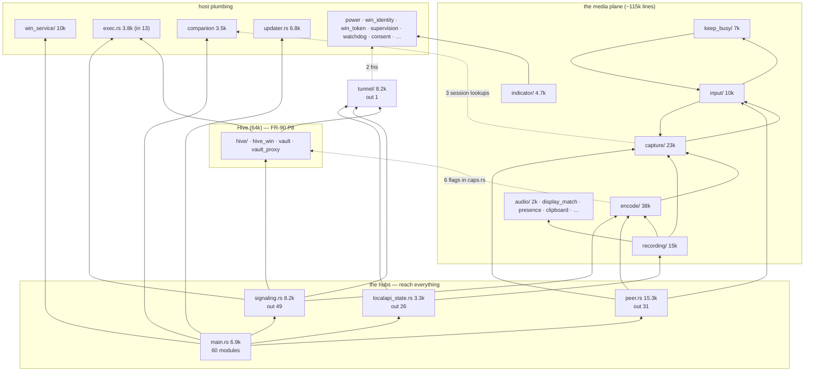
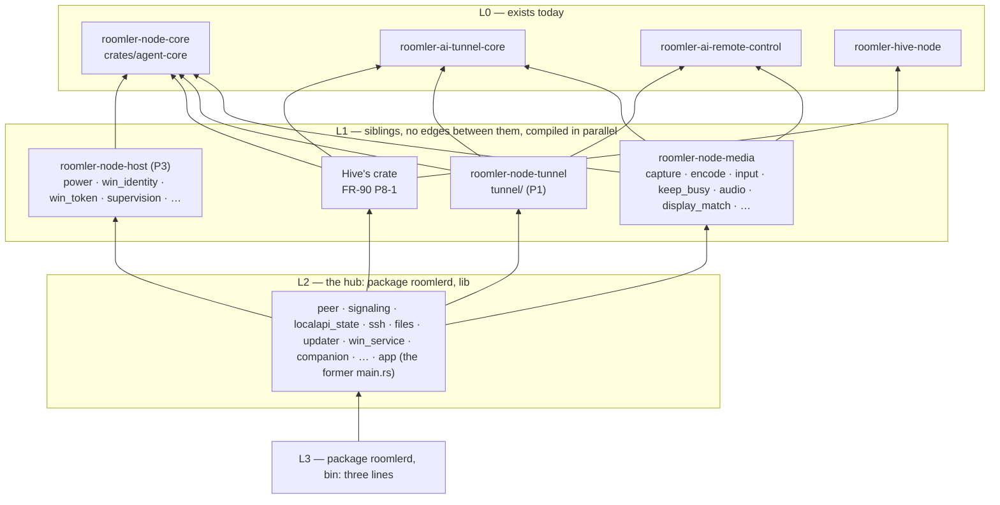

# FR-123: The daemon compiles in parallel — `roomlerd` split into sibling crates

**Issue:** [#2941](https://github.com/gjovanov/roomler-ai/issues/2941) · **Status:** proposed 2026-10-26 — spec, claim
and the Phase 0 measurements; P1 in flight · **Owner:** the agent's build shape (with FR-6 for the lane and
FR-90 P8 for Hive's crate) · **Anchors:** master `12a0edc81` (2026-10-26) unless a row says otherwise ·
**Parent:** [FR-6](FR-6-ci-release-build-speed-slo.md) (#773), whose residual lever this is

## 1. Goal

A release build of the daemon stops being one serial, single-core compile. Today `agents/roomlerd` is one
crate — a lib of 355 files and a 6,945-line `main.rs` — built at `codegen-units = 1`
(`.github/workflows/release-agent.yml:117`), so the last six to thirteen minutes of every MSI and `.pkg`
job are two units that run one after the other, each on one core, while the runner's other cores idle.
The goal is a crate graph in which the daemon's independent parts compile **beside each other**, the
hub that wires them compiles **while** they finish, and the binary that ships is the same binary: same
features, same behaviour, same size within one per cent.

This is FR-6's last open lever. Everything cheaper was measured and rejected there: more codegen units
cost +14 % gzip size on a 22 MB budget whose ceiling is 26; a bigger runner cannot help a one-core
compile; the version bump is not why our crates rebuild. Only crates that compile in parallel are
size-neutral.

## 2. Evidence

### 2.1 Where a release spends its time (FR-6, 2026-10-25/26)

`cargo --timings` from FR-6's wave-29 probes, dependencies warm, `codegen-units = 1`
(`docs/fr/FR-6-ci-release-build-speed-slo.md`, log of 2026-10-25):

| Runner | run | `roomlerd` lib | `roomlerd` bin (`main.rs`) | whole build | lib + bin share |
|---|---|---|---|---|---|
| Windows (`windows-latest`, 2 cores / 4 threads) | 40228482936 | 322 s | 172 s | 565 s | 87 % |
| macOS (`macos-15`, 3 vCPU) | 40230929108 | 477 s | 197 s | 766 s | 88 % |
| macOS, the release build in the same log | — | 564 s | 229 s | 858 s | 92 % |

The two units run one after the other: the bin waits for the lib's object code, and each is a single
crate. On 0.4.173's rehearsal (run 40249389321) the MSI job took 16.1 min and the `.pkg` 16.3; a tag
now reuses its rehearsal's compile (FR-6 wave 29, #2914), but every rehearsal pays the full compile,
and our crates rebuild on every release because the version bump changes them.

**Codegen units were measured and rejected** (FR-6 log, 2026-10-25/26; our crates only, dependencies
at 1):

| `codegen-units` | Windows build | lib + bin | `roomlerd.exe` | gzip -9 | macOS build | macOS gzip |
|---|---|---|---|---|---|---|
| 1 (shipped) | 565 s | 322 + 172 | 64,755,712 | 22,479,787 | 766 s | — |
| 4 | 426 s (−25 %) | 231 + 122 | +16.5 % | +13.7 % | 494 s (−35 %) | +14.2 % |
| 16 | 463 s | 250 + 140 | +23.8 % | +19.5 % | 439 s | +23.7 % |

The MSI budget (`release-agent.yml:2088-2154`) is a 22.00 MB baseline, a warning at 24 and a hard
ceiling at 26; today's MSI is 22.18 MB. At 4 units it would land near 25.2 MB, at 16 near 26.6. So
the lever is structural, not a flag.

### 2.2 The crate, measured (Phase 0, 2026-10-26, master `d016f81d2`)

**Size.** `agents/roomlerd/src`: 356 `.rs` files, 325,526 lines, 13.7 MB. FR-24 counted the same crate
at 89,737 lines on 2026-08-28 (`FR-24-licensing-split.md` §"Crate classification"): ×3.6 in eight weeks,
and the trend is FR-90, FR-97, FR-119 and their successors.

**Lines per top-level module** (directories recursive; `cargo` compiles all of it in one unit):

| Module | Files | Lines | Release builds | Notes |
|---|---|---|---|---|
| `hive/` | 62 | 63,839 | yes (`hive`) | FR-90; its P8 moves it (§3.6) |
| `encode/` | 40 | 38,210 | yes | FR-119 / FR-118 hot |
| `capture/` | 26 | 22,824 | yes | FR-119 / FR-97 hot |
| `peer.rs` | 1 | 15,261 | yes | hub: reaches 31 modules |
| `recording/` | 21 | 14,965 | yes (`recording` ⊂ `full`) | |
| `vault_proxy/` | 26 | 11,750 | **no** (`vault` is not in any release feature set) | |
| `input/` | 14 | 10,347 | yes | |
| `win_service/` | 16 | 10,088 | Windows | |
| `signaling.rs` | 1 | 8,217 | yes | hub: reaches 49 modules |
| `tunnel/` | 11 | 8,195 | yes | out-degree 1 (§3.4) |
| `keep_busy/` | 14 | 7,277 | yes | |
| `main.rs` (the bin) | 1 | 6,945 | yes | uses 60 lib modules |
| `updater.rs` | 1 | 6,831 | yes | |
| `system_context/` | 11 | 5,441 | Windows (`system-context`) | |
| `ssh.rs` | 1 | 5,160 | yes (`overlay-*`) | |
| `files.rs` | 1 | 5,115 | yes | |
| `indicator/` | 5 | 4,711 | yes | |
| `exec.rs` | 1 | 3,755 | yes | in-degree 13 |
| `apps/` | 4 | 3,426 | yes | |
| `localapi_state.rs` | 1 | 3,325 | yes | hub: reaches 26 modules |
| the other 72 modules | 97 | ~50,900 | mostly | 56 of them under 1,000 lines |

The release feature sets are `full,hive,vp9-444,vp9-444-bindgen,overlay-l3,overlay-netstack,ffmpeg-encoder,ssh-server,viewer-indicator-x11`
on Linux (`release-agent.yml:537`, `:1159`), `full-hw,hive,vp9-444,system-context,ffmpeg-encoder,overlay-l3,overlay-netstack,ssh-server`
on Windows (`:1645`) and `full,hive,vp9-444,vp9-444-bindgen,overlay-l3,overlay-netstack,ssh-server,ffmpeg-encoder,viewer-indicator-macos`
on macOS (`:2723`). `vault` is in none of them, so `vault_proxy/` and the `vault`-gated halves cost a
release nothing.

**The module graph** (every `crate::X` reference between top-level modules, comments stripped;
`scratchpad/fr-roomlerd-split/modgraph.pl`): the crate is a hub and spokes.

What the edges say:

- **The hubs are the hubs.** `signaling.rs`, `peer.rs`, `localapi_state.rs` and `main.rs` together name
  every other module. They stay in the crate that depends on all the rest.
- **The media plane is a cycle of three plus everything that hangs off it.** `capture ↔ input ↔
  keep_busy` reference each other (16, 10, 10, 5, 6 and 1 references); `encode` reaches `capture` 20
  times; `recording` reaches `capture`, `audio` and `encode`. Its edges *out* of the plane are few and
  small, listed in §3.5.
- **`tunnel/` is one edge from a leaf.** Its only references outward are two functions in
  `tunnel/netwatch.rs` (`:43`, `:57`) that read a registry `overlay.rs` owns
  (`DERP_TUNNEL_MUXES`, `agents/roomlerd/src/overlay.rs:117-160`); everything else it needs is
  `roomler_node_core::config` (re-exported as `crate::config`) and `tunnel_core`. Four modules depend
  on it (`signaling.rs`, `localapi_state.rs`, `ssh.rs`, `hive/`), all above it.
- **Hive reaches down** into `vault` (69), `hive_win` (36), `vault_proxy` (35), `exec` (20), `tunnel`
  (11) and `ssh_client` (9); the hubs reach into Hive (`signaling.rs` 48 references). FR-90 P8 already
  plans its boundary as traits (`FR-90-hive-agent-sessions.md` §3i).

**Churn**, because a file move lands on whoever has it open. Commits touching each module in the last
14 and 30 days (to 2026-10-26), and the open PRs:

| Module | 14 d | 30 d | Open PRs touching it |
|---|---|---|---|
| `signaling.rs` | 80 | 112 | #1642 |
| `hive/` | 72 | 115 | — |
| `encode/` | 55 | 65 | #2932, #900 (draft, Aug.) |
| `main.rs` | 52 | 78 | #2932, #2924 |
| `peer.rs` | 50 | 62 | — |
| `capture/` | 46 | 57 | — |
| `vault_proxy/` | 21 | 21 | — |
| `input/` | 18 | 26 | — |
| `localapi_state.rs` | 15 | 25 | #2924, #2912 |
| `updater.rs` | 12 | 19 | — |
| `recording/` | 10 | 24 | — |
| `win_service/` | 8 | 18 | — |
| `companion` | 7 | 7 | #2912, #1642 |
| `tunnel/` | 6 | 13 | — (`client_mgr.rs` 4 / 9; FR-90 P4-6-1b will touch it) |
| `keep_busy/` | 3 | 16 | — |

291 commits touched `agents/roomlerd/src` in 14 days; 11 PRs are open, 5 of them in the daemon.

**Doc anchors**, because a moved file moves every `file:line` claim about it: 1,400 anchors into
`agents/roomlerd/src/*` across `docs/`, `ui/docs/`, `CLAUDE.md` and `.github/`. Per module: `hive/`
573, `encode/` 72, `signaling.rs` 61, `vault_proxy/` 54, `capture/` 53, `input/` 52, `peer.rs` 45,
`vault.rs` 31, `tunnel/` 31, `display_match.rs` 31, `main.rs` 27 (62 `main.rs:N` forms in 33 files),
`updater.rs` 22, `win_service/` 21.

### 2.3 What cargo can and cannot overlap

Three facts bound the design; the first two are cargo's, the third is the lane's.

1. **An rlib's dependents start at its metadata.** rustc writes the `.rmeta` when the front end is
   done and keeps running LLVM; cargo starts every dependent *rlib* at that moment (pipelining). At
   `codegen-units = 1` the LLVM half is one thread, so a dependent's whole compile can run beside it on
   the idle cores.
2. **A binary waits for objects.** cargo's `requires_upstream_objects` is true for every `bin` target:
   the bin's rustc does not start until each upstream rlib is fully written. That is why the timings
   show `main.rs` strictly after the lib, and why "move `main.rs` into the lib" buys no overlap by
   itself — it collapses two serial units into one. Only code in an **rlib** below a trivial bin can
   overlap a predecessor's codegen.
3. **The runners have three or four threads** (Windows: an EPYC 7763 at 2 cores / 4 threads, FR-6
   log 2026-10-06; `macos-15`: 3 vCPU). Parallelism saturates at three or four sibling crates of
   comparable size; twenty small crates buy nothing more than four large ones and cost a metadata
   round each.

So the shape that pays is a short, wide graph: a few large **siblings** with no edges between them,
one **hub** above them whose front end starts at their metadata, and a bin that is a shell.

### 2.4 The Phase 0 probe (run 40303391151, branch `exp/fr-roomlerd-split-probe`, 2026-10-26)

A temporary push-triggered workflow on the real release runners, the lane's seeds restored
read-only (never saved, never stamped; `SEED_REUSE_SAME_TREE=off`), the lane's own feature set per OS.
Two variants on each of Windows and macOS: `baseline` (the tree as released) and `collapse`
(`main.rs` moved into the lib as `roomlerd::app` behind a three-line bin, to measure whether the
bin's time is its own code or the lib's generics instantiated again). Both record `--timings`, a
release-profile `cargo check` (front-end-only times) and the binary's size; Windows also runs
`cargo llvm-lines` on the lib and the bin and aggregates it per module.

Results go in §8 (the field log) as the run reports them; the rows the design below already relies
on are marked *(probe)*.

## 3. Key design

### 3.1 The target shape

- **Package `roomlerd` keeps its name, its directory, its lib and its bin.** `cargo build -p roomlerd`,
  `cargo deb`, `cargo wix -p roomlerd`, `build.rs` (`hive_host`, the `/STACK` link argument, the
  Windows version resource — `agents/roomlerd/build.rs:36-88`), the `.deb` asset map and the MSI
  mapping are untouched by every phase. The lane's four build lines never change. What moves is
  *below* the package: sibling crates it depends on.
- **Every `crate::X` path inside `roomlerd` keeps resolving.** An extracted module is re-exported at
  its old place (`pub use roomler_node_tunnel as tunnel;` where `lib.rs:236` has `pub mod tunnel;`),
  exactly as FR-21's P3e did for `roomler-node-core` (`agents/roomlerd/src/lib.rs:16-19`). The
  integration tests (`crates/tests`, 160 `roomlerd::` paths) and the wizard (`agents/roomler-setup`,
  which links the lib for `updater`, `enrollment`, `install_detect`) compile unchanged.
- **The hub overlaps the siblings.** Its front end starts when the slowest sibling's metadata is out;
  its LLVM half runs after its own front end. With the former `main.rs` inside the hub (P3) the bin is a
  shell, and the whole of today's second serial unit rides inside the overlap.
- **Hive's crate is FR-90's.** P8-1 moves the session-facing machinery behind `SessionEgress` and
  `ControlLink` into `crates/hive-node` or a sibling (`FR-90-hive-agent-sessions.md` §3i). This FR asks
  one property of it: the crate depends on L0 and the seams, never on `roomlerd`'s hub, so it compiles
  beside `roomler-node-media`. Its 64k lines are the largest single sibling; nothing here moves them.

### 3.2 The rules every extraction follows

1. **Behaviour is identical.** No runtime switch exists because nothing at runtime changes: the same
   functions, the same `cfg`s, the same features, linked into the same binary. The proof per PR is
   every CI lane green on every release feature set, the binary's size within ±1 % (AC2) and the next
   release's fleet check (AC3). The kill switch of a phase is its revert, which is why each phase is
   one PR.
2. **A moved file's body stays byte-identical.** Only its `use` header changes, and `crate::config::`
   becomes `roomler_node_core::config::` on the same line. Then every doc anchor into it shifts by a
   constant per file, `anchor-xcheck.pl` proves each by content, and a PR that has the old file open
   rebases across a rename git detects.
3. **Features mirror.** A sibling declares the features its code gates on (`overlay-l3`,
   `overlay-netstack`, `recording`, …) and `roomlerd`'s feature of the same name enables it
   (`overlay-l3 = ["roomler-ai-tunnel-core/overlay-l3", "roomler-node-core/overlay-l3", "roomler-node-tunnel/overlay-l3"]`),
   so the lane's feature sets mean what they meant. `build.rs`'s `cfg(hive_host)` stays `roomlerd`'s.
4. **Boundaries are inverted, never widened.** A back-edge from a sibling into the hub (the
   `tunnel → overlay` registry; `encode::caps` reading Hive's flags) becomes a registry or a value the
   hub hands *down*, never a dependency of the sibling on the hub. §3.4 and §3.5 list each one.
5. **`#[inline]` where the boundary is hot.** Without LTO a non-generic function is not inlined across
   crates. A per-frame or per-packet call that crosses a new boundary (the capture → encode hand-off,
   the DC send path) gets `#[inline]` or stays on one side; the review of each PR names the hot calls
   it checked. The tunnel plane's boundary is per-flow, not per-packet (its data path is inside
   `tunnel_core`), so P1 has none.
6. **A new crate joins the tables on its first commit.** `CLIENT_PATHS` and `CLIENT_CRATES` in
   `scripts/licence-classes.sh` (`:45`, `:100`), an MPL-2.0 SPDX header on every file, `cargo clippy
   --workspace` (`.github/workflows/ci.yml:285`, which compiles every member), the "remaining
   crates" unit-test step (`ci.yml:496`) and whichever feature-gated clippy or test line its features
   need. A crate CI does not name has decorative tests (#1626).
7. **Versions stay `version.workspace = true`.** A pinned version alone would not keep a crate cached
   across releases: FR-6 proved our crates rebuild because a checkout makes every file newer than the
   seed's dep-info, and the lane now reuses a whole stamped tree instead. Per-crate reuse is open
   decision 2, not a rule.

### 3.3 Naming and place

Daemon-side shared crates live under `crates/` as `roomler-node-*` since FR-21 D3 (`roomler-node-core`
at `crates/agent-core`) and FR-90 P0a (`roomler-hive-node` at `crates/hive-node`). The siblings follow:
`crates/node-tunnel` → `roomler-node-tunnel` (lib `roomler_node_tunnel`), `crates/node-media` →
`roomler-node-media`, `crates/node-host` → `roomler-node-host`. Open decision 1 asks the operator to
confirm the names before P2; P1 ships with `roomler-node-tunnel` and a rename is one commit while it
is the only sibling.

### 3.4 P1 — `roomler-node-tunnel`, the pilot

The smallest extraction with a one-edge boundary and no open PR, chosen to prove the recipe (rules 1–7)
where a mistake costs little: 11 files, 8,195 lines, 31 doc anchors, 6 commits in 14 days.

| Today | After P1 |
|---|---|
| `agents/roomlerd/src/tunnel/{mod,acceptor,client_mgr,dialer,netwatch,peer,port_holder,quic_peer,quic_setup,reap,route_reconciler}.rs` (`tunnel/mod.rs:28-46`) | `crates/node-tunnel/src/{lib,…}.rs`, bodies byte-identical; `mod.rs` becomes `lib.rs` |
| `lib.rs:236` `pub mod tunnel;` | `pub use roomler_node_tunnel as tunnel;` |
| `tunnel/mod.rs:32` `pub use roomler_node_core::acl;` | the same line in the new `lib.rs`, so `crate::tunnel::acl::…` still resolves |
| `tunnel/netwatch.rs:43`, `:57` call `crate::overlay::{primary_,}derp_tunnel_handle` | the registry moves into the crate: `DERP_TUNNEL_MUXES`, `register_derp_tunnel_mux`, `derp_tunnel_handle`, `primary_derp_tunnel_handle` (`overlay.rs:117-160`) become `roomler_node_tunnel::netwatch::*`; `overlay.rs` registers into it. `PRIMARY_TENANT_ID` stays in `overlay.rs` and is passed in |
| `pub(crate) mod netwatch` and its `pub(crate)` functions, used by `signaling.rs` and `hive/supervisor/stream.rs` | `pub` |
| `crate::config::{load, save, WriteLock, PRIMARY_ORG_LABEL, test_fixture}` (12 sites) | `roomler_node_core::config::…`, same lines; tests take `roomler-node-core` with `test-fixtures` as a dev-dependency |
| features: `overlay-l3`, `overlay-netstack` gates inside `tunnel/` | the crate declares both, forwarding to `tunnel-core` and `node-core`; `roomlerd` forwards its own |

Consumers above the crate are unchanged: `signaling.rs` (31 `crate::tunnel::` sites), `localapi_state.rs`
(17), `ssh.rs` (4), `hive/` (9). The CI lane adds `-p roomler-node-tunnel` to the remaining-crates step;
`cargo clippy -p roomlerd --features overlay-l3` (`ci.yml:401`) compiles it with its features through
the forwarding.

Expected effect on the release compile: small and real — `tunnel/` is ~2.5 % of the lines, its front
end is a few seconds, and the hub's front end no longer waits on it. It is measured on the same runner,
back to back (§4's method), not claimed.

### 3.5 P2 — `roomler-node-media`, the plane that pays

The media plane is ~115k lines, 35–40 % of the release compile, and FR-119's and FR-118's working
area. Its boundary, measured on master, is a short list of small edges, each with its inversion:

| Edge out of the plane | Sites | Inversion |
|---|---|---|
| `encode::caps` reads Hive's switches (`adopt_enabled`, `replica_enabled`, `archive_enabled`, `stream_enabled`) | `encode/caps.rs:2114-2143` | `caps::detect` takes a `HostWords` value the hub fills from Hive, `files::is_remote_browse_enabled` (`:1961`), `rc_local_turn::enabled` (`:2041`) and `apps` (`:1916-1926`, `:3285`) |
| `capture` asks `companion` which graphical session is live | `capture/mod.rs:2163`, `capture/portal/mod.rs:1316-1318` | the session lookup moves to a leaf both can see (`roomler-node-host`, P3) or is passed in by the pump's caller |
| `capture`, `input` ask `system_context::worker_role` and `desktop_rebind` | `capture/mod.rs:2807-2810`, `input/system_context_backend.rs:84`, `:380`, `input/sas.rs:194`, `input/mod.rs:576` | `worker_role` (pure: SYSTEM / worker / user) goes to the host leaf; the SystemContext capture pump is a capture backend and moves with `capture/` |
| `capture::scrap_backend` takes `power::DisplayAwake` | `capture/scrap_backend.rs:143` | `power` goes to the host leaf |
| `keep_busy` reads `win_identity`, `lock_state`, `presence` | `keep_busy/state.rs:135-248`, `keep_busy/host_win.rs:28`, `:67` | `win_identity`, `win_token` to the host leaf; `lock_state`/`lock_on_end`/`presence` move with the plane |
| `indicator` owns `rc_sessions::RcSessionRegistry` and calls `companion::ensure_running` | `indicator/mod.rs:100-606`, `indicator/notify.rs:212`, `:526` | `rc_sessions` moves with the plane (it is the indicator's registry; `peer.rs` reads it from above); the companion start becomes a callback the hub installs |
| `encode` names `peer::TargetResolution` | `encode/resample.rs:43`, `encode/plan.rs:645`, `encode/policy.rs:28`, `encode/sim.rs:2958` | the type moves into the plane and `peer.rs` re-exports it |
| `recording` reaches `consent`, `supervision`, `companion`, `signaling::COMPANION_START_BUDGET` | `recording/remote.rs:711-734`, `:1266-1300`; `recording/manager.rs:479`; `recording/launch.rs:439`, `:1494`, `:1587` | `recording/` **stays in the hub** (17 out-edges, the most entangled of the group); it depends on the plane from above |

What moves: `capture/`, `encode/`, `input/`, `keep_busy/`, `audio/`, `audio_source.rs`,
`display_match.rs`, `presence.rs`, `virtual_desktop.rs`, `desktop_brief.rs`, `clipboard.rs`,
`media_share.rs`, `indicator/`, `rc_sessions.rs`, `lock_state.rs`, `lock_on_end.rs`,
`lock_overlay.rs`, `host_mute.rs`, `gpu_clock.rs`, `fp16.rs`, `clock.rs`, `win32_monitors.rs`,
`dpi.rs`, `apps/` — about 115k lines and ~290 anchors. Its features: `scrap-capture`,
`openh264-encoder`, `mf-encoder`, `wgc-capture`, `vp9-444(-bindgen)`, `enigo-input`, `clipboard`,
`viewer-indicator(-x11|-macos)`, `audio`, `drm-capture`, `portal-capture`, `uinput-input`,
`ffmpeg-encoder`, `synthetic-frame-source`, `system-context` — mirrored (rule 3). The
`encoder-cells` skill's invariants are untouched: the probe child, the cache, the denylist and the
cell matrix move as files.

⚠️ **P2 needs a merge window.** It lands only when FR-118/FR-119 have no PR open against `capture/`
or `encode/`, prepared on a branch so that its rebase, CI and merge fit inside a few hours. The main
session schedules it; this FR does not open it unasked.

### 3.6 P3 — the host leaf and the bin shell

- `roomler-node-host`: the OS-session and process plumbing the plane and the hub both read —
  `power`, `win_identity`, `win_token`, `instance_lock`, `supervision`, `watchdog`,
  `system_context::worker_role`, the companion's session lookup, `arch`, `mem_trim`, `clock`-class
  leaves. Small (~12k lines) and needed by P2's inversions; it may ship before P2 if P2's window is
  late.
- The bin shell: `agents/roomlerd/src/main.rs` → `src/app.rs` as `pub mod app` (a git-detectable
  rename: the body is byte-identical but for `pub fn main` at `main.rs:1201` and `:1257` and
  `roomlerd::` → `crate::` on the same lines), and the bin becomes `src/bin/roomlerd.rs`, three lines.
  Once L1 exists, the former bin's whole compile overlaps the siblings' codegen (§2.3). Its tests
  (`main.rs:6640`, `#[cfg(test)] mod tests`) start running under `--lib`, which they never did.
  Whether this ships before P2 depends on the probe's `collapse` rows: a measured de-duplication
  gain makes it worth its own PR; none makes it P3's last commit.
- Hive: FR-90 P8-1, coordinated on #1827.

### 3.7 What the design refuses

- **No `codegen-units` or LTO change**, in any crate: FR-6 measured both (§2.1; P3e: thin LTO +5 %
  size, fat worse).
- **No crate split along platform lines.** A `roomlerd-windows` crate would not shorten the Windows
  job, which is the pole.
- **No renaming of the package or the binary**, and no second package producing `roomlerd`:
  `cargo wix -p roomlerd`, the `.deb` metadata and the six MSI version copies are couplings the
  `ship-it` skill lists as fleet-freezing when they drift.
- **No feature re-shaping.** The lane's feature strings are a compatibility surface (a build without
  `hive` advertises no `hive` verb); every sibling mirrors, nothing is renamed.
- **No moves of `hive/`, `vault*`, `hive_win.rs`.** FR-90 owns them (P8).

## 4. Phases

Each phase is one PR, reverted as one; its kill switch is that revert, because no phase changes
behaviour. Every phase is measured the same way: the temporary probe workflow builds the PR's tree
and its base tree on the **same runner, back to back**, with the lane's seeds restored read-only and
`--timings` on — FR-6's method, whose repeat-to-repeat noise was ±1 s on one machine against a
±10 % spread across runners.

| Phase | What | Measured by | Status |
|---|---|---|---|
| **P0** | this spec, the claim, the Phase 0 measurements (§2.2) and the probe (§2.4, §8) | run 40303391151 | spec + probe in flight, 2026-10-26 |
| **P1** | `roomler-node-tunnel` (§3.4): the crate, the registry inversion, the licence tables, the CI lane, the anchor pass | same-runner A/B, Windows + macOS | in flight |
| **P1b** | the bin shell (§3.6), if the probe's `collapse` rows show a de-duplication gain | the probe's `collapse` vs `baseline` | decided by §8 |
| **P2** | `roomler-node-media` (§3.5), in a merge window FR-118/119 agree to | same-runner A/B; the next rehearsal's build steps | after P1 |
| **P3** | `roomler-node-host` + the bin shell if P1b did not ship | same-runner A/B | after P2 (or before, if P2's window is late) |
| **P4** | Hive's crate — FR-90 P8-1, with the dependency property of §3.1 | FR-90's | FR-90's schedule |
| **P5** | docs: the crate layout in `docs/architecture.md` (workspace map + a daemon section), `CLAUDE.md`'s Architecture tree, a row in `docs/README.md`'s index, this spec's status | — | with P2 |

## 5. Acceptance criteria

- [ ] **AC1 — the release compiles shorter.** The rehearsal's MSI build step and `.pkg` build step are
  each ≥ 30 % shorter than 0.4.173's rehearsal (13.8 min and 18.2 min for the whole build step on
  0.4.171's; the daemon's lib + bin 494 s on Windows, 674–793 s on macOS) on three consecutive
  releases, and each phase's same-runner A/B (§4) shows its own share.
- [ ] **AC2 — the binary is the same size.** `roomlerd.exe`, the macOS `roomlerd`, the `.deb`'s
  `roomlerd` and both MSIs are within ±1 % of the release before each phase (the MSI size step's
  `::notice::` lines; the `.deb`/`.pkg` asset sizes on the release).
- [ ] **AC3 — no behaviour change.** Every CI lane green on every PR, including the `--features full`
  clippy step, the Windows and macOS lanes and the integration lane dispatched on the branch; then one
  real release carrying each phase installs on the fleet through the normal update, and the post-roll
  check passes: version on the online agents, a remote-desktop session, an overlay pair, a tunnel
  forward.
- [ ] **AC4 — the anchors hold.** For every PR: `anchor-xcheck.pl` reports no MISMATCH over all of
  `docs/` and `ui/docs/`, `scripts/anchor-range-audit.sh` reports no fault, dated field-log rows keep
  their anchors, and moved files' bodies are byte-identical to their base (rule 2).
- [ ] **AC5 — a new crate is a full citizen.** MPL-2.0 header on every file; `CLIENT_PATHS` and
  `CLIENT_CRATES`; `licensing.yml` green; a CI step names its unit tests and runs them (the step's log
  shows the binary ran); `cargo clippy --workspace -- -D warnings` and the feature-gated clippy lines
  green on Linux, Windows and macOS.
- [ ] **AC6 — the shape is parallel.** On the release runner, `cargo build --timings` of the daemon
  shows at least two of our crates compiling concurrently during the daemon's own compile, and the
  hub's unit starting before the slowest sibling's unit ends.
- [ ] **AC7 — docs.** `docs/architecture.md` (the workspace map with the siblings; a daemon
  crate-layout section with the rules of §3.2), `CLAUDE.md`'s Architecture tree, and a row for the
  layout doc in `docs/README.md`'s index, before the close.

## 6. Open decisions

1. **Names and place** (the operator): `crates/node-{tunnel,media,host}` as `roomler-node-*` (§3.3),
   or `agents/roomlerd-*` beside the daemon. P1 ships with the former; a rename is one commit while
   it is alone.
2. **Per-crate reuse across releases.** A sibling whose sources did not change between two releases
   still rebuilds today for two reasons: its `version.workspace = true` changes its package id, and a
   fresh checkout makes its files newer than the seed's dep-info (FR-6, 2026-10-06). Pinning a
   sibling's version removes the first; only the lane's seed logic (FR-6's) could remove the second,
   by restoring per-crate mtimes against recorded blob hashes. Not pursued here; measured only if FR-6
   wants it.
3. **`recording/`: hub or plane.** The design keeps it in the hub (17 out-edges, consent and
   supervision among them); if P3's host leaf absorbs `consent` and `supervision`, it can follow the
   plane down in a later PR.
4. **The SystemContext plumbing's home** (Windows, `system_context/` 5.4k, `win_service/` 10k): the
   capture pump belongs to the plane, the winlogon-token spawn to the hub, `worker_role` to the host
   leaf. The split inside `system_context/` is P2's to draw.
5. **P1b's timing** — by the probe's numbers (§8).
6. **Hive's crate** — FR-90's decisions 63–65; this FR asks only for the dependency property.

## 7. Out of scope

- Any change to `codegen-units`, LTO, `opt-level`, `panic` or `strip` (FR-6 §Open decisions).
- The seed, stamp and reuse mechanics of `release-agent.yml` (FR-6 wave 29 and after).
- Moving `hive/`, `vault.rs`, `vault_proxy/`, `hive_win.rs` (FR-90 P8).
- Renaming the `roomlerd` package, binary, `.deb` or MSI; a second package that ships a binary.
- Any behaviour, feature or wire change. A phase that needs one is not this FR's.
- The server crates and `crates/tests`' own build time.
- The wizard's link against the daemon lib (`agents/roomler-setup/Cargo.toml:50`): freeing it is a
  side benefit of a later `roomler-node-install` leaf, noted, not planned.

## 8. Field-verification log

| When | What | Result |
|---|---|---|
| 2026-10-26 09:30Z | Phase 0, static (master `d016f81d2`): lines, graph, churn, anchors (§2.2) | 356 files / 325,526 lines; hubs `signaling` (out 49), `peer` (31), `localapi_state` (26), `main` (60 modules); `tunnel/` out-degree 1; media plane ~115k lines with 7 small boundary edges; 1,400 doc anchors |
| 2026-10-26 09:56Z | Phase 0 probe pushed: run 40303391151 on `exp/fr-roomlerd-split-probe` (Windows + macOS × baseline, collapse) | pending |
