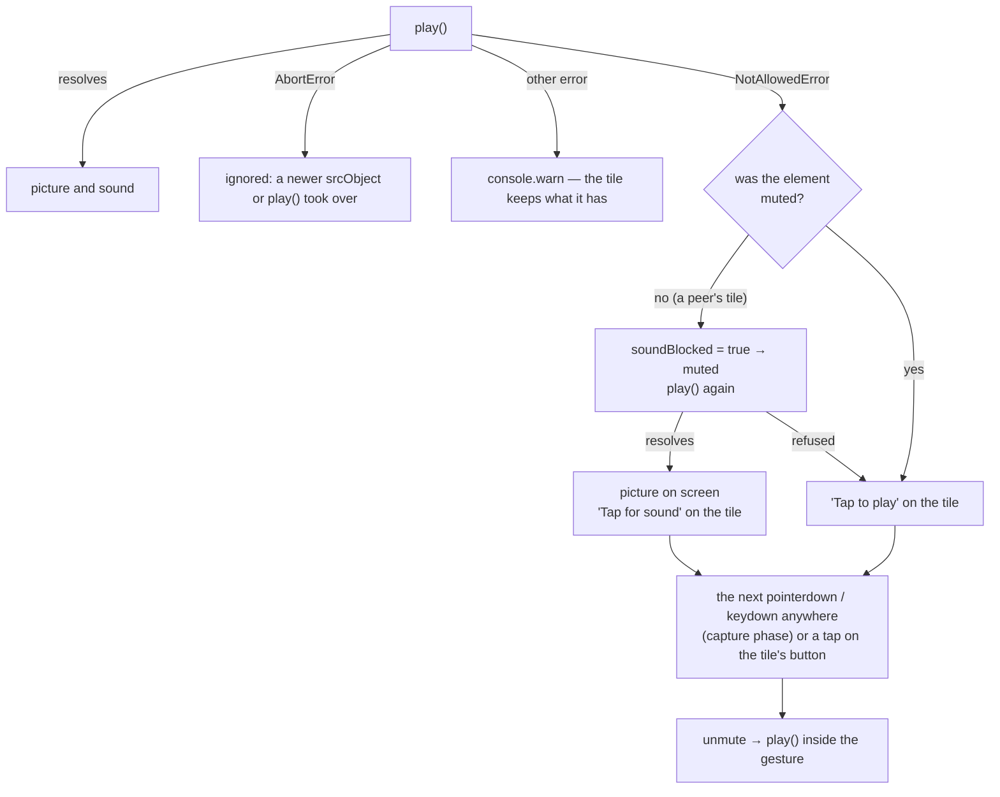

# FR-124: A black call tile says why — a covered camera is named, a refused start recovers

**Issue:** [#2945](https://github.com/gjovanov/roomler-ai/issues/2945) · **Status:** proposed 2026-10-26 — spec and claim
· **Owner:** the web app (UI) · **Anchors:** master `a350082a8` · **Builds on:** [FR-30](FR-30-camera-state-signalling.md)
(a peer's own word that their camera is off), [FR-25](FR-25-call-layout-mentions-pip.md) (the call layouts)

## 1. Goal

A call tile that shows black says why, on the screen of the person who can fix it.

- **A covered camera is named.** When a camera sends a black picture (a covered lens, a closed privacy shutter, a
  camera-off key that blanks the sensor while the device stays attached), its tile says so in text, and the sender's
  call page warns: *"Your camera is sending a black picture. Is the lens covered or a privacy shutter closed?"* A
  viewer's tile says the black comes from that camera, not from their own network or browser.
- **A tile the browser refused to start recovers.** When the autoplay policy refuses `play()`, the picture comes back
  muted at once, the tile offers its sound, and the next click or key anywhere on the page restores it. Today the
  refusal is swallowed and the tile stays black for good.

## 2. Evidence (2026-10-26)

### 2.1 An hour on a covered lens

The report: a call between neo16 and a MacBook, and "the MacBook's camera doesn't work", in Chrome and in Safari.
Both devices were signed in to the same account. Every layer turned out to be healthy:

| layer | measured | verdict |
|---|---|---|
| the Mac's camera (macOS 27.0.1, Chrome 156, Safari 27.0.1) | `cameracaptured` ran a capture session for "MacBook Pro Camera" (1280×720 `420v`) for the whole of each join, in both browsers | healthy |
| the SFU | each join created a `kind=Video source=camera` producer, the other device consumed it, and no `media transport has no DTLS` warning fired | healthy |
| the media sampler (`stats_call`, 30 s buckets) | in every two-party sample one device sent 1.2–1.8 Mbps and the other 90–160 kbps; neo16 alone sent 141 kbps | neo16 the weak sender |
| a test call: a synthetic pattern from a third tab, the Mac in Chrome, neo16's own tab | the Mac's stream: 640×480 at 30 fps, mean luma ≈ 130, spread ≈ 36. neo16's: 640×480 at ~10 fps, mean luma 0, spread 0 | the black picture was neo16's |
| neo16's raw camera track (`getUserMedia` in the browser, before any encoding) | mean luma 0, peak 1–3 of 255, spread 0.2, 1–10 fps; brightness, contrast and exposure compensation at their defaults, exposure continuous | a covered lens, then confirmed by the reporter |

Why it took an hour:

1. **Nothing on screen said a picture was black, or whose it was.** A black tile and a tile that never started look
   the same.
2. **Both tiles carried the same name.** A second device of the same account is labelled like the first, so the black
   tile was pinned on the wrong device.
3. **The constant pointed the wrong way.** Both Mac browsers "failed", which pointed at the Mac, when the thing that
   never changed was the black sender.

⚠️ Two traps, recorded for the next triage: VP8's bitrate is low for a black picture **and** for a static scene, so
bitrate alone cannot say which camera is black. And `stats_call_user` is keyed by user, so two devices of one account
overwrite each other's row in every bucket.

### 2.2 Found on the way: a refused start is silent

`VideoTile.vue:264` and `:303` call `el.play().catch(() => {})`. A remote tile's `<video>` is not muted (`:26`),
because it carries the peer's audio. Measured in neo16's Edge 156 on 2026-10-26: an unmuted `play()` on a received
stream before any gesture was refused with `NotAllowedError: play() failed because the user didn't interact with the
document first`. The element drew black (mean luma 0) although 140 frames had decoded. After one real click the same
`play()` succeeded, muted and unmuted. Nothing in the tile retries, so a refused tile stays black and silent until its
stream changes. It was not the cause in §2.1, because the Join click gives the page its activation, but it is a black
tile with no reason given.

## 3. Design

### 3.1 The detector (`ui/src/utils/blackPicture.ts`, new)

- Once a second, draw the tile's own `<video>` into a 16×12 canvas and take the luma (`0.299 R + 0.587 G + 0.114 B`)
  of each of its 192 samples.
- **Black** = mean ≤ 4 and peak ≤ 16 (of 255). A covered lens measured mean 0 and peak 1–3. A dim room under
  auto-exposure reads far brighter, and a dark screen with text has bright peaks (D1).
- **Flagged** after 3 black samples in a row (about 3 s, which also rides out a camera's first dark frames while its
  exposure settles), and **cleared** by the first sample with a picture.
- **No judgement**, and the run starts again, while the tile isn't playing (`paused`, `readyState < 2`, no width), its
  track is disabled (your own camera turned off), ended or muted (no media arriving), the peer said their camera is off
  (FR-30's `videoPaused`), or the tile is a screen share. A camera that is off is not a covered camera, and a black
  slide is not one either. A hidden page skips its samples.
- The luma values never leave the tab, and nothing goes on the wire (D3).

### 3.2 Where it says so

- `VideoTile.vue`: a notice over the black picture, in text, never hover-only (FR-120). Your own tile reads *"Your
  camera is sending a black picture · Is the lens covered?"*; a peer's reads *"Black picture from this camera · Its
  lens may be covered"*. A compact tile reads *"Black picture"*.
- The tile emits `picture-black`. The three layouts forward it with the stream key, and `ConferenceView.vue` shows a
  closable warning while the **local** picture is black. Closing it hides it until the picture recovers and turns
  black again.

### 3.3 A refused start (`VideoTile.vue`)

The `:muted` binding reads `isLocal || soundBlocked`, so a re-render cannot unmute a tile behind the browser's back,
and the gesture listeners are removed once used and when the tile unmounts.

## 4. Phases

| Phase | What | Kill switch | Proven on | Size |
|---|---|---|---|---|
| **P1** | the detector, the tile's notice, the call page's warning | revert: UI only | a black camera stream in a production call, red on the current deploy then green; unit tests | S |
| **P2** | a refused start recovers | revert: UI only | a tab joined without a gesture in a production call, red then green; unit tests | S |
| **P3** | docs: `docs/ui.md` § Calls, with its diagram, and the `docs/README.md` index row | — | CI | S |

P1–P3 ship in one PR.

## 5. Acceptance criteria

- [ ] **AC1**: a black camera is named on its sender's call page within 5 s: the warning shows, and the local tile
  reads "Black picture". A picture again clears both within 2 s. Shown to fail on the current deploy first.
- [ ] **AC2**: a peer's black picture is named on a viewer's tile within 5 s. A peer who turned their camera off gets
  FR-30's avatar, not the notice.
- [ ] **AC3**: no false flag: your own camera turned off shows no warning, and a real picture in a dim room shows none.
- [ ] **AC4**: a refused start recovers: a remote tile whose unmuted `play()` is refused shows its picture within 1 s,
  muted, with "Tap for sound", and the next click anywhere restores the sound. Shown to fail on the current deploy
  first.
- [ ] **AC5**: unit tests lock the thresholds and the hysteresis, the tile's notice (local, remote, camera off, screen
  share) and the refused-start path (`NotAllowedError` → a muted retry, `AbortError` ignored, a gesture restores the
  sound).
- [ ] **AC6**: Docs: `docs/ui.md` describes the notice and the recovery, with a diagram, and the `docs/README.md` index
  row for `ui.md` names them.

## 6. Decisions

Proposed with the claim; the operator may overrule any of them.

| | decision | proposal |
|---|---|---|
| **D1** | the thresholds | mean ≤ 4, peak ≤ 16, 3 samples a second apart, as measured in §2.1 |
| **D2** | where it says so | the tile and the call page. Not the mini call view (it shows at most four small tiles) and not a toast, which fades while the lens stays covered |
| **D3** | a wire signal | none. The sender judges its own picture and each viewer judges what it decodes, so an older client changes nothing for anyone |

## 7. Out of scope

- `MiniConference.vue`'s own `<video>` elements. They never call `play()`, and the mini view is reached only after a
  Join click, which gives the page its activation.
- **Found on the way, for a separate fix:** remote audio plays only through a rendered tile, so a participant whose
  tile is not rendered is not heard. That happens when "hide participants without video" hides them, past the tiled
  maximum (`useConferenceLayout.ts:306`), and for a fourth remote in the mini view (`MiniConference.vue:94`). The fix
  is an audio sink per remote, independent of the tiles. Read from the code, not yet measured.
- Telling a second device of the same account apart on its tile (§2.1's second reason): a product call.
- A camera preview before joining.

## 8. Field-verification log

| date | build | host | result |
|---|---|---|---|

## 9. Related

- [FR-30](FR-30-camera-state-signalling.md) (#884): a peer's own camera-off signal, which the detector defers to.
- [FR-25](FR-25-call-layout-mentions-pip.md) (#839): the layouts that forward the tile's event.
- [FR-120](FR-120-phone-parity-part-2.md) (#2839): no fact is hover-only, so the notice is text.
- [FR-4](FR-4-conference-media-path-integrity.md) (#776): conference media-path integrity, the layer §2.1 proved
  healthy first.
