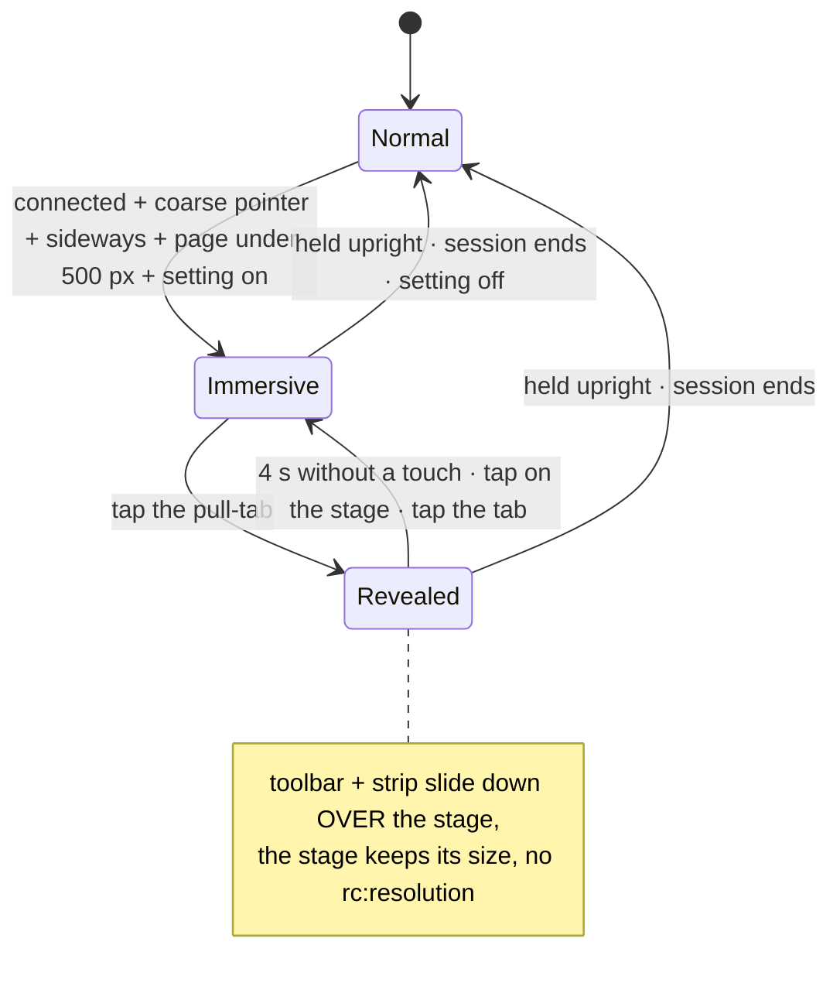

# FR-125: Immersive landscape on phones — a session held sideways gets the whole screen

**Issue:** [#2947](https://github.com/gjovanov/roomler-ai/issues/2947) · **Status:** on production since
2026-10-26 13:45Z (`hosted-20261026-6257ff2`). AC1–AC5 and AC7 are field-verified there (§8); open for AC6, the
operator's own phones ·
**Owner:** the web app (UI) · **Anchors:** master `7b576a6ac` · **Builds on:**
[FR-116](FR-116-phone-and-tablet-parity.md) (its D3), [FR-120](FR-120-phone-parity-part-2.md) (D3 carried, D1's
36 px targets, D4's full-screen Settings) and [FR-111](FR-111-touch-controls.md) (the touch presets)

## 1. Goal

On a phone held sideways, a remote-desktop session gets the whole screen:
- **The bars step aside.** The app bar, the viewer's toolbar and the session tools strip move out of the way, and one tap brings them back.
- **The presets fit.** The built-in touch presets fit the stage as they were designed, instead of running off its top.

This resolves FR-116's D3, which FR-120 carried as its own D3. The operator chose this direction, option "A", on 2026-10-26.

What it must not do:
- change a phone held upright, a tablet, or a desktop;
- resize the stage when the toolbar is shown or hidden, because a resized stage re-sends `rc:resolution`;
- take away any control: Disconnect and Settings stay one tap away.

## 2. Evidence

### 2.1 The stage on a phone held sideways (measured 2026-10-26 00:46Z)

**Setup:**
- Production, from mars, with Playwright 1.62 in Chromium's mobile emulation (touch, `isMobile`).
- An offline device's viewer in the vmtest org, so no session was started.
- The stage is `.remote-stage`, measured idle. A running session adds the tools strip (`.rc-tb-strip`, at least 44 px, `RemoteControl.vue:5555`), so the connected stage is the idle one minus 44.
- Rows marked "with bar" subtract what the browser's own address bar takes in landscape (approximate).

| phone, sideways | page | stage starts at | idle stage | stage in a session |
|---|---|---|---|---|
| iPhone 14 | 844 × 390 | 105 px | 276 px | **232 px** |
| iPhone 14, with Safari's bar | 844 × 340 | 105 px | 226 px | **182 px** |
| Pixel 7 | 915 × 412 | 105 px | 298 px | **254 px** |
| Pixel 7, with Chrome's bar | 915 × 356 | 105 px | 242 px | **198 px** |
| small Android | 740 × 360 | 105 px | 246 px | **202 px** |
| small Android, with its bar | 740 × 304 | 105 px | 190 px | **146 px** |

Above the stage sit three bars:
- the app shell's compact app bar, 48 px (`AppLayout.vue:431`);
- the viewer's toolbar row, a compact `v-toolbar` (`RemoteControl.vue:15`);
- in a session, the tools strip (`RemoteControl.vue:916`).

On a 340–412 px page, those bars take 149 px, 36–49 % of the height.

### 2.2 The presets overflow on every phone

The presets place controls at fixed distances from the stage's edges:
- a button is 44 px tall with 6 px gaps (`TouchControls.vue:304`, `:284`);
- the d-pad and the stick are 150 px (`touchControls.ts:157`, `:187`, `:198`).

| preset | the tallest stack | needs a stage of | overflows in a session |
|---|---|---|---|
| WASD + mouse look | Fire / Aim / Jump, a column 182 px above the bottom (`touchControls.ts:203-205`): 182 + 3 × 44 + 2 × 6 | **326 px** | by 72–180 px on every phone above |
| Arrows | PgUp … Esc, a column 16 px above the bottom (`touchControls.ts:166`): 16 + 5 × 44 + 4 × 6 | **260 px** | by 6–114 px |
| Office keys | one row 12 px above the bottom | 56 px | fits |

The stage card clips (`.remote-stage-card { overflow: hidden }`, `RemoteControl.vue:5583-5584`). A control past the stage's top edge is cut off, and it cannot be reached.

On an iPhone 14 with WASD, Fire and Aim are gone and only Jump shows; at 740 × 304 the d-pad and the stick lose their top edges too. Measured in a live session, P1's field run, §8.

*Corrected 2026-10-26:* the claim said the overflow was drawn over the bars above the stage. The first screenshots showed it clipped. `.video-frame` itself does not clip in "fit" (`:5621`), but its card does.

### 2.3 Android has a way out, iPhone has none

The viewer's ⛶ puts the stage itself into element fullscreen (`toggleFullscreen`, `RemoteControl.vue:4106`). The touch overlay lives inside the stage (`:1398`), so it comes along. In fullscreen the stage is the whole screen, and every preset fits.

The button shows only where `document.fullscreenEnabled` is true (`:4094`, `:902`): Android's Chrome, but not iPhone Safari, which fullscreens only video. On an iPhone held sideways there is no way to give the remote desktop more than 182–232 px today.

## 3. Design

### 3.1 When the mode applies

The mode is on while **all** of these hold:
- a session is connected (`rc.phase === 'connected'`);
- the pointer is coarse (`(pointer: coarse)`, the signal FR-120's P6 uses);
- the page is wider than it is tall;
- the page is under **500 px** tall;
- the setting is on (§3.4).

The tallest page a phone held sideways leaves is about 430 px. A tablet held sideways leaves 600 px or more, and a desktop has a fine pointer. A phone held upright is taller than wide. So the mode reaches exactly the phones the table in §2.1 measured. The predicate is a pure function of `(coarse, width, height)`, so a spec can drive it at every size.

### 3.2 What changes in the mode

- **The app bar hides.** The viewer tells the app shell through one shared flag. The shell binds `v-app-bar`'s `model-value` to it (`AppLayout.vue:431`), and Vuetify's layout gives `v-main` (`:661`) the freed 48 px.
- **The toolbar row and the tools strip become an overlay above the stage** (`position: absolute`, translated out of view). They are **not** unmounted. The strip is the Teleport target the session tools render into (`#rc-tb-strip`), and the toolbar holds live state: the soft keyboard toggle, the clipboard buttons, the stats.
- **The stage takes the whole page**: 340–412 px where it had 182–254, and 304 px on the smallest page with its bar.

### 3.3 Getting the toolbar back: the pull-tab

- **The tab.** A small tab at the top centre of the stage, with an invisible hit area of at least 36 px (FR-120's D1) and the label "Show the toolbar".
- **Revealing.** A tap slides the toolbar and the strip down over the stage, above the touch overlay (whose z-index is 20, `TouchControls.vue:277`).
- **The stage does not resize.** They are an overlay, so no `rc:resolution` is sent. FR-116 §3.3 measured what a resize costs when the stage alerts used to take space.
- **Hiding again.** They hide after **4 s** without a touch inside them (D2), on a tap on the stage, or on the tab.
- **Dialogs.** A dialog opened from the toolbar, such as Settings (full screen on such a page, FR-120's D4, `RemoteControl.vue:2586`), keeps the toolbar up until the dialog closes.

### 3.4 The setting: the kill switch

The Display tab of the viewer's Settings gets "Immersive when sideways on a phone". It is **on** by default (D1) and remembered per browser in `localStorage`, like the viewer's other preferences.

Turning it off restores the normal layout at once. So does holding the phone upright or ending the session.

### 3.5 Presets that still don't fit: the fit rule (P2)

The mode gives five of the six sizes room for every built-in preset. WASD needs 326 px. The smallest page with its bar (304 px), and any org or personal preset taller than the stage, need a rule.

The rule lives in `TouchControls` and applies only to a control that would cross the stage's top edge:
1. A column becomes a row at the same corner.
2. If the controls still don't fit, the d-pad and the stick shrink to fit, down to 96 px.
3. Buttons keep their 44 px height (36 px at the least, D1).

A stage with room renders exactly as today.

### 3.6 Android's real fullscreen (P3)

Where `document.fullscreenEnabled` is true, entering the mode shows a one-time chip, "Full screen". Element fullscreen also hides the browser's own bar: 356 → 412 px on a Pixel 7. The chip is dismissible and remembered per browser. On iPhone it never shows.

### 3.7 What does not change

- **Other layouts:** phones held upright, tablets in either orientation, and desktops. Their geometry must match production pixel for pixel, measured as FR-120's P6 did.
- **The session:** its signalling, input, consent, the touch modes, and the files drawer.
- **Display matching.** FR-108's display matching re-matches **once** on entering the mode, because the stage really did grow. Revealing the toolbar does not count.

## 4. Phases

| Phase | What | Kill switch | Proven on | Size |
|---|---|---|---|---|
| **P0** | this spec, the claim, the issue | — | — | S |
| **P1** | the mode: the shared flag, the hidden app bar, the toolbar and strip as an overlay, the pull-tab, the setting | the setting (per browser); revert (UI only) | production vs the branch at the six sizes in a live session (AC1, AC3, AC5); the other layouts' geometry (AC4) | M |
| **P2** | the presets' fit rule (§3.5) | revert (UI only) | every built-in preset's controls inside the stage at the six sizes (AC2) | S |
| **P3** | Android's fullscreen chip (§3.6) | dismissing it; revert | the chip on an Android-emulated page, none on an iPhone-emulated one | S |
| **P4** | docs | — | CI; the index row (AC7) | S |

## 5. Acceptance criteria

- [x] **AC1**: in a session on a touch page held sideways, the stage is the whole page (±2 px) at 844 × 390, 844 × 340, 915 × 412, 915 × 356, 740 × 360 and 740 × 304. Measured on production against §2.1's baseline (146–254 px), red then green.
- [x] **AC2**: every control of the three built-in presets lies inside the stage at the six sizes.
- [x] **AC3**: one tap on the pull-tab puts Disconnect and Settings on screen. Showing and hiding the toolbar leaves the stage's size unchanged, and no `rc:resolution` is sent for it.
- [x] **AC4**: a phone held upright (360 × 780), a tablet both ways (768 × 1024 and 1024 × 768, touch) and a desktop (1300 × 900) render as on production. Measured in a live session, so the remote picture moves and no screenshot can match byte for byte: no immersive class and no pull-tab, and the app bar, the toolbar and the stage have the same boxes on both builds. The mode's CSS applies only under `.rc-immersive`.
- [x] **AC5**: turning the setting off restores the normal layout at once, and the choice survives a reload.
- [ ] **AC6**: on a real iPhone and a real Android phone held sideways in a session, the desktop fills the screen, the WASD preset is usable, and the toolbar is one tap away. The operator runs this.
- [x] **AC7**: docs. `docs/ui.md` § Phones and tablets gets the mode's rule and a diagram. `docs/touch-controls.md` gets the fit rule, and that the presets now fit sideways. `docs/remote-control.md` notes the mode next to fullscreen. The `docs/README.md` index row covers them.

## 6. Decisions

| # | Question | Recommendation |
|---|---|---|
| **A** | FR-116 D3 / FR-120 D3: how the presets fit a phone held sideways | **decided 2026-10-26: immersive landscape (this FR)**, over fitting the presets with the bars kept (B) or shrinking the whole overlay below D1's 36 px (C) |
| **D1** | the mode on by default, or opt-in | on by default, with the setting to turn it off: the phone held sideways is exactly the case that is broken today |
| **D2** | how the revealed toolbar hides | after 4 s without a touch inside it, or on a tap on the stage or the tab |
| **D3** | P3's Android fullscreen chip | yes: it also hides the browser's own bar, which nothing else can |
| **D4** | P2 inside this FR | yes: without it the smallest page with its bar still overflows by 22 px |

## 7. Out of scope

- **An installable web app** (a standalone PWA). It would also remove iOS Safari's bar, but it is a separate product decision.
- **Native apps.**
- **Tablets held sideways and desktops:** they have the room, and §3.7 keeps them unchanged.
- **The presets' own content.** Their keys and their positions on a stage with room are FR-111's.

## 8. Field-verification log

| When (UTC) | Build | Instrument | Result |
|---|---|---|---|
| 2026-10-26 00:46Z | production `hosted-20261025-6c1760b` | Playwright 1.62 on mars, Chromium mobile emulation; an offline device's viewer in the vmtest org; `.remote-stage` measured at the six sizes | 🔴 **the baseline (§2.1)**: the stage starts at 105 px; idle 190–298 px, so 146–254 px in a session. WASD (326 px) and Arrows (260 px) overflow at every size |
| 2026-10-26 11:10–11:11Z | production (`index-DbWa1WpV.js`) | the run below, its first attempt | ⚪ **a wrong turn, recorded**: the run stopped at its first session, "not connected". The session had connected; the page snapshot showed it. The check read the tools strip's `textContent`, which runs the chips together ("connectedVerified…"), so `\bconnected\b` never matched. `innerText` would have worked on production but reads nothing on the branch, where the strip is `visibility: hidden`. Fixed by reading the status chip's own text |
| 2026-10-26 11:12–11:22Z | production (`index-DbWa1WpV.js`) vs the branch (`index-B-zb3AaA.js`, P1–P3) served at the production origin | Playwright 1.62 on mars; live sessions to this FR's kept vmtest cell (Ubuntu, promptless: the vmtest admin enrolled it); the WASD preset chosen before each load; 13 s between loads | 🔴 → 🟢 **AC1, AC2, AC3, AC5 on the branch.** **AC1, the stage in a session:** 232 → **390**, 182 → **340**, 254 → **412**, 198 → **356**, 202 → **360** and 146 → **304** px. The stage starts at 0 and fills the page at every size. **AC2, WASD controls outside the stage:** 2, 3, 2, 3, 3 and 5 on production (Fire and Aim cut off at the top, plus the d-pad and the stick at 304 px); 0 on the branch at every size. **AC3:** one tap on the pull-tab put the toolbar on screen with Disconnect and Settings in view, the stage kept exactly its box, and 5 s later the toolbar had hidden again, at all six sizes. **AC4:** the phone held upright, the tablet both ways and the desktop had the same app bar, toolbar and stage boxes on both builds (stage 622, 866, 602 and 734 px), with no immersive class and no pull-tab. **AC5:** at 844 × 390 with the setting off (stored before the load: a reload), the normal layout came back, a 232 px stage. Its WASD controls still all fit: P2 turned Fire / Aim / Jump into a row |
| 2026-10-26 11:22Z | the screenshots of the run above | read by eye | ⚪ **two findings, recorded.** (1) §2.2 was wrong: production does not draw the cut-off controls over the bars; the stage card clips them (corrected above, and in the issue). (2) The pull-tab, a translucent dark tab, vanished against the remote desktop's dark top panel; it is now a surface-coloured pill with a shadow, like the full-screen chip |
| 2026-10-26 11:26–11:27Z | the branch (`index-DhtIHld5.js`, with the pull-tab fix) | the same instrument, a Pixel 7 held sideways (915 × 412) | 🟢 **P3 on the branch.** The full-screen chip shows, and the pull-tab (a 44 × 18 px pill in its 48 × 36 px hit area) is plain to see on the remote desktop's dark panel. A tap on the chip put the stage into element fullscreen (`document.fullscreenElement` is `.video-frame`) and the chip went away; after a reload it stayed away. With `document.fullscreenEnabled` forced to false (iPhone Safari's case) the mode still applied, and no chip showed. The size gain itself needs a real phone: in headless Chromium the screen is the page |
| 2026-10-26 13:47–13:56Z | production `hosted-20261026-6257ff2` (`index-CXFFqF5B.js`), promoted 13:45Z | P1's run again, production's own bundle now carrying the change (the branch's bundle beside it) | 🟢 **AC1, AC2 (WASD) and AC4 on production.** **AC1:** the stage is the whole page at all six sizes: 390, 340, 412, 356, 360 and 304 px, where §2.1 measured 232, 182, 254, 198, 202 and 146. **AC2:** all 10 WASD controls lie inside the stage at every size. **AC4:** the phone held upright, the tablet both ways and the desktop have the boxes production had before (stage 622, 866, 602 and 734 px), with no immersive class and no pull-tab. This run reveals the toolbar on the branch's bundle only, so AC3 on production's own bundle is two rows down |
| 2026-10-26 13:56–13:57Z | production (`index-CXFFqF5B.js`) | the same instrument; an iPhone 14 held sideways (844 × 390); the viewer's own Settings → Display | 🟢 **AC5 on production.** In the mode (stage 390 px, nothing stored): the pull-tab, Settings → Display, the setting unticked. The normal layout came back at once, with Settings still open: a 232 px stage starting at 149 px, below the bars again, no immersive class, no pull-tab, and `'off'` stored. After a disconnect and a fresh load in the same browser, still the normal layout, still `'off'` |
| 2026-10-26 14:03–14:10Z | production (`index-CXFFqF5B.js`) | the same instrument, a live session for each preset at each of the six sizes (12). It adds a counter on the page's data-channel sends (`RTCDataChannel.prototype.send`, counting `rc:resolution` and FR-108's `rc:display-match`). The resolution is stored as Fit before each load, so a stage resize does send one | 🟢 **AC2 for the other two presets, and AC3 on production's own bundle.** **AC2:** Arrows (6 controls) and Office keys (6) lie wholly inside the stage at all six sizes. No red run here: the old bundle is gone from production. The same check of each control's box against the stage's found 2–5 WASD controls outside on it (11:12Z), and §2.2's arithmetic has Arrows overflowing it by 6–114 px. **AC3, in all 12 sessions:** one tap on the pull-tab put Disconnect and Settings on screen; 5 s later the toolbar had hidden by itself; and the stage kept its box throughout. Sent meanwhile: **0** `rc:resolution` and **0** `rc:display-match`. **The control, so the zero can fail:** shrinking the page by 24 px at the end of each session sent one `rc:resolution`, 12 times out of 12 |

## 9. Related

- [FR-116](FR-116-phone-and-tablet-parity.md) (#2561): its D3, the touch presets above a short landscape stage.
- [FR-120](FR-120-phone-parity-part-2.md) (#2839): D3 carried; D1's 36 px targets; D4's full-screen Settings on a short page.
- [FR-111](FR-111-touch-controls.md) (#2359): the touch presets and the overlay.
- [FR-108](FR-108-display-follows-the-viewer.md) (#2322): the remote display follows the viewer's stage.
