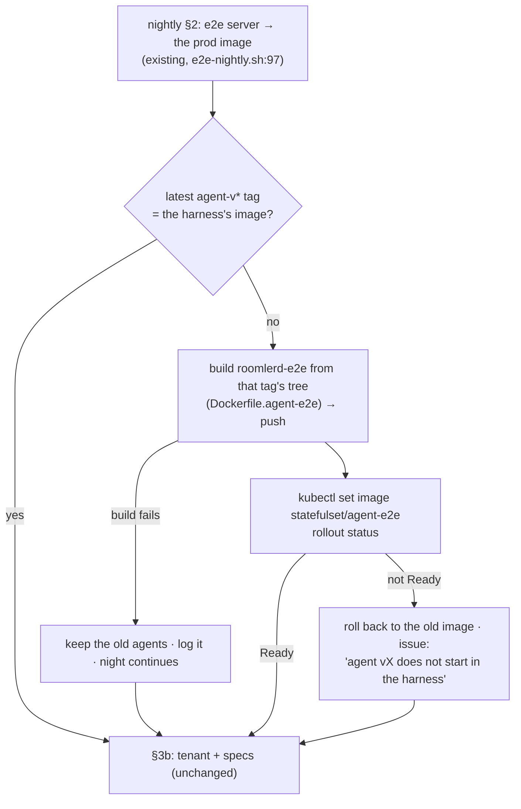

# FR-126: The agent-e2e harness follows the agent release — the nightly rebuilds its test agents from each new tag

**Issue:** [#2969](https://github.com/gjovanov/roomler-ai/issues/2969) · **Status:** proposed 2026-10-26, on the operator's choice of "Auto-refresh e2e agents" (FR-114
decision 1's other option) · **Owner:** testing (the e2e pod lane) · **Anchors:** master `5dd2a8837` · **Builds
on:** [FR-114](FR-114-agent-e2e-lane-runs-nightly.md) (the agent-e2e lane), #2645 (the nightly runs each image's own
specs)

## 1. Goal

The nightly's three agent-e2e agents run **the newest released agent**, not whatever someone last built by hand. A
release whose agent breaks remote desktop then fails the first night after its tag, instead of going unnoticed until
the next manual refresh.

## 2. Evidence

| What | Measured |
|---|---|
| FR-114's decision 1 (default) | "the image built from master at P2, re-built by hand when an agent change needs it" (`FR-114-…md:89`) |
| the drift it allowed | the harness ran **0.4.145** from 2026-10-19 to 2026-10-26, while the fleet moved through **27 releases** to 0.4.172. Every server change was tested against a week-old agent, and no agent change at all |
| the drift again | refreshed by hand to 0.4.172 at 2026-10-26 00:06Z (deploy #49); by 16:28Z that day `agent-v0.4.177` existed, so the harness was **5 releases** behind within 16 hours |
| what the refresh found | nothing broken between 0.4.145 and 0.4.172 (7/7). FR-100 P1c's per-session verdicts appeared in the lane for the first time, a path the 0.4.145 agents never ran |

## 3. Key design

1. **The tag is the source.** The nightly takes the newest `agent-v*` tag and builds `Dockerfile.agent-e2e` from
   **that tag's tree** (`git archive`), never master. So the agents are the released source with the harness's feature
   set (`Dockerfile.agent-e2e:43`), and the image is named for the release: `agent-e2e-v0.4.N`. If a night's image
   already exists in the registry, it is reused, not rebuilt.
2. **Live, like the server.** The nightly already moves the e2e server onto prod's image every run (`e2e-nightly.sh:97`)
   while the deploy overlay's pin stays a fallback. The agents follow the same rule: `kubectl set image` on the
   StatefulSet's `agent` container (`statefulset-agent-e2e.yaml:54`). The overlay pin becomes the baseline a full apply
   uses, and its comment says so.
3. **A failure is a finding, never a silent rollback.**
   - A **build** failure keeps the old agents and logs why. That's a lane problem, and the night still runs.
   - A rollout that does not reach Ready is different: the release's agent cannot start in a container. The nightly
     restores the old image, deleting the pods so they come back on it (an OrderedReady StatefulSet will not roll past
     a crash-looping pod by itself). Then it files an issue and runs the night on the old agents.
4. **Bounded cost.** At most one build a night (the newest tag only, ~6 min on mars). Only this lane's own image tags
   are pruned locally, keeping the newest three; the shared build cache is left alone.

## 4. Phases

| Phase | What | Kill switch | Status |
|---|---|---|---|
| P1 | `e2e-nightly.sh` §2b (resolve, build, push, roll, wait, roll back on failure, prune); `LATEST` names the agents; the overlay pin's comment; `docs/testing.md` + `AGENT-E2E.md` | `E2E_AGENT_FOLLOW_RELEASE=0` in the cron line (the harness then stays where it is, as before) | — |
| P2 | field: the first nightly after a new `agent-v*` tag rebuilds and rolls the harness, and the seven agent tests run on it | as P1 | — |

## 5. Acceptance criteria

- [ ] **AC1 (P1):** with the harness behind the newest `agent-v*` tag, the nightly builds `agent-e2e-v<that version>`
  from the tag's tree, rolls the StatefulSet to it, and runs the agent tests on it; `LATEST` names the agents' tag. Red
  first: before P1 the harness stays on its hand-built tag however many releases go by.
- [ ] **AC2 (P1):** a build failure leaves the harness on its old image, the night still runs, and the log says why.
- [ ] **AC3 (P1):** a rollout that does not reach Ready restores the old image (all three agents Ready on it again),
  the night still runs, and an issue names the release. Shown by a deliberately broken image, in a rehearsal outside a
  real night.
- [ ] **AC4 (P2):** the first nightly after a real release does AC1 unattended, and the seven agent tests pass on it, or
  each failure is attributed.
- [ ] **AC5 (docs):** `docs/testing.md` documents the rule (a row in the agent-e2e lane's table, with `file:line`
  anchors), `scripts/e2e-k8s/AGENT-E2E.md` says the nightly rebuilds per release and how to switch it off, and
  `docs/README.md`'s index row for `testing.md` names it.

## 6. Open decisions (defaults in bold)

1. **Which release.** **The newest `agent-v*` tag**, every night it changes. Option: only tags the fleet's updater
   already serves, if a tag can exist before its release is published.
2. **What a failed rollout files.** **A GitHub issue per occurrence**, like the nightly's regression issues. Option: a
   line in `LATEST` only.

## 7. Out of scope

- Building the harness image in GitHub Actions on each release (the release lane stays untouched; the build host already
  builds it).
- Testing every release in between: one night tests one release, the newest.
- Persistent agent keys and seeded browser pins (an FR-100 P3 question, raised on #2092).

## 8. Field-verification log

| Date | Build | What was checked | Result |
|---|---|---|---|
