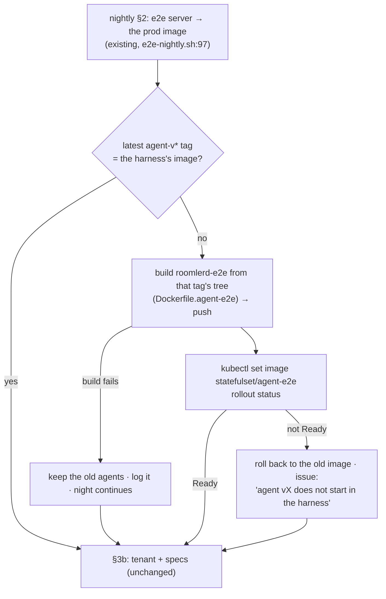

# FR-126: The agent-e2e harness follows the agent release — the nightly rebuilds its test agents from each new tag

**Issue:** [#2969](https://github.com/gjovanov/roomler-ai/issues/2969) · **Status:** ✅ **closed 2026-10-28**, every
criterion ticked. P1 merged 2026-10-26 (#2971, `73991627a`); the first nightly after a new tag (2026-10-28 02:30Z)
built `agent-e2e-v0.4.180` from that tag's tree, rolled the harness to it unattended, and the seven agent tests passed
on it. Proposed 2026-10-26, on the operator's choice of "Auto-refresh e2e agents" (FR-114 decision 1's other option) ·
**Owner:** testing (the e2e pod lane) · **Anchors:** master `5dd2a8837` · **Builds on:**
[FR-114](FR-114-agent-e2e-lane-runs-nightly.md) (the agent-e2e lane), #2645 (the nightly runs each image's own specs)

## 1. Goal

The nightly's three agent-e2e agents run **the newest released agent**, not whatever someone last built by hand. A
release whose agent breaks remote desktop then fails the first night after its tag, instead of going unnoticed until
the next manual refresh.

## 2. Evidence

| What | Measured |
|---|---|
| FR-114's decision 1 (default) | "the image built from master at P2, re-built by hand when an agent change needs it" (`FR-114-…md:89`) |
| the drift it allowed | the harness ran **0.4.145** from 2026-10-19 to 2026-10-26, while the fleet moved through **27 releases** to 0.4.172. Every server change was tested against a week-old agent, and no agent change at all |
| the drift again | refreshed by hand to 0.4.172 at 2026-10-26 00:06Z (deploy #49); by 16:28Z that day `agent-v0.4.177` existed, so the harness was **5 releases** behind within 16 hours |
| what the refresh found | nothing broken between 0.4.145 and 0.4.172 (7/7). FR-100 P1c's per-session verdicts appeared in the lane for the first time, a path the 0.4.145 agents never ran |

## 3. Key design

1. **The tag is the source.** The nightly takes the newest `agent-v*` tag and builds `Dockerfile.agent-e2e` from
   **that tag's tree** (`git archive`), never master. So the agents are the released source with the harness's feature
   set (`Dockerfile.agent-e2e:43`), and the image is named for the release: `agent-e2e-v0.4.N`. If a night's image
   already exists in the registry, it is reused, not rebuilt.
2. **Live, like the server.** The nightly already moves the e2e server onto prod's image every run (`e2e-nightly.sh:97`)
   while the deploy overlay's pin stays a fallback. The agents follow the same rule: `kubectl set image` on the
   StatefulSet's `agent` container (`statefulset-agent-e2e.yaml:54`). The overlay pin becomes the baseline a full apply
   uses, and its comment says so.
3. **A failure is a finding, never a silent rollback.**
   - A **build** failure keeps the old agents and logs why. That's a lane problem, and the night still runs.
   - A rollout that does not reach Ready is different: the release's agent cannot start in a container. The nightly
     restores the old image, deleting the pods so they come back on it (an OrderedReady StatefulSet will not roll past
     a crash-looping pod by itself). Then it files an issue and runs the night on the old agents.
4. **Bounded cost.** At most one build a night (the newest tag only, ~6 min on mars). Only this lane's own image tags
   are pruned locally, keeping the newest three; the shared build cache is left alone.

## 4. Phases

| Phase | What | Kill switch | Status |
|---|---|---|---|
| P1 | `e2e-nightly.sh` §2b (resolve, build, push, roll, wait, roll back on failure, prune); `LATEST` names the agents; the overlay pin's comment; `docs/testing.md` + `AGENT-E2E.md` | `E2E_AGENT_FOLLOW_RELEASE=0` in the cron line (the harness then stays where it is, as before) | rehearsed 2026-10-26 (AC2, AC3; AC1's mechanism); merged 2026-10-26 in #2971 (`73991627a`); ran unattended from the cron on 2026-10-27 02:30Z, where it took the "already current" branch |
| P2 | field: the first nightly after a new `agent-v*` tag rebuilds and rolls the harness, and the seven agent tests run on it | as P1 | field-verified 2026-10-28 02:30Z: three tags behind (`agent-v0.4.178`–`0.4.180`, all tagged on 10-27), the nightly built `agent-e2e-v0.4.180` from the newest tag's tree in 4 min 45 s, rolled the harness in 11 s, and the seven agent tests passed on it (§8) |

## 5. Acceptance criteria

- [x] **AC1 (P1):** with the harness behind the newest `agent-v*` tag, the nightly builds `agent-e2e-v<that version>`
  from the tag's tree, rolls the StatefulSet to it, and runs the agent tests on it; `LATEST` names the agents' tag. Red
  first: before P1 the harness stays on its hand-built tag however many releases go by.
  **Met:** the red (§8, 2026-10-26 16:28Z, and again 2026-10-27 12:52Z); the build from the tag's tree, the roll and the
  7/7 in a driven rehearsal (§8, 16:36–16:45Z); and then the nightly itself, unattended (§8, 2026-10-28 02:30Z): three
  tags behind, it built `agent-e2e-v0.4.180` from `agent-v0.4.180`'s tree, rolled the StatefulSet to it, ran the agent
  tests on it, and `LATEST` reads `agents=agent-e2e-v0.4.180`.
- [x] **AC2 (P1):** a build failure leaves the harness on its old image, the night still runs, and the log says why.
- [x] **AC3 (P1):** a rollout that does not reach Ready restores the old image (all three agents Ready on it again),
  the night still runs, and an issue names the release. Shown by a deliberately broken image, in a rehearsal outside a
  real night.
- [x] **AC4 (P2):** the first nightly after a real release does AC1 unattended, and the seven agent tests pass on it, or
  each failure is attributed. **Met 2026-10-28 02:30Z** (§8): the seven passed on `agent-e2e-v0.4.180`, and each left
  its own session in the agents' logs, so none of them skipped. The night's two failures (`rc-vp9-444.spec.ts` ×2, on
  the expected-failures list) and its one flaky test (`conference.spec.ts:37`) touch no agent.
- [x] **AC5 (docs):** `docs/testing.md` documents the rule (a row in the agent-e2e lane's table, with `file:line`
  anchors), `scripts/e2e-k8s/AGENT-E2E.md` says the nightly rebuilds per release and how to switch it off, and
  `docs/README.md`'s index row for `testing.md` names it. Written in #2971; read back on master `208e42385`:
  the row is `docs/testing.md:255` and its anchors resolve (`e2e-nightly.sh:101` is §2b's heading, `:315` the verdict
  join); `AGENT-E2E.md:34–40` says the nightly rebuilds per release and names `E2E_AGENT_FOLLOW_RELEASE=0`;
  `docs/README.md:171` names FR-126 in the `testing.md` row.

## 6. Open decisions (defaults in bold)

1. **Which release.** **The newest `agent-v*` tag**, every night it changes. Option: only tags the fleet's updater
   already serves, if a tag can exist before its release is published.
2. **What a failed rollout files.** **A GitHub issue per occurrence**, like the nightly's regression issues. Option: a
   line in `LATEST` only.

## 7. Out of scope

- Building the harness image in GitHub Actions on each release (the release lane stays untouched; the build host already
  builds it).
- Testing every release in between: one night tests one release, the newest.
- Persistent agent keys and seeded browser pins (an FR-100 P3 question, raised on #2092).

## 8. Field-verification log

| Date | Build | What was checked | Result |
|---|---|---|---|
| 2026-10-26 16:28Z | the harness on `agent-e2e-20261025-d211617` (0.4.172, refreshed by hand at 00:06Z); the newest tag `agent-v0.4.177` | AC1's red | **5 releases behind** after 16 h, and nothing in the lane would move it |
| 2026-10-26 16:34Z | §2b as committed on the P1 branch, run by a driver on mars with the nightly's variables; the Dockerfile path forced to a missing file | AC2 | `could not build agent-e2e-v0.4.177 … the harness stays on agent-e2e-20261025-d211617`. The build log names the cause (`failed to read dockerfile … NOPE`); the tag's archive was fine (`724ef9273`, which carries `Dockerfile.agent-e2e`). 3/3 Ready, 0 restarts, no failure recorded, the block carried on |
| 2026-10-26 16:34–16:36Z | the same block, the image forced to `busybox:1.36` (exits at once), the rollout timeout cut to 90 s | AC3 | Not Ready in 90 s: `agent agent-v0.4.177 did NOT come up in the harness: restoring agent-e2e-20261025-d211617`. The pods were deleted and came back **3/3 Ready on the old image**, 0 restarts; `AGENT_FAIL=agent-v0.4.177`. The verdict section, run locally with `gh` stubbed: `LATEST` reads `REGRESSION … agents=agent-e2e-20261025-d211617`, an issue is filed whose body names the release, exit 1. With no failure, `LATEST` reads `OK … agents=…` and no issue is filed |
| 2026-10-26 16:36–16:45Z | the block as committed | AC1's mechanism, then the suite | Built `agent-e2e-v0.4.177` **from the tag's tree** (6 min), pushed, rolled in 15 s; **3/3 Ready on v0.4.177**, each recording state advertised. The seven agent tests on `hosted-20261026-21d7c18`, with the specs at that image's commit: **7/7**. AC1 itself ticks with AC4: the first night that does this unattended |
| 2026-10-27 02:30Z | the first nightly after #2971 merged, from the cron: `repo at cc7e4b3b4`; the harness on `agent-e2e-v0.4.177`, the newest tag still `agent-v0.4.177` | §2b unattended; AC1's `LATEST` half | §2b ran and took the "already current" branch — `agent-e2e harness on agent-v0.4.177` — no build, no roll. `LATEST`: `20261027-0230 OK (2failed 8skipped 180passed(7.2m)) tag=hosted-20261026-21d7c18 agents=agent-e2e-v0.4.177`. The two failures are `rc-vp9-444.spec.ts` ×2 (on the expected-failures list; nothing to do with the harness); the seven harness specs passed. 3/3 Ready on v0.4.177, 0 restarts, the pods 19 h old (the rehearsal's). The build-and-roll half could not happen: no newer tag existed before the run |
| 2026-10-27 12:29Z | master `208e42385` (#2993 bumped the workspace to 0.4.178); the `rel-0.4.178` release rehearsal running | what AC4 waits on | once `agent-v0.4.178` is tagged, the first 02:30Z nightly after it is the observation: expect `agent-e2e harness on agent-e2e-v0.4.177; the newest release is agent-v0.4.178`, a ~6 min build, `rolled to agent-v0.4.178`, and `LATEST … agents=agent-e2e-v0.4.178`. Read `~/e2e-nightly/LATEST` and that night's log on mars; attribute any of the seven that fails |
| 2026-10-27 12:52Z | `agent-v0.4.178` tagged (`208e42385`, the tag object `a9d661e53`); the harness on `agent-e2e-v0.4.177`, 3/3 Ready, the pods from the 10-26 rehearsal | AC1's red, the second time | **One release behind** within the hour, and nothing moves it until the 2026-10-28 02:30Z nightly. The tag's tree carries `Dockerfile.agent-e2e`, and the four features it builds (`synthetic-frame-source,openh264-encoder,clipboard,recording`) are unchanged since v0.4.177, so the night's build should go as the rehearsal's did. Left alone on purpose |
| 2026-10-28 02:30Z | the nightly from the cron (`repo at 0204c5dc8`); the server on prod's `hosted-20261026-21d7c18`, the specs at that image's commit; the harness on `agent-e2e-v0.4.177` while `agent-v0.4.178`, `0.4.179` and `0.4.180` had all been tagged on 10-27 | AC1 + AC4, unattended | `agent-e2e harness on agent-e2e-v0.4.177; the newest release is agent-v0.4.180` (02:30:06Z) → `built agent-e2e-v0.4.180 from the tag's tree and pushed it` (02:34:51Z, 4 min 45 s) → `agent-e2e harness rolled to agent-v0.4.180` (02:35:02Z, 11 s) → `3 agent(s) ready — its specs run`. All three agent containers on `agent-e2e-v0.4.180`, 0 restarts; the StatefulSet's update and current revisions equal. `LATEST`: `20261028-0230 OK (2failed 1flaky 8skipped 179passed(7.2m)) tag=hosted-20261026-21d7c18 agents=agent-e2e-v0.4.180`. Failed: `rc-vp9-444.spec.ts:61` and `:138` (the expected-failures list); flaky: `conference.spec.ts:37` (no agent in it); no issue filed. **The seven passed, and none skipped**: a test that finds no agent skips before it opens a session, and each one has its own session in the v0.4.180 agents' logs. The 1 MiB file-DC upload completed on agent-2 (`files: complete … bytes=1048576`). The two refusals opened sessions on agent-0 (a recorder, not opted in) and agent-2 (no recorder). The recording smoke recorded on agent-1 (`remote recording started` → `ended … reason=requested bytes=3256`). The rating spec, next in the run, held sessions on agent-2 from 02:39:49Z to 02:41:04Z, past its 30 s floor. The session smoke (agent-2, 02:41:39Z) and the device switch (agent-0 and agent-1, 02:41:42–43Z) opened theirs and printed their console reports. The night took the newest tag and passed over 0.4.178 and 0.4.179, as decision 1 says |
