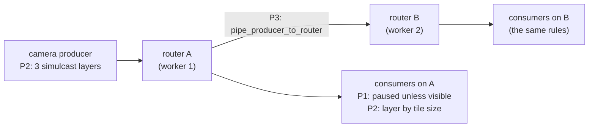

# FR-127: A meeting grows past one worker — receive what is visible, simulcast layers, and a room piped across workers

**Issue:** [#2985](https://github.com/gjovanov/roomler-ai/issues/2985) · **Status:** proposed 2026-10-27, on the operator's
choice of FR-115 O4's second branch ("build the scaling as its own FR, then re-measure") · **Owner:** conference (the
mediasoup SFU and the call UI) · **Anchors:** master `aee65c269` · **Builds on:** [FR-115](FR-115-pricing-reshape.md)
(*O4, measured*; the plan caps), FR-30 (producer pause), FR-32 (the participant cap)

## 1. Goal

A meeting carries what the plans sell, **Pro's 50 people and Business's 100**, with cameras on, on the pods production
runs today. Today one room is one mediasoup router on one worker thread, and that thread runs out at about 20 cameras.
Three levers lift the ceiling. Each is switchable on its own, and each is measured on its own:

1. **Receive what is visible.** A participant receives video only for the tiles it shows.
2. **Simulcast.** A camera publishes layers, and each tile receives the layer its size needs.
3. **A room across workers.** A room's participants spread over the pod's workers, with producers piped between them.

Then **measure again**, with the bench and with real browsers. The published caps follow the measurement.

## 2. Evidence

| What | Measured |
|---|---|
| FR-115 O4 (2026-10-26, `examples/room_capacity.rs`, production's worker settings and codecs) | one worker delivers 100 % up to **N = 20** cameras at Chrome's 640×480 ceiling (1.58 Mbit/s VP8 + 40 kbit/s Opus), and 60 % at 25; audio-only reaches about 40 |
| the ceiling's unit | **packets**, about 85,000–110,000 a second per worker; the worker's log level and io_uring do not move it |
| the client's side | at 50 people, each participant would receive about 78 Mbit/s of video |
| the plans | `video_max_participants` is 10 · 50 · 100 for Free · Pro · Business (`crates/db/src/models/tenant.rs:578`, `:596`, `:614`), enforced at `media:join` (`crates/modules/conference/src/ws_media.rs:272`) |
| production | 2 pods, a 2-CPU limit each, 4 mediasoup workers a pod; tenant affinity puts a tenant's meeting on one pod |

## 3. Key design

**Today.** `RoomManager::create_room` (`crates/modules/conference/src/media/room_manager.rs:155`) creates **one** router
on the worker `WorkerPool::get_worker` hands it (`crates/modules/conference/src/media/worker_pool.rs:48`, round-robin).
Every consumer is resumed when it is created (`room_manager.rs:436`), whether or not its tile is on screen. The camera
publishes one encoding (`ui/src/stores/conference.ts:324`). So N cameras make N×(N−1) video streams through one thread.

**The arithmetic each lever buys** (to be confirmed by P4, not assumed):

| Lever | Video streams out of the SFU at N = 50 |
|---|---|
| today | 50 × 49 = 2,450 full-rate streams on one worker |
| P1, a 3×3 grid plus the active speaker | about 50 × 10 = 500, about a fifth |
| P1 + P2, small tiles on the 320×180 layer | the same 500 streams, most at about a tenth of the full rate's packets |
| P3, a room over the pod's 4 workers | the work spread over 4 threads, minus each producer piped up to 3 times |

**Constraints that carry over.**
- FR-30 P4's producer pause (`room_manager.rs:75`, read at `:406`) is the **owner's** choice. A consumer paused because its
  tile is off screen is the **viewer's**. The two are different states, and P1 must not merge them.
- The participant cap (`ws_media.rs:272`) is unchanged until P5. The media claim-or-route (`media_cluster.rs`, one owner
  pod per room) is unchanged; a room across **pods** is out of scope.
- Kill switches live in `[meetings]` (`MeetingsSettings`, `crates/config/src/settings.rs:370`), next to `free_cap`.
- The bench (`crates/modules/conference/examples/room_capacity.rs`, `docs/testing.md`) is the measuring instrument. It
  gains a model of each lever in the phase that builds the lever.

## 4. Phases

| Phase | What | Kill switch | Status |
|---|---|---|---|
| P0 | the design deepened, with anchors: the visible set and its signalling, the layer ladder, the pipe topology, how each lever is modelled in the bench | — (docs) | — |
| P1 | receive what is visible: the client tells the server which video consumers it shows; the server pauses the rest (`Consumer::pause`) and resumes on demand; audio and the active speaker always flow | `[meetings] visible_tiles = false`: every consumer stays resumed, as today | — |
| P2 | simulcast: the camera publishes VP8 layers (decision 1); each consumer is given the layer its tile needs (preferred layers) | `[meetings] simulcast = false`: the client publishes one encoding, as today | — |
| P3 | a room across a pod's workers: a router per worker for the room, participants' transports spread over them, each producer piped to the room's other routers | `[meetings] pipe_rooms = false`: one router per room, as today | — |
| P4 | measure again: the bench with P1–P3 modelled, then real browsers in the app pod (the `pwrunner` sidecar with fake cameras) at 25, 50 and 100 | — | — |
| P5 | publish what was measured: the plan caps and their copy (decision 4); the docs | — | — |

## 5. Acceptance criteria

- [ ] **AC1 (P1):** in a meeting larger than the grid, a participant receives video for its visible tiles and the active
  speaker only. Shown by the client's inbound-RTP stats and the server's paused consumers. A tile scrolled into view
  plays within 1 s. Red first: today every tile's consumer delivers.
- [ ] **AC2 (P1):** a producer its owner paused (FR-30) stays paused for every viewer, and a viewer's off-screen pause
  never pauses it for anyone else.
- [ ] **AC3 (P2):** a camera publishes at least two layers; a small tile receives the low layer and a large or pinned
  tile the high one; a layer switch freezes the tile for at most 1 s.
- [ ] **AC4 (P3):** a room's participants land on more than one worker, every producer reaches every consumer through
  the pipes, and a viewer on another worker sees the same video as one on the producer's worker.
- [ ] **AC5 (P4, the bench):** with P1–P3 modelled, one pod carries a 50-person meeting with cameras on at ≥ 99 %
  delivery. The 100-person ceiling is measured, and reported as a number even if it falls short.
- [ ] **AC6 (P4, the field):** real browsers in the app pod at N = 25 and 50 confirm the bench within 20 %, with each
  lever's kill switch shown to change the result (a positive control).
- [ ] **AC7 (no regression):** a 2–4 person meeting keeps today's quality and latency with every lever on.
- [ ] **AC8 (P5):** the published caps match what was measured (decision 4), and FR-115's O4 is closed by it.
- [ ] **AC9 (docs):** `docs/real-time.md` documents the three levers in the house style (a mermaid diagram, tables,
  `file:line` anchors, each kill switch), `docs/testing.md` the bench's new models, and `docs/README.md`'s index row for
  `real-time.md` names them.

## 6. Open decisions (defaults in bold)

1. **The layer ladder.** **Three VP8 layers: 320×180 at about 150 kbit/s, 640×360 at about 500 kbit/s, and the capture
   resolution at about 1.2 Mbit/s.** Options: two layers; VP9 SVC (one stream; Safari's support is the question).
2. **The visible set.** **The tiles on screen, plus the active speaker and any pinned tile; audio always flows.** Option:
   the current grid page only.
3. **The pipe topology.** **Each producer piped to every other router of its room (R ≤ 4).** Option: put each
   consumer on its producer's router, which costs a transport per router per participant.
4. **The published caps if 100 is out of reach** on today's pods (2 CPUs for 4 workers). **Publish the measured
   number**; option: raise the pods' CPU limit. Decided after P4, by the operator.
5. **Which plans get the levers.** **Every plan**: they cut the SFU's cost for Free too.

## 7. Out of scope

- A room across **pods**. Tenant affinity places a meeting on one pod; cascading SFUs is its own FR.
- Recording's architecture, native mobile apps, and SVC (decision 1's option only).
- Changing the meeting length cap (FR-115 P5).

## 8. Field-verification log

| Date | Build | What was checked | Result |
|---|---|---|---|
| 2026-10-26 | `examples/room_capacity.rs` on master `d016f81d2` (FR-115 O4) | the red: one room on one worker | **100 % to N = 20 cameras, 60 % at 25**; audio-only about 40. Pro sells 50 and Business 100 |
