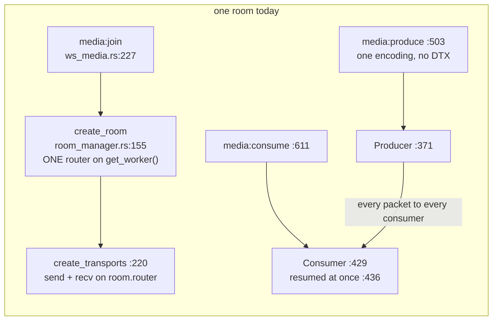
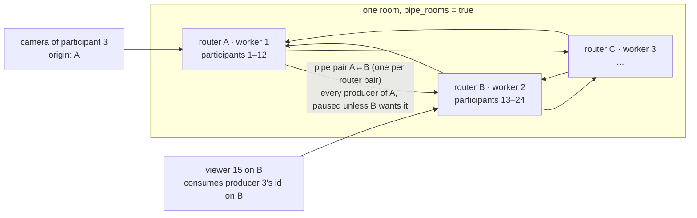

# FR-127: A meeting grows past one worker — receive what is visible, simulcast layers, and a room piped across workers

**Issue:** [#2985](https://github.com/gjovanov/roomler-ai/issues/2985) · **Status:** P0 done 2026-10-27 — the design below
is read against the code, and each phase is specified so that a separate worker builds it from this document ·
**Owner:** conference (the mediasoup SFU and the call UI) · **Anchors:** master `aee65c269`, every one verified by P0 on
2026-10-27 · **Builds on:** [FR-115](FR-115-pricing-reshape.md) (*O4, measured*; the plan caps), FR-30 (producer pause),
FR-32 (the participant cap), FR-124 (the black-tile detector, which P1 must not trip)

## 1. Goal

A meeting carries what the plans sell, **Pro's 50 people and Business's 100**, with cameras on, on the pods production
runs today. Today one room is one mediasoup router on one worker thread, and that thread runs out at about 20 cameras.
Three levers lift the ceiling. Each is switchable on its own, and each is measured on its own:

1. **Receive what is visible.** A participant receives video only for the tiles it shows, and audio only for what is
   said (Opus DTX).
2. **Simulcast.** A camera publishes layers, and each tile receives the layer its size needs.
3. **A room across workers.** A room's participants spread over the pod's workers, with producers piped between them.

Then **measure again**, with the bench and with real browsers. The published caps follow the measurement.

## 2. Evidence

| What | Measured or read |
|---|---|
| FR-115 O4 (2026-10-26, `examples/room_capacity.rs`, production's worker settings and codecs) | one worker delivers 100 % up to **N = 20** cameras at Chrome's 640×480 ceiling (1.58 Mbit/s VP8 + 40 kbit/s Opus), and 60 % at 25; audio-only reaches about 40 |
| the ceiling's unit | **packets**, about 85,000–110,000 a second per worker thread; the worker's log level and io_uring do not move it |
| the client's side | at 50 people, each participant would receive about 78 Mbit/s of video |
| the plans | `video_max_participants` is 10 · 50 · 100 for Free · Pro · Business (`crates/db/src/models/tenant.rs:578`, `:596`, `:614`), enforced at `media:join` (`crates/modules/conference/src/ws_media.rs:272-300`) |
| production | 2 pods, a 2-CPU limit each, **4** mediasoup workers a pod (`ROOMLER__MEDIASOUP__NUM_WORKERS` in the deploy repo's base config; the code's default is 2, `crates/config/src/settings.rs:1733`); tenant affinity puts a tenant's meeting on one pod |
| **P0 finding — audio alone** | 50 people unmuted send 50 × 49 Opus streams at 50 packets/s: **122,000 packets/s, more than one worker carries**, before any video. FR-115's audio-only run saw it: 89 % delivered at N = 50 at 109,000 pkt/s. A muted participant costs nothing (FR-30 P4 pauses the producer server-side) but an unmuted silent one costs the full 50 pkt/s, because the client produces Opus without DTX (`ui/src/stores/conference.ts:315-319` passes no `codecOptions`) |
| **P0 finding — the capture** | the camera is opened unconstrained (`ui/src/stores/conference.ts:305-308`), which Chrome serves at **640×480**. A simulcast ladder has to be stated relative to that, not as 16:9 sizes |
| **P0 finding — what a viewer renders** | the tiled layout renders `tiledMaxTiles` tiles (default 16, 4–49) and **drops the rest without scrolling** (`ui/src/composables/useConferenceLayout.ts:306`); spotlight and sidebar render **everyone else in a scrolling strip** (`SpotlightLayout.vue:29-49`, `SidebarLayout.vue:29-49`). So "visible" is the grid's list in one layout and an on-screen test in the other two |
| **P0 finding — the libraries** | the server is `mediasoup` 0.20.0 (`Cargo.lock`), which has `Router::pipe_producer_to_router`, `Consumer::set_preferred_layers`, `ActiveSpeakerObserver` and `AudioLevelObserver`; the client is `mediasoup-client` 3.21.0 (`ui/bun.lock`), whose `produce()` takes `encodings` and `codecOptions` and which applies simulcast on Chrome, Firefox and Safari. Nothing the design needs is missing from the pinned versions |
| **P0 finding — the wire** | `media:*` types are JSON strings matched in `dispatch_media_local` (`ws_media.rs:177-208`); they are not in the RC signalling enum, so the composition baseline (`crates/tests/fixtures/composition.baseline.json:5896`, `wire`) holds none of them, and a new `media:*` type changes no baseline. An unknown type is logged and ignored (`ws_media.rs:205-207`) |

## 3. Key design

### 3.0 Today, and the arithmetic corrected



`RoomManager::create_room` (`crates/modules/conference/src/media/room_manager.rs:155`) creates **one** router on the
worker `WorkerPool::get_worker` hands it (`media/worker_pool.rs:48`, round-robin over the pool). Both of a participant's
transports go on that router (`room_manager.rs:231-232`). Every consumer is resumed when it is created
(`room_manager.rs:436-440`), whether or not its tile is on screen. ⚠️ The comment there says mediasoup creates consumers
paused; it does not: `ConsumerOptions.paused` defaults to `false` (mediasoup 0.20.0, `src/router/consumer.rs:116`), and
the crate's own doc recommends `paused: true` for video so the first key frame does not race the client's consumer. P1
uses that field. The camera publishes one encoding (`ui/src/stores/conference.ts:324-328`) and the bench sends exactly
that (`examples/room_capacity.rs:391-394`).

**The packet budget.** The worker's cost is packets, so the levers are stated in packets. With the bench's 1,100-byte
payloads, a VP8 stream costs ⌈frame bytes ÷ 1,100⌉ packets a frame, at least one, and Opus costs 50 packets/s, or about
2.5 with DTX while silent. Everyone unmuted, three people talking, the default 16-tile grid:

| Stream | Packets/s |
|---|---|
| camera, 640×480 at Chrome's 1.58 Mbit/s ceiling (today) | 180 |
| camera, top layer capped at 1.5 Mbit/s | 170 |
| half layer, 320×240 at 300 kbit/s | 60 (30 at temporal layer 1, 15 at layer 0) |
| quarter layer, 160×120 at 100 kbit/s | 30 — **a low bitrate saves bits, not packets**: one packet per frame is the floor, so temporal layers are the packet lever for small tiles |
| Opus, talking / silent without DTX / silent with DTX | 50 / 50 / 2.5 |

| Scenario | N = 20 | N = 50 | N = 100 |
|---|---|---|---|
| today: N·(N−1)·(180 + 50) + N·230 in | 92,000 (the measured knee: 88,200 out at N = 20) | 575,000 | 2,300,000 |
| P1 alone (16 full-layer tiles, DTX) | 78,000 | 169,000 | 335,000 |
| **P1 + P2** (16 tiles on the half layer, DTX, 2 layers in) | 32,000 | **74,000 — one worker, just** | 161,000 |
| P1 + P2 with temporal layer 1 on grid tiles | 24,000 | 50,000 | 113,000 |
| **P1 + P2 + P3** over 4 workers, pipes gated by demand (§3.3) | one router, no pipes | ≈ 20,000 a worker | ≈ 45,000 a worker, **≈ 2.2 cores at the measured 85,000 pkt/s a core** |

So, to be confirmed by P4 and not assumed: P1 alone does not reach 50; P1 with P2 reaches 50 on one worker; 100 needs
P3 and, on today's 2-CPU pods, probably the CPU limit raised (decision 4). FR-115's claim-spec table counted video only;
the audio row is why P1 carries DTX.

### 3.1 P1 — receive what is visible, and audio that costs what is said

**The wire.** Two additive changes, both ignored by a server or a client that predates them.

| Message | Direction | Payload | Notes |
|---|---|---|---|
| `media:join` | client → server | gains `caps: ["view"]` | declares a client that will report its view. Absent → a legacy client, every consumer resumed as today. The flag rides the join so the server knows the client's generation before the first `media:consume`, with no ordering to get wrong |
| `media:view` | client → server | `{ room_id, seq, video: [{ producer_id, w, h }] }` | **the whole set the client shows right now**, not a delta: idempotent, self-healing after a lost or reordered message. `w`/`h` are the tile's device pixels (P2 reads them; P1 ignores them). Debounced 100 ms on the client, sent on every layout change and after a re-join. `seq` lets the server drop a report that arrives after a newer one |
| `media:transport_created` | server → client | gains `meeting: { view: bool, audio_dtx: bool, simulcast: null \| { layers } }` | **the server tells the client which levers are on**, so a client-side behaviour (DTX, simulcast) still has a server-side kill switch. An old client ignores the field |
| `media:produce` | client → server | gains `capture: { w, h }` for a camera | P2 reads it to map tile sizes to layers; absent → 640×480 assumed |

The WS loop awaits each namespace handler in turn (`crates/api/src/ws/handler.rs:261`, `:410`), and a forwarded command
is awaited too (`ws_media.rs:149-150`), so one connection's `join` → `view` → `consume` order holds end to end.

```mermaid
sequenceDiagram
  participant V as viewer (browser)
  participant S as owner pod (ws_media.rs → room_manager.rs)
  participant W as mediasoup worker
  V->>S: media:join {caps:["view"]}
  S-->>V: media:transport_created {meeting:{view:true, audio_dtx:true, simulcast}}
  S-->>V: media:new_producer ×(N−1)
  V->>S: media:view {video: []}  (nothing rendered yet)
  V->>S: media:consume (one per producer, serialised by consumeChain)
  S->>W: Consumer paused:true for video not in the view; audio resumed
  Note over V: the layout mounts 16 tiles
  V->>S: media:view {video: [16 × {producer_id,w,h}]}
  S->>W: resume those 16 (+ preferred layers, P2); pause the rest
  W-->>V: key frame for each resumed consumer (the worker requests it on resume)
```

**Server state.** `ParticipantMedia` (`room_manager.rs:44`) gains `view: Option<ViewState>` with
`ViewState { wanted: HashMap<ProducerId, (u32, u32)>, seq: u64 }`. ⚠️ `None` means *a legacy client, everything flows*;
`Some(empty)` means *a view client that shows nothing, every video consumer paused*. The two must never be collapsed,
for the same reason `ingress_rules` keeps `None` apart from `Some([])`. Applying a view:

- `media:view` → `RoomManager::apply_view(room_id, connection_id, view)`: for each **video** consumer of that
  connection (`ParticipantMedia.consumers`, `:49`, matched by `Consumer::producer_id()`): wanted and paused → `resume()`;
  not wanted and resumed → `pause()`. Audio consumers are never touched. The handles are cloned out and every DashMap guard
  dropped before the awaits, the pattern `set_producer_paused` established (`room_manager.rs:468-472`).
- `consume` (`room_manager.rs:389`): for a video consumer, `ConsumerOptions.paused = !wanted` when `view` is `Some`; the
  resume at `:436-440` runs only for a wanted or legacy consumer, and never for audio-off.
- A view names a producer whose consumer does not exist yet (the client learns producer ids from `media:new_producer`,
  `ws_media.rs:441-460` and `:579-603`, before it consumes): the set is kept and applied when the consumer is created.
- A server cap, `[meetings] view_max` (default 49, the UI's own maximum, `useConferenceLayout.ts:393-394`): a report
  longer than the cap is truncated in the order sent. P5 may lower it with the plan caps; it is a load guard, not a policy.

**The owner's pause and the viewer's pause are different states, in mediasoup too.** FR-30 P4's pause is
`Producer::pause()` (`room_manager.rs:477`), which the worker mirrors into every consumer's `producer_paused`
(`Consumer::producer_paused()`, mediasoup `src/router/consumer.rs:1015`). The viewer's pause is `Consumer::pause()`
(`:1116`), a separate flag (`Consumer::paused()`, `:1009`). `media:consumer_created.producer_paused` (`ws_media.rs:683`)
and the `media:producer_paused` event (`:753-769`) keep reading the **producer**; `media:view` only ever drives the
consumer's own flag. So AC2 holds by construction: a viewer hiding a tile changes nothing another viewer can see, and an
owner's pause reaches every viewer whatever their view says. ⚠️ With P3's piped producers this stays true only if
`producer_paused` is read from the **origin** producer (§3.3).

**The active speaker stays client-side in P1.** Audio always flows, so `pollSpeaker` (`ui/src/stores/conference.ts:634`)
keeps working on every remote audio track, the layout sorts the speaker to the front (`useConferenceLayout.ts:271-282`)
or into the spotlight (`:108`), and the view follows the layout. One round trip plus a key frame, well inside AC1's
second. A server `ActiveSpeakerObserver` (mediasoup `src/router.rs:925`, the dominant speaker every 300 ms, `:387`
`on_dominant_speaker`) is decision 6, not P1: it would save the client 49 `AnalyserNode`s at N = 50 and make every
viewer agree on the speaker, at the cost of a new server → client event and, under P3, an observer per router.

**What "visible" is, per layout.**

| Layout | Rendered | Visible set |
|---|---|---|
| tiled | `layout.primary`, at most `tiledMaxTiles`, no scrolling (`useConferenceLayout.ts:306`, `TiledLayout.vue:5-23`) | exactly the rendered list |
| spotlight | `primary` big; `secondary` = everyone else in a 120 px filmstrip that scrolls sideways (`SpotlightLayout.vue:29-49`, `:129-141`) | `primary` plus the strip tiles inside its viewport |
| sidebar | `primary` big; `secondary` in a 280 px column that scrolls (`SidebarLayout.vue:29-49`, `:100`, `:116-122`) | the same rule |

The on-screen test is an `IntersectionObserver` in `VideoTile.vue`, created in `onMounted` beside the black-picture watch
(`ui/src/components/conference/VideoTile.vue:454`, `:465-473`), with the scrolling strip as its root, emitting
`visible: [streamKey, boolean, w, h]` the way `picture-black` is emitted (`:221`) and forwarded by every layout
(`TiledLayout.vue:22`, `SpotlightLayout.vue:24`, `SidebarLayout.vue:24`) to the view
(`ui/src/views/conference/ConferenceView.vue:97-104`, next to `handlePictureBlack`, `:418-420`). The store turns stream
keys into video producer ids (it has them from `media:new_producer`, and `consumerStreamKey` maps the other way,
`conference.ts:366-367`) and sends `media:view`. A tile that is rendered but whose owner paused the camera (FR-30) stays
in the set: the producer is paused anyway, and the moment the owner resumes, the tile shows. A screen share is always
`primary`, so always in the set. ⚠️ FR-124's black detector (`VideoTile.vue:465-473`) flags after three black samples,
about 3 s; a resumed tile paints its key frame well inside that, and a paused tile is off screen, where no detector runs.
P1's e2e test asserts no `picture-black` fires on a scroll-in.

**Key frames.** Nothing to add on the server: the worker requests a key frame when a video consumer resumes
(`SimpleConsumer::UserOnResumed`, mediasoup-sys 0.10.0 `src/RTC/SimpleConsumer.cpp:711`; the simulcast one re-evaluates
its layers and requests one for the target, `src/RTC/SimulcastConsumer.cpp:1431`). A speaker change that makes 49
viewers resume the same producer within a few hundred ms costs **one** PLI: the producer's `KeyFrameRequestManager`
absorbs requests while one is pending (`src/RTC/KeyFrameRequestManager.cpp:96`), and
`ProducerOptions.key_frame_request_delay` (mediasoup `src/router/producer.rs:58`, today 0) is the floor to raise if P4
sees key-frame storms. Chrome answers a PLI within a frame; a 640×480 key frame is 15–40 kB, under 200 ms at the stream's
rate. That is AC1's "plays within 1 s".

**Audio that costs what is said.** The audio producer adds `codecOptions: { opusDtx: true }`
(`conference.ts:315-319`; the option exists, mediasoup-client `lib/Producer.d.ts:25`). Chrome then sends about one
packet every 400 ms while the microphone hears silence, which the worker forwards as is (the producer's `usedtx` is read
at `src/RTC/Producer.cpp:1114`). This is the lever that takes audio at N = 50 from 122,000 packets/s to about 13,000. It
is switched by `meeting.audio_dtx` in `media:transport_created`; `[meetings] audio_dtx = false` sends `false` and the
client produces as today. Not in P1: forwarding only the K loudest (an `AudioLevelObserver`, mediasoup
`src/router/audio_level_observer.rs:418`). It is the fallback if P4 shows DTX short of the budget.

**Multi-pod.** `media:view` is one more arm of `dispatch_media_local` (`ws_media.rs:177-208`), so the placement gate
(`route_and_dispatch_media`, `:123-163`, `resolve_media_route`, `media_cluster.rs:53`) forwards it to the owner pod over
`media.cmd` like every other command (`forward_media_cmd`, `:174`; executed by `handle_media_cmd_rpc`, `:632-669`). The
view state lives with the owner's `ParticipantMedia`; a viewer whose socket is on the other pod is served the same way
its `media:consume` is. A room across **pods** stays out of scope.

**Back-compat, both ways.** An old client sends no `caps` and no `media:view`: `view = None`, every consumer resumed, DTX
off (it never reads `meeting`). A new client on an old server: `caps` is an unread field of the join, `media:view` is
logged as unknown (`ws_media.rs:205-207`), `meeting` is absent so the client produces without DTX and expects everything
to flow — which it does. The web client ships with the server; the only mixed pair is a tab that joined before a deploy,
and its socket reconnects into the new server with the old protocol until the page reloads.

**Kill switches.** `[meetings] visible_tiles = false`: the server ignores `caps` and `media:view` (every consumer resumed,
as today) and sends `meeting.view = false`. `[meetings] audio_dtx = false`: as above. Both in `MeetingsSettings`
(`crates/config/src/settings.rs:370`, beside `free_cap` at `:376`), read where `meeting_cap.rs:104` reads `free_cap`.

### 3.2 P2 — simulcast

**The client.** `sendTransport.produce()` (`conference.ts:324-328`) gains `encodings` and the ladder, which the server
hands it in `meeting.simulcast` so it is switchable and changeable without a client release:

```ts
// decision 1 — two layers relative to the capture, three temporal layers each
encodings: [
  { scaleResolutionDownBy: 2, maxBitrate: 300_000,   scalabilityMode: 'L1T3' },
  { scaleResolutionDownBy: 1, maxBitrate: 1_500_000, scalabilityMode: 'L1T3' },
]
```

mediasoup-client 3.21.0 turns that into `rid r0, r1`, forces one temporal-layer count across the encodings (Chrome's
default is `L1T3` anyway) and passes them as `sendEncodings` (`lib/handlers/Chrome111.js:235`, `:259`); Firefox and
Safari get the same through SDP (`lib/handlers/Firefox120.js:284`, `lib/handlers/Safari12.js:272`). The screen share
keeps one encoding (`conference.ts:497-500`): it is always the big tile. The capture stays 640×480 by default; a 720p
capture (`width: { ideal: 1280 }`) is decision 1b, because it doubles the sender's encode cost for a top layer only the
spotlight shows. `media:produce` carries `capture: { w, h }` so the server can map tile sizes to layers.

**The server.** The router's codec list (`room_manager.rs:809`, VP8 at `:821-833` with NACK, PLI, FIR, REMB and
transport-cc) needs no change: simulcast is a property of the producer's `encodings` (mediasoup-types 0.2.1
`src/rtp_parameters.rs:995`; `scalability_mode` at `:1016`, `max_bitrate` at `:1019`), and the router's finalized
capabilities already carry RTX. Layer selection:

- at `consume` (`room_manager.rs:429`): `ConsumerOptions.preferred_layers` (mediasoup `src/router/consumer.rs:121`)
  from the view's `w`/`h` for that producer, or the top layer when the view does not name it yet;
- on each `media:view`: `Consumer::set_preferred_layers(ConsumerLayers { spatial_layer, temporal_layer })` (`:1157`)
  when the mapped layer changed, **only for `ConsumerType::Simulcast`** — a screen share's consumer is `Simple` and the
  worker rejects the request;
- the map, with the producer's `capture` height `H` and the tile's height `h` in device pixels: the half layer when
  `0.75·h ≤ H/2`, else the full one (a third layer, decision 1's option, when `0.75·h ≤ H/4`); temporal layer 2 for
  `h ≥ 240`, 1 for `120 ≤ h < 240`, 0 below. The thresholds are constants in one function with a unit test, and the
  ladder is `[meetings] simulcast_layers` (2 or 3) with the bitrates beside it;
- `Consumer::set_priority(2)` (`:1182`) for a spotlight or pinned tile, so when the viewer's downlink is short the
  worker's bandwidth estimator lowers grid tiles first. Preferred layers are a **ceiling**: transport-cc still picks
  what the link carries, which is the congestion control the browser-only path never had.

**A layer switch does not freeze.** The simulcast consumer keeps forwarding the current layer until the target layer's
key frame arrives (`src/RTC/SimulcastConsumer.cpp:1732`), which it requests at once. AC3 is therefore "the switch
completes within 1 s and the tile never freezes", stronger than the claim spec's "freezes for at most 1 s".

**Kill switch.** `[meetings] simulcast = false`: `meeting.simulcast = null`, the client publishes one encoding, the
server has nothing to select and every consumer is `Simple`, as today. With P1 off and P2 on, `media:view` still
carries the sizes and the layer map still runs; the two halves of the handler sit under their own switches.

**Browsers.** Chrome: VP8 simulcast with temporal layers, the mainline case. Firefox: VP8 simulcast by RID. Safari:
simulcast by SDP, VP8 and H264 (the router already lists H264 `42e01f`). The Safari pair is a P2 field check on a real
Mac, logged in §8 before P2 closes; the ladder is the same.

### 3.3 P3 — a room across a pod's workers

**Topology (decision 3, kept).** Every producer is piped from its origin router to every other router of its room. The
alternative, one recv transport per router per viewer and no pipes, was rejected: a legacy client has one recv transport
and must still reach every producer, and the client should never learn that routers exist. It does not have to: a piped
producer **keeps the origin producer's id** (`ProducerOptions::new_pipe_transport(producer_id, …)`, mediasoup
`src/router/producer.rs:66`), so `media:consume { producer_id }` resolves on the viewer's router by the same id.



**The API, as pinned.** `Router::pipe_producer_to_router(producer_id, PipeToRouterOptions)` (mediasoup
`src/router.rs:1079`) creates, once per **pair of routers** (`get_or_create_pipe_transport_pair`, `:1467`), a loopback
`PipeTransport` pair, then a pipe consumer on the origin (`:1109`) and a pipe producer on the destination whose paused
state mirrors the origin's (`:1117`); the crate wires the pause and resume of the pipe consumer into the pipe producer
(`:1143`, `:1159`) and the origin producer's close into the pipe producer's. `PipeToRouterOptions::new(router)`
(`:119`) defaults to SCTP on (`:129`), RTX off, SRTP off, and its `listen_info` is private: loopback UDP, fine for
workers in one process. Set `enable_sctp = false` (no data channels in a room). The returned `PipedProducer`
(`src/router/producer.rs:1099`) is kept as is — dropped without `into_inner()` it ties the pipe producer's life to the
origin's, which is exactly the lifetime wanted — and the `pipe_consumer` handle is kept too, because P3b pauses it.
Pipe consumers keep the audio-level extension and drop only MID, abs-send-time and transport-cc (`src/ortc.rs:917`), so a
server active-speaker observer (decision 6) would work on a router that holds only piped producers.

**Placement.** `MediaRoom` (`room_manager.rs:28`) replaces `router: Router` (`:29`) with `routers: RoomRouters`, a new
`media/room_routers.rs` that owns the routers, the pipes and the origin index, and depends on nothing in `RoomManager`,
so the bench can drive it (§3.4):

| Piece | Rule |
|---|---|
| the first router | at `create_room` (`:155`), on `get_worker()` as today |
| a participant's router | the room's router with the fewest participants; `ParticipantMedia` gains `router_id`, and `create_transports` (`:220`) puts both transports on it instead of `room.router` (`:231-232`) |
| a new router | opened when every router holds ≥ `[meetings] pipe_rooms_fill` (default 12) participants and the room has fewer routers than `[meetings] pipe_rooms_max` (default: the pool's `worker_count()`, `worker_pool.rs:53`); on the least-loaded worker the room does not use yet (`WorkerPool` gains a per-worker router count and `least_loaded_except(&[WorkerId])`, beside `get_worker`, `:48`). Every existing producer of the room is piped into it before it takes its first participant |
| small meetings | up to 12 people stay on one router with no pipes: AC7 by construction |
| a producer | at `produce` (`:353`): created on the owner's router, indexed in `producers: DashMap<ProducerId, Origin { router_id, producer, connection_id, capture }>`, then piped to every other router; a pipe that fails (a closed router) is logged and skipped, **never** fails the produce |
| a consumer | at `consume` (`:389`): `can_consume` (`:402`) and the consume run on the **viewer's** router, where the producer exists under its own id, origin or piped |
| the RTP tap | `create_rtp_tap` (`:687`) consumes on the producer's **origin** router, from the index, instead of `room.router` (`:697-700`) |
| `producer_paused` | read from the origin index, never from a pipe producer and never from `consumer.producer_paused()`; this also replaces the scan at `:410-422` |
| cleanup | a participant's leave drops its transports as today (`:536`); a producer's close (`:517`) drops the origin handle, the crate closes its pipe producers, each of which drops its pipe consumer, and the index entry goes with them; `remove_room` (`:187`) drops every router |
| capabilities | every router is created from `media_codecs()`, so `rtp_capabilities()` is identical across them (a P3 unit test asserts it) and `media:router_capabilities` (`ws_media.rs:319-332`) keeps sending the first router's |

**P3b — pipes gated by demand.** A pipe consumer forwards every packet of its producer to the destination router whether
or not anyone there is watching. With P1's view, the room knows: the pipe consumer for (producer, router B) is **paused
while no video consumer of that producer on B is resumed**, and resumed on the first `apply_view` that wants it. With
`visible_tiles = false` every consumer is resumed, so every pipe is, and P3b costs nothing. ⚠️ Pausing a pipe consumer
pauses the pipe producer on B (`src/router.rs:1143`), which the worker shows B's consumers as `producer_paused`. That is
why `producer_paused` must come from the origin index, and why the FR-30 badge test (AC2) runs across routers too. Audio
pipes are never gated: audio always flows.

**What breaks if a worker dies.** Today `on_dead` logs (`worker_pool.rs:31-35`) and every room on that worker loses its
transports; the browser sees its transports fail and nothing recovers them. P3 does not change that for the
participants on the dead router, and it must not make the rest worse: placement skips a router whose `closed()` is true,
a pipe into it fails and is skipped, and the next `create_transports` drops the dead slot and may open a new one. A
`[meetings] pipe_rooms` room survives a worker death with 1/R of its participants cut, instead of all of them.

**Stats and gauges.** `sample_transports` (`room_manager.rs:108`) and the sampler (`media_stats.rs:89`, `:238`) read
per-participant transports and are unchanged. `media_gauges` (`crates/modules/conference/src/lib.rs:109`) gains
`routers` and `pipes` per room, and the `MediaGauges` struct (`:101`) the totals; the cluster status snapshot shows them.
Pipe transport bytes (`PipeTransport::get_stats`, mediasoup `src/router/pipe_transport.rs:185`) go to the docs as a
P4 reading, not a sampled series.

**Kill switch.** `[meetings] pipe_rooms = false`: `RoomRouters` never opens a second router; one router per room, no
pipes, today's shape. `pipe_rooms_fill` and `pipe_rooms_max` beside it.

### 3.4 The bench models each lever

`crates/modules/conference/examples/room_capacity.rs` keeps its shape — one process, a generator thread
(`:274`), N `PlainTransport` senders and receivers (`:463`), sink threads counting RTP (`:207`), the worker thread's CPU
from procfs (`:546`, `:566`) — and gains one flag per lever, each defaulting to *off* so the FR-115 rows reproduce:

| Flag | Models | How |
|---|---|---|
| `--visible V` | P1 | each participant resumes the video consumers of the V participants after it (mod N) and leaves the rest paused (`ConsumerOptions.paused = true` at `:436`, no `resume`); `expected` counts only resumed consumers |
| `--talkers T` | P1's DTX | T participants send Opus at 50 pkt/s; the others at one packet every 400 ms (`AUDIO_PERIOD` per target, `:64`, `:290-305`) |
| `--layers L` | P2 | each camera sends L SSRCs — the ladder's packet rates: 170, 60, 30 pkt/s — as one producer with L `encodings` carrying `rid`-free SSRCs and `scalability_mode: L1T3` (`video_parameters`, `:376`); the VP8 descriptor (`:314-331`) gains the T bit with a TID cycling 0, 2, 1, 2 and `tl0picidx`, so the worker's temporal selection is real |
| `--tiles "16@0:2,1@1:2"` | P2's selection | per viewer, 16 consumers preferring spatial 0 / temporal 2 and one preferring 1 / 2 (`ConsumerOptions.preferred_layers`); `expected` is summed per consumer from the generator's per-layer counters |
| `--routers R`, `--fill F` | P3 | R workers in the process (`WorkerManager::create_worker` per router, `:636`); participants placed by **the same `RoomRouters`** production uses (§3.3), with `PlainTransport`s on each router; pipes created and gated by it. `worker_tid()` (`:546`) returns every `mediasoup-worke` thread, ordered by TID, and the CPU column becomes one figure per worker; a `pipe_pkt/s` column reads `PipeTransport::get_stats` across the room |

The header line names the levers, the table gains `routers`, `visible`, `layers`, `talkers`, `pipe_pkt/s` and a
per-worker `cpu_%` list, and the JSON twin (`:743-757`) carries each as a field, so P4's matrix is machine-readable. The
bench stays an upper bound (no ICE, DTLS, RTCP or senders' SRTP); the synthetic participant of §3.5 is what closes that
gap in the field.

### 3.5 P4 — the field measurement

**Where real browsers run.** The e2e namespace's app pod carries the `pwrunner` sidecar (Playwright, the browser inside
the pod's network namespace — `docs/testing.md:241`, `scripts/e2e-run.sh:16`, `:77-78`; the nightly's
`scripts/e2e-nightly.sh:173-188`), launched with fake media (`ui/playwright.config.ts:22-25`), and the multi-participant
spec opens one context per participant (`ui/e2e/conference-multi.spec.ts:46-51`). In the deploy repo's e2e overlay that
sidecar has a 2-CPU, 3 GiB limit, the app container 1 CPU, and **one** mediasoup worker; the run needs production's
shape, 4 workers and 2 CPUs, which is a deploy-repo overlay change for the run and back.

**How many browsers one sidecar drives.** A Chromium participant that encodes a fake 640×480 camera as VP8 (about
a fifth of a core; a third with two simulcast layers), decodes its 16 visible tiles and runs the page costs roughly a
quarter of a core and 150–250 MiB. Two CPUs carry **6–8** real participants, not 50. So N = 25 and 50 are a **hybrid**:

| Part | Role | Measures |
|---|---|---|
| 4–6 real browsers in the sidecar | the viewers under test, one per layout (tiled, spotlight, sidebar, a narrow one) | `getStats()` per inbound-rtp track: `framesPerSecond`, `framesDecoded`, `bytesReceived`, `freezeCount`, `totalFreezesDuration`, `packetsLost`, `nackCount`, `pliCount`; `consumer.currentLayers` through the store; the time from scroll-in to the first decoded frame |
| N − 6 synthetic participants (decision 8) | fill the room over the **real** protocol: a user JWT, `/ws`, `media:join`, a `WebRtcTransport` with ICE, DTLS and SRTP, Opus and VP8 RTP at the ladder's rates, `media:view` of a 16-tile grid | the server side: resumed consumers per viewer (`media_gauges`), the worker threads' CPU (`/proc/<pid>/task/*/stat` in the app container), the pod's CFS throttling (`cpu.stat` `nr_throttled`), pipe packets per router |

The synthetic participant is a Rust example on `webrtc-rs`, which the workspace already builds for the agent
(`agents/roomlerd/Cargo.toml:139`): it answers mediasoup's transport parameters the way mediasoup-client's remote SDP
does, so it exercises the ICE consent, DTLS and senders' SRTP the bench leaves out. That is the piece that lets AC6
confirm the bench "within 20 %". Decision 8 lists the cheaper options and what each cannot show.

**Positive controls.** Each switch is flipped in the overlay's config and the number must move, on the same image: with
`visible_tiles = false` the gauge reads N − 1 resumed video consumers per viewer and the viewers' inbound bitrate climbs;
with `simulcast = false` every consumer's `currentLayers` is null and the sender's outbound is one SSRC; with
`pipe_rooms = false` the room reports one router and the busiest worker thread carries it all; with `audio_dtx = false`
the silent participants' audio packet rate returns to 50/s. A measurement whose control does not move is not recorded.

**Red first.** Before any lever ships, the same matrix runs on the current production image: every consumer delivers
(AC1's red), one encoding, one router. The P4 rows in §8 carry both runs.

### 3.6 Per phase — files, tests, switches, baseline, docs

| Phase | Files | Tests | Switch (`MeetingsSettings`, `settings.rs:370`) | Baseline | Docs owed |
|---|---|---|---|---|---|
| P1 | `ws_media.rs` (the `media:view` arm, `caps` in join, `meeting` in `transport_created`), `room_manager.rs` (`ViewState`, `apply_view`, paused creation), `settings.rs`; `conference.ts` (report, DTX, the `meeting` read), `VideoTile.vue` (observer + `visible` emit), the three layouts, `ConferenceView.vue` | unit: `apply_view` on a fake room (`None` vs `Some([])`, audio untouched); integration (`crates/tests/src/conference_tests.rs`, the `ws_join_media` helper at `:1125`): a view client's video consumer is created paused and resumes on `media:view`, a legacy join resumes everything, `visible_tiles = false` via `TestApp::spawn_with_settings` (`crates/tests/src/fixtures/test_app.rs:194`, as `meeting_cap_tests.rs:364` does), an owner pause survives a viewer's view (AC2); Vitest: the store's report from stream keys, the layouts forward `visible` (as `conferenceLayoutTiles.spec.ts` does for `picture-black`); e2e: scroll a strip, assert `getStats` moves and no `picture-black` | `visible_tiles` (default on), `audio_dtx` (default on), `view_max` | none: `media:*` is not in `wire` (§2) and the namespace map is unchanged | `docs/real-time.md` (the two messages, the `meeting` object, the view rule), `docs/api.md` if it lists `media:*` |
| P2 | `conference.ts` (encodings, `capture`), `ws_media.rs` (`capture`, the layer map on view), `room_manager.rs` (`preferred_layers`, `set_preferred_layers`, priority), `settings.rs` | unit: the size → layer map; integration: a producer with two encodings is a `Simulcast` consumer and `media:view` sizes change `preferred_layers`; a screen share is skipped; `simulcast = false` sends `null`; e2e: `currentLayers` follows the tile size on Chromium | `simulcast` (default on), `simulcast_layers` (2) | none | `docs/real-time.md` (the ladder), `docs/testing.md` (`--layers`, `--tiles`) |
| P3 | `media/room_routers.rs` (new), `room_manager.rs`, `worker_pool.rs`, `lib.rs` (gauges), `settings.rs` | unit: placement (fill, max, closed router skipped), identical capabilities across routers, the index; integration with `num_workers = 2` and `pipe_rooms_fill = 1`: two joiners land on two routers and the second consumes the first's producer (AC4), a leave and a close clean the index, AC2 across routers; the bench with `--routers 2` | `pipe_rooms` (default **off** until P4's numbers), `pipe_rooms_fill`, `pipe_rooms_max` | none | `docs/real-time.md` (the topology diagram), `docs/deployment.md` (workers vs the CPU limit) |
| P3b | `room_routers.rs` (pipe demand), `room_manager.rs` | unit: a pipe consumer pauses at zero demand and resumes at one; integration: `producer_paused` stays the owner's with a gated pipe | rides `visible_tiles` | none | with P3 |
| P4a | `examples/room_capacity.rs` | the bench runs the FR-115 rows unchanged with every flag off | — | none | `docs/testing.md` (the bench section at `:605`) |
| P4b | `examples/synthetic_participant.rs` (new, `webrtc-rs`), `ui/e2e/conference-capacity.spec.ts` (opt-in, never in the nightly list) | the participant joins a local server and its RTP reaches a browser | — | none | `docs/testing.md` (the capacity lane) |
| P4c | the deploy repo's e2e overlay (workers, CPU), the runs | — | — | — | §8 rows, `docs/fr/FR-127-…` |
| P5 | `tenant.rs` caps, plan copy, `plans-and-limits.md` | the plan snapshot tests | — | the plan tests' snapshots | `docs/plans-and-limits.md`, `docs/README.md` row for `real-time.md` |

### 3.7 Risks

| Risk | Where it bites | Held by |
|---|---|---|
| `Some([])` read as `None` | `apply_view`, consume | the two-state type, a unit test for each, the CLAUDE.md invariant |
| the viewer's pause shown as the owner's | P3b's gated pipes make B's consumers `producer_paused` | `producer_paused` read from the origin index only; AC2 across routers |
| a key-frame storm on a speaker change | one producer, 49 PLIs | the worker's pending-request dedupe; `key_frame_request_delay` as the knob |
| a join at N = 50 takes seconds | 98 serialised `media:consume` round trips (`conference.ts:392-394`, one `waitForMessage` per type, `ui/src/stores/ws.ts:381`) | measured in P4; a batched `media:consume_many` is the follow-up if it matters |
| the 16-tile grid becomes a 49-tile grid | a viewer's "max tiles" | `view_max`; the budget table assumes 16 |
| Safari and simulcast | SDP-level simulcast on Safari | a P2 field row on a Mac before P2 closes |
| 4 workers on 2 CPUs | P3 spreads work the pod cannot run | the CFS-throttling reading in P4; decision 4 |
| pipe loss under overload | loopback UDP buffers overflow when a destination worker stalls | `pipe_pkt/s` against the senders' rate in the bench; RTX on the pipe if seen |
| a worker dies | 1/R of the room | unchanged from today's whole-room loss; logged in `on_dead` |
| the field lane cannot reach 50 real browsers | the sidecar's 2 CPUs | the hybrid (decision 8); the bench stays the instrument for 100 |

## 4. Phases

| Phase | What | Kill switch | Status |
|---|---|---|---|
| P0 | the design deepened, with anchors: the view and its signalling, the layer ladder, the pipe topology, how each lever is modelled in the bench, how the field run is built | — (docs) | ✅ 2026-10-27, this document (the P0 branch) |
| P1 | receive what is visible: `caps` on the join, `media:view`, video consumers paused unless shown, audio always; Opus DTX, with the levers announced in `media:transport_created.meeting` | `[meetings] visible_tiles = false`: every consumer stays resumed, as today; `[meetings] audio_dtx = false` | — |
| P2 | simulcast: the camera publishes two VP8 layers with three temporal layers each (decision 1); each consumer is given the layer its tile's size maps to, and a pinned tile a higher priority | `[meetings] simulcast = false`: the client publishes one encoding, as today | — |
| P3 | a room across a pod's workers: `RoomRouters`, a router per 12 participants up to the worker count, each producer piped to the room's other routers under its own id | `[meetings] pipe_rooms = false`: one router per room, as today (the default until P4 measures it) | — |
| P3b | pipes gated by demand: a pipe consumer runs only while someone on its router watches | rides `visible_tiles` | — |
| P4a | the bench models P1–P3 (`--visible`, `--talkers`, `--layers`, `--tiles`, `--routers`, `--fill`), each lever alone and combined, at 25, 50 and 100 | — | — |
| P4b | the synthetic participant over the real protocol, and the opt-in capacity spec for the sidecar's browsers | — | — |
| P4c | the field runs in the e2e namespace at production's shape: red on the current image, then each lever with its positive control, at 25 and 50 | — | — |
| P5 | publish what was measured: the plan caps and their copy (decision 4); the docs | — | — |

## 5. Acceptance criteria

- [ ] **AC1 (P1):** in a meeting larger than the grid, a view client receives video for its rendered tiles only (the
  grid in tiled; the big tile plus the on-screen strip in spotlight and sidebar) and audio from everyone. Shown by the
  client's inbound-RTP stats and the server's resumed-consumer gauge. A tile scrolled into view plays within 1 s and
  FR-124's black notice does not appear. Red first: today every tile's consumer delivers.
- [ ] **AC2 (P1, P3b):** a producer its owner paused (FR-30) stays paused for every viewer, and a viewer's off-screen
  pause never pauses it for anyone else — also when the viewer and the owner sit on different routers.
- [ ] **AC3 (P2):** a camera publishes two layers; a grid tile receives the half layer and a spotlit or pinned tile the
  full one, read from `currentLayers`; a layer switch completes within 1 s and the tile does not freeze.
- [ ] **AC4 (P3):** a room's participants land on more than one worker, every producer reaches every consumer through
  the pipes under its own id, and a viewer on another router sees the same picture as one on the producer's router. A
  client that sends no `caps` sees everything.
- [ ] **AC5 (P4, the bench):** with P1–P3 modelled, one pod's worker budget carries a 50-person meeting with cameras on
  at ≥ 99 % delivery. The 100-person figure is measured, and reported as a number even if it falls short.
- [ ] **AC6 (P4, the field):** real browsers in the app pod, with synthetic participants filling the room, confirm the
  bench within 20 % at N = 25 and 50, each lever's kill switch shown to change the result (a positive control), red on
  the current image first.
- [ ] **AC7 (no regression):** a 2–4 person meeting keeps today's quality and latency with every lever on, and stays on
  one router.
- [ ] **AC8 (P5):** the published caps match what was measured (decision 4), and FR-115's O4 is closed by it.
- [ ] **AC9 (docs):** `docs/real-time.md` documents the three levers in the house style (a mermaid diagram, tables,
  `file:line` anchors, each kill switch, the `meeting` object), `docs/testing.md` the bench's flags and the capacity
  lane, and `docs/README.md`'s index row for `real-time.md` names them.

## 6. Open decisions (defaults in bold)

1. **The layer ladder.** **Two VP8 layers relative to the capture — ÷2 at 300 kbit/s and ÷1 at 1.5 Mbit/s, each
   `L1T3` — with the temporal layer chosen by tile height.** Revised from the claim's three 16:9 sizes because the
   capture is 640×480 (a ÷4 layer is 160×120), because a low bitrate saves bits and not packets (§3.0), and because the
   second layer costs the sender about a quarter more encode and the third only a little less. Options: three layers
   (`simulcast_layers = 3`); **1b:** a 720p capture for a sharper spotlight at about twice the sender's encode; VP9 SVC
   (one stream; Safari is the question).
2. **The visible set.** **The tiles the layout renders: the grid in tiled, the big tile plus the strip's on-screen
   part in spotlight and sidebar; the active speaker is in it because the layout sorts it in; audio always flows.**
   Option: the current grid page only, strips excluded.
3. **The pipe topology.** **Each producer piped to every other router of its room, under its own id, pipes gated by
   demand (P3b), a router per 12 participants.** Option: a recv transport per router per viewer and no pipes — rejected
   for back-compat (a legacy client has one recv transport) and because the client would learn about routers.
4. **The published caps if 100 is out of reach** on today's pods (2 CPUs for 4 workers). **Publish the measured
   number**; option: raise the pods' CPU limit, which the budget in §3.0 says 100 needs (≈ 2.2 cores of worker time).
   Decided after P4, by the operator.
5. **Which plans get the levers.** **Every plan**: they cut the SFU's cost for Free too.
6. **A server-side active speaker.** **Not in P1** — the client's own detection works because audio always flows.
   Option: an `ActiveSpeakerObserver` per room pushing `media:active_speaker`, if P4 shows the client's analysers
   costing too much at N = 50, or viewers disagreeing on the speaker.
7. **A hidden tab.** **Keeps its view in P1.** Option: an empty view after 30 s hidden, restored on focus, which saves
   the most and costs one key frame per tile on return.
8. **How the field lane fills a room to 50.** **A synthetic participant over the real protocol (a Rust example on
   `webrtc-rs`), with 4–6 real browsers measuring**, about a week of work and the only option that also measures the
   ICE, DTLS and SRTP the bench omits. Options: **B** a `[meetings] bench_plain = true` server hook that accepts
   `PlainTransport` joins (two days; test code in production; no DTLS measured); **C** browsers only, N ≤ 8 a sidecar,
   with the bench as the instrument above that (nothing to build; AC6 then holds only at the small N).

## 7. Out of scope

- A room across **pods**. Tenant affinity places a meeting on one pod; cascading SFUs is its own FR.
- Recording's architecture, native mobile apps, and SVC (decision 1's option only).
- Changing the meeting length cap (FR-115 P5).
- Recovering a browser's failed transports after a worker death (today's behaviour, unchanged by P3).
- A batched consume (`media:consume_many`); measured in P4, filed if the join time at 50 warrants it.

## 8. Field-verification log

| Date | Build | What was checked | Result |
|---|---|---|---|
| 2026-10-26 | `examples/room_capacity.rs` on master `d016f81d2` (FR-115 O4) | the red: one room on one worker | **100 % to N = 20 cameras, 60 % at 25**; audio-only about 40. Pro sells 50 and Business 100 |
| 2026-10-27 | master `aee65c269`, mediasoup 0.20.0, mediasoup-client 3.21.0 (P0, read, not run) | every anchor and API the design names | all present in the pinned versions. Corrections to the claim spec: consumers are **not** created paused (`ConsumerOptions.paused` defaults to false); the capture is 640×480, so the ladder is relative; audio alone exceeds a worker at N = 50 unmuted, so P1 carries DTX; a piped producer keeps its id, so the client never learns about routers; the tiled layout never scrolls, the strips do; the composition baseline holds no `media:*` name |
