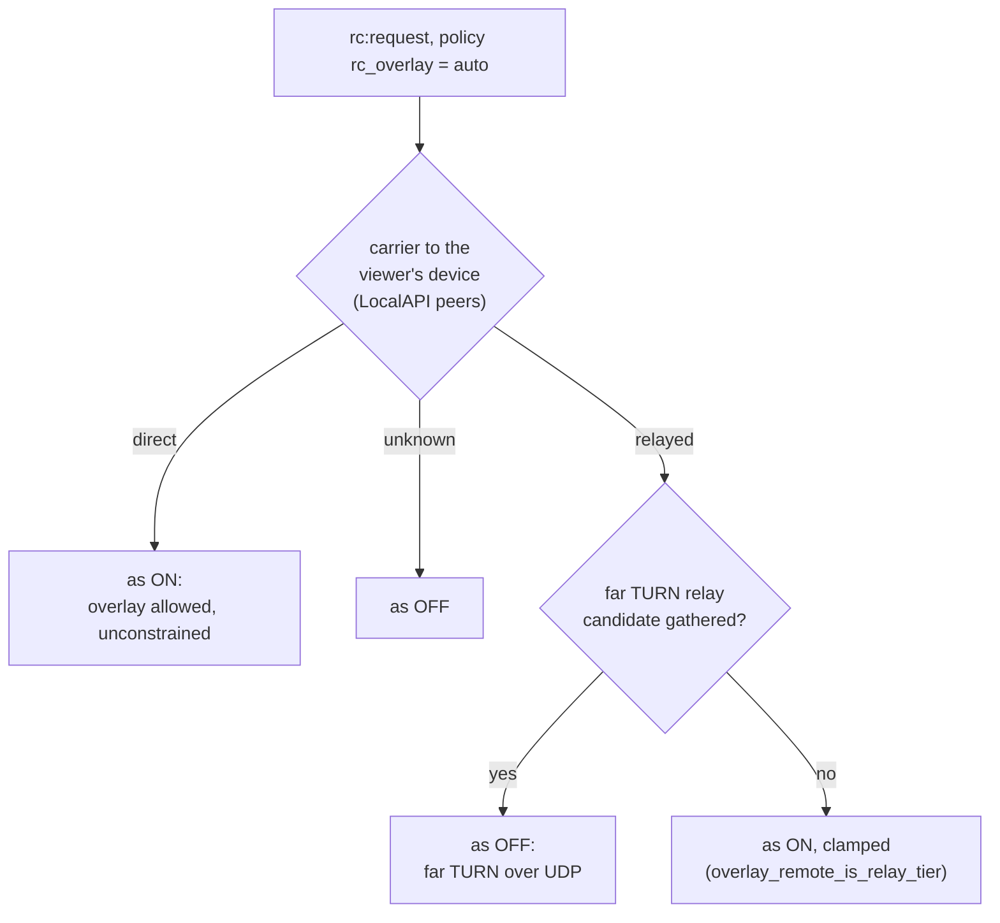

# FR-128: Remote desktop over the mesh, automatically — the overlay path only while the mesh link is direct, or when it is the only path

**Issue:** [#2989](https://github.com/gjovanov/roomler-ai/issues/2989) · **Status:** proposed 2026-10-27, on the operator's choice of an "auto" mode after a same-network session relayed. **§2.1's premise was corrected 2026-10-28**: those sessions measured a worker that #2987 had orphaned, not `rc_overlay=off`. **D6 and D7 decided 2026-10-28**: §2.2 was re-measured (Chrome on a Mac still relays; the cause is found). P1 and P2 merged 2026-10-29 (#3079, #3088) and are live: agents from 0.4.185, server images from `hosted-20261029-2ae4ffd`. **Field verification (P4) began 2026-10-30**: AC1 holds in both directions, 10 of 10 each way; AC2 holds since P2b went live; AC4, AC5 and AC6 are met; and the far-TURN hint had two blind spots (D8), which P2c closes (AC7 met). Only AC3 is owed · **Related:** #1882 (the switch), FR-64 ([#1244](https://github.com/gjovanov/roomler-ai/issues/1244)), FR-121 ([#2862](https://github.com/gjovanov/roomler-ai/issues/2862)), [#2781](https://github.com/gjovanov/roomler-ai/issues/2781), [#2774](https://github.com/gjovanov/roomler-ai/issues/2774)

## 1. Goal

A remote-desktop session between two machines on one network rides the **direct** mesh link, at LAN speed and unconstrained, **without** the risk that made `rc_overlay` default off. The decision, per session:

- the mesh link to the viewer's own device is **direct**: take the overlay;
- the mesh link is **relayed** (DERP over TCP, a peer relay) and a UDP path exists: **don't** take the overlay;
- the overlay is the **only** path (#2781: UDP blocked, TLS inspected, no TURN): take it, clamped.

Today the device chooses between two defaults, and each is wrong somewhere. `off` relays a Mac browser's same-network session through the far TURN (§2.2), and fails a session where the mesh is the only path (§2.4). `on` lets a relayed mesh carry the video over TCP (§2.3). A Windows browser on a Mac's network needs neither: with a working agent it goes direct under `off` (§2.1, corrected 2026-10-28).

## 2. Evidence

### 2.1 Same network, `rc_overlay` off: the far-TURN sessions came from an orphaned worker (corrected 2026-10-28)

The record that opened this FR, from 2026-10-27. The operator's Windows laptop's browser → the operator's MacBook (its GUI worker), one Wi-Fi. The Mac's log, `session carrier recorded (FR-102 P9c)`:

| session start (UTC) | carrier | local (Mac) | remote (browser) |
|---|---|---|---|
| 09:39:36 | `turn` | Srflx | **Relay** |
| 09:39:58 | `turn` | Host (LAN) | **Relay** |
| 09:40:16 | `turn` | Srflx | **Relay** |
| 09:45:49 | **`direct`** | Host (LAN) | Prflx (LAN) |
| 09:46:09 | `turn` | Srflx | **Relay** |

The relayed sessions ran `constrained=true`: 30 fps, a ceiling of ~3.4 Mbit/s. They logged `rc ICE: overlay excluded (device policy rc_overlay=off, the default)` (`agents/roomlerd/src/peer.rs:497`). The mesh link between the two machines was direct the whole time: `tier=Lan`, ~11 ms (`roomler peers` on both ends).

⚠️ **These sessions measured a broken worker, not `rc_overlay=off`.** All five ran on the GUI worker that #2987 orphaned when its daemon exited on 2026-10-26 at 13:06Z. A browser without a camera grant hides its LAN address behind an mDNS `.local` name. The agent resolves that name through the OS before handing the candidate to ICE (`agents/roomlerd/src/mdns_resolve.rs:99`, called from `agents/roomlerd/src/peer.rs:1852`). With the real address, the agent checks a Host↔Host pair itself, and that pair completes before the browser nominates. A worker that cannot resolve leaves the direct pair to peer-reflexive discovery, racing the pre-warmed relay pair. The table above shows that race: the relay four times, and one prflx pair that replaced the relay 3 s into the session (`transport path changed mid-session … was_relay=true now_relay=false`, `peer.rs:2224`). The worker's own log:

| worker | when (UTC) | sessions | direct | `mDNS host candidate resolved` | how they paired |
|---|---|---|---|---|---|
| healthy (0.4.17x) | 10-23 19:27 → 10-26 07:47 | 75 | **75** | 59, in 1–58 ms | 59 Host↔Host on a resolved name, 13 Host↔Host on a raw address, 3 peer-reflexive from the same laptop with no resolution logged |
| orphaned (#2987) | 10-26 13:06 → 10-27 10:00 | 7 | **2** | **0** | far TURN 5, peer-reflexive from the same laptop 1, Host↔Host on a raw address 1 |
| fresh, after the orphan was replaced | 10-27 10:00 → 10-28 17:00 | 10 | **10** | 1 (the control below) | 1 Host↔Host on a resolved name, 8 on a raw address, 1 peer-reflexive from a third machine on the LAN |

**The control, 2026-10-28, on 0.4.181.** One session from the operator's Edge (`Edg/156`, no camera grant for roomler.ai, so its only host candidate was a `.local` name) to MacBook-1, under the interim `rc_overlay=on` (§8). The name resolved in **9 ms** to a 192.168 LAN address. The session recorded `carrier="direct" local_typ=Host remote_typ=Host`, both addresses on the LAN, `overlay=None`, and ran `constrained=false`: HEVC on VideoToolbox at 3024×1964, 120 fps target, 60→80 Mbit/s. `on` offered the overlay candidates, and ICE still took the LAN pair.

So §2.1 is no case for this FR. With a working agent, a Windows browser on the Mac's network already gets the LAN pair under `off`. The case rests on §2.2 and §2.4. Why the orphan stopped resolving was not established: the worker logs only a resolution that succeeds, and the orphan was replaced before anyone looked. The sessions on 2026-10-23 before 19:27Z relayed for a different reason: the viewing browser offered no candidate at all. In Edge the cause was a VPN extension that forbade non-proxied UDP, and it was removed that evening.

### 2.2 The other direction (2026-10-24)

A Mac browser (Chrome and Safari) → a Windows agent on the same network relayed every session: macOS Local Network privacy denies Chrome's helper, and Safari offers no host candidates without a camera grant. Turning `rc_overlay` on for the target fixed it. The viewer's own device's loopback relay (FR-121) carries the session over the mesh.

**Re-measured 2026-10-28 (D6), target `off`, on 0.4.182.** Carriers are from the server's own record (`remote_sessions.carrier`):

| Mac browser → Windows agent | sessions | carrier | time to first frame |
|---|---|---|---|
| Safari | 3 | `direct` ×3 | 628–873 ms |
| Chrome | 3 | `turn` ×3 | 1062–1129 ms |

So §2.2 still holds for **Chrome** and no longer for **Safari**. The cause for Chrome is per-process. The Mac's network-extension rules (`/Library/Preferences/com.apple.networkextension.plist`) allow `com.google.Chrome` local-network access, but deny it to `com.google.Chrome.helper` (`DenyMulticast = true`, never chosen by the user). That helper is the process that owns WebRTC's UDP sockets, so every ICE check to a LAN address is refused. Under `on`, Chrome sends to 127.0.0.1 (its own device's loopback relay), which is not "local network". That is why `on` fixes it: 35 of 35 sessions from that Mac rode the mesh from 2026-10-25 to 10-27.

### 2.3 Why `rc_overlay` defaults off (`docs/remote-control.md` §4.4)

- **#1856:** a 3 ms route hole on a Mac killed sessions.
- **Hidden carrier:** a pair the mesh carries over DERP/TCP reads as `Host` ↔ `Host`. The data-channel video then crosses a TCP relay: two retransmission layers and head-of-line blocking.
- The guard `overlay_remote_is_relay_tier` (`agents/roomlerd/src/peer.rs:2251`) asks the daemon which carrier holds the session's overlay peer, and clamps the session as constrained unless it is a live direct one. That ended the 2026-07-27 collapse (821 kbps, 17 fps, 1.5–7.5 s stalls). It **cannot** remove the TCP latency. And ICE still ranks the mesh host pair above a far TURN pair over UDP, so on a relayed mesh `on` picks the TCP path even when the UDP relay would be better.

### 2.4 Where the overlay is the only path (#2781)

On a UDP-blocked, TLS-inspected network no TURN allocation answers (`TURN allocate … attribute not found` = no answer). The mesh over DERP/TLS :443 is then the only working path, and `off` fails the session silently. A naive "auto" that drops the overlay whenever the mesh is relayed would fail it the same way.

## 3. Key design

### 3.1 The decision

`AccessPolicy.rc_overlay` (`crates/remote_control/src/models.rs:1624`) gains a third value, **`auto`**. Under `auto` the **target agent** decides per session. Both inputs are facts it already has:

| mesh carrier to the viewer's device | far TURN candidate gathered | the session behaves as | why |
|---|---|---|---|
| **direct** (LAN, public, srflx) | either | **on**: the overlay pair, unconstrained | the case §2.2 loses today |
| **relayed** (DERP, peer relay, tunnel) | **yes** | **off**: the far TURN over UDP | the TCP risk of §2.3 |
| relayed | **no** | **on**, clamped by the existing guard | §2.4: the overlay is the only path |
| unknown (an old daemon, no answer within the guard's 400 ms) | — | **off** | fail safe |

With several viewer devices (FR-121 P3b: one relay per agent on the viewer's computer), the **best** of their carriers is the row, and a session on the mesh keeps every device on a worse link out of its ICE (§3.2).

### 3.2 The inputs

**As built in P1 (2026-10-28): the session decides at its offer, before ICE gathers, from three inputs. The peer then sees a plain on/off, filtered exactly as `on` and `off` always were.**

- **The carriers.** One LocalAPI `peers` call, the one the relay-tier guard makes, bounded at 400 ms the same way, read for each of the viewer's devices by its overlay address (`mesh_carriers_of`, `agents/roomlerd/src/rc_overlay.rs:310`). `Direct` reads direct. `Relay` and `Tunnel` read relayed. `Blocked`, `Offline` and no answer read unknown (`MeshCarrier`, `:257`). The best carrier among the viewer's devices decides. When the session rides the mesh, every device on a worse link stays out of its ICE (`exclude`, `:57`).
- **The viewer's devices** (D3, option B): the **server names them** in `rc:request` (`RcOverlayAutoWire.viewers`, `crates/remote_control/src/signaling.rs:5522`). Each is the `overlay_ip` of a loopback-relay descriptor the Hub hands the browser (FR-121, `resolve_local_relay`, `crates/modules/fleet/src/hub.rs:3497`), which the Hub has already checked lies in the overlay range. Since FR-121 P3b there is one per agent on the viewer's computer, at most four. Windows and WSL each run a relay, and their mesh links can differ completely: on neo16 the Windows agent is direct to every peer while the WSL one rides DERP.
- **Far TURN availability** (D5, alternative): also from the server, `RcOverlayAutoWire.far_turn`. It is true only when **both** devices' last netcheck reached the far TURN over UDP: `stun_udp` (`crates/remote_control/src/signaling.rs:5317`). Until P2b it also required `relay_band_udp` (`:5321`) not to be `Some(false)`. The lab showed that misreads a working far TURN as dead (§8, 2026-10-30), because a relay↔relay pair needs only coturn's listening port. The netcheck itself says so: its STUN target is coturn's own UDP address (`stun_urls_from_turn`, `crates/modules/network/src/overlay.rs:2859`), and it probes the band only through a UDP-only allocation on coturn that has already succeeded (`crates/tunnel-core/src/overlay/runtime.rs:4095`, `crates/tunnel-core/src/overlay/netcheck.rs:207`). So `stun_udp=true` with the band `Some(false)` is a node that did allocate on the far TURN over UDP. Since P2c (D8) the browser's end is the best of all its devices, and the target folds its own netcheck in at its offer, which is how a Mac's GUI worker is measured at all. `None` means not measured, and is read as "it works", so a relayed mesh stays off. #2781's viewer sits behind exactly such an egress drop, which the agent's own gathering could never see.
- **Where it runs.** `RcOverlay::decide` (`rc_overlay.rs:112`), called by the `rc:sdp.offer` handler (`agents/roomlerd/src/signaling.rs:4120`). That handler also runs in a delegated macOS GUI worker. The inputs cross to that worker inside `RcOverlay`, which already carries the decision there, so whichever process builds the peer decides. The server sends the offer only after the request is answered, so the decision never races the consent.

⚠️ **Why not the proposed defaults (decide while gathering, holding the overlay candidates).** Holding a candidate means gathering it, and webrtc-rs pairs every candidate it gathered, trickled or not. On a weak-host OS (Linux, macOS), checks from the overlay-bound host candidate to a browser's LAN address can come back over the mesh as a peer-reflexive pair. That would put the session on a relayed mesh exactly when `auto` had decided against it. Deciding before gathering keeps the proven `off` filters intact. It also needs no candidate buffering in `peer.rs` at all.

### 3.3 The policy on the wire

`RcOverlay` (`rc_overlay.rs:34`) is resolved per session from the request (`RcOverlay::resolve_mode`, `:80`) and reaches a delegated worker in `SessionParams.rc_overlay` (`agents/roomlerd/src/delegate.rs:216`). `auto` travels beside the bool, as `rc_overlay_auto` next to `rc_overlay: false`, so an older reader sees the bool it understands (D1).

As built, the Hub also sends `auto` only to an agent that advertises the `rc-overlay-auto` verb (`crates/remote_control/src/models.rs:1298`), as it sends `lock_on_end` only to one advertising `lock-on-end`. To any other agent the policy reads as `off`: no `rc_overlay_auto`, and no viewer relay handed out. That makes D1 hold on the server, not only in the older agent's parser. A device with the kill switch set stops advertising the verb (`agents/roomlerd/src/encode/caps.rs:3081`).

P2, as built (`docs/remote-control.md` §4.4 has the diagram):
- **Stored.** The policy row keeps `auto` in a field of its own, `AccessPolicy.rc_overlay_auto` (`crates/remote_control/src/models.rs:1635`), rather than as a third value of `rc_overlay`. A pod rolled back below P2 then reads the row as `off`, never as one it cannot parse.
- **Carried.** `RcOverlayMode` (`:1653`) is what the authz gate hands the Hub, and it crosses pods as `rc_overlay_auto` plus `rc_overlay_far_turn` beside the bool (`crates/modules/remote/src/relay.rs:585`).
- **The far-TURN hint (D5).** The authz gate asks a new core hook, `far_turn_udp` (`crates/core/src/hooks.rs:187`), bounded at 500 ms (`crates/modules/remote/src/controller.rs:701`). `network` answers from the fresh netcheck of the target and of every device the browser runs on (`crates/modules/network/src/hooks.rs:107`). Since P2c the browser's end is its best device (D8, `browser_reach`, `:154`), and the target folds its own netcheck in at the offer (`own_far_turn`, `agents/roomlerd/src/rc_overlay.rs:351`). A hook, because the Hub has no database and `remote` must not call `network` (the module DAG).
- **The page.** **Mesh: off / auto / on** on each device's row (`ui/src/components/admin/devicePolicy.ts:82`) replaces the checkbox, and both fields are written on every change, so a row never says `on` and `auto` at once.

### 3.4 Mid-session

The guard keeps clamping a carrier that degrades during a session. Moving such a session off the overlay is P3 (D4).

## 4. Phases

| Phase | What | Kill switch | Status |
|---|---|---|---|
| P0 | **Measure before building**: same network, Mac ↔ Windows both directions, `off` vs `on` vs a mesh forced onto DERP, plus #2781's topology. Carrier, fps and Mbit/s per cell | — | **in progress.** Windows browser → Mac measured on 2026-10-28: direct with a working agent (§2.1). Mac browser → Windows re-measured the same day (D6): Safari direct, Chrome relayed, cause found (§2.2). Still owed: a mesh forced onto DERP, and #2781's topology |
| P1 | Agent: the `auto` decision (§3.1, §3.2 as built), its log line naming the inputs and the outcome, the wire field `rc_overlay_auto`, and the `rc-overlay-auto` verb (§3.3) | `ROOMLERD_RC_OVERLAY_AUTO=0`: `auto` behaves as `off`, and the verb is not advertised | **merged** 2026-10-29 (#3079, `de8403167`), released in agent 0.4.185 |
| P2 | Server + UI: the tri-state on the device policy (Off / Auto / On). The Hub hands out the viewer's loopback relay under `auto` as under `on`. Wire compatibility per D1 | P1's switch, plus the policy itself | **merged** 2026-10-29 (#3088, `15a7cabe6`), on prod since `hosted-20261029-2ae4ffd` (10:26Z). Stored, carried and shown as §3.3 says; the far-TURN hint comes through a core hook that `network` answers. ⚠️ The hint cannot measure a Mac's GUI worker, and it reads only the browser's first device (D8) |
| P2b | Server: the far-TURN hint reads `stun_udp` alone (`reaches_far_turn`, `crates/modules/network/src/hooks.rs:145`). The relay band stays the overlay dialer's bit (§8, 2026-10-30) | P1's switch, plus the policy itself | **merged** 2026-10-30 (#3134, `729ed7222`), D5 confirmed by the operator. Live since `hosted-20261030-ff00741` (19:43Z) |
| P2c | D8's two blind spots. **Server:** the gate names every device the browser runs on, in the Hub's own order (`viewer_devices_of`, `crates/modules/remote/src/controller.rs:666`), and the browser's end is its best device (`browser_reach`, `crates/modules/network/src/hooks.rs:154`). **Agent:** the target folds its own netcheck into the hint at its offer (`own_far_turn`, `agents/roomlerd/src/rc_overlay.rs:351`), and a Mac's per-user half lends its root daemon's netcheck (`with_machine_network`, `agents/roomlerd/src/person_socket.rs:223`) | P1's switch, plus the policy itself | **merged** 2026-10-30 (#3159, `ff0074175`). The server half is live since `hosted-20261030-ff00741` (19:43Z), the agent half since agent 0.4.189. AC7 met (§8) |
| P3 | (D4) Move a session off an overlay that degrades to a relay mid-session, when a far TURN path exists | its own env switch | — |
| P4 | Docs + field verification (AC1–AC7) | — | **in progress** since 2026-10-30. AC1 met in both directions: 10 of 10 direct and unconstrained each way (§8). AC2 met in the lab on prod after P2b went live, including the relay band measured blocked (§8). AC4, AC5, AC6 and AC7 met. Owed: AC3 |

## 5. Acceptance criteria

- [x] **AC1 (P1+P2):** same network, mesh direct, `auto`, in both directions (a Windows browser → a Mac agent, a Mac browser → a Windows agent): `session carrier recorded` shows a direct pair (the overlay, or the LAN host pair that ICE preferred over it in §2.1's control), and the session runs `constrained=false`, in at least 9 sessions of 10. The Windows → Mac half already holds under `off` with a working agent (10 of 10 since 2026-10-27 10:00Z, §2.1), so for that half AC1 is a non-regression check.
- [x] **AC2:** the mesh forced onto DERP, far TURN reachable, `auto`: the session's carrier is `turn` and never the overlay. The log names why.
- [ ] **AC3:** #2781's topology (UDP blocked, TLS inspected), `auto`: the session connects over the overlay, clamped. With `off` it fails: record that RED first.
- [x] **AC4:** compatibility: an older agent given `auto` behaves per D1, and an older server never sends `auto`.
- [x] **AC5:** `ROOMLERD_RC_OVERLAY_AUTO=0` makes `auto` behave as `off`, verified on one device.
- [x] **AC6 (docs):** `docs/remote-control.md` §4.4 documents `auto`: the decision table, a mermaid diagram of it, `file:line` anchors, linked from `docs/README.md`.
- [x] **AC7 (P2c, D8):** a session to a Mac under `auto` logs the Mac's own reach (`own_far_turn=Some(..)` on its decision line), and a browser whose first device has no UDP out (NEO16 with its WSL agent first) still reads the far TURN as usable when another of its devices reaches it.

## 6. Open decisions (defaults in bold)

| | Decision | Options |
|---|---|---|
| D1 | What an **older agent** receives for `auto` | **`rc_overlay=false`**: it behaves as today's default. Or `true` |
| D2 | The **default** for new devices once AC1–AC3 hold | **stay `off`, and the operator decides then**. Or `auto` |
| D3 | How the target learns the **viewer's device** | ~~the overlay address of the session's remote relay candidate~~. **P1 took the other option: the server names it in `rc:request`**, because the remote candidate only arrives while ICE gathers (§3.2's ⚠️). The operator's to confirm. |
| D4 | **P3** in scope (a mid-session move off a degraded overlay) | **no: the guard's clamp covers it**. Or an ICE restart |
| D5 | How **far-TURN availability** is known before the overlay is offered | ~~defer the overlay candidates until far-TURN gathering has finished~~. **P1 took a third option: the server's hint from both devices' last netcheck** (§3.2), absent = "it works". Deferring candidates leaks (§3.2's ⚠️), and only the server sees the viewer's side. **P2b (2026-10-30) narrows the hint to `stun_udp`**: read as "dead", `relay_band_udp` put an `auto` session on the overlay over DERP (§8). **Confirmed 2026-10-30 (operator).** |
| D6 | Build P1–P2 now that §2.1 is void (added 2026-10-28) | **Decided 2026-10-28 (operator): re-measure first, then build.** Re-measured the same day (§2.2), then the build began. |
| D7 | The interim `rc_overlay=on` on the MacBook's GUI-worker row (§8), set for the Windows → Mac case that §2.1 no longer supports | **Decided 2026-10-28 (operator): keep it.** |
| D8 | The far-TURN hint's two blind spots (added 2026-10-30, §8): a Mac target is never measured, because its RC target is the GUI worker's row and that row has no overlay node; and only the browser's first device counts | For the Mac: **the target folds its own daemon's last netcheck into the hint at its offer** (any OS; an agent release). Or the GUI worker names its daemon's row in its hello (agent and server). Or document the limit, and a Mac on a UDP-blocked network keeps `on`. For the browser: **the best verdict among all its devices** (server only). **Decided 2026-10-30 (operator): both defaults**, the target's own netcheck for the Mac and the best device for the browser. Built in P2c |

## 7. Out of scope

- FR-64's multi-org route war (#1237).
- TURN over TLS/TCP.
- Changing the guard itself (`overlay_remote_is_relay_tier`).
- Safari's missing host candidates, beyond what the mesh path already solves.

## 8. Field-verification log

### 2026-10-27 — the RED, and the interim switch

Recorded in §2.1: one Wi-Fi, `rc_overlay` off, four of five sessions on the far TURN, the mesh link direct. On the operator's choice, the MacBook's GUI-worker row had `rc_overlay` set to `true` the way the Devices page does it: `PUT …/agent/{id}` with the full policy, 200, every other field unchanged. That is the interim until this FR ships `auto` (D7). ⚠️ The RED is superseded by the next two entries.

### 2026-10-27 evening — the RED was the orphaned worker (#2987)

The Mac worker's log resolved 59 mDNS names while healthy (10-23 19:27Z → 10-26 07:47Z) and none after its daemon died at 10-26 13:06Z. The flip from relay to direct came at 10:00:40Z, when the orphan was replaced by hand, not at the `rc_overlay` switch (~10:10Z): the 10:01:42Z session ran under `off` and was direct Host↔Host. Posted on [#2989](https://github.com/gjovanov/roomler-ai/issues/2989#issuecomment-6454236389).

### 2026-10-28 — the control: a browser that hides its address, on a healthy 0.4.181 worker

Edge (no camera grant) on the operator's Windows laptop → MacBook-1: resolved in 9 ms, direct LAN Host↔Host, `constrained=false`, 120 fps target (§2.1). The same visit field-verified #2987's fix on this Mac (`docs/installation.md`, "The GUI worker never outlives its daemon"). Every session since the orphan was replaced has been direct: 10 of 10.

### 2026-10-28 night — D6: §2.2 re-measured, and why Chrome on a Mac relays

The operator unticked "Remote desktop over the mesh" on the Windows laptop's row. They then connected three times from Safari and three times from Chrome on the MacBook, and ticked the box back (20:34:36Z).
- **Safari:** `direct` ×3.
- **Chrome:** `turn` ×3.
- The carriers come from `remote_sessions.carrier`, because the laptop's daemon had logged nothing since its update restart (#3073), so the ICE pair types were not recorded.

The cause is per-process macOS Local Network privacy: Chrome's network helper is denied the LAN, while Chrome itself is allowed (§2.2). Posted on [#2989](https://github.com/gjovanov/roomler-ai/issues/2989#issuecomment-6480088242) and [#2989](https://github.com/gjovanov/roomler-ai/issues/2989#issuecomment-6484202232). On the operator's decision, P1 began the same night.

### 2026-10-30 — AC1, Windows browser → Mac agent: 10 of 10 direct

Setup:
- **Viewer:** NEO16's Chrome 156. A probe in the same tab gathered 16 host candidates, the LAN address among them.
- **Target:** MacBook-1 under `auto`.
- **When and where:** 00:41–00:52Z, one network, the mesh direct at about 5 ms.

Results:
- **The decision.** Every session logged `rc ICE: overlay auto (FR-128) — the session may ride the mesh`, with `carriers=[Direct, Relayed]` (NEO16, then NEO16-WSL, which rides DERP), `allow=true`, and NEO16-WSL's relay in `exclude`.
- **The pair.** Every `session carrier recorded` read `direct`, Host↔Host on the LAN, and so did the server's `remote_sessions.carrier`.
- **The posture.** All 42 heartbeats read `constrained=false`, at a 120 fps target.
- **Which direct pair.** With the overlay allowed, ICE preferred the LAN pair in all ten, as in §2.1's control. Three earlier `auto` sessions on this pair were direct too: two on the LAN pair, and one on the overlay pair (`overlay_direct`, 10-29 22:00Z).

Posted on [#2989](https://github.com/gjovanov/roomler-ai/issues/2989#issuecomment-6512232869). The Mac → Windows half, the case this FR exists for, waits on the operator at the MacBook.

### 2026-10-30 — the far-TURN hint cannot see a Mac's GUI worker (D8)

Every one of those 13 decisions logged `far_turn=None`. A bounded read of `overlay_nodes` found live nodes with a fresh netcheck for MacBook-1-Daemon, NEO16 and NEO16-WSL. It found none for MacBook-1, the GUI worker's row, which is the row a session targets.

**Why a Mac target is never measured.** The hook looks nodes up by agent id (`find_live_by_agent`, `crates/services/src/dao/overlay_node.rs:413`). Nothing links the two Mac rows: their `machine_id`s differ, and no field names the other.

**Only the browser's first device counts.** The hint uses `viewer_device_of` (`crates/modules/remote/src/controller.rs:663`), and the browser sends `probed[0]` (`ui/src/composables/useRemoteControl.ts:4118`). On NEO16 the first device is whichever agent holds the first loopback port, 47989: NEO16 itself that night, NEO16-WSL on 10-23. NEO16-WSL measures the far TURN dead (`stun_udp=false`, relay band blocked), while Windows reaches it.

**What it affects.** AC1 is untouched, because a direct carrier allows the mesh whatever the hint says. #2781's row with a Mac as the blocked end is affected: its hint reads `None`, and the session stays off the mesh. Posted on [#2989](https://github.com/gjovanov/roomler-ai/issues/2989#issuecomment-6512346739). The options are D8.

### 2026-10-30 — AC4 and AC5 on a lab device

One throwaway Ubuntu 24.04 VM in the lab org, 01:32–01:39Z, in three phases. Each phase was a fresh ephemeral enrollment, because a stopped ephemeral daemon unenrolls itself. Every phase did the same three things:
- set the policy to **Mesh: auto** the way the Devices page writes it, and read it back as `rc_overlay=false, rc_overlay_auto=true`;
- ran one remote-desktop session from the lab's Playwright viewer, which decoded frames;
- read the session from the daemon's own log.

| phase | agent | `rc-overlay-auto` advertised | the session's log |
|---|---|---|---|
| a | 0.4.184, before P1 | no | `rc ICE: overlay excluded (device policy rc_overlay=off, the default)` |
| b | 0.4.187 with `ROOMLERD_RC_OVERLAY_AUTO=0`, read back from the process's environment | no | `rc ICE: overlay excluded (device policy rc_overlay=off, the default)` |
| c | 0.4.187, the control | yes | `rc ICE: overlay auto (FR-128) — the session stays off the mesh`, then `overlay excluded (device policy rc_overlay=auto, decided for this session)` |

**AC5.** Phases b and c differ only in the kill switch. With it set, the device does not advertise the verb, and its session runs as a plain `off`.

**AC4.** An agent from before P1, given `auto`, behaves as `off` (phase a): that is D1. A server from before P2 has no `rc_overlay_auto` to send. It reads `rc_overlay`, which every phase stored as `false` beside `rc_overlay_auto=true`, so it reads such a device as `off`. The new server's half is the CI test `auto_reaches_only_a_device_that_decides_it` (#3088). The older-server half rests on the stored row and the code, not on a run against an old server image.

**The control said "stays off"** because the lab viewer has no relay of its own in the lab org: `viewers=[]` reads the carrier as unknown (§3.1). A control that rides the mesh needs a viewer-side relay. AC2 needs one too. The VM, its disks and all three device rows are gone. Posted on [#2989](https://github.com/gjovanov/roomler-ai/issues/2989#issuecomment-6512839286).

### 2026-10-30 — AC2 in the lab: the hint read the relay band, and `auto` rode DERP

**Setup:**
- **The viewer's device:** a fresh 0.4.187 agent in its own container on one lab host, with the Playwright browser in that container's network namespace. A seeded pairing makes the browser name the device, so `viewers` is filled.
- **The target:** a 0.4.187 VM on another lab host, under `auto`.
- **The mesh between them:** relayed in every phase (`relay:derp/tcp`, once `relay:turn/udp`). The NAT on each host defeats WireGuard's hole punch, while ICE still punches through.

| run | phase | `far_turn` | the decision | the session's carrier |
|---|---|---|---|---|
| 1 | `auto` ×2 | `None` (no netcheck on the server yet) | stays off the mesh, `carriers=[Relayed]` | `direct` (Srflx↔Srflx, Host↔Prflx) |
| 1 | `on` | — | overlay allowed | `direct` |
| 2 | `auto` | `Some(false)` | **may ride the mesh** | **`derp`**: the overlay over DERP |
| 2 | `auto`, the target's UDP to the viewer's host dropped | `Some(false)` | may ride the mesh | `turn` (Host↔Relay) |
| 2 | `on`, the same drop | — | overlay allowed | `turn` |

**The cause.** In run 2 the viewer's netcheck read `relay_band_udp=false`, and the hint took that as "far TURN dead". Yet run 2's last two sessions rode the far TURN, with the band read blocked at both ends. One of them was a Host↔Relay pair in which the VM itself sent into the relay band.

**The reach.** Five of the 21 live nodes with a fresh netcheck read `stun_udp=true, relay_band_udp=false`. One is CORPLAP-3, a corp laptop.

**The fix.** P2b: the hint reads `stun_udp` alone. Posted on [#2989](https://github.com/gjovanov/roomler-ai/issues/2989#issuecomment-6513246164). AC2 waits on P2b being promoted and a re-run.

### 2026-10-30 — AC1, Mac browser → Windows agent: 10 of 10 direct

**Setup:**
- **The viewer:** Chrome 156 on MacBook-1 (macOS), driven through the Claude extension.
- **The target:** NEO16 on 0.4.188, with `rc_overlay=auto` and consent `auto`.
- **The mesh:** NEO16 ↔ MacBook-1-Daemon direct, about 7 ms, on one network.
- **Each session:** Connect, about 9 s with the picture on the canvas (2560×1600), Disconnect.

**The decision.** All 10 sessions logged the same line on NEO16: `the session may ride the mesh`, with one viewer device (the Mac's daemon, which the browser's loopback probe found), `carriers=[Direct]`, `far_turn=Some(true)`, `allow=true`, and nothing in `exclude`.

**The outcome.** On NEO16's `session carrier recorded`, cross-checked against the server's `remote_sessions.carrier`:

| sessions | carrier | the pair |
|---|---|---|
| 3 | `overlay_direct` | Host↔Host, both on the overlay |
| 7 | `direct` | Srflx↔Host, the Mac's LAN address |

Every heartbeat read `constrained=false` at a 144 fps target (HEVC on NVENC). Each session connected in 143–386 ms and ended `controller_hangup`. With the Windows → Mac half (10 of 10, above), **AC1 is met.** Posted on [#2989](https://github.com/gjovanov/roomler-ai/issues/2989#issuecomment-6528390985).

**Not explained.** On 2026-10-28, under `off`, Chrome on this Mac relayed 3 of 3 (§2.2: macOS denied Chrome's network helper the LAN). Today 7 of 10 sessions took a direct pair to the Mac's LAN address, the path that denial blocked. What changed on the Mac is not established.

### 2026-10-30 evening — AC2 after P2b went live: met, including the relay band measured blocked

**Setup:** the lab of the AC2 entry above (the viewer's device in a container on one lab host, the target a VM on another, the mesh between them relayed over DERP), against prod on `hosted-20261030-ff00741`. One change to the kit: the phases now wait until both agents hold a netcheck vector. A phase run before that reads the hint as `None`, which the agent takes as "it works", so it proves nothing about the hint.

| run | the hint's inputs | phase | the decision | the session's carrier |
|---|---|---|---|---|
| 3 | neither node had reported a netcheck yet | `auto` | stays off the mesh, `far_turn=None` | `direct` |
| 3 | | `auto`, the target's UDP to the viewer's host dropped | stays off the mesh, `far_turn=None` | `turn` |
| 4 | both nodes: `stun_udp=true`, band open | `auto` | stays off the mesh, `far_turn=Some(true)` | `direct` (Srflx↔Srflx) |
| 4 | | `auto`, the drop | stays off the mesh, `far_turn=Some(true)` | **`turn`** (Host↔Relay) |
| 4 | | `on`, the drop (the RED) | overlay allowed | **`derp`**: the overlay over DERP |
| 5 | the target: `stun_udp=true`, **`relay_band_udp=false`** | `auto` | stays off the mesh, **`far_turn=Some(true)`** | `direct` (Srflx↔Srflx) |
| 5 | | `auto`, the drop | stays off the mesh, **`far_turn=Some(true)`** | `direct` (Host↔Prflx) |
| 5 | | `on`, the drop (the RED) | overlay allowed | **`derp`** |

**Run 5 is run 2's failing condition, rebuilt on purpose.** Before its first netcheck the target dropped its UDP to coturn's addresses on every port but 3478. STUN and the TURN allocation still worked; a raw send into the relay band did not. Its vector then read `stun_udp=true, relay_band_udp=false`, the reading that made the old hint say "far TURN dead" and put run 2's session on DERP. With P2b the hint read `Some(true)`, and the session stayed off the mesh.

**AC2 is met:** with the mesh on DERP and `auto`, the session never took the overlay, and the log names why (`carriers=[Relayed]`, `far_turn=Some(true)`). Where UDP to the viewer's host was dropped, it rode the far TURN (run 4). Under `on` the same session rode the overlay over DERP, which is what `auto` refuses. Posted on [#2989](https://github.com/gjovanov/roomler-ai/issues/2989#issuecomment-6532511332).

### 2026-10-30 21:00Z — AC7 (P2c, D8): both halves in one session

**Setup:** Chrome 156 on NEO16 → MacBook-1 (the Mac's GUI-worker row) under `auto`, after agent 0.4.189 reached all three machines. The browser's device list ("This browser runs on") was set to **NEO16-WSL first**, then NEO16, and restored straight after. On the server: NEO16-WSL's netcheck read `stun_udp=false`, NEO16's `stun_udp=true`, and the GUI-worker row has no overlay node.

**The Mac worker's decision line:** `the session may ride the mesh`, with `viewers=[NEO16-WSL, NEO16]`, `carriers=[Relayed, Direct]`, `far_turn=None`, `own_far_turn=Some(true)`, `allow=true` and NEO16-WSL in `exclude`. The session rode `overlay_direct` (Host↔Host) and ended `controller_hangup`.

- **The browser half.** Before P2c the gate read only the first device, NEO16-WSL, so the hint would have read `Some(false)`, "far TURN dead", for every target. The browser's best device now counts, and with the Mac's row unmeasured the hint is `None`.
- **The Mac half.** `own_far_turn=Some(true)` is the Mac's own netcheck, read at the offer from its daemon, which the per-user half now lends. The server's hint can never measure this row.

**AC7 is met.** An attempt at 20:57Z landed while 0.4.189 was restarting NEO16 and NEO16-WSL: the Hub held neither relay yet (`viewers=[]`), and `decide` made no lookups. Posted on [#2989](https://github.com/gjovanov/roomler-ai/issues/2989#issuecomment-6533385211).
