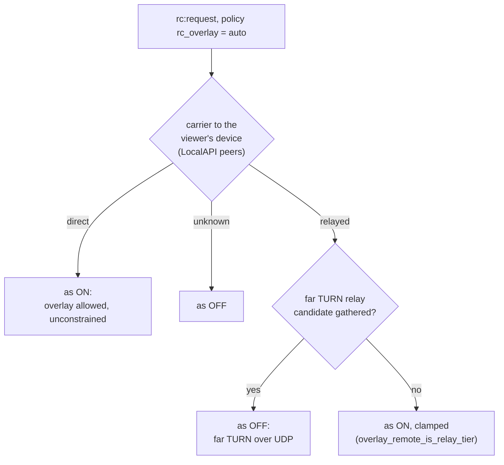

# FR-128: Remote desktop over the mesh, automatically — the overlay path only while the mesh link is direct, or when it is the only path

**Issue:** [#2989](https://github.com/gjovanov/roomler-ai/issues/2989) · **Status:** proposed 2026-10-27, on the operator's choice of an "auto" mode after a same-network session relayed · **Related:** #1882 (the switch), FR-64 ([#1244](https://github.com/gjovanov/roomler-ai/issues/1244)), FR-121 ([#2862](https://github.com/gjovanov/roomler-ai/issues/2862)), [#2781](https://github.com/gjovanov/roomler-ai/issues/2781), [#2774](https://github.com/gjovanov/roomler-ai/issues/2774)

## 1. Goal

A remote-desktop session between two machines on one network rides the **direct** mesh link, at LAN speed and unconstrained, **without** the risk that made `rc_overlay` default off. The decision, per session:

- the mesh link to the viewer's own device is **direct**: take the overlay;
- the mesh link is **relayed** (DERP over TCP, a peer relay) and a UDP path exists: **don't** take the overlay;
- the overlay is the **only** path (#2781: UDP blocked, TLS inspected, no TURN): take it, clamped.

Today the device chooses between two wrong defaults. `off` relays a same-network session through the far TURN most of the time. `on` lets a relayed mesh carry the video over TCP.

## 2. Evidence

### 2.1 Same network, `rc_overlay` off: the far TURN wins most sessions (2026-10-27)

The operator's Windows laptop's browser → the operator's MacBook (its GUI worker), one Wi-Fi. The Mac's log, `session carrier recorded (FR-102 P9c)`:

| session start (UTC) | carrier | local (Mac) | remote (browser) |
|---|---|---|---|
| 09:39:36 | `turn` | Srflx | **Relay** |
| 09:39:58 | `turn` | Host (LAN) | **Relay** |
| 09:40:16 | `turn` | Srflx | **Relay** |
| 09:45:49 | **`direct`** | Host (LAN) | Prflx (LAN) |
| 09:46:09 | `turn` | Srflx | **Relay** |

The relayed session ran `constrained=true`: 30 fps, a ceiling of ~3.4 Mbit/s. The session logged `rc ICE: overlay excluded (device policy rc_overlay=off, the default)` (`agents/roomlerd/src/peer.rs:493`). **The mesh link between the two machines was direct the whole time**: `tier=Lan`, ~11 ms (`roomler peers` on both ends).

Why the LAN pair loses: the browser hides its LAN address behind an mDNS `.local` name. The agent resolves it through the OS (`mdns_resolve.rs`), but a direct pair still has to win a race against the pre-warmed relay pair, and it won 1 roll in 5.

### 2.2 The other direction (2026-10-24)

A Mac browser (Chrome and Safari) → a Windows agent on the same network relayed every session: macOS Local Network privacy denies Chrome's helper, and Safari offers no host candidates without a camera grant. Turning `rc_overlay` on for the target fixed it. The viewer's own device's loopback relay (FR-121) carries the session over the mesh.

### 2.3 Why `rc_overlay` defaults off (`docs/remote-control.md` §4.4)

- **#1856:** a 3 ms route hole on a Mac killed sessions.
- **Hidden carrier:** a pair the mesh carries over DERP/TCP reads as `Host` ↔ `Host`. The data-channel video then crosses a TCP relay: two retransmission layers and head-of-line blocking.
- The guard `overlay_remote_is_relay_tier` (`agents/roomlerd/src/peer.rs:2238`) asks the daemon which carrier holds the session's overlay peer, and clamps the session as constrained unless it is a live direct one. That ended the 2026-07-27 collapse (821 kbps, 17 fps, 1.5–7.5 s stalls). It **cannot** remove the TCP latency. And ICE still ranks the mesh host pair above a far TURN pair over UDP, so on a relayed mesh `on` picks the TCP path even when the UDP relay would be better.

### 2.4 Where the overlay is the only path (#2781)

On a UDP-blocked, TLS-inspected network no TURN allocation answers (`TURN allocate … attribute not found` = no answer). The mesh over DERP/TLS :443 is then the only working path, and `off` fails the session silently. A naive "auto" that drops the overlay whenever the mesh is relayed would fail it the same way.

## 3. Key design

### 3.1 The decision

`AccessPolicy.rc_overlay` (`crates/remote_control/src/models.rs:1601`) gains a third value, **`auto`**. Under `auto` the **target agent** decides per session. Both inputs are facts it already has:

| mesh carrier to the viewer's device | far TURN candidate gathered | the session behaves as | why |
|---|---|---|---|
| **direct** (LAN, public, srflx) | either | **on**: the overlay pair, unconstrained | the case §2.1 and §2.2 lose today |
| **relayed** (DERP, peer relay, tunnel) | **yes** | **off**: the far TURN over UDP | the TCP risk of §2.3 |
| relayed | **no** | **on**, clamped by the existing guard | §2.4: the overlay is the only path |
| unknown (an old daemon, no answer within the guard's 400 ms) | — | **off** | fail safe |

### 3.2 The inputs

- **The carrier.** The same LocalAPI `peers` call the guard makes (`peer.rs:2238`), keyed by the viewer device's overlay address. A delegated Mac session's GUI worker runs no overlay, so it asks the daemon, as the guard already does.
- **The viewer's device** (D3): by default, the overlay address of the session's remote relay candidate. When the browser uses its own device's loopback relay (FR-121, `resolve_local_relay`, `crates/modules/fleet/src/hub.rs:3329`), that candidate's address is the viewer device's overlay address, so no new wire field is needed.
- **Far TURN availability** (D5): whether ICE gathered a relay candidate that is **not** fast-local (`relay_addr_is_fast_local`, `agents/roomlerd/src/encode/mod.rs:884`). The filters apply at gathering (`RcOverlay::keeps_local`/`ice_servers`, `agents/roomlerd/src/rc_overlay.rs:64-77`), so this needs one of two mechanisms: defer the overlay candidates until far-TURN gathering has finished, or restart ICE after a failed first round.

### 3.3 The policy on the wire

`RcOverlay` (`rc_overlay.rs:34`) is resolved per session from a bool (`RcOverlay::resolve`, `:48`) and reaches a delegated worker in `SessionParams.rc_overlay` (`agents/roomlerd/src/delegate.rs:216`). `auto` adds a mode beside it, so an older reader sees the bool it understands (D1).

### 3.4 Mid-session

The guard keeps clamping a carrier that degrades during a session. Moving such a session off the overlay is P3 (D4).

## 4. Phases

| Phase | What | Kill switch | Status |
|---|---|---|---|
| P0 | **Measure before building**: same network, Mac ↔ Windows both directions, `off` vs `on` vs a mesh forced onto DERP, plus #2781's topology. Carrier, fps and Mbit/s per cell | — | — |
| P1 | Agent: the `auto` decision (§3.1), its log line naming the inputs and the outcome, and the D5 mechanism | `ROOMLERD_RC_OVERLAY_AUTO=0`: `auto` behaves as `off` | — |
| P2 | Server + UI: the tri-state on the device policy (Off / Auto / On). The Hub hands out the viewer's loopback relay under `auto` as under `on`. Wire compatibility per D1 | P1's switch, plus the policy itself | — |
| P3 | (D4) Move a session off an overlay that degrades to a relay mid-session, when a far TURN path exists | its own env switch | — |
| P4 | Docs + field verification (AC1–AC6) | — | — |

## 5. Acceptance criteria

- [ ] **AC1 (P1+P2):** same network, mesh direct, `auto`, in both directions (a Windows browser → a Mac agent, a Mac browser → a Windows agent): `session carrier recorded` shows the overlay path, and the session runs `constrained=false`, in at least 9 sessions of 10 (§2.1: 1 of 5 today).
- [ ] **AC2:** the mesh forced onto DERP, far TURN reachable, `auto`: the session's carrier is `turn` and never the overlay. The log names why.
- [ ] **AC3:** #2781's topology (UDP blocked, TLS inspected), `auto`: the session connects over the overlay, clamped. With `off` it fails: record that RED first.
- [ ] **AC4:** compatibility: an older agent given `auto` behaves per D1, and an older server never sends `auto`.
- [ ] **AC5:** `ROOMLERD_RC_OVERLAY_AUTO=0` makes `auto` behave as `off`, verified on one device.
- [ ] **AC6 (docs):** `docs/remote-control.md` §4.4 documents `auto`: the decision table, a mermaid diagram of it, `file:line` anchors, linked from `docs/README.md`.

## 6. Open decisions (defaults in bold)

| | Decision | Options |
|---|---|---|
| D1 | What an **older agent** receives for `auto` | **`rc_overlay=false`**: it behaves as today's default. Or `true` |
| D2 | The **default** for new devices once AC1–AC3 hold | **stay `off`, and the operator decides then**. Or `auto` |
| D3 | How the target learns the **viewer's device** | **the overlay address of the session's remote relay candidate**. Or FR-121's named device, carried in `rc:request` |
| D4 | **P3** in scope (a mid-session move off a degraded overlay) | **no: the guard's clamp covers it**. Or an ICE restart |
| D5 | How **far-TURN availability** is known before the overlay is offered | **defer the overlay candidates until far-TURN gathering has finished**. Or an ICE restart after a failed first round |

## 7. Out of scope

- FR-64's multi-org route war (#1237).
- TURN over TLS/TCP.
- Changing the guard itself (`overlay_remote_is_relay_tier`).
- Safari's missing host candidates, beyond what the mesh path already solves.

## 8. Field-verification log

### 2026-10-27 — the RED, and the interim switch

Recorded in §2.1: one Wi-Fi, `rc_overlay` off, four of five sessions on the far TURN, the mesh link direct. On the operator's choice, the MacBook's GUI-worker row had `rc_overlay` set to `true` the way the Devices page does it: `PUT …/agent/{id}` with the full policy, 200, every other field unchanged. That is the interim until this FR ships `auto`.
