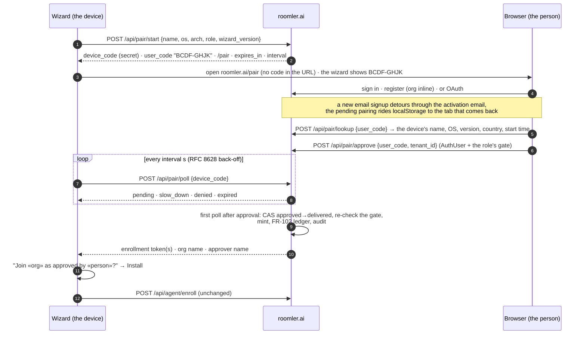
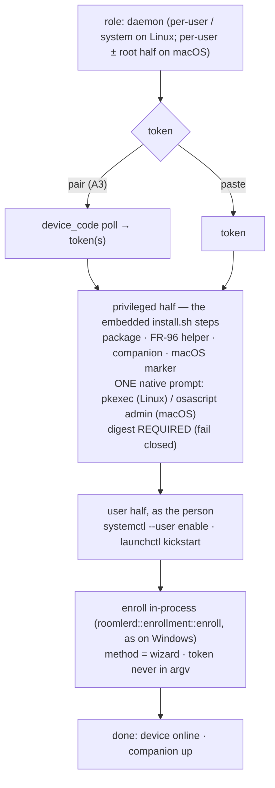

# FR-129: The installer pairs instead of asking for a token, and installs the full daemon on Linux and macOS

**Issue:** [#3022](https://github.com/gjovanov/roomler-ai/issues/3022) · **Status:** **decisions resolved 2026-10-28 · A1 (the server), A2 (`/pair`), A3 (the wizard), A4 (the terminal), B0 (the `install.sh` split) and B1-s (`/api/setup/features`) merged — the server half not on production yet (a promote hold); A3 released in agent 0.4.182** ·
**Related:** [#2338](https://github.com/gjovanov/roomler-ai/issues/2338) (a wizard reinstall overwrites `config.toml`) ·
FR-43 ([#971](https://github.com/gjovanov/roomler-ai/issues/971), the macOS halves) ·
FR-84 ([#1633](https://github.com/gjovanov/roomler-ai/issues/1633), the wizard in lockstep) ·
FR-102 ([#2127](https://github.com/gjovanov/roomler-ai/issues/2127), the install trace and the issuance ledger) ·
FR-104 (anchoring) · FR-115 ([#2557](https://github.com/gjovanov/roomler-ai/issues/2557), the free tier) ·
FR-61 ([#1199](https://github.com/gjovanov/roomler-ai/issues/1199), vmtest) · FR-96 (the update helper)

## Goal

**A person who downloads Roomler goes from "no account" to "this machine is in my org and I
can see its screen" without ever seeing, copying or pasting a token — on Windows, Linux and
macOS, from the same GUI wizard.**

The operator's report (2026-10-27), on the day the SourceForge listing went live: its Download
button served `roomler-desktop` (fixed the same day — see the log), "we need an installer for
all platforms like Linux and macOS", and "when the user comes to token, guide him/her to
account and org creation with a smooth user experience". Asked how far to go, the operator
chose the full version of both: a pairing flow with no copy-paste, and the full daemon from the
GUI on Linux and macOS.

## The field evidence

Read on master `c2ccd5e17` and on production, 2026-10-27/28.

### The token step is a dead end for anyone without an account

The wizard's step 3 is a text box: "Paste a fresh token from the Roomler admin UI"
(`agents/roomler-setup/src/front/index.html:179`). Nothing on it opens a browser, names a
signup page or says where a token comes from. To get one, a new person must:

1. register — production answers with a message and **no session**
   (`crates/api/src/routes/auth.rs:311-324`);
2. open the activation email — `login` refuses an unactivated account (`auth.rs:366-370`);
3. log in;
4. create an org, unless they filled the optional org fields at signup (`auth.rs:250-255`);
5. find Devices → Enroll device, which mints a **10-minute single-use** token
   (`crates/modules/fleet/src/agent.rs:24`, `:90-140`, behind `MANAGE_AGENTS`);
6. copy it — the dialog says "then paste the token into the wizard"
   (`ui/src/components/enroll/EnrollmentDialog.vue:119`);
7. get back to the wizard and paste it before the 10 minutes run out.

Seven steps across two applications and an inbox, with a clock on the last two. The terminal
path is the same: `install.sh` without `--token` prints the enroll command to run later.

### The GUI installs the daemon only on Windows

Every daemon-role arm of the wizard's detection says
`supported: cfg!(target_os = "windows")` (`agents/roomler-setup/src/commands.rs:79, 86, 93, 103`),
and the daemon surface off Windows is a set of no-op stubs
(`agents/roomler-setup/src/orchestrator_agent.rs:758, 889, 922`). The docs say so plainly:
on Linux and macOS the daemon is `install.sh` in a terminal, and the wizard does the tunnel
client only (`docs/installation.md:22, 26`).

Yet the wizard ships for all three. Every `agent-v<V>` cuts `setup-v<V>` (FR-84 S1), and
`setup-v0.4.180` carries Linux x86_64 and aarch64, macOS universal and Windows x64 archives.
A Linux or macOS desktop user who downloads the GUI therefore gets a wizard that cannot install
the thing they came for.

### What the terminal path does that a GUI path must do too

Each of these was paid for in the field, which is why Phase B reuses them rather than redoing
them:

| Step | Where | Why it is not optional |
|---|---|---|
| package format follows the host | `scripts/install.sh:402-421` | a `.deb` on a host without dpkg downloads and then fails; non-dpkg hosts take the tarball, mirroring the updater |
| the macOS root-half marker | `scripts/install.sh:539-548` | must exist **before** the `.pkg` runs — its absence actively removes the LaunchDaemon; "nothing in the product ever created this file, which is why the privileged half was unreachable through the advertised one-liner despite shipping for months" |
| the per-user half as the console user | `scripts/install.sh:199-210` | a root run re-targets the per-user enroll at the console user; a root-owned config is the documented failure mode |
| the macOS second enrollment | `scripts/install.sh:570-600` | the overlay needs root, and the hub keys sessions on `agent_id`, so the root half is a separate device with its own token (FR-43 P2c/P3 have not collapsed it yet) |
| the FR-96 update helper | `scripts/install.sh:324-342` | a per-user Linux install cannot write `/usr`; the root helper installs its updates |
| the desktop companion | `scripts/install.sh:842`, header `:36-40` | the companion is the device's consent **prompt surface**; a "Prompt on host" device without one cannot ask anybody |
| digest verification | `scripts/install.sh:219-228` | soft-skips when a release publishes no digest — tolerable in a terminal, **not** for a GUI that elevates to root (Phase B fails closed instead) |

## The mechanism, in the code (master `c2ccd5e17`)

*Every anchor in this table resolves at `c2ccd5e17` and records the code before FR-129 changed
it. Do not shift these anchors with code that moved later.*

| Surface | Where | What it does today |
|---|---|---|
| token mint | `crates/modules/fleet/src/agent.rs:90-140`; route `crates/modules/fleet/src/lib.rs:386` | `POST /api/tenant/{tid}/agent/enroll-token`: `AuthUser` + `MANAGE_AGENTS`; 600 s single-use JWT (`:24`); FR-102 issuance recorded (`:114-124`); FR-104 `anchor` from an optional body (`:52-85`) |
| token claims | `crates/services/src/auth/mod.rs:82-96`, `:530-563` | `EnrollmentClaims { sub = issuing admin, tenant_id, jti, anchor }`; ten audiences in `TokenType` (`:37-78`) |
| token redeem | `crates/modules/fleet/src/agent.rs:180-260`; route `fleet/src/lib.rs:477-478`, `:564` | public `POST /api/agent/enroll`: archived org refused (`:192-207`), plan device cap before the single-use claim (`:222-242`), the claim fails closed (`:244-260`) |
| tunnel token | `crates/modules/network/src/routes/tunnel.rs:53-75`; mint `crates/services/src/auth/mod.rs:731` | any member (`is_member`) mints a `TunnelEnrollment` token |
| registration | `crates/api/src/routes/auth.rs:167-325` | creates the user; the org inline only with `tenant_name` + `tenant_slug` (`:250-255`); production returns no session (`:311-324`) |
| login gate | `crates/api/src/routes/auth.rs:366-370` | an unactivated account is refused |
| return path | `ui/src/plugins/router.ts:385-411` | `pending_redirect` in **sessionStorage** — one tab only; same-origin paths only |
| short-lived capability row | `crates/db/src/models/consent_request.rs:13-37` | an unguessable `token`, a status enum, an `expires_at` TTL, redeemed by a public token-keyed route — the shape a pairing row needs |
| rate limits | `crates/api/src/lib.rs:111-127`, `:143-145`, `:393`; `crates/core/src/rate_limit.rs:37-66` | per-IP governor on `/api`; `AuthRateLimiter` on register/login; a per-(caller, resource) sliding window for exec, SSH and relay mints |
| decision log | `crates/services/src/dao/peer_relay_audit.rs:3-10` | one collection per decision kind; the refused rows are the point |
| install trace | `crates/remote_control/src/models.rs:31-93` | `InstallInfo { method, scope, run }`; `InstallMethod::Wizard` already exists |
| module graph | `crates/core/src/graph.rs:45-47` | `remote → fleet`, `network → fleet`, `hive → fleet` |
| wizard daemon gate | `agents/roomler-setup/src/commands.rs:79, 86, 93, 103` | `supported: cfg!(target_os = "windows")` |
| wizard daemon pipeline | `agents/roomler-setup/src/orchestrator_agent.rs:142-203`, `:289`, `:403`, `:555-567` | resolve → download → verify → elevated `msiexec` → in-process `roomlerd::enrollment::enroll`, tagged `InstallMethod::Wizard` |
| non-Windows stubs | `agents/roomler-setup/src/orchestrator_agent.rs:758, 889, 922` | the daemon surface off Windows is a no-op |
| platform strings | `crates/roomler-setup-core/src/asset_resolver.rs:265-300` | `windows-x86_64`, `linux-x86_64`, `linux-aarch64`, `macos` |
| token step | `agents/roomler-setup/src/front/index.html:176-204`; `app.js:461-497`, `:629-680` | paste + a live, unverified JWT peek (`cmd_validate_token`, `commands.rs:204`); no polling anywhere in the frontend |
| browser open | `agents/roomler-setup/tauri.conf.json:40-41` | the shell-open plugin is enabled and unused by the token step |
| terminal installer | `scripts/install.sh:402-509` (Linux), `:511-576` (macOS), `:584-610` (root half), `:642` (enroll), `:842` (companion) | plain `sudo`, so it needs a terminal; no `pkexec` anywhere |

## Key design

### A — Pairing: the wizard asks the browser, not the person

The invariants, each closing a specific failure:

1. **Two codes, two holders** (RFC 8628's split). The `device_code` is 256 random bits, held
   only by the wizard, stored only as a SHA-256 hash, sent only in a POST body, and never shown,
   logged or put in a URL. It is the **only** credential that can retrieve a token. The
   `user_code` is 8 characters from the 20 unambiguous consonants (`BCDFGHJKLMNPQRSTVWXZ`,
   about 34.6 bits), shown in the wizard and typed in the browser. It names the pairing and
   retrieves nothing, so a shoulder-surfed or screenshotted code gives an attacker nothing to
   poll with.

2. **The same token, the same gate, minted on delivery.** Approval records a *decision*
   (approver, org, time). The token is minted by the first poll that sees `approved`, which
   flips the row `approved → delivered` by CAS — winning the CAS is the right to mint, so two
   polls can never mint twice. The mint re-checks the approver's gate, so an admin demoted
   between approve and delivery gets nothing. It is the existing call: daemon roles take
   `issue_enrollment_token_with(approver, org, 600, anchor = false)` behind `MANAGE_AGENTS`,
   and the tunnel role takes `issue_tunnel_enrollment_token` behind `is_member`. Both write
   the FR-102 ledger exactly as the admin route does today. Consequence: **no token ever rests
   in the database**, and everything downstream holds unchanged — the enroll route, the
   archived-org refusal (which the daemon enroll route holds; the tunnel enroll route never
   checked it, a pre-existing gap filed separately — and `approve` itself refuses an archived
   org for both kinds, before any notice fires), the plan device cap, the single-use claim,
   the 10-minute life. A lost delivery response is recovered by starting again: delivery is
   once.

3. **Both directions are confirmed on the other side.** The device-code flow has a known
   phishing hole, and here it runs both ways.
   - **Phishing (an attacker's device into a victim's org).** The attacker starts a pairing
     and sends the victim a link. If the victim approves, a root-level agent joins the victim's
     org and sits on its mesh under the tenant's coarse scope wherever no overlay ACL is
     compiled. Closed by: the link never carries the code, so the person must **type** it; the
     page shows the device's name, OS, wizard version, the starting IP's country and the start
     time before Approve, beside "Only approve a device you are setting up right now, in front
     of you"; and the org's admins are told (A2).
   - **Hijack (a victim's device into an attacker's org).** An authenticated user who guesses
     a live `user_code` approves someone else's pending install into *their* org, and gets
     remote control of a stranger's machine. Closed by: lookups and approvals are limited per
     account (misses lock that account's approvals for the hour), the code space is about
     2.6 × 10¹⁰, a pairing lives 15 minutes, and — the real lock — **the wizard shows the org
     name and the approver before it installs** and installs only on the person's click.
     An approval into an org you don't recognise ends at your own screen.

4. **No pod-local state.** The front LB hashes on the tenant, and a pairing has no tenant until
   it is approved, so start, approve and poll can each land on a different pod. The row in
   Mongo is the only state: no in-memory waiter. The consent flow's `ConsentSlot` oneshot is
   pod-local and does not transfer.

5. **Limits.**
   - `start` is pre-auth: the global per-IP governor plus its own per-IP ceiling, so a flood
     cannot exhaust the code space.
   - `poll` keeps a minimum interval per `device_code`; faster earns `slow_down` and a 5 s
     longer interval (RFC 8628 §3.5).
   - `lookup` and `approve` count misses per account.
   - Each limiter is the `crates/core/src/rate_limit.rs` pattern, checked *after* identity so
     every refusal is attributable.

6. **Own collections.** `device_pairings` — a unique index on the device-code hash, a unique
   partial index on the user code among `pending` rows, and a TTL on `expires_at`.
   `pairing_audit` records start, lookup, approve, deny, deliver, expiry and every refusal;
   it is best-effort, never gates, and lives 90 days (the `peer_relay_audit` convention). Both
   index sets go in the fleet module's index plan, never in `crates/db/src/indexes.rs`.

7. **Where it lives.** The **fleet** module owns pairing: it mints enrollment tokens and owns
   enrollment. Minting the tunnel kind goes through the services-layer call, so no new
   module-graph edge appears (`network → fleet` stays one-way). A tunnel-role pairing is
   refused while the network module is unmounted, as its enroll route would answer 503 anyway.
   The new routes re-record the composition baseline (`COMPOSITION_UPDATE=1`, saying why).
   The `/pair` page gates on `/api/capabilities` like every other page.

8. **New people.** The `/pair` page handles three states:
   - **Signed in:** pick the org (default the only or last one; create one inline if there is
     none) and approve.
   - **An account, signed out:** log in or use OAuth, and come back.
   - **No account:** register with the org inline (`register` already takes `tenant_name` and
     `tenant_slug`). An OAuth signup stays in one tab, so `pending_redirect` carries it. An
     email signup opens the activation link in a **new tab**, where sessionStorage is empty
     (`ui/src/plugins/router.ts:389`). The page therefore also keeps the pending pairing in
     localStorage with its expiry, under the guard's same-origin rules, and the guard routes
     any signed-in tab back to `/pair` while it lives.
   - **Fallback, always:** the wizard keeps showing the code with an "Open the page again"
     button. Production keeps requiring email activation — pairing works with it, never
     around it.

9. **What stays.**
   - **The paste.** It becomes "I already have a token" under the primary action. Scripted
     installs, MSP flows, offline mints and FR-104's anchoring tokens depend on it, and it is
     the kill-switch fallback.
   - **Anchoring.** A paired token never anchors (`anchor = false`); anchoring stays a
     deliberate act through the enrollment dialog.

10. **Terminal parity (A4).** `roomlerd enroll --pair`, `install.sh --pair` and
    `install.ps1 -Pair` print the code and the URL and poll the same endpoints, so a headless
    or SSH-only install gets the same flow. The token stays in-process — never in argv. As
    built (`crates/agent-core/src/pairing_terminal.rs`; the `--pair` arm of `enroll_cmd` in
    `agents/roomlerd/src/app.rs`):
    - **One process, one path.** The daemon starts the pairing (`client` = `script-sh` /
      `script-ps1` when a served script drives it — the install trace's method — else
      `roomlerd`; `halves: 1`), prints the code and the page (whose address never carries
      the code), polls with A3's back-off, and on the approval enrolls **in the same
      process** through exactly the `--token` path: everything in `enroll_cmd` from the read
      of the existing config to the save is the `--token` code, byte for byte — the same
      `read_if_present` → machine id → `enrollment::enroll` → `apply_enrollment` → save, the
      same install trace. The pairing runs **before** that read, after the refusals that
      need no config and the archive replica's (so a refusal costs nobody an approval): a
      daemon already running on the machine saves its own config while the person approves
      (token renewal, remote configuration, the companion's settings), and a copy read
      before a wait of minutes would be merged and saved over those writes. The delivered
      token goes from the poll's answer into `enrollment::enroll` and nowhere else; the
      `device_code` is never printed. A test runs the whole flow against a loopback server
      and scans the terminal output and the log for both (AC3). Each check was shown to
      fail before it was trusted: the device code put into a log line, and the token into
      the approval text, each turn that test red; `shown` as a pass-through turns the two
      escaping tests red; the previous trim-and-fold slug comparison turns the byte-for-byte
      test red on `ACME`.
    - **The hijack guard, terminal shape (AC5).** The approval is shown with the two
      unique handles beside the display names — `Organization: Acme Corp (slug: acme)`,
      `Approved by: Dana (username: dana)` — and the daemon asks
      `Join «Acme Corp» (acme) as approved by «Dana» (@dana)? [y/N]`. **On the terminal,
      never on stdin:** under `curl … | sh -s -- --pair` stdin is the pipe the shell is
      still reading the script from, so the answer comes from `/dev/tty` (Unix) or the
      console, `CONIN$` / `CONOUT$` (Windows; the question is written with `WriteConsoleW`,
      `pairing_terminal.rs:212-242`, because a plain write on `CONOUT$` is read in the
      console's OEM code page and would garble the `«»` and any non-ASCII name). A no, an
      empty line or an EOF enrolls nothing; the pairing stays `delivered` and its token
      unused, which the message says. A server that sends no slug or username (A1 before
      its review fix) is shown as such, with a warning to check the names.
    - **What the person reads is made visible.** Every server-sent string — the org's name
      and slug, the approver's name and username, the page and the code — reaches the
      terminal through `shown` (`pairing_terminal.rs:277-286`): controls and invisible
      characters (ESC, CR, the C1 set, bidi overrides, zero-width marks) appear as escapes
      such as `\u{1b}`, so an org named with an ANSI sequence cannot move the cursor and
      repaint the question with another org's. A slug outside the shape the admin UI makes
      (`a-z0-9` in dash-joined runs, `pairing_terminal.rs:292-297`) and a username with
      spaces or non-ASCII characters are flagged beside the approval: that is what a
      lookalike (`ACME`, `acme `, a Cyrillic `аcme`) has to look like.
    - **No terminal: `--pair-org <slug>`.** With no controlling terminal (cron, systemd,
      `ssh host 'curl … | sh'` without `-t`, a WinRM shell) there is nobody to ask, and the
      only way to enroll is to state the check in advance: the approval must name exactly
      that org, **byte for byte** (`decide`, `pairing_terminal.rs:455-478`). (A Windows
      console nobody can see — a scheduled task's, a tool's hidden one — still opens, so
      the pairing starts and the question waits unseen: `--pair-org` is the way there too.) The server
      stores a slug as it was sent — only the admin UI constrains it — under a case- and
      space-sensitive unique index, so `ACME`, `acme ` and `аcme` are other orgs anyone can
      create through the API; a comparison that folded case or trimmed the server's value
      would enroll the device into one of them without a question. Only the person's own
      value is trimmed, and an empty one is refused, not read as absent. Given on a terminal
      it replaces the question; a mismatch refuses on a terminal too; a server that sends no
      slug refuses rather than trusting a display name. `install.sh --pair-org` and
      `install.ps1 -PairOrg` pass it through, after a shape check that catches a display
      name typed in its place before anybody approves anything (the judgement calls below).
    - **A failed poll** (a network blip, a pod roll, a VPN reconnect) lengthens the
      interval — doubling, capped at 30 s, never shrinking (RFC 8628 §3.5;
      `pairing_terminal.rs:100-102`) — and the loop goes on until the pairing's own clock
      runs out, as the wizard's does. A run of failures to the very end is reported as the
      failure, not as "nobody approved it".
    - **An older server** (404 on `start`, or `[pairing] enabled = false`) answers "this
      server does not support pairing …; use --token", exit 1, with no poll. `--token` and
      `--pair` refuse each other, one of them is required, `--pair-org` belongs to `--pair`,
      and `--pair` refuses `--ephemeral` (a pairing mints a standard token, never an
      ephemeral key, and `--ephemeral` with a standard token enrolls a permanent device
      under a random id).
    - **The served scripts** run the paired enroll exactly where they ran `--token` — as the
      console user, or `--system` as root, or after the MSI with the role's elevation — and
      `install.sh` gives it `/dev/null` as stdin. Nothing on that path reads stdin today
      (sudo 1.9.15 passed a piped script through untouched even with `log_stdin`, measured
      below); the redirect keeps it so, because under `curl … | sh` the shell's stdin is the
      rest of the install. A refusal exits 1 and stops the install where a refused token
      stops it.
    - **macOS root half.** `--pair` pairs the per-user half; the root half is still its own
      enrollment (FR-43), paired afterwards as root in a second run — the install prints
      the two commands (`sudo … --config /etc/roomler/config.toml enroll --pair … --name
      <name>-daemon --overlay`, then `sudo roomlerd service install --as-service`).
      `--pair --daemon-token` is refused, naming that path and B2 (one approval for both
      halves, `halves: 2`).

### B — The full daemon from the GUI on Linux and macOS

**One implementation of package placement: `install.sh`.** On Windows the wizard is a GUI
front end to `msiexec`. On Linux and macOS it becomes a GUI front end to the same steps the
terminal path runs, not a Rust re-implementation of them. Every row of the table under the
field evidence was paid for in the field, and two implementations drift without anyone seeing
it until a field report.

1. **The seam is decided by a spike (B0), then recorded here before B1.** The candidates:
   - **(i)** Run the whole script elevated. This breaks the per-user Linux path, which runs
     `systemctl --user` as the invoking user (`install.sh:702`); under `pkexec` that is root's
     user manager.
   - **(ii)** Give `install.sh` a privileged-steps entry point and a user-steps entry point.
     The terminal path calls both in order and does not change; the wizard elevates only the
     first and runs the second as the person.

   Recommended: (ii).

   **Decided by B0: (ii)** — PR #3039, field-proven 2026-10-28 (the log below). `install.sh`
   gained `--privileged-steps` (root only: the package and the tarball's owner repair, the
   macOS root-half marker, the FR-96 helper, the Linux companion package, the `--system` unit;
   **a missing digest fails closed**, an undigested companion is skipped rather than placed) and
   `--user-steps` (never root, never a token: the systemd user unit, the LaunchAgent
   kickstart). They are the same functions the terminal path keeps calling in the same order —
   without a flag nothing changes for anyone who is not root — and the daemon path's `sudo`
   calls go through `as_root`, because a `pkexec`'d half is already root and gets a scrubbed
   environment. (The one effect on the terminal path: a caller that is already root no longer
   goes through `sudo`, which was a no-op wrapper there, so a root shell without `sudo` — a
   container — now works; the commands issued are the same.) Under the native
   prompt, the half ran as root on Ubuntu 24.04 GNOME-Wayland (per-user and `--system`) and on
   Fedora 44 KDE Plasma 6 Wayland (the tarball + `.rpm` path), launched from the user manager
   where GNOME and Plasma put every app they start: polkit 124 and 127 resolved that process to
   the seat0 session through their display-session fallback (`polkitd: Operator of unix-session:2
   successfully authenticated … ONE-SHOT authorization for action org.freedesktop.policykit.exec`),
   which is the wizard's own situation. The `osascript` half is owed (the log says what it needs).

   **What did not split, and the fix.** A SYSTEM-scope enroll — Linux `--system`, the macOS root
   half — writes a root-owned config and needs the token, which the wizard holds in-process. So
   the privileged half takes **`--config-from FILE`**: the wizard enrolls in-process into a
   private 0600 file of its own **before** the privileged half, which places it root-owned 0600
   (`.prev` kept, the daemon's own convention) and then enables the unit. One prompt, and a
   package placement that fails leaves an enrolled config to retry with instead of a burnt
   single-use token. On macOS the flag also requests the root half, as `--daemon-token` does on a
   terminal. Two more findings for B1: the FR-96 `helper_before`/`helper_changed` decision cannot
   cross the privilege boundary, so `--user-steps` restarts a daemon already running beside an
   enabled helper (a re-install cost, never a first install's); and the half sees no `DISPLAY`
   under `pkexec`, so the companion decision falls to `loginctl` — the wizard passes `--desktop`
   or `--no-desktop` explicitly. The wizard's order on Linux and macOS is therefore: *(system
   scope: enroll in-process first)* → privileged half → *(per-user: enroll in-process)* →
   `--user-steps`.
2. **Elevation through the desktop's own prompt:** `pkexec` (polkit) on Linux, which is present
   in any GNOME or KDE session, and `osascript … with administrator privileges` on macOS — one
   native password dialog per install. With no polkit agent (rare on a desktop), the wizard
   shows the terminal command. That command carries no secret; the wizard enrolls in-process
   once it detects the installed daemon.
3. **Fail closed on a missing digest** when elevated, unlike the terminal's soft-skip
   (`install.sh:388-409`). A root install of an unverified package is the thing to refuse.
4. **Roles.**
   - **Linux per-user** (the default for a desktop): screen sharing, plus the overlay through
     the userspace netstack.
   - **Linux system:** the root `roomlerd.service` and the TUN overlay, config at
     `/etc/roomler/config.toml` — the terminal's `--system`.
   - **macOS per-user:** screen sharing.
   - **macOS root half** for the overlay (B2): the pairing records `halves: 2`, one approval
     covers both, and delivery mints two tokens, until FR-43's single enrollment lands. The
     device cap counts each half, exactly as the terminal path does today.
5. **#2338 first.** The wizard's enroll path reportedly overwrites operator state that
   `roomlerd enroll` preserves. B1 routes Linux and macOS through the same code, so it fixes or
   folds in #2338 rather than spreading it to two more platforms.
6. **The kill switch is the server's.** A wizard is a binary on someone's disk. The Linux and
   macOS daemon cards appear only when the setup endpoint advertises `wizard_unix_daemon`, so
   they can be turned off without a release.

## The pairing API

Shipped by A1 in the **fleet** module (`crates/modules/fleet/src/pairing.rs`; the row in
`crates/db/src/models/device_pairing.rs`, the DAOs in `crates/services/src/dao/device_pairing.rs`
and `pairing_audit.rs`). All routes are under `/api/pair`, JSON in and out, inside the per-IP
governor. **The `device_code` travels only in POST bodies**, and appears in no response but
`start`'s.

| route | auth | request | response |
|---|---|---|---|
| `POST /api/pair/start` | none (per-IP ceiling) | `{machine_name, os: "linux"\|"macos"\|"windows", arch: "x86_64"\|"aarch64", role: "daemon"\|"tunnel", halves: 1\|2 (default 1), client, client_version}` | `{device_code, user_code: "BCDF-GHJK", verification_uri, expires_in, interval}` · 400 `invalid_request` · 400 `network_unmounted` (a tunnel role on a server without the network module) · 429 `rate_limited` |
| `POST /api/pair/poll` | none — the `device_code` is the credential | `{device_code}` | `{status: "authorization_pending"}` · `{status: "slow_down", interval}` · `{status: "access_denied"}` · `{status: "expired_token"}` · `{status: "approved", tokens: [jwt, …], org_name, org_slug, approver_name, approver_username}` — the two **unique** handles (`slug`, `username`) are what the installer shows beside the display names, which anyone can set to anything |
| `POST /api/pair/lookup` | `AuthUser`, per-account miss ceiling | `{user_code}` | `{machine_name, os, arch, role, halves, client, client_version, country, started_at, expires_at}` · 404 when no live pending pairing has that code · 429 once the account is locked |
| `POST /api/pair/approve` | `AuthUser` + `MANAGE_AGENTS` (daemon) / member (tunnel) in `tenant_id` | `{user_code, tenant_id}` | `{approved: true}` · 404 not pending · 403 `forbidden` (the gate, or an **archived** org — **never the `not_a_member` code**, which moves the SPA out of the org) · 400 `network_unmounted` · 429 locked |
| `POST /api/pair/deny` | `AuthUser`, per-account miss ceiling | `{user_code}` | `{denied: true}` · 404 · 429 locked |

- Every route takes JSON and says so: a body whose content type is not `application/json`
  (or `+json`) is refused **415** before it is read, so a cross-site `text/plain` form post
  cannot reach the cookie-authenticated `approve` or `deny` without a CORS preflight.
- `os` is `OsKind`'s wire spelling. `machine_name`, `client` and `client_version` are trimmed,
  stripped of control characters and capped at 64 characters, never refused for odd content —
  markup is kept as **text**, and every renderer escapes it (the admins' notice, the SPA); a
  `client` outside `wizard · roomlerd · roomler · script-sh · script-ps1` is clamped to
  `other`, as `InstallInfo::clamped` does for the install trace.
- `user_code`: 8 characters from `BCDFGHJKLMNPQRSTVWXZ`, displayed `XXXX-XXXX`; input is
  normalised (case-insensitive, hyphens and spaces optional) and stored without the hyphen.
  Anything that is not eight letters of the alphabet names no pairing and counts as a miss.
- `device_code`: 32 bytes from a CSPRNG, base64url (43 characters); stored **only** as
  `hex(SHA-256(code))`. An unknown, swept, delivered or expired code answers `expired_token`
  — the response never says which.
- `verification_uri` = `app.frontend_url` + `/pair`; `expires_in` = `[pairing] ttl_secs`
  (900); `interval` = `[pairing] poll_interval_secs` (5). A poll sooner than the row's
  interval answers `slow_down` with the interval lengthened by 5 s (capped at 60), persisted
  on the row (RFC 8628 §3.5).
- `halves: 2` is accepted only for `os: "macos", role: "daemon"` (else 400); delivery then
  mints two daemon tokens, each on the FR-102 ledger.
- `[pairing] enabled = false` makes every `/api/pair/*` route the **empty 404** an older
  server answers — to everyone, signed in or not — so a client falls back to the paste step.
- A refused approval is a plain 403 `forbidden` for a non-member too: `not_a_member` is the one
  server-sent code the SPA navigates on (out of the org), and an approval refused mid-flow must
  not evict the approver from the `/pair` page. The audit row keeps `refused:not_a_member`.
- 404 and 403 from `lookup`, `approve` and `deny` count as misses against the account; past
  `[pairing] misses_per_account_per_hour` (10) that account's three routes answer 429 for the
  rest of the hour. `start` has its own per-address ceiling
  (`[pairing] start_per_ip_per_hour`, 60 — a corporate NAT rolling out a floor of machines
  must not be refused at install #21) on top of the governor. Both ceilings are per pod, in
  memory, like the exec and SSH limiters: abuse ceilings over a code space of ~2.6 × 10¹⁰ and
  a 15-minute life, not the security boundary — the device code is. A key keeps at most
  `limit` timestamps, so a flood costs `limit` entries, not one per attempt.
- An approval into an **archived** org is refused (403 `forbidden`, audited `refused:archived`)
  before the decision is recorded, so no admin is told a device was paired into a closed org.

**The row** (`device_pairings`): `device_code_hash` (unique), `user_code` (unique among
`pending` rows — a partial index, so a decided pairing frees its code and `start` regenerates
on a collision), `status` (`pending` → `approved` → `delivered`; `denied`; `expired`), the
request fields, `start_ip`, `country` (from the server's GeoIP database, `null` when it has no
answer — never fabricated), `created_at`, `expires_at` (a TTL index tidies; **every read
compares it to the clock**, because the monitor runs about a minute late), `last_poll_at`,
`poll_interval_secs`, `approver_user_id`, `tenant_id`, `decided_at`, `delivered_at`. Every
transition is a compare-and-set on `status`: `approve` records the decision (`pending →
approved`) and mints nothing; the first `poll` that sees `approved` wins `approved →
delivered`, re-checks the approver's gate (`MANAGE_AGENTS` for a daemon, membership for a
tunnel — an approver demoted in between makes the pairing `denied` and the poll answers
`access_denied`), then mints through the existing calls
(`issue_enrollment_token_with(approver, org, 600, anchor = false)` ×`halves` on the FR-102
ledger, or `issue_tunnel_enrollment_token(approver, org, 600)` through the services layer — no
`fleet → network` edge). **No token ever rests in the database, and delivery is once.** A row
found past its `expires_at` is flipped to `expired` by whichever reader finds it, so the
expiry is audited exactly once. Nothing about a pairing lives in a pod's memory: start,
approve and poll may each land on a different pod.

**The trail** (`pairing_audit`, 90-day TTL): one row per decision — `action` (`start` ·
`lookup` · `approve` · `deny` · `deliver` · `expire` · `refuse`), `outcome` (`ok` or
`refused:<reason>` — `ip_ceiling`, `account_locked`, `not_pending`, `no_permission`,
`not_a_member`, `archived`, `network_unmounted`, `gate_lost`, `slow_down`, `unknown_code`,
`already_delivered`, `invalid_request`, `not_json`), the pairing id, user id, tenant id,
client IP, machine name, role, `at`. Best-effort: a failed insert is logged and the request
proceeds. Never the device code, never a token. **Every decision about a real pairing or by a
signed-in account is a durable row** (lookups, approvals, denials, deliveries, expiries, the
gate gone at delivery); a refusal an anonymous caller can repeat at will (an address past its
ceiling, a body that is not a request, a code that names nothing, a poll too soon, a poll after
delivery) is recorded **once per `(action, reason, address)` per hour** per pod, the repeats
counted in a debug line — or a flood could write a 90-day row per request.

**The notice** (`pairing_notice.rs`): on approve, the org's other `MANAGE_AGENTS` holders get
"<approver> paired <machine_name> (<os>) into <org> from <country or 'an unknown location'>",
naming what the pairing enrolls (a tunnel client, which any member may pair, or the full
daemon), by web push and by email — spawned, best-effort, never gating the answer. The mail
is rendered by `render_device_paired_notice`, which HTML-escapes every field and keeps the
subject plain text: the machine name is the installer's own text.

**Settings** — `[pairing]`, env `ROOMLER__PAIRING__*`: `enabled` (default **on**),
`ttl_secs` (900), `poll_interval_secs` (5), `start_per_ip_per_hour` (60),
`misses_per_account_per_hour` (10).

## Phases

| phase | what | kill switch | status |
|---|---|---|---|
| P0 | spec + ledger row + issue | — | this commit |
| A1 | server: `device_pairings` + `pairing_audit`; `/api/pair/start`, `/poll` (public), `/lookup`, `/approve`, `/deny` (`AuthUser`); mint on delivery; FR-102 ledger; limits; integration tests incl. start on one pod, approve + poll on another | `[pairing] enabled = false` → every `/api/pair/*` route answers the empty 404 and the wizard shows the paste step only | **merged** — [#3040](https://github.com/gjovanov/roomler-ai/pull/3040) (`571615b7a`, 2026-10-28); not on production yet (a promote hold) |
| A2 | web: `/pair` — type the code, see the device, pick or create the org, approve or deny; the pending pairing through login, OAuth and email activation; the admins' notice | unmounted with A1's switch | **merged** — [#3026](https://github.com/gjovanov/roomler-ai/pull/3026) (`3b723161c`, 2026-10-28); not on production yet |
| A3 | wizard: "Set up in the browser" as the token step's primary action — start, open `/pair`, show the code, poll with back-off, confirm org + approver, then install; paste kept as "I already have a token" | A1's switch; an older server (404 on start) → paste only | **merged** — [#3027](https://github.com/gjovanov/roomler-ai/pull/3027) (`48f9e1762`, 2026-10-28); not on production yet; end-to-end on the dev stack against A1 (#3040 at `9fab730c0`, 2026-10-28): a paired tunnel install, the guard with the unique identifiers, Cancel leaving the pairing `delivered` and nothing enrolled (AC5), the 429 back-off |
| A4 | terminal parity: `roomlerd enroll --pair [--pair-org SLUG]`, `install.sh --pair [--pair-org SLUG]`, `install.ps1 -Pair [-PairOrg SLUG]` — the code and the page on the terminal, A3's back-off, the hijack guard as `Join «org» (slug) as approved by «name» (@username)? [y/N]` on `/dev/tty` / the Windows console, `--pair-org` (byte for byte) for a terminal that has none, server text escaped, the in-process enroll through the `--token` path (invariant 10 above; the judgement calls below) | omit the flag (nothing changes without it); an older server or `[pairing] enabled = false` → "use --token", exit 1 | **merged** — [#3045](https://github.com/gjovanov/roomler-ai/pull/3045) (`f37b2c74a`, 2026-10-28), in agent 0.4.183; the scripts' `--pair` ships in the server image. End-to-end on the dev stack against A1 (the log below): the `curl … \| sh -s -- --pair` shape running the real `enroll_daemon` on a Linux pty (`y`, `n`), no terminal without and with `--pair-org`, a lookalike org refused, an org name full of escapes shown inert, an older server; the Windows build with `--pair-org`, with no console at all, and asked in a real console (code page 437); no secret in any transcript or log (AC3). The first draft, run the same way, enrolled into the lookalike and printed the escapes raw. AC13 at this head: the FR-61 no-flag cells pass on Ubuntu (per-user, `--system`); Win11 matches master check for check (its `#desktop` fails on master too) — the log below |
| B0 | spike: the privileged/user split of `install.sh` under `pkexec` (Ubuntu GNOME, Fedora KDE vmtest cells) and `osascript` admin (macOS cell); the seam recorded in this spec | — | **merged** — [#3039](https://github.com/gjovanov/roomler-ai/pull/3039) (`ef6e3ed01`, 2026-10-28): `--privileged-steps` / `--user-steps` / `--config-from`, proven under `pkexec` on Ubuntu 24.04 GNOME-Wayland (per-user, `--system`) and Fedora 44 KDE Plasma 6 Wayland (per-user, tarball + `.rpm`); the terminal path re-run on all three and on macOS (per-user, and the root half through `--daemon-token`); **owed: the macOS native-prompt half** (no display driver in the harness's macOS lane) |
| B1 | wizard: daemon roles on Linux (per-user, system) and macOS (per-user) through the embedded `install.sh` steps; the companion placed as the terminal places it; #2338 folded in | `wizard_unix_daemon` absent/false on the setup endpoint → Windows-only cards | — |
| B1-s | server: `GET /api/setup/features` → `{"pairing", "wizard_unix_daemon", "wizard_pairing"}`, public. `pairing` is the server's fact (A1's switch, for the wizard); the two `[setup]` switches are the operator's assertions about the **released** wizard, each default **off** until its field run — `wizard_unix_daemon` (`ROOMLER__SETUP__WIZARD_UNIX_DAEMON`; AC11) and `wizard_pairing` (`ROOMLER__SETUP__WIZARD_PAIRING`; A3 against this server). The enrollment dialog, the landing page and the static `/` (`home.js`) show the Linux and macOS wizard only on `wizard_unix_daemon`, and the install lead says "sign in from your browser" only on `pairing && wizard_pairing` — never on the server's fact alone, or a server promoted before the first `setup-v*` carrying A3 would promise a flow the download cannot do | the settings; absent/false, a 404 (an older server) and a 503 (fleet unmounted) all read as false | PR [#3044](https://github.com/gjovanov/roomler-ai/pull/3044) |
| B2 | macOS root half from the GUI (two tokens from one approval), or FR-43's single enrollment if it lands first | B1's switch | — |
| D | docs, vmtest cells (wizard × OS × daemon; pairing end to end), field log | — | `docs/device-pairing.md` merged ([#3051](https://github.com/gjovanov/roomler-ai/pull/3051)); its §13, terminal pairing, follows A4. Owed: the vmtest matrix and the acceptance criteria |

## Acceptance criteria

Each criterion's fail-first run is today's build, recorded in the log before its fix merges.

- [ ] **AC1** — A person with no account, on Windows 11, Ubuntu GNOME and macOS, downloads the
      wizard, picks a daemon role and ends with the device online in a new org created during
      the flow — typing only their account details and the 8-character code, never a token.
      Fail-first: today's wizard stops at the paste box.
- [ ] **AC2** — A signed-in admin of two orgs pairs a device into the org they pick. The device
      row shows `install.method = wizard`, and the FR-102 ledger records the issuance.
- [ ] **AC3** — A `device_code` never appears in a URL, a log line or the UI. A poll with only
      a `user_code` (or a forged device code) retrieves nothing. A log grep over a full flow on
      the dev stack finds no device code.
- [ ] **AC4** — `/pair` never approves from a link alone: the code must be typed, and the
      device's name, OS, version, country and start time are shown before Approve.
- [ ] **AC5** — The wizard shows the org and the approver before installing. Cancel leaves the
      device unenrolled and the pairing `delivered` (the token unused, expiring in 10 minutes).
- [ ] **AC6** — Start on pod A, approve and poll on pod B: the flow completes (no pod-local
      state), in an integration test with two servers on one database.
- [ ] **AC7** — A start flood from one IP is refused past its ceiling; a poll faster than
      `interval` answers `slow_down`; misses past the per-account ceiling lock that account's
      approvals for the hour. `pairing_audit` holds every decision about a real pairing or by a
      signed-in account, and the first refusal per source per hour for the refusals an
      anonymous caller can repeat at will.
- [ ] **AC8** — Every lookup, approve, deny, delivery and expiry lands in `pairing_audit`, and
      the org's other admins receive the "device paired" notice.
- [ ] **AC9** — A paired token is the ordinary single-use enrollment token: the plan device cap
      and an archived org refuse a paired device exactly as they refuse a pasted token
      (integration tests for both).
- [ ] **AC10** — With `[pairing] enabled = false`, the wizard shows only the paste step, and a
      pasted token enrolls unchanged.
- [ ] **AC11** — The GUI installs the full daemon on Ubuntu GNOME (per-user and system), Fedora
      KDE (the tarball path) and macOS (per-user, and the root half in B2). Each install is one
      native administrator prompt, places the companion where `install.sh` places it, and ends
      with the device online and a remote-desktop session showing its screen. Fail-first:
      today's wizard offers no daemon card on those OSes.
- [ ] **AC12** — An elevated GUI install refuses a package whose release publishes no digest.
- [ ] **AC13** — The terminal path is unchanged: `install.sh` and `install.ps1` pass the FR-61
      matrix with their existing flags and defaults.
- [ ] **AC14** — The setup endpoint's `wizard_unix_daemon` switch hides the Linux and macOS
      daemon cards without a new wizard release.
- [ ] **AC15** — Docs: `docs/device-pairing.md` created in house style (the flow as a mermaid
      sequence, the two-code model, the threat model in both directions, the limits, the audit)
      and linked from `docs/README.md`; `docs/installation.md` (the decision diagram at `:11`
      and the per-OS sections), `docs/api.md` (the routes), `docs/growth-observability.md`
      (pairing in the install trace) and the `ship-it` skill (the wizard's embedded
      `install.sh`, in lockstep) updated.

## Decisions (operator, 2026-10-28)

All seven open decisions were resolved as the spec recommended
([#3022, the decisions comment](https://github.com/gjovanov/roomler-ai/issues/3022)):

| # | decision | resolved |
|---|---|---|
| 1 | typed code or a pre-filled link (A2/A3) | **typed** — the link to `/pair` never carries the code; the person types the 8 characters. A pre-filled link is exactly what a phishing message carries |
| 2 | pairing life | **15 minutes** (`[pairing] ttl_secs = 900`), RFC 8628's order of magnitude; the wizard restarts an expired pairing with one click |
| 3 | the admins' notice | **web push and email**, to the org's other `MANAGE_AGENTS` holders — never to the approver. An org whose only admin approved gets none |
| 4 | anchoring from `/pair` (FR-104) | **not offered** — a paired token never anchors (`anchor = false`); anchoring stays a deliberate act through the enrollment dialog |
| 5 | the seam for B | **(ii) a privileged/user split** of `install.sh`; B0's spike still confirms it under `pkexec` and `osascript` before B1 code |
| 6 | embedded or served `install.sh` | **embedded** in the wizard, which is signed and cut with every agent release (FR-84 S1); a server-side hotfix reaches the wizard at the next agent release |
| 7 | macOS root half | **two tokens from one approval** (`halves: 2`, B2), until FR-43's single enrollment lands |

### Judgement calls recorded by A4 (the terminal; not operator decisions)

| # | call | why |
|---|---|---|
| A4-1 | the no-terminal flag is **`--pair-org <slug>`** (`install.sh --pair-org`, `install.ps1 -PairOrg`) | it names the thing the guard checks — the org's unique slug — so it IS the hijack guard stated in advance, not a way past it; a `--yes` would be one. The spelling ties it to `--pair`. `--org` already means a local `[[orgs]]` label (`re-enroll --org`) and `--label` a local label too, so neither could carry a server-side slug without confusion; a tenant id was rejected because nobody knows one by heart, while the slug is what the admin UI shows. |
| A4-2 | **a matching `--pair-org` replaces the question on a terminal as well**, and a mismatch refuses there too | the question exists to make the person compare the unique handles; a slug typed in advance is the same comparison, made before the pairing started. Asking again would teach people to type `y` without reading. |
| A4-3 | **the macOS root half is not paired in A4**: `--pair` does the per-user half, `--pair --daemon-token` is refused, and the install prints a second pairing to run as root | the root half is its own enrollment, written by a root process into a root-owned config. Carrying a second delivered token from the per-user process into a root one means a pipe across a `sudo` boundary, with sudo's own password prompt on the same terminal, mid-pairing — B2's design (`halves: 2`, one approval), built beside the GUI's `--config-from`. The second pairing keeps every invariant today: no token in argv, none on disk outside the config, the same guard on each half. |
| A4-4 | **a refusal is exit 1 and the install stops**, where it stops when a pasted token is refused | a declined pairing means the person did not want this device in that org: the package stays, no unit is enabled for a daemon with no identity, and the script prints the one command to run again. |
| A4-5 | **the tunnel role does not pair from the scripts** (`--role tunnel --pair` and `-Role tunnel-client -Pair` are refused, naming `--token` and the wizard) | the `roomler` CLI's enroll is its own code (`agents/roomler-cli`) and has no `--pair` yet; a script cannot pair on its behalf without holding the token itself, which is the thing `--pair` exists to avoid. A CLI `--pair` is a follow-up. |
| A4-6 | **`--pair-org` matches the approved slug byte for byte** — no case folding, no trimming of the server's value, no Unicode normalisation; only the person's own value is trimmed | the server takes a slug as sent (`crates/api/src/routes/tenant.rs:60-68` passes it straight to the DAO; only `ui/src/composables/useValidation.ts:10` constrains it) under the binary-collated unique index of `crates/db/src/indexes.rs:132`, so `ACME`, `acme ` and a Cyrillic `аcme` are three orgs anyone can create beside `acme`. The first A4 draft trimmed and case-folded the server's slug, which let `ACME` through with no question asked: the flag that was the guard would have been the bypass. |
| A4-7 | **server-sent text is escaped on the terminal, and a lookalike handle is flagged** | the org's name and slug and the approver's name and username are typed by whoever made the org and the account. Printed raw, an ANSI sequence (cursor up, clear line) in an org's name can repaint the `Join …?` line with another org's; a bidi override can reorder it. Escaping controls and invisible characters keeps every byte visible, and the warnings catch what escaping cannot (a slug in capitals, a Cyrillic letter). On Windows the question goes out through `WriteConsoleW`, so the `«»` and a non-ASCII name are not garbled by the console's code page. |
| A4-8 | **a failed poll is retried until the pairing's clock runs out**, at a doubling interval capped at 30 s | the first draft gave up after six failures in a row (about 30 s): a pod roll or a VPN reconnect mid-pairing would end the install although the approval was still coming. The wizard retries to the end (`agents/roomler-setup/src/front/app.js:758-770`), and RFC 8628 §3.5 asks a client to slow down after a failure, not to stop. |
| A4-9 | **the existing config is read after the pairing, not before it** | the first draft read it before the wait and merged into that copy after: a running daemon's own writes in between (token renewal, remote configuration, the companion's settings) would be saved over. Reading after makes the paired enroll's read-to-save window the `--token` one, and every line of it the `--token` code. |
| A4-10 | **`install.sh` gives the paired enroll `/dev/null` as stdin** | under `curl … \| sh` the shell's stdin is the rest of the script. Nothing reads it today — the daemon asks on `/dev/tty`, and sudo 1.9.15 passed a piped script through untouched by default and with `log_input` or `log_stdin` set (the log below) — so this is a belt, kept because the cost of being wrong is an install that silently stops halfway. |

## Out of scope

- Changing email verification. Production keeps requiring activation before login.
- New token audiences, a longer enrollment TTL, or any change to `POST /api/agent/enroll`.
- Mobile installers. The browser viewer stays install-free.
- Replacing `install.sh`, `install.ps1` or the MSI.
- SourceForge's per-OS default downloads on future releases. They were set by hand on
  `setup-v0.4.180` (see the log); repeating that per release is a `ship-it` follow-up, not this
  FR.

## Field-verification log

| date | build | observation |
|---|---|---|
| 2026-10-27 | SourceForge, `setup-v0.4.180` | The listing's Download button served `roomler-desktop-0.4.180-x86_64-pc-windows-msvc.exe`, the Windows tray companion, because SourceForge's GitHub-release import picked it. "Default Download For" was set per file by hand: Windows → `roomler-setup-0.4.180-x86_64-pc-windows-msvc.zip`, macOS → `roomler-setup-0.4.180-universal-apple-darwin.tar.gz`, Linux → `roomler-setup-0.4.180-x86_64-unknown-linux-gnu.tar.gz`. `files/latest/download` from a Windows browser then resolved to the setup zip, and no `roomler-desktop` name appeared in its page. |
| 2026-10-28 | master `c2ccd5e17` | Baseline read: the token step is a paste box (`index.html:179`), the daemon cards are `cfg!(windows)` (`commands.rs:79-103`), and no pairing route or `pair` collection exists anywhere in the tree. |
| 2026-10-28 | B0, PR #3039 (`install.sh` sha256 `d6529ff…`), agent 0.4.180; a throwaway overlay of the vmtest Ubuntu 24.04.4 GNOME-Wayland golden on the fleet (cell `vmtest-ub-b0-use-235658`, user `vmtest`, seat0 session type wayland) | **The split, per-user, under the native prompt.** `pkexec /bin/sh install.sh --privileged-steps --role daemon --desktop --server … --name …` was started as a transient unit in the person's own user manager (`systemd-run --user` — where GNOME puts every app it launches, outside the logind session scope). GNOME Shell's polkit dialog appeared on the desktop: "Authentication Required — Authentication is needed to run `/bin/sh /tmp/install-b0.sh --privilege…` as the super user", user vmtest, password field focused (`cell/prompt.png`). The password was typed through the VM's keyboard from the hypervisor (`virsh send-key`), as the person at the screen would. `polkitd[913]: Operator of unix-session:2 successfully authenticated as unix-user:vmtest to gain ONE-SHOT authorization for action org.freedesktop.policykit.exec for unix-process:3284 [/bin/sh /tmp/b0-priv.sh]`; `pkexec[3285]: vmtest: Executing command [USER=root] [TTY=unknown] [COMMAND=/bin/sh /tmp/install-b0.sh --privileged-steps …]`. The half ran 14 steps as root in 6 s: resolved 0.4.180, sha256-verified the `.deb`, `dpkg -i`, enabled `roomler-update.timer` + `.path`, verified and installed `roomler-desktop` 0.4.180 (`.deb`), printed "privileged steps done. Next, as the person: enroll in your own process, then install.sh --user-steps --role daemon", exit 0. Then, as vmtest, the stand-in for the wizard's in-process enroll — `roomlerd enroll --ephemeral --overlay` (the CLI; the wizard calls `roomlerd::enrollment::enroll` in-process) — wrote `~/.config/roomler/config.toml` vmtest:vmtest 0600, and `install.sh --user-steps --role daemon` enabled the user unit (both `WantedBy` links), "daemon status: active", exit 0. Read on the device: `roomler.service` active/enabled, MainPID as **vmtest** in `user@1000.service/app.slice/roomler.service`, roomlerd 0.4.180 at `/usr/bin/roomlerd`, `roomler-desktop` 0.4.180 installed and running `--first-run`, helper timer and path enabled, LocalAPI answering, overlay address `100.65.x` (the userspace netstack, as the lane configures a per-user daemon) with the anchor in `peers`, and the device **online in the vmtest org 1 s after the user half**. The companion opened its Welcome tour on the screen, naming the device and the server (`cell/desktop-after.png`, FR-84 D6). A clean shutdown self-unenrolled the ephemeral row 7 s later; the guest was destroyed by name. Evidence: mars `~/b0/home/20261027-235658-ubuntu-user-split/`. |
| 2026-10-28 | B0, the same build; Ubuntu cell `vmtest-ub-b0-sys-000254` | **The split, `--system`, with `--config-from` — the step that needed root and the token.** Before any elevation, as vmtest: the release's own binary unpacked from the `.deb` (`dpkg-deb -x`, `LD_LIBRARY_PATH` to its `usr/lib`) enrolled into a private file, `roomlerd --config /tmp/b0cfg/config.toml enroll … --ephemeral --overlay` → vmtest:vmtest 0600 (the stand-in for the wizard's in-process enroll of the system scope). Then one prompt: `pkexec … --privileged-steps --role daemon --desktop --system --config-from /tmp/b0cfg/config.toml` (the dialog in `cell/prompt.png` shows the `--config-from` tail), `polkitd: … ONE-SHOT authorization …`, 19 steps as root in 6 s: `dpkg -i`, "placing the enrolled config at /etc/roomler/config.toml (root-owned, 0600)", disabled `roomler-update.timer` + `.path` ("this system install's root daemon installs its own updates"), `systemctl enable --now roomlerd.service` → "daemon status: active", the companion `.deb`, exit 0. `install.sh --user-steps --role daemon --system` answered "a --system install has no user half: the privileged steps enabled the root unit" and exited 0. Read on the device: `roomlerd.service` active/enabled, MainPID as **root** in `system.slice/roomlerd.service`, `/etc/roomler/config.toml` root:root 600 in a 755 directory (what `roomlerd enroll` itself makes; the `config.toml.prev` beside it is the daemon's own rollback copy from its first save, not the script's — no config existed before placement), overlay `100.65.x` over the TUN with the anchor in `peers`, helper timer and path disabled, companion `--first-run` running, **online in the org 16 s after the half**. Clean shutdown self-unenrolled the row; destroyed by name. Evidence: `~/b0/home/20261028-000254-ubuntu-system-split/`. |
| 2026-10-28 | B0, the same build; Fedora 44 KDE Plasma 6 Wayland, a throwaway clone of the FR-93 lab guest's `clean` snapshot (no Roomler on it; new machine-id and hostname; cell `wlab-b0kde-001100`, user `wlab`) — the harness has no Fedora lane, so this is the non-dpkg desktop | **The split, per-user, on a non-dpkg host, under KDE's prompt.** The same launch; `polkit-kde-authentication-agent-1` showed the dialog (`cell/prompt.png`); the lab's generated password typed from the hypervisor (`lab.sh type-secret`); `pkexec[2827]: wlab: Executing command [USER=root] … --privileged-steps …` (polkit 127). The half took the **tarball** path: "host: linux/x86_64, installing the .tar.gz", sha256-verified, `tar --no-same-owner --no-overwrite-dir`, the owner repair (no file under `/usr/bin/roomlerd`, the binary's RPATH lib directory or the unit left owned by uid 1001), enabled the helper timer + path, then the companion **`.rpm`** 0.4.180 through `dnf5` with `webkit2gtk4.1`, `javascriptcoregtk4.1`, `libayatana-appindicator-gtk3` and three more from Fedora's repositories; 14 steps, exit 0. Stand-in enroll as wlab (wlab:wlab 0600), `--user-steps` → "daemon status: active", exit 0. Read: `roomler.service` active as **wlab** under `user@1000.service/app.slice`, roomlerd 0.4.180, `roomler-desktop-0.4.180-1.x86_64` installed and running `--first-run`, helper enabled, LocalAPI answering, **online in the org 0 s after the half**. (The overlay address read `null` two seconds after the start — the netstack had not reported yet; not a B0 criterion.) Clean shutdown self-unenrolled the row; the clone was destroyed by name and its disk removed; the lab guest was never booted (its lock held only while its snapshot was read). Evidence: `~/b0/home/20261028-001100-fedora-user-split/`. |
| 2026-10-28 | B0, the same script, a throwaway `ubuntu:24.04` container on the fleet (no VM: nothing here touches a service) | **The refusals and the digest.** As uid 1000, `--privileged-steps` → "needs root: run it under pkexec, osascript 'with administrator privileges', or sudo"; as root, `--user-steps` → "runs as the person whose session the daemon joins, never as root"; `--token` on a half → "a half never takes a token — enroll in your own process between the halves"; both halves at once, a half for `--role tunnel`, `--download-only` on a half, `--config-from` on the terminal path, `--config-from` without `--system` on Linux, a missing `--config-from` file, and `--uninstall` with a half: each refused, exit 1, before anything is staged. (`--daemon-token` on a half is refused too, by the older "macOS only" check that runs first on Linux.) **The digest:** a fake release feed on loopback publishing a `.deb` URL and **no** digest. The terminal path (`--download-only`): "WARNING: no sha256 digest published for roomlerd.deb — skipping verification" and on to "would run: sudo dpkg -i", exit 0. The privileged half: "error: no sha256 digest published for roomlerd.deb — an elevated install places nothing it cannot verify (the terminal path only warns here)", exit 1, and `dpkg-query -W roomlerd` finds nothing — AC12's shape, on the script. Log: mars `~/b0/negatives.log`. |
| 2026-10-28 | B0, the same script (sha256 `d6529ff…`, byte-identical to the split cells'), agent **0.4.181** (the release moved overnight); fresh cells `vmtest-ub-b0-use-072847`, `vmtest-ub-b0-sys-073516` (Ubuntu 24.04.4 GNOME-Wayland), `wlab-b0kde-074641` (Fedora 44 KDE) | **The terminal path, no flag — unchanged.** Run as the FR-61 lane runs the served script (`--role daemon --no-enroll --desktop [--system]`, then the lane's own ephemeral enroll and ONE start). *Ubuntu per-user:* resolved, sha256-verified and `dpkg -i`'d the `.deb`, printed the "enroll later with: /usr/bin/roomlerd enroll …" hint, enabled the helper timer + path, enabled the user unit ("daemon status: active"), verified and installed the companion `.deb`, exit 0; after the lane's enroll + start: unit active as vmtest, config vmtest:vmtest 0600, roomlerd 0.4.181, `roomler-desktop` 0.4.181 running `--first-run`, helper enabled, overlay address with the anchor in `peers`, **online**. *Ubuntu `--system`:* the hint names `sudo … --config /etc/roomler/config.toml`, the helper timer + path disabled, `roomlerd.service` enabled ("daemon status: activating" — configless until the enroll, as today), companion `.deb`, exit 0; after `sudo roomlerd --config /etc/roomler/config.toml enroll …` + start: MainPID root in `system.slice`, `/etc/roomler/config.toml` root:root 600 in a 755 dir with a `config.toml.prev` beside it (so the `.prev` seen in the split cell is the enroll's own, here too), helper disabled, TUN overlay, anchor in peers, **online**. *Fedora per-user:* the tarball, the owner repair (nothing left owned by uid 1001), helper enabled, user unit active, the companion `.rpm` (7 packages via dnf5), exit 0; after enroll + start: active as wlab, config wlab:wlab 0600, companion running, **online**. Each ephemeral row self-unenrolled on the clean shutdown; each guest destroyed by name; the org's device count ended at its baseline (25). Evidence: `~/b0/home/20261028-07{2847,3516,4641}-*-regress/`. |
| 2026-10-28 | B0, master `ce590a290`'s `install.sh` (sha256 `4740b86…`) vs the branch's (`d6529ff…`), a throwaway `ubuntu:24.04` container on the fleet under macOS shims | **The macOS terminal path: the same privileged commands, in the same order — a trace-equivalence check, not a macOS run.** The `sudo → as_root` change touched the macOS branch too, and the harness's macOS lane could not run (next row), so both scripts ran their Darwin branch under shims: `uname -s` → Darwin, `stat -f %Su /dev/console` → `admin` (uid 501), `installer`, `launchctl` and the daemon binary as fakes that log what they are asked (the fake `installer` places the LaunchDaemon only when the marker exists, as the real postinstall does), `sudo` logging and then running the command, a loopback release feed publishing one `.pkg` with its digest. Six invocations each, traces and outputs diffed with the random stage name normalised: **identical for every non-root caller** — the lane's `--role daemon --no-enroll` (4 calls), a person's `--token` (5), `--token --daemon-token` (12: `mkdir -p /etc/roomler`, `touch …/enable-daemon`, `installer -pkg`, the per-user enroll with `ROOMLER_INSTALL_SCOPE=per-user`, `kickstart -k gui/501/com.roomler.agent`, `test -f /etc/roomler/config.toml`, the root-half enroll with `--config /etc/roomler/config.toml … --name mac1-daemon --overlay` and `ROOMLER_INSTALL_SCOPE=system`, `kickstart -k system/com.roomler.daemon`), `--no-enroll --daemon-token` (11) and `--download-only` (0). The one difference: a caller that is **already root** — master issued six `sudo` wrappers (a no-op as root) that the branch's `as_root` skips; the commands under them are identical, including the unchanged `sudo -H -u admin` for the per-user enroll. The branch's halves on their own: `--privileged-steps` → `installer -pkg`, no marker, no LaunchDaemon; with `--config-from` → marker, `installer` (LaunchDaemon placed), the config at `/etc/roomler/config.toml` root:wheel 600, `kickstart -k system/com.roomler.daemon`; `--user-steps` as uid 501 → `kickstart -k gui/501/com.roomler.agent` and the permissions notice; as uid 1000 → the "console user is admin (uid 501)" warning first. Harness and traces: mars `~/b0/macshim.sh`, `~/b0/shimout/`, log `~/b0/macshim.log`. |
| 2026-10-28 | B0, the branch's `install.sh` at `c98f2844a` (sha256 `d6529ff…`, fetched by commit from the public repo and pinned in the guest), agent 0.4.181; the harness's macOS lane — a throwaway `tart` clone of the vmtest golden (macOS Sequoia), headless, on the operator's Mac over the mesh, once its daemon row was back online (it read offline earlier that morning; nothing was woken, no other path used); cell `vmtest-m-scr-use-093544`, user `admin` (uid 501, the console user, non-root) | **The macOS terminal path, per-user — unchanged, run on macOS.** `install.sh --role daemon --no-enroll` as the lane runs the served script: resolved 0.4.181, sha256-verified the `.pkg`, `installer -pkg` under the script's own `sudo`, printed the enroll-later hint, `kickstart -k gui/501/com.roomler.agent`, the per-user-only note and the permissions notice; exit 0 (`VMTEST-RESULT install PASS`). The lane's ephemeral enroll as the console user wrote `/Users/admin/Library/Application Support/live.roomler.roomler/config.toml` and the per-user row was created (`enroll`, `enroll-row` PASS); `online`, `rd` and `desktop` N/A by the lane's own rule (a headless VM has no Aqua session for a LaunchAgent). Verdict line: PASS 6, FAIL 0, NA 3; the org back at its baseline. Evidence: mars `~/b0/home/20261028-093543/`. |
| 2026-10-28 | B0, the same build and lane; cell `vmtest-m-scr-sys-094437` (and a first run, `20261028-093731/`, see (b)) | **The macOS root half through the script's own `--daemon-token` path — the marker before the `.pkg`, run on macOS.** `install.sh --role daemon --no-enroll --daemon-token <a standard single-use token> --name <vm>`: "requesting the privileged half" (`mkdir -p /etc/roomler`, the marker), `installer -pkg` — the postinstall placed the LaunchDaemon because the marker was there — the per-user kickstart, "enrolling the privileged half as `<vm>-daemon` (second single-use token, overlay on)" → "Enrollment successful … Config written to: /etc/roomler/config.toml", "starting the privileged half" (`kickstart -k system/com.roomler.daemon`); exit 0. In the VM: `sudo roomler status` self `100.65.x`, the anchor in `peers`, `roomler ping` round-trip (`overlay PASS`). On the server, read by id: the row `<vm>-daemon` **online**, `ephemeral: false`, `os: macos`, `install: {method: script-sh, scope: system}`. The lane's ephemeral per-user enroll then created its own row. **Two harness findings, not product ones:** (a) the lane's orchestrator still reported `#enroll FAIL — never online` for that very row: `vmtest/lib.sh`'s `device_by_name`, `device_count` and `device_dump` read page 1 of a **paged** listing (`per_page` 25 by default, 100 at most; the org held 53 rows), so a row past the first page is invisible to the online check and to the baseline count — read with `?per_page=100` it was online. (b) The lane never passes `--name` to the script, so the first run enrolled the root half under the VM's hostname (`…Virtual-Machine.local-daemon`) while the lane waited for `<vm>-daemon`; the private copy now passes the lane's name through. Both runs landed on the **same** server row — a standard enroll reuses the row keyed by the golden's hostname-derived machine id (agent `6ac98e0e…`, an Oct-10 ObjectId): every tart clone's standard enroll shares one row, the macOS twin of the Win11 `VMTEST-WIN` trap. Afterwards the standard row was deleted by id, the VM torn down (`tart list`: only the golden), the org at its baseline. The token was minted into the 0600 env file the lane reads (never on a mars command line) and reached the throwaway VM only inside the lane's base64 args, its existing `--token` route. Evidence: `~/b0/home/20261028-094436/`. |
| 2026-10-28 | B0 | **macOS — what is still owed: the native-prompt half.** The terminal path and the `--daemon-token` path ran on macOS (the two rows above). `--privileged-steps` under `osascript … with administrator privileges` and `--user-steps` as the console user did not: the lane runs headless `tart` VMs (`tart run --no-graphics`) with no display driver, so a SecurityAgent prompt cannot be answered, and an SSH context has no Aqua session to show one in. Needs a tart cell with a driven display (`tart run --vnc` plus VNC input, the lab's QMP equivalent), the half launched in the console user's session (`launchctl asuser <uid>`), the password typed there — or one hand-run in a tart VM: `osascript -e 'do shell script "sh install.sh --privileged-steps --role daemon --server … --name …" with administrator privileges'`, then `roomlerd enroll`, then `sh install.sh --user-steps --role daemon` as the console user. The halves' macOS sequence is trace-checked (the row above). | What it needs: a tart cell with a driven display (`tart run --vnc` plus VNC input, the lab's QMP equivalent), the half launched in the console user's session (`launchctl asuser <uid>`), and the password typed there — or one hand-run by the operator in a tart VM: `osascript -e 'do shell script "sh install.sh --privileged-steps --role daemon --server … --name …" with administrator privileges'`, then `roomlerd enroll`, then `sh install.sh --user-steps --role daemon` as the console user. The script's macOS half is written (the marker before the `.pkg`, `installer -pkg`, `--config-from` for the root half, the kickstart in the user half) but unproven. |
| 2026-10-28 | B1-s, PR #3044, local (dev box) | `GET /api/setup/features` on a real server answers `{"pairing": true, "wizard_unix_daemon": false, "wizard_pairing": false}` by default, each flag follows its own setting and none implies another (`pairing: false` coincides with `/api/pair/start` answering 404), a guest and a member read the same; the composition baseline moved by exactly one route. The built static `/` carries the Linux and macOS button hidden and `home.js` shows it only on a JSON `true`. The guest landing page at 360 and 390 px with every switch on: no sideways overflow, three "Roomler Setup" buttons inside the viewport (33–226 px), the pairing lead; with the shipped default (`pairing` alone): the Windows-only page and the token lead; with the endpoint off or answering an HTML 503: the same. Not yet proven: the wizard itself reading the flags (B1, A3), and either `[setup]` flag flipped on prod. |
| 2026-10-28 | A4, PR #3045 with the Rust at `2cb9c3505` (agent 0.4.181 + A4, debug builds); A1's server from the same tree on local Mongo + Redis (`[pairing] poll_interval_secs = 2`, `auth.auto_verify` on, the conference module off); production under the promote hold. On it, through its API: an approver `dana-a4` (display name "Dana (A4 approver)") with the org `acme-a4`, and an attacker `eve-a4` who took the **same display name** and registered a lookalike org with slug `ACME-A4` and the same org name — which the server accepted beside `acme-a4` — plus an org whose **name** carries terminal escapes (cursor up, clear line, a carriage return, then a forged `Join «Acme A4 Test Org» (acme-a4) … [y/N]`). The Linux build in WSL, private XDG dirs, `ROOMLERD_AUTO_UPDATE=0`; approvals through `POST /api/pair/lookup` + `/approve` | **Linux: the `curl … \| sh -s -- --pair` shape, running the REAL `enroll_daemon`** (it and the helpers it calls, extracted from `scripts/install.sh` into a script fed to `sh -s -- --pair` through a pipe, 400 lines of padding after the call). On a pty (util-linux `script`), answered `y`: the code, `Organization: Acme A4 Test Org  (slug: acme-a4)`, `Approved by:  Dana (A4 approver)  (username: dana-a4)`, `Join «Acme A4 Test Org» (acme-a4) as approved by «Dana (A4 approver)» (@dana-a4)? [y/N] y`, the machine id derived only after the answer (the config is read after the wait), "Enrollment successful", the config `0600` — and the script's own last line printed, so the shell went on reading its piped script after the daemon exited. `lookup` showed `client: script-sh`, `halves: 1`. Answered `n`: "not enrolling: you answered no. Nothing was enrolled. The pairing stays delivered on the server and its token goes unused; it expires in 10 minutes…", then the script's "error: not enrolled (see above) … --pair …", exit 1, no config. No terminal (`setsid`, stdin `/dev/null`), no flag: "not starting a pairing: there is no terminal to confirm on, and no --pair-org <slug>…", exit 1, and **no `device_pairings` row** for it. No terminal, `--pair-org acme-a4`, Dana approving: enrolled, nothing asked. **The same flag, eve approving into `ACME-A4`: "the approval names the org with slug `ACME-A4`, not `acme-a4` (--pair-org must match it exactly)…", exit 1, no config**, the slug `WARNING:` beside the approval. Eve's escaped-name org on a pty: `Organization: Evil Org\u{1b}[1A\u{1b}[2K\rJoin «Acme A4 Test Org» (acme-a4) …` — zero raw ESC bytes in the approval and question lines — answered `n`. Eve's `ACME-A4` on a pty: the slug warning, and `(@eve-a4)` in the question under Dana's display name; answered `n`. A second instance with `[pairing] enabled = false`: the empty 404, "this server does not support pairing … use --token …", exit 1. On the server every approval ended `delivered`, the refused ones included (minted on delivery, left unused). **Negative controls: the first draft's Linux build (`191676df8`, still on disk), run the same way — the lookalike shape ENROLLED the device into `ACME-A4` (exit 0, "Enrollment successful"), and the escaped-name shape wrote 4 raw ESC bytes into the org and question lines.** |
| 2026-10-28 | A4, the same server; the Windows build (`roomlerd.exe`, debug) on the dev box, private `--config` paths, `ROOMLERD_AUTO_UPDATE=0`, the served `install.ps1`'s environment (`ROOMLER_INSTALL_METHOD=script-ps1`) | **Windows.** `--pair-org acme-a4`, Dana approving: enrolled, nothing asked; `lookup` showed `client: script-ps1`, `os: windows`. The same flag, eve approving into `ACME-A4`: refused as on Linux, exit 1, no config. Launched with `DETACHED_PROCESS` (no console at all — a service's or a scheduled task's situation), no flag: "not starting a pairing: there is no terminal…", exit 1, **zero** `device_pairings` rows for it. **The question in a real console:** `roomlerd.exe` in a console of its own (`CREATE_NO_WINDOW`: nothing on the desktop), output code page **437**, the screen read back through `ReadConsoleOutputCharacterW` — the code, the approval, and `Join «Acme A4 Test Org» (acme-a4) as approved by «Dana (A4 approver)» (@dana-a4)? [y/N]` with its `«»` intact (`WriteConsoleW`; in that code page a plain write would show `┬½`) — then `y` typed into the console's input buffer (`WriteConsoleInputW`): "Enrollment successful". ⚠️ A hand-run `roomlerd.exe` appends to the per-user log in `%LOCALAPPDATA%` (there is no override); these runs added 4 lines, and the live SCM service stayed untouched and running. |
| 2026-10-28 | A4, the same runs | **AC3 and the token, scanned.** Every transcript, every lookup and approve request and response, both API logs, the Linux daemons' own logs and the Windows log lines from these runs, searched for a device code (a 43-character base64url run; 64- and 24-hex ids stripped first) and for a JWT (`eyJ…`): nothing, but one config-key name in each API log (`ROOMLER__NEWSLETTER__EVENT_WEBHOOK_PUBLIC_KEY`, 45 characters). A planted 43-character code was found, so the scan sees what it should. Each enrolled `config.toml` holds exactly one JWT, whose claims say `token_type: agent`: the enrollment token the approval delivered is stored nowhere. |
| 2026-10-28 | A4, sudo 1.9.15p5 (WSL Ubuntu 24.04 with `Defaults use_pty`; a throwaway `ubuntu:24.04` container for the logging policies) | **Does `sudo` swallow a piped script?** A 209 KB script — past the shell's read buffer — fed to `sh` through a pipe, `sudo -n sleep 1` at its top and an `echo` as its last line: the last line ran under the default policy, `log_input`, `log_stdin` and both, with and without a pty. Nothing on the paired enroll's path reads the piped script today; `install.sh`'s `</dev/null` on that enroll is a belt (A4-10). A first, 3-line version of this test proved nothing — the shell had read all of it before `sudo` ran. |
| 2026-10-28 | A4, the scripts at `c3821085c`: `install.sh` (sha256 `abc54226…`) fetched by commit from the public repo into a private copy of B0's lab harness, `install.ps1` (`b39cd099…`) fetched by commit by the Win11 lane's guest; agent 0.4.181 from the release feed; the lab host's vmtest lanes on a private home and env, issue filing off | **AC13 — the FR-61 no-flag regression, at this head.** Ubuntu 24.04 GNOME-Wayland, per-user: `install.sh --role daemon --no-enroll --desktop` exit 0 (the guest's own hash of the script it ran: `abc54226…`), the lane's ephemeral enroll and one start, the device online. `--system`: the same, as root. Win11 `script/system` (`install.ps1 -Role daemon-system -NoEnroll`): install, enroll, overlay (self `100.65.x`, the anchor in `peers`, a ping) and rd PASS, `#desktop` FAIL ("WebView2 CDP endpoint never answered on 127.0.0.1:9333") — and the same cell with **master's** `install.ps1` (`886ad79b1`), run straight after as the control, failed `#desktop` the same way with every other check passing: a fault of the lane's companion check, which neither script touches, not of A4. Every cell torn down by name, the org back at its baseline. The first draft's own runs of the same three cells (`191676df8`) read the same, and so did a pair of Ubuntu cells on a copy that differed from this one by a comment only. |
| 2026-10-28 | **`setup-v0.4.182`**, the first release carrying A3 (tag `agent-v0.4.182` → `8e55985c0`, which contains `48f9e1762`): `roomler-setup-0.4.182-x86_64-pc-windows-msvc.zip`, sha256 `225b71b3…` = its published `.sha256`; run on a Windows 11 desktop against **production** (`hosted-20261026-21d7c18`, no FR-129 server commit) | **The released wizard falls back to the paste box where the server has no pairing.** Production first, measured on its own: `POST /api/pair/start` → **404, empty body**. The wizard resumed at its token step from a saved state, whose server was a dev stack's loopback URL, so the Server page was set back to `https://roomler.ai` first. Then **Set up in the browser**: the pairing card was gone with no error shown, no browser opened, the paste box was open and retitled **Enrollment token**, and the lead read "This server does not offer pairing from the browser. Paste a fresh enrollment token." Nothing was installed; the wizard was closed. Driven through the window's UI Automation tree, which exposes the page's element ids (`pair-start`, `paste-summary`, `token-input`). WebView2's debugging port could not be opened without a machine policy, because the wizard sets its own browser arguments, and no policy was set. A side finding: production's server answers `GET /api/setup/features` with **400**, not 404 — its `/api/setup/{platform}` route takes "features" as an unknown platform — so a client must read any non-2xx answer as off, not just a 404. |
