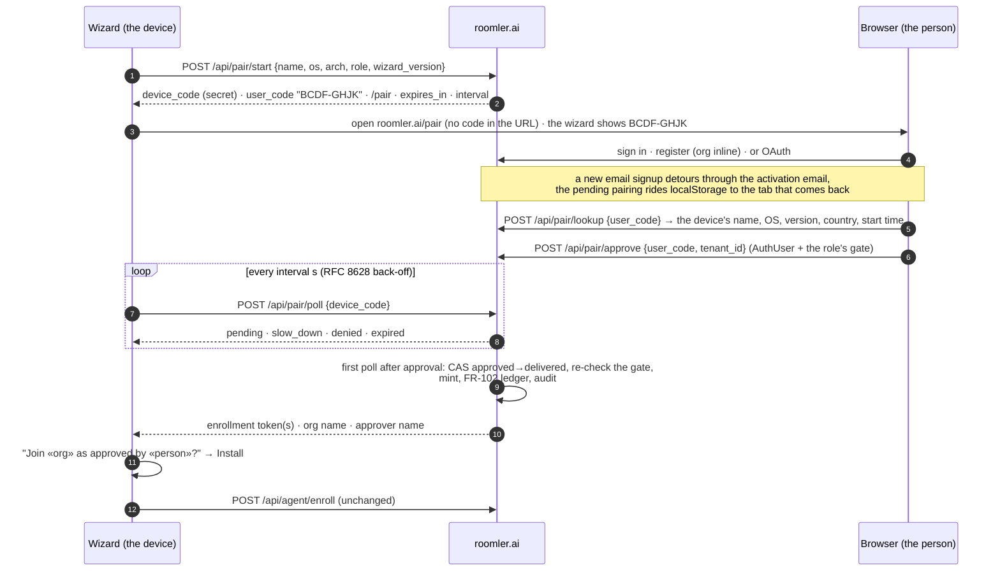
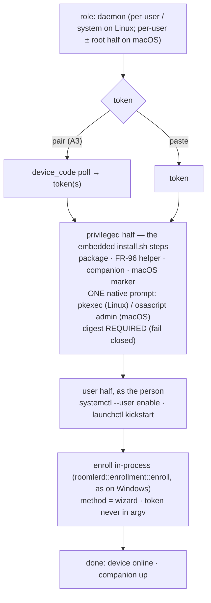
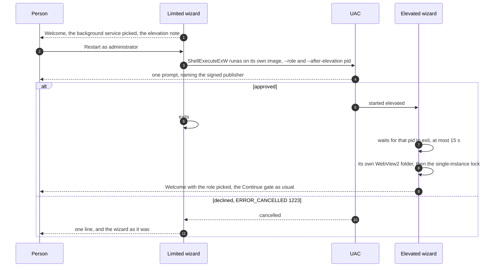

# FR-129: The installer pairs instead of asking for a token, and installs the full daemon on Linux and macOS

**Issue:** [#3022](https://github.com/gjovanov/roomler-ai/issues/3022) · **Status:** **decisions resolved 2026-10-28 · A1 (the server), A2 (`/pair`), A3 (the wizard), A4 (the terminal), B0 (the `install.sh` split), B1-s (`/api/setup/features`), B1 (the daemon from the wizard on Linux and macOS), B2 (the macOS root half) and B1-w (the Windows reinstall, #3116) merged — the server half on production since 2026-10-29 (`hosted-20261029-2ae4ffd`), paired against there on 2026-10-30, and `wizard_pairing` on since 2026-10-30 16:11Z; A3 released in agent 0.4.182, A4 in 0.4.183, B1 in 0.4.184, B2 in 0.4.187, B1-w in 0.4.188; B1-s2 (the daemon switch per OS, so Linux can go live without macOS) in review; the Linux and macOS daemon cards stay hidden until `wizard_linux_daemon` / `wizard_macos_daemon` is flipped, Linux first** ·
**Related:** [#2338](https://github.com/gjovanov/roomler-ai/issues/2338) (a wizard reinstall overwrites `config.toml`) ·
FR-43 ([#971](https://github.com/gjovanov/roomler-ai/issues/971), the macOS halves) ·
FR-84 ([#1633](https://github.com/gjovanov/roomler-ai/issues/1633), the wizard in lockstep) ·
FR-102 ([#2127](https://github.com/gjovanov/roomler-ai/issues/2127), the install trace and the issuance ledger) ·
FR-104 (anchoring) · FR-115 ([#2557](https://github.com/gjovanov/roomler-ai/issues/2557), the free tier) ·
FR-61 ([#1199](https://github.com/gjovanov/roomler-ai/issues/1199), vmtest) · FR-96 (the update helper)

## Goal

**A person who downloads Roomler goes from "no account" to "this machine is in my org and I
can see its screen" without ever seeing, copying or pasting a token — on Windows, Linux and
macOS, from the same GUI wizard.**

The operator's report (2026-10-27), on the day the SourceForge listing went live: its Download
button served `roomler-desktop` (fixed the same day — see the log), "we need an installer for
all platforms like Linux and macOS", and "when the user comes to token, guide him/her to
account and org creation with a smooth user experience". Asked how far to go, the operator
chose the full version of both: a pairing flow with no copy-paste, and the full daemon from the
GUI on Linux and macOS.

## The field evidence

Read on master `b4e72ff0d` and on production, 2026-10-27/28.

### The token step is a dead end for anyone without an account

The wizard's step 3 is a text box: "Paste a fresh token from the Roomler admin UI"
(`agents/roomler-setup/src/front/index.html:179`). Nothing on it opens a browser, names a
signup page or says where a token comes from. To get one, a new person must:

1. register — production answers with a message and **no session**
   (`crates/api/src/routes/auth.rs:311-324`);
2. open the activation email — `login` refuses an unactivated account (`auth.rs:366-370`);
3. log in;
4. create an org, unless they filled the optional org fields at signup (`auth.rs:250-255`);
5. find Devices → Enroll device, which mints a **10-minute single-use** token
   (`crates/modules/fleet/src/agent.rs:24`, `:90-140`, behind `MANAGE_AGENTS`);
6. copy it — the dialog says "then paste the token into the wizard"
   (`ui/src/components/enroll/EnrollmentDialog.vue:119`);
7. get back to the wizard and paste it before the 10 minutes run out.

Seven steps across two applications and an inbox, with a clock on the last two. The terminal
path is the same: `install.sh` without `--token` prints the enroll command to run later.

### The GUI installs the daemon only on Windows

Every daemon-role arm of the wizard's detection says
`supported: cfg!(target_os = "windows")` (`agents/roomler-setup/src/commands.rs:79, 86, 93, 103`),
and the daemon surface off Windows is a set of no-op stubs
(`agents/roomler-setup/src/orchestrator_agent.rs:758, 889, 922`). The docs say so plainly:
on Linux and macOS the daemon is `install.sh` in a terminal, and the wizard does the tunnel
client only (`docs/installation.md:22, 26`).

Yet the wizard ships for all three. Every `agent-v<V>` cuts `setup-v<V>` (FR-84 S1), and
`setup-v0.4.180` carries Linux x86_64 and aarch64, macOS universal and Windows x64 archives.
A Linux or macOS desktop user who downloads the GUI therefore gets a wizard that cannot install
the thing they came for.

### What the terminal path does that a GUI path must do too

Each of these was paid for in the field, which is why Phase B reuses them rather than redoing
them:

| Step | Where | Why it is not optional |
|---|---|---|
| package format follows the host | `scripts/install.sh:402-421` | a `.deb` on a host without dpkg downloads and then fails; non-dpkg hosts take the tarball, mirroring the updater |
| the macOS root-half marker | `scripts/install.sh:539-548` | must exist **before** the `.pkg` runs — its absence actively removes the LaunchDaemon; "nothing in the product ever created this file, which is why the privileged half was unreachable through the advertised one-liner despite shipping for months" |
| the per-user half as the console user | `scripts/install.sh:199-210` | a root run re-targets the per-user enroll at the console user; a root-owned config is the documented failure mode |
| the macOS second enrollment | `scripts/install.sh:570-600` | the overlay needs root, and the hub keys sessions on `agent_id`, so the root half is a separate device with its own token (FR-43 P2c/P3 have not collapsed it yet) |
| the FR-96 update helper | `scripts/install.sh:324-342` | a per-user Linux install cannot write `/usr`; the root helper installs its updates |
| the desktop companion | `scripts/install.sh:840`, header `:36-40` | the companion is the device's consent **prompt surface**; a "Prompt on host" device without one cannot ask anybody |
| digest verification | `scripts/install.sh:219-228` | soft-skips when a release publishes no digest — tolerable in a terminal, **not** for a GUI that elevates to root (Phase B fails closed instead) |

## The mechanism, in the code (master `b4e72ff0d`)

*Every anchor in this table resolves at `b4e72ff0d` and records the code before FR-129 changed
it. Do not shift these anchors with code that moved later.*

| Surface | Where | What it does today |
|---|---|---|
| token mint | `crates/modules/fleet/src/agent.rs:90-140`; route `crates/modules/fleet/src/lib.rs:386` | `POST /api/tenant/{tid}/agent/enroll-token`: `AuthUser` + `MANAGE_AGENTS`; 600 s single-use JWT (`:24`); FR-102 issuance recorded (`:114-124`); FR-104 `anchor` from an optional body (`:52-85`) |
| token claims | `crates/services/src/auth/mod.rs:82-96`, `:530-563` | `EnrollmentClaims { sub = issuing admin, tenant_id, jti, anchor }`; ten audiences in `TokenType` (`:37-78`) |
| token redeem | `crates/modules/fleet/src/agent.rs:180-260`; route `fleet/src/lib.rs:477-478`, `:564` | public `POST /api/agent/enroll`: archived org refused (`:192-207`), plan device cap before the single-use claim (`:222-242`), the claim fails closed (`:244-260`) |
| tunnel token | `crates/modules/network/src/routes/tunnel.rs:53-75`; mint `crates/services/src/auth/mod.rs:731` | any member (`is_member`) mints a `TunnelEnrollment` token |
| registration | `crates/api/src/routes/auth.rs:167-325` | creates the user; the org inline only with `tenant_name` + `tenant_slug` (`:250-255`); production returns no session (`:311-324`) |
| login gate | `crates/api/src/routes/auth.rs:366-370` | an unactivated account is refused |
| return path | `ui/src/plugins/router.ts:385-411` | `pending_redirect` in **sessionStorage** — one tab only; same-origin paths only |
| short-lived capability row | `crates/db/src/models/consent_request.rs:13-37` | an unguessable `token`, a status enum, an `expires_at` TTL, redeemed by a public token-keyed route — the shape a pairing row needs |
| rate limits | `crates/api/src/lib.rs:111-127`, `:143-145`, `:393`; `crates/core/src/rate_limit.rs:37-66` | per-IP governor on `/api`; `AuthRateLimiter` on register/login; a per-(caller, resource) sliding window for exec, SSH and relay mints |
| decision log | `crates/services/src/dao/peer_relay_audit.rs:3-10` | one collection per decision kind; the refused rows are the point |
| install trace | `crates/remote_control/src/models.rs:31-93` | `InstallInfo { method, scope, run }`; `InstallMethod::Wizard` already exists |
| module graph | `crates/core/src/graph.rs:45-47` | `remote → fleet`, `network → fleet`, `hive → fleet` |
| wizard daemon gate | `agents/roomler-setup/src/commands.rs:79, 86, 93, 103` | `supported: cfg!(target_os = "windows")` |
| wizard daemon pipeline | `agents/roomler-setup/src/orchestrator_agent.rs:142-203`, `:289`, `:403`, `:555-567` | resolve → download → verify → elevated `msiexec` → in-process `roomlerd::enrollment::enroll`, tagged `InstallMethod::Wizard` |
| non-Windows stubs | `agents/roomler-setup/src/orchestrator_agent.rs:758, 889, 922` | the daemon surface off Windows is a no-op |
| platform strings | `crates/roomler-setup-core/src/asset_resolver.rs:265-300` | `windows-x86_64`, `linux-x86_64`, `linux-aarch64`, `macos` |
| token step | `agents/roomler-setup/src/front/index.html:176-204`; `app.js:461-497`, `:629-680` | paste + a live, unverified JWT peek (`cmd_validate_token`, `commands.rs:204`); no polling anywhere in the frontend |
| browser open | `agents/roomler-setup/tauri.conf.json:40-41` | the shell-open plugin is enabled and unused by the token step |
| terminal installer | `scripts/install.sh:402-509` (Linux), `:511-576` (macOS), `:584-610` (root half), `:642` (enroll), `:842` (companion) | plain `sudo`, so it needs a terminal; no `pkexec` anywhere |

## Key design

### A — Pairing: the wizard asks the browser, not the person



The invariants, each closing a specific failure:

1. **Two codes, two holders** (RFC 8628's split). The `device_code` is 256 random bits, held
   only by the wizard, stored only as a SHA-256 hash, sent only in a POST body, and never shown,
   logged or put in a URL. It is the **only** credential that can retrieve a token. The
   `user_code` is 8 characters from the 20 unambiguous consonants (`BCDFGHJKLMNPQRSTVWXZ`,
   about 34.6 bits), shown in the wizard and typed in the browser. It names the pairing and
   retrieves nothing, so a shoulder-surfed or screenshotted code gives an attacker nothing to
   poll with.

2. **The same token, the same gate, minted on delivery.** Approval records a *decision*
   (approver, org, time). The token is minted by the first poll that sees `approved`, which
   flips the row `approved → delivered` by CAS — winning the CAS is the right to mint, so two
   polls can never mint twice. The mint re-checks the approver's gate, so an admin demoted
   between approve and delivery gets nothing. It is the existing call: daemon roles take
   `issue_enrollment_token_with(approver, org, 600, anchor = false)` behind `MANAGE_AGENTS`,
   and the tunnel role takes `issue_tunnel_enrollment_token` behind `is_member`. Both write
   the FR-102 ledger exactly as the admin route does today. Consequence: **no token ever rests
   in the database**, and everything downstream holds unchanged — the enroll route, the
   archived-org refusal (which the daemon enroll route holds; the tunnel enroll route never
   checked it, a pre-existing gap filed separately — and `approve` itself refuses an archived
   org for both kinds, before any notice fires), the plan device cap, the single-use claim,
   the 10-minute life. A lost delivery response is recovered by starting again: delivery is
   once.

3. **Both directions are confirmed on the other side.** The device-code flow has a known
   phishing hole, and here it runs both ways.
   - **Phishing (an attacker's device into a victim's org).** The attacker starts a pairing
     and sends the victim a link. If the victim approves, a root-level agent joins the victim's
     org and sits on its mesh under the tenant's coarse scope wherever no overlay ACL is
     compiled. Closed by: the link never carries the code, so the person must **type** it; the
     page shows the device's name, OS, wizard version, the starting IP's country and the start
     time before Approve, beside "Only approve a device you are setting up right now, in front
     of you"; and the org's admins are told (A2).
   - **Hijack (a victim's device into an attacker's org).** An authenticated user who guesses
     a live `user_code` approves someone else's pending install into *their* org, and gets
     remote control of a stranger's machine. Closed by: lookups and approvals are limited per
     account (misses lock that account's approvals for the hour), the code space is about
     2.6 × 10¹⁰, a pairing lives 15 minutes, and — the real lock — **the wizard shows the org
     name and the approver before it installs** and installs only on the person's click.
     An approval into an org you don't recognise ends at your own screen.

4. **No pod-local state.** The front LB hashes on the tenant, and a pairing has no tenant until
   it is approved, so start, approve and poll can each land on a different pod. The row in
   Mongo is the only state: no in-memory waiter. The consent flow's `ConsentSlot` oneshot is
   pod-local and does not transfer.

5. **Limits.**
   - `start` is pre-auth: the global per-IP governor plus its own per-IP ceiling, so a flood
     cannot exhaust the code space.
   - `poll` keeps a minimum interval per `device_code`; faster earns `slow_down` and a 5 s
     longer interval (RFC 8628 §3.5).
   - `lookup` and `approve` count misses per account.
   - Each limiter is the `crates/core/src/rate_limit.rs` pattern, checked *after* identity so
     every refusal is attributable.

6. **Own collections.** `device_pairings` — a unique index on the device-code hash, a unique
   partial index on the user code among `pending` rows, and a TTL on `expires_at`.
   `pairing_audit` records start, lookup, approve, deny, deliver, expiry and every refusal;
   it is best-effort, never gates, and lives 90 days (the `peer_relay_audit` convention). Both
   index sets go in the fleet module's index plan, never in `crates/db/src/indexes.rs`.

7. **Where it lives.** The **fleet** module owns pairing: it mints enrollment tokens and owns
   enrollment. Minting the tunnel kind goes through the services-layer call, so no new
   module-graph edge appears (`network → fleet` stays one-way). A tunnel-role pairing is
   refused while the network module is unmounted, as its enroll route would answer 503 anyway.
   The new routes re-record the composition baseline (`COMPOSITION_UPDATE=1`, saying why).
   The `/pair` page gates on `/api/capabilities` like every other page.

8. **New people.** The `/pair` page handles three states:
   - **Signed in:** pick the org (default the only or last one; create one inline if there is
     none) and approve.
   - **An account, signed out:** log in or use OAuth, and come back.
   - **No account:** register with the org inline (`register` already takes `tenant_name` and
     `tenant_slug`). An OAuth signup stays in one tab, so `pending_redirect` carries it. An
     email signup opens the activation link in a **new tab**, where sessionStorage is empty
     (`ui/src/plugins/router.ts:389`). The page therefore also keeps the pending pairing in
     localStorage with its expiry, under the guard's same-origin rules, and the guard routes
     any signed-in tab back to `/pair` while it lives.
   - **Fallback, always:** the wizard keeps showing the code with an "Open the page again"
     button. Production keeps requiring email activation — pairing works with it, never
     around it.

9. **What stays.**
   - **The paste.** It becomes "I already have a token" under the primary action. Scripted
     installs, MSP flows, offline mints and FR-104's anchoring tokens depend on it, and it is
     the kill-switch fallback.
   - **Anchoring.** A paired token never anchors (`anchor = false`); anchoring stays a
     deliberate act through the enrollment dialog.

10. **Terminal parity (A4).** `roomlerd enroll --pair`, `install.sh --pair` and
    `install.ps1 -Pair` print the code and the URL and poll the same endpoints, so a headless
    or SSH-only install gets the same flow. The token stays in-process — never in argv. As
    built (`crates/agent-core/src/pairing_terminal.rs`; the `--pair` arm of `enroll_cmd` in
    `agents/roomlerd/src/app.rs`):
    - **One process, one path.** The daemon starts the pairing (`client` = `script-sh` /
      `script-ps1` when a served script drives it — the install trace's method — else
      `roomlerd`; `halves: 1`), prints the code and the page (whose address never carries
      the code), polls with A3's back-off, and on the approval enrolls **in the same
      process** through exactly the `--token` path: everything in `enroll_cmd` from the read
      of the existing config to the save is the `--token` code, byte for byte — the same
      `read_if_present` → machine id → `enrollment::enroll` → `apply_enrollment` → save, the
      same install trace. The pairing runs **before** that read, after the refusals that
      need no config and the archive replica's (so a refusal costs nobody an approval): a
      daemon already running on the machine saves its own config while the person approves
      (token renewal, remote configuration, the companion's settings), and a copy read
      before a wait of minutes would be merged and saved over those writes. The delivered
      token goes from the poll's answer into `enrollment::enroll` and nowhere else; the
      `device_code` is never printed. A test runs the whole flow against a loopback server
      and scans the terminal output and the log for both (AC3). Each check was shown to
      fail before it was trusted: the device code put into a log line, and the token into
      the approval text, each turn that test red; `shown` as a pass-through turns the two
      escaping tests red; the previous trim-and-fold slug comparison turns the byte-for-byte
      test red on `ACME`.
    - **The hijack guard, terminal shape (AC5).** The approval is shown with the two
      unique handles beside the display names — `Organization: Acme Corp (slug: acme)`,
      `Approved by: Dana (username: dana)` — and the daemon asks
      `Join «Acme Corp» (acme) as approved by «Dana» (@dana)? [y/N]`. **On the terminal,
      never on stdin:** under `curl … | sh -s -- --pair` stdin is the pipe the shell is
      still reading the script from, so the answer comes from `/dev/tty` (Unix) or the
      console, `CONIN$` / `CONOUT$` (Windows; the question is written with `WriteConsoleW`,
      `pairing_terminal.rs:212-242`, because a plain write on `CONOUT$` is read in the
      console's OEM code page and would garble the `«»` and any non-ASCII name). A no, an
      empty line or an EOF enrolls nothing; the pairing stays `delivered` and its token
      unused, which the message says. A server that sends no slug or username (A1 before
      its review fix) is shown as such, with a warning to check the names.
    - **What the person reads is made visible.** Every server-sent string — the org's name
      and slug, the approver's name and username, the page and the code — reaches the
      terminal through `shown` (`pairing_terminal.rs:277-286`): controls and invisible
      characters (ESC, CR, the C1 set, bidi overrides, zero-width marks) appear as escapes
      such as `\u{1b}`, so an org named with an ANSI sequence cannot move the cursor and
      repaint the question with another org's. A slug outside the shape the admin UI makes
      (`a-z0-9` in dash-joined runs, `pairing_terminal.rs:292-297`) and a username with
      spaces or non-ASCII characters are flagged beside the approval: that is what a
      lookalike (`ACME`, `acme `, a Cyrillic `аcme`) has to look like.
    - **No terminal: `--pair-org <slug>`.** With no controlling terminal (cron, systemd,
      `ssh host 'curl … | sh'` without `-t`, a WinRM shell) there is nobody to ask, and the
      only way to enroll is to state the check in advance: the approval must name exactly
      that org, **byte for byte** (`decide`, `pairing_terminal.rs:455-478`). (A Windows
      console nobody can see — a scheduled task's, a tool's hidden one — still opens, so
      the pairing starts and the question waits unseen: `--pair-org` is the way there too.) The server
      stores a slug as it was sent — only the admin UI constrains it — under a case- and
      space-sensitive unique index, so `ACME`, `acme ` and `аcme` are other orgs anyone can
      create through the API; a comparison that folded case or trimmed the server's value
      would enroll the device into one of them without a question. Only the person's own
      value is trimmed, and an empty one is refused, not read as absent. Given on a terminal
      it replaces the question; a mismatch refuses on a terminal too; a server that sends no
      slug refuses rather than trusting a display name. `install.sh --pair-org` and
      `install.ps1 -PairOrg` pass it through, after a shape check that catches a display
      name typed in its place before anybody approves anything (the judgement calls below).
    - **A failed poll** (a network blip, a pod roll, a VPN reconnect) lengthens the
      interval — doubling, capped at 30 s, never shrinking (RFC 8628 §3.5;
      `pairing_terminal.rs:100-102`) — and the loop goes on until the pairing's own clock
      runs out, as the wizard's does. A run of failures to the very end is reported as the
      failure, not as "nobody approved it".
    - **An older server** (404 on `start`, or `[pairing] enabled = false`) answers "this
      server does not support pairing …; use --token", exit 1, with no poll. `--token` and
      `--pair` refuse each other, one of them is required, `--pair-org` belongs to `--pair`,
      and `--pair` refuses `--ephemeral` (a pairing mints a standard token, never an
      ephemeral key, and `--ephemeral` with a standard token enrolls a permanent device
      under a random id).
    - **The served scripts** run the paired enroll exactly where they ran `--token` — as the
      console user, or `--system` as root, or after the MSI with the role's elevation — and
      `install.sh` gives it `/dev/null` as stdin. Nothing on that path reads stdin today
      (sudo 1.9.15 passed a piped script through untouched even with `log_stdin`, measured
      below); the redirect keeps it so, because under `curl … | sh` the shell's stdin is the
      rest of the install. A refusal exits 1 and stops the install where a refused token
      stops it.
    - **macOS root half.** `--pair` pairs the per-user half; the root half is still its own
      enrollment (FR-43), paired afterwards as root in a second run — the install prints
      the two commands (`sudo … --config /etc/roomler/config.toml enroll --pair … --name
      <name>-daemon --overlay`, then `sudo roomlerd service install --as-service`).
      `--pair --daemon-token` is refused, naming that path and B2 (one approval for both
      halves, `halves: 2`).

### B — The full daemon from the GUI on Linux and macOS

**One implementation of package placement: `install.sh`.** On Windows the wizard is a GUI
front end to `msiexec`. On Linux and macOS it becomes a GUI front end to the same steps the
terminal path runs, not a Rust re-implementation of them. Every row of the table under the
field evidence was paid for in the field, and two implementations drift without anyone seeing
it until a field report.



1. **The seam is decided by a spike (B0), then recorded here before B1.** The candidates:
   - **(i)** Run the whole script elevated. This breaks the per-user Linux path, which runs
     `systemctl --user` as the invoking user (`install.sh:733`); under `pkexec` that is root's
     user manager.
   - **(ii)** Give `install.sh` a privileged-steps entry point and a user-steps entry point.
     The terminal path calls both in order and does not change; the wizard elevates only the
     first and runs the second as the person.

   Recommended: (ii).

   **Decided by B0: (ii)** — PR #3039, field-proven 2026-10-28 (the log below). `install.sh`
   gained `--privileged-steps` (root only: the package and the tarball's owner repair, the
   macOS root-half marker, the FR-96 helper, the Linux companion package, the `--system` unit;
   **a missing digest fails closed**, an undigested companion is skipped rather than placed) and
   `--user-steps` (never root, never a token: the systemd user unit, the LaunchAgent
   kickstart). They are the same functions the terminal path keeps calling in the same order —
   without a flag nothing changes for anyone who is not root — and the daemon path's `sudo`
   calls go through `as_root`, because a `pkexec`'d half is already root and gets a scrubbed
   environment. (The one effect on the terminal path: a caller that is already root no longer
   goes through `sudo`, which was a no-op wrapper there, so a root shell without `sudo` — a
   container — now works; the commands issued are the same.) Under the native
   prompt, the half ran as root on Ubuntu 24.04 GNOME-Wayland (per-user and `--system`) and on
   Fedora 44 KDE Plasma 6 Wayland (the tarball + `.rpm` path), launched from the user manager
   where GNOME and Plasma put every app they start: polkit 124 and 127 resolved that process to
   the seat0 session through their display-session fallback (`polkitd: Operator of unix-session:2
   successfully authenticated … ONE-SHOT authorization for action org.freedesktop.policykit.exec`),
   which is the wizard's own situation. The `osascript` half is owed (the log says what it needs).

   **What did not split, and the fix.** A SYSTEM-scope enroll — Linux `--system`, the macOS root
   half — writes a root-owned config and needs the token, which the wizard holds in-process. So
   the privileged half takes **`--config-from FILE`**: the wizard enrolls in-process into a
   private 0600 file of its own **before** the privileged half, which places it root-owned 0600
   (`.prev` kept, the daemon's own convention) and then enables the unit. One prompt, and a
   package placement that fails leaves an enrolled config to retry with instead of a burnt
   single-use token. On macOS the flag also requests the root half, as `--daemon-token` does on a
   terminal. Two more findings for B1: the FR-96 `helper_before`/`helper_changed` decision cannot
   cross the privilege boundary, so `--user-steps` restarts a daemon already running beside an
   enabled helper (a re-install cost, never a first install's); and the half sees no `DISPLAY`
   under `pkexec`, so the companion decision falls to `loginctl` — the wizard passes `--desktop`
   or `--no-desktop` explicitly. The wizard's order on Linux and macOS is therefore: *(system
   scope: enroll in-process first)* → privileged half → *(per-user: enroll in-process)* →
   `--user-steps`.

   **Decided by B1** (the wizard on top of that seam; the PR is the "B1" row below):

   - **#2338, every platform.** The wizard's enroll step now reads the config at the
     role's path and folds the fresh enrollment into it through
     `enrollment::apply_enrollment` — reusing its `machine_id`, keeping every
     operator-owned key — exactly as `roomlerd enroll` does
     (`agents/roomler-setup/src/enroll_step.rs`). A fresh install's defaults (FR-99's
     `lock_on_end = auto` for a Windows service install, the role's overlay default) apply
     to a **fresh** config only, so a value the device already has is never overridden by a
     default (the FR-99 P3c note). The Advanced boxes the person **touched** land on a fresh
     and on a refreshed config alike (the SPA names them, `touched`); the untouched ones
     only on a fresh config. An enrollment that resolves to another org is appended as a
     secondary, as the CLI does, and the person is told.
   - **Another organization (found in the orchestrator's review).** An append is the one
     outcome where "the device just enrolled" and the config's top-level ids differ, and
     three paths read the wrong one:
     - **The identity (R1).** The wizard reported, and on Windows anchored, `cfg.agent_id`,
       the PRIMARY's: the Done page named org A's device beside "It joined «org B»", and the
       FR-104 step ran `anchor create` with org B's token and org A's device, which the
       server refused as no such device. Every caller now reads
       `enrollment::enrolled_identity` (the org entry's ids for an added org; `roomlerd
       enroll` already did this by hand). On an added org the anchor step does not run: the
       anchor is one per machine and only the anchored device advertises `exec-system`, so
       anchoring the added row would move SYSTEM exec off the primary organization on
       another organization's token (the rule peer relays keep: primary-org only).
     - **The options (U2).** `adopt-enrollment --take` applied the touched boxes whatever
       the fold did, so a system-scope install into org B over a root config in org A
       wrote them onto org A's primary. With "auto-grant" ticked, that auto-granted org A's
       remote-control sessions. It now takes no key on an added org and says so, the rule
       the wizard's own fold already kept.
     - **The key (F3b, and every org the wizard appends).** A secondary's WireGuard key was
       minted only at append time and only by a build with an overlay surface, and
       `AgentConfig::for_org` reads a keyless org as off its mesh, whatever its mode. The
       wizard's build has no overlay surface, so every org it appended was keyless for good,
       and so was an org whose key F3 retired. The daemon now mints a fresh key at start
       for every org on the mesh that has none (`org_join::heal_org_keys`, beside the
       primary's own lazy mint and #2493's port heal).
     **A config that is there and does not load is never read as absent (F4).** The probe
     every fold used, `config::read_if_present`, turns absent, unreadable and unparseable
     alike into "no config" — right for a caller asking whether an optional file exists, wrong
     for one about to write the path — and `config::save` does not even keep such a file: its
     `.prev` rotation runs only for a file that still parses, so that a broken file never
     overwrites the last good copy. A fold now reads through `config::read_merge_base`
     (`crates/agent-core/src/config.rs`; `read_if_present` itself is unchanged, the CLI shares
     it): a file that does not load is folded into from its last good copy (`.prev`) when that
     one loads — what the daemon's own `load` would run on at its next start — and kept aside as
     `config.toml.unreadable` (never over `.prev`) either way, and the person is told which
     happened, naming the path, the reason and both files.
   - **The system-scope merge: option (b), a daemon verb run by the privileged half.** The
     person cannot read the root daemon's `/etc/roomler/config.toml` (root:root 0600), so
     the fold cannot happen in the wizard. `roomlerd --config TARGET adopt-enrollment --from
     FILE [--take KEY]…` (no token; the enroll already happened) runs the same
     `apply_enrollment` as root, inside `place_system_config`, when a config is already at the
     target; `--config-take` carries the touched keys. Why not (a), a non-argv token channel
     into `roomlerd enroll`: it would move the enroll — and the token — into the elevated half,
     against B0's "a half never takes a token", it overlaps A4's `enroll` changes, and it would
     spend the token *after* the package step, so a failed placement would still cost a Retry
     its token. With (b) the B0 property holds as it was: the enroll happens first, the file
     is placed by root, and a half that fails leaves an enrolled file the next attempt reuses
     (the wizard keeps it, `unix_daemon::KeptEnrollment`, shredded at the latest at exit). A
     daemon too old for the verb (a self-hosted server pinning an older release) gets B0's
     placement with the old config kept as `.prev`, and says that the settings did not carry
     over. The same function serves B2's macOS root half: `place_system_config` is called
     with the bundle's daemon binary there too. The verb reads its target as the wizard's folds
     do (F4) and retires a previous row's key (F3, next), and says both on stderr, which the
     wizard streams to the person.
   - **A device the server no longer recognises (F3).** The server reuses a device row by
     `(tenant, machine_id)` (`crates/modules/fleet/src/agent.rs`, `enroll_agent`), and a
     system-scope enroll in the wizard has to derive the machine id — SHA-256 of the host name,
     OS, arch and config path (`crates/agent-core/src/machine.rs`) — because the person cannot
     read the one root's config holds. On a host renamed since its first enrollment, or a VM
     cloned together with its config, that is a NEW id: the server makes a new row, and the
     fold kept the existing WireGuard key, which the previous row (offline, never removed)
     still claims. The overlay join then refuses the new row for good — `wg_key_taken_by_other`
     fails closed, and silently: the device is not told — and the device has a duplicate row.
     `roomlerd enroll` on a terminal never does this, since it reads the existing id.
     **Decided:** a refresh of the same org that lands on another row retires the kept key —
     `overlay_wg_secret_key` dropped and `overlay_wg_key_epoch` back to 0, so the daemon mints a
     key at its next start, as on a first install — and names the previous row for the
     operator, with what to do for each cause (`enrollment::retire_key_of_previous_row`,
     `describe_previous_row`). `adopt-enrollment` applies it as root, from the files; the
     wizard's own folds apply it too, where it cannot fire today (they read the id back).
     Before the enroll the wizard also asks the running root daemon which device it is, over
     the person socket a Linux root daemon serves the console user (`Status` is in
     `Scope::Person`; `agents/roomler-setup/src/root_identity.rs`), and says a new row on its
     own page. **What the LocalAPI does not say, and why it is not added:** it answers the
     agent id (`node_id`), the org and the name — never the machine id — so the wizard cannot
     enroll with it and have the server reuse the row. Adding it would not be the fix: on a
     cloned VM the previous row is the ORIGINAL machine's, still in use, and reusing it would
     make two machines one device (the terminal `enroll` does exactly that on a clone today). A
     new row with a retired key is right for a clone and costs a renamed host one stale row to
     remove; the warning says which is which. **B2 inherits this as it is** — the macOS root
     half's config is root:wheel 0600 too, and `place_system_config` runs the same verb there
     — **and meets it more often:** on a Mac with no `HostName` set, `gethostname()` can follow
     the network (a DHCP- or Bonjour-derived name), so a wizard reinstall on another network
     derives another id. B2 should take the root half's machine id from something that does
     not move (the `IOPlatformUUID`, which the person can read through `ioreg`), or have the
     root half hand back its own.
   - **A reinstall's running daemon.** `systemctl enable --now` leaves an *active* unit as
     it is, so on a reinstall the root daemon would keep its previous config in memory
     (nothing in the daemon watches the file; its runtime writers reload before they save,
     so the file was never overwritten — but the new name and options never took). The
     privileged half now **restarts** `roomlerd.service` when it placed a config and the unit
     is active. The per-user unit was already covered: `--user-steps` restarts a daemon
     running beside an enabled helper (B0's finding), and the macOS user half's
     `kickstart -k` restarts by definition. The terminal path (`enable --now` after its own
     enroll) is unchanged, so B0's regress cells stay valid; the same reinstall there keeps the
     old identity in memory until the next restart, which a later PR may take up.
   - **When the half has started, and what an exit means (F1, F2).** The privileged half
     writes to files in the scratch directory, never to pipes the wizard holds: a root
     `dpkg -i` must not die of SIGPIPE halfway through because the window closed, and
     `osascript`'s `do shell script` returns its output only when the command has finished, so
     for the macOS half a file is also the only way its lines stream at all (the constant
     AppleScript sends the shell's stdout and stderr to two files and its exit status to a
     third: `unix_daemon::ADMIN_APPLESCRIPT`). The wizard tails them into the progress channel.
     **Started** means something runs, or ran, as root: for `pkexec`, the half's first stdout
     line (the script prints its banner before any step; `pkexec` itself writes only stderr) or
     a kill refused with EPERM (`pkexec` has switched every uid to 0); for `osascript`, the
     output file the root shell creates as its first act. **Before the start** the exit is the
     prompt tool's: `pkexec` **126** = the person dismissed the dialog ("cancelled", nothing
     installed, never a package failure); **127** = no authentication possible (no polkit
     agent in the session, `pkexec` absent — a spawn error — or the password refused), which
     turns into the terminal fallback: the identical half shown as `sudo /bin/sh
     <scratch>/install.sh --privileged-steps …` (no secret on it), a wait for "I've run it",
     then a check that the daemon (and, for a system scope, the config) is there; `osascript`
     `(-128)` = cancelled. **After the start every exit is the script's own (F2):** `pkexec`
     passes the script's status through, so a `set -e` step whose `dpkg` or `systemctl` is
     missing exits 127 too — a failed step, never "no polkit agent", never the terminal
     fallback. Measured values are in the log rows below.
   - **Cancel (F1).** Before the start a cancel kills the prompt client (`pkexec`,
     `osascript`, still the person's processes) and the dialog goes away: *cancelled* means
     nothing ran. After it nothing the person's process sends can stop a root process — and
     killing `osascript` would only stop the wizard seeing the end of one that runs on:
     `installer -pkg` would carry on while the wizard said "nothing was installed", and a Retry
     could start a second, concurrent install. So the cancel is reported, the half waited out
     to its own exit, and the install stops after it, saying what the half left
     (`orchestrator_unix::cancelled_after_privileged`). One race is closed on purpose: a cancel
     that kills `osascript` in the instant the password is accepted can leave the root shell
     running, so for 5 s after such a kill the wizard watches for its output file and, if it
     appears, waits for the status file instead of reporting a cancel. The window does not
     close while the half (or the terminal step standing in for it) runs: the wizard's exit
     would remove the scratch directory — the config a root half has yet to place — from under
     it; a native message says why.
   - **Retry (F5).** What an attempt leaves is kept for the next one with the same server,
     name and scope (`unix_daemon::KeptEnrollment`): the enrollment the server holds, a
     system-scope config the half has not placed yet, and whether the privileged half ran to
     its end. A Retry after a cancel or a failure that came after that half — between the
     halves — does not run it again (no second password) and, for a system scope, does not
     enroll again. Before this it kept the placed enrollment with no scratch file, fell
     through to "enroll", and posted a token the first attempt had already spent. The half's
     work is checked first (the daemon binary, the placed config); if it has gone since, the
     install runs from the start and says that a spent token will be refused — get a new one,
     or pair again — and the server's refusal of a used token says the same.
   - **The per-user overlay on Linux** goes through the userspace netstack: the wizard
     writes `netstack_socks_port` (the first free port of 10800–10899, picked as the
     secondaries' are) beside `overlay_enabled`, because a per-user unit has no
     `CAP_NET_ADMIN` and a daemon without the port joins nothing (#2493's lesson, applied to
     the primary). macOS leaves the overlay off: the mesh is the root half's (B2).
   - **The per-user unit's folders (found on the Fedora cell).** The packaged
     `roomler.service` lists the daemon's config and data folders in `ReadWritePaths=`
     without `-`, on the stated assumption that `roomlerd enroll` makes both (the data folder
     as a side effect of its logging). The wizard enrolls in its own process, so the data
     folder was never made, and wherever a user manager applies the sandbox the unit failed
     226/NAMESPACE every 5 s, forever, under an install the wizard had reported done. Fedora
     44's user manager applies it; Ubuntu 24.04's skips the mounts (AppArmor's
     unprivileged-userns restriction), which is why the Ubuntu cells never showed it. The
     wizard now makes both folders before the user half starts the unit, a Retry included
     (`unix_daemon::unit_folders`, `make_unit_folders`), from the same `appdirs` resolution
     as the config path — never a fixed `~/.local/share/roomler`: on a pre-rename host a
     new-segment folder made beside the legacy tree would turn the daemon's new-then-old
     resolution away from its enrolled config. A test reads the packaged unit and fails when
     a required `%h/` folder is not one the wizard makes, or is made after the user half.

   **Decided by B2** (the macOS root half from the GUI; the PR is the "B2" row below):

   ```mermaid
   sequenceDiagram
       autonumber
       participant P as Person
       participant W as Wizard (the person's process)
       participant S as Server
       participant R as Root shell (osascript)
       P->>W: the daemon role, "Join the overlay network" ticked (the macOS default)
       W->>S: POST /api/pair/start with halves 2
       S-->>W: one approval, two ordinary single-use tokens
       W->>S: enroll the root half: token 2, a machine id from the hardware
       W->>W: its config, 0600, in the 0700 scratch directory
       W->>R: ONE administrator prompt: --privileged-steps --config-from FILE
       R->>R: the marker, the .pkg, place_system_config (adopt-enrollment on a reinstall), kickstart
       W->>S: enroll the person's half: token 1, folded into their config
       W->>W: --user-steps: the LaunchAgent kickstart
   ```

   - **Which installs add the root half.** The macOS daemon role with **"Join the overlay
     network"** ticked, which is now the box's macOS default (`role::wants_root_half`, mirrored
     by the SPA's `wantsRootHalf`). On macOS the box *is* the root half: the mesh needs root
     for its utun, so the root half is the only way onto it, and unticking the box installs
     B1's per-user half alone. The box no longer writes `overlay_enabled` into the person's
     half: the overlay's two keys (`overlay_enabled`, `overlay_advertised_routes`) are the root
     half's, and every other Advanced key stays the person's half's, as B1 left them
     (`orchestrator_unix::device_options`, `root_half_options`). A box rather than always,
     because a person who wants screen sharing alone must not get a root daemon, nor spend a
     second device on the plan — the terminal path has the same choice (`--daemon-token` or
     not).
   - **One approval, two tokens.** The pairing starts with `halves: 2` (`cmd_pair_start`'s
     `rootHalf`), the session remembers its halves (`PairStore`), and the install takes the
     first token for the person's half and the second for the root half
     (`PairStore::tokens_for`). An install whose halves are not the pairing's is refused, never
     half-served — the SPA cancels the pairing whenever the person goes back to where the box
     is — and so are fewer tokens than halves and the same token twice. The approver sees one
     device on `/pair`, with A2's note that a Mac joins as two entries; the wizard's approval
     card names both devices (`<name>` and `<name>-daemon`). **The device cap counts each
     half:** each token is its own `POST /api/agent/enroll` and a new row
     (`the_device_cap_counts_each_of_a_macs_two_halves`). The cap refuses before the
     single-use claim, so a half refused at the cap keeps its token for the Retry once a slot
     is free, and the wizard names the cause (a Mac is two devices).
   - **The paste takes a second token.** On macOS with the root half wanted, the paste box
     shows a second field, "Second token, for the private network": required then, peeked
     like the first, and never the first token again (`commands::resolve_install_tokens`; the
     SPA holds Install until both pass). Not root-half-by-pairing-only, because the paste is
     the kill-switch fallback (A, item 9) and the MSP and offline-mint path, and a fallback
     that installs every Mac without its mesh is no fallback for the network pillar; the admin
     UI's macOS instructions already teach a second token (`--daemon-token`); and it costs one
     field. Unticking the box keeps B1's one-token paste.
   - **The root half's enrollment** is B1's system scope's, step for step: in the wizard's
     process, before the prompt, into a 0600 file in the 0700 scratch directory
     (`orchestrator_unix::enroll_root_half`, `enroll_step::enroll_fresh_as`); `--config-from`
     hands it to the privileged half, which on macOS also requests the root half (the marker
     before the `.pkg`); `place_system_config` places it root:wheel 0600, or folds it into an
     existing `/etc/roomler/config.toml` through `roomlerd adopt-enrollment`; the token never
     reaches argv. Its name is `<name>-daemon` and its install trace `{method: wizard, scope:
     system}`, as the terminal names its root half. A half that reports success is checked
     against the placement (`placement_problem`): the script skips the root half with only a
     warning when the package installed no LaunchDaemon, and a config whose token is spent is
     kept for a Retry, never shredded unplaced.
   - **The root half's machine id comes from the hardware** (`machine::root_half_machine_id`):
     SHA-256 of a tag (`roomler/macos-root-half/v1`) and the `IOPlatformUUID` — System
     Information's "Hardware UUID", which any user reads with `ioreg -rd1 -c
     IOPlatformExpertDevice` — and, on a **virtual** Mac (`kern.hv_vmm_present` is 1, or the
     model is a hypervisor's), the VM's permanent `en0` address (`networksetup -getmacaddress
     en0`). Stable across reinstalls: neither the host name nor the network enters it. Never
     the person's half's: that one hashes the host name and the person's config path, this one
     a tag no other id carries — two devices, as FR-43 needs. Never two Macs': a logic board's
     UUID is its own. **A tart clone** was measured (the log): two clones of the lab's golden
     report the same `IOPlatformUUID`, serial, VZ machine identifier and host name, and
     different MACs, because tart regenerates the MAC of a clone whose original is on the host.
     A UUID-only id, like the host-name one, would put every clone on one device row (B0's
     finding for the per-user half); with the MAC a clone is a new device, and the fold retires
     the key the original's row holds (F3). A clone that keeps both the identifier and the MAC
     is the same machine from inside, and `tart set --random-serial --random-mac` gives it its
     own. When a fact cannot be read, the root half enrolls under a **one-time** id and the
     person is told (`machine::resolve_root_half_machine_id`) — never the host-name id, which a
     clone shares. Not "the root half hands back its own id": the enroll has to happen before
     the privileged half (a failed placement then leaves an enrolled file, not a burnt token),
     when root's config cannot be read without a second prompt, and on a cloned VM the id that
     config holds is the original's — two machines, one device. The cost: a Mac whose root half
     was first enrolled from a terminal (`--daemon-token`, the host-name id) gets one new row at
     its first wizard reinstall, which `adopt-enrollment`'s previous-row warning names (it now
     names this cause as well).
   - **The overlay, and the keys.** The root half's config is made from its own fresh
     enrollment and nothing else (`orchestrator_unix::root_half_config`): the overlay on — the
     reason the half exists, what `--overlay` writes on a terminal — and no WireGuard key, which
     the root daemon mints at its first start (and `adopt-enrollment` keeps the root half's own
     on a reinstall that finds its row). Nothing copies one half's config into the other's, so
     the two never hold one key and `wg_key_taken_by_other` cannot arise between them; the
     person's half keeps its overlay off.
   - **Cancel, Retry and the late-start watch, over two enrollments.** The kept state
     (`unix_daemon::KeptEnrollment`) carries the root half's device beside the person's, and is
     matched by the halves too. A cancel at the prompt keeps the root half's unplaced config
     (its token spent), and the Retry places it without enrolling again; a cancel after the
     start — the root shell waited out, the late-start watch as B1 built it — keeps the placed
     root half, and the Retry skips the privileged half and enrolls the person's half with its
     own token, still unspent; a refused person's enroll (the plan's cap, say) keeps the root
     half the same way. Neither token is posted twice. One window was closed on the way, B1's
     too: a cancel at the very start of the root-owned enroll dropped the kept scratch, and with
     it a config whose token was spent; it is kept again now.
   - **The terminal path keeps A4's refusal** (`--pair --daemon-token`). For one `roomlerd enroll
     --pair` to take both tokens, the console user's process would enroll the root half and
     hand its config across the `sudo` boundary through a file the script places: a credential
     handoff the terminal has no Retry for (the script's stage directory dies with it, so a
     failed `sudo` burns the second token and leaves its row behind), and a root-half enroll
     from a process that cannot read root's config, deriving an id where today's terminal root
     enroll reuses the one in that config. The two-run flow keeps every invariant at the price
     of a second approval; one approval for both halves is the wizard's.
   - **Where A1's server can be reached from a Mac cell.** Production has no pairing server (the
     promote hold), so `halves: 2` end to end on a Mac needs A1's server from master somewhere
     the cell reaches. The enroll promotes any non-loopback `http://` to `https://`
     (`server_url::secure`), so the server must look like `http://127.0.0.1:<port>` inside the
     cell, or carry real TLS. The cell sits behind tart's NAT on the operator's Mac: it reaches
     the internet and the Mac host, and nothing of the mesh. A dev stack on the dev box or on
     the lab host would need an inbound port opened to the internet, or a forward through
     `roomler ssh`, whose `direct-tcpip` reads the target device's default-deny `forward_acl` —
     not B2's to change on the operator's devices. Two ways work and were not built for B2: the
     dev stack inside the cell (a macOS build of `roomler-ai-api` with the fleet and network
     modules, MongoDB and Redis beside it), or a Linux tart VM next to the cell with the Mac
     host forwarding the cell's loopback to it over plain `ssh -R`. The wizard's side of
     `halves: 2` is A1's contract, held by A1's integration test
     (`two_halves_deliver_two_tokens_for_a_macos_daemon_only`) and the store's own tests.

2. **Elevation through the desktop's own prompt:** `pkexec` (polkit) on Linux, which is present
   in any GNOME or KDE session, and `osascript … with administrator privileges` on macOS — one
   native password dialog per install. With no polkit agent (rare on a desktop), the wizard
   shows the terminal command. That command carries no secret; the wizard enrolls in-process
   once it detects the installed daemon.
3. **Fail closed on a missing digest** when elevated, unlike the terminal's soft-skip
   (`install.sh:409-430`). A root install of an unverified package is the thing to refuse.
4. **Roles.**
   - **Linux per-user** (the default for a desktop): screen sharing, plus the overlay through
     the userspace netstack.
   - **Linux system:** the root `roomlerd.service` and the TUN overlay, config at
     `/etc/roomler/config.toml` — the terminal's `--system`.
   - **macOS per-user:** screen sharing.
   - **macOS root half** for the overlay (B2): the pairing records `halves: 2`, one approval
     covers both, and delivery mints two tokens, until FR-43's single enrollment lands. The
     device cap counts each half, exactly as the terminal path does today.
5. **#2338 first.** The wizard's enroll path reportedly overwrites operator state that
   `roomlerd enroll` preserves. B1 routes Linux and macOS through the same code, so it fixes or
   folds in #2338 rather than spreading it to two more platforms.
6. **The kill switch is the server's, one per OS.** A wizard is a binary on someone's disk.
   The Linux daemon cards appear only when the setup endpoint advertises `wizard_linux_daemon`,
   and the macOS ones only on `wizard_macos_daemon`, so each OS can be turned on or off
   without a release, and Linux can go live while macOS still owes its field run (B1-s2). The
   legacy `[setup] wizard_unix_daemon` turns both on. Every wizard released before the split
   (`setup-v0.4.184` to `0.4.188`) reads `wizard_unix_daemon` alone, for both OSes, and its
   User-Agent (`roomler-setup/<version>`, `agents/roomler-setup/src/proxy.rs:21`) carries no
   OS, so the server cannot answer it per platform. It answers that key as
   `wizard_linux_daemon && wizard_macos_daemon` instead: one OS on alone shows those wizards
   nothing, the safe direction, and both on shows them both. A wizard carrying B1-s2 reads its
   own OS's key OR `wizard_unix_daemon`, and so do the SPA and the static `/`, so a server from
   before the split, which sends only `wizard_unix_daemon`, still works.

   **The order to turn Linux on.** A homepage's Linux button downloads the **latest**
   `setup-v*`, so the switch waits for a release that reads it: first the `setup-v*` carrying
   B1-s2, then its Linux field run, then `ROOMLER__SETUP__WIZARD_LINUX_DAEMON: "true"` in the
   deploy repo's `roomler2-config` ConfigMap, with a bump of the `roomler.ai/config-rev`
   annotation on the deployment (the pods take the ConfigMap through `envFrom`, which does not
   roll them). Flipped before that release, the button would download a wizard that reads
   `wizard_unix_daemon`, still off, and shows no Linux daemon card. macOS follows the same way
   with `ROOMLER__SETUP__WIZARD_MACOS_DAEMON` once its remote-desktop session is on record
   (the B2 row).

### C — The download, and the service by default

#### What the operator reported (2026-10-30, anchors at master `60e589425`)

Two reports, about 19:50Z, each measured before any fix:

| Report | Measured | Mechanism |
|---|---|---|
| "`https://roomler.ai/api/setup/windows` downloads a zip, not the installer direct." | `Content-Type: application/zip`, `roomler-setup-0.4.188-x86_64-pc-windows-msvc.zip`, while the public install page promises "a signed EXE with a role picker" (`ui/docs/content/start/install/windows.md:40`) | the release lane signs `roomler-setup.exe` and publishes it only inside a zip (`.github/workflows/release-setup.yml:525-607`); `pick_setup_asset` serves only a `.zip` for `windows-x86_64` (`crates/modules/fleet/src/setup_release.rs:221-245`); `stream_asset` (`:402`) streams that asset unchanged |
| "It installs a tunnel, not the daemon-system role (background service), which should be the default installation, with overlay and lock-screen control enabled. macOS and Linux should do the same." | on the operator's own machine the wizard's saved state (`crates/roomler-setup-core/src/wizard_state.rs:66`) held `{"step":"done","role":"tunnel-client"}` and an earlier test run's device name; the tunnel card came up selected, and a second, elevated run tried to enroll the machine under that test name | `loadPersistedState` restores the role and the device name whatever the saved step, and only moves the step back to Welcome (`agents/roomler-setup/src/front/app.js:179`); with no saved state nothing is selected at all (`state.role` starts `null`, `app.js:136`), and the Windows background service is "recommended" only in its card's title |

Asked in the same exchange how the wizard could "automatically ask for sudo right or win run
as admin": on Linux and macOS the install already asks through the desktop's own prompt
(B.2). On Windows the one manual step left is #3116's note, which tells a limited wizard on a
SystemContext reinstall to be closed and started again with "Run as administrator" — the
operator did exactly that the same day, and C1's default sends more reinstalls to that note.

#### C1 — The wizard preselects the background service

**Rust decides, the SPA applies**, as for `daemonRoles`: `role::default_role`
(`agents/roomler-setup/src/role.rs:210`), pure and unit-tested, is carried on the detection as
`defaultRole` (`agents/roomler-setup/src/commands.rs:75`, `null` = no preselection). It
chooses among what the OS offers right now — its daemon roles when `supported` (on Linux and
macOS the server's switch), and the tunnel client:

| `kind` | Windows | Linux (cards offered) | macOS (cards offered) | Linux / macOS, switch off |
|---|---|---|---|---|
| `clean` | `daemon-system` | `daemon-system` | `daemon-user` (+ the root half: the overlay box is ticked) | `tunnel-client`, the only card |
| `peruser` | `daemon-user` | `daemon-user` | `daemon-user` | none |
| `permachine`, `ambiguous` | the SystemContext switch: on → `daemon-system`, off or absent → `daemon-machine`, unreadable → none | `daemon-system` | `daemon-user` | none |

- **An existing install keeps its flavour.** A default never switches a flavour (that is the
  cross-flavour warning's to explain) and never changes a posture: SystemContext makes the lock
  screen remotely controllable, so an attended service stays attended unless the person picks
  otherwise. The switch is `ROOMLERD_ENABLE_SYSTEM_SWAP` in the `Roomler` service's SCM
  Environment, read as the updater reads it
  (`agents/roomler-setup/src/commands.rs:171`, `roomlerd::win_service::environment`), and on is
  what the daemon itself reads as on (`role::system_context_switch`, `role.rs:172`: `1`, `true`,
  `yes`, `on`) — the posture the device runs in. It is asked only for a Windows perMachine or
  ambiguous install. A flavour the server does not offer right now gets no preselection: the
  tunnel client would be another product than the one the device has. This supersedes B.4's
  "Linux per-user (the default for a desktop)".
- **The SPA** preselects `defaultRole` when nothing is picked and the card is shown
  (`agents/roomler-setup/src/front/app.js:577`, `isOfferedRole` `:638`), never saves it (a
  click does), and evaluates the Continue gate as before — the cross-flavour acknowledgement
  and #3116's elevation note included. The overlay box keeps its per-OS default, already ticked
  for every preselected daemon role.
- **A run resumes only from the Server or the Token page** (`RESUMABLE_STEPS`, `app.js:188`):
  there the saved role and device name come back with the step. A run that finished, stopped on
  Welcome or was cut off during the install starts again at Welcome with no role and the
  default device name. The server URL is the person's setting and is always kept.
- **Copy.** "Recommended" marks the preselected card on every OS: the Linux system card
  ("root, recommended") and the macOS card; the Linux per-user card loses "recommended for a
  desktop", which would contradict it. The wizard's own text never calls the daemon an "agent"
  (the operator, 2026-10-30): the token step names the dashboard's Devices → Enroll, the
  checklist and the Done page say "device" and show a version (`roomlerd 0.4.188`), never a
  release tag (`app.js:1786-1796`). Tags, API paths and wire strings stay as they are: they are
  compatibility surfaces.

#### C2 — `/api/setup/windows` serves the signed EXE

- **The release lane** stages the same signed EXE as its own asset,
  `roomler-setup-<v>-x86_64-pc-windows-msvc.exe`, with an `.exe.sha256` in the zip's format,
  after checking it byte for byte against the zip's copy
  (`.github/workflows/release-setup.yml:615`); the publish job copies `*.exe` too (`:684`), so
  the GPG step signs it and the attestation covers it. ⚠️ A tag run executes the workflow as it
  stood at the tag: the first EXE asset appears at the first `setup-v*` cut after this merges.
- **The server** (`crates/modules/fleet/src/setup_release.rs:66`, `SetupFormat`; `:281`,
  `pick_setup_asset`) prefers the `.exe` for `windows-x86_64` and falls back to the `.zip`, so a
  release without the EXE (every one up to 0.4.189) is served exactly as before; a sidecar is
  never a pick. `?format=zip` forces the zip — for a network whose proxy refuses an EXE —
  on `/api/setup/{platform}` and `/health`, whose `uri` carries it; Linux and macOS ignore the
  value; any other value is a 400 naming `exe` and `zip`. No route changes: the composition
  baseline is byte-identical.
- **`scripts/signing/90-verify-release.ps1`** checks every asset's `.sha256` sidecar and that
  the EXE asset is the EXE inside the zip (`:231`), beside the Authenticode checks it already
  made on both.
- **C2b — a slow link is never cut.** The three asset proxies (`/api/setup/{platform}`,
  `/api/agent/installer/{flavour}`, `/api/tunnel/installer/{platform}`) stream a GitHub asset at
  the person's pace (`Body::from_stream`), and each built its client with reqwest's
  `timeout(60 s)`, a TOTAL deadline that includes reading the body: every download longer than a
  minute was cut mid-body — the 22.5 MB MSI below about 375 KB/s, C2's EXE below about 270
  KB/s, a hotel, phone or throttled corporate link. They now share
  `crates/modules/fleet/src/asset_stream.rs`: a 15 s connect deadline and a 60 s idle bound on
  each read (`read_timeout`, which runs only while a read waits and resets with every chunk),
  and no total. The release-list fetch keeps its `FETCH_TIMEOUT`. Measured on 2026-10-30
  through a local proxy of `stream_asset`'s shape with `curl --limit-rate 150k` and a 16 MiB
  body: master's client delivered 10,403,414 bytes and the stream ended at 67.9 s (curl exit 18,
  a partial file); the branch's delivered all 16,777,216 in 109.0 s.
- **A consumer outside this repository:** the FR-61 vmtest Windows wizard cell downloads
  `/api/setup/windows` into `roomler-setup.zip` and runs `Expand-Archive` on it. It must ask for
  `?format=zip` (an older server ignores the value, so the change can go first) before the first
  release that publishes the EXE.

#### C3 — The wizard asks for administrator rights itself



- **Where.** #3116's note (`agents/roomler-setup/src/front/index.html:97`) carries a **Restart as
  administrator** button inside it, so it shows exactly when the note does: the pre-logon role,
  on a reinstall whose config folder a limited wizard cannot open. It runs
  `cmd_relaunch_elevated` (`agents/roomler-setup/src/commands.rs:299`), Windows-only: `runas`
  on `std::env::current_exe()`, one UAC prompt
  (`crates/roomler-setup-core/src/elevation.rs:106`), with
  `--role <role> [--server <url>] --after-elevation <pid>` — the server only when it is not the
  default (`agents/roomler-setup/src/launch.rs:117`). The relaunch happens on Welcome, before a
  token exists, so nothing secret is on the command line; every value is validated on both
  sides, and an unknown argument is ignored. `SEE_MASK_NOZONECHECKS`, because the file is the
  wizard's own running image, whose zone check ran when the person opened it.
- **The wait.** The elevated copy waits, at most 15 s, for the limited one to exit
  (`launch.rs:191`, called from `agents/roomler-setup/src/main.rs:65`) **before** Tauri's
  single-instance plugin initialises: the plugin finds a running copy by its mutex and window
  and would hand that dying copy the arguments and quit. Under over-the-shoulder credentials
  (a standard user types an administrator's password) the elevated copy is another account,
  whose `OpenProcess` on the limited copy can be refused; the wait then polls the process list
  for that pid running this same image (`wizard_shared::elevation::poll_until_gone`), so a
  reused id is not waited on. Read from the plugin's source (2.4.2), a mutex the elevated
  account may not open is not a hand-off either: `CreateMutexW` fails with access denied
  rather than "already exists", and the copy simply runs as its own instance.
- **Over-the-shoulder credentials, otherwise.** The elevated copy then keeps that account's
  `%LOCALAPPDATA%` (its saved state and log), which is why the role and server travel on the
  command line, and "Open the page" on the Join step opens that account's browser. The Join step
  shows the page and the code as text, so the person can type both into their own browser; the
  copy does not name the effect, because the wizard does not tell such an elevation from an
  administrator approving their own prompt, where it does not arise.
- **WebView2.** An elevated run gives WebView2 a user-data folder of its own,
  `%LOCALAPPDATA%\ai.roomler.setup\elevated` (`launch.rs:173`). WebView2 shares one browser
  process among every host that names the same folder, and the limited copy's browser process
  can outlive that copy by a moment; an elevated host joining a limited browser process is the
  cross-integrity failure. **Through the API, not the environment:** an elevated WebView2 host
  ignores every `WEBVIEW2_*` environment override and honours what the app passes through the
  API (Microsoft's "Develop secure WebView2 apps"), so the folder goes to Tauri's
  `WebviewWindowBuilder::data_directory`, the `userDataFolder` argument WebView2 receives. That
  is why the main window is now created by the setup hook (`main.rs:103`) from its
  `tauri.conf.json` entry, which says `"create": false`; a test holds the two together. (The
  first cut of C3 set `WEBVIEW2_USER_DATA_FOLDER`, which an elevated host would have ignored;
  the #3116 kit had already met the same rule for the CDP port, which an elevated wizard takes
  only from machine policy.) Any elevated run does this, a hand-made "Run as administrator"
  included; a limited run passes nothing and keeps Tauri's folder.
- **The outcomes.** A declined prompt leaves the limited wizard as it was, with one line; any
  other failure shows its reason and the right-click way; a started copy makes this one exit.
  The elevated copy opens on Welcome with the handed role, which wins over C1's default
  (`applyLaunchOptions`, `app.js:215`), and passes the Continue gate like any other pick.
- **Nothing else self-elevates.** A fresh install still gets the MSI's own UAC prompt.

## The pairing API

Shipped by A1 in the **fleet** module (`crates/modules/fleet/src/pairing.rs`; the row in
`crates/db/src/models/device_pairing.rs`, the DAOs in `crates/services/src/dao/device_pairing.rs`
and `pairing_audit.rs`). All routes are under `/api/pair`, JSON in and out, inside the per-IP
governor. **The `device_code` travels only in POST bodies**, and appears in no response but
`start`'s.

| route | auth | request | response |
|---|---|---|---|
| `POST /api/pair/start` | none (per-IP ceiling) | `{machine_name, os: "linux"\|"macos"\|"windows", arch: "x86_64"\|"aarch64", role: "daemon"\|"tunnel", halves: 1\|2 (default 1), client, client_version}` | `{device_code, user_code: "BCDF-GHJK", verification_uri, expires_in, interval}` · 400 `invalid_request` · 400 `network_unmounted` (a tunnel role on a server without the network module) · 429 `rate_limited` |
| `POST /api/pair/poll` | none — the `device_code` is the credential | `{device_code}` | `{status: "authorization_pending"}` · `{status: "slow_down", interval}` · `{status: "access_denied"}` · `{status: "expired_token"}` · `{status: "approved", tokens: [jwt, …], org_name, org_slug, approver_name, approver_username}` — the two **unique** handles (`slug`, `username`) are what the installer shows beside the display names, which anyone can set to anything |
| `POST /api/pair/lookup` | `AuthUser`, per-account miss ceiling | `{user_code}` | `{machine_name, os, arch, role, halves, client, client_version, country, started_at, expires_at}` · 404 when no live pending pairing has that code · 429 once the account is locked |
| `POST /api/pair/approve` | `AuthUser` + `MANAGE_AGENTS` (daemon) / member (tunnel) in `tenant_id` | `{user_code, tenant_id}` | `{approved: true}` · 404 not pending · 403 `forbidden` (the gate, or an **archived** org — **never the `not_a_member` code**, which moves the SPA out of the org) · 400 `network_unmounted` · 429 locked |
| `POST /api/pair/deny` | `AuthUser`, per-account miss ceiling | `{user_code}` | `{denied: true}` · 404 · 429 locked |

- Every route takes JSON and says so: a body whose content type is not `application/json`
  (or `+json`) is refused **415** before it is read, so a cross-site `text/plain` form post
  cannot reach the cookie-authenticated `approve` or `deny` without a CORS preflight.
- `os` is `OsKind`'s wire spelling. `machine_name`, `client` and `client_version` are trimmed,
  stripped of control characters and capped at 64 characters, never refused for odd content —
  markup is kept as **text**, and every renderer escapes it (the admins' notice, the SPA); a
  `client` outside `wizard · roomlerd · roomler · script-sh · script-ps1` is clamped to
  `other`, as `InstallInfo::clamped` does for the install trace.
- `user_code`: 8 characters from `BCDFGHJKLMNPQRSTVWXZ`, displayed `XXXX-XXXX`; input is
  normalised (case-insensitive, hyphens and spaces optional) and stored without the hyphen.
  Anything that is not eight letters of the alphabet names no pairing and counts as a miss.
- `device_code`: 32 bytes from a CSPRNG, base64url (43 characters); stored **only** as
  `hex(SHA-256(code))`. An unknown, swept, delivered or expired code answers `expired_token`
  — the response never says which.
- `verification_uri` = `app.frontend_url` + `/pair`; `expires_in` = `[pairing] ttl_secs`
  (900); `interval` = `[pairing] poll_interval_secs` (5). A poll sooner than the row's
  interval answers `slow_down` with the interval lengthened by 5 s (capped at 60), persisted
  on the row (RFC 8628 §3.5).
- `halves: 2` is accepted only for `os: "macos", role: "daemon"` (else 400); delivery then
  mints two daemon tokens, each on the FR-102 ledger.
- `[pairing] enabled = false` makes every `/api/pair/*` route the **empty 404** an older
  server answers — to everyone, signed in or not — so a client falls back to the paste step.
- A refused approval is a plain 403 `forbidden` for a non-member too: `not_a_member` is the one
  server-sent code the SPA navigates on (out of the org), and an approval refused mid-flow must
  not evict the approver from the `/pair` page. The audit row keeps `refused:not_a_member`.
- 404 and 403 from `lookup`, `approve` and `deny` count as misses against the account; past
  `[pairing] misses_per_account_per_hour` (10) that account's three routes answer 429 for the
  rest of the hour. `start` has its own per-address ceiling
  (`[pairing] start_per_ip_per_hour`, 60 — a corporate NAT rolling out a floor of machines
  must not be refused at install #21) on top of the governor. Both ceilings are per pod, in
  memory, like the exec and SSH limiters: abuse ceilings over a code space of ~2.6 × 10¹⁰ and
  a 15-minute life, not the security boundary — the device code is. A key keeps at most
  `limit` timestamps, so a flood costs `limit` entries, not one per attempt.
- An approval into an **archived** org is refused (403 `forbidden`, audited `refused:archived`)
  before the decision is recorded, so no admin is told a device was paired into a closed org.

**The row** (`device_pairings`): `device_code_hash` (unique), `user_code` (unique among
`pending` rows — a partial index, so a decided pairing frees its code and `start` regenerates
on a collision), `status` (`pending` → `approved` → `delivered`; `denied`; `expired`), the
request fields, `start_ip`, `country` (from the server's GeoIP database, `null` when it has no
answer — never fabricated), `created_at`, `expires_at` (a TTL index tidies; **every read
compares it to the clock**, because the monitor runs about a minute late), `last_poll_at`,
`poll_interval_secs`, `approver_user_id`, `tenant_id`, `decided_at`, `delivered_at`. Every
transition is a compare-and-set on `status`: `approve` records the decision (`pending →
approved`) and mints nothing; the first `poll` that sees `approved` wins `approved →
delivered`, re-checks the approver's gate (`MANAGE_AGENTS` for a daemon, membership for a
tunnel — an approver demoted in between makes the pairing `denied` and the poll answers
`access_denied`), then mints through the existing calls
(`issue_enrollment_token_with(approver, org, 600, anchor = false)` ×`halves` on the FR-102
ledger, or `issue_tunnel_enrollment_token(approver, org, 600)` through the services layer — no
`fleet → network` edge). **No token ever rests in the database, and delivery is once.** A row
found past its `expires_at` is flipped to `expired` by whichever reader finds it, so the
expiry is audited exactly once. Nothing about a pairing lives in a pod's memory: start,
approve and poll may each land on a different pod.

**The trail** (`pairing_audit`, 90-day TTL): one row per decision — `action` (`start` ·
`lookup` · `approve` · `deny` · `deliver` · `expire` · `refuse`), `outcome` (`ok` or
`refused:<reason>` — `ip_ceiling`, `account_locked`, `not_pending`, `no_permission`,
`not_a_member`, `archived`, `network_unmounted`, `gate_lost`, `slow_down`, `unknown_code`,
`already_delivered`, `invalid_request`, `not_json`), the pairing id, user id, tenant id,
client IP, machine name, role, `at`. Best-effort: a failed insert is logged and the request
proceeds. Never the device code, never a token. **Every decision about a real pairing or by a
signed-in account is a durable row** (lookups, approvals, denials, deliveries, expiries, the
gate gone at delivery); a refusal an anonymous caller can repeat at will (an address past its
ceiling, a body that is not a request, a code that names nothing, a poll too soon, a poll after
delivery) is recorded **once per `(action, reason, address)` per hour** per pod, the repeats
counted in a debug line — or a flood could write a 90-day row per request.

**The notice** (`pairing_notice.rs`): on approve, the org's other `MANAGE_AGENTS` holders get
"<approver> paired <machine_name> (<os>) into <org> from <country or 'an unknown location'>",
naming what the pairing enrolls (a tunnel client, which any member may pair, or the full
daemon), by web push and by email — spawned, best-effort, never gating the answer. The mail
is rendered by `render_device_paired_notice`, which HTML-escapes every field and keeps the
subject plain text: the machine name is the installer's own text.

**Settings** — `[pairing]`, env `ROOMLER__PAIRING__*`: `enabled` (default **on**),
`ttl_secs` (900), `poll_interval_secs` (5), `start_per_ip_per_hour` (60),
`misses_per_account_per_hour` (10).

## Phases

| phase | what | kill switch | status |
|---|---|---|---|
| P0 | spec + ledger row + issue | — | this commit |
| A1 | server: `device_pairings` + `pairing_audit`; `/api/pair/start`, `/poll` (public), `/lookup`, `/approve`, `/deny` (`AuthUser`); mint on delivery; FR-102 ledger; limits; integration tests incl. start on one pod, approve + poll on another | `[pairing] enabled = false` → every `/api/pair/*` route answers the empty 404 and the wizard shows the paste step only | **merged** — [#3040](https://github.com/gjovanov/roomler-ai/pull/3040) (`d27810be5`, 2026-10-28); on production since 2026-10-29 (`hosted-20261029-2ae4ffd`, the log) |
| A2 | web: `/pair` — type the code, see the device, pick or create the org, approve or deny; the pending pairing through login, OAuth and email activation; the admins' notice | unmounted with A1's switch | **merged** — [#3026](https://github.com/gjovanov/roomler-ai/pull/3026) (`9bb9e2f13`, 2026-10-28); on production since 2026-10-29 |
| A3 | wizard: "Set up in the browser" as the token step's primary action — start, open `/pair`, show the code, poll with back-off, confirm org + approver, then install; paste kept as "I already have a token" | A1's switch; an older server (404 on start) → paste only | **merged** — [#3027](https://github.com/gjovanov/roomler-ai/pull/3027) (`2494b10ce`, 2026-10-28), in agent 0.4.182; its server on production since 2026-10-29, paired against there on 2026-10-30 (the log: red on `setup-v0.4.181`, green on `setup-v0.4.188`, Cancel, Deny, a second org); end-to-end on the dev stack against A1 (#3040 at `b4ce829c7`, 2026-10-28): a paired tunnel install, the guard with the unique identifiers, Cancel leaving the pairing `delivered` and nothing enrolled (AC5), the 429 back-off |
| A4 | terminal parity: `roomlerd enroll --pair [--pair-org SLUG]`, `install.sh --pair [--pair-org SLUG]`, `install.ps1 -Pair [-PairOrg SLUG]` — the code and the page on the terminal, A3's back-off, the hijack guard as `Join «org» (slug) as approved by «name» (@username)? [y/N]` on `/dev/tty` / the Windows console, `--pair-org` (byte for byte) for a terminal that has none, server text escaped, the in-process enroll through the `--token` path (invariant 10 above; the judgement calls below) | omit the flag (nothing changes without it); an older server or `[pairing] enabled = false` → "use --token", exit 1 | **merged** — [#3045](https://github.com/gjovanov/roomler-ai/pull/3045) (`fa8ce1147`, 2026-10-28), in agent 0.4.183; the scripts' `--pair` ships in the server image. End-to-end on the dev stack against A1 (the log below): the `curl … \| sh -s -- --pair` shape running the real `enroll_daemon` on a Linux pty (`y`, `n`), no terminal without and with `--pair-org`, a lookalike org refused, an org name full of escapes shown inert, an older server; the Windows build with `--pair-org`, with no console at all, and asked in a real console (code page 437); no secret in any transcript or log (AC3). The first draft, run the same way, enrolled into the lookalike and printed the escapes raw. AC13 at this head: the FR-61 no-flag cells pass on Ubuntu (per-user, `--system`); Win11 matches master check for check (its `#desktop` fails on master too) — the log below. On production on 2026-10-30: `install.sh --role daemon --pair` with `--pair-org` (no question) and without it (the `[y/N]` question), and `install.ps1 -Pair -PairOrg` (the log) |
| B0 | spike: the privileged/user split of `install.sh` under `pkexec` (Ubuntu GNOME, Fedora KDE vmtest cells) and `osascript` admin (macOS cell); the seam recorded in this spec | — | **merged** — [#3039](https://github.com/gjovanov/roomler-ai/pull/3039) (`16c910c48`, 2026-10-28): `--privileged-steps` / `--user-steps` / `--config-from`, proven under `pkexec` on Ubuntu 24.04 GNOME-Wayland (per-user, `--system`) and Fedora 44 KDE Plasma 6 Wayland (per-user, tarball + `.rpm`); the terminal path re-run on all three and on macOS (per-user, and the root half through `--daemon-token`); the macOS native-prompt half proven on 2026-10-29 by the field sweep's `setup-v0.4.186` run (the log) |
| B1 | wizard: daemon roles on Linux (per-user, system) and macOS (per-user) through the embedded `install.sh` steps; the companion placed as the terminal places it; #2338 folded in | the setup endpoint's switch for that OS (`wizard_linux_daemon`, `wizard_macos_daemon`; one `wizard_unix_daemon` before B1-s2) absent/false → Windows-only cards | **merged** — [#3063](https://github.com/gjovanov/roomler-ai/pull/3063) (`16f1315ed`, 2026-10-28), in agent 0.4.184. Field (log rows below): Ubuntu GNOME per-user and system, each with a remote-desktop session through the production viewer; Fedora KDE per-user (red, a fix, green); #2338 kept on Linux (per-user, system) and on Windows (red on `setup-v0.4.182`, green on B1); F1, F2 and F5 on the per-user cell, with `pkexec`'s 126/127 measured; F3 (a renamed host) and F4 (a zeroed root config) on the system cell. The orchestrator's second review (another organization: R1, U2, F3b, in the decisions above) is unit-tested, not field-run. The field sweep (2026-10-29, the log): the macOS per-user GUI half (`setup-v0.4.186`) and `org_join::heal_org_keys` (red on 0.4.183, green on 0.4.187) are green. On Windows SystemContext the operator's settings survive a reinstall, but the restarted worker writes its stale copy over the wizard's fold, so a reinstall's new enrollment never takes, and a limited wizard spends the token before it fails ([#3116](https://github.com/gjovanov/roomler-ai/issues/3116)), fixed by B1-w (the row below) and field-verified on 0.4.188 |
| B1-w | #3116, B1's Windows defects from the field sweep. The wizard asks the daemon the MSI restarted to restart again onto the folded config, through its own LocalAPI (`RestartDaemon`, the internal arm: no crash counted, no ephemeral unenroll), as the Linux half restarts its unit. A daemon's startup saves never write over a config another process wrote after it loaded it (`config::StartupWrites`, `crates/agent-core/src/config.rs:4153`). A limited wizard stops before the MSI when it could not write the SystemContext config (a reinstall: the folder is hardened, #3073), and before the enroll on a config it may not read or a folder it may not write; an access-denied read is `MergeBase::Denied`, never a damaged config. A fresh install of that role still works from a double-click. `docs/installation.md` (the reinstall section) has the mechanism | none: a bug fix. The restart is best-effort, and the Done page says why when it did not happen | **merged** — [#3125](https://github.com/gjovanov/roomler-ai/pull/3125) (`37efecf13`, 2026-10-30), in agent and setup 0.4.188. Unit-tested on Windows and Linux; a new CI step lints and tests the wizard on Windows, where no lane compiled its Windows half. Field (2026-10-30, the log): on Win11 SystemContext cells, first with the PR's wizard against agent 0.4.187, then with the released `setup-v0.4.188` as `roomler.ai` serves it against agent 0.4.188, with the red reproduced on `setup-v0.4.187`. A reinstall's new enrollment takes and the worker restarts onto it, on an upgrade (0.4.187 → 0.4.188) and on the same version; a re-enrollment after a revocation comes back online; a limited wizard is stopped on Welcome before any token; a fresh limited install still completes. The daemon's `StartupWrites` refuses the stale startup save the old wizard still provokes, so its enrollment waits in the file for the daemon's next start. Not exercised: the restart's skipped arms (no answer within 90 s, a refusal, a daemon older than `RestartDaemon`), an ephemeral device, a perUser reinstall. Noticed beside it: a limited wizard's companion placement fails with nothing on the checklist (the service places the companion anyway) |
| B1-s | server: `GET /api/setup/features` → `{"pairing", "wizard_unix_daemon", "wizard_pairing"}`, public. `pairing` is the server's fact (A1's switch, for the wizard); the two `[setup]` switches are the operator's assertions about the **released** wizard, each default **off** until its field run — `wizard_unix_daemon` (`ROOMLER__SETUP__WIZARD_UNIX_DAEMON`; AC11; split per OS by B1-s2 below, where it stays as the legacy key that turns both OSes on) and `wizard_pairing` (`ROOMLER__SETUP__WIZARD_PAIRING`; A3 against this server). The enrollment dialog, the landing page and the static `/` (`home.js`) showed the Linux and macOS wizard only on `wizard_unix_daemon` (each OS on its own switch since B1-s2), and the install lead says "sign in from your browser" only on `pairing && wizard_pairing` — never on the server's fact alone, or a server promoted before the first `setup-v*` carrying A3 would promise a flow the download cannot do | the settings; absent/false, a 404 (an older server) and a 503 (fleet unmounted) all read as false | **merged** — [#3044](https://github.com/gjovanov/roomler-ai/pull/3044) (`f44058c8f`, 2026-10-28); on production since 2026-10-29: `/api/setup/features` answers `pairing: true` with both `[setup]` switches off; `wizard_pairing` on since 2026-10-30 16:11Z, after the production pairing run (the log) |
| B1-s2 | the daemon switch per OS, so Linux goes live without macOS (the operator, 2026-10-30). **Server:** `[setup] wizard_linux_daemon` (`ROOMLER__SETUP__WIZARD_LINUX_DAEMON`) and `wizard_macos_daemon` (`ROOMLER__SETUP__WIZARD_MACOS_DAEMON`), each default off; the legacy `wizard_unix_daemon` turns both on (`SetupSettings::linux_daemon`, `macos_daemon`, `crates/config/src/settings.rs:128-140`). `GET /api/setup/features` adds `wizard_linux_daemon` and `wizard_macos_daemon`, each the effective value, and answers `wizard_unix_daemon` as their AND (`crates/modules/fleet/src/setup_release.rs:159-170`): the one key the wizards released before the split read, for both OSes (B.6). **Wizard:** one helper picks this OS's switch, its own key OR `wizard_unix_daemon` (`SetupFeatures::daemon_offered`, `agents/roomler-setup/src/features.rs:73-79`), for the Welcome cards (`agents/roomler-setup/src/commands.rs:164`), the Server page (`:195`) and the re-check before installing (`agents/roomler-setup/src/orchestrator_unix.rs:329`); the page gets that one boolean (`daemonOffered`). **SPA and `/`:** the setup-features store (`ui/src/stores/setupFeatures.ts:73-75`) and `home.js` (`ui/docs/theme/home.js:205-211`) apply the same OR and still fail closed; each hidden button on the static page names its OS (`data-wizard-unix="linux"`) | the two settings, each off by default; a server from before the split sends its one key, read for both OSes | **PR open** — [#3162](https://github.com/gjovanov/roomler-ai/pull/3162), riding the next agent and setup release and the next server image. Red first on master: the wizard's per-OS pick, the integration test's five keys and its legacy key, and 22 Vitest checks (a Linux-only answer hid the Linux cards everywhere). Not field-run. **Turning Linux on** waits for the first `setup-v*` carrying it (the order in B.6) |
| B2 | macOS root half from the GUI: the daemon role with "Join the overlay network" ticked (the macOS default now) adds the root half — one approval, two tokens (`halves: 2`), or two pasted tokens; the root half enrolled in-process under a machine id from the hardware, placed and folded by B1's `--config-from` / `adopt-enrollment`; Cancel, Retry and the late-start watch over two enrollments; the terminal's refusal kept (the decisions under "Decided by B2") | B1's macOS switch (`wizard_macos_daemon` since B1-s2, which the legacy `wizard_unix_daemon` also sets); untick the box for the per-user half alone | **merged** — [#3077](https://github.com/gjovanov/roomler-ai/pull/3077) (`f0c85a639`, 2026-10-29), rides agent 0.4.187 (the "B2" rows of the log). Unit-tested (the hardware id against two measured tart clones' facts; the halves, the tokens, the Retry state), the SPA driven in jsdom (27 checks, red on master's SPA), the device cap per half in an integration test. Field (2026-10-29, the log): red on `setup-v0.4.186`, green on `setup-v0.4.187`. Green covered a fresh install (one prompt, both rows online, the root half on the mesh), a reinstall (the same rows, key and machine id), and a Cancel after the password with a Retry that asked for no second prompt. The remote-desktop session ran on 2026-10-30 (the log): green, but only after a restart typed in Terminal. macOS's default "Quit & Reopen" leaves the agent offline, and nothing in the product restarts it ([#3164](https://github.com/gjovanov/roomler-ai/issues/3164)). **Owed:** #3164's fix and a re-run, before the macOS cards go on |
| D | docs, vmtest cells (wizard × OS × daemon; pairing end to end), field log | — | `docs/device-pairing.md` merged ([#3051](https://github.com/gjovanov/roomler-ai/pull/3051)), its §13 terminal pairing too ([#3062](https://github.com/gjovanov/roomler-ai/pull/3062)); the stale `install.sh` anchors re-pointed ([#3069](https://github.com/gjovanov/roomler-ai/pull/3069)); B2's root half in `docs/installation.md`, and the `ship-it` skill on `install.sh` riding two trains (a promote and an agent release). Owed: the vmtest matrix and the acceptance criteria |
| C1 | wizard: the Welcome page preselects the background service — `role::default_role` → `defaultRole` on the detection, the table under "C1" (an existing install keeps its flavour; Windows perMachine reads the SystemContext switch); the SPA applies it when nothing is picked and never saves it; a run resumes only from the Server or Token page; "recommended" on the Linux system and macOS cards; no "agent" in the wizard's own text, a version where a person reads a release (AC17) | none: a default the person can change before anything happens | **draft PR** [#3187](https://github.com/gjovanov/roomler-ai/pull/3187), rides 0.4.190. Unit-tested (the default per OS × kind, the switch read as the daemon reads it, read only where it decides); the SPA driven in jsdom with a mocked Tauri, red on master's SPA and green on the branch's (the log). **Owed, with C2, after the first release that carries them:** a fresh throwaway Win11 cell downloads `/api/setup/windows` → an EXE whose hash matches the release's `.exe.sha256` and whose signature is valid → the Welcome page preselects the background service → install → a remote-desktop session on the **lock screen** and an overlay ping |
| C2 | release + server: `release-setup.yml` stages the same signed EXE as `roomler-setup-<v>-x86_64-pc-windows-msvc.exe` (+ `.exe.sha256`, GPG `.asc`, the attestation); `/api/setup/{platform}` and `/health` take `format` (`exe` default, `zip`), the Windows pick prefers the EXE and falls back to the zip; `90-verify-release.ps1` checks the sidecars and that the EXE asset is the zip's EXE (AC16) | the server falls back to the zip for a release without the EXE (every one up to 0.4.189), and `?format=zip` serves the zip whatever the release has | **draft PR** [#3187](https://github.com/gjovanov/roomler-ai/pull/3187), rides 0.4.190; the workflow change takes effect at the first `setup-v*` cut after the merge (a tag run runs the workflow as it stood at the tag). Unit-tested (the EXE preferred in either listing order, the zip fallback, `format=zip`, sidecars never picked, Linux and macOS unchanged, the param's values); the staging step's byte check dry-run on dummy bytes, both ways. **C2b** (same PR): the three asset proxies stream through one client with a 15 s connect deadline and a 60 s idle read bound instead of a 60 s total deadline, which cut every download longer than a minute; red/green measured at 150 KB/s on a 16 MiB body (10.4 MB and the stream ended at 67.9 s on master's client, all 16.8 MB in 109 s on the branch's), and unit-tested (a slow reader read whole, a silent upstream cut by the idle bound, a total deadline cutting the same reader). **Owed:** the released run in C1's row, and the vmtest Windows wizard cell asking for `?format=zip` before that release |
| C3 | wizard: "Restart as administrator" in #3116's note — `cmd_relaunch_elevated` starts the wizard's own image through `runas` (one UAC prompt) with `--role [--server] --after-elevation <pid>` and exits; the elevated copy waits for that pid before the single-instance plugin (the process list when another account's process refuses a handle), gives WebView2 its own folder through the API, and opens on Welcome with the role (AC18) | none needed: the button exists only inside the note, which shows only where an elevated wizard is required; the right-click way still works | **draft PR** [#3187](https://github.com/gjovanov/roomler-ai/pull/3187), rides 0.4.190. Unit-tested (the arguments both ways, unknown ones ignored, bad values dropped; the C runtime's quoting against `CommandLineToArgvW`; the wait and the process-list fallback on real processes; the button's place and rule; the config's `"create": false` held to the setup hook); the SPA's button, its three outcomes and the elevated copy's preselection driven in jsdom (the log). **Owed, at release, red first, as a same-user administrator AND with over-the-shoulder credentials:** a limited wizard on a SystemContext reinstall stops on Welcome (red) → the button → UAC Yes → one elevated wizard (the limited one gone), the background service preselected, WebView2 on the `elevated` folder → the install succeeds; UAC No → still on Welcome with the line, no second process; no process left over |

## Acceptance criteria

Each criterion's fail-first run is today's build, recorded in the log before its fix merges.

- [ ] **AC1** — A person with no account, on Windows 11, Ubuntu GNOME and macOS, downloads the
      wizard, picks a daemon role and ends with the device online in a new org created during
      the flow — typing only their account details and the 8-character code, never a token.
      Fail-first: today's wizard stops at the paste box.
- [ ] **AC2** — A signed-in admin of two orgs pairs a device into the org they pick. The device
      row shows `install.method = wizard`, and the FR-102 ledger records the issuance.
- [ ] **AC3** — A `device_code` never appears in a URL, a log line or the UI. A poll with only
      a `user_code` (or a forged device code) retrieves nothing. A log grep over a full flow on
      the dev stack finds no device code.
- [ ] **AC4** — `/pair` never approves from a link alone: the code must be typed, and the
      device's name, OS, version, country and start time are shown before Approve.
- [ ] **AC5** — The wizard shows the org and the approver before installing. Cancel leaves the
      device unenrolled and the pairing `delivered` (the token unused, expiring in 10 minutes).
- [ ] **AC6** — Start on pod A, approve and poll on pod B: the flow completes (no pod-local
      state), in an integration test with two servers on one database.
- [ ] **AC7** — A start flood from one IP is refused past its ceiling; a poll faster than
      `interval` answers `slow_down`; misses past the per-account ceiling lock that account's
      approvals for the hour. `pairing_audit` holds every decision about a real pairing or by a
      signed-in account, and the first refusal per source per hour for the refusals an
      anonymous caller can repeat at will.
- [ ] **AC8** — Every lookup, approve, deny, delivery and expiry lands in `pairing_audit`, and
      the org's other admins receive the "device paired" notice.
- [ ] **AC9** — A paired token is the ordinary single-use enrollment token: the plan device cap
      and an archived org refuse a paired device exactly as they refuse a pasted token
      (integration tests for both).
- [ ] **AC10** — With `[pairing] enabled = false`, the wizard shows only the paste step, and a
      pasted token enrolls unchanged.
- [ ] **AC11** — The GUI installs the full daemon on Ubuntu GNOME (per-user and system), Fedora
      KDE (the tarball path) and macOS (per-user, and the root half in B2). Each install is one
      native administrator prompt, places the companion where `install.sh` places it, and ends
      with the device online and a remote-desktop session showing its screen. Fail-first:
      today's wizard offers no daemon card on those OSes.
- [ ] **AC12** — An elevated GUI install refuses a package whose release publishes no digest.
- [ ] **AC13** — The terminal path is unchanged: `install.sh` and `install.ps1` pass the FR-61
      matrix with their existing flags and defaults.
- [ ] **AC14** — The setup endpoint's per-OS switches (`wizard_linux_daemon`,
      `wizard_macos_daemon`; B1-s2) each hide that OS's daemon cards without a new wizard
      release, and turning Linux on leaves the macOS cards hidden. A wizard released before the
      split reads `wizard_unix_daemon` for both OSes, which the endpoint answers as
      `wizard_linux_daemon && wizard_macos_daemon`, so it shows its cards only once both are on.
- [ ] **AC15** — Docs: `docs/device-pairing.md` created in house style (the flow as a mermaid
      sequence, the two-code model, the threat model in both directions, the limits, the audit)
      and linked from `docs/README.md`; `docs/installation.md` (the decision diagram at `:11`
      and the per-OS sections), `docs/api.md` (the routes), `docs/growth-observability.md`
      (pairing in the install trace) and the `ship-it` skill (the wizard's embedded
      `install.sh`, in lockstep) updated.
- [ ] **AC16** — `GET /api/setup/windows` serves the signed wizard EXE itself
      (`roomler-setup-<v>-x86_64-pc-windows-msvc.exe`,
      `Content-Type: application/vnd.microsoft.portable-executable`) from the first `setup-v*`
      release that publishes one; its bytes equal the release's `.exe.sha256`, its Authenticode
      signature is valid, and it carries a GPG `.asc` like every other asset. `?format=zip`
      still serves the zip (for networks whose proxy refuses an EXE download). A release with no
      `.exe` asset (every one up to 0.4.189) keeps serving the zip, unchanged. Fail-first: the
      measured zip (the log, 2026-10-30).
- [ ] **AC17** — The wizard's Welcome page preselects the background service on every OS that
      offers one, with "Join the overlay network" ticked: Windows `daemon-system` (perMachine +
      SystemContext: the lock screen, UAC dialogs, admin apps); Linux `daemon-system` (the root
      service) once the server offers the Linux daemon cards; macOS the daemon with its root half
      once the server offers the macOS cards. An existing install keeps its own flavour as the
      default (never an unasked flavour switch or a security posture change). A finished or
      interrupted run's role and device name are never restored; a run interrupted on the Server
      or Token page resumes as it was. Fail-first: the tunnel card preselected on the operator's
      machine, and nothing preselected on a clean one (the log, 2026-10-30).
- [ ] **AC18** — A wizard that needs administrator rights asks for them itself: one UAC prompt,
      the chosen role kept. On a Windows reinstall over the pre-logon service, a limited
      wizard's Welcome note offers "Restart as administrator"; after the one prompt the elevated
      wizard opens on Welcome with that role preselected and the install succeeds. A declined
      prompt leaves the limited wizard as it was, and nothing else in the wizard elevates itself.
      Fail-first: today's note asks the person to close the wizard and use "Run as
      administrator".

## Decisions (operator, 2026-10-28)

All seven open decisions were resolved as the spec recommended
([#3022, the decisions comment](https://github.com/gjovanov/roomler-ai/issues/3022)):

| # | decision | resolved |
|---|---|---|
| 1 | typed code or a pre-filled link (A2/A3) | **typed** — the link to `/pair` never carries the code; the person types the 8 characters. A pre-filled link is exactly what a phishing message carries |
| 2 | pairing life | **15 minutes** (`[pairing] ttl_secs = 900`), RFC 8628's order of magnitude; the wizard restarts an expired pairing with one click |
| 3 | the admins' notice | **web push and email**, to the org's other `MANAGE_AGENTS` holders — never to the approver. An org whose only admin approved gets none |
| 4 | anchoring from `/pair` (FR-104) | **not offered** — a paired token never anchors (`anchor = false`); anchoring stays a deliberate act through the enrollment dialog |
| 5 | the seam for B | **(ii) a privileged/user split** of `install.sh`; B0's spike still confirms it under `pkexec` and `osascript` before B1 code |
| 6 | embedded or served `install.sh` | **embedded** in the wizard, which is signed and cut with every agent release (FR-84 S1); a server-side hotfix reaches the wizard at the next agent release |
| 7 | macOS root half | **two tokens from one approval** (`halves: 2`, B2), until FR-43's single enrollment lands |

### Judgement calls recorded by A4 (the terminal; not operator decisions)

| # | call | why |
|---|---|---|
| A4-1 | the no-terminal flag is **`--pair-org <slug>`** (`install.sh --pair-org`, `install.ps1 -PairOrg`) | it names the thing the guard checks — the org's unique slug — so it IS the hijack guard stated in advance, not a way past it; a `--yes` would be one. The spelling ties it to `--pair`. `--org` already means a local `[[orgs]]` label (`re-enroll --org`) and `--label` a local label too, so neither could carry a server-side slug without confusion; a tenant id was rejected because nobody knows one by heart, while the slug is what the admin UI shows. |
| A4-2 | **a matching `--pair-org` replaces the question on a terminal as well**, and a mismatch refuses there too | the question exists to make the person compare the unique handles; a slug typed in advance is the same comparison, made before the pairing started. Asking again would teach people to type `y` without reading. |
| A4-3 | **the macOS root half is not paired in A4**: `--pair` does the per-user half, `--pair --daemon-token` is refused, and the install prints a second pairing to run as root | the root half is its own enrollment, written by a root process into a root-owned config. Carrying a second delivered token from the per-user process into a root one means a pipe across a `sudo` boundary, with sudo's own password prompt on the same terminal, mid-pairing — B2's design (`halves: 2`, one approval), built beside the GUI's `--config-from`. The second pairing keeps every invariant today: no token in argv, none on disk outside the config, the same guard on each half. |
| A4-4 | **a refusal is exit 1 and the install stops**, where it stops when a pasted token is refused | a declined pairing means the person did not want this device in that org: the package stays, no unit is enabled for a daemon with no identity, and the script prints the one command to run again. |
| A4-5 | **the tunnel role does not pair from the scripts** (`--role tunnel --pair` and `-Role tunnel-client -Pair` are refused, naming `--token` and the wizard) | the `roomler` CLI's enroll is its own code (`agents/roomler-cli`) and has no `--pair` yet; a script cannot pair on its behalf without holding the token itself, which is the thing `--pair` exists to avoid. A CLI `--pair` is a follow-up. |
| A4-6 | **`--pair-org` matches the approved slug byte for byte** — no case folding, no trimming of the server's value, no Unicode normalisation; only the person's own value is trimmed | the server takes a slug as sent (`crates/api/src/routes/tenant.rs:60-68` passes it straight to the DAO; only `ui/src/composables/useValidation.ts:10` constrains it) under the binary-collated unique index of `crates/db/src/indexes.rs:132`, so `ACME`, `acme ` and a Cyrillic `аcme` are three orgs anyone can create beside `acme`. The first A4 draft trimmed and case-folded the server's slug, which let `ACME` through with no question asked: the flag that was the guard would have been the bypass. |
| A4-7 | **server-sent text is escaped on the terminal, and a lookalike handle is flagged** | the org's name and slug and the approver's name and username are typed by whoever made the org and the account. Printed raw, an ANSI sequence (cursor up, clear line) in an org's name can repaint the `Join …?` line with another org's; a bidi override can reorder it. Escaping controls and invisible characters keeps every byte visible, and the warnings catch what escaping cannot (a slug in capitals, a Cyrillic letter). On Windows the question goes out through `WriteConsoleW`, so the `«»` and a non-ASCII name are not garbled by the console's code page. |
| A4-8 | **a failed poll is retried until the pairing's clock runs out**, at a doubling interval capped at 30 s | the first draft gave up after six failures in a row (about 30 s): a pod roll or a VPN reconnect mid-pairing would end the install although the approval was still coming. The wizard retries to the end (`agents/roomler-setup/src/front/app.js:1081-1093`), and RFC 8628 §3.5 asks a client to slow down after a failure, not to stop. |
| A4-9 | **the existing config is read after the pairing, not before it** | the first draft read it before the wait and merged into that copy after: a running daemon's own writes in between (token renewal, remote configuration, the companion's settings) would be saved over. Reading after makes the paired enroll's read-to-save window the `--token` one, and every line of it the `--token` code. |
| A4-10 | **`install.sh` gives the paired enroll `/dev/null` as stdin** | under `curl … \| sh` the shell's stdin is the rest of the script. Nothing reads it today — the daemon asks on `/dev/tty`, and sudo 1.9.15 passed a piped script through untouched by default and with `log_input` or `log_stdin` set (the log below) — so this is a belt, kept because the cost of being wrong is an install that silently stops halfway. |

## Decisions (operator, 2026-10-30)

| # | decision | resolved |
|---|---|---|
| a | one daemon switch for Linux and macOS, or one per OS | **one per OS** (B1-s2): "split it out from wizard_unix_daemon so Linux can go live first". Linux is field-proven (the B1 row); macOS still owes a remote-desktop session (the B2 row). `wizard_unix_daemon` stays as the legacy key for both |
| b | when `wizard_pairing` goes on | **after a production pairing run**: the released wizard paired against production itself, not the dev stack. Done on 2026-10-30, and the switch went on at 16:11Z (the log) |
| c | the model FR-129's agents run on | **Opus**, the tier CLAUDE.md §3 sets for this work, for every FR-129 agent |

## Out of scope

- Changing email verification. Production keeps requiring activation before login.
- New token audiences, a longer enrollment TTL, or any change to `POST /api/agent/enroll`.
- Mobile installers. The browser viewer stays install-free.
- Replacing `install.sh`, `install.ps1` or the MSI.
- SourceForge's per-OS default downloads on future releases. They were set by hand on
  `setup-v0.4.180` (see the log); repeating that per release is a `ship-it` follow-up, not this
  FR.

## Field-verification log

| date | build | observation |
|---|---|---|
| 2026-10-27 | SourceForge, `setup-v0.4.180` | The listing's Download button served `roomler-desktop-0.4.180-x86_64-pc-windows-msvc.exe`, the Windows tray companion, because SourceForge's GitHub-release import picked it. "Default Download For" was set per file by hand: Windows → `roomler-setup-0.4.180-x86_64-pc-windows-msvc.zip`, macOS → `roomler-setup-0.4.180-universal-apple-darwin.tar.gz`, Linux → `roomler-setup-0.4.180-x86_64-unknown-linux-gnu.tar.gz`. `files/latest/download` from a Windows browser then resolved to the setup zip, and no `roomler-desktop` name appeared in its page. |
| 2026-10-28 | master `b4e72ff0d` | Baseline read: the token step is a paste box (`index.html:179`), the daemon cards are `cfg!(windows)` (`commands.rs:79-103`), and no pairing route or `pair` collection exists anywhere in the tree. |
| 2026-10-28 | B0, PR #3039 (`install.sh` sha256 `d6529ff…`), agent 0.4.180; a throwaway overlay of the vmtest Ubuntu 24.04.4 GNOME-Wayland golden on the fleet (cell `vmtest-ub-b0-use-235658`, user `vmtest`, seat0 session type wayland) | **The split, per-user, under the native prompt.** `pkexec /bin/sh install.sh --privileged-steps --role daemon --desktop --server … --name …` was started as a transient unit in the person's own user manager (`systemd-run --user` — where GNOME puts every app it launches, outside the logind session scope). GNOME Shell's polkit dialog appeared on the desktop: "Authentication Required — Authentication is needed to run `/bin/sh /tmp/install-b0.sh --privilege…` as the super user", user vmtest, password field focused (`cell/prompt.png`). The password was typed through the VM's keyboard from the hypervisor (`virsh send-key`), as the person at the screen would. `polkitd[913]: Operator of unix-session:2 successfully authenticated as unix-user:vmtest to gain ONE-SHOT authorization for action org.freedesktop.policykit.exec for unix-process:3284 [/bin/sh /tmp/b0-priv.sh]`; `pkexec[3285]: vmtest: Executing command [USER=root] [TTY=unknown] [COMMAND=/bin/sh /tmp/install-b0.sh --privileged-steps …]`. The half ran 14 steps as root in 6 s: resolved 0.4.180, sha256-verified the `.deb`, `dpkg -i`, enabled `roomler-update.timer` + `.path`, verified and installed `roomler-desktop` 0.4.180 (`.deb`), printed "privileged steps done. Next, as the person: enroll in your own process, then install.sh --user-steps --role daemon", exit 0. Then, as vmtest, the stand-in for the wizard's in-process enroll — `roomlerd enroll --ephemeral --overlay` (the CLI; the wizard calls `roomlerd::enrollment::enroll` in-process) — wrote `~/.config/roomler/config.toml` vmtest:vmtest 0600, and `install.sh --user-steps --role daemon` enabled the user unit (both `WantedBy` links), "daemon status: active", exit 0. Read on the device: `roomler.service` active/enabled, MainPID as **vmtest** in `user@1000.service/app.slice/roomler.service`, roomlerd 0.4.180 at `/usr/bin/roomlerd`, `roomler-desktop` 0.4.180 installed and running `--first-run`, helper timer and path enabled, LocalAPI answering, overlay address `100.65.x` (the userspace netstack, as the lane configures a per-user daemon) with the anchor in `peers`, and the device **online in the vmtest org 1 s after the user half**. The companion opened its Welcome tour on the screen, naming the device and the server (`cell/desktop-after.png`, FR-84 D6). A clean shutdown self-unenrolled the ephemeral row 7 s later; the guest was destroyed by name. Evidence: mars `~/b0/home/20261027-235658-ubuntu-user-split/`. |
| 2026-10-28 | B0, the same build; Ubuntu cell `vmtest-ub-b0-sys-000254` | **The split, `--system`, with `--config-from` — the step that needed root and the token.** Before any elevation, as vmtest: the release's own binary unpacked from the `.deb` (`dpkg-deb -x`, `LD_LIBRARY_PATH` to its `usr/lib`) enrolled into a private file, `roomlerd --config /tmp/b0cfg/config.toml enroll … --ephemeral --overlay` → vmtest:vmtest 0600 (the stand-in for the wizard's in-process enroll of the system scope). Then one prompt: `pkexec … --privileged-steps --role daemon --desktop --system --config-from /tmp/b0cfg/config.toml` (the dialog in `cell/prompt.png` shows the `--config-from` tail), `polkitd: … ONE-SHOT authorization …`, 19 steps as root in 6 s: `dpkg -i`, "placing the enrolled config at /etc/roomler/config.toml (root-owned, 0600)", disabled `roomler-update.timer` + `.path` ("this system install's root daemon installs its own updates"), `systemctl enable --now roomlerd.service` → "daemon status: active", the companion `.deb`, exit 0. `install.sh --user-steps --role daemon --system` answered "a --system install has no user half: the privileged steps enabled the root unit" and exited 0. Read on the device: `roomlerd.service` active/enabled, MainPID as **root** in `system.slice/roomlerd.service`, `/etc/roomler/config.toml` root:root 600 in a 755 directory (what `roomlerd enroll` itself makes; the `config.toml.prev` beside it is the daemon's own rollback copy from its first save, not the script's — no config existed before placement), overlay `100.65.x` over the TUN with the anchor in `peers`, helper timer and path disabled, companion `--first-run` running, **online in the org 16 s after the half**. Clean shutdown self-unenrolled the row; destroyed by name. Evidence: `~/b0/home/20261028-000254-ubuntu-system-split/`. |
| 2026-10-28 | B0, the same build; Fedora 44 KDE Plasma 6 Wayland, a throwaway clone of the FR-93 lab guest's `clean` snapshot (no Roomler on it; new machine-id and hostname; cell `wlab-b0kde-001100`, user `wlab`) — the harness has no Fedora lane, so this is the non-dpkg desktop | **The split, per-user, on a non-dpkg host, under KDE's prompt.** The same launch; `polkit-kde-authentication-agent-1` showed the dialog (`cell/prompt.png`); the lab's generated password typed from the hypervisor (`lab.sh type-secret`); `pkexec[2827]: wlab: Executing command [USER=root] … --privileged-steps …` (polkit 127). The half took the **tarball** path: "host: linux/x86_64, installing the .tar.gz", sha256-verified, `tar --no-same-owner --no-overwrite-dir`, the owner repair (no file under `/usr/bin/roomlerd`, the binary's RPATH lib directory or the unit left owned by uid 1001), enabled the helper timer + path, then the companion **`.rpm`** 0.4.180 through `dnf5` with `webkit2gtk4.1`, `javascriptcoregtk4.1`, `libayatana-appindicator-gtk3` and three more from Fedora's repositories; 14 steps, exit 0. Stand-in enroll as wlab (wlab:wlab 0600), `--user-steps` → "daemon status: active", exit 0. Read: `roomler.service` active as **wlab** under `user@1000.service/app.slice`, roomlerd 0.4.180, `roomler-desktop-0.4.180-1.x86_64` installed and running `--first-run`, helper enabled, LocalAPI answering, **online in the org 0 s after the half**. (The overlay address read `null` two seconds after the start — the netstack had not reported yet; not a B0 criterion.) Clean shutdown self-unenrolled the row; the clone was destroyed by name and its disk removed; the lab guest was never booted (its lock held only while its snapshot was read). Evidence: `~/b0/home/20261028-001100-fedora-user-split/`. |
| 2026-10-28 | B0, the same script, a throwaway `ubuntu:24.04` container on the fleet (no VM: nothing here touches a service) | **The refusals and the digest.** As uid 1000, `--privileged-steps` → "needs root: run it under pkexec, osascript 'with administrator privileges', or sudo"; as root, `--user-steps` → "runs as the person whose session the daemon joins, never as root"; `--token` on a half → "a half never takes a token — enroll in your own process between the halves"; both halves at once, a half for `--role tunnel`, `--download-only` on a half, `--config-from` on the terminal path, `--config-from` without `--system` on Linux, a missing `--config-from` file, and `--uninstall` with a half: each refused, exit 1, before anything is staged. (`--daemon-token` on a half is refused too, by the older "macOS only" check that runs first on Linux.) **The digest:** a fake release feed on loopback publishing a `.deb` URL and **no** digest. The terminal path (`--download-only`): "WARNING: no sha256 digest published for roomlerd.deb — skipping verification" and on to "would run: sudo dpkg -i", exit 0. The privileged half: "error: no sha256 digest published for roomlerd.deb — an elevated install places nothing it cannot verify (the terminal path only warns here)", exit 1, and `dpkg-query -W roomlerd` finds nothing — AC12's shape, on the script. Log: mars `~/b0/negatives.log`. |
| 2026-10-28 | B0, the same script (sha256 `d6529ff…`, byte-identical to the split cells'), agent **0.4.181** (the release moved overnight); fresh cells `vmtest-ub-b0-use-072847`, `vmtest-ub-b0-sys-073516` (Ubuntu 24.04.4 GNOME-Wayland), `wlab-b0kde-074641` (Fedora 44 KDE) | **The terminal path, no flag — unchanged.** Run as the FR-61 lane runs the served script (`--role daemon --no-enroll --desktop [--system]`, then the lane's own ephemeral enroll and ONE start). *Ubuntu per-user:* resolved, sha256-verified and `dpkg -i`'d the `.deb`, printed the "enroll later with: /usr/bin/roomlerd enroll …" hint, enabled the helper timer + path, enabled the user unit ("daemon status: active"), verified and installed the companion `.deb`, exit 0; after the lane's enroll + start: unit active as vmtest, config vmtest:vmtest 0600, roomlerd 0.4.181, `roomler-desktop` 0.4.181 running `--first-run`, helper enabled, overlay address with the anchor in `peers`, **online**. *Ubuntu `--system`:* the hint names `sudo … --config /etc/roomler/config.toml`, the helper timer + path disabled, `roomlerd.service` enabled ("daemon status: activating" — configless until the enroll, as today), companion `.deb`, exit 0; after `sudo roomlerd --config /etc/roomler/config.toml enroll …` + start: MainPID root in `system.slice`, `/etc/roomler/config.toml` root:root 600 in a 755 dir with a `config.toml.prev` beside it (so the `.prev` seen in the split cell is the enroll's own, here too), helper disabled, TUN overlay, anchor in peers, **online**. *Fedora per-user:* the tarball, the owner repair (nothing left owned by uid 1001), helper enabled, user unit active, the companion `.rpm` (7 packages via dnf5), exit 0; after enroll + start: active as wlab, config wlab:wlab 0600, companion running, **online**. Each ephemeral row self-unenrolled on the clean shutdown; each guest destroyed by name; the org's device count ended at its baseline (25). Evidence: `~/b0/home/20261028-07{2847,3516,4641}-*-regress/`. |
| 2026-10-28 | B0, master `b0de2afea`'s `install.sh` (sha256 `4740b86…`) vs the branch's (`d6529ff…`), a throwaway `ubuntu:24.04` container on the fleet under macOS shims | **The macOS terminal path: the same privileged commands, in the same order — a trace-equivalence check, not a macOS run.** The `sudo → as_root` change touched the macOS branch too, and the harness's macOS lane could not run (next row), so both scripts ran their Darwin branch under shims: `uname -s` → Darwin, `stat -f %Su /dev/console` → `admin` (uid 501), `installer`, `launchctl` and the daemon binary as fakes that log what they are asked (the fake `installer` places the LaunchDaemon only when the marker exists, as the real postinstall does), `sudo` logging and then running the command, a loopback release feed publishing one `.pkg` with its digest. Six invocations each, traces and outputs diffed with the random stage name normalised: **identical for every non-root caller** — the lane's `--role daemon --no-enroll` (4 calls), a person's `--token` (5), `--token --daemon-token` (12: `mkdir -p /etc/roomler`, `touch …/enable-daemon`, `installer -pkg`, the per-user enroll with `ROOMLER_INSTALL_SCOPE=per-user`, `kickstart -k gui/501/com.roomler.agent`, `test -f /etc/roomler/config.toml`, the root-half enroll with `--config /etc/roomler/config.toml … --name mac1-daemon --overlay` and `ROOMLER_INSTALL_SCOPE=system`, `kickstart -k system/com.roomler.daemon`), `--no-enroll --daemon-token` (11) and `--download-only` (0). The one difference: a caller that is **already root** — master issued six `sudo` wrappers (a no-op as root) that the branch's `as_root` skips; the commands under them are identical, including the unchanged `sudo -H -u admin` for the per-user enroll. The branch's halves on their own: `--privileged-steps` → `installer -pkg`, no marker, no LaunchDaemon; with `--config-from` → marker, `installer` (LaunchDaemon placed), the config at `/etc/roomler/config.toml` root:wheel 600, `kickstart -k system/com.roomler.daemon`; `--user-steps` as uid 501 → `kickstart -k gui/501/com.roomler.agent` and the permissions notice; as uid 1000 → the "console user is admin (uid 501)" warning first. Harness and traces: mars `~/b0/macshim.sh`, `~/b0/shimout/`, log `~/b0/macshim.log`. |
| 2026-10-28 | B0, the branch's `install.sh` at `87bea792c` (sha256 `d6529ff…`, fetched by commit from the public repo and pinned in the guest), agent 0.4.181; the harness's macOS lane — a throwaway `tart` clone of the vmtest golden (macOS Sequoia), headless, on the operator's Mac over the mesh, once its daemon row was back online (it read offline earlier that morning; nothing was woken, no other path used); cell `vmtest-m-scr-use-093544`, user `admin` (uid 501, the console user, non-root) | **The macOS terminal path, per-user — unchanged, run on macOS.** `install.sh --role daemon --no-enroll` as the lane runs the served script: resolved 0.4.181, sha256-verified the `.pkg`, `installer -pkg` under the script's own `sudo`, printed the enroll-later hint, `kickstart -k gui/501/com.roomler.agent`, the per-user-only note and the permissions notice; exit 0 (`VMTEST-RESULT install PASS`). The lane's ephemeral enroll as the console user wrote `/Users/admin/Library/Application Support/live.roomler.roomler/config.toml` and the per-user row was created (`enroll`, `enroll-row` PASS); `online`, `rd` and `desktop` N/A by the lane's own rule (a headless VM has no Aqua session for a LaunchAgent). Verdict line: PASS 6, FAIL 0, NA 3; the org back at its baseline. Evidence: mars `~/b0/home/20261028-093543/`. |
| 2026-10-28 | B0, the same build and lane; cell `vmtest-m-scr-sys-094437` (and a first run, `20261028-093731/`, see (b)) | **The macOS root half through the script's own `--daemon-token` path — the marker before the `.pkg`, run on macOS.** `install.sh --role daemon --no-enroll --daemon-token <a standard single-use token> --name <vm>`: "requesting the privileged half" (`mkdir -p /etc/roomler`, the marker), `installer -pkg` — the postinstall placed the LaunchDaemon because the marker was there — the per-user kickstart, "enrolling the privileged half as `<vm>-daemon` (second single-use token, overlay on)" → "Enrollment successful … Config written to: /etc/roomler/config.toml", "starting the privileged half" (`kickstart -k system/com.roomler.daemon`); exit 0. In the VM: `sudo roomler status` self `100.65.x`, the anchor in `peers`, `roomler ping` round-trip (`overlay PASS`). On the server, read by id: the row `<vm>-daemon` **online**, `ephemeral: false`, `os: macos`, `install: {method: script-sh, scope: system}`. The lane's ephemeral per-user enroll then created its own row. **Two harness findings, not product ones:** (a) the lane's orchestrator still reported `#enroll FAIL — never online` for that very row: `vmtest/lib.sh`'s `device_by_name`, `device_count` and `device_dump` read page 1 of a **paged** listing (`per_page` 25 by default, 100 at most; the org held 53 rows), so a row past the first page is invisible to the online check and to the baseline count — read with `?per_page=100` it was online. (b) The lane never passes `--name` to the script, so the first run enrolled the root half under the VM's hostname (`…Virtual-Machine.local-daemon`) while the lane waited for `<vm>-daemon`; the private copy now passes the lane's name through. Both runs landed on the **same** server row — a standard enroll reuses the row keyed by the golden's hostname-derived machine id (agent `6ac98e0e…`, an Oct-10 ObjectId): every tart clone's standard enroll shares one row, the macOS twin of the Win11 `VMTEST-WIN` trap. Afterwards the standard row was deleted by id, the VM torn down (`tart list`: only the golden), the org at its baseline. The token was minted into the 0600 env file the lane reads (never on a mars command line) and reached the throwaway VM only inside the lane's base64 args, its existing `--token` route. Evidence: `~/b0/home/20261028-094436/`. |
| 2026-10-28 | B0 | **macOS — what is still owed: the native-prompt half.** The terminal path and the `--daemon-token` path ran on macOS (the two rows above). `--privileged-steps` under `osascript … with administrator privileges` and `--user-steps` as the console user did not: the lane runs headless `tart` VMs (`tart run --no-graphics`) with no display driver, so a SecurityAgent prompt cannot be answered, and an SSH context has no Aqua session to show one in. Needs a tart cell with a driven display (`tart run --vnc` plus VNC input, the lab's QMP equivalent), the half launched in the console user's session (`launchctl asuser <uid>`), the password typed there — or one hand-run in a tart VM: `osascript -e 'do shell script "sh install.sh --privileged-steps --role daemon --server … --name …" with administrator privileges'`, then `roomlerd enroll`, then `sh install.sh --user-steps --role daemon` as the console user. The halves' macOS sequence is trace-checked (the row above). | What it needs: a tart cell with a driven display (`tart run --vnc` plus VNC input, the lab's QMP equivalent), the half launched in the console user's session (`launchctl asuser <uid>`), and the password typed there — or one hand-run by the operator in a tart VM: `osascript -e 'do shell script "sh install.sh --privileged-steps --role daemon --server … --name …" with administrator privileges'`, then `roomlerd enroll`, then `sh install.sh --user-steps --role daemon` as the console user. The script's macOS half is written (the marker before the `.pkg`, `installer -pkg`, `--config-from` for the root half, the kickstart in the user half) but unproven. |
| 2026-10-28 | B1-s, PR #3044, local (dev box) | `GET /api/setup/features` on a real server answers `{"pairing": true, "wizard_unix_daemon": false, "wizard_pairing": false}` by default, each flag follows its own setting and none implies another (`pairing: false` coincides with `/api/pair/start` answering 404), a guest and a member read the same; the composition baseline moved by exactly one route. The built static `/` carries the Linux and macOS button hidden and `home.js` shows it only on a JSON `true`. The guest landing page at 360 and 390 px with every switch on: no sideways overflow, three "Roomler Setup" buttons inside the viewport (33–226 px), the pairing lead; with the shipped default (`pairing` alone): the Windows-only page and the token lead; with the endpoint off or answering an HTML 503: the same. Not yet proven: the wizard itself reading the flags (B1, A3), and either `[setup]` flag flipped on prod. |
| 2026-10-28 | A4, PR #3045 with the Rust at `2cb9c3505` (agent 0.4.181 + A4, debug builds); A1's server from the same tree on local Mongo + Redis (`[pairing] poll_interval_secs = 2`, `auth.auto_verify` on, the conference module off); production under the promote hold. On it, through its API: an approver `dana-a4` (display name "Dana (A4 approver)") with the org `acme-a4`, and an attacker `eve-a4` who took the **same display name** and registered a lookalike org with slug `ACME-A4` and the same org name — which the server accepted beside `acme-a4` — plus an org whose **name** carries terminal escapes (cursor up, clear line, a carriage return, then a forged `Join «Acme A4 Test Org» (acme-a4) … [y/N]`). The Linux build in WSL, private XDG dirs, `ROOMLERD_AUTO_UPDATE=0`; approvals through `POST /api/pair/lookup` + `/approve` | **Linux: the `curl … \| sh -s -- --pair` shape, running the REAL `enroll_daemon`** (it and the helpers it calls, extracted from `scripts/install.sh` into a script fed to `sh -s -- --pair` through a pipe, 400 lines of padding after the call). On a pty (util-linux `script`), answered `y`: the code, `Organization: Acme A4 Test Org  (slug: acme-a4)`, `Approved by:  Dana (A4 approver)  (username: dana-a4)`, `Join «Acme A4 Test Org» (acme-a4) as approved by «Dana (A4 approver)» (@dana-a4)? [y/N] y`, the machine id derived only after the answer (the config is read after the wait), "Enrollment successful", the config `0600` — and the script's own last line printed, so the shell went on reading its piped script after the daemon exited. `lookup` showed `client: script-sh`, `halves: 1`. Answered `n`: "not enrolling: you answered no. Nothing was enrolled. The pairing stays delivered on the server and its token goes unused; it expires in 10 minutes…", then the script's "error: not enrolled (see above) … --pair …", exit 1, no config. No terminal (`setsid`, stdin `/dev/null`), no flag: "not starting a pairing: there is no terminal to confirm on, and no --pair-org <slug>…", exit 1, and **no `device_pairings` row** for it. No terminal, `--pair-org acme-a4`, Dana approving: enrolled, nothing asked. **The same flag, eve approving into `ACME-A4`: "the approval names the org with slug `ACME-A4`, not `acme-a4` (--pair-org must match it exactly)…", exit 1, no config**, the slug `WARNING:` beside the approval. Eve's escaped-name org on a pty: `Organization: Evil Org\u{1b}[1A\u{1b}[2K\rJoin «Acme A4 Test Org» (acme-a4) …` — zero raw ESC bytes in the approval and question lines — answered `n`. Eve's `ACME-A4` on a pty: the slug warning, and `(@eve-a4)` in the question under Dana's display name; answered `n`. A second instance with `[pairing] enabled = false`: the empty 404, "this server does not support pairing … use --token …", exit 1. On the server every approval ended `delivered`, the refused ones included (minted on delivery, left unused). **Negative controls: the first draft's Linux build (`191676df8`, still on disk), run the same way — the lookalike shape ENROLLED the device into `ACME-A4` (exit 0, "Enrollment successful"), and the escaped-name shape wrote 4 raw ESC bytes into the org and question lines.** |
| 2026-10-28 | A4, the same server; the Windows build (`roomlerd.exe`, debug) on the dev box, private `--config` paths, `ROOMLERD_AUTO_UPDATE=0`, the served `install.ps1`'s environment (`ROOMLER_INSTALL_METHOD=script-ps1`) | **Windows.** `--pair-org acme-a4`, Dana approving: enrolled, nothing asked; `lookup` showed `client: script-ps1`, `os: windows`. The same flag, eve approving into `ACME-A4`: refused as on Linux, exit 1, no config. Launched with `DETACHED_PROCESS` (no console at all — a service's or a scheduled task's situation), no flag: "not starting a pairing: there is no terminal…", exit 1, **zero** `device_pairings` rows for it. **The question in a real console:** `roomlerd.exe` in a console of its own (`CREATE_NO_WINDOW`: nothing on the desktop), output code page **437**, the screen read back through `ReadConsoleOutputCharacterW` — the code, the approval, and `Join «Acme A4 Test Org» (acme-a4) as approved by «Dana (A4 approver)» (@dana-a4)? [y/N]` with its `«»` intact (`WriteConsoleW`; in that code page a plain write would show `┬½`) — then `y` typed into the console's input buffer (`WriteConsoleInputW`): "Enrollment successful". ⚠️ A hand-run `roomlerd.exe` appends to the per-user log in `%LOCALAPPDATA%` (there is no override); these runs added 4 lines, and the live SCM service stayed untouched and running. |
| 2026-10-28 | A4, the same runs | **AC3 and the token, scanned.** Every transcript, every lookup and approve request and response, both API logs, the Linux daemons' own logs and the Windows log lines from these runs, searched for a device code (a 43-character base64url run; 64- and 24-hex ids stripped first) and for a JWT (`eyJ…`): nothing, but one config-key name in each API log (`ROOMLER__NEWSLETTER__EVENT_WEBHOOK_PUBLIC_KEY`, 45 characters). A planted 43-character code was found, so the scan sees what it should. Each enrolled `config.toml` holds exactly one JWT, whose claims say `token_type: agent`: the enrollment token the approval delivered is stored nowhere. |
| 2026-10-28 | A4, sudo 1.9.15p5 (WSL Ubuntu 24.04 with `Defaults use_pty`; a throwaway `ubuntu:24.04` container for the logging policies) | **Does `sudo` swallow a piped script?** A 209 KB script — past the shell's read buffer — fed to `sh` through a pipe, `sudo -n sleep 1` at its top and an `echo` as its last line: the last line ran under the default policy, `log_input`, `log_stdin` and both, with and without a pty. Nothing on the paired enroll's path reads the piped script today; `install.sh`'s `</dev/null` on that enroll is a belt (A4-10). A first, 3-line version of this test proved nothing — the shell had read all of it before `sudo` ran. |
| 2026-10-28 | A4, the scripts at `c3821085c`: `install.sh` (sha256 `abc54226…`) fetched by commit from the public repo into a private copy of B0's lab harness, `install.ps1` (`b39cd099…`) fetched by commit by the Win11 lane's guest; agent 0.4.181 from the release feed; the lab host's vmtest lanes on a private home and env, issue filing off | **AC13 — the FR-61 no-flag regression, at this head.** Ubuntu 24.04 GNOME-Wayland, per-user: `install.sh --role daemon --no-enroll --desktop` exit 0 (the guest's own hash of the script it ran: `abc54226…`), the lane's ephemeral enroll and one start, the device online. `--system`: the same, as root. Win11 `script/system` (`install.ps1 -Role daemon-system -NoEnroll`): install, enroll, overlay (self `100.65.x`, the anchor in `peers`, a ping) and rd PASS, `#desktop` FAIL ("WebView2 CDP endpoint never answered on 127.0.0.1:9333") — and the same cell with **master's** `install.ps1` (`0c839df87`), run straight after as the control, failed `#desktop` the same way with every other check passing: a fault of the lane's companion check, which neither script touches, not of A4. Every cell torn down by name, the org back at its baseline. The first draft's own runs of the same three cells (`191676df8`) read the same, and so did a pair of Ubuntu cells on a copy that differed from this one by a comment only. |
| 2026-10-28 | **`setup-v0.4.182`**, the first release carrying A3 (tag `agent-v0.4.182` → `e0a445f9c`, which contains `2494b10ce`): `roomler-setup-0.4.182-x86_64-pc-windows-msvc.zip`, sha256 `225b71b3…` = its published `.sha256`; run on a Windows 11 desktop against **production** (`hosted-20261026-21d7c18`, no FR-129 server commit) | **The released wizard falls back to the paste box where the server has no pairing.** Production first, measured on its own: `POST /api/pair/start` → **404, empty body**. The wizard resumed at its token step from a saved state, whose server was a dev stack's loopback URL, so the Server page was set back to `https://roomler.ai` first. Then **Set up in the browser**: the pairing card was gone with no error shown, no browser opened, the paste box was open and retitled **Enrollment token**, and the lead read "This server does not offer pairing from the browser. Paste a fresh enrollment token." Nothing was installed; the wizard was closed. Driven through the window's UI Automation tree, which exposes the page's element ids (`pair-start`, `paste-summary`, `token-input`). WebView2's debugging port could not be opened without a machine policy, because the wizard sets its own browser arguments, and no policy was set. A side finding: production's server answers `GET /api/setup/features` with **400**, not 404 — its `/api/setup/{platform}` route takes "features" as an unknown platform — so a client must read any non-2xx answer as off, not just a 404. |
| 2026-10-28 | B1, branch `fr-129-b1-unix-daemon` at `63ce0acd2` (the commit ids in the B1 rows are the branch's before its rebases onto #3058, A4 and #3062; the same patches carry the same subjects in #3063), the wizard's Linux x86_64 build (sha256 `91b06426…`) against the released `setup-v0.4.181` (`9dd6178d…`); Ubuntu 24.04.4 GNOME-Wayland vmtest cells (`vmtest-ub-b1-usr-161205`, `vmtest-ub-b1-sys-164635`) and a Fedora clone (row below). The wizard is driven through WebDriver (tauri-driver 2.1.0 → WebKitWebDriver; the wizard started with `TAURI_WEBVIEW_AUTOMATION=true` in the person's user manager), and the administrator password is typed from the hypervisor's keyboard. `GET /api/setup/features` is answered by a loopback shim in the cell (`wizard_unix_daemon: true`); every other request goes through to production over TLS, so the enrollment, the hub, the mesh and the viewer are production's own. Production itself predates B1-s and is under a promote hold | **Fail-first, the Welcome page, and the switch.** The released wizard on Linux: its three daemon cards carry `hidden`, but `label.radio`'s `display: flex` outranks the user agent's `[hidden]` rule, so all three **Windows** daemon cards were on screen under "the daemon roles are Windows-only" (measured by computed style, not by the DOM). That is a card the person can pick on a platform where it cannot install. B1 against production: production answers `/api/setup/features` with **400**, because its `/api/setup/{platform}` route takes "features" for a platform. B1 reads that as off: no daemon card on screen, the tunnel card alone. B1 against the shim: `daemon-system` and `daemon-user`. Fixed in B1: a global `[hidden] { display: none !important; }` (`front/styles.css`, with a test), without which the switch's off state (AC14) would hide nothing either. An older server's 400, like its 404, is now quiet in the log (`features::older_server`). Evidence: the lab host's `~/b1/runs/usr/probe-*` and `~/b1/runs/fed/probe-*`. |
| 2026-10-28 | B1, the same harness; the cell's first install on the build before `63ce0acd2`, the rest on `63ce0acd2` | **Ubuntu per-user through the wizard, one prompt.** The first attempt found a bug the unit tests could not: the user half ran `/bin/sh /bin/sh <script> --user-steps …` ("Syntax error: ")" unexpected", exit 2), because `run_half` put the shell in front of an argv that already began with it. Fixed in `63ce0acd2` (`run_half` takes the whole argv; a test runs a real child). Then: Welcome → "this user only" → Server (the shim) → Join (a pasted single-use token) → Install. GNOME Shell's polkit dialog came up once (`polkitd: … ONE-SHOT authorization …` for the wizard's `pkexec`). The half ran as root: resolve, sha256, `dpkg -i`, the FR-96 helper, the companion `.deb`. The in-process enroll was folded into `~/.config/roomler/config.toml` (vmtest:vmtest 0600, `overlay_enabled` with `netstack_socks_port = 10800`), and `--user-steps` started `roomler.service` as vmtest. Done. Read: roomlerd 0.4.181, the companion running its Welcome tour, the helper timer + path enabled, **online**, overlay `100.65.x` over the netstack with the anchor in `peers`. The lane's remote-desktop check through the **production viewer** passed on the cell's GNOME desktop (1 passed, 6.8 s). Evidence: `~/b1/runs/usr/install*`, `inspect`, `rd`. |
| 2026-10-28 | B1 at `63ce0acd2`, cell `vmtest-ub-b1-usr-161205` | **#2338, per-user, Ubuntu: kept.** A fresh install (standard token), then the operator's edits (`lock_on_end = "always"`, a soft-disabled `[[tunnel_routes]]` entry; `overlay_enabled` was already on), then a wizard reinstall with another token and one Advanced box touched (`auto_grant_session` off). After: the **same** row (`6ae22561…`, one row for the name), `lock_on_end = "always"`, the route, the overlay and `netstack_socks_port` kept, the WireGuard key kept, `auto_grant_session = false` (the touched box), the daemon restarted onto it (a new MainPID), online, the anchor in `peers`. There is no red run on Linux: the released wizard cannot install a daemon there at all (first row). The red run is on Windows (below). Evidence: `~/b1/runs/usr/2338/`. |
| 2026-10-28 | B1 at `63ce0acd2`, the same cell | **Cancel, exits and Retry (F1, F2, F5).** (a) The person dismisses the polkit dialog (Escape): "cancelled at the administrator prompt — nothing was installed", and no `pkexec` is left. (b) The wizard's Cancel while the dialog is up: the dialog closes ("closing the administrator prompt"), with the same message. (c) The wizard's Cancel after the half had started (its `# ` lines on screen): the half ran to its end, and the wizard said so: "Cancelled after the administrator steps had started. A step running as root cannot be stopped from here, so they ran to the end: the package is installed, but this device is not enrolled yet. Retry finishes the install without asking for the password again." Then Retry: Done and online, with **one** polkit authentication for the whole of (c), counted in the journal. (d) `pkexec` measured on its own in the same session: dismissed → **126**; no agent (an SSH session) → **127**, with "Error creating textual authentication agent …". These are the two values the wizard reads, and only before the half's first line. Evidence: `~/b1/runs/usr/f1/`, `~/b1/runs/usr/seq-f1.log`. |
| 2026-10-28 | B1 at `63ce0acd2`, cell `vmtest-ub-b1-sys-164635`. For the reinstalls, the B1 daemon (an `overlay-l3,overlay-netstack` build of this branch) was put at `/usr/bin/roomlerd` with `dpkg-divert`, because the released 0.4.181 daemon has no `adopt-enrollment`. A release carries the wizard and its daemon in lockstep | **The system scope through the wizard.** Fresh install: one prompt, with the enroll done in-process before it into a 0600 scratch file. The half placed it (`/etc/roomler/config.toml` root:root 600) and disabled the helper; `roomlerd.service` ran as root, the companion ran, and the device was online over the TUN with the anchor in `peers`. The production viewer's remote-desktop check passed. **#2338, system:** the operator edited the root config (`lock_on_end = "always"`, `auto_update = false`, a route), then a wizard reinstall ran. The half ran `roomlerd adopt-enrollment` as root (`enrollment adopted … outcome=RefreshedPrimary` in root's log) and restarted the active unit onto the placed file (a new MainPID). The device kept its row (one row), its keys, its route and its WireGuard key, and stayed online with the anchor in `peers`. **F3:** the host was renamed (`hostnamectl`), then a wizard reinstall ran. Before anything ran, the wizard asked the running root daemon over the person socket and said: "The root daemon here runs as "<name>": this machine was enrolled in this organization as device 6ae228b0…, and the server has now enrolled it as a NEW device, 6ae22b11…: the machine's fingerprint changed …". The half's `adopt-enrollment` logged "a new device row; the previous row's overlay key retired previous=6ae228b0… new=6ae22b11…". The new row came up online with a fresh key and a new overlay address, the anchor in `peers`. The old row stayed, offline, for the operator to remove. **F4, root side:** the daemon was stopped and the root config zeroed (2362 bytes of NUL, an unclean shutdown's signature), with its last good copy as `.prev`. A wizard reinstall followed. `adopt-enrollment` said "… could not be read (… 2362 bytes of NUL …). Its last good copy, /etc/roomler/config.toml.prev, is used instead, so this device's settings carry over. The unreadable file is kept as /etc/roomler/config.toml.unreadable." The device kept the same row, `lock_on_end` and the route, and stayed online with the anchor in `peers`; the damaged file was kept root:root 600. Evidence: `~/b1/runs/sys/`. |
| 2026-10-28 | B1 at `63ce0acd2`, then `ac4c1db87` (the wizard's Linux build sha256 `554f1271…`); Fedora 44 KDE Plasma 6 Wayland, a throwaway clone of the lab's KDE guest (`wlab-b1kde-170415`, user `wlab`); agent 0.4.182, released during the run | **Fedora per-user, the tarball path: red, then green.** The wizard itself needs WebKitGTK 4.1, which this KDE image did not have (the harness installed `webkit2gtk4.1`, and `webkitgtk6.0` for its WebKitWebDriver; worth a line on the download page). The released wizard here showed the same three Windows cards on screen. B1 at `63ce0acd2`: one `polkit-kde` prompt; the half took the tarball path and the companion `.rpm`; Done. The daemon **never started**: `roomler.service` restarted every 5 s with `226/NAMESPACE` ("Failed to set up mount namespacing: /home/wlab/.local/share/roomler: No such file or directory"). The packaged unit requires that folder in `ReadWritePaths=`, and `roomlerd enroll` makes it, but the wizard's in-process enroll did not. Fedora's user manager applies the sandbox; Ubuntu's skips it. `mkdir ~/.local/share/roomler` on the cell started the unit within one restart, online. Fixed in `ac4c1db87` (the wizard makes the unit's folders; see the decision above). Green: the same cell, reset to a fresh person's state (unit off, config and data folders removed, the row deleted), with the fixed wizard. Done; `roomler.service` active as wlab with **0 restarts and no NAMESPACE line since the install began**; roomlerd 0.4.182; `roomler-desktop-0.4.182` running; the helper enabled; the WireGuard key minted; **online**, overlay `100.65.x` with the anchor in `peers`. Evidence: `~/b1/runs/fed/`. |
| 2026-10-28 | B1 at `63ce0acd2`, the wizard's Windows build (debug, with the static CRT the release uses; sha256 `62ddcf4e…`) against the released `setup-v0.4.182` (`f4fa903f…`, fetched from `/api/setup/windows`); a kept win11 vmtest cell from the lane's golden (`vmtest-w-b1-2338-173909`); the wizard walked over WebView2's debugging port as the lane's `wizard` method does (the token in a 0600 file mounted into the walker); the per-user daemon role, production as the server | **#2338 on Windows, red first, then green (issue #2338's own recipe).** A fresh per-user install with the released wizard (Done, the agent-v0.4.182 MSI, enrolled). Then the operator's edits, made while the daemon ran: `overlay_enabled = true`, `lock_on_end = "always"`, a soft-disabled `[[tunnel_routes]]` entry. **Red:** a reinstall with the released wizard and a fresh token reached Done and wrote a fresh config. `lock_on_end` went back to `"never"`, `overlay_enabled` back to `false`, and the route was gone. The same edits again, then **green:** a reinstall with the B1 wizard and a fresh token reached Done, and the config read the same as before it, key for key (secret-shaped values compared as present or absent). The three edits were kept, on the same row (one row for the name throughout). A harness fault on the way was repaired before the red run: the second launch's unzip met the still-open first wizard, and the edit step then ran twice, so its duplicate route was removed. **Harness finding:** the lane's win11 golden has an expired account password (`PasswordLastSet` 2026-09-02, Windows' 42-day maximum, so expired 2026-10-14). Its autologon stops at "Your password has expired and must be changed". Every console-session cell (`attended`, the `wizard` method) then has no desktop, and a GUI launch fails without saying why. This cell was set `PasswordNeverExpires` over SSH and rebooted; the golden needs the same at bake time. Also, as B0 found for macOS, every win11 clone enrolls under one hostname-derived machine id, so a standard enroll lands on one shared row (`6a97e322…`, created at the golden's bake). It was deleted by id afterwards, as the lane's own wizard cell does. Evidence: `~/b1/runs/win/`. |
| 2026-10-28 | B1 | **macOS: owed.** The `cfg(target_os = "macos")` arms are compile-checked on every PR now: `cargo check -p roomler-setup --lib --bins` in CI's `macos-overlay-check` job (this branch adds the step). The GUI half was not run. The lane's tart cells are headless (B0's row), and this harness drives no display on macOS. The recipe stands as B0 wrote it, with the wizard in place of the hand-run halves: a tart cell started with `--vnc`; the wizard launched in the console user's session (`launchctl asuser <uid> open …`); the SecurityAgent password typed over VNC; then the per-user LaunchAgent, the companion and the device online. Then a Cancel after the password, which must wait the root shell out (the 5-second late-start watch). Never on the operator's own Mac. |
| 2026-10-28 | B2; two throwaway clones of the lab's macOS golden (macOS 15.7.7), booted one after the other on the lab's tart host, read over SSH, deleted by name | **What tells two clones apart, for the root half's machine id.** The two clones report the same `IOPlatformUUID`, the same serial, the same VZ machine identifier (the `ecid` in the VM's `config.json`) and the same host name; `kern.hv_vmm_present` is 1 and `hw.model` is `VirtualMac2,1` on both. Only the MAC differs, and in each clone it is one value in `config.json`, `networksetup -getmacaddress en0` and `ifconfig en0`. An id from the platform UUID alone would put every clone of a VM on one device row, so on a virtual Mac the root half's id hashes the `en0` address too (`machine::root_half_machine_id`). The values were compared programmatically from the run's raw output and are not recorded here. |
| 2026-10-28 | B2, branch `fr-129-b2-macos-root-half`; a third clone of the same golden, started with Virtualization.framework's VNC server (`tart run --no-graphics --vnc-experimental`) | **The macOS GUI run: not done, owed.** The cell came up with VNC and SSH. Its first frame was black until a key event woke the display (then 2048×1536 with content), and one VNC session ended with the connection refused (after a restart of the cell the client held). The B2 wizard built inside the cell (a debug binary). The run itself did not happen: the wizard started in the console user's session with `launchctl asuser`, two vmtest-org tokens pasted, the administrator password typed into SecurityAgent over VNC. The implementing agent stopped at its usage limit at 22:11Z, and the cell was deleted on 2026-10-29. **Owed, with the released wizards rather than a build in the cell:** red on `setup-v0.4.186` (B1: no root half), green on the first `setup-v*` that carries B2. The runs are a fresh install (both halves online, the overlay up on the root half), a reinstall (the same rows, the same keys) and a Cancel after the password (the root shell waited out). B0's `osascript` half is proven by the same runs. |
| 2026-10-29 | production, `hosted-20261029-2ae4ffd` (server 0.4.186), promoted 10:24Z | **The server half is on production now.** That image carries A1 and B1-s: `GET /api/setup/features` answers `{"pairing": true, "wizard_unix_daemon": false, "wizard_pairing": false}` and `POST /api/pair/start` with an empty object answers 400, where the A3 row above measured 404. The two `[setup]` switches stay off, so a released wizard still shows no Linux or macOS daemon card against production. The runs below keep B1's loopback shim for `wizard_unix_daemon` and use the paste, not the pairing. |
| 2026-10-29 | agent **0.4.183** (`roomlerd-0.4.183-x86_64-unknown-linux-gnu.deb`, sha256 `5f004fed…`), then **0.4.187** (`…0.4.187…deb`, sha256 `aa1e7dca…`), each equal to its release's `.sha256`. Two throwaway Ubuntu 24.04.4 GNOME clones of the vmtest golden on the lab host: the cell (`b2f-ub-heal-184055`, a root `roomlerd.service`) and org B's peer (`b2f-ub-anchb-184049`, org B as its primary, 0.4.187, the overlay on its TUN) | **`heal_org_keys`: a keyless added org gets a key at daemon start and joins its mesh. Red on 0.4.183, green on 0.4.187, on the same cell with the same config.** The cell enrolled the system scope with org A (the vmtest org) as primary with `--overlay`, then org B (`VMTEST_TENANT_ID_B`) with `--overlay --label orgb`. That gave `AppendedOrg`, `netstack`, SOCKS port 10800, and a key the CLI minted. Before the daemon first started, the org's `overlay_wg_secret_key` line was removed: no key, epoch 0, the state the wizard's `default = []` build left an appended org in. The tokens were standard single-use mints. They reached the enroll in-process through `roomlerd enroll --pair`, against a loopback stand-in in the cell. The stand-in answers `/api/pair/start` and `/poll` with the minted token and passes every other request to production, so no token was on any command line. The config's server URL was set back to production before the first start. **Red, 0.4.183, over two starts:** the org's key stayed absent. `roomler status` showed it as `connected`, `overlay_mode: netstack`, which looks healthy. Meanwhile its SOCKS front was not listening and `roomler peers --org orgb` was empty, though org B's peer was online. The server held no overlay node and no public key for that row, and the peer's own `roomler peers` was empty. **Green:** `dpkg -i` of 0.4.187, whose `postinst` restarts nothing, so the config was still keyless; then a restart. The log said `overlay: an org on the mesh had no WireGuard key; it has its own now org=orgb`. The netstack came up with its own address and the SOCKS front listening, and the key was persisted. The server showed the row's public key (not the primary's) and an overlay node with that address. `peers --org orgb` listed org B's peer, direct. An HTTP GET through the org's SOCKS front to the peer's overlay address returned the peer's probe file (200). The peer pinged the cell's org-B address 4/4 (0.34 ms average) and listed the cell as a direct peer. A further restart minted nothing: the key was kept and no heal line was logged. Side finding: `roomler ping` reaches the primary's mesh only. It reached org A's anchor in 4.0 ms and got no reply from org B's peer, and there is no `--org`, so a secondary's reachability is shown through its SOCKS front or by a peer's ping. Both cells were deleted by name and their three rows by id. |
| 2026-10-29 | **`setup-v0.4.186`** (B1; `universal-apple-darwin.tar.gz`, sha256 `e4d5b641…`, equal to its `.sha256`, Developer ID signed); a throwaway clone of the lab's macOS golden (macOS 15.7.7) started with Virtualization.framework's VNC server (`b2f-mac-red-191939`), given its own host name before anything enrolled. The wizard ran in the console user's Aqua session (`launchctl asuser`) against B1's shim. A vmtest-org token was typed over VNC from a 0600 file on the lab host, and the administrator password was typed into the native prompt over VNC | **Red: B1's overlay box installs no root half.** The macOS daemon card reads "Be accessed — this user only … The private network needs the root half, which this wizard does not install yet". Under Advanced, "Join the overlay network" is off by default with the same hint; it was ticked for the red. One token field; Install; one native prompt ("osascript wants to make changes"); Done says "This user only", mode per-user. On the cell, the LaunchAgent runs, there is no `system/com.roomler.daemon`, and there is neither the root-half marker nor `/etc/roomler/config.toml`. The person's config carries `overlay_enabled = true`, because B1 writes the box into the person's half. The wizard posted one enrollment (`install_scope="per-user"`). The server holds one row, `wizard/per-user`, online, and no `<name>-daemon`. This same run is B0's owed `osascript` half and B1's owed macOS per-user GUI half: `--privileged-steps` under the native prompt (`installer -pkg`, the companion placed), then `--user-steps` kickstarting the LaunchAgent, with one prompt. The cell was deleted by name and its row by id. |
| 2026-10-29 | **`setup-v0.4.187`** (B2; sha256 `818bb387…`, equal to its `.sha256`, Developer ID signed), agent 0.4.187 from the `.pkg`; a fresh clone (`b2f-mac-grn-193232`), the same harness | **Green: two halves from one prompt — a fresh install, a reinstall, and a Cancel after the password.** **(a) Fresh, two pasted tokens.** The card reads "Be accessed — this Mac … joins as two devices. Asks for your password once". The overlay box is ticked by default, and the paste shows "Token" and "Second token, for the private network". On Install, the pre-flight names both devices and the root half is enrolled before the prompt ("Enrolled the private network's root half"). There is one prompt; `authd` logged the `system.privilege.admin` right granted at a single instant. Done names `<name>-daemon` and both ids. On the cell, the LaunchDaemon and the LaunchAgent run, and `/etc/roomler/config.toml` is root:wheel 0600 beside the `enable-daemon` marker. The root half's config is `<name>-daemon` with the overlay on and its own key; the person's half has the overlay off and no key. `sudo roomler status` shows `service (root)`, an overlay address, `server connected` and MagicDNS active. `peers` lists the vmtest anchor, direct, and a ping to it went 4/4 (about 46 ms). The server shows `<name>` (`wizard/per-user`, no WireGuard key) and `<name>-daemon` (`wizard/system`, a public key), both online. **(b) Reinstall, two fresh tokens.** Welcome says "enrolled both per-user and as a system daemon … two daemons", and the Server step says "This machine already has an enrollment: the daemon keeps its current settings". There is one prompt. The root half re-enrolled as the same device; the wizard log has `the root half's machine fingerprint from_hardware=true`. Afterwards there are the same two rows. The root half's machine id is unchanged, and so is its WireGuard key (the config's key compared by digest, and the server's public key). The overlay address is the same, and both halves were restarted onto the result. **(c) Cancel after the password.** The wizard's Cancel was pressed about 2 s after the root shell started. The half printed `cancel: the install steps already run as administrator and cannot be stopped from here; waiting for them to finish …` and ran to its end (`adopt-enrollment` gave `RefreshedPrimary`). The wizard then said: "Cancelled after the administrator steps had started … the package is installed and this Mac's private network (its root half) is enrolled, its service running, but the screen half is not enrolled yet. Retry finishes the install without asking for the password or the private network's token again." Retry reached Done with no prompt: `authd` logged no authorization after the cancelled attempt's. The root half's enrollment was posted once and the person's once, at the Retry. The same two rows and key remained, and the anchor answered 4/4. Two earlier attempts at (c) ended as plain reinstalls, because the click missed: the package's postinstall brings the companion's window to the front. Both kept the same rows and key. Side finding: the wizard's install-output panel shows raw ANSI colour codes from `adopt-enrollment`'s log lines. The cell was deleted by name and both rows by id. |
| 2026-10-29 | **`setup-v0.4.183`** (Windows zip sha256 `e29fa0a3…`) and **`setup-v0.4.187`**, each equal to its `.sha256`; both install agent 0.4.187's perMachine MSI, the latest. A Win11 cell from the lane's `win11-20261014` golden, renamed before anything enrolled (`b2f-w-sys-190527`), with UAC at its default. The wizard was launched in the console session by a scheduled task, either limited (a person's double-click) or at the highest level ("Run as administrator"). It was walked over WebView2 CDP; an elevated host ignores `WEBVIEW2_ADDITIONAL_BROWSER_ARGUMENTS`, so the cell got WebView2's `AdditionalBrowserArguments` policy for `roomler-setup.exe`. The token came from a 0600 file mounted read-only into the walker, and the `msiexec` UAC consent was answered from the hypervisor's keyboard. A watcher read `config.toml` every 100 ms, recording a digest of the agent token (never the token) and the keys #2338 is about | **#2338 on the SystemContext flavour: red on the pre-B1 wizard, green on 0.4.187, seen in the wizard's own write.** A fresh SystemContext install with the limited 0.4.183 wizard, then the operator's edits made while the daemon ran: `lock_on_end = "always"`, `auto_update = false`, and a soft-disabled `[[tunnel_routes]]` entry. **Red, the elevated 0.4.183 wizard with a fresh token:** at 20:10:48.311Z the wizard wrote a fresh config: a new token digest, `lock_on_end = "auto"`, no `auto_update`, no route. **Green, the elevated 0.4.187 wizard with a fresh token:** at 20:18:12.164Z the wizard wrote a new token digest with `lock_on_end = "always"`, `auto_update = false` and the route, all kept. **But in both runs the running worker overwrote the wizard's write within 1.7 s** (20:10:49.971, 20:18:13.611), and again at its five-minute clean-run promotion to last-known-good. Each time it wrote the first install's token and its own in-memory settings. The MSI's `EnableSystemContext` restarts the service before the wizard enrolls, so the worker loads the pre-reinstall file just before the wizard writes. Then two of its own saves write that stale copy back: one about 1.7 s after the load, logged beside the file-browse capability bookkeeping, and the last-known-good promotion. On this flavour, then, the operator's settings survive a reinstall in both versions: in the red only because the worker carries them, in the green by the fold. A reinstall's new enrollment never takes either way: the server row keeps the first install's agent token, and a touched option or a new name would be lost the same way. B1's note that the runtime writers reload before they save does not hold for these two saves, and the Linux fix, restarting the unit onto the placed config, has no Windows counterpart. Filed as [#3116](https://github.com/gjovanov/roomler-ai/issues/3116). |
| 2026-10-29 | the same Win11 cell and wizards | **Two more Windows findings from the same cell.** **(1) A limited wizard cannot reinstall SystemContext.** The failure predates FR-129 (0.4.183 fails the same way); the 0.4.187 wording below is B1's F4 path, and both are in [#3116](https://github.com/gjovanov/roomler-ai/issues/3116). The fresh install from a limited wizard works: its `icacls` hardening fails with "Access is denied", and the daemon re-hardens the folder to SYSTEM and Administrators later. A reinstall from a limited wizard then fails at the config write, after the MSI ran and after the enroll spent the token. With 0.4.183 the error is "creating config temp file". With 0.4.187 it is "creating parent dir", and the F4 path first reads "Access is denied (os error 5)" as a config that does not load. It then announces "a fresh config is written, and this device's earlier settings … [lost]", although the file is only unreadable to the person. The device stays as it was. An elevated wizard completes. **(2) An MSI maintenance run can delete the service and not recreate it** (outside FR-129's code; [#3115](https://github.com/gjovanov/roomler-ai/issues/3115)). At 19:32:30Z an elevated reinstall failed with MSI 1603, leaving the device offline with no `Roomler` service (`sc qc` gives 1060). `RegisterService` (`service install --as-service`) runs `win_service::install`, whose `delete_service` waits at most 5 s for the running service to stop and then deletes it anyway. This time the worker took 6.2 s: "runtime shut down at its budget: a blocking task was left behind (#2718)" took 3 s of it, and the MagicDNS revert the rest. The service was marked for deletion, so `create_service` failed with 1072, and `install` tolerates only 1073. The CA's error was ignored (`Return='ignore'`), and `EnableSystemContext` and its rollback then failed for lack of a service. The next install recreated it. Across the five MSI runs on this cell with the service running, the worker stopped in 3.4, 6.2, 4.1, 3.6 and 4.2 s, so the fixed 5 s wait sits inside that spread. The cell was deleted by name and its row by id. |
| 2026-10-30 | **#3116's wizard, PR #3125 at `a1004afe2`** (release profile; `roomler-setup.exe` sha256 `abfaddbb…`, unsigned, copied into the cell with no mark of the web, so SmartScreen never saw it; Defender recorded nothing). It installed agent 0.4.187's perMachine MSI, the latest; the first install used **`setup-v0.4.187`** (zip sha256 `b1e528be…`, equal to its `.sha256`). A Win11 cell from the lane's `win11-20261014` golden, renamed before anything enrolled (`b3116-w-c1-012550`), UAC at its default. The 10-29 harness: a scheduled task launched the wizard in the console session, limited or at the highest level; it was walked over WebView2 CDP (the `AdditionalBrowserArguments` policy), with the token in a 0600 file mounted read-only into the walker. The 100 ms watcher now also prints a write that leaves the content unchanged, the crash bookkeeping, the roomlerd process set and `config.toml.prev` | **#3116 green: an elevated reinstall's new enrollment takes, and the worker restarts onto it.** First, a fresh SystemContext install from the elevated `setup-v0.4.187` wizard, then the operator's edits while the daemon ran (`lock_on_end = "always"`, `auto_update = false`, a soft-disabled route), which the worker's clean-run promotion kept. Then the elevated PR wizard with a fresh token and "Auto-approve incoming remote-control sessions" unticked. The MSI restarted the service at 01:34:21, and that worker saved its startup copy, still the first install's token, at 01:34:22.6. The wizard read the config at 01:34:24.7, after that worker answered on its LocalAPI. It enrolled, wrote the fold, and asked for the restart. The worker accepted at 01:34:25.232 ("reason=setup: a reinstall wrote a new enrollment", the SCM arm, exit code 0). Its graceful-shutdown save, a reload of the file the wizard had just written, carried the new token digest, the edits and `auto_grant_session = false`. The host respawned the worker at once (pid 6296). The new worker saved the new token at its start and again at its clean-run promotion five minutes later. The checklist read "Restarting the Roomler service onto the new enrollment", then "The Roomler service runs the new enrollment (PID 6296)". The Done page showed no restart warning. No save in the 12½ minutes after the write carried the first install's token. The row stayed the same device, online. Its `token_expires_at`, which the server stamps from the token a device connects with, moved to the reinstall's enrollment plus a year. The new worker's consent broker logged `mode=Prompt` where the first had `mode=AutoGrant`, so the unticked box took effect. The 100 ms poll missed the wizard's own write: the shutdown save replaced it within milliseconds. A second run of the same reinstall caught it in `config.toml.prev`: the new token, the edits and the boxes, written 0.6 s after the restarted worker's startup save, then a restart onto it (pid 10336, "runs the new enrollment (PID 10336)"). |
| 2026-10-30 | the same cell, minutes later, with **`setup-v0.4.187`** (elevated, a fresh token) | **The red, reproduced by the same harness.** The MSI-restarted worker loaded the config just before the released wizard wrote its fold (a new token digest, the edits kept). Its startup save put the previous token back 1.016 s after the wizard's write, and `.prev` held the wizard's copy. There was no restart step. The row stayed online on the previous token (`token_expires_at` unchanged). Same daemon, same cell: the difference is the wizard. |
| 2026-10-30 | the same cell and the PR wizard | **#3116 green: a re-enrollment after a revocation brings the device back.** The device's row was deleted from the vmtest org. The worker heard the goodbye (`AgentDeleted`) and exited with code 7, as did each respawn; the SCM host backed off from 2 to 32 s and logged "operator action required (re-enrol with fresh token)". The elevated PR wizard with a fresh token, "Advertise directly-connected subnets" unticked, then enrolled and wrote the fold. The worker the MSI had restarted (still on the dead token) accepted the restart 0.6 s after the enroll post. Its successor said hello 4.7 s later with no goodbye, and the checklist read "runs the new enrollment". The row was online again, with `token_expires_at` at the new enrollment plus a year. The server brought it back under its old id: the wizard reads the machine id back from the config, and a standard enroll rehydrates the tombstone. The config held the new token, with `advertise_local_subnets = false`, past the new worker's clean-run promotion. The `.prev` watcher did not run during this reinstall (a harness error); the daemon log, a watch from 41 s after the write and the server row carry it. Without the restart, 0.4.187's stale startup save would have put back a token minted before the removal, which the server refuses (FR-103's `token_gen`). |
| 2026-10-30 | the same cell, after the reinstalls; the PR wizard limited (a person's double-click) | **#3116 green: a limited wizard stops on Welcome, before any token.** The config folder was `SYSTEM` and `Administrators` only. Picking "Be accessed — background service (pre-logon)" showed "This device already has the background service, and its settings are in a folder only administrators may open. To install it again, close Roomler Setup, then right-click it and choose Run as administrator. Or pick another option above." Continue stayed disabled. "Attended service" hid the note and enabled Continue. "This user only" hid it too, though Continue then waited on that role's own cross-flavour acknowledgement. No token was minted, pasted or paired, and the watcher running through it saw no config write. |
| 2026-10-30 | a second fresh clone of the golden (`b3116-w-c2-020614`); the PR wizard limited | **#3116 green: a fresh limited install of the pre-logon role still works.** Welcome showed no note and let the role through. The MSI asked for UAC consent (answered Yes) and exited 0. The checklist carried the expected warning, "could not restrict permissions on the machine-global config directory (icacls /setowner … Access is denied.)", then "Enrolled" and Done. The service's first worker exited with code 1 for want of a config, and the next one, 2 s later, loaded the wizard's file and said hello. The row was online (`wizard/system`), and by the time the folder was read, about a minute later, the daemon had re-hardened it to `SYSTEM` and `Administrators`. Side observation: the limited wizard's own companion placement failed with Access denied and nothing on the checklist said so. The service had already placed and started the companion. Both cells were deleted by name and their rows by id. |
| 2026-10-30 | **The released re-run.** **`setup-v0.4.188`** as `roomler.ai` serves it (`/api/setup/windows`: the health names `setup-v0.4.188`, and the zip's sha256 `f85e812e…` equals both the health digest and the release's `.sha256`; `roomler-setup.exe` Authenticode `Valid`), and the agent it fetches, **`agent-v0.4.188`** (tag → `ff29120ed`, which contains `37efecf13`). A fresh Win11 cell from the same golden (`b3116-w-r1-133023`). Its first install used `setup-v0.4.187` elevated while 0.4.187 was still the newest agent, so the reinstall below is an upgrade. The same harness as the branch run, with two changes: the `.prev`-aware watcher runs in the cell for every reinstall, and no PowerShell travels encoded (each snippet is copied into the cell as a plain `.ps1`) | **#3116 green with the released wizard: an upgrade reinstall (agent 0.4.187 → 0.4.188) runs its new enrollment.** The operator's edits (`lock_on_end = "always"`, `auto_update = false`, a soft-disabled route) were made first and kept by the clean-run promotion. Then the served wizard, elevated, with a fresh token and "Auto-approve incoming remote-control sessions" unticked. The MSI stopped the 0.4.187 worker and installed and started the 0.4.188 service. The new worker saved its startup copy, still the first install's token, and `StartupWrites` let it, because the file was still the one that worker had loaded. The wizard wrote its fold 0.57 s later: a new token digest, the edits and `auto_grant_session = false`, caught in the cell this time. Then it asked for the restart. The worker accepted, the host respawned it, and the checklist read "The Roomler service runs the new enrollment (PID n)", with no restart warning. The new worker's consent broker logged `mode=Prompt` where the first had `mode=AutoGrant`. No save in the 12½ minutes after the write carried the first install's token, including the promotion, which recorded 0.4.188 as last known good. The row stayed the same device, online on 0.4.188, and its `token_expires_at` moved to the reinstall's enrollment plus a year. The MSI installed the service again (SCM event 7045) and it was running, as after each of the cell's five MSI runs: #3115 did not recur. |
| 2026-10-30 | the same cell, after the upgrade reinstall; the served `setup-v0.4.188` limited (a person's double-click) | **#3116 green with the released wizard: a limited wizard stops on Welcome, before any token.** The config folder was `SYSTEM` and `Administrators` only. The role restored from the wizard's saved state, and "Be accessed — background service (pre-logon)" picked again, both showed "This device already has the background service, and its settings are in a folder only administrators may open. To install it again, close Roomler Setup, then right-click it and choose Run as administrator. Or pick another option above." Continue stayed disabled. "Attended service" hid the note and enabled Continue. "This user only" hid it too, with that role's own cross-flavour warning. No token was minted or read, and the config's write time and digest did not move. |
| 2026-10-30 | the same cell, the served `setup-v0.4.188`, elevated, a fresh token, "Advertise directly-connected subnets" unticked | **#3116 green: a same-version reinstall (0.4.188 over 0.4.188) runs its new enrollment.** This was the MSI's maintenance run ("Configuration completed successfully"). It went as the upgrade did: the restarted worker's startup save was allowed, the wizard's fold came 0.59 s later with a new token digest, the box it touched, the edits, and `auto_grant_session = false`, which the previous reinstall had set and this one did not touch. Then the restart onto it and "runs the new enrollment (PID n)". No later save carried the previous token, the promotion included. The row's `token_expires_at` moved to this enrollment. On the Server page the Advanced boxes showed their defaults ("Auto-approve…" ticked) beside the note "the daemon keeps its current settings, and only the options you change here are written over them", and the write kept the machine's value, as #2338's fold intends. |
| 2026-10-30 | the same cell; the device's row deleted; then the served `setup-v0.4.188`, elevated, a fresh token | **#3116 green: a re-enrollment after a revocation brings the device back, this time with the wizard's own write in the watcher's log.** The worker heard the goodbye (`AgentDeleted`) and exited with code 7, as did its first respawn (back-off 2 s, then 4 s). The server aborted the third worker's connection at the socket (`os error 10053`) instead of sending a goodbye, so that worker stayed up retrying with back-off. Refused either way. The MSI-restarted worker saved its startup copy (the deleted row's token). The wizard's fold came 0.57 s later with a new token digest and every edit and box the earlier reinstalls had left. Then the restart and "runs the new enrollment (PID n)". The new worker said hello 5.6 s after the write with no goodbye. The server revived the deleted row under its old id, online, with `token_expires_at` at this enrollment plus a year. No later save carried an older token. This closes the branch run's harness gap, where the `.prev` watcher never reached the cell. |
| 2026-10-30 | the same cell; the released **`setup-v0.4.187`** (the old wizard, which writes right after the MSI and restarts nothing), elevated, a fresh token, against the **0.4.188** daemon its MSI starts | **#3116 green: the daemon half, `StartupWrites`, against the red above.** The MSI started the 0.4.188 worker, which loaded the config, and the old wizard wrote its fold 0.33 s after that worker was spawned. The worker's startup save then logged "could not persist crash-tracking state … config.toml changed on disk after this daemon loaded it: another process wrote it (a re-enrollment, an installer). This run's copy is not written over". On 0.4.187 that is the save that put the old token back 1.016 s after the wizard's write. That worker wrote nothing at its start. Its clean-run promotion, a reload under the write lock, wrote the new token. No save in the 6½ minutes after the wizard's write carried the old token. As designed, that run kept its in-memory copy, so the row's `token_expires_at` stayed on the previous enrollment. `roomler restart`, the LocalAPI arm, exited 0 after 7 s, and the next worker ran the new file: the row's `token_expires_at` moved to this enrollment. So an old wizard against a 0.4.188 daemon no longer loses the enrollment. It waits for the daemon's next start, and the new wizard does that restart itself. |
| 2026-10-30 | a second fresh clone of the golden (`b3116-w-r2-154634`), booted after the first was deleted; the served `setup-v0.4.188` limited | **#3116 green with the released wizard: a fresh limited install of the pre-logon role still works.** Welcome showed no note and let the role through. The MSI asked for UAC consent (answered Yes) and exited 0. The checklist carried the expected warning, "could not restrict permissions on the machine-global config directory (icacls /setowner … Access is denied.)", then "Enrolled" and Done. The service's first worker exited with code 1 for want of a config. The next one, 2 s later, loaded the wizard's file and said hello. The row was online on 0.4.188 (`wizard/system`), and a minute later the daemon had re-hardened the folder to `SYSTEM` and `Administrators`. The branch run's side observation recurs. The limited wizard's own companion placement failed with Access denied, its Done page left out the companion sentence, and no checklist row said so. The service had placed and started the companion anyway. Both cells were deleted by name and their rows by id, and the lab host and the vmtest org were then checked: neither has any left. |
| 2026-10-30 | **`setup-v0.4.181`** (zip sha256 `ef715983…`, equal to its `.sha256`), then the wizard production serves, **`setup-v0.4.188`** (`/api/setup/windows` → zip sha256 `f85e812e…` = the health digest = the release's `.sha256`, Authenticode valid; tag → `ff29120ed`), against **production** (`/api/setup/features` = `{"pairing": true, "wizard_unix_daemon": false, "wizard_pairing": false}`). A throwaway Win11 cell of the vmtest lane's golden, renamed before anything enrolled; the per-user daemon role, the wizard started as a double-click starts it (not elevated, no UAC). The approver: the vmtest admin in a headless Chromium on the lab host, its session from `POST /api/auth/login` inside the browser context, `purestat.ai` aborted | **A3 paired against production, red then green.** **Red** (0.4.181): the Token step is "Enrollment token", a paste box and nothing else (no pairing card in the DOM). **Green** (0.4.188): the step leads with "Approve this device from your browser — nothing to copy", "Set up in the browser" is the primary action and the paste sits folded under "I already have a token". The pairing started in 52 ms: an eight-letter `XXXX-XXXX` code, the page `roomler.ai/pair`, a 15:00 clock. **"Open the page" started the browser on exactly `https://roomler.ai/pair`** (its command line, read in the cell; the cell's browser was firewalled first, so test traffic reached no analytics). **No link decides (AC4):** signed in, that URL showed an empty code field and sent no `/api/pair/*` request on load; a crafted link carrying the code in its query (`/pair?code=…&user_code=…`) did the same, so the page ignores a code in the URL. The code typed, `lookup` 200, and before Approve the page showed the machine's name, `Windows · x86-64`, what it becomes, the installer `wizard 0.4.188`, the location (the country of the lab's egress address, from the server's GeoIP) and "Started: just now", under "Only approve a device you are setting up right now, in front of you". The approver kept the picker's default (the vmtest org) and approved. One 5 s poll later the wizard read **"Approved by «display name» (@username) to join «org name» (slug). Install into this org?"**, with both unique handles shown (AC5). Install → the per-user MSI (`agent-v0.4.188`, SHA256 verified) → Enrolled → Done in 5 s; the Done page names the org and the approver. The device row: **online, `install.method = wizard`, scope per-user** (AC2's first half). |
| 2026-10-30 | the same cell and served wizard, the same approver | **Cancel and deny on production (AC5).** **Cancel:** a second pairing, approved; the wizard showed the org and the approver; Cancel took it back to "Set up in the browser", and 20 s later it was still on that step with an empty install checklist. Nothing was enrolled: no row of the new name in either org, the machine's existing row unchanged (its name and its agent-token expiry; a re-enroll of this machine reuses that row and mints a new token), and the wizard's log has no "posting enrollment" line for that run, so the delivered token was never presented. The pairing's server-side state (`delivered`) is not exposed by the API: `lookup` answers 404 for any code no longer pending, and production's database was not read. **Deny:** a third pairing, denied on `/pair` ("Denied — the installer will stop"); 1.5 s later the wizard read "This was denied in the browser." with "Start again"; no row, no enroll. Leftover pairings were left to expire. |
| 2026-10-30 | the same cell, the per-user daemon uninstalled and its config moved aside first; served `setup-v0.4.188`; the vmtest admin, who administers both the vmtest org and the harness's second org | **Two orgs (AC2).** On `/pair` the organization picker defaulted to the vmtest org and listed both; the approver picked the second org. The wizard read "Approved by «…» (@…) to join «second org» (its slug)" → Install → Done ("It joined «second org»"). The device row landed in **the second org, online, `install.method = wizard`**; the vmtest org gained nothing from this run. The FR-102 ledger half of AC2 was not read (it has no API; production's database is not ours to query). |
| 2026-10-30 | the served `install.sh` (sha256 `141af244…`) and `install.ps1` (`b39cd099…`), agent 0.4.188; an Ubuntu 24.04.4 GNOME-Wayland cell (per-user, a seat0 session, the one-liner run under a pty: util-linux `script`, with the pty's input fed only once the question showed), and the Win11 cell above, its wizard daemon uninstalled and its config moved aside first | **A4 on production.** **Linux, `curl -fsSL …/api/setup/install.sh \| sh -s -- --role daemon --pair --pair-org <slug>`:** the package was installed, then "To pair this device, open https://roomler.ai/pair and type the code …". The approver saw the installer `script-sh 0.4.188`. The terminal printed "Organization: … (slug: …)" and "Approved by: … (username: …)", **asked nothing (the matching `--pair-org` replaces the question, A4-2)**, then "Enrollment successful", the user unit and the companion. Exit 0, 15 s end to end. The device was online with `install.method = script-sh`, per-user; its config is 0600 and holds exactly one JWT (`token_type: agent`). **Without `--pair-org`** (the unit stopped, the config moved aside, the row deleted): the pty showed **`Join «org» (slug) as approved by «name» (@username)? [y/N]`**; `y` was typed, the enroll succeeded and the device came back online (the server revived the deleted row for the same org and machine id, the fleet's row reuse). **Windows, `install.ps1 -Role daemon-user -Pair -PairOrg <slug> -AllowElevated`** run the FR-61 way (fetched to a file, `powershell -File`, over the admin's ssh session): the VC++ runtime, the per-user MSI and the companion, then the code and the page; the approver saw `script-ps1 0.4.188`; "Approved in the browser", the org and approver lines, no question; "Enrollment successful", the Scheduled Task started, exit 0 after 58 s; online, `install.method = script-ps1`. **The brief's shorthand without `--role`** (`… \| sh -s -- --pair --pair-org <slug>`) refuses before anything: "--role daemon\|tunnel is required", exit 1, nothing installed and no pairing started. The documented line carries `--role daemon`. **AC3, the client side:** a scan for a 43-character base64url run and for a JWT found neither. It covered every wizard log, both daemons' logs, the companion logs, both pty transcripts, the `install.ps1` output and every driver log, and a planted code was found first. Every URL observed carries no code. The tunnel role through the Linux wizard was not run: the B1 kit's WebDriver bridge binary is no longer on the lab host. |
| 2026-10-30 | production, before the `[setup] wizard_pairing` flip | **The "before".** `GET /api/setup/features` = `{"pairing": true, "wizard_unix_daemon": false, "wizard_pairing": false}`. On `https://roomler.ai/`, `home.js` fetched the features and kept the token lead: "Paste one command, or on Windows run the graphical installer. Enrollment tokens come from your workspace (Devices → Enroll device)." The pairing lead ("Run Roomler Setup and sign in from your browser, with no token to copy. …") waits in `data-pairing-lead`. Every cell was torn down by name and every row it made was deleted (the vmtest org and the second org hold no row of this run). |
| 2026-10-30 | production `hosted-20261030-ff29120`; the deploy repo's #52 (`5bae922`) | **`wizard_pairing` on, with the "after".** The change: `ROOMLER__SETUP__WIZARD_PAIRING: "true"` in `roomler2-config`, plus a `config-rev` bump. `kubectl kustomize k8s/overlays/prod` before and after differed by exactly the key and the annotation. It merged at 16:11:10Z, and both pods rolled at 16:11:16Z and 16:11:29Z on the same image. `GET /api/setup/features` then answered `{"pairing": true, "wizard_unix_daemon": false, "wizard_pairing": true}`. On `https://roomler.ai/`, signed out, in a headless check, `home.js` replaced the install lead with "Run Roomler Setup and sign in from your browser, with no token to copy. Or paste one command with a token from your workspace (Devices → Enroll device)." The Windows card keeps its Roomler Setup button. The Linux and macOS cards keep only their terminal lines, because their daemon switches are off. |
| 2026-10-30 | **`setup-v0.4.188`** (`universal-apple-darwin.tar.gz`, sha256 `925e55c3…`, equal to its `.sha256` and to the digest `/api/setup/macos/health` reports; Developer ID signed), agent **0.4.188** from the `.pkg` (sha256 `221cebc8…`). A fresh clone of the lab's macOS golden (macOS 15.7.7) driven over Virtualization.framework's VNC server; the wizard in the console user's Aqua session against B1's shim; two vmtest-org tokens typed over VNC from 0600 files | **AC11, macOS: the install, and the red before any grant.** The daemon card ("joins as two devices. Asks for your password once"), "Join the overlay network" ticked by default. The root half enrolled before the prompt (`from_hardware=true`), then one native prompt, "osascript wants to make changes", and `authd` granted `system.privilege.admin` at a single instant. Both rows came online: `<name>` (`wizard/per-user`, no WireGuard key, `permissions: []`) and `<name>-daemon` (`wizard/system`, a key, `["no-gui-session"]`). The root half was on the mesh: `peers` listed the vmtest anchor, direct, and a ping over the utun went 4/4 (about 41 ms). The clone carried no TCC row for any Roomler client before the install. At its first start the person's half logged "Screen Recording is NOT granted", "Accessibility is NOT granted" and "restart the agent: `launchctl kickstart -k …`", and opened System Settings on a list where the entry is called **roomlerd**. tccd attributed it to itself (`responsible=com.roomler.agent`, path `/Library/Roomler/roomlerd.app/…/roomlerd`, uid 501): the LaunchAgent is its own responsible process, not the wizard's and not SSH's. A session from the production viewer to `<name>` connected and showed the FR-80 overlay: "This device cannot capture its screen. Grant Screen Recording to Roomler … then reconnect … Reported by the device as `permission`". It also showed a banner, "Your mouse and keyboard do not reach this device's desktop … then restart the agent". The surface stayed unlit, with no fps. The agent logged `scrap capture unavailable … code="permission"`, `reach="none"` and `enigo init failed`, and the viewer's click and keystrokes never reached the screen. That first session raised two macOS prompts on the Mac: Screen Recording ("“roomlerd” would like to record this computer's screen and audio", with Deny as the default) and Local Network ("Allow “roomlerd” to find devices on local networks?"). Disconnect ended it as `ControllerHangup`. The wizard's Done page says only "enable 'Roomler Daemon' under both"; it does not mention a restart. |
| 2026-10-30 | the same cell, after the red | **AC11, macOS: the grants, a restart, and green.** The grants were made by hand over VNC. First Local Network → Allow. Then the Screen Recording prompt → Open System Settings → the **roomlerd** toggle → one administrator password → the TCC row `kTCCServiceScreenCapture` for `com.roomler.agent` (bundle id) allowed. The Accessibility list shows two entries, **Roomler** (the companion, which asked for itself) and **roomlerd**. Only roomlerd was turned on, and it needed no second password. **A running worker picks up neither grant:** a new session still answered `permission` ("then reconnect" is not enough). The input banner disappeared, yet keystrokes were still dropped, because the injector the first session failed to build stays a no-op. The companion said "restart the agent for it to take effect" and offers no way to do it. **macOS's own restart takes the screen half offline.** The default answer to "“roomlerd” may not be able to record … until it is quit" is **Quit & Reopen**. It sent a Quit Apple Event, AppKit terminated the agent with exit 0, and launchd logged `service inactive: com.roomler.agent`: the LaunchAgent's `KeepAlive {SuccessfulExit: false}` does not relaunch a clean exit. Finder said "The application “roomlerd” is not open anymore", and `<name>` went offline. The documented `launchctl kickstart -k gui/$(id -u)/com.roomler.agent`, typed in Terminal, brought it back: the agent logged "Screen Recording + Accessibility both granted" and the row advertised `["screen-capture","input"]`. **Green:** the production viewer showed the Mac's real screen, `VP9 4:4:4 SW (libvpx) · direct`, 2048×1536 captured at 1920×1440, about 15 fps. Its frame matched a VNC frame: the TextEdit lines typed over VNC, the windows and the clock. A line typed through the viewer appeared in TextEdit. A click at the start of the first line put the next typing there, so the click had moved the caret. Disconnect ended each session as `ControllerHangup`. The first capture after the grant raised a fourth macOS prompt, "“roomlerd” is requesting to bypass the system private window picker and directly access your screen and audio". Capture went on while it waited. replayd stores the answer with a 30-day policy (`kScreenCapturePrivacyHintPolicy = 2592000`), so it comes back monthly. Afterwards the root half was untouched by all of this: the anchor was direct and a ping answered 4/4 (about 37 ms). The cell was deleted by name and both rows by id. |
| 2026-10-30 | production, `setup-v0.4.188` as `roomler.ai` serves it | **C2 red: the download is a zip.** The operator: "`https://roomler.ai/api/setup/windows` downloads a zip, not the installer direct." Measured: `Content-Type: application/zip`, `roomler-setup-0.4.188-x86_64-pc-windows-msvc.zip`, where the public install page promises "a signed EXE with a role picker" (`ui/docs/content/start/install/windows.md:40` at master `60e589425`). The release lane publishes the signed EXE only inside the zip (`.github/workflows/release-setup.yml:525-607`), and `pick_setup_asset` takes only a `.zip` for Windows (`crates/modules/fleet/src/setup_release.rs:221-245`). The fail-first for AC16. |
| 2026-10-30 | `setup-v0.4.188`, on the operator's own Windows machine | **C1 red: the tunnel card came up preselected.** The operator: "It installs a tunnel, not the daemon-system role (background service), which should be the default installation, with overlay and lock-screen control enabled. macOS and Linux should do the same." Measured on that machine: the wizard's saved state held `{"step":"done","role":"tunnel-client"}` and an earlier test run's device name; the SPA restores both whatever the step (`agents/roomler-setup/src/front/app.js:179` at master `60e589425`), so the tunnel card was selected and the test name offered again, under which a second, elevated run then tried to enroll the machine. With no saved state nothing is selected (`app.js:136`). The fail-first for AC17. |
| 2026-10-30 | the wizard's SPA, master `60e589425` vs this branch (C1 + C3), driven in jsdom with a mocked `window.__TAURI__` (the harness is outside the repository; its 48 checks are in the PR) | **C1 and C3 in the SPA: red on master, green on the branch.** Master's SPA met 13 of the 48 checks. It selected the tunnel card from a finished tunnel run's state and offered that run's device name; selected nothing on a clean machine, a perUser, an attended or a SystemContext install, or a Linux or macOS one; restored a role from a run stopped on Welcome and from an interrupted install; showed the cards' old copy and the release tag (`Resolved tag agent-v0.4.188`, `Agent ID`); and had no relaunch button. The branch met all 48: the background service from that same state and on a clean machine (with the default device name, no save before a click, the overlay box ticked), `daemon-user` for a perUser install, `daemon-machine` for an attended one, nothing when the switch is unreadable, `daemon-system` with the cross-flavour acknowledgement still required for both flavours, on Linux the system card with the server's switch on and the tunnel card with it off, the macOS card; a run killed on the Token page resumed with its role and name; the relaunch button inside #3116's note, its call carrying the role and server, the cancelled and failed lines, the note gone with another role; the elevated copy's handed role over the default, its server, and Continue open; `Resolved roomlerd 0.4.188 (18.2 MB)`, `Device ID`, the version on Done. |
| 2026-10-30 | the branch's `crates/modules/fleet/src/asset_stream.rs` compiled as it is in a scratch crate against the lockfile's reqwest 0.12.28, behind a local proxy of `stream_asset`'s shape (`Body::from_stream`, the upstream's Content-Length passed on) in front of a fast local asset host serving 16 MiB; the client `curl --limit-rate 150k` | **C2b: red on master's client, green on the branch's.** Master's (`timeout(60 s)`): HTTP 200, 10,403,414 of 16,777,216 bytes, the stream ended at 67.9 s, curl exit 18 (a partial file) — a download that needed 109 s was cut at the deadline. The branch's (`connect_timeout` 15 s, `read_timeout` 60 s, no total): all 16,777,216 bytes in 109.0 s, exit 0, at the same 153 KB/s. The module's own tests passed there too: a reader pausing 1.2 s mid-body is cut by a 400 ms total deadline and read whole through the shrunk client, and an upstream silent for 3 s is cut by the 400 ms idle bound. |
