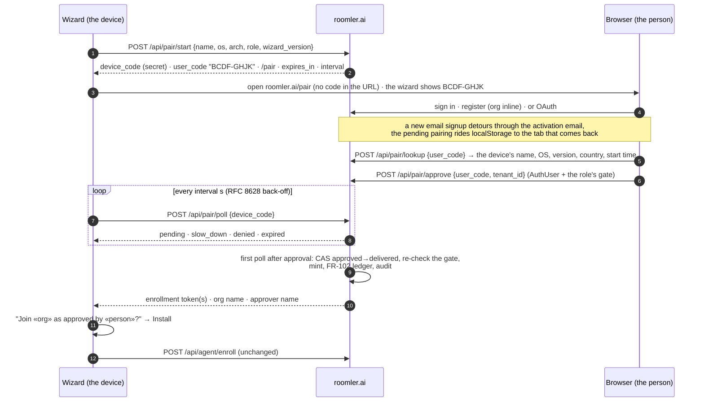
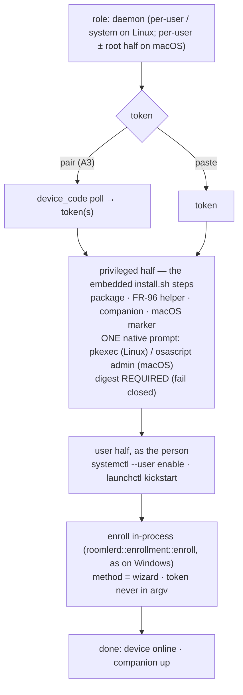

# FR-129: The installer pairs instead of asking for a token, and installs the full daemon on Linux and macOS

**Issue:** [#3022](https://github.com/gjovanov/roomler-ai/issues/3022) · **Status:** **decisions resolved 2026-10-28 · A1 (the server half) in review** ·
**Related:** [#2338](https://github.com/gjovanov/roomler-ai/issues/2338) (a wizard reinstall overwrites `config.toml`) ·
FR-43 ([#971](https://github.com/gjovanov/roomler-ai/issues/971), the macOS halves) ·
FR-84 ([#1633](https://github.com/gjovanov/roomler-ai/issues/1633), the wizard in lockstep) ·
FR-102 ([#2127](https://github.com/gjovanov/roomler-ai/issues/2127), the install trace and the issuance ledger) ·
FR-104 (anchoring) · FR-115 ([#2557](https://github.com/gjovanov/roomler-ai/issues/2557), the free tier) ·
FR-61 ([#1199](https://github.com/gjovanov/roomler-ai/issues/1199), vmtest) · FR-96 (the update helper)

## Goal

**A person who downloads Roomler goes from "no account" to "this machine is in my org and I
can see its screen" without ever seeing, copying or pasting a token — on Windows, Linux and
macOS, from the same GUI wizard.**

The operator's report (2026-10-27), on the day the SourceForge listing went live: its Download
button served `roomler-desktop` (fixed the same day — see the log), "we need an installer for
all platforms like Linux and macOS", and "when the user comes to token, guide him/her to
account and org creation with a smooth user experience". Asked how far to go, the operator
chose the full version of both: a pairing flow with no copy-paste, and the full daemon from the
GUI on Linux and macOS.

## The field evidence

Read on master `c2ccd5e17` and on production, 2026-10-27/28.

### The token step is a dead end for anyone without an account

The wizard's step 3 is a text box: "Paste a fresh token from the Roomler admin UI"
(`agents/roomler-setup/src/front/index.html:179`). Nothing on it opens a browser, names a
signup page or says where a token comes from. To get one, a new person must:

1. register — production answers with a message and **no session**
   (`crates/api/src/routes/auth.rs:311-324`);
2. open the activation email — `login` refuses an unactivated account (`auth.rs:366-370`);
3. log in;
4. create an org, unless they filled the optional org fields at signup (`auth.rs:250-255`);
5. find Devices → Enroll device, which mints a **10-minute single-use** token
   (`crates/modules/fleet/src/agent.rs:24`, `:90-140`, behind `MANAGE_AGENTS`);
6. copy it — the dialog says "then paste the token into the wizard"
   (`ui/src/components/enroll/EnrollmentDialog.vue:119`);
7. get back to the wizard and paste it before the 10 minutes run out.

Seven steps across two applications and an inbox, with a clock on the last two. The terminal
path is the same: `install.sh` without `--token` prints the enroll command to run later.

### The GUI installs the daemon only on Windows

Every daemon-role arm of the wizard's detection says
`supported: cfg!(target_os = "windows")` (`agents/roomler-setup/src/commands.rs:79, 86, 93, 103`),
and the daemon surface off Windows is a set of no-op stubs
(`agents/roomler-setup/src/orchestrator_agent.rs:758, 889, 922`). The docs say so plainly:
on Linux and macOS the daemon is `install.sh` in a terminal, and the wizard does the tunnel
client only (`docs/installation.md:22, 26`).

Yet the wizard ships for all three. Every `agent-v<V>` cuts `setup-v<V>` (FR-84 S1), and
`setup-v0.4.180` carries Linux x86_64 and aarch64, macOS universal and Windows x64 archives.
A Linux or macOS desktop user who downloads the GUI therefore gets a wizard that cannot install
the thing they came for.

### What the terminal path does that a GUI path must do too

Each of these was paid for in the field, which is why Phase B reuses them rather than redoing
them:

| Step | Where | Why it is not optional |
|---|---|---|
| package format follows the host | `scripts/install.sh:402-421` | a `.deb` on a host without dpkg downloads and then fails; non-dpkg hosts take the tarball, mirroring the updater |
| the macOS root-half marker | `scripts/install.sh:539-548` | must exist **before** the `.pkg` runs — its absence actively removes the LaunchDaemon; "nothing in the product ever created this file, which is why the privileged half was unreachable through the advertised one-liner despite shipping for months" |
| the per-user half as the console user | `scripts/install.sh:199-210` | a root run re-targets the per-user enroll at the console user; a root-owned config is the documented failure mode |
| the macOS second enrollment | `scripts/install.sh:570-600` | the overlay needs root, and the hub keys sessions on `agent_id`, so the root half is a separate device with its own token (FR-43 P2c/P3 have not collapsed it yet) |
| the FR-96 update helper | `scripts/install.sh:324-342` | a per-user Linux install cannot write `/usr`; the root helper installs its updates |
| the desktop companion | `scripts/install.sh:842`, header `:36-40` | the companion is the device's consent **prompt surface**; a "Prompt on host" device without one cannot ask anybody |
| digest verification | `scripts/install.sh:219-228` | soft-skips when a release publishes no digest — tolerable in a terminal, **not** for a GUI that elevates to root (Phase B fails closed instead) |

## The mechanism, in the code (master `c2ccd5e17`)

*Every anchor in this table resolves at `c2ccd5e17` and records the code before FR-129 changed
it. Do not shift these anchors with code that moved later.*

| Surface | Where | What it does today |
|---|---|---|
| token mint | `crates/modules/fleet/src/agent.rs:90-140`; route `crates/modules/fleet/src/lib.rs:386` | `POST /api/tenant/{tid}/agent/enroll-token`: `AuthUser` + `MANAGE_AGENTS`; 600 s single-use JWT (`:24`); FR-102 issuance recorded (`:114-124`); FR-104 `anchor` from an optional body (`:52-85`) |
| token claims | `crates/services/src/auth/mod.rs:82-96`, `:530-563` | `EnrollmentClaims { sub = issuing admin, tenant_id, jti, anchor }`; ten audiences in `TokenType` (`:37-78`) |
| token redeem | `crates/modules/fleet/src/agent.rs:180-260`; route `fleet/src/lib.rs:477-478`, `:564` | public `POST /api/agent/enroll`: archived org refused (`:192-207`), plan device cap before the single-use claim (`:222-242`), the claim fails closed (`:244-260`) |
| tunnel token | `crates/modules/network/src/routes/tunnel.rs:53-75`; mint `crates/services/src/auth/mod.rs:731` | any member (`is_member`) mints a `TunnelEnrollment` token |
| registration | `crates/api/src/routes/auth.rs:167-325` | creates the user; the org inline only with `tenant_name` + `tenant_slug` (`:250-255`); production returns no session (`:311-324`) |
| login gate | `crates/api/src/routes/auth.rs:366-370` | an unactivated account is refused |
| return path | `ui/src/plugins/router.ts:385-411` | `pending_redirect` in **sessionStorage** — one tab only; same-origin paths only |
| short-lived capability row | `crates/db/src/models/consent_request.rs:13-37` | an unguessable `token`, a status enum, an `expires_at` TTL, redeemed by a public token-keyed route — the shape a pairing row needs |
| rate limits | `crates/api/src/lib.rs:111-127`, `:143-145`, `:393`; `crates/core/src/rate_limit.rs:37-66` | per-IP governor on `/api`; `AuthRateLimiter` on register/login; a per-(caller, resource) sliding window for exec, SSH and relay mints |
| decision log | `crates/services/src/dao/peer_relay_audit.rs:3-10` | one collection per decision kind; the refused rows are the point |
| install trace | `crates/remote_control/src/models.rs:31-93` | `InstallInfo { method, scope, run }`; `InstallMethod::Wizard` already exists |
| module graph | `crates/core/src/graph.rs:45-47` | `remote → fleet`, `network → fleet`, `hive → fleet` |
| wizard daemon gate | `agents/roomler-setup/src/commands.rs:79, 86, 93, 103` | `supported: cfg!(target_os = "windows")` |
| wizard daemon pipeline | `agents/roomler-setup/src/orchestrator_agent.rs:142-203`, `:289`, `:403`, `:555-567` | resolve → download → verify → elevated `msiexec` → in-process `roomlerd::enrollment::enroll`, tagged `InstallMethod::Wizard` |
| non-Windows stubs | `agents/roomler-setup/src/orchestrator_agent.rs:758, 889, 922` | the daemon surface off Windows is a no-op |
| platform strings | `crates/roomler-setup-core/src/asset_resolver.rs:265-300` | `windows-x86_64`, `linux-x86_64`, `linux-aarch64`, `macos` |
| token step | `agents/roomler-setup/src/front/index.html:176-204`; `app.js:461-497`, `:629-680` | paste + a live, unverified JWT peek (`cmd_validate_token`, `commands.rs:204`); no polling anywhere in the frontend |
| browser open | `agents/roomler-setup/tauri.conf.json:40-41` | the shell-open plugin is enabled and unused by the token step |
| terminal installer | `scripts/install.sh:402-509` (Linux), `:511-576` (macOS), `:584-610` (root half), `:642` (enroll), `:842` (companion) | plain `sudo`, so it needs a terminal; no `pkexec` anywhere |

## Key design

### A — Pairing: the wizard asks the browser, not the person

The invariants, each closing a specific failure:

1. **Two codes, two holders** (RFC 8628's split). The `device_code` is 256 random bits, held
   only by the wizard, stored only as a SHA-256 hash, sent only in a POST body, and never shown,
   logged or put in a URL. It is the **only** credential that can retrieve a token. The
   `user_code` is 8 characters from the 20 unambiguous consonants (`BCDFGHJKLMNPQRSTVWXZ`,
   about 34.6 bits), shown in the wizard and typed in the browser. It names the pairing and
   retrieves nothing, so a shoulder-surfed or screenshotted code gives an attacker nothing to
   poll with.

2. **The same token, the same gate, minted on delivery.** Approval records a *decision*
   (approver, org, time). The token is minted by the first poll that sees `approved`, which
   flips the row `approved → delivered` by CAS — winning the CAS is the right to mint, so two
   polls can never mint twice. The mint re-checks the approver's gate, so an admin demoted
   between approve and delivery gets nothing. It is the existing call: daemon roles take
   `issue_enrollment_token_with(approver, org, 600, anchor = false)` behind `MANAGE_AGENTS`,
   and the tunnel role takes `issue_tunnel_enrollment_token` behind `is_member`. Both write
   the FR-102 ledger exactly as the admin route does today. Consequence: **no token ever rests
   in the database**, and everything downstream holds unchanged — the enroll route, the
   archived-org refusal (which the daemon enroll route holds; the tunnel enroll route never
   checked it, a pre-existing gap filed separately — and `approve` itself refuses an archived
   org for both kinds, before any notice fires), the plan device cap, the single-use claim,
   the 10-minute life. A lost delivery response is recovered by starting again: delivery is
   once.

3. **Both directions are confirmed on the other side.** The device-code flow has a known
   phishing hole, and here it runs both ways.
   - **Phishing (an attacker's device into a victim's org).** The attacker starts a pairing
     and sends the victim a link. If the victim approves, a root-level agent joins the victim's
     org and sits on its mesh under the tenant's coarse scope wherever no overlay ACL is
     compiled. Closed by: the link never carries the code, so the person must **type** it; the
     page shows the device's name, OS, wizard version, the starting IP's country and the start
     time before Approve, beside "Only approve a device you are setting up right now, in front
     of you"; and the org's admins are told (A2).
   - **Hijack (a victim's device into an attacker's org).** An authenticated user who guesses
     a live `user_code` approves someone else's pending install into *their* org, and gets
     remote control of a stranger's machine. Closed by: lookups and approvals are limited per
     account (misses lock that account's approvals for the hour), the code space is about
     2.6 × 10¹⁰, a pairing lives 15 minutes, and — the real lock — **the wizard shows the org
     name and the approver before it installs** and installs only on the person's click.
     An approval into an org you don't recognise ends at your own screen.

4. **No pod-local state.** The front LB hashes on the tenant, and a pairing has no tenant until
   it is approved, so start, approve and poll can each land on a different pod. The row in
   Mongo is the only state: no in-memory waiter. The consent flow's `ConsentSlot` oneshot is
   pod-local and does not transfer.

5. **Limits.**
   - `start` is pre-auth: the global per-IP governor plus its own per-IP ceiling, so a flood
     cannot exhaust the code space.
   - `poll` keeps a minimum interval per `device_code`; faster earns `slow_down` and a 5 s
     longer interval (RFC 8628 §3.5).
   - `lookup` and `approve` count misses per account.
   - Each limiter is the `crates/core/src/rate_limit.rs` pattern, checked *after* identity so
     every refusal is attributable.

6. **Own collections.** `device_pairings` — a unique index on the device-code hash, a unique
   partial index on the user code among `pending` rows, and a TTL on `expires_at`.
   `pairing_audit` records start, lookup, approve, deny, deliver, expiry and every refusal;
   it is best-effort, never gates, and lives 90 days (the `peer_relay_audit` convention). Both
   index sets go in the fleet module's index plan, never in `crates/db/src/indexes.rs`.

7. **Where it lives.** The **fleet** module owns pairing: it mints enrollment tokens and owns
   enrollment. Minting the tunnel kind goes through the services-layer call, so no new
   module-graph edge appears (`network → fleet` stays one-way). A tunnel-role pairing is
   refused while the network module is unmounted, as its enroll route would answer 503 anyway.
   The new routes re-record the composition baseline (`COMPOSITION_UPDATE=1`, saying why).
   The `/pair` page gates on `/api/capabilities` like every other page.

8. **New people.** The `/pair` page handles three states:
   - **Signed in:** pick the org (default the only or last one; create one inline if there is
     none) and approve.
   - **An account, signed out:** log in or use OAuth, and come back.
   - **No account:** register with the org inline (`register` already takes `tenant_name` and
     `tenant_slug`). An OAuth signup stays in one tab, so `pending_redirect` carries it. An
     email signup opens the activation link in a **new tab**, where sessionStorage is empty
     (`ui/src/plugins/router.ts:389`). The page therefore also keeps the pending pairing in
     localStorage with its expiry, under the guard's same-origin rules, and the guard routes
     any signed-in tab back to `/pair` while it lives.
   - **Fallback, always:** the wizard keeps showing the code with an "Open the page again"
     button. Production keeps requiring email activation — pairing works with it, never
     around it.

9. **What stays.**
   - **The paste.** It becomes "I already have a token" under the primary action. Scripted
     installs, MSP flows, offline mints and FR-104's anchoring tokens depend on it, and it is
     the kill-switch fallback.
   - **Anchoring.** A paired token never anchors (`anchor = false`); anchoring stays a
     deliberate act through the enrollment dialog.

10. **Terminal parity (A4).** `roomlerd enroll --pair`, `install.sh --pair` and
    `install.ps1 -Pair` print the code and the URL and poll the same endpoints, so a headless
    or SSH-only install gets the same flow. The token stays in-process — never in argv.

### B — The full daemon from the GUI on Linux and macOS

**One implementation of package placement: `install.sh`.** On Windows the wizard is a GUI
front end to `msiexec`. On Linux and macOS it becomes a GUI front end to the same steps the
terminal path runs, not a Rust re-implementation of them. Every row of the table under the
field evidence was paid for in the field, and two implementations drift without anyone seeing
it until a field report.

1. **The seam is decided by a spike (B0), then recorded here before B1.** The candidates:
   - **(i)** Run the whole script elevated. This breaks the per-user Linux path, which runs
     `systemctl --user` as the invoking user (`install.sh:501`); under `pkexec` that is root's
     user manager.
   - **(ii)** Give `install.sh` a privileged-steps entry point and a user-steps entry point.
     The terminal path calls both in order and does not change; the wizard elevates only the
     first and runs the second as the person.

   Recommended: (ii).
2. **Elevation through the desktop's own prompt:** `pkexec` (polkit) on Linux, which is present
   in any GNOME or KDE session, and `osascript … with administrator privileges` on macOS — one
   native password dialog per install. With no polkit agent (rare on a desktop), the wizard
   shows the terminal command. That command carries no secret; the wizard enrolls in-process
   once it detects the installed daemon.
3. **Fail closed on a missing digest** when elevated, unlike the terminal's soft-skip
   (`install.sh:219-228`). A root install of an unverified package is the thing to refuse.
4. **Roles.**
   - **Linux per-user** (the default for a desktop): screen sharing, plus the overlay through
     the userspace netstack.
   - **Linux system:** the root `roomlerd.service` and the TUN overlay, config at
     `/etc/roomler/config.toml` — the terminal's `--system`.
   - **macOS per-user:** screen sharing.
   - **macOS root half** for the overlay (B2): the pairing records `halves: 2`, one approval
     covers both, and delivery mints two tokens, until FR-43's single enrollment lands. The
     device cap counts each half, exactly as the terminal path does today.
5. **#2338 first.** The wizard's enroll path reportedly overwrites operator state that
   `roomlerd enroll` preserves. B1 routes Linux and macOS through the same code, so it fixes or
   folds in #2338 rather than spreading it to two more platforms.
6. **The kill switch is the server's.** A wizard is a binary on someone's disk. The Linux and
   macOS daemon cards appear only when the setup endpoint advertises `wizard_unix_daemon`, so
   they can be turned off without a release.

## The pairing API

Shipped by A1 in the **fleet** module (`crates/modules/fleet/src/pairing.rs`; the row in
`crates/db/src/models/device_pairing.rs`, the DAOs in `crates/services/src/dao/device_pairing.rs`
and `pairing_audit.rs`). All routes are under `/api/pair`, JSON in and out, inside the per-IP
governor. **The `device_code` travels only in POST bodies**, and appears in no response but
`start`'s.

| route | auth | request | response |
|---|---|---|---|
| `POST /api/pair/start` | none (per-IP ceiling) | `{machine_name, os: "linux"\|"macos"\|"windows", arch: "x86_64"\|"aarch64", role: "daemon"\|"tunnel", halves: 1\|2 (default 1), client, client_version}` | `{device_code, user_code: "BCDF-GHJK", verification_uri, expires_in, interval}` · 400 `invalid_request` · 400 `network_unmounted` (a tunnel role on a server without the network module) · 429 `rate_limited` |
| `POST /api/pair/poll` | none — the `device_code` is the credential | `{device_code}` | `{status: "authorization_pending"}` · `{status: "slow_down", interval}` · `{status: "access_denied"}` · `{status: "expired_token"}` · `{status: "approved", tokens: [jwt, …], org_name, org_slug, approver_name, approver_username}` — the two **unique** handles (`slug`, `username`) are what the installer shows beside the display names, which anyone can set to anything |
| `POST /api/pair/lookup` | `AuthUser`, per-account miss ceiling | `{user_code}` | `{machine_name, os, arch, role, halves, client, client_version, country, started_at, expires_at}` · 404 when no live pending pairing has that code · 429 once the account is locked |
| `POST /api/pair/approve` | `AuthUser` + `MANAGE_AGENTS` (daemon) / member (tunnel) in `tenant_id` | `{user_code, tenant_id}` | `{approved: true}` · 404 not pending · 403 `forbidden` (the gate, or an **archived** org — **never the `not_a_member` code**, which moves the SPA out of the org) · 400 `network_unmounted` · 429 locked |
| `POST /api/pair/deny` | `AuthUser`, per-account miss ceiling | `{user_code}` | `{denied: true}` · 404 · 429 locked |

- Every route takes JSON and says so: a body whose content type is not `application/json`
  (or `+json`) is refused **415** before it is read, so a cross-site `text/plain` form post
  cannot reach the cookie-authenticated `approve` or `deny` without a CORS preflight.
- `os` is `OsKind`'s wire spelling. `machine_name`, `client` and `client_version` are trimmed,
  stripped of control characters and capped at 64 characters, never refused for odd content —
  markup is kept as **text**, and every renderer escapes it (the admins' notice, the SPA); a
  `client` outside `wizard · roomlerd · roomler · script-sh · script-ps1` is clamped to
  `other`, as `InstallInfo::clamped` does for the install trace.
- `user_code`: 8 characters from `BCDFGHJKLMNPQRSTVWXZ`, displayed `XXXX-XXXX`; input is
  normalised (case-insensitive, hyphens and spaces optional) and stored without the hyphen.
  Anything that is not eight letters of the alphabet names no pairing and counts as a miss.
- `device_code`: 32 bytes from a CSPRNG, base64url (43 characters); stored **only** as
  `hex(SHA-256(code))`. An unknown, swept, delivered or expired code answers `expired_token`
  — the response never says which.
- `verification_uri` = `app.frontend_url` + `/pair`; `expires_in` = `[pairing] ttl_secs`
  (900); `interval` = `[pairing] poll_interval_secs` (5). A poll sooner than the row's
  interval answers `slow_down` with the interval lengthened by 5 s (capped at 60), persisted
  on the row (RFC 8628 §3.5).
- `halves: 2` is accepted only for `os: "macos", role: "daemon"` (else 400); delivery then
  mints two daemon tokens, each on the FR-102 ledger.
- `[pairing] enabled = false` makes every `/api/pair/*` route the **empty 404** an older
  server answers — to everyone, signed in or not — so a client falls back to the paste step.
- A refused approval is a plain 403 `forbidden` for a non-member too: `not_a_member` is the one
  server-sent code the SPA navigates on (out of the org), and an approval refused mid-flow must
  not evict the approver from the `/pair` page. The audit row keeps `refused:not_a_member`.
- 404 and 403 from `lookup`, `approve` and `deny` count as misses against the account; past
  `[pairing] misses_per_account_per_hour` (10) that account's three routes answer 429 for the
  rest of the hour. `start` has its own per-address ceiling
  (`[pairing] start_per_ip_per_hour`, 60 — a corporate NAT rolling out a floor of machines
  must not be refused at install #21) on top of the governor. Both ceilings are per pod, in
  memory, like the exec and SSH limiters: abuse ceilings over a code space of ~2.6 × 10¹⁰ and
  a 15-minute life, not the security boundary — the device code is. A key keeps at most
  `limit` timestamps, so a flood costs `limit` entries, not one per attempt.
- An approval into an **archived** org is refused (403 `forbidden`, audited `refused:archived`)
  before the decision is recorded, so no admin is told a device was paired into a closed org.

**The row** (`device_pairings`): `device_code_hash` (unique), `user_code` (unique among
`pending` rows — a partial index, so a decided pairing frees its code and `start` regenerates
on a collision), `status` (`pending` → `approved` → `delivered`; `denied`; `expired`), the
request fields, `start_ip`, `country` (from the server's GeoIP database, `null` when it has no
answer — never fabricated), `created_at`, `expires_at` (a TTL index tidies; **every read
compares it to the clock**, because the monitor runs about a minute late), `last_poll_at`,
`poll_interval_secs`, `approver_user_id`, `tenant_id`, `decided_at`, `delivered_at`. Every
transition is a compare-and-set on `status`: `approve` records the decision (`pending →
approved`) and mints nothing; the first `poll` that sees `approved` wins `approved →
delivered`, re-checks the approver's gate (`MANAGE_AGENTS` for a daemon, membership for a
tunnel — an approver demoted in between makes the pairing `denied` and the poll answers
`access_denied`), then mints through the existing calls
(`issue_enrollment_token_with(approver, org, 600, anchor = false)` ×`halves` on the FR-102
ledger, or `issue_tunnel_enrollment_token(approver, org, 600)` through the services layer — no
`fleet → network` edge). **No token ever rests in the database, and delivery is once.** A row
found past its `expires_at` is flipped to `expired` by whichever reader finds it, so the
expiry is audited exactly once. Nothing about a pairing lives in a pod's memory: start,
approve and poll may each land on a different pod.

**The trail** (`pairing_audit`, 90-day TTL): one row per decision — `action` (`start` ·
`lookup` · `approve` · `deny` · `deliver` · `expire` · `refuse`), `outcome` (`ok` or
`refused:<reason>` — `ip_ceiling`, `account_locked`, `not_pending`, `no_permission`,
`not_a_member`, `archived`, `network_unmounted`, `gate_lost`, `slow_down`, `unknown_code`,
`already_delivered`, `invalid_request`, `not_json`), the pairing id, user id, tenant id,
client IP, machine name, role, `at`. Best-effort: a failed insert is logged and the request
proceeds. Never the device code, never a token. **Every decision about a real pairing or by a
signed-in account is a durable row** (lookups, approvals, denials, deliveries, expiries, the
gate gone at delivery); a refusal an anonymous caller can repeat at will (an address past its
ceiling, a body that is not a request, a code that names nothing, a poll too soon, a poll after
delivery) is recorded **once per `(action, reason, address)` per hour** per pod, the repeats
counted in a debug line — or a flood could write a 90-day row per request.

**The notice** (`pairing_notice.rs`): on approve, the org's other `MANAGE_AGENTS` holders get
"<approver> paired <machine_name> (<os>) into <org> from <country or 'an unknown location'>",
naming what the pairing enrolls (a tunnel client, which any member may pair, or the full
daemon), by web push and by email — spawned, best-effort, never gating the answer. The mail
is rendered by `render_device_paired_notice`, which HTML-escapes every field and keeps the
subject plain text: the machine name is the installer's own text.

**Settings** — `[pairing]`, env `ROOMLER__PAIRING__*`: `enabled` (default **on**),
`ttl_secs` (900), `poll_interval_secs` (5), `start_per_ip_per_hour` (60),
`misses_per_account_per_hour` (10).

## Phases

| phase | what | kill switch | status |
|---|---|---|---|
| P0 | spec + ledger row + issue | — | this commit |
| A1 | server: `device_pairings` + `pairing_audit`; `/api/pair/start`, `/poll` (public), `/lookup`, `/approve`, `/deny` (`AuthUser`); mint on delivery; FR-102 ledger; limits; integration tests incl. start on one pod, approve + poll on another | `[pairing] enabled = false` → every `/api/pair/*` route answers the empty 404 and the wizard shows the paste step only | in review — [#3040](https://github.com/gjovanov/roomler-ai/pull/3040) |
| A2 | web: `/pair` — type the code, see the device, pick or create the org, approve or deny; the pending pairing through login, OAuth and email activation; the admins' notice | unmounted with A1's switch | — |
| A3 | wizard: "Set up in the browser" as the token step's primary action — start, open `/pair`, show the code, poll with back-off, confirm org + approver, then install; paste kept as "I already have a token" | A1's switch; an older server (404 on start) → paste only | — |
| A4 | terminal parity: `roomlerd enroll --pair`, `install.sh --pair`, `install.ps1 -Pair` | omit the flag | — |
| B0 | spike: the privileged/user split of `install.sh` under `pkexec` (Ubuntu GNOME, Fedora KDE vmtest cells) and `osascript` admin (macOS cell); the seam recorded in this spec | — | — |
| B1 | wizard: daemon roles on Linux (per-user, system) and macOS (per-user) through the embedded `install.sh` steps; the companion placed as the terminal places it; #2338 folded in | `wizard_unix_daemon` absent/false on the setup endpoint → Windows-only cards | — |
| B2 | macOS root half from the GUI (two tokens from one approval), or FR-43's single enrollment if it lands first | B1's switch | — |
| D | docs, vmtest cells (wizard × OS × daemon; pairing end to end), field log | — | — |

## Acceptance criteria

Each criterion's fail-first run is today's build, recorded in the log before its fix merges.

- [ ] **AC1** — A person with no account, on Windows 11, Ubuntu GNOME and macOS, downloads the
      wizard, picks a daemon role and ends with the device online in a new org created during
      the flow — typing only their account details and the 8-character code, never a token.
      Fail-first: today's wizard stops at the paste box.
- [ ] **AC2** — A signed-in admin of two orgs pairs a device into the org they pick. The device
      row shows `install.method = wizard`, and the FR-102 ledger records the issuance.
- [ ] **AC3** — A `device_code` never appears in a URL, a log line or the UI. A poll with only
      a `user_code` (or a forged device code) retrieves nothing. A log grep over a full flow on
      the dev stack finds no device code.
- [ ] **AC4** — `/pair` never approves from a link alone: the code must be typed, and the
      device's name, OS, version, country and start time are shown before Approve.
- [ ] **AC5** — The wizard shows the org and the approver before installing. Cancel leaves the
      device unenrolled and the pairing `delivered` (the token unused, expiring in 10 minutes).
- [ ] **AC6** — Start on pod A, approve and poll on pod B: the flow completes (no pod-local
      state), in an integration test with two servers on one database.
- [ ] **AC7** — A start flood from one IP is refused past its ceiling; a poll faster than
      `interval` answers `slow_down`; misses past the per-account ceiling lock that account's
      approvals for the hour. `pairing_audit` holds every decision about a real pairing or by a
      signed-in account, and the first refusal per source per hour for the refusals an
      anonymous caller can repeat at will.
- [ ] **AC8** — Every lookup, approve, deny, delivery and expiry lands in `pairing_audit`, and
      the org's other admins receive the "device paired" notice.
- [ ] **AC9** — A paired token is the ordinary single-use enrollment token: the plan device cap
      and an archived org refuse a paired device exactly as they refuse a pasted token
      (integration tests for both).
- [ ] **AC10** — With `[pairing] enabled = false`, the wizard shows only the paste step, and a
      pasted token enrolls unchanged.
- [ ] **AC11** — The GUI installs the full daemon on Ubuntu GNOME (per-user and system), Fedora
      KDE (the tarball path) and macOS (per-user, and the root half in B2). Each install is one
      native administrator prompt, places the companion where `install.sh` places it, and ends
      with the device online and a remote-desktop session showing its screen. Fail-first:
      today's wizard offers no daemon card on those OSes.
- [ ] **AC12** — An elevated GUI install refuses a package whose release publishes no digest.
- [ ] **AC13** — The terminal path is unchanged: `install.sh` and `install.ps1` pass the FR-61
      matrix with their existing flags and defaults.
- [ ] **AC14** — The setup endpoint's `wizard_unix_daemon` switch hides the Linux and macOS
      daemon cards without a new wizard release.
- [ ] **AC15** — Docs: `docs/device-pairing.md` created in house style (the flow as a mermaid
      sequence, the two-code model, the threat model in both directions, the limits, the audit)
      and linked from `docs/README.md`; `docs/installation.md` (the decision diagram at `:11`
      and the per-OS sections), `docs/api.md` (the routes), `docs/growth-observability.md`
      (pairing in the install trace) and the `ship-it` skill (the wizard's embedded
      `install.sh`, in lockstep) updated.

## Decisions (operator, 2026-10-28)

All seven open decisions were resolved as the spec recommended
([#3022, the decisions comment](https://github.com/gjovanov/roomler-ai/issues/3022)):

| # | decision | resolved |
|---|---|---|
| 1 | typed code or a pre-filled link (A2/A3) | **typed** — the link to `/pair` never carries the code; the person types the 8 characters. A pre-filled link is exactly what a phishing message carries |
| 2 | pairing life | **15 minutes** (`[pairing] ttl_secs = 900`), RFC 8628's order of magnitude; the wizard restarts an expired pairing with one click |
| 3 | the admins' notice | **web push and email**, to the org's other `MANAGE_AGENTS` holders — never to the approver. An org whose only admin approved gets none |
| 4 | anchoring from `/pair` (FR-104) | **not offered** — a paired token never anchors (`anchor = false`); anchoring stays a deliberate act through the enrollment dialog |
| 5 | the seam for B | **(ii) a privileged/user split** of `install.sh`; B0's spike still confirms it under `pkexec` and `osascript` before B1 code |
| 6 | embedded or served `install.sh` | **embedded** in the wizard, which is signed and cut with every agent release (FR-84 S1); a server-side hotfix reaches the wizard at the next agent release |
| 7 | macOS root half | **two tokens from one approval** (`halves: 2`, B2), until FR-43's single enrollment lands |

## Out of scope

- Changing email verification. Production keeps requiring activation before login.
- New token audiences, a longer enrollment TTL, or any change to `POST /api/agent/enroll`.
- Mobile installers. The browser viewer stays install-free.
- Replacing `install.sh`, `install.ps1` or the MSI.
- SourceForge's per-OS default downloads on future releases. They were set by hand on
  `setup-v0.4.180` (see the log); repeating that per release is a `ship-it` follow-up, not this
  FR.

## Field-verification log

| date | build | observation |
|---|---|---|
| 2026-10-27 | SourceForge, `setup-v0.4.180` | The listing's Download button served `roomler-desktop-0.4.180-x86_64-pc-windows-msvc.exe`, the Windows tray companion, because SourceForge's GitHub-release import picked it. "Default Download For" was set per file by hand: Windows → `roomler-setup-0.4.180-x86_64-pc-windows-msvc.zip`, macOS → `roomler-setup-0.4.180-universal-apple-darwin.tar.gz`, Linux → `roomler-setup-0.4.180-x86_64-unknown-linux-gnu.tar.gz`. `files/latest/download` from a Windows browser then resolved to the setup zip, and no `roomler-desktop` name appeared in its page. |
| 2026-10-28 | master `c2ccd5e17` | Baseline read: the token step is a paste box (`index.html:179`), the daemon cards are `cfg!(windows)` (`commands.rs:79-103`), and no pairing route or `pair` collection exists anywhere in the tree. |
