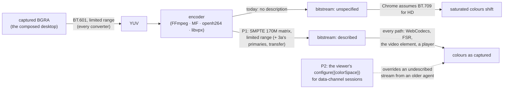

# FR-130: Colours decode true — every encoder tells the decoder the BT.601 it converted with

**Issue:** [#3120](https://github.com/gjovanov/roomler-ai/issues/3120) · **Status:** proposed 2026-10-30 — spec and
claim · **Owner:** the agent's encoders and the viewer's decoders · **Anchors:** master `caeb7f7ad` ·
**Promotes:** [#3049](https://github.com/gjovanov/roomler-ai/issues/3049) · **Builds on:**
[FR-118](FR-118-gpu-resident-frames.md) (open decision 3; P5's BT.601 mark), [FR-77](FR-77-encoder-chroma-matrix.md)
(cells and the probe), [FR-85](FR-85-hq-screen-recording.md) (the recorder)

## 1. Goal

Saturated colours decode as the source in every remote-control session and every recording, on every viewer path.

The agent converts the captured BGRA to YUV with **BT.601 at limited range**, on every path: the CPU converters, the
D3D11 VideoProcessor and VideoToolbox's attached matrix. No encoder writes a colour description, though. The
bitstream says "unspecified", the browser decodes an HD picture as **BT.709**, and every saturated colour shifts.
Greys come out exact, so the fault hides in a desktop of black text on white.

## 2. Evidence (master `caeb7f7ad`)

### 2.1 The red record is BT.601 read as BT.709, value for value

#3049 measured AC3's test pattern on CORPLAP-3 (`av1_qsv` at 1920×1200, agent 0.4.181, 16×16 patch means, σ 0).
Next to it, the same bars converted with BT.601 limited at 8 bits, rounded as a converter rounds, and decoded with
each matrix's inverse:

| Source RGB | BT.601 YUV | Decoded as BT.709 (predicted) | **Measured (#3049)** | Decoded as BT.601 (predicted) |
|---|---|---|---|---|
| 191 / 191 / 191 | 180 / 128 / 128 | 191 / 191 / 191 | 191 / 191 / 191 | 191 / 191 / 191 |
| 191 / 191 / 0 | 161 / 44 / 142 | 194 / 179 / 0 | **194 / 179 / 0** | 191 / 190 / 0 |
| 0 / 191 / 191 | 131 / 156 / 44 | 0 / 173 / 193 | **0 / 173 / 193** | 0 / 191 / 190 |
| 0 / 191 / 0 | 112 / 72 / 58 | 0 / 161 / 0 | **0 / 161 / 0** | 0 / 191 / 0 |
| 191 / 0 / 191 | 84 / 184 / 198 | 205 / 30 / 197 | **205 / 30 / 197** | 191 / 0 / 192 |
| 191 / 0 / 0 | 65 / 100 / 212 | 208 / 18 / 0 | **208 / 18 / 0** | 191 / 0 / 1 |
| 0 / 0 / 191 | 35 / 212 / 114 | 0 / 12 / 200 | **0 / 12 / 199** | 0 / 1 / 192 |

The prediction matches the field to the code value on six bars and within one on the seventh. Nothing else is
needed to explain #3049: not the capture, not the GPU conversion, not a backend quirk. Decoded with the matrix it
was encoded with, the same YUV comes back within one code value of the source.

### 2.2 No encoder writes a description today

| Encoder family | Converts with | Writes a colour description? | Where it would go |
|---|---|---|---|
| FFmpeg, every backend | BT.601 limited (the CPU form's dcv; the GPU forms, FR-118) | **no**: none of `colorspace`, `color_range`, `color_primaries`, `color_trc` is set anywhere in the agent | the codec context, in `build_encoder`'s `configure` closure (`agents/roomlerd/src/encode/ffmpeg/encoder.rs:1757`, after `:1888`), which every FFmpeg open passes through: sessions, rebuilds, probes, recordings and the GPU forms |
| Media Foundation (Windows) | BT.601 limited (`agents/roomlerd/src/encode/color.rs:42`, `:108-109`) | **no**: the media types carry size, rate and bitrate only | the output and input types (`agents/roomlerd/src/encode/mf/sync_pipeline.rs:454`, `:476`), and again where `drain_output` renegotiates the output type (`:410`) |
| openh264, live | BT.601 limited | **no** (`agents/roomlerd/src/encode/openh264_backend.rs:91`) | its VUI, as the recording profile already does (`:150`, `VuiConfig::bt601()`) |
| libvpx VP9 | BT.601 limited | **no**: `img.cs` is set (`agents/roomlerd/src/encode/libvpx.rs:629`), but libvpx writes the header's colour space from `VP9E_SET_COLOR_SPACE`, never from the image, so every VP9 stream says "unknown" | `VP9E_SET_COLOR_SPACE` and `VP9E_SET_COLOR_RANGE` in `apply_screen_content_controls` (`:351`) |
| openh264, recording | BT.601 limited | **yes**, SMPTE 170M and limited range, and the MP4's `colr` box says the same | nothing to do |

FFmpeg 9.0.1 (tag `n9.0.1`, `bf1b838f2`, read in its source) passes the context's fields on for NVENC, QSV, AMF,
VAAPI, D3D12, Vulkan and VideoToolbox: as the H.264/HEVC SPS VUI, the AV1 sequence header, or VideoToolbox's
session properties. `avcodec_open2` neither checks nor changes them, and no hardware encoder reads a frame's colour
fields, so they belong on the context before the open. Two cells cannot carry a description at all:
**`vp9_qsv`** (QSV's signal-info buffer excludes VP9) and **`vp9_vaapi`** (FFmpeg's VAAPI VP9 writer has no
tagging). Four backends hand the header to closed code, so only a parsed output proves them: the NVIDIA driver,
AMD's AMF runtime, VideoToolbox and Intel's Windows driver. VAAPI sends its header as a packed sequence header, and a
driver that refuses one drops the description with only a warning (Mesa 26.2.6 accepts it). The matrix must be
`AVCOL_SPC_SMPTE170M`, not `BT470BG` (the same matrix under another code), because AMF maps only SMPTE 170M, BT.709 and BT.2020 and
treats anything else as "auto". Every conversion is BT.601 limited, so signalling BT.601 is true on every path. The
only difference between paths is chroma siting (the CPU averages a 2×2 block; the D3D11 VideoProcessor sites
left), and nothing signals that today either.

### 2.3 The viewer does no colour work of its own

Every viewer path leaves the YUV → RGB conversion to Chrome: `drawImage(VideoFrame)` in the data-channel workers
(`ui/src/workers/rc-vp9-444-worker.ts:750` for VP9, AV1 and H.264; `ui/src/workers/rc-hevc-worker.ts:833`), the FSR
pass's `texImage2D(VideoFrame)` on RGB Chrome has already converted (`ui/src/workers/rc-fsr-render.ts:535`), and the
`<video>` element on the RTP path. No `configure()` passes a `colorSpace` (`rc-vp9-444-worker.ts:538`,
`rc-hevc-worker.ts:620`), there is no YUV shader, and no CSS filter touches the picture. So a description in the
bitstream reaches every path with no viewer change, and nothing would correct the colour twice.

### 2.4 Colour-managed captures are a different effect

On neo16 and on the MacBook the bars arrive desaturated on both of FR-118's paths, cyan 0/191/191 as about
80/178/192. A matrix error cannot raise the red channel of cyan from 0; the panel's colour management does, before
the capture sees the pixels (FR-118 §9.7, §9.9). FR-130 fixes the decode. Its field reads compare the decoded
picture with the pixels as captured, which equal the CSS values only on an unmanaged host.

### 2.5 P0: what Chrome does with each description (2026-10-30)

**The setup.**
- **The streams:** the test pattern at 1920×1080, converted once to BT.601 limited YUV. FFmpeg's software encoders
  (x264, x265, libaom, libvpx-vp9) then encoded that one YUV in four colour-description variants:
  - U: none;
  - A: SMPTE 170M for matrix, primaries and transfer;
  - B: SMPTE 170M matrix, BT.709 primaries and transfer;
  - S: SMPTE 170M matrix, BT.709 primaries, the sRGB transfer (IEC 61966-2-1).

  All four are limited range. Within a codec the variants decode to the same YUV, so only the description differs.
- **The decoders:** Chrome 156 on an RTX 5090 and Chromium 149 on a Radeon 610M decoded them. Both ran headless,
  with hardware and software decode.
- **The paths:** each frame went through the viewer's three paths: WebCodecs into a 2D canvas (`drawImage`),
  WebCodecs into WebGL (`texImage2D`, as the FSR pass does), and `<video>` from an MP4 or WebM file.
- **The readout:** 16×16 patch means at every bar.

| Stream | WebCodecs, 2D and WebGL, hardware and software | `<video>` |
|---|---|---|
| U, every codec | read as BT.709: worst bar 30 code values off, #3049's values exactly | the same |
| U with `configure({colorSpace})` set to A, B or S, every codec | **within 1 code value of the source** | — |
| A, B or S: H.264, HEVC, AV1 | within 1 | within 1 |
| A, B or S: VP9 | **read as BT.709** (the frame reports `bt709`) | within 1, through WebM's colour element |
| S with `configure({colorSpace})` set to S: VP9 | within 1 | — |

- **A, B and S decode identically.** Chrome applies no gamut mapping between SMPTE C and BT.709 primaries here. It
  reports S as `bt709 / iec61966-2-1 / smpte170m`, limited range.
- **Chrome's WebCodecs ignores VP9's in-band colour space.** A tagged VP9 stream still decodes as BT.709. Only the
  decoder configuration fixes it, so lever 2 is required for every VP9 session on the data channel, including 4:4:4.
  That makes it more than a convenience for older agents.
- **The override works everywhere it can apply:** all four codecs, hardware and software decode, 2D and WebGL.
- **Software HEVC does not decode.** Chrome has no software HEVC decoder, so those rows are empty.
- **Greys are exact on every row.** The readout is canvas and WebGL readback, not the compositor's output.

## 3. Design

### 3a. What to signal

The matrix is BT.601 (SMPTE 170M) and the range is limited: that is what every converter does. Primaries and
transfer describe the content, and the content is an sRGB desktop. Two sets are candidates:

| Set | Matrix | Primaries | Transfer | For it | Against it |
|---|---|---|---|---|---|
| **A** | SMPTE 170M | SMPTE 170M | SMPTE 170M | the conventional "BT.601" triple; what the recorder's openh264 already writes | Chrome may gamut-map SMPTE C primaries to the sRGB canvas and move saturated colours a little |
| **B** | SMPTE 170M | BT.709 | BT.709 or sRGB (IEC 61966-2-1) | says what the desktop is: sRGB primaries, with only the YCbCr matrix being BT.601 | a combination fewer tools write |

P0 measures both in Chrome on every viewer path and picks the one that decodes closest to the source (open
decision 1). Chroma siting stays unspecified, because the paths differ (2.2). **P0 chose set S**: an SMPTE 170M matrix,
BT.709 primaries, the sRGB transfer and limited range. In Chrome it decodes exactly as A and B do (§2.5), and it
describes the desktop truthfully.

### 3b. Lever 1: the agent describes its stream (P1)

| Family | The change | Proof (a test per backend reachable on that platform) |
|---|---|---|
| FFmpeg | `set_colorspace`, `set_color_range`, `set_color_primaries`, `set_color_transfer_characteristic` in `build_encoder`'s `configure` closure (`encoder.rs:1757`, after `:1888`). One place covers every cell, rebuild, probe and recording | parse the output: the H.264/HEVC SPS VUI, the AV1 sequence header's `color_config` |
| Media Foundation | `MF_MT_YUV_MATRIX`, `MF_MT_VIDEO_NOMINAL_RANGE`, `MF_MT_VIDEO_PRIMARIES`, `MF_MT_TRANSFER_FUNCTION` on the output and input types (`sync_pipeline.rs:454`, `:476`), and **again** on the renegotiated type (`:410`), or a stream change drops them | parse the SPS VUI of the encoder's output |
| openh264, live | the VUI the recording profile already sets (`openh264_backend.rs:150`), in `new` (`:91`) | parse the SPS VUI |
| libvpx VP9 | `VP9E_SET_COLOR_SPACE` (`VPX_CS_BT_601`) and `VP9E_SET_COLOR_RANGE` (studio) in `apply_screen_content_controls` (`libvpx.rs:351`), for 4:2:0 and 4:4:4 alike | parse a keyframe's uncompressed header (`color_space`, `color_range`) |
| `vp9_qsv`, `vp9_vaapi` | none: FFmpeg cannot tag them | covered by lever 2 on the data channel |

The repo has no SPS, AV1 sequence-header or VP9 header parser, and the vendored FFmpeg decodes only H.264. So P1
adds a small test-only parser per bitstream, built on the Annex-B and OBU walkers the repo already has
(`agents/roomlerd/src/recording/annexb.rs`, `agents/roomlerd/src/encode/mf/sync_pipeline.rs`). Each test gets a negative
control: with the switch off it must read "unspecified".

The agent also advertises the description, as an `AgentCaps.video` token, so a viewer knows before it connects that
this agent's streams describe themselves (`crates/remote_control/src/models.rs`, beside `chunk-framing`).

### 3c. The switch

`color_description` (env `ROOMLERD_COLOR_DESCRIPTION`), a tribool like `zero_copy`, **on** by default once P1 is
verified (open decision 3). Off brings back today's undescribed stream. It is read at every open, and it must hold
at every entry point:

| Entry point | How the switch reaches it |
|---|---|
| a session, a rebuild, a GPU form | the getter, read in `build_encoder` and the other three families' opens |
| the capability probe's child processes | automatic: the child gets every config knob as an env var, and the probe cache's key hashes them, so a flip re-probes |
| the recorder child the daemon starts | automatic |
| `roomlerd record` run by hand | its explicit key list (`agents/roomlerd/src/recording/child.rs:245-266`) gains the key |
| `encoder-smoke`, `media export` | they publish no config today; the env var reaches them, and P1 either publishes the config or documents env-only |
| a supervised Mac's GUI worker | `WORKER_ENV_FORWARD` gains the suffix (`agents/roomlerd/src/macos_supervisor.rs:322` is `ZERO_COPY`'s line) |
| the config surface | a `KeyMeta`, `current_value` and `apply` arm in `crates/agent-core/src/config_surface.rs`, and the env bridge in `crates/agent-core/src/config.rs`, like `zero_copy` |

The recorder's openh264 VUI and its MP4 `colr` box predate FR-130 and have always been right, so the switch leaves
them alone (open decision 5).

**P1b** makes the switch pushable through remote config ([remote-config.md](../remote-config.md) §6), so an operator
can switch it off without a person at each device. A push writes the device's `color_description`: `off`, `on`, or
blank, which clears the key back to the default. It is pushable on `encoder_cells_deny`'s terms: `MANAGE_AGENTS`
alone, because it grants nothing either way, and the device reports it as waiting for the restart a local edit waits
for.

### 3d. Lever 2: the viewer tells the decoder (P2)

WebCodecs' `VideoDecoderConfig.colorSpace` overrides what the bitstream says. Passing 3a's set in the three
`configure()` calls fixes data-channel sessions from **every** agent, the fleet's older ones included, the moment
the server is promoted. It also covers `vp9_qsv` and `vp9_vaapi`. Every agent so far converts with BT.601 limited,
so the override is right for all of them. An agent that ever converted otherwise would advertise a token that
switches the override off; FR-130 adds none (open decision 2). The `<video>` path has no such control, so it relies
on lever 1. P0 measured the override on Chrome's hardware and software decoders, on every codec (§2.5). **Lever 2 is
the only fix for VP9 on the data channel**, because Chrome's WebCodecs ignores VP9's in-band colour space. P2 keeps a
per-browser kill switch (`roomler-rc-colorspace=off`).

### 3e. The recorder

An FFmpeg-encoded recording carries lever 1's description in its SPS. The openh264 one already does, and the MP4
`colr` box already says BT.601 limited. A recording's SPS must not change mid-file
(`agents/roomlerd/src/recording/annexb.rs:109-113`), and the switch is fixed for a recorder's process, so that holds.

## 4. Phases

| P | Scope | Kill switch | Status |
|---|---|---|---|
| P0 | The lab, no product change. (1) The red record per codec: today's bitstreams parsed (unspecified) and decoded in Chrome (the shift of 2.1). (2) 3a's sets A and B, encoded with the agent's encoders and decoded in Chrome through `drawImage`, the FSR pass's `texImage2D` and `<video>`, read against the source. (3) Whether `configure({colorSpace})` overrides an undescribed stream on Chrome's hardware and software decoders | — | **done 2026-10-30** (§2.5, §8): (1) what each of neo16's encoders writes today; (2) A, B and S decode identically, so open decision 1 picks S; (3) the override works on every codec, and it is the only fix for VP9 |
| P1 | Lever 1 (3b) and the switch (3c), with a header test per family and negative controls; the `AgentCaps.video` token | `color_description = off` | **built 2026-10-30** (PR #3139, unreleased; no AC ticked): set S lives once in `encode/color_desc.rs`, mapped into each API. FFmpeg sets it in `build_encoder` for every cell, rebuild, probe, recording and GPU form (not on the VP9 names), and a vendor runtime that refused it would open undescribed rather than not at all; MF puts it on both media types and on the renegotiated one; live openh264 gets the VUI (the recording profile keeps its own); libvpx gets `VP9E_SET_COLOR_SPACE` (SMPTE 170M) and `_RANGE`. The switch reaches the probe and recorder children, a hand-run `roomlerd record`, `encoder-smoke` (it now publishes the config), a supervised Mac's GUI worker and the config surface; the hello says `color-described`. A test-only reader of the H.264/HEVC SPS VUI, the AV1 `color_config` and the VP9 header, checked against x264, x265, libaom and libvpx output, backs one test per family, each with the switch off as its negative control. **neo16:** NVENC, D3D12 and Vulkan write S exactly on H.264, HEVC and AV1 (NVENC 4:4:4 too), libvpx 4:2:0 and 4:4:4 write SMPTE 170M at studio range, live openh264 writes S; AMF writes its own matrix from FFmpeg's 601 profile, 5 for HEVC and **2 (unspecified) for H.264**, and its own BT.709 with the switch off; Microsoft's MF H.264 and HEVC encoders write **no description** from the attributes or the encoder API; NVIDIA's and AMD's MF encoders did not open there. VideoToolbox, QSV and VAAPI are unmeasured |
| P1b | The switch, pushable through remote config: `DesiredConfig.color_description` carries `off`, `on`, or blank (clear the device's key, back to the default), on `encoder_cells_deny`'s terms | the device's own `remote_config_enabled = false`, the default, refuses every push | **built 2026-10-30** (PR #PR_P1B, unreleased): `MANAGE_AGENTS` alone, because the switch grants nothing either way; the device writes the key and reports `needs_restart`, because the encoders read it once per process. The server reads the word with the parser the device applies it with (`parse_pushed_tribool`), takes the words `roomler config set` takes, stores `on`, `off` or blank, and refuses anything else with a 400 naming the key. A word that reaches a device anyway leaves its key as it is and never fails the keys beside it. Not managed is not a revert, so the dialog's select has four states: not managed, the default, off and on. Tests: the parser and its agreement with `roomler config set`; the route (`MANAGE_AGENTS` alone for every word, one spelling, the 400); the agent's apply (written, idempotent, an unmanaged key kept, an unreadable word kept out of the way, blank clears); the store and the select's mapping; and `agent_tests` end to end, where a device admin without either grant bit pushes `off`, an opted-in device writes it to its config file, and the listing reads `needs_restart`. The field push is owed with P3 |
| P2 | Lever 2 (3d) in the three data-channel workers, with unit tests on the `configure()` arguments | `roomler-rc-colorspace=off`, per browser | **built 2026-10-30**, not yet promoted: set S is defined once (`ui/src/workers/rc-decoder-config.ts`), and `rc-vp9-444-worker` (VP9, AV1, H.264), `rc-hevc-worker` and `rc-webcodecs-worker` configure through it on every session from every agent, with no agent token (open decision 2; the composable's `agentConvertsBt601Limited` is the hook). A browser that refuses the colour space keeps its picture: a `configure()` that throws on it goes again without it, and a decoder that fails before its first frame with it set is rebuilt once without it and waits for a key frame. The workers report the colour space they were told and the one each first frame carries. Unit tests drive the three real workers with a recording `VideoDecoder`. In the lab, Chrome 156 decodes the real workers' BT.601 bars within 1 code value on all four codecs, and with the switch off they shift as #3049 measured (§8). P3 is owed |
| P3 | The field, per backend family, on a release carrying P1 and a promote carrying P2: the pattern on the data-channel paths (blit and FSR) and on `<video>`, red then green | both switches | — |
| P4 | Docs: `docs/encoders.md` (a colour section: the converters, the description, the switch), `docs/remote-control.md` (the viewer's decode paths and lever 2), a row in `docs/README.md`'s index | — | — |

## 5. Acceptance criteria

- [ ] **AC1 (red first):** today's agent writes no colour description: the parsed SPS VUI, AV1 `color_config` and VP9
  header say "unspecified" or "unknown", per family. A session's test pattern decodes shifted as 2.1 predicts on every
  data-channel codec and on `<video>`.
- [ ] **AC2 (described):** every encoder writes 3a's chosen description, checked by a test that parses its output
  (FFmpeg on every backend the platform's CI or a host can open, MF, live openh264, libvpx 4:2:0 and 4:4:4). With
  the switch off the same tests read "unspecified". `vp9_qsv` and `vp9_vaapi` are listed as FFmpeg's gap, covered by
  AC5.
- [ ] **AC3 (green, the field):** on a release carrying P1, per backend family (QSV, NVENC, VideoToolbox, MF or
  openh264, libvpx), the pattern's saturated bars decode within ±2 code values of the pixels as captured, in every
  channel, on the data-channel paths (blit and FSR) and on `<video>`. The greys stay exact, and there is no new
  decode error or keyframe request.
- [ ] **AC4 (the switch):** `color_description = off` brings back the undescribed stream at every entry point in 3c,
  and a test fails if any entry point ignores it.
- [ ] **AC5 (old and new together):** a viewer with P2 and an agent without P1 decode the pattern true on the data
  channel. A viewer without P2 and an agent with P1 decode it true on every path. An agent with P1 and a viewer with
  P2 agree, with no double correction. Every VP9 session on the data channel decodes true through P2, whichever agent
  sends it (Chrome's WebCodecs ignores VP9's own description, §2.5), and so do `vp9_qsv` and `vp9_vaapi` where a
  host can open one.
- [ ] **AC6 (recordings):** an FFmpeg-encoded recording carries the description in its SPS, beside the `colr` box,
  and plays true in a standard player.
- [ ] **AC7 (docs):** `docs/encoders.md` and `docs/remote-control.md` describe the colour path (a mermaid diagram, the
  description, both switches), with a row in `docs/README.md`'s index.

## 6. Open decisions

1. **Which primaries and transfer** (3a): set A (SMPTE 170M for all three) or set B (BT.709 primaries, BT.709 or sRGB
   transfer). Recommended: decide by P0's measurement, on the set that decodes closest to the source on every
   viewer path. **Decided 2026-10-30 by P0's measurement: set S.** A, B and S decode identically in Chrome on every
   path (§2.5). S is the truthful description of an sRGB desktop: SMPTE 170M matrix, BT.709 primaries, the sRGB
   transfer, limited range. That matters for players that colour-manage by primaries and transfer, such as Safari
   and QuickTime. An API that cannot express the sRGB transfer writes BT.709's, the closest exact value, and says so
   where it does it.
2. **Lever 2's gate** (3d): override on every data-channel session unless the agent advertises a different
   conversion (recommended; FR-130 adds no such token), or only for agents without P1's token.
3. **The switch's default:** on once AC2 holds (recommended), or off until AC3.
4. **`vp9_qsv` and `vp9_vaapi`:** rely on lever 2 (recommended), or patch the vendored FFmpeg to tag VP9.
5. **The recorder's existing description:** leave it as it is, whatever the switch says (recommended). It has been
   right since FR-85.
6. **The RTP `<video>` fallback with Microsoft's MF H.264 and `h264_amf`:** decided by the operator 2026-10-30: accept
   for now; P2 covers both on the data channel. (Neither carries the description, as P1 measured: MF writes none and
   `h264_amf` writes matrix 2, unspecified. `<video>` has no lever 2, so such a stream still decodes there as BT.709.)

## 7. Out of scope

- Colour-managed capture: a panel whose compositor works in its own space (a Mac's Display P3, Windows' automatic
  colour management) hands the capture pixels that already differ from the page's CSS. Both paths capture the same
  pixels (2.4).
- Moving the conversion to BT.709 (FR-118's open decision 3, option 2).
- Chroma siting, HDR and 10-bit.
- Conferencing: browser to browser, with no agent encoder in the path.

## 8. Field-verification log

| Date | Build | Cell | Result |
|---|---|---|---|
| 2026-10-28 | agent 0.4.181, CORPLAP-3: `av1_qsv` 1920×1200 on the SystemContext DXGI arm; AC3's test pattern; the viewer on neo16 | **The red record** (#3049, before FR-130) | Greys exact; every saturated bar shifted, as 2.1 predicts to the code value: magenta 191/0/191 as 205/30/197, green 0/191/0 as 0/161/0. The CPU and GPU input paths decode identically (FR-118 AC3) |
| 2026-10-30 | agent 0.4.187 on neo16 (RTX 5090 and Radeon 610M), `roomlerd encoder-smoke --dump`, read with ffprobe | **P0 (1): what today's encoders write** | `h264_nvenc` and live openh264: no description at all. `hevc_nvenc`, `av1_nvenc`: the range only (limited). **`hevc_amf`: BT.709 for matrix, primaries and transfer; `h264_amf`: a BT.709 matrix.** Left on "auto", AMF picks BT.709 by picture size and declares it for our BT.601 data. Media Foundation's H.264 dump carries no parameter sets (`encoder-smoke` writes only access-unit delimiters and slices), so P1 reads MF's VUI elsewhere |
| 2026-10-30 | the P0 lab: FFmpeg's software encoders, four codecs × four descriptions, Chrome 156 (RTX 5090) and Chromium 149 (Radeon 610M), headless | **P0 (2) and (3)** (§2.5) | An undescribed stream reads as BT.709 on every codec and path, reproducing #3049's values exactly. A, B and S decode within 1 code value on H.264, HEVC and AV1, through WebCodecs (2D and WebGL) and `<video>`. VP9 through WebCodecs ignores its own description. `configure({colorSpace})` fixes every codec, hardware and software. Open decision 1: set S |
| 2026-10-30 | the P2 branch, Chrome 156 on neo16, headless, served by Vite: the real `rc-vp9-444-worker` and `rc-hevc-worker`, each fed one keyframe encoded straight from BT.601 limited I420 bars at 1280×720 (no browser RGB → YUV step), the painted canvas read back. A lab run, not P3's field | **P2 in the lab** | **Switch on:** the decoder reports set S, and every bar reads back within 1 code value of the source on VP9, H.264 and AV1 (`rc-vp9-444-worker`) and HEVC (`rc-hevc-worker`). **Switch off:** the frame reports `bt709`, and the bars shift as #3049 measured, to the code value but one: magenta 205/30/197, green 0/161/0, and blue 0/12/200 against #3049's 0/12/199 (§2.1 predicts 200). **A browser refusing the colour space**, simulated in a wrapper around the real worker: at `configure()`, the worker goes on without it; after `configure()`, it rebuilds the decoder once without it, asks for a key frame and paints. Neither failure reaches the main thread as an error. Safari and Firefox are untested: Playwright's WebKit on Windows has no WebCodecs, and no Firefox build was at hand |

## 9. Related

- [#3049](https://github.com/gjovanov/roomler-ai/issues/3049): the bug FR-130 promotes.
- [FR-118](FR-118-gpu-resident-frames.md): its open decision 3 (the matrix), its GPU conversions (BT.601 limited by
  design), and P5's BT.601 mark on VideoToolbox, which fixes VideoToolbox's conversion. FR-130 signals the result.
- [FR-77](FR-77-encoder-chroma-matrix.md): cells and the probe, whose child processes inherit the switch.
- [FR-85](FR-85-hq-screen-recording.md): the recorder, whose openh264 profile and MP4 `colr` box already describe
  BT.601.
- [`docs/encoders.md`](../encoders.md), [`docs/remote-control.md`](../remote-control.md).
