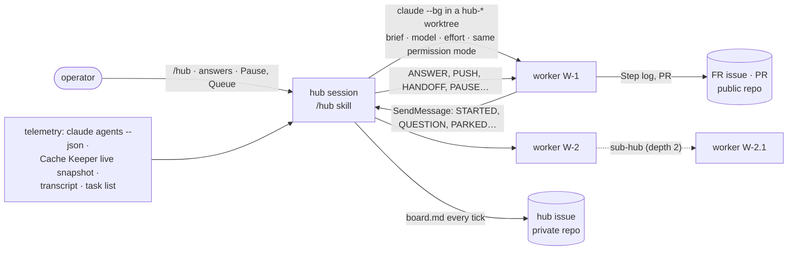

# FR-131: Hub — one coordinator session runs the backlog through parallel worker sessions (`/hub` skill + hub view)

**Status: P1 shipped 2026-10-30. P2 (the hub view mod) in progress.** P1 is the skill, the worker protocol and
the helper, with the mechanics measured live. P3 (the first real backlog run) and P4 (the docs) are pending.

## Problem / Goal

The FR backlog is worked one card at a time (the `autopilot` skill), with two or three workers sent out by
hand as in-process subagents. A subagent can't be entered by the operator. It dies with its parent's
`/clear`. It reports only when it finishes. And nobody sees its context filling up or its prompt cache
expiring. Three things have been measured, each the cost of running workers that way:

- a worker silently continued on a weaker model;
- two workers halted on a usage limit;
- a worker improvised live network manipulation on the dev box because "prove it in the field" was left
  open.

**Goal:** one coordinator session, the **hub**, delegates FRs, bugs, specs and research to **worker
sessions** that run in parallel. Each worker has its own session and worktree, which the operator can
enter and leave. All of them are tracked on one board. Each worker's context is rotated before it
degrades. And every claim a worker makes is verified on GitHub, CI or the fleet before it counts.

## Key design

| Part | Where | What it does |
|---|---|---|
| `/hub` skill | `~/.claude/skills/hub/SKILL.md` | The coordinator. It defines Start, Tick, the signal table, model and effort tiers (§3 scope pinned to the top tier at max), dispatch, rotation (handoff, then the next generation), verification on the surface, operator escalation with exact commands, pause and resume, FR claims (the hub is the only claimant) and nesting. |
| Worker protocol | `~/.claude/skills/hub/worker.md` | Start (orient on the surface, plan, report), the loop, the message verbs both ways (their single definition), questions, handoff, park, sub-hub, and the `status.json` schema. |
| Templates | `~/.claude/skills/hub/templates.md` | The hub issue, the brief, the worker's progress comment, and the FR, task and sub-issue shapes. |
| Helper | `~/.claude/skills/hub/hub.mjs` | No dependencies. `init`, `add`, `spawn` (including `--rotate [--from-status]`), `stop`, `respawn`, `msg`, `status` (the board plus recommendations), `sync` (reading the hub issue's controls and queue) and `attach`. |
| Hub view mod (P2) | a function-hooks plugin | `/hub` with no arguments lists every worker of every hub, active and inactive, with total, done and in-progress task counts. A worker can be entered (its task list and its whole conversation), answered, activated or deactivated, and left again for the hub view. |
| State | `~/.claude/hub/<id>/` | `state.json` (the registry, written only by the hub), `status.json`, `board.md` and `board.txt` (generated), `events.log`, and `workers/<W>/` (the brief, `status.json` written by the worker, and the handoffs). |

## Evidence — the mechanics the design rests on

All measured 2026-10-30 on Claude Code 2.1.280, except the last row, with throwaway workers that were
removed afterwards.

| Measured | Consequence in the design |
|---|---|
| `--effort low` recorded `effort: max` in the transcript: the project's `env.CLAUDE_CODE_EFFORT_LEVEL=max` beats the flag. `--settings '{"env":{…}}'` recorded `high`. | `spawn` sets the effort through `--settings` env, and `status` reads the effort each turn actually used. |
| A background session in another permission mode held the hub's message ("permission mode class doesn't match") and let it expire. With the modes matched, messages flowed both ways. | Every worker starts in the hub's own mode, read from the hub's transcript. `spawn` refuses while the mode is unknown. |
| `claude --bg --resume <id>` on a stopped, registered session started a copy under a new id that inherited the name. `claude respawn <id>` resumed it in place. | Pause is `claude stop`, resume is `claude respawn`. |
| A session started inside a worktree shares auto-memory, CLAUDE.md, the rules, the project env and the hooks (the gh-account guard ran). It lacks `settings.local.json`, so `GH_CONFIG_DIR` is unset, and it lacks `permissions.defaultMode` and the untracked skills. | `spawn` forwards `GH_CONFIG_DIR` and a per-worktree `CARGO_TARGET_DIR`. Briefs pass untracked skills by absolute path. |
| `claude agents --json`: `state: blocked` is the normal label of an idle job; a real prompt reads `status: "waiting"` with `waitingFor`. A `/clear` inside a job gives it a new session id under the same job id. | Liveness follows the job id, and a person is needed only on `status: waiting`. |
| A `<synthetic>` reply is a limit hit only with `error: "rate_limit"` ("You've hit your session limit · resets …"). After a stop or respawn the session writes "No response requested.", which is not a limit hit. | `LIMIT` fires on real limit hits only and quotes the reset. `API_ERROR` is a separate signal. |
| On 2.1.280, `claude-sonnet-5-5` served, but as an unrecognised model with a 200k window and unknown pricing. On **2.1.314** it is recognised with a 1M window and list pricing, and the `sonnet` alias resolves to it. | Claude Code was moved to 2.1.314 after the operator's three function-hooks mods passed their own suites on it (62, 67 and 63 tests). |

## Phases

| Phase | What | Status | Kill switch |
|---|---|---|---|
| P1 | Skill, worker protocol, templates and helper. Mechanics measured with five throwaway workers. An independent review found 12 defects, all fixed and retested. | shipped 2026-10-30 | Don't invoke `/hub`; delete `~/.claude/skills/hub/`. |
| P1b | Claude Code 2.1.280 → 2.1.314, so that Sonnet 5.5 is first-class | done 2026-10-30 | Rename the kept 2.1.280 binary back. |
| P2 | Hub view mod: list, counts, enter (tasks and conversation), answer, activate and deactivate, back | in progress | Remove the plugin's folder. |
| P3 | First real backlog run, at least two workers in parallel on real FRs | pending | ⏸ Pause in the hub issue. |
| P4 | Docs: `docs/agent-hub.md` in house style, plus a `docs/README.md` row | pending | — |

## Acceptance criteria

- [x] **AC1 — spawn.** A worker started by `hub.mjs spawn` runs on the tier's model and effort, in the hub's
  permission mode, with `GH_CONFIG_DIR` set and a `CARGO_TARGET_DIR` outside its worktree. Evidence (field
  log 2026-10-30): the worker reported `gh=set cargo=C:/dev/_targets/<worktree> eff=high`, and its
  transcript recorded `high` on Sonnet in `bypassPermissions`.
- [x] **AC2 — messages.** The hub and a worker exchange messages both ways when their modes match. A
  mismatched mode is shown to hold the message.
- [x] **AC3 — rotation.** `spawn --rotate` refuses without a handoff. `--from-status` writes an UNVERIFIED
  handoff, stops gN, and starts gN+1, whose first message points at that handoff.
- [x] **AC4 — pause and resume.** `stop` followed by `respawn` brings the same job back, idle, with nothing
  replayed.
- [x] **AC5 — signals.** On real transcripts, `LIMIT` fires on a real limit hit and quotes its reset, a
  "No response requested." reply raises nothing, and a model switch is flagged as drift.
- [ ] **AC6 — hub view.** `/hub` with no arguments lists every worker of every hub, active and inactive,
  each with total, done and in-progress task counts that match its `status.json` plan.
- [ ] **AC7 — enter.** Entering a worker shows its task list and its whole conversation, scrollable, and
  "back" returns to the hub view.
- [ ] **AC8 — answer.** An answer typed in the view reaches the worker, and the worker continues with it,
  as shown in its transcript.
- [ ] **AC9 — activate and deactivate.** `respawn` and `stop` work from the view, and the hub's state
  follows.
- [ ] **AC10 — real run.** At least two workers in parallel each park one phase of a real FR with PRs the
  hub has verified. The board and the hub issue track them, and at least one rotation happens on a
  context or cache signal.
- [ ] **AC11 — docs.** `docs/agent-hub.md` in house style (mermaid, tables) and a `docs/README.md` row.

## Open decisions

- **The command.** `/hub` with no arguments opens the view; `/hub <args>` stays with the skill.
- **The answer route.** If the function-hooks API can send a cross-session message, the view sends the
  answer directly. Otherwise it relays through the hub session (`W-n: <answer>`).
- **Where the tooling lives.** The skill and the mod could move into this repo (tracked, like `autopilot`)
  or into a repo of their own (like Cache Keeper).

## Out of scope

- Agent teams (they can't nest and don't survive `/resume`) and in-process subagents as workers (they
  can't be entered and die with their parent's `/clear`).
- The hub merging, closing, tagging, promoting or deploying: those stay with the operator.
- Cloud and remote-machine workers.

## Field log

- **2026-10-30 — P1.** Five throwaway workers (Sonnet), all removed afterwards; every mechanic above was
  measured on them.
  - **Dead hypothesis:** a stopped job resumes with `--bg --resume`. It forks a copy.
  - **Dead hypothesis:** `state: blocked` means a worker needs a person. It is the normal idle label.
  - **Dead hypothesis:** any `<synthetic>` reply is a limit hit. "No response requested." follows every
    respawn.
- **2026-10-30 — P1b.** 2.1.314 was staged in a separate folder, probed (Sonnet 5.5 served, a 1M window,
  list pricing, `sonnet` resolving to it), and the operator's mods' suites passed on it. The global binary
  was then swapped by rename, so the running sessions stayed on 2.1.280.
