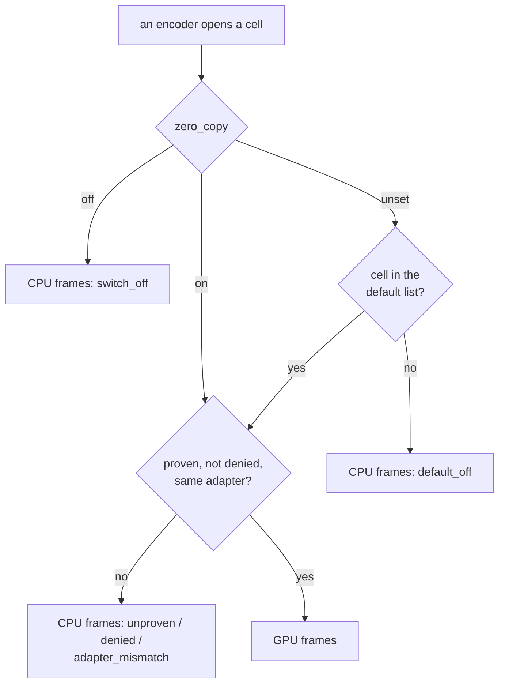

# FR-132: Zero-copy by default — each GPU-input cell turns on for the fleet after a clean week of its own

**Issue:** [#3141](https://github.com/gjovanov/roomler-ai/issues/3141) · **Status:** proposed 2026-10-30 — spec and
claim · **Owner:** the agent's capture and encode path, and remote config · **Anchors:** master `b101fc456` ·
**Takes over:** [FR-118](FR-118-gpu-resident-frames.md) open decision 2 (the default) · **Builds on:**
[FR-118](FR-118-gpu-resident-frames.md) (the GPU-input cells), [FR-77](FR-77-encoder-chroma-matrix.md) (cells, the
probe, `encoder_cells_deny`), [FR-119](FR-119-high-refresh-streaming.md) (`fps_deny`, the second pushable denylist)

## 1. Goal

On a host where FR-118's GPU path is proven, a session takes it without anyone setting a switch on that host. The
default goes on **one cell at a time**, and a cell goes on only after a clean fleet week of its own. Before any cell
goes on, the server can turn any cell off on any device.

FR-118 closed with every cell it built field-verified, and with `zero_copy` **off by default**: the decision it left
open (§7, decision 2) was "OFF for one release, then ON per cell after a clean fleet week of that cell (decode errors,
keyframe requests, `input_path` reasons), never globally". The first half has held since 0.4.181. This FR is the
second half, and §2 shows that two things it needs are missing today.

## 2. Evidence (master `b101fc456`)

### 2.1 What the GPU path saves, per cell

| Cell | Host | CPU path → GPU path | FR-118 |
|---|---|---|---|
| QSV, the DXGI arm | CORPLAP-3, `av1_qsv` 1920×1200 | capture + encode 14.70 → 12.30 ms a frame; the worker's CPU 15.9 → 10.6 ms an encoded frame | §9.3 |
| QSV, the DXGI arm | the 2880×1800 laptop, `av1_qsv` | windows at ≥ 50 fps 0 of 564 → 594 of 596; capture + encode 25.12 → 16.61 ms; CPU 15.93 → 3.88 ms | §9.10 |
| NVENC, the WGC arm | neo16, `av1_nvenc` 2560×1600 | readback + encode 18.26 → 5.14 ms; CPU 9.64 → 3.18 ms | §9.7 |
| VideoToolbox | the MacBook, `hevc_videotoolbox` 3024×1964 | encode stage 4.18 → 0.12 ms; CPU 14.58 → 2.55 ms | §9.9 |

Every one of those legs ran with the switch set by hand on a test host. No other host runs the GPU path.

### 2.2 The switch is off unless a host sets it

`zero_copy_enabled` reads `ROOMLERD_ZERO_COPY` (config `zero_copy`), and any value other than `1`, `true`, `yes` or
`on` is off, unset included (`agents/roomlerd/src/capture/mod.rs:91-107`). A capture backend reads it once when it
opens. An encoder then opens the GPU form only for a cell the probe's `gpu` child proved
(`agents/roomlerd/src/capture/gpu_frame.rs:52-59`) and `zero_copy_deny` does not name
(`agents/roomlerd/src/encode/ffmpeg/gpu_hint.rs:142-169`), and otherwise reports CPU frames and the reason
(`gpu_hint.rs:85-97`). The config surface offers both keys locally, restart-applied
(`crates/agent-core/src/config_surface.rs:1755-1778`).

### 2.3 The server cannot turn a cell off

`DesiredConfig`, what remote config pushes, carries two keys of this family, `encoder_cells_deny` and `fps_deny`
(`crates/remote_control/src/models.rs:2967-2981`), and the agent's `apply` handles exactly those two
(`agents/roomlerd/src/remote_config.rs:308-332`). Neither `zero_copy` nor `zero_copy_deny` is there. Today that
costs nothing, because the switch is off everywhere. With a default on, a cell that misbehaves on one driver could
be turned off only one host at a time, over exec, and only on hosts that answer exec.

### 2.4 A fleet week cannot count decode errors

A decode error in the viewer's WebCodecs worker is posted to the page (`ui/src/workers/rc-webcodecs-worker.ts:170-182`),
which tears the WebCodecs path down and falls back to `<video>` (`ui/src/composables/useRemoteControl.ts:7752-7765`).
Nothing reaches the agent or the server. What does reach the server per session is `rc:session.stats`, whose
`keyframe_requests` counts the viewer's keyframe asks (`agents/roomlerd/src/peer.rs:331-347`). FR-118's legs read
decode errors in a viewer someone was watching, and a fleet week has no such viewer. So the first measure decision
2 names cannot be read today.

## 3. Design

### 3a. The kill switch first (P1)

`zero_copy_deny` joins `DesiredConfig`, beside `encoder_cells_deny` and `fps_deny`, and for their reason: it only
ever removes cells a device would otherwise open, so it is not a security gate and `MANAGE_AGENTS` is enough. The
agent applies it as it applies `fps_deny` (a blank push clears it, `none` denies nothing) and reports
`needs_restart`, since the probe and the config fallbacks read it once per process. It ships before any cell is on
by default, so the first flip already has a switch the server can push.

### 3b. Decode errors become countable (P1)

The viewer sends one control message per decode error, with the stage that failed (configure, decode, the pipe),
before it falls back. The agent counts them per session, as it counts `keyframe_requests`, and `rc:session.stats`
carries the count. A viewer without this sends nothing, which reads as zero, so the canary read in 3d compares
sessions from viewers that have it.

### 3c. A default per cell (P2)

`zero_copy` becomes three-valued in its reading as it already is in config (`kind: "tribool"`): `on` keeps today's
meaning (every proven cell), `off` turns every cell off, and **unset** means "the cells in the built-in default list".
A cell outside the list reports CPU frames and a new reason, `default_off`, so "not yet on by default" is never read
as "someone turned it off" (`switch_off`). The probe's proof, the adapter rule and `zero_copy_deny` apply to a
listed cell exactly as to one turned on by hand.

The capture decides at open, before the encoder's cell is known. With the switch unset it delivers GPU frames when
the first proven GPU-input cell in cascade order is listed, the cell whose vendor `gpu_frame.rs` already uses to pick
WGC's adapter. An encoder on an unlisted cell then reads those frames back through `Frame::cpu()`, which returns
today's readback bytes (FR-118 AC2). That costs what the CPU path costs already.

The list ships **empty**, so P2 alone changes nothing a session does. A test pins that: with the list empty and
`zero_copy` unset, every input form matches `off`'s, and only the reason differs.

### 3d. A canary week per cell, then its flip (P3–P5)

For each cell, its canary hosts (open decision 2) set `zero_copy = on` locally and run for 7 days. That week is read
against the same hosts' CPU-path week before it, from the heartbeats and `rc:session.stats`:

| Measure | Where | Clean means |
|---|---|---|
| decode errors per session-hour | `rc:session.stats` (3b) | no rise (open decision 3) |
| keyframe requests per session-hour | `rc:session.stats` | no rise |
| `input_reason` | the DC heartbeat (`agents/roomlerd/src/peer.rs:9716-9730`) | `gpu` on every session of the cell; no `open_failed` that persists |
| capture + encode, CPU per frame | the heartbeat; the process's CPU time | FR-118's saving for that cell, roughly |

A clean week puts the cell on the default list in the next agent release. A fleet week after that release verifies
the flip on every host that runs the cell, canary or not.

## 4. Phases

| P | Scope | Kill switch | Status |
|---|---|---|---|
| P0 | The red record: a fleet week of heartbeats read per cell (encoder × capture arm), counting the sessions that could have opened a GPU form and read `switch_off`, and naming the hosts that run each cell | — | not started |
| P1 | 3a and 3b: `zero_copy_deny` in `DesiredConfig` and the agent's `apply`; the viewer's decode-error message and its count in `rc:session.stats` | the push is absent (no change); a viewer without the message sends nothing | not started |
| P2 | 3c: the three-valued reading, the default list (empty), `default_off`, at both entry points | `zero_copy = off`; the list empty | not started |
| P3 | QSV: the canary week, then the flip (if open decision 4 orders it first) | `zero_copy_deny` pushed; the cell off the list in the next release | not started |
| P4 | NVENC on the WGC arm: the same | the same | not started |
| P5 | VideoToolbox: the same | the same | not started |
| P6 | Docs: the default per cell and each flip in `docs/encoders.md`, the pushable deny list in `docs/remote-config.md`, `docs/remote-control.md` §5.1f | — | not started |

## 5. Acceptance criteria

- [ ] **AC1 (red first):** a fleet week of heartbeats counts the sessions that ran on a cell with a proven GPU form
  and read `input_reason=switch_off`, per cell, with the hosts that ran them.
- [ ] **AC2 (the kill switch):** a `zero_copy_deny` push reaches a device, the device reports `needs_restart`, and
  after the restart that cell's sessions read `input_reason=denied`. Integration-tested, and seen in the field.
- [ ] **AC3 (decode errors counted):** a decode error forced in the viewer shows up in that session's
  `rc:session.stats`, and a session with none reads zero.
- [ ] **AC4 (a default per cell):** with `zero_copy` unset, a listed cell opens GPU input and an unlisted one reads
  `default_off`; `on` and `off` keep their meaning; with the list empty, every input form matches `off`'s. Tested at
  both entry points, the probe and a session, as FR-118 AC6 was.
- [ ] **AC5 (a clean week before each flip):** per cell, 7 days with the switch on, read against the CPU-path week
  on the same hosts by the table in 3d, before the release that lists the cell.
- [ ] **AC6 (each flip, in the field):** after the release that lists a cell, a fleet week shows that cell's
  sessions on `input_path=gpu` on hosts that never set the switch, with no rise in decode errors or keyframe requests,
  and the per-frame saving FR-118 measured for the cell.
- [ ] **AC7 (docs):** `docs/encoders.md` (the default per cell and the record of each flip), `docs/remote-config.md`
  (the pushable deny list) and `docs/remote-control.md` §5.1f, with a row in `docs/README.md`'s index.

## 6. Open decisions

1. **Should `zero_copy` itself be pushable**, so a canary can be started from the server? Recommended: no. Push only
   the deny list, the half that removes, as with `encoder_cells_deny` and `fps_deny`. Turning a cell on stays a
   decision made on the device, or by a release.
2. **Which hosts are each cell's canaries.** P0 names the hosts that run each cell. The 2880×1800 laptop is not a
   test host, so it joins a canary only in a window its owner agrees to, as in FR-118's decision 7.
3. **What "clean" means in numbers.** Within the spread of the CPU-path week on the same hosts, or a fixed bound per
   session-hour. Recommended: the spread, with a floor of one event in the week, since a single host's week can be
   all zeros.
4. **The order of the flips.** Recommended: by the hosts each cell covers, read from P0. QSV is likely first: every
   QSV host captures through the DXGI arm (FR-118 §9, 2026-10-27).

## 7. Out of scope

- New GPU-input cells: AMF and VAAPI (FR-118 deferred both with measurements), D3D12 and Vulkan, the portal and mutter
  arms (FR-118 §8).
- HDR, and the colour description, which is [FR-130](FR-130-colours-decode-true.md).
- Turning the default on for every cell at once. Decision 2 ruled that out.

## 8. Field-verification log

Nothing yet. P0 is the first entry.

## 9. Related

[FR-118](FR-118-gpu-resident-frames.md) (#2669) · [FR-77](FR-77-encoder-chroma-matrix.md) ·
[FR-119](FR-119-high-refresh-streaming.md) (#2670) · [FR-130](FR-130-colours-decode-true.md) (#3120) ·
[`docs/encoders.md`](../encoders.md) § GPU-resident frames · [`docs/remote-config.md`](../remote-config.md)
