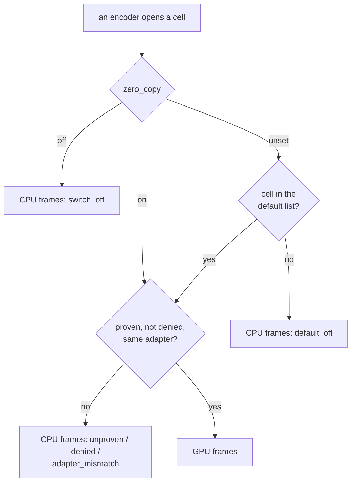

# FR-132: Zero-copy by default — each GPU-input cell turns on for the fleet after a clean week of its own

**Issue:** [#3141](https://github.com/gjovanov/roomler-ai/issues/3141) · **Status:** P1 released in 0.4.191 on 2026-10-31;
the four decisions taken 2026-10-30 (§6); proposed 2026-10-30 · **Owner:** the agent's capture and encode path, and
remote config · **Anchors:** master `01520c8af` (§2); the as-built notes in §3a and §3b, master `ff29120ed` + P1 ·
**Takes over:** [FR-118](FR-118-gpu-resident-frames.md) open decision 2 (the default) · **Builds on:**
[FR-118](FR-118-gpu-resident-frames.md) (the GPU-input cells), [FR-77](FR-77-encoder-chroma-matrix.md) (cells, the
probe, `encoder_cells_deny`), [FR-119](FR-119-high-refresh-streaming.md) (`fps_deny`, the second pushable denylist)

## 1. Goal

On a host where FR-118's GPU path is proven, a session takes it without anyone setting a switch on that host. The
default goes on **one cell at a time**, and a cell goes on only after a clean fleet week of its own. Before any cell
goes on, the server can turn any cell off on any device.

FR-118 closed with every cell it built field-verified, and with `zero_copy` **off by default**: the decision it left
open (§7, decision 2) was "OFF for one release, then ON per cell after a clean fleet week of that cell (decode errors,
keyframe requests, `input_path` reasons), never globally". The first half has held since 0.4.181. This FR is the
second half, and §2 shows that two things it needs are missing today.

## 2. Evidence (master `01520c8af`)

### 2.1 What the GPU path saves, per cell

| Cell | Host | CPU path → GPU path | FR-118 |
|---|---|---|---|
| QSV, the DXGI arm | CORPLAP-3, `av1_qsv` 1920×1200 | capture + encode 14.70 → 12.30 ms a frame; the worker's CPU 15.9 → 10.6 ms an encoded frame | §9.3 |
| QSV, the DXGI arm | the 2880×1800 laptop, `av1_qsv` | windows at ≥ 50 fps 0 of 564 → 594 of 596; capture + encode 25.12 → 16.61 ms; CPU 15.93 → 3.88 ms | §9.10 |
| NVENC, the WGC arm | neo16, `av1_nvenc` 2560×1600 | readback + encode 18.26 → 5.14 ms; CPU 9.64 → 3.18 ms | §9.7 |
| VideoToolbox | the MacBook, `hevc_videotoolbox` 3024×1964 | encode stage 4.18 → 0.12 ms; CPU 14.58 → 2.55 ms | §9.9 |

Every one of those legs ran with the switch set by hand on a test host. No other host runs the GPU path.

### 2.2 The switch is off unless a host sets it

`zero_copy_enabled` reads `ROOMLERD_ZERO_COPY` (config `zero_copy`), and any value other than `1`, `true`, `yes` or
`on` is off, unset included (`agents/roomlerd/src/capture/mod.rs:91-107`). A capture backend reads it once when it
opens. An encoder then opens the GPU form only for a cell the probe's `gpu` child proved
(`agents/roomlerd/src/capture/gpu_frame.rs:52-59`) and `zero_copy_deny` does not name
(`agents/roomlerd/src/encode/ffmpeg/gpu_hint.rs:142-169`), and otherwise reports CPU frames and the reason
(`gpu_hint.rs:85-97`). The config surface offers both keys locally, restart-applied
(`crates/agent-core/src/config_surface.rs:1755-1778`).

### 2.3 The server cannot turn a cell off

`DesiredConfig`, what remote config pushes, carries two keys of this family, `encoder_cells_deny` and `fps_deny`
(`crates/remote_control/src/models.rs:2967-2981`), and the agent's `apply` handles exactly those two
(`agents/roomlerd/src/remote_config.rs:308-332`). Neither `zero_copy` nor `zero_copy_deny` is there. Today that
costs nothing, because the switch is off everywhere. With a default on, a cell that misbehaves on one driver could
be turned off only one host at a time, over exec, and only on hosts that answer exec.

### 2.4 A fleet week cannot count decode errors

A decode error in the viewer's WebCodecs worker is posted to the page (`ui/src/workers/rc-webcodecs-worker.ts:170-182`),
which tears the WebCodecs path down and falls back to `<video>` (`ui/src/composables/useRemoteControl.ts:7752-7765`).
Nothing reaches the agent or the server. What does reach the server per session is `rc:session.stats`, whose
`keyframe_requests` counts the viewer's keyframe asks (`agents/roomlerd/src/peer.rs:331-347`). FR-118's legs read
decode errors in a viewer someone was watching, and a fleet week has no such viewer. So the first measure decision
2 names cannot be read today.

## 3. Design

### 3a. The kill switch first (P1)

`zero_copy_deny` joins `DesiredConfig`, beside `encoder_cells_deny` and `fps_deny`, and for their reason: it only
ever removes cells a device would otherwise open, so it is not a security gate and `MANAGE_AGENTS` is enough. The
agent applies it as it applies `fps_deny` (a blank push clears it, `none` denies nothing) and reports
`needs_restart`, since the probe and the config fallbacks read it once per process. It ships before any cell is on
by default, so the first flip already has a switch the server can push.

As built: the route passes the text on unread, as it does the other two denylists, because an entry the gate cannot
read denies nothing (`crates/modules/fleet/src/remote_config.rs:206`). The agent stores it trimmed, a blank clears
it, and it reports `needs_restart` (`agents/roomlerd/src/remote_config.rs:354`). A test chains the pushed value
through the restarted daemon's config fallbacks to the exact `name:gpu` entry `gpu_hint::is_denied` matches.
Decision 1 is held by `the_device_owned_refusals_are_not_pushable`, which compares whole keys
(`crates/remote_control/src/models.rs:9599`). The dialog gets the field, and
[`remote-config.md`](../remote-config.md) §6 the key, with its value table.

### 3b. Decode errors become countable (P1)

The viewer sends one control message per decode error, with the stage that failed (configure, decode, the pipe),
before it falls back. The agent counts them per session, as it counts `keyframe_requests`, and `rc:session.stats`
carries the count. A viewer without this sends nothing, which reads as zero, so the canary read in 3d compares
sessions from viewers that have it.

As built, a session's count tells "zero" from "not counted":

- Every `rc:decodestat` carries `de: 1`, so the agent knows this viewer counts. `rc:session.stats` then carries
  `decode_errors`, and `Some(0)` is a measured zero. A session whose viewer or agent predates P1, or that never
  decoded in a worker, carries no field, and the server writes none. The canary read compares only rows that have it.
- `rc:decode-error` carries `stage` (`configure` · `decode` · `pipe`), `path` (`webcodecs` · `vp9-444` · `hevc`),
  and the codec and the decoder's message, cut short.
- The agent logs the first eight errors with their stage.
- The first `de`, and each of those first eight errors, send one sample at once, by the carrier's road
  (FR-102 P9d). A session someone leaves right after a black screen still records its count, and a short clean
  session records its zero.
- A re-offer carries the count to the new peer.
- The server writes `stats.decode_errors` only from a sample that counted.

Detail: [remote-control.md §11.10](../remote-control.md#1110-the-viewers-decode-errors-fr-132-p1).

### 3c. A default per cell (P2)

`zero_copy` becomes three-valued in its reading as it already is in config (`kind: "tribool"`): `on` keeps today's
meaning (every proven cell), `off` turns every cell off, and **unset** means "the cells in the built-in default list".
A cell outside the list reports CPU frames and a new reason, `default_off`, so "not yet on by default" is never read
as "someone turned it off" (`switch_off`). The probe's proof, the adapter rule and `zero_copy_deny` apply to a
listed cell exactly as to one turned on by hand.

The capture decides at open, before the encoder's cell is known. With the switch unset it delivers GPU frames when
the first proven GPU-input cell in cascade order is listed, the cell whose vendor `gpu_frame.rs` already uses to pick
WGC's adapter. An encoder on an unlisted cell then reads those frames back through `Frame::cpu()`, which returns
today's readback bytes (FR-118 AC2). That costs what the CPU path costs already.

The list ships **empty**, so P2 alone changes nothing a session does. A test pins that: with the list empty and
`zero_copy` unset, every input form matches `off`'s, and only the reason differs.

### 3d. A canary week per cell, then its flip (P3–P5)

For each cell, its canary hosts (open decision 2) set `zero_copy = on` locally and run for 7 days. That week is read
against the same hosts' CPU-path week before it, from the heartbeats and `rc:session.stats`:

| Measure | Where | Clean means |
|---|---|---|
| decode errors per session-hour | `rc:session.stats` (3b) | no rise (open decision 3) |
| keyframe requests per session-hour | `rc:session.stats` | no rise |
| `input_reason` | the DC heartbeat (`agents/roomlerd/src/peer.rs:9729-9743`) | `gpu` on every session of the cell; no `open_failed` that persists |
| capture + encode, CPU per frame | the heartbeat; the process's CPU time | FR-118's saving for that cell, roughly |

A clean week puts the cell on the default list in the next agent release. A fleet week after that release verifies
the flip on every host that runs the cell, canary or not.

## 4. Phases

| P | Scope | Kill switch | Status |
|---|---|---|---|
| P0 | The red record: a fleet week of heartbeats read per cell (encoder × capture arm), counting the sessions that could have opened a GPU form and read `switch_off`, and naming the hosts that run each cell | — | **done 2026-10-30** (§8, AC1) |
| P1 | 3a and 3b: `zero_copy_deny` in `DesiredConfig` and the agent's `apply`; the viewer's decode-error message and its count in `rc:session.stats` | the push is absent (no change); a viewer without the message sends nothing | **built 2026-10-30, released 2026-10-31** ([#3154](https://github.com/gjovanov/roomler-ai/pull/3154), in 0.4.191 and `hosted-20261031-28dfd72`). 3a: `MANAGE_AGENTS` alone, passed on unread, written by the device with `needs_restart`, end to end in `agent_tests` (AC2's integration half). 3b: `rc:decode-error` per error before the fallback, `de: 1` on every `rc:decodestat`, `decode_errors` on `rc:session.stats` (absent = not counted), the first `de` and the first eight errors sent at once, end to end through a real agent and viewer peer in `session_decode_errors_tests` (AC3's integration half). The field halves of AC2 and AC3 are met (§8) |
| P2 | 3c: the three-valued reading, the default list (empty), `default_off`, at both entry points | `zero_copy = off`; the list empty | not started |
| P3 | QSV: the canary week, then the flip (if open decision 4 orders it first) | `zero_copy_deny` pushed; the cell off the list in the next release | not started |
| P4 | NVENC on the WGC arm: the same | the same | not started |
| P5 | VideoToolbox: the same | the same | not started |
| P6 | Docs: the default per cell and each flip in `docs/encoders.md`, the pushable deny list in `docs/remote-config.md`, `docs/remote-control.md` §5.1f | — | not started |

## 5. Acceptance criteria

- [x] **AC1 (red first):** a fleet week of heartbeats counts the sessions that ran on a cell with a proven GPU form
  and read `input_reason=switch_off`, per cell, with the hosts that ran them.
- [x] **AC2 (the kill switch):** a `zero_copy_deny` push reaches a device, the device reports `needs_restart`, and
  after the restart that cell's sessions read `input_reason=denied`. Integration-tested, and seen in the field.
- [x] **AC3 (decode errors counted):** a decode error forced in the viewer shows up in that session's
  `rc:session.stats`, and a session with none reads zero.
- [ ] **AC4 (a default per cell):** with `zero_copy` unset, a listed cell opens GPU input and an unlisted one reads
  `default_off`; `on` and `off` keep their meaning; with the list empty, every input form matches `off`'s. Tested at
  both entry points, the probe and a session, as FR-118 AC6 was.
- [ ] **AC5 (a clean week before each flip):** per cell, 7 days with the switch on, read against the CPU-path week
  on the same hosts by the table in 3d, before the release that lists the cell.
- [ ] **AC6 (each flip, in the field):** after the release that lists a cell, a fleet week shows that cell's
  sessions on `input_path=gpu` on hosts that never set the switch, with no rise in decode errors or keyframe requests,
  and the per-frame saving FR-118 measured for the cell.
- [ ] **AC7 (docs):** `docs/encoders.md` (the default per cell and the record of each flip), `docs/remote-config.md`
  (the pushable deny list) and `docs/remote-control.md` §5.1f, with a row in `docs/README.md`'s index.

## 6. Decisions

All four were decided by the operator on 2026-10-30, each as recommended
([#3141 comment](https://github.com/gjovanov/roomler-ai/issues/3141#issuecomment-6524105510)).

1. **Should `zero_copy` itself be pushable**, so a canary can be started from the server? **Decided: no.** Only
   the deny list is pushed, the half that removes, as with `encoder_cells_deny` and `fps_deny`. Turning a cell on
   stays a decision made on the device, or by a release. P1 holds it in a test that compares whole keys
   (`zero_copy` is a prefix of `zero_copy_deny`).
2. **Which hosts are each cell's canaries.** **Decided: picked from P0's list.** P0 names the hosts that run each
   cell. The 2880×1800 laptop is not a test host, so it joins a canary only in a window its owner agrees to, as in
   FR-118's decision 7.
3. **What "clean" means in numbers.** **Decided: within the spread of the CPU-path week on the same hosts**, with a
   floor of one event in the week, since a single host's week can be all zeros.
4. **The order of the flips.** **Decided: by the hosts each cell covers**, read from P0. QSV is likely first: every
   QSV host captures through the DXGI arm (FR-118 §9, 2026-10-27).

## 7. Out of scope

- New GPU-input cells: AMF and VAAPI (FR-118 deferred both with measurements), D3D12 and Vulkan, the portal and mutter
  arms (FR-118 §8).
- HDR, and the colour description, which is [FR-130](FR-130-colours-decode-true.md).
- Turning the default on for every cell at once. Decision 2 ruled that out.

## 8. Field-verification log

### 2026-10-30: P0, a fleet week of heartbeats (AC1)

Production `agent_logs` for the seven days before the read, grouped per day by host, encoder, `input_path` and
`input_reason`. 99 sessions read `switch_off`, the first gate, so the switch stopped them before any of the cell's
own checks.

| Family | Encoder | `switch_off` sessions | Hosts | Sessions on `input_path=gpu` |
|---|---|---|---|---|
| QSV | `hevc_qsv` | 36 | three PCs at a client office (29), CORPLAP-1 (7) | 0 |
| QSV | `av1_qsv` | 13 | the 2880×1800 laptop (10), CORPLAP-3 (3) | 19 |
| QSV | `h264_qsv` | 0 | none | 1 |
| NVENC | `av1_nvenc` | 23 | CORPLAP-2 (21), NEO16 (2) | 2 |
| NVENC | `h264_nvenc` | 3 | NEO16 | 0 |
| NVENC | `hevc_nvenc` | 3 | NEO16 | 0 |
| VideoToolbox | `hevc_videotoolbox` | 20 | MacBook-1 | 2 |
| VideoToolbox | `h264_videotoolbox` | 1 | MacBook-1 | 0 |

The heartbeat carries no capture arm, so the arm comes from the capture-backend read beside it. Every QSV host
captures through the SystemContext DXGI arm. NVENC takes GPU frames only on the WGC arm, so CORPLAP-2's 21 sessions,
on that same DXGI arm, would likely read `adapter_mismatch` with the switch on. NVENC's count is an upper bound.

### 2026-10-31: AC3, decode errors counted, on 0.4.191

CORPLAP-3, `av1_qsv`, direct. The viewer was Chrome on NEO16, on `hosted-20261031-28dfd72`.

| Session | Device | What the viewer sent | `remote_sessions.stats.decode_errors` |
|---|---|---|---|
| clean, 24 s | 0.4.191 | `de: 1` on all 23 reports, no error | `0` |
| forced, 15 s | 0.4.191 | one `rc:decode-error` | `1` |
| the viewer's own reconnect, 16 s | 0.4.191 | one `rc:decode-error` | `1` |
| control, 21 s | 0.4.190 | `de: 1` on all 20 reports | absent |

The error was the decoder's own. The page wrapped its decode worker so that the worker's 100th `decode()` received a
2 KB random key chunk, and Chrome's `VideoDecoder` answered `Decoding error.`. The viewer sent `rc:decode-error`, and
the agent logged it with `stage=decode path=vp9-444 codec=av01.0.13M.08` and counted it. The wrapper was still armed
when the viewer reconnected, so the second session failed the same way and counted its own one.

The control is the state a promote leaves until the agents update: a 0.4.190 agent ignored `de`, the session ran
normally, and its row carries no count, which reads as not counted, not as zero.

Seen on the way: a mid-session decode error on this data-channel path froze the picture ("video stalled") for about
10 s, 9.4 s and 10.2 s from the error to the next session, and then a new session started by itself. So a real
failure reads in a fleet week as one row with a count and a clean row right after it, and the person at the viewer
sees a 10 s freeze.

### 2026-10-31: AC2's field half, pushed and open

The integration half is in `agent_tests` (P1). In the field the host is CORPLAP-3, which has the switch on and the
remote-config opt-in, and whose sessions read `encoder=av1_qsv input_path=gpu` before the push. The deny is
`h264_qsv:gpu`, not its everyday `av1_qsv`, so it costs the host's sessions nothing while it waits. It went through
the Device configuration dialog as revision 2 with `encoder_cells_deny` kept, and the device row reads `pending`.

A push lands on connect and takes effect at the restart after it
([`remote-config.md`](../remote-config.md) §6), and a restart can only be forced remotely with `roomler exec`, which
a corporate laptop does not take. Owed, in order:

1. The device's next reconnect, from a pod roll or the laptop waking: the row reads `needs_restart`.
2. The restart after that, from the next release's push: an `h264_qsv` session reads `input_reason=denied`, and AC2
   is met.
3. `none` pushed in place of the deny, so the cell is free again from the restart that follows.

### 2026-10-31: AC2 met on CORPLAP-3, and the cell freed again

This did not need the release the entry above expected. `roomler restart` at the device is the verb behind the
companion's Apply now, and it takes no `roomler exec` and no elevation, so the entry overstated the constraint. Every
session below is on 0.4.191, direct, with the codec forced to H.264 (`data-channel-h264`) unless the row says
otherwise, and the device row is the server's.

| Step | Device row | The session reads |
|---|---|---|
| Deny stored as revision 2 at 19:02:48Z, not delivered | `pending`, last report revision 1 | `encoder=h264_qsv input_path=gpu` |
| Restart 1, 20:13:58Z: the reconnect delivers it | `needs_restart` (`zero_copy_deny`) at 20:14:06Z | `input_path=gpu`: this process started on the old value |
| Restart 2, 20:16:36Z | `applied` at 20:16:53Z | `encoder=h264_qsv input_path=cpu input_reason=denied` |
| The same deny, codec on auto | `applied` | `encoder=av1_qsv input_path=gpu` |
| `none` stored as revision 3 at 20:20:46Z, restart 3 at 20:22:36Z delivers it | `needs_restart` (`zero_copy_deny`) at 20:22:43Z | `input_path=cpu input_reason=denied`: the deny holds |
| Restart 4, 20:24:36Z | `applied` at 20:24:54Z | `encoder=h264_qsv input_path=gpu` |

The third row is AC2. The fourth is the switch's scope: under the same deny, the host's everyday `av1_qsv` kept its
GPU input. The last two show that taking a deny off costs what putting one on does. `encoder_cells_deny` stayed as it
was throughout. Each restart went through the service manager (`exits with code 0; scm relaunches it`) and answered
again in 6.6 to 7.6 s, and the viewer rejoined without a click.

**The switch's reach, for P3.** The deny sat undelivered on an online device for 71 minutes and would have sat longer.
Reconcile-on-connect is the only delivery path, deliberately
(`crates/modules/fleet/src/socket.rs:410`), and no server message restarts a daemon
([`remote-config.md`](../remote-config.md) §7b). So a cell that goes bad stays open on an online host until that host
has reconnected and then restarted, which across a fleet means a pod roll followed by a release's push. With someone
at the device, two `roomler restart`s do it in about a minute. A canary week should be planned on that reach.
Whether the server should also send a changed document to a connected device is a decision for before P3, and was not
taken here.

## 9. Related

[FR-118](FR-118-gpu-resident-frames.md) (#2669) · [FR-77](FR-77-encoder-chroma-matrix.md) ·
[FR-119](FR-119-high-refresh-streaming.md) (#2670) · [FR-130](FR-130-colours-decode-true.md) (#3120) ·
[`docs/encoders.md`](../encoders.md) § GPU-resident frames · [`docs/remote-config.md`](../remote-config.md)
