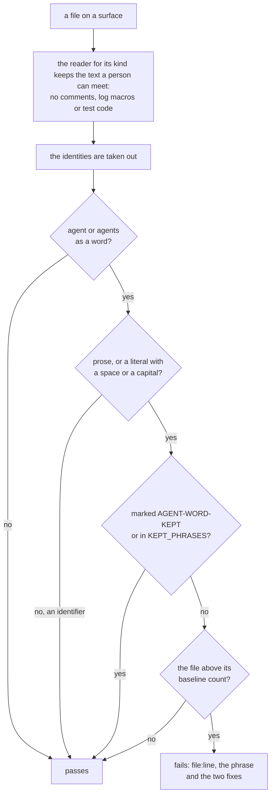

# FR-133: Nothing a person reads calls the daemon an "agent" — it is `roomlerd`

**Issue:** [#3177](https://github.com/gjovanov/roomler-ai/issues/3177) · **Status:** P1 shipped in 0.4.192 (#3209); AC1 to AC4 and AC7 met 2026-11-03; P2a shipped in 0.4.234 (#4307); P2b built (#4314), promoted 2026-11-23 (`hosted-20261123-a238604`); P2c shipped in 0.4.236 (#4343); P4 built, the guard in CI's `name-audit` job ([The guard (P4)](#the-guard-p4)); P3 proposed (D1–D3 decided 2026-10-30); spec and claim 2026-10-30 ·
**Related:** FR-46 ([#1051](https://github.com/gjovanov/roomler-ai/issues/1051), the retired `roomler-agent` names; its "MSI installer identity — its own program" row is this FR's P1) ·
FR-21 (the retired-name guard, `scripts/name-audit.sh`) · FR-129 ([#3022](https://github.com/gjovanov/roomler-ai/issues/3022), the wizard; its phase C renames the wizard's own words)

## Goal

**The daemon has one name a person ever reads: `roomlerd` (or "the daemon" in a sentence).** The
wizard, the Windows installer's Apps & Features entry and its UAC prompt, the macOS and Linux
packages, the menu-bar/tray companion, the web app, the docs site, and every line an installer or
the CLI prints say it. "Agent" survives only where it is a wire or operating-system identity that a
rename would break, and each of those is listed below with its reason.

## Evidence

Anchors in this section are master `4bc9a9fc8` (the claim). P1 moved the
installer ones; the P1 row under Phases has where they are now.

The operator, 2026-10-30, after running the released 0.4.188 wizard: "the installer uses agent
instead of roomlerd, which was renamed agent to roomlerd originally. We shouldn't use anywhere
agent." What that run showed, and what master carries (counts are person-facing string lines,
approximate, wire/identity names excluded):

| surface | where | what a person sees |
|---|---|---|
| Windows Apps & Features | `agents/roomlerd/wix/main.wxs:56`, `agents/roomlerd/wix-perMachine/main.wxs:65` (ProductName); `:291-292` (Start-menu shortcut), `:312` / `:302` (the installer UI's title) | **Roomler Agent**, **Roomler Agent (per-Machine)** |
| the UAC prompt on every MSI | `.github/workflows/release-agent.yml:1998` (the Authenticode description) | "Roomler Agent installer" |
| `apt show` / `dnf info` summary | `agents/roomlerd/Cargo.toml:7` (`description`, the package summary) | "Roomler AI remote-control agent — …" (the extended description already says "Roomler Daemon") |
| the wizard | `agents/roomler-setup/src/front/app.js:1758` and ~35 more lines | "Resolved tag **agent**-v0.4.188" |
| the companion | `agents/roomler-desktop/src/` | ~17 lines |
| `install.sh` / `install.ps1` output | `scripts/` | ~10 lines |
| the web app | `ui/src/components`, `ui/src/views` | ~378 lines (e.g. "agent version" on the Devices page) |
| the docs site | `ui/docs/content` | ~237 lines |

FR-46 already classified the MSI's display identity as "renaming breaks upgrade detection — its
own program" (`docs/fr/FR-46-eradicate-the-retired-agent-name.md:383`). Measured on master:
Windows Installer matches an upgrade by its UpgradeCode, and `install_detect` keys on the
UpgradeCode's registry presence, so neither reads the ProductName. What does read it is
`scripts/install.ps1`: the post-install check (`:279`) and `-Uninstall` (`:453`) find the product by
`DisplayName -like 'Roomler Agent*'`, as does the M3 verify script
(`agents/roomlerd/scripts/m3-a1-verify-win11.ps1:385`). A rename is therefore safe for upgrades
and needs those lookups to accept both names.

## Key design

| class | examples | treatment |
|---|---|---|
| **person-facing text** | wizard pages and progress lines, the companion, the web app, the docs site, installer and CLI output, the viewer's banners | renamed: `roomlerd`, or "the daemon". A version is shown as a version (`0.4.188`), never as its tag (`agent-v0.4.188`) |
| **display identity** | the MSI ProductName (Apps & Features), its shortcut and UI title, the Authenticode description, the `.deb`/`.rpm` summary | renamed (D1). `install.ps1` and the verify script match the old and the new name. The old one is kept as a `RETIRED-NAME-ANCHOR` for the machines installed before |
| **wire names** | the `agent-v*` release tags every deployed updater polls; `/api/agent/*` and every `/agent` path segment; the `agents` collection; `TokenType::Agent`; `/ws?role=agent`; the `rc:agent.*` message types; snake_case fields and codes (`agent_id`, `agent_offline`); the `roomler` CLI's `--agent` flag | **kept**. Each is a fleet migration with a dual-accept window (FR-46 P4's pattern), and none of them is ever shown to a person once the text above shows versions |
| **OS identities** | `com.roomler.agent`, the macOS bundle id and launchd label that every Mac's TCC grants key on (FR-46 D1); Apple's own word "LaunchAgent"; `Software\Roomler\Agent`, the HKCU key the per-user MSI's components keep their KeyPath under (Windows Installer tracks a component by it, so a rename means new component GUIDs, and no page shows it) | **kept** |
| **an agent that is not the daemon** | polkit's authentication agent; an EDR or endpoint-security product's agent; the HTTP `User-Agent` header; FR-90's agent sessions (an AI agent at work on a device); in the docs site, another product's agent (MeshCentral's) | **kept**: the word names something else. A spelling that always means it is in P4's list; one that only its sentence tells apart is marked where it stands |
| **engineering prose** | `docs/*.md`, code comments, `tracing` lines, and the text only a log line carries (P4's `KEPT_PHRASES`) | not this FR |

## Phases

| phase | what | kill switch | status |
|---|---|---|---|
| P0 | spec + ledger row + issue | — | this commit |
| P1 | the install surfaces: the MSI ProductName, shortcut and title (both flavours), the Authenticode description, the `.deb`/`.rpm` summary; `install.ps1`'s two lookups and the verify script accept both names; `install.sh`/`install.ps1` output. The wizard's own words ride FR-129 phase C, and the macOS grant notices ride #3164. **Where it landed:** `agents/roomlerd/wix/main.wxs:73` (Name), `:339` (shortcut), `:359` (title); `agents/roomlerd/wix-perMachine/main.wxs:71`, `:308`; `.github/workflows/release-agent.yml:2026`; `agents/roomlerd/Cargo.toml:7` (roomlerd ships no `.rpm`: only the companion does, and its summary never said "agent"); `scripts/install.ps1:109` (the exact names, old and new, per flavour), `:294`, `:476`; `agents/roomlerd/scripts/m3-a1-verify-win11.ps1:387`. Proved by `.github/workflows/installer-smoke.yml:1699` | copy: a revert. The lookups match both names, so an older or a newer MSI is always found | shipped: [#3209](https://github.com/gjovanov/roomler-ai/pull/3209) merged 2026-10-31, first released in 0.4.192. Field-verified on the CI MSI on 2026-10-31 and on the released 0.4.197 packages (the log below) |
| P2a | the daemon's own notifications (the needs-attention notice: a crash loop, a re-enrollment, a server-side close, a duplicate-instance duel) and the updater reasons they carry, which now open `roomlerd:`, say the server's close reason in words and show a release as its version (`notify::versions_not_tags` in `crates/agent-core/src/notify.rs`, at the one writer); the companion's pages, the errors it hands them, and the key descriptions on its Settings page (`crates/agent-core/src/config_surface.rs`). Held by `agents/roomlerd/src/notice_text_tests.rs`, the `says_roomlerd` tests in `agents/roomler-desktop/src/commands.rs`, and four node-core tests (three in `notify.rs`, one in `config_surface.rs`) | a revert | shipped in 0.4.234: [#4307](https://github.com/gjovanov/roomler-ai/pull/4307), read in the released packages' bytes ([the read](https://github.com/gjovanov/roomler-ai/issues/3177#issuecomment-7115908297)) |
| P2b | the web app (`ui/src`) and the server's own words: the server-written half of the viewer's banners (the page's text and the refusal reasons the server sends), and the server text a notice quotes (`crates/modules/fleet/src/hub.rs`, `socket.rs`, `auth_agent.rs`) | a revert | built (#4314), promoted 2026-11-23 (`hosted-20261123-a238604`) |
| P2c | the daemon-written half of the viewer's banners: 33 sentences in 12 files of `agents/roomlerd/src` (`capture/mod.rs`, `audio_source.rs`, `encode/caps.rs`, `apps/{linux,macos,mod}.rs`, `input/reach.rs`, `keep_busy/engine.rs`, `files.rs`, `virtual_desktop.rs`, `peer.rs`, `display_match.rs`); the CLI and LocalAPI output: 35 sentences of `roomlerd` (`service.rs`'s enroll output, `app.rs`, `tunnel/client_mgr.rs`, `tunnel/acceptor.rs`, `probe_target.rs`, `one_row.rs`, and `signaling.rs`'s exec refusal), 4 of `agents/roomler-cli/src` (`cli.rs`, `mesh.rs`, `sshcmd.rs`) and the two tunnel refusals the acceptor sends from `crates/agent-core/src/acl.rs`; and both binaries' `--help`, 31 doc-comment lines of `agents/roomlerd/src/app.rs` and `agents/roomler-cli/src/cli.rs`. A machine or a row is "device", and the credential "device credential", as P2b words them. Held by `agents/roomlerd/src/daemon_text_tests.rs`, which reads each file with P2a's lexer (so the Linux- and macOS-only files are read on every OS) and walks every subcommand's long help, with the kept spellings listed | a revert | shipped in 0.4.236 ([#4343](https://github.com/gjovanov/roomler-ai/pull/4343)), read in the released packages' bytes ([the read](https://github.com/gjovanov/roomler-ai/issues/3177#issuecomment-7132981129)) |
| P3 | the docs site (`ui/docs/content`) | a revert | proposed |
| P4 | a guard in CI: person-facing strings may not say "agent" except the listed identities (an allowlist, in the shape of `name-audit.sh`). **Where it landed:** `scripts/says-roomlerd.cjs` (Node, no dependencies) and its baseline `scripts/says-roomlerd-baseline.txt`, run as the last step of CI's `name-audit` job (`.github/workflows/ci.yml:2862-2864`). How it reads, how a kept word is marked and how the baseline moves: [The guard (P4)](#the-guard-p4) | the guard's own baseline | built |
| D | docs: `docs/installation.md` (what Windows lists), the `ship-it` skill (the signing description), this spec's log | — | `docs/installation.md` § Windows rides P1's PR, and so does `ship-it` § 2: the MSI's name is display only, and a change to it ships in one order, because `install.ps1` matches exact names and is served by the server image. Neither `ship-it` nor `docs/code-signing.md` ever named the signing description (checked 2026-10-31), so there was nothing to rename. This log, as phases land |

## Acceptance criteria

- [x] **AC1** — A fresh Windows install from the released MSI (both flavours) appears in Apps &
      Features under the new name (D1), and its UAC prompt shows the new description. **Met
      (2026-11-02, 0.4.197):** both flavours list one entry under the new name. UAC reads
      "Roomler installer" (was "Roomler Agent installer", `.github/workflows/release-agent.yml:2006`).
      That half is the per-machine MSI's: the per-user one has no UAC prompt
      (`agents/roomlerd/wix/main.wxs:16`).
- [x] **AC2** — An upgrade from 0.4.188 (named "Roomler Agent…") to the first release with P1
      leaves ONE entry, under the new name, and keeps the service and its SystemContext mode.
      **Met (2026-11-02):** read on 0.4.188 → 0.4.197. The first release with P1 was 0.4.192,
      and this upgrade crosses the same rename.
- [x] **AC3** — `install.ps1 -Uninstall` removes an install made before P1 and one made after it.
      **Met (2026-11-02):** four installs, with the script production serves (the log below).
- [x] **AC4** — `apt show roomlerd` and `dnf info roomlerd` print a summary without "agent".
      (Found 2026-10-31: roomlerd ships no `.rpm` at all, so `dnf info roomlerd` has nothing
      to show; only the companion ships one, and its `summary` never said "agent".) **Met
      (2026-11-03, 0.4.197):** read with `apt show` on a Linux device (the log below).
- [ ] **AC5** — Every page, progress line and Done text of the released wizard, every companion
      page and the web app's person-facing strings contain no "agent" outside the allowlist
      (asserted by tests, then by P4's guard).
- [ ] **AC5b** — The daemon's notifications, the text the daemon writes for the web viewer, and
      the CLI and LocalAPI output contain no "agent" outside the allowlist (asserted by tests,
      then by P4's guard).
- [ ] **AC6** — The docs site's pages say `roomlerd`.
- [x] **AC7** — Docs: `docs/installation.md` and the `ship-it` skill updated, with a
      `docs/README.md` row if a doc is added. **Met:** `docs/installation.md:550` and
      `.claude/skills/ship-it/SKILL.md:66`. No doc was added, so no row.

## Open decisions

| # | question | decision |
|---|---|---|
| D1 | the Apps & Features name: "Roomler", "Roomler Daemon", or "roomlerd"? | **DECIDED 2026-10-30 by the operator, as recommended: "Roomler"** (and "Roomler (per-Machine)"): the MSI installs the product — the daemon, the `roomler` CLI and the companion — not the daemon alone; the service is already displayed as "Roomler" |
| D2 | does the web app's Devices page keep any "agent" column or filter word? | **DECIDED 2026-10-30 by the operator, as recommended: no**: "daemon version", "daemon" vs "tunnel client" |
| D3 | rename the `agent-v*` tag family? | **DECIDED 2026-10-30 by the operator, as recommended: no**: every deployed updater polls it; a dual-accept migration is weeks of fleet turnover for a name no person should see once versions replace tags |

## Out of scope

- Wire names and OS identities (the table above).
- The retired `roomler-agent` names (FR-46).
- Engineering docs, code comments and log lines.

## The guard (P4)

`scripts/says-roomlerd.cjs` holds every surface in CI: a new "agent" in text a person reads fails
the PR that adds it, whichever file it lands in. It is Node with no dependencies, so the
`name-audit` job runs it as its last step (`.github/workflows/ci.yml:2862-2864`) in seconds, with
no build and no install. Its `if: ${{ !cancelled() }}` lets it report even when the retired-name
audit before it failed.

| command | what it does |
|---|---|
| `node scripts/says-roomlerd.cjs --check` | CI's step. The self-test first (each reader, the rule, planted hits that must fail and kept ones that must pass, and the agreement below), then the tree against the baseline |
| `node scripts/says-roomlerd.cjs` | every hit per surface, as `file:line` and its phrase; `--summary` prints the counts only |
| `node scripts/says-roomlerd.cjs --identities` | the kept spellings and phrases, each with its reason |
| `node scripts/says-roomlerd.cjs --update-baseline` | rewrites the baseline from the tree; refused while a marker is at fault |

**What it reads.** A reader per kind of file: Rust string literals outside comments, log macros and
test code (P2a's lexer); JS strings outside comments and `console.*` calls; a page's text and its
`placeholder`, `title`, `aria-label` and `alt`; Markdown prose; the quoted strings and heredocs of
`sh` and `ps1`; a `.wxs`'s attribute values and text; the shown keys of a `Cargo.toml`,
`tauri.conf.json`, `.desktop` entry or systemd unit; every line of an installed README; and the
description the release's Windows signing step stamps on the MSI. Once the identities are out, a hit
is `agent` or `agents` as a word. Prose counts as it stands; in code, a literal with no space and no
capital (`'agent'`, `"agent-logs"`) is an identifier. The UI spec counts the same way, and the Rust
tests count only a literal with a space. It cannot see a word built at run time from parts, nor the
binaries' `--help`, whose text is doc comments: `agents/roomlerd/src/daemon_text_tests.rs` walks
every subcommand's help instead.

**One list, held in agreement.** The identities are the key-design table above, each in the script
with its reason. `ui/src` is read by its own spec, `ui/src/__tests__/saysRoomlerd.spec.ts`, and not
twice. The self-test fails when that spec's `IDENTITIES` are not in the guard's list verbatim, or
when a spelling `daemon_text_tests.rs` or `notice_text_tests.rs` keeps is not kept by the guard too,
and its message names the entry to add.

**Keeping one.** Reword it first: `roomlerd`, "the daemon", or "device" as P2b words them. When the
word must stay, a comment says why, on the line above it or on its own line:
`AGENT-WORD-KEPT: <the reason>`. It covers its own line and the next line that is neither blank nor
a comment. A marker with no reason fails, and so does one that covers nothing. A phrase in a file
that cannot hold a comment, or in one whose comments a person reads (an installed README), or one
that only a log line carries, goes in the script's `KEPT_PHRASES` with its reason; a listed phrase
that is gone fails too. A new identity goes in `IDENTITIES` with its reason, and in the key-design
table.

**The baseline is the kill switch.** `scripts/says-roomlerd-baseline.txt` holds the known hits as a
count per file, never a line number (so an edit elsewhere in a file never moves it), grouped by
surface under the owner that removes them. `--check` fails only when a file holds more than its
count. A PR that only removes hits passes and is told how to lock the gain in. A count moves only
with `--update-baseline`, committed with its reason, as with `scripts/name-audit.sh`.

The baseline as P4 wrote it, read on master `d3f974e3f`:

| surface | read | hits | owner |
|---|---|---|---|
| the web app, `ui/src` | by its spec | — | P2b |
| the daemon (AC5b): `agents/roomlerd`, `roomler-cli`, `roomlerdw`, `roomler-cli-shim`; `crates/agent-core`, `localapi`, `tunnel-core` | 448 files | 4 | FR-133 follow-up |
| the companion (AC5): `agents/roomler-desktop/src` | 26 files | 0 | — |
| the server's own words: `crates/api`, `core`, `remote_control`, `services`, every `crates/modules/*` | 329 files | 60 | FR-133 follow-up |
| the install scripts' output: `install.sh`, `install.ps1`, the `.deb`'s maintainer scripts, the `.pkg`'s postinstall | 6 files | 3 | FR-133 follow-up |
| the display identity: both MSIs' `.wxs`, the packages' metadata and installed READMEs, the signing description | 20 files | 1 | FR-133 follow-up |
| the wizard (AC5): `agents/roomler-setup`, `crates/roomler-setup-core` | 40 files | 0 | FR-129 phase C |
| the docs site, `ui/docs/content` | 67 files | 242 | P3 |

> ⚠️ **AC5b's surface is not empty.** Its 4 are the tunnel gate's refusal reasons
> (`crates/tunnel-core/src/policy.rs:212`, `:221`, `:227`, `:236`): the server evaluates the gate
> and sends the reason to the tunnel client, which logs it or returns it as its error. AC5b stays
> open until they are reworded. The server's 60 sit in 21 files: refusals a person reads (the
> device console's, SSH's, the tunnel's, an external login's), the growth pages' "Agent version"
> labels, the daemon's own handshake errors, and internal 500 text. The install scripts' 3 are the
> `.pkg`'s postinstall calling the per-user launchd job an "agent"
> (`agents/roomlerd/packaging/macos/postinstall:394`, `:426`, `:649`), and the display identity's 1
> is a line of the `.deb`'s README (`agents/roomlerd/packaging/linux/README.Debian:48`). The
> baseline file lists each with its words.

## Field-verification log

| date | build | result |
|---|---|---|
| 2026-10-30 | released 0.4.188 (wizard + MSI), Windows 11 | ❌ the operator's run: the wizard's progress said "Resolved tag agent-v0.4.188"; the MSI's Windows Installer events name the product "Roomler Agent (per-Machine)"; the operator: "We shouldn't use anywhere agent" |
| 2026-10-31 | released 0.4.189 per-Machine MSI, Windows 11 (a dev machine; a read of the Uninstall keys, nothing installed) | ❌ as expected before P1: exactly one Roomler entry in Apps & Features, `'Roomler Agent (per-Machine)' 0.4.189`, in HKLM |
| 2026-10-31 | released 0.4.191 per-Machine MSI + SystemContext, a throwaway Win11 vmtest cell, a STANDARD enrollment (an ephemeral device unenrolls on the clean stop an upgrade makes) | ❌ before P1, as expected. Settings → Apps → Installed apps, searched "roomler": 1 app found, **Roomler Agent (per-Machine)** 0.4.191. Service Running, SystemContext on, the device online, and the daemon's own log says `auto-update disabled`. The MSI's tables: ProductName `Roomler Agent (per-Machine)`, UpgradeCode `{2A8E9C2D-3F1A-5E3F-C2B4-7C2F3D8F5E02}` |
| 2026-10-31 | the same cell: the released 0.4.191 binary against this branch's per-Machine MSI (the `installer-smoke` artifact, MSI 0.4.192.1), before installing it | ✅ `roomlerd artifact-version`, the deployed updater's own reader: `bound: … is agent-v0.4.192 (it says 0.4.192.1)`, exit 0. It is a keyed query, so the new name cannot move it |
| 2026-10-31 | the same cell: that MSI over the release, hand-run, no property | ✅ exit 0 in 10 s. The same search: 1 app found, **Roomler (per-Machine)** 0.4.192.1. The installer's log says how it found the old product: `FindRelatedProducts`, then `WIX_UPGRADE_DETECTED` = the 0.4.191 ProductCode, then `RemoveExistingProducts`; the two MSIs' tables share the UpgradeCode and differ in ProductName. Service Running, SystemContext kept, the SAME device row online. Host and worker started at the upgrade and were alive 1 min 44 s later, and `roomlerd.exe` is the unsigned CI build, so "online" is the new binary, which reports the same 0.4.191 |
| 2026-10-31 | the same cell: `install.ps1 -Uninstall` from this branch, in Windows PowerShell 5.1 | ✅ on the upgraded per-Machine product, on a fresh per-User install and on a real pre-P1 install (released 0.4.191 per-Machine): each time 0 entries, no service, no `roomlerd.exe` |
| 2026-10-31 | the same cell: this branch's per-User MSI, fresh | ✅ The same search: 1 app found, **Roomler** 0.4.192.1; Start menu `Roomler\Roomler.lnk`. The README as installed: 10 commands intact, none missing its space. `roomlerd --help` opens with the new summary. From an elevated SSH session the ARP record lands in HKLM, the mirror `installer-smoke` already documents: pre-existing, nothing to do with the name |
| 2026-10-31 | the same cell: the `install.ps1` production serves today, on that per-User install | ❌ as predicted, and why `ship-it` § 2 states an order: `no 'Roomler Agent' MSI products registered`, `done.`, exit 0, and the product stays installed. The image carrying this script is promoted BEFORE the first release with the new name |
| 2026-11-02 | released 0.4.197 MSIs, a clean throwaway Win11 guest, `install.ps1` as production serves it | ✅ **AC1, AC2, AC3**, read during FR-129's field run ([the read](https://github.com/gjovanov/roomler-ai/issues/3177#issuecomment-6578314826)). AC1: the per-machine MSI lists one entry, **Roomler (per-Machine)** 0.4.197, G ROX LTD, and UAC on the secure desktop reads "Roomler installer, Verified publisher: G ROX LTD"; the per-user MSI lists one entry, **Roomler** 0.4.197. AC2: 0.4.188 per-machine (`Roomler Agent (per-Machine)`) with SystemContext on, then `msiexec /i` of the 0.4.197 per-machine MSI: one entry under the new name, service Running and Automatic, `ROOMLERD_ENABLE_SYSTEM_SWAP=1` kept. AC3: `-Uninstall` on the wizard's install, on 0.4.188, on the upgraded one and on the per-user one: 0 entries, no service, no `roomlerd.exe`. What it leaves behind is [#3247](https://github.com/gjovanov/roomler-ai/issues/3247#issuecomment-6578313265). |
| 2026-11-03 | released 0.4.197 `.deb`, a Linux device, read-only through `roomler exec` | ✅ **AC4.** `apt show roomlerd` and `dpkg -s roomlerd`, version `0.4.197-1`: `Description: Roomler daemon (roomlerd): remote desktop, private WireGuard mesh and tunnels`, and the extended description opens "Roomler Daemon". Neither holds the word. Before P1 the package said "Roomler AI remote-control agent — runs on the controlled host, connects to the Roomler API." (the source at `00c264cc6^`). `Provides: roomler-agent` and `Replaces: …, roomler-agent` remain in the same output: those are the retired package's identity, and the criterion is about the summary. |
| 2026-11-23 | `hosted-20261123-a238604`, production's served web app | ✅ **P2b.** The served bundle, read by chunk for 7 sampled strings ([the read](https://github.com/gjovanov/roomler-ai/issues/3177#issuecomment-7096073584)): before the roll (entry `index-CXJcFygu.js`, 08:31Z) every old string was there and no new one; after it (entry `index-CNJBMpkJ.js`, 08:46Z) no old string and every new one. This is the web app's share of AC5, which stays open (the companion ships in 0.4.234, and P4's guard is not built). |
