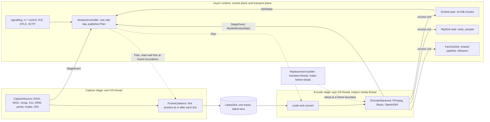
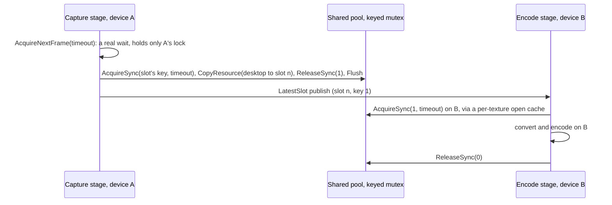
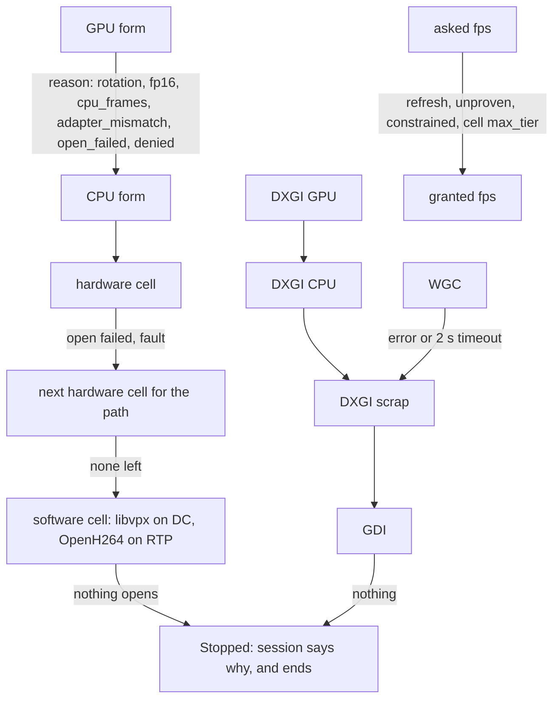
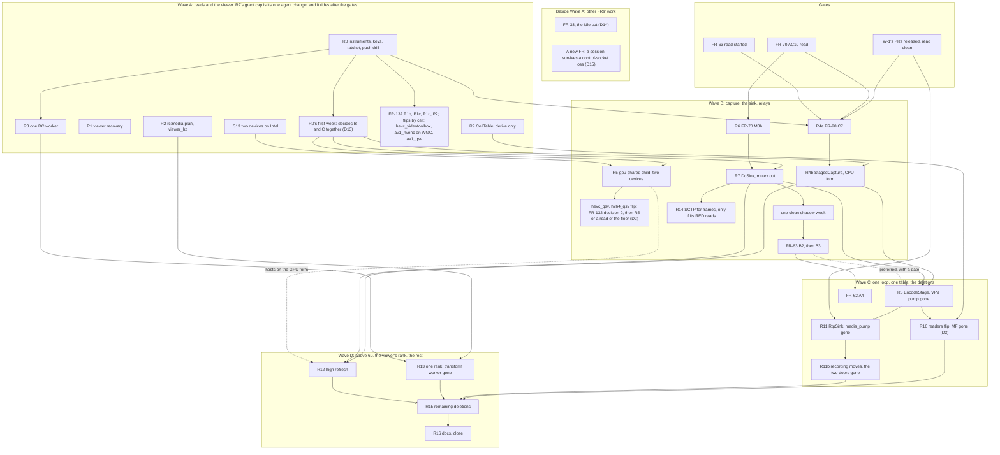

# FR-135: One RC media pipeline — one capture contract, one encode loop, every transport a sink, and the patch-work deleted

**Issue:** [#3293](https://github.com/gjovanov/roomler-ai/issues/3293) · **Status:** claimed 2026-11-02; decisions taken at the recommendations in §10 under the operator's standing approval, each open to being overturned; Wave A first · **Owner:** the agent's capture, encode and session path, and the viewer's decode path · **Anchors:** master `de6571f1a` (0.4.195), a doc-level pin: every `file:line` below is at that commit, and a later PR does not shift them · **Debt ledger:** [`docs/plans/rc-media-debt.tsv`](../plans/rc-media-debt.tsv), same SHA · **Private annex:** `roomler-ai-docs/fleet/FR-135-annex-rc-population-2026-11-02.md`, the population split behind §2.1 and its method; every number here stands without it · **Builds on:** [FR-70](FR-70-media-pipeline-leaves-the-runtime.md), [FR-98](FR-98-input-to-photon-budget.md), [FR-63](FR-63-one-delay-based-rate-controller.md), [FR-62](FR-62-encoder-rate-changes-without-an-idr.md), [FR-119](FR-119-high-refresh-streaming.md), [FR-132](FR-132-zero-copy-by-default.md), [FR-77](FR-77-encoder-chroma-matrix.md), [FR-78](FR-78-d3d12-vulkan-video-encode.md), [FR-38](FR-38-idle-keepalive-spend.md), [FR-22](FR-22-time-to-first-frame.md), [FR-28](FR-28-derp-drain-on-pod-roll.md) · **Amends:** [FR-118](FR-118-gpu-resident-frames.md) §4.3 ("one device, shared") · **Supersedes:** FR-65's one-line narrowing of the send-wait reading

## Summary, for the operator

**Asked.** A proper architecture for low-latency, flawless remote desktop at 30, 60, 120 and 144 fps, zero-copy included, on every codec and chroma, with less patch-work and debt.

**What the hours say.** FFmpeg DC is 99 % of the 71.9 h of interactive use, and 66 % of those hours are a still screen or someone typing. `hevc_qsv` holds 47.6 h and only 3.0 of the 23.3 moving hours. About 95 % of its hours are on a class of Intel office desktops that no worker can reach and no config push has ever reached. An earlier draft led with that cell; the plan's independent review showed its hours are nearly all still, and this version follows the review. So on most hours the largest measured costs are not frame rate: the table's first three rows.

Motion is elsewhere: `hevc_videotoolbox` 47 % of moving hours, `av1_nvenc` 22 %, `av1_qsv` 14 %, `hevc_qsv` 13 %. RTP is 0.4 h, VP9 0.3 h, above 60 fps 3.3 h, relays 21 % of hours and about 4 moving ones. The population is small, so a different mix would change the order.

**What is wrong in the code.** Three copied pumps, 6,315 of `peer.rs`'s 15,610 lines, answer the same questions differently (§2.2). Capture and encode run in series (§2.3). `Ok(None)` has six meanings (§2.4). The DC mutex hides the wait every threshold is tuned on (§2.5). Advertising and opening are separate code (§2.6). Input-to-paint has a baseline in 2 of 27 live cells, none above 60 (§3.4).

**The proposal.** No new architecture: this finishes FR-70's planes. Capture owns pacing on its own thread. One encode loop feeds every transport as a sink. One table drives probe, hello, pick and open. One stats struct and one message say what a session got. Two D3D11 devices let zero-copy hosts really wait. 18 phases in four waves, each with a kill switch and a RED-first field proof. **Approve Wave A only: R0's first week replaces these weights with real ones, and then B and C are decided together (D13).** R4a, FR-98's own cut, is not held.

| What | Today | After | How sure |
|---|---|---|---|
| A still screen on QSV | 6.9-8.9 Mbit/s, 16 encodes a second, about 3.6 GB an hour; `av1_nvenc` costs 0.20 | ≤ 0.2 Mbit/s | measured, cause unread; FR-38's, by D14 |
| A session when the server rolls | ends: 10 in the window, 9 inside a promote run, 6-24 s for a person each time | survives | measured; a new FR, by D15 |
| A frame presented between capture polls, CPU path off macOS, 54.1 h, 9.3 moving | waits out the pump's sleep | about 1.9 ms mean, 3.8 ms maximum less | reasoned; R4a, #3275 |
| Decode error, time to recover | 9.4-10.2 s | ≤ 500 ms | measured; may rarely fire (2 of 107 sessions, with forced errors in the window) |
| `hevc_qsv` on the GPU form (FR-132) | CPU path | in motion 2.4-4.5 ms a frame, a third less CPU; a keystroke's frame 2-3 ms | reasoned from `av1_qsv`; waits, by D2 and D16 |
| Input to paint, 60 fps, LAN, sparse update | 40.1 ms | 37 ms | a target; `hevc_qsv` direct and moving content are unread |
| 2880×1800 on the CPU path | 37.6-38.6 fps | ≥ 50 fps | reasoned; about 1 moving hour |
| 120 and 144 fps | 0.9-42.1 % of windows reach 90 % of target | ≥ 95 % of the granted rate on cells that fit, 25 and 23 ms to paint | no L4 there yet |
| A black page | no reason given | names the reason | |
| Media-path code; `peer.rs` | 74,163; 13,243 lines | about 64,600, −13 %, or −9 % if the new code doubles; about 6,930 | ±30 % |
| Env knobs, read per frame | 199, 40 | about 40, 0 | |

**What it costs.** About 40 PRs and 130 engineer-days of judgement. At least 16-20 weeks on two lanes, mostly soak, excluding M3b, B2, B3 and A4 (§7.4). **The code grows by about 1,600 lines before it shrinks,** and stopping at that peak is the one bad outcome (§7.6). FR-63's B2 slips about three weeks. Two devices add 0.3-0.5 ms a frame. Two temporary config keys.

**How safe it is, plainly.** The fleet-wide kill switch is a config push, and 33 of 37 agents have never been asked to take one, nor have any of the 5 `hevc_qsv` hosts. On the classes holding most hours the real rollback is a forward release, so they flip last (§7.1, D17). R0 drills the push. No old path is deleted before 14 days, a traffic floor, and each session-proven cell read on the new path or listed for the operator to sign.

**What it gives up.** FR-132's largest population waits, for a gain of milliseconds. `peer.rs` stays near 6,900 lines. 4K above 60 is not committed. AMD panel + NVIDIA under SYSTEM stays on the CPU path. At 144 even the best cell misses its host-half allotment (§3.2). 10-bit and HDR are out. Latency stays at about two frame times at 60. Wave A alone gives up a planning horizon.

**Not known yet.** 25 of 27 input-to-paint baselines, any of it in motion, hardware 4:4:4 text, two devices on Intel, anything on phones, the enterprise-VPN path. §12 names who can read each.

**Decisions** (§10, recommendation in bold). D13 how far to commit: **Wave A only**. D2 FR-132's flips: **by cell; `hevc_qsv` and `h264_qsv` wait**. D16 how the office desktops flip: **hold, as FR-132's decision 9 proposes**. D14 the idle cut: **FR-38 resumes now**. D15 a session surviving a control-socket loss: **FR-28's redial now, a new FR next**. D17 opt-in on corporate and office hosts: **a person, where the owner agrees; otherwise a release**. D8 L4 where `roomler exec` is barred: **a person starts it, in a window the operator picks**. D4 **M3b, R7, a shadow week, then B2; R8 waits for B2 at most four weeks past that week**. D3 retire Media Foundation: **yes, after the reach read**. D1, D5, D6, D7, D9, D10 and D12 confirm a default.

**How to read the tags.** `[M]` measured, source named. `[R]` read from code at the pinned SHA. `[reasoned]` my inference: attack these first. Nothing here is a promise about a cell no session has run. A status word in §5 means exactly what its table says.

**How to read the anchors.** A bare path is relative to `agents/roomlerd/src/`. A bare `:N` continues the file just named. `useRemoteControl.ts`, `videoCells.ts` and `rcBench.ts` are under `ui/src/composables/`, `rc-*-worker.ts` under `ui/src/workers/`. Every other path is from the repository root.

## 1. Goal

The operator's request, verbatim:

> "invoke a senior dev/architect worker to reduce the patch-work, technical debt and code smells and design a proper architectural solution low latency, high fps (30, 60, 120, 144) flawless remote desktop (including zero copy) with all codecs, chromas and ."

The sentence stops there. This spec reads the missing end as *every backend, transport and OS* and designs for that (decision D1).

**What the goal is, in one paragraph.** Every session, on every cell a host can run, goes through one capture contract, one encode loop and one transport interface. Each decision has one owner, each fallback is visible to the person watching, each stage reports the same typed numbers, and a stated latency and smoothness budget holds per frame-rate tier and path (§3). Moving there removes more code than it adds (§4.4), in phases of one or two PRs that each ship alone, because the daemon updates itself across a fleet running as SYSTEM or root (§7).

**What it is not.** It is not a new architecture. [FR-70](../plans/media-pipeline-architecture.md)'s three planes stand: media, transport, control, one owner each, no synchronous coupling. FR-70 moved the encoder off the runtime and put make-before-break on it. It stops at the FFmpeg DataChannel pump, and capture stayed on the pump's clock. This FR finishes those planes across every transport and the capture side, then deletes what that makes obsolete. Its one refinement to FR-70's words is that the media plane is two threads, not one (§6.1), because one thread cannot pipeline.

## 2. Evidence

All at `de6571f1a`. Fleet numbers are one generated pass of bounded server-side reads over `agent_logs`, `remote_sessions` and `ws_sessions`, window 2026-10-26 01:30Z to 2026-11-01 22:30Z (6 d 21 h), with `RESTARTS` on the database pod unchanged at 1. The plan's independent review re-derived §2.1's counts from the raw reads and found them exact. Field tests are included.

### 2.1 What the fleet actually runs [M]

| Measure | Count |
|---|---|
| Sessions, session-hours | 711, 73.1 h; duration p50 23 s, p95 1,380 s |
| By pump | FFmpeg DC 434 (61 %) · VP9 libvpx DC 129 (18 %) · DC with no heartbeat 81 (11 %) · RTP 55 (8 %) · none 12 |
| By cell | libvpx VP9 129 · `hevc_qsv` 108 · `hevc_nvenc` 92 · `av1_nvenc` 79 · `hevc_videotoolbox` 68 · `av1_qsv` 57 · RTP OpenH264 20 · RTP MF H.264 16 · `h264_nvenc` 8 · `h264_qsv` 8 · RTP AV1 Noop 7 · `h264_vaapi` 6 · `hevc_vaapi` 4 · `h264_videotoolbox` 3 · RTP `hevc_qsv` 2 · `vp9_qsv` 1 · RTP `hevc_vaapi` 1 |
| Host OS | Windows 392 · macOS 106 · Linux 51 · unknown 162 |
| Capture arm (inferred from lines) | SystemContext DXGI + GDI 319 · DRM 152 · scrap 122 · WGC 43 · portal 12 |
| FFmpeg DC input path | CPU `switch_off` 209 · field absent 129 · GPU 44 · `no_gpu_cell` 38 · `adapter_mismatch` 7 · denied 4 · `cpu_frames` 2 |
| Network path | direct 296 · relay or constrained 272 · mixed 41 · unknown 102 |
| Carrier | direct 492 · TURN 88 · DERP 68 · overlay direct 27 |
| Viewer (inferred through `ws_sessions`) | Chrome Windows 490 · Chrome macOS 67 · Chrome Android 57 · Edge 45 · Chrome Linux 31 · Safari iOS 17 · Safari macOS 4 |
| Above 60 fps | 123 sessions asked (28.3 % of FFmpeg DC); 103 ran at ≥ 120. Refused: `Refresh` 48, `Constrained` 15, `Unproven` 14 |
| Live agents seen in the window | 30: Windows 16 (QSV 12, NVENC 4, AMF 1), Linux 12 (VAAPI 4, NVENC 2), macOS 2 |

**Session counts mislead, so this plan orders by hours of interactive use** [M S15, offline over the same raw reads]. Automated test sessions inflate the session count and barely touch the hours. The split is in the private annex, and every number below stands without it.

| Weighted by hours, the 71.9 h of interactive use | Reading |
|---|---|
| Pump | FFmpeg DC 71.2 h (**99 %**) · RTP 0.4 h · VP9 0.3 h |
| Cell (FFmpeg DC, 70.0 h) | `hevc_qsv` 47.6 h (**68 %**) · `hevc_videotoolbox` 11.3 h (16 %) · `av1_nvenc` 5.5 h · `av1_qsv` 4.1 h · `hevc_nvenc` 0.9 h · everything else ≤ 0.3 h |
| Highest target fps | 60: 52.1 h (74 %) · 30: 14.6 h (21 %) · 120: 2.6 h (4 %) · 144: 0.7 h (1 %) |
| Geometry | to 1920×1080: 47.9 h · 1920×1200: 7.0 h · 2560×1600: 2.0 h · 5-6 MP: 12.9 h |
| Input path | CPU 65.0 h (93 %) · GPU 4.9 h (7 %) |
| Carrier, all pumps | direct 56.6 h · TURN 11.4 h · DERP 3.5 h · overlay direct 0.4 h, so relays are **21 %** of hours and 38 % of sessions |

**Hours are not all motion** [M, the 2 s windows that carry a rate: 69.2 h, where the session sums above read 70.0]. This plan calls a window capturing under 5 fps **sparse** (a still screen, or someone typing) and 5 fps or more **moving**. The 5 fps boundary is my reasoning, so the table shows the split and a reader can move it.

| Cell | Hours | < 1 fps | 1-4 fps | Moving | Moving share of the cell | Share of all moving |
|---|---|---|---|---|---|---|
| `hevc_qsv` | 46.9 | 26.6 | 17.3 | 3.0 | 6.5 % | 13 % |
| `hevc_videotoolbox` | 11.2 | 0.2 | 0.0 | 11.0 | 98 % | 47 % |
| `av1_nvenc` | 5.3 | 0.1 | 0.1 | 5.1 | 96 % | 22 % |
| `av1_qsv` | 4.4 | 0.5 | 0.5 | 3.3 | 76 % | 14 % |
| `hevc_nvenc` | 0.9 | 0.1 | 0.0 | 0.8 | 93 % | 3 % |
| **All** | **69.2** | **27.7** | **18.2** | **23.3** | **34 %** | |

| The same windows, split | Hours | Moving |
|---|---|---|
| Input path: CPU, or the field absent on older builds | 64.0 | 19.0 |
| Input path: GPU | 5.2 | 4.3 |
| CPU off macOS (R4a's real reach, since the Mac waits for R12's event wake) | 54.1 | 9.3 |
| DXGI GPU today (`av1_qsv`) | 2.8 | 2.1 |
| Target above 60 (3.3 h at session level) | 3.0 | 2.81: 2.35 on the MacBook, 0.46 on neo16 |
| Long edge 1920 | 47.95 | 8.41 |
| Long edge 2880 or more | 12.76 | 12.21, of which VideoToolbox 11.01 |
| Long edge 2560 | 1.96 | 1.87 |
| Long edge 1366-1600 | 3.84 | 0.57 |
| Long edge 1280 or less | 2.70 | 0.24 |
| Constrained path | 14.55 | 12.51, about 4 without the stretch named below |

What follows from that.

- **Two-thirds of the hours are one cell, and that cell is nearly always still.** `hevc_qsv` holds 47.6 h and only 3.0 moving hours, 13 % of all motion. These are real use: one 7.68 h session carries 62,425 input events. But it is someone typing: within sparse, 60.6 % of windows capture under 1 fps. About 95 % of the cell's hours sit on a class of Intel office desktops, whose logs name UHD Graphics 730 on three and HD Graphics 530 (6th generation) on one [M], and one corporate laptop holds the rest. There, a keystroke's frame, the cost of a still screen (§3.5) and a session that does not end (§8.1) matter more than a frame rate the cell already reaches. It has no GPU-form proof and no direct L4.
- **Motion is somewhere else.** `hevc_videotoolbox` 47 %, `av1_nvenc` 22 %, `av1_qsv` 14 %, `hevc_qsv` 13 %. Even that overstates the Mac: 8.52 of its 11.03 moving hours are one target-30 constrained stretch at 0.26 Mbit/s, because that arm returns a frame on every ask. Without that stretch moving is 14.8 h, and `hevc_qsv` is about 20 %, behind `av1_nvenc` and `av1_qsv`.
- **Relays are real and thin.** 14.84 h by session, 8.71 of them that MacBook, and 10.50 h average under 0.5 Mbit/s. Moving constrained windows without the Mac's stretch total about 4 h.
- **VP9's 129 sessions are mostly automated test sessions.** Interactive VP9 is 0.3 h, nearly all on two Linux hosts whose only DC transport is `vp9-444`. So libvpx is a software floor with little measured use, and merging its pump is justified by deletion and by those hosts, not by volume. This answers the question the first draft left open.
- **RTP is 0.7 h with automated sessions counted**, so RTP work earns its place by deleting code alone.
- **74 sessions came from phones** while no spec records a decode read on a real phone (§5.5). Their hours were not split out here.

The population is small, so a different mix would change §7's order, which is why the cell summary in N16 matters.

### 2.2 Three pumps, three sets of answers [R]

`peer.rs` is 15,610 lines, and its three media pumps are 6,315 of them: RTP `media_pump` `agents/roomlerd/src/peer.rs:2329-3506` (1,178), VP9 `media_pump_vp9_444_dc` `:3816-5202` (1,387), FFmpeg `media_pump_ffmpeg_dc` `:6180-9929` (3,750). The FFmpeg pump declares 99 `let mut` before its loop, has 34 awaits in the loop, and is 42 % comment-only lines. Of VP9's 557 code lines, 316 (57 %) are verbatim in FFmpeg.

| Question | RTP | VP9 DC | FFmpeg DC |
|---|---|---|---|
| Target fps | `:111-129` | `:10036-10052` | `:10069-10074` |
| After `Ok(None)` | 0 ms sleep `:2912` | floor ÷ 2 `:4463` | 2 ms `:8132` |
| Keepalive | 1,000 ms `:2756` | 60 ms `:3931` | 60 ms `:6582` |
| Lock overlay | yes `:3007` | yes `:4596` | none |
| `rc:quality` | honoured | honoured | ignored: `_quality_state` `:6187` |
| Encoder open | inline on a runtime worker `:3029` | inline `:4636` | `spawn_blocking` `:8693` |
| Quick probe in the daemon | on a runtime worker `:2581` | n/a | n/a |
| Replacing an encoder | inline | inline | make-before-break |
| Heartbeat | every 30 packets | every 30 packets | every 2 s |
| Encode error | return | return | ladder |
| `avg_capture_ms` | delivered frames `:2850` | every call | every call, gate sleeps included `:7928` |
| Rate apply | direct | direct | five arms `:9148-9298` |
| A pump's exit | silent | silent | silent: nothing watches the `JoinHandle` and no `rc:media-unavailable` follows |

None of these differences was chosen. Each is a fix that reached one copy. This is the same finding as the RTP review of 2026-11-01 ("`next_frame` has no contract, three copied pump loops answer differently, advertising and opening are separate code"), and the rest of this section tests that view against the whole path. It holds, with two additions: the pump is serial (§2.3), and the DC mutex hides the wait everything else is tuned on (§2.5).

### 2.3 The pump is serial, so the slower half sets the rate [R, M]

On pull arms (SystemContext DXGI, X11, macOS scrap) the pump asks for a frame and awaits it, then encodes and awaits that (`peer.rs:7927`, `:9329`). Only WGC captures off the pump's clock. So on a pull arm, throughput is 1 / (capture + encode). The 2880×1800 laptop on the CPU path spends 8.16 ms in readback and 17.23 ms encoding, 25.4 ms a frame, and measured 37.6-38.6 fps with 0 of 564 windows at ≥ 50 fps [M FR-118 §9.10]. With capture on its own thread the rate is bounded by 1 / max(stage), about 58 fps with no zero-copy at all [reasoned on M]. The same arithmetic gives `av1_qsv` 1920×1200 on the CPU path a ceiling of 97 fps instead of 68.

**Who that rate gain actually reaches: about 1 moving hour of this week.** The CPU path is 93 % of FFmpeg DC session-hours (65.0 of 70.0 h: `switch_off` 22.9, field absent on older builds 41.5, the rest named) [M §2.1], but a stage split only raises the rate where the serial work exceeds the period, on a pull arm. The 5-6 MP hours are 11.3 h of `hevc_videotoolbox` on one MacBook, where capture is the wait (§5.6), and 1.6 h of `av1_qsv` on one laptop. The windows that fit the rule are `av1_qsv` at 2880 or more on the CPU path, 0.66 h moving, plus 0.46 h of non-VideoToolbox windows above 60. Those are all on neo16, whose attended form is WGC, already off the pump's clock [M on the hours, reasoned on the arm]. `hevc_qsv` to 1080p at 60 has a serial 10.2-10.7 ms against a 16.7 ms period: it already fits, so the split gives it no rate. It may give it less jitter, which R4b reads and does not assume. So the split does not earn its place by hours. It earns it by the reopen fix, the contract, and being what R8 and R12 stand on (§7.3).

"Sums to the frame time" is therefore a throughput statement, and only for what is serial. Latency is another matter: the one measured direct cell runs 40.1 ms input-to-paint at 60 fps, 2.4 frame times [M FR-98 §9]. §3 keeps two budgets for that reason.

### 2.4 Capture has no contract [R]

- `ScreenCapture::next_frame` has no doc (`agents/roomlerd/src/capture/mod.rs:498`). W-1's PR #3274 writes one and adds `capture/pace.rs`. This plan treats that as landed before its first agent phase.
- `Ok(None)` has six meanings: idle, gate not due, frame stuck, device lost, mismatch, parked. The pump cannot tell them apart.
- Waits differ per arm: WGC gate then a 100 ms notify (`capture/wgc_backend.rs:89`), DXGI `AcquireNextFrame(0)` (`system_context/dxgi_direct.rs:1174`) with no gate and an empty `set_target_fps` (`system_context/capture_pump.rs:285`), GDI never idle, scrap a gate plus a 2 ms poll, X11 waits in xcb, DRM its own period, portal and mutter a helper with 250 ms and a cap of 60, Noop 3,600 s.
- **Reopen builds before it releases.** Five sites assign `capturer = open_default_async(…).await` with the old capturer alive (`peer.rs:2938`, `:3202`, `:4476`, `:7462`, `:8153`). On DXGI that meets `E_INVALIDARG`: 15 of 16 reopens fell to GDI [M #3272]. `unavailable()` is read only at first open (`peer.rs:2693`, `:3897`, `:6482`), so a reopen landing on Noop parks one hour and tells nobody.
- WGC has no `Err` path and never calls `Recreate`: a lost session or mode change reads as idle.
- `monotonic_us` is the encoder's PTS and has three bases (since open, worker start, wall clock). `LastPresentTime` and `displayTime` are not used.
- No thread on any OS has raised priority: no `SetThreadPriority`, MMCSS, waitable high-resolution timer or `SetGPUThreadPriority`. `timeBeginPeriod(1)` is process-wide. macOS QoS default off (`encode/clock.rs:56`), Linux `uclamp` only on `drm-capture` and encoders.
- A DXGI CPU frame allocates a new `Vec<u8>` per frame (`system_context/dxgi_direct.rs:1085`, `:893`): 20.7 MB at 2880×1800, 60 times a second, no recycling. What that costs is not measured; the page faults sit inside the 7.9 ms readback [reasoned].

### 2.5 The DC mutex [R, reasoned]

The send task holds the `video_bytes_dc` mutex for a frame's whole chunked send (`peer.rs:7045`; the guard is the `if let` scrutinee). The pump locks the same mutex after every encode and before `try_send` (`peer.rs:9502`, comment `:9498-9500`). Pump and sender therefore run in lock-step: one frame on the wire, one parked. Four things come out of that:

1. The channel depth of 6 or 4 is close to unreachable, and `frames_dropped_backpressure` reads 0 on all 11 encoders [M]. That zero says nothing about the network. The neighbouring `frames_skipped_backpressure`, counted when a pump skips a frame ahead of the channel, is not zero: 900 in the window [M].
2. The wait falls before the wire timestamp (`peer.rs:9556`) and before `send_wait`, so neither `age` nor `send_wait` contains it.
3. `AgentStalled` is partly this wait, FR-79's flagship 12:15 event included. FR-65's narrowing would re-arm that cut.
4. Every threshold tuned since was tuned on numbers with this wait removed.

`dc_lock` is reported only on STALL lines since 2026-10-30, and 2 of 1,324 name it dominant [M], so the size of the wait outside stalls is unknown. Instrument R0 reads it before the fix (§7).

### 2.6 Eight readers of "which encoder" [R]

Probe (`encode/caps.rs`), pick (`signaling.rs:3492`), RTP track bind (`peer.rs:13344`), RTP open (`encode/mod.rs:1613`), DC dispatcher (`peer.rs:2420-2638`), DC open (`peer.rs:5247`), GPU plan (`encode/ffmpeg/gpu_input.rs:130`), viewer (`ui/src/composables/videoCells.ts`, `ui/src/composables/useRemoteControl.ts:3471`), and the bench's mirror (`encode/bench.rs:808`). Twenty named divergences between them are listed in §5.7. The three that cost the most:

- `chosen_codec` is bound before the transport and without it (`signaling.rs:3491-3507`), so a session can bind a codec no opener on that transport has: #3245, 7 sessions on one laptop in 7 days, connected and black, the watchdog looping [M].
- `codecs` is a union of what MF and FFmpeg opened on RTP or DC, read by one consumer that means RTP (`encode/caps.rs:1860`, `:1917`, `:1939`, `:2186`, `:2209`).
- A probe proves different things by phase: FFmpeg's base and `444` phases open at 480×270 and drop it, no frame encoded, while `docs/encoders.md` calls it a real-bytes trial. `av1_vulkan` opened, encoded and did not decode [M FR-78].

### 2.7 The viewer [R, M]

- No message tells the viewer the negotiated transport or codec. A mismatch falls through to the track: black canvas, watchdog happy, because it counts counters and not pixels.
- A decode error after the first frame stops the worker, with no reconnect, until the 10 s watchdog: 9.4-10.2 s measured [M FR-132 §8]. The gap path does not re-arm the keyframe gate (`ui/src/workers/rc-vp9-444-worker.ts:465-474`).
- The main thread is in the path: `dc.onmessage` (`useRemoteControl.ts:8319`) then a `postMessage` per 16 KiB chunk, 690 messages a second at 90 Mbit/s [reasoned from the chunk size]. `RTCDataChannel` is transferable on Chrome ≥ 130, Firefox ≥ 144, Safari ≥ 15, and worker `requestAnimationFrame` exists on Chrome ≥ 69, Firefox ≥ 99, Safari ≥ 16.4 [M browser-compat-data, fetched 2026-11-01]. Neither is used.
- `fps` is the decode rate. The viewer never learns its refresh, so a 60 Hz viewer can ask for 144. `queueMs` is sampled after paint (`rc-vp9-444-worker.ts:545`), so decode backlog reads as link growth.
- The RTP script-transform worker is gated off on Chromium ≥ 148 (`useRemoteControl.ts:4768`), so every current Chrome RTP session is `<video>`. RTP has no `rc:decodestat`.
- HEVC on RTP has never had its paint read on a current build, and the fleet ran it in the week [M].

### 2.8 Rate and recovery [R, M]

- **The 25 M ceiling.** The ladder tops at 25 M (`encode/aimd.rs:299`). Replacements open at `coarsen_bitrate` ≤ 25 M (`encode/ffmpeg/encoder.rs:2576`), FR-119's fps swaps included, while the heartbeat prints above 100 M. After a first rung crossing an in-place backend caps at 25 M for the session. There is no maxrate in the heartbeat. Whether viewers see this is unknown; 28 % of FFmpeg DC sessions ask above 60 fps, 3.3 h, where the ceiling matters.
- No pacer on the wire. Keyframes are unbounded except by HRD (8.6 MB is legal at AV1 34.56 M), and ~625 KB blocks the wire about 72 ms [M FR-119 §4.12].
- SCTP: `RTO_MIN` 1 s, initial 3 s (`crates/vendored/webrtc-sctp/src/timer/rtx_timer.rs:9-11`), T3 drops cwnd to one MTU, a 128 KiB pending semaphore shared by control, cursor and clipboard per ordering class (`crates/vendored/webrtc-sctp/src/queue/pending_queue.rs:17`), initial cwnd 4,380 B. `peer.rs` never sets the receive buffer. Measured DC throughput is loopback only, 275-376 Mbit/s; a real path at high rates is unknown.
- Every repair is a full IDR or a new session. Time to recover from a lost frame has no number anywhere.
- All nine IDR rationers and all eight estimators from FR-70's 2026-09-04 count still exist. Today's count is 80 rows and 3 shadows, 19-33 switches, 11 estimators; the baseline list was lost, so it is not a clean ratio.
- `encode/**` went from 18,742 lines on 2026-09-03 to 27,855 non-test lines today, 50,591 with tests: ×2.7 in 8.5 weeks counting tests [M `wc`, git].

### 2.9 What is healthy, and stays

These are load-bearing, and nothing here argues with them: the child-process probe; FR-118's `FrameData`, proof child and `zero_copy_deny`; FR-132's default-per-cell with a clean week; FR-79's gate and FR-71's classifier; FR-70's encoder thread and make-before-break; FR-119's grant, split and clock pin; FR-130's colour; FR-77's cells and denylist; WGC's own-thread capture; the libvpx path's `tune=screen`.

## 3. "Flawless", in numbers

An SLO here is a target with an instrument and today's reading beside it. Where today's reading is unknown, the row says unknown. Target numbers are [reasoned] from the stage arithmetic in §3.3 unless a source is named. **A move takes the operator's sign-off with its measurement, and never goes below today's baseline. A miss with no signed move stays open.** Rows owned elsewhere name their owner: FR-22, FR-38, the endings FR (D15).

**End to end means input to paint.** L4 (FR-98, `roomler-rc-bench`) stops at the paint stamp in the viewer. Input to photon is paint + D, with D the display's own delay. D has never been measured here (instrument N14, a 240 fps camera). Reasoned: about 12 ms at 60 Hz, 6 at 120, 4-5 at 144 or 240 Hz. Every number below is to paint, and the gap between that and photon is D.

### 3.1 Two budgets, because one cannot do both jobs

The brief asks for a per-stage budget that sums to the frame time. That holds for one thing only, the **host half as a latency allotment**. It does not describe throughput or end-to-end latency, and pretending otherwise is how the 25.4 ms serial pump went unquestioned:

- **Throughput rule.** Each stage alone stays at or below 90 % of the period at p90: 30.0, 15.0, 7.5, 6.25 ms, which is FR-119's trial limit (`encode/frame_rate.rs:326-328`). Stages run in parallel once §6 lands, so they do not add up against the period.
- **Host-half allotment.** From a present to bytes handed to the sink. This table sums to the period at each tier, as asked. A stage may run over its line while another runs under; the sum is what binds.
- **End-to-end latency.** A separate table (§3.3), in milliseconds, not tied to the period. It is 2.4 frame times at 60 today, and no design could make it one.

### 3.2 Host half, present to sink: sums to the frame time [reasoned]

| Stage, mean ms | 33.3 | 16.7 | 8.3 | 6.9 | Today, measured |
|---|---|---|---|---|---|
| Wake after present | 1.0 | 1.0 | 0.5 | 0.5 | ≤ 2 ms poll floor on DXGI (`peer.rs:8132`); WGC `FrameArrived` p50 2.1-2.8 [M FR-118 §9.4] |
| Capture work | 1.0 | 0.5 | 0.3 | 0.3 | GPU form 0.26-0.44 [M FR-118 §9.3, §9.7]; CPU form 3.4-7.9, and it must leave this line above 60 |
| Hand-off + convert | 1.3 | 1.0 | 0.5 | 0.3 | 0.03 NVENC GPU, 0.46 QSV GPU, 1.3 `hevc_qsv` CPU [M FR-118 §9.5]; two devices +0.3-0.5 [M S8] |
| Encode | 20 | 11 | 5.5 | 4.5 | `av1_nvenc` 2560×1600 5.05-5.13, `av1_qsv` 1920×1200 11.31, `hevc_qsv` 1080p 5.2 [M FR-118] |
| Sink hand-off | 0.5 | 0.2 | 0.2 | 0.1 | unknown: hidden behind the mutex (§2.5) |
| Reserve | 9.5 | 3.0 | 1.3 | 1.2 | |
| **Sum** | **33.3** | **16.7** | **8.3** | **6.9** | |

**At 144 this allotment is missed, and no phase changes that.** The best measured host half is 2.1-2.8 wake + 0.26 capture + 0.03 hand-off + 5.05-5.14 encode + 0.1 sink, 7.5-8.3 ms against 6.9, and nothing here lowers WGC's wake. The throughput rule and 23 / 32 are not missed by it.

### 3.3 End to end, LAN, RTT 3 ms, to paint, hardware decode

| Stage, mean ms | 30 | 60 | 120 | 144 | Today, cell 3: `av1_qsv` 1920×1200, Wi-Fi LAN, GPU path [M FR-98 §9, FR-118 §9.3] |
|---|---|---|---|---|---|
| Pointer coalescer (real pointer only; L4 bypasses it) | 4 | 4 | 2 | 2 | 0-8 by design (`useRemoteControl.ts:6853`, `:6866-6872`); no read. Above 60 its 8 ms gap is a full period |
| Input leg | 1.5 | 1.5 | 1.5 | 1.5 | RTT/2, unread |
| Injection + window paint + host compositor + cadence wait | 22 | 14 | 7 | 6 | inside a ~19 ms residual (48 % of p50), unsplit |
| Host half to the sink, less reserve | 23.8 | 13.7 | 7 | 5.7 | 10.8 encode stage during L4, 0.43-1.0 capture |
| Wire, including main → worker | 5.5 | 5.5 | 5.5 | 5.5 | transit 9, Wi-Fi, unsplit |
| Decode + paint call | 1.5 | 1.5 | 1.5 | 1.5 | viewer 1, whole-ms rounding; a software decoder is unread above this |
| **Sum to paint, L4's reading** | **54** | **36** | **23** | **20** | **40.1 p50 at 60**, outside the viewer's Wi-Fi bursts |

**The 60 fps target is 37 / 50, not this table's 36.** 40.1 less about 1.5 for the wake on that GPU cell (the wait replaces a 2 ms poll floor) and about 0.9 for a keepalive no longer in the way leaves about 37.7, and the main-thread hop (R3) and the sink are unmeasured, so 37 asks them for under a millisecond. S8 proves the wake's mechanism, and nobody has split the transit. If N6, N7 and N9 show the budget is wrong, the SLO moves by §3's rule.

### 3.4 Input-to-paint SLO per tier × resolution × path

**Two modes.** **Sparse update** is a keystroke's frame on a still screen: it is what L4's target mode reads, and 66 % of hours are there (§2.1). **Moving** is content that changes every frame, and it first reads with N1.

| Mode at 60 fps | Hours | Target p50 / p95 | Today | Who can read it |
|---|---|---|---|---|
| Sparse update | 45.9 | 37 / 50 | 40.1 / 49.1 on `av1_qsv` GPU; `hevc_qsv` direct unknown | L4 on the office-desktop class needs a person (D8) |
| Moving | 23.3 | reasoned, no reading | unknown | N1, in R0 |

The rows below are L4 p50 / p95, hardware decode. A row with a reading names its mode, and those are all sparse today. The p95 is read outside bursts a ping monitor names, with the raw p95 beside it: 49.1 and 90.1 in the one LAN baseline. **WAN direct** = LAN + RTT at p50, LAN + 1.5×RTT at p95. **Relay** = RTT + 45 at p50, RTT + 90 at p95 (baseline at RTT 80: 131 / 206, outside bursts 130 / 144-149). A cell whose encode does not fit a tier does not get that tier's SLO: its `max_tier` in the cell table says so, and that session's SLO is the tier below (§6.5). 4K above 60 is not committed (D6): no panel in the fleet reads it.

Codes. **B** a real baseline in this cell. **b** partial: a proxy, the host half only, a settled read, or one run. **I** an instrument exists, no baseline. **Iw** an instrument exists only for a Windows host on a release build. **X** no instrument. **R** refused on this path by design. **R(hw)** refused on the hardware pump (`peer.rs:10069-10074`); software and RTP on a relay may run a 60 target, with no measurement of one [R].

| Tier | Resolution | Path | SLO p50 / p95 | Today p50 / p95 | I2P | Stage | Drop | Frz | Jit | Col | Txt |
|---|---|---|---|---|---|---|---|---|---|---|---|
| 30 | 1080p | LAN | 55 / 80 | unknown | Iw | I | I | I | I | I | I / X |
| 30 | 1080p | WAN direct | +RTT / +1.5×RTT | unknown | Iw | b | b | I | I | I | I / X |
| 30 | 1080p | Relay | RTT+45 / RTT+90 | **131 / 206** at RTT 80 (130 / 144-149 outside bursts) [M FR-98 §9 cell 4] | **B** | b | I | b | I | I | I / X |
| 30 | 1440p, 1600p | LAN | 55 / 80 | unknown | Iw | I | I | I | I | I | I / X |
| 30 | 1440p, 1600p | WAN direct | +RTT / +1.5×RTT | unknown | Iw | I | I | I | I | I | I / X |
| 30 | 1440p, 1600p | Relay | RTT+45 / RTT+90 | unknown; ~28-29 fps at 3024×1964 relayed [M FR-118] | Iw | b | b | I | I | I | I / X |
| 30 | 4K | LAN | 55 / 80 | unknown | Iw | I | I | I | I | I | I / X |
| 30 | 4K | WAN direct | +RTT / +1.5×RTT | unknown | Iw | I | I | I | I | I | I / X |
| 30 | 4K | Relay | RTT+45 / RTT+90 | unknown | Iw | I | I | I | I | I | I / X |
| 60 | 1080p | LAN | 37 / 50 | **40.1 / 49.1** outside bursts, 40.0 / 90.1 raw, near-static [M FR-98 §9 cell 3] | **B** | b | b | b | I | **B** | b |
| 60 | 1080p | WAN direct | +RTT / +1.5×RTT | unknown; 56.2 fps at 2048×1080 [M FR-112] | Iw | b | b | I | I | I | I / X |
| 60 | 1080p | Relay | none, see D12 | refused on hardware | R(hw) | R(hw) | R(hw) | R(hw) | R(hw) | R(hw) | R(hw) |
| 60 | 1440p, 1600p | LAN | 37 / 50 | unknown; 57-58 fps at 2560×1600 [M FR-118 §9.7] | Iw | b | b | I | I | **B** | I / X |
| 60 | 1440p, 1600p | WAN direct | +RTT / +1.5×RTT | unknown | Iw | I | I | I | I | I | I / X |
| 60 | 1440p, 1600p | Relay | none, see D12 | refused on hardware | R(hw) | R(hw) | R(hw) | R(hw) | R(hw) | R(hw) | R(hw) |
| 60 | 4K | LAN | 37 / 50 | unknown; no hardware encoder has a 4K row [R docs] | Iw | I | b | I | I | I | I / X |
| 60 | 4K | WAN direct | +RTT / +1.5×RTT | unknown | Iw | I | I | I | I | I | I / X |
| 60 | 4K | Relay | none, see D12 | refused on hardware | R(hw) | R(hw) | R(hw) | R(hw) | R(hw) | R(hw) | R(hw) |
| 120 | 1080p | LAN | 25 / 35 | unknown; 119.8-120.1 fps viewer-read at 1662×1078 [M FR-119 AC4] | Iw | b | **B** | I | **B** | I | I / X |
| 120 | 1080p | WAN direct | +RTT / +1.5×RTT | unknown | Iw | I | I | I | I | I | I / X |
| 120 | 1080p | Relay | refused | refused | R | R | R | R | R | R | R |
| 120 | 1440p, 1600p | LAN | 25 / 35 | unknown; trial 112.4-117.0 fps [M FR-119 §8] | Iw | b | b | I | b | b | I / X |
| 120 | 1440p, 1600p | WAN direct | +RTT / +1.5×RTT | unknown | Iw | I | I | I | I | I | I / X |
| 120 | 1440p, 1600p | Relay | refused | refused | R | R | R | R | R | R | R |
| 120 | 4K | LAN | not committed | unknown; needs a 120 Hz 4K host panel | Iw | I | I | I | I | I | I / X |
| 120 | 4K | WAN direct | not committed | unknown | Iw | I | I | I | I | I | I / X |
| 120 | 4K | Relay | refused | refused | R | R | R | R | R | R | R |
| 144 | 1080p | LAN | 23 / 32 | unknown; no row at 144 in any doc | Iw | I | I | I | I | I | I / X |
| 144 | 1080p | WAN direct | +RTT / +1.5×RTT | unknown | Iw | I | I | I | I | I | I / X |
| 144 | 1080p | Relay | refused | refused | R | R | R | R | R | R | R |
| 144 | 1440p, 1600p | LAN | 23 / 32 | unknown; trial 141.4 fps on AV1 [M FR-119 §8] | Iw | b | b | I | b | I | I / X |
| 144 | 1440p, 1600p | WAN direct | +RTT / +1.5×RTT | unknown | Iw | I | I | I | I | I | I / X |
| 144 | 1440p, 1600p | Relay | refused | refused | R | R | R | R | R | R | R |
| 144 | 4K | LAN | not committed | unknown | Iw | I | I | I | I | I | I / X |
| 144 | 4K | WAN direct | not committed | unknown | Iw | I | I | I | I | I | I / X |
| 144 | 4K | Relay | refused | refused | R | R | R | R | R | R | R |

**The count.** 36 cells: 9 refused on the hardware path, 27 live. I2P has a baseline in **2 of 27**, none above 60, none on WAN direct. Jitter has a full baseline in 1 of 27, colour in 2, and text a partial one in 1. Motion text has no instrument. The hidden axes are all unknown for I2P: both real-host L4 cells are Windows QSV laptops; the network is home Wi-Fi and one forced relay, with no CGNAT, symmetric NAT or VPN path; no Linux or macOS host on a release build; signed-in desktop only; one Chrome on one Wi-Fi; no sustained motion.

### 3.5 Everything else that "flawless" means

| Metric | SLO, all tiers unless stated | Instrument | Today | Gap |
|---|---|---|---|---|
| Delivered rate | ≥ 95 % of the granted fps at p50 of moving windows, ≥ 90 % at p5 | heartbeat + N3 (keepalive split) | Windows ≥ 0.9 × target: `av1_qsv` 2880×1800 GPU at 60 78.6 %, CPU 0 %; `hevc_videotoolbox` 2880 CPU at 120 40.8 %, GPU 0.9 %; `av1_nvenc` 2560 at 144 42.1 %; `hevc_nvenc` 2560 at 144 3.1 % [M fleet; idle windows mixed in] | large on most high tiers |
| Idle spend: what a still screen costs | ≤ 0.2 Mbit/s, FR-38's goal, with its "time to crisp not worse" | N3's `keepalive_bytes`, per window | `hevc_qsv` sparse p50 6.89 Mbit/s; direct at 1920 p10 6.32, p50 8.19, p90 10.62, about 64 KB a keepalive, 16 encodes a second, about 3.6 GB an hour. `av1_qsv` 8.93. `av1_nvenc` 0.20, goal met. `hevc_qsv` wrote 169 GB in the window [M]. FR-38's August numbers were 3-6.5 KB a keepalive on a relay, so the direct case is 10-20 × worse. Cause unread: FR-38's P0 bisect and P0b QP telemetry are open | ×34-45 on QSV. Owner: FR-38 (D14) |
| Backpressure drops | 0 outside a real overflow | `frames_dropped_backpressure`, meaningful only after R7 | 0 everywhere, and that reading is empty (§2.5) | unknown until R7 |
| Superseded frames | reported, not a drop while encode ≥ the granted rate | new `frames_superseded`, from R4b | does not exist | new |
| Freeze: paint gap > 200 ms on moving content | ≤ 1 per 10 min direct, ≤ 1 per 5 min relay | N11 (worker counter; `getStats` on `<video>`) | relay proxy 2 in 181 s and 8 in 247 s [M FR-98]; direct unknown; viewer freezes are not in the database at all | unknown |
| Jitter | arrival interval p99 ≤ 2 periods in ≥ 90 % of 60 s windows | N10 | FR-119 AC4: 65 of 104 windows under, at 120 [M] | 1 cell |
| Recovery after a keyframe ask | ≤ 150 ms LAN; on a relay ≤ RTT + keyframe bytes at the link rate + 100 ms, since 625 KB takes 1.7 s at 3 Mbit/s | N12, which also reads relay keyframe sizes | no number anywhere; no read shows relay keyframe sizes | unknown |
| Recovery after a decode error | ≤ 500 ms | N12 + `decode_errors` | 9.4-10.2 s [M FR-132 §8] | ×20 |
| Time to first frame | p50 ≤ 800 ms, p95 ≤ 2,000 ms | `ttff` already stored, N16 by cell | 873, 4,134 ms, n = 548 first foreground attempts [M fleet] | p95 ×2. Owner: FR-22, which traced the 10-15 s case to a half-open control socket; its part 5 is proposed, not built |
| A session ended with the host healthy | 0 on a server roll | N16 + S19's classes (§8.1) | 10 in 71.9 h, 9 of them inside a promote run. It costs a person 6-24 s each time [M S19] | Owner: a new FR (D15) |
| Reconnects after a drop | ≤ 0.2 per session-hour that reached a session | `rc.connect` records | **0.71 per session-hour**: 51 attempts reached a session in 71.9 h, 48 of them to first frame. The other 246 of 297 `after_drop` records stalled at `session_created` against an agent already offline (192 `agent_offline`, 54 abandoned), 198 of the 297 from hidden tabs, so they say nothing about media [M S9] | ×3.5. `agent_disconnect` ended 32 sessions, and S19 classifies them (§8.1) |
| Pump death | every exit reaches the viewer with a reason | `StageEvent` + `rc:media-plan` | silent (§2.2) | new |
| Colour | worst channel ≤ 2 in every session-proven cell | FR-130's bars (N0 brings them into the repo) | 1 on libvpx + lever 2, OpenH264, NVENC, QSV, VideoToolbox; MS MF 20; AMF, VAAPI unread [M FR-130 §8] | MF retires (D3); AMF, VAAPI read |
| Text, settled | 4:4:4 ≥ 95 % within ±8; 4:2:0 ≥ 70 % within ±8; sharp ≤ 1 s after motion stops, direct | FR-74's delta histogram, N15 | libvpx 4:4:4 96.8 %, `av1_qsv` 4:2:0 73 %, on one host at 1920×1200 [M FR-74]; hardware 4:4:4 unknown | hardware 4:4:4 unknown |
| Text, in motion | SSIM p5 stated per chroma once N15 exists | N15 | no instrument | new |

Chroma is why text has two SLOs: 4:2:0 cannot carry a 1 px coloured glyph, and 13.6 % of its pixels sit over 32 on text in FR-74's read, which is a property of the format and not a defect.

### 3.6 Instruments: what exists, and what this plan adds

**Exists.** L4 (FR-98, Windows host only, 3.75 probes a second, so a p99 needs 4.4 minutes). `roomler-rc-bench` and FR-16's levels. The two DC heartbeats (`encode`, `capture`, `readback`, `input_path`, `age_split`). `rc:session.stats` into `remote_sessions`. `plan_divergences` (FR-70 M3a). FR-130's bars, FR-74's delta histogram, FR-118's fps pattern (the last three are scripts kept outside the repo, N0 moves them in).

**New, in the order they unlock things.** Days are one engineer who knows this repo, with a red-first check, excluding field runs: a judgement from the surfaces touched, no velocity data behind it. Each additive wire field follows FR-132's pattern: absent means not counted, never zero.

| # | Closes | Smallest thing | Where | Days | Phase |
|---|---|---|---|---|---|
| N0 | runs are not repeatable | Colour, motion and text pages into `scripts/rc-bench/` | repo | 0.5 | R0 |
| N1 | I2P above 60 and in motion | No code: L4 target beside the pattern at 120 and 144, plus a 60 arm on the same pair | field | 0.5 a cell | R0 |
| N2 | `rc.l4` needs a join; logs age out in 7 d | `target_fps`, dims, codec, chroma, carrier, render path, decoder hw on the record | `ui/src/composables/rcBench.ts:371-431` | 0.5 | R0 |
| N3 | arm and keepalive share unseen | `capture_backend`, `frames_keepalive`, `keepalive_bytes` on both DC pumps | `peer.rs:9745-9760`, `:5133` | 0.5 | R0 |
| N7 | age starts at hand-off | capture → hand-off p50/p95 on the heartbeat, one epoch | `peer.rs:9365`, `:9553` | 1 | R0 |
| N8 | VideoToolbox's encode is on no timer | pts → submit map, `enc_latency_ms` at packet out, every backend | `encode/ffmpeg/encoder.rs:2363`, `:2813`, `:2971` | 1 | R0 |
| N9 | decode and paint are HUD-only | `dec_ms`, `paint_ms`, `fwd_ms`, `backlog_ms`, `chunk_gaps`, `decoder_hw` on `rc:decodestat`; shared with FR-63's v2 fields | `useRemoteControl.ts:2366-2428`, `peer.rs:10684-10757` | 1 | R0 |
| N10 | jitter is a console paste | arrival and hand-off interval histograms, log buckets, per 2 s window | workers, heartbeat | 1.5 | R0 |
| N11 | no freeze counter | worker counts paint gaps > 200 ms, cumulative; `freezeCount` from `getStats` on `<video>` | workers, `session_telemetry.rs`, `crates/remote_control/src/signaling.rs:737` | 1.5 | R0 |
| N12 | recovery is unknown | gate armed → first painted frame; keyframe ask → key frame queued | workers, `peer.rs:9580-9582` | 1 | R0 |
| N16 | log scrapes, the 7-day TTL | per-session summary in `rc:session.stats`, extending FR-132 P1d's struct (#3284: `encoder`, `capture` and the input form into `remote_sessions.video`, newest reading, absent never meaning CPU, absent on a follower). It adds `moving_s`, `sparse_s`, the cell id, frames encoded and painted, followers named, and `ttff` by cell. This is what turns a session into proof of a cell (§6.5) | `signaling.rs:737`, `crates/services/src/dao/remote_session.rs:129-141` | 3 | R0, built from `MediaWindowStats` |
| N6 | the 19 ms residual | `probe-target` stamps QPC at `WM_MOUSEMOVE` and `EndPaint`; the agent at input receipt and `SendInput` return | `probe_target.rs:254-305`, `peer.rs:10076` | 2.5 | R1-R3 window |
| N13 | viewer vsync | worker rAF on the OffscreenCanvas, `viewer_hz`, paints overwritten between ticks; rVFC on `<video>`. Spike: does worker rAF report real cadence under `desynchronized`? | workers | 0.5 + 1.5 | R2 |
| N4 | the coalescer cannot be read | continuous-motion L4 at a chosen rate | `rcBench.ts:213-231`, `useRemoteControl.ts:7051` | 2 | R12 |
| N5 | cursor path cannot be read | `probe-target` sets a cursor per cell; move sent → cursor message received | `probe_target.rs:247` | 1.5 | R12 |
| N14 | display latency, D | 240 fps camera, once per panel class | a person (D9) | 0.5 a cell | R12 |
| N15 | text in motion | whole-pixel scroll with a frame number; block luma SSIM at 1:1 | `scripts/rc-bench/`, `bench_marker.rs` | 4 | R12 |
| N17 | L4 is Windows-only | `probe-target` on macOS and X11; Wayland has no way to place the window | `probe_target.rs:127-132` | 4.5 | R12 |
| N18 | lock screen, nobody signed in | a marker in the agent's own lock frame in bench mode; reads less than `probe-target`, and says so | `lock_overlay`, `peer.rs:3007`, `:4596` | 1.5 | R12 |
| N19 | corporate laptops and office desktops are out of reach | a person starts `probe-target`, or a device-owner key does (D8) | policy | 0 or 2 | D8 |
| N22 | WAN direct has no L4 | L4 on a host at another site at a stated RTT | field | 0.5 a cell | R4a onward |

Sum of the code items except N17 and N19: about 24 days [calc]. N0, N1, N2, N3 alone give the first I2P above 60 for about 1.5 days plus field time, which is why R0 leads.

## 4. Patch-work inventory

The ledger is [`docs/plans/rc-media-debt.tsv`](../plans/rc-media-debt.tsv): 1,051 rows, each with id, kind, scope, anchors, what it is, owner after this design, retiring phase, and the condition that retires it. It is a TSV for two reasons: GitHub renders it as a searchable table, and the docs' anchor shifter reads only `*.md`, so 1,886 pinned anchors do not burden every later `peer.rs` PR. Each phase in §7 burns its rows down in the same PR that makes them obsolete.

**How it was built.** Four read-only inventories (`peer.rs`; capture and `system_context`; `encode/`; the viewer's transport pick and decode path), merged mechanically. **Content check [M]:** for each of the 698 rows naming a backticked identifier, that identifier must occur within ±3 lines of a cited line, case-insensitively: 627 pass (89.8 %), 35 of the misses within ±25 lines, 24 elsewhere in the cited file, 12 not in it. I opened 23 of the 71 by hand. Each was the right line, and the miss came from the row describing an absence ("no `set_output_cap`"), a helper with another spelling (`cpu_used_from_env` for `VP9_CPU_USED`), or a placeholder (`startX`). No wrong anchor turned up in that sample, and the other 48 misses are unopened. The plan's independent review opened 32 more rows by a fixed stride, all right, and checked 131 env names in code against the ledger: one real miss, `SESSION_WATCHDOG`, now row `peer:E47`. Limits: misleading-log and misleading-comment rows come from word greps and are floors; dead-or-unreachable was not compiled; per-backend rows in `encode/` cover five files.

### 4.1 Counts [M]

| Kind | `peer.rs` | capture | `encode/` | viewer | Total |
|---|---|---|---|---|---|
| Env knob | 47 | 52 | 100 | | 199 |
| Stored or URL knob | | | | 47 | 47 |
| Special case | 38 | 54 | 1 | 59 | 152 |
| Per-backend branch | 25 | 18 | 46 | | 89 |
| Per-browser, per-codec branch | | | | 40 | 40 |
| Copied loop or code | 33 | 16 | | 16 | 65 |
| No-op trait method or hook | 12 | 19 | 9 | 14 | 54 |
| Misleading log (floor) | 14 | 11 | 11 | 12 | 48 |
| Misleading comment (floor) | 46 | 55 | 24 | 32 | 157 |
| String match | 16 | 13 | 55 | 27 | 111 |
| Inline blocking on a runtime worker | 20 | 13 | | | 33 |
| Duplicate list | | | 26 | | 26 |
| Dead or unreachable | 7 | | 13 | | 20 |
| File size | 10 | | | | 10 |
| **Total** | **268** | **251** | **285** | **247** | **1,051** |

| Owner after this design | Rows | Of which stay | Retire in |
|---|---|---|---|
| `CellTable` | 217 | 29 | R10 179, R9 9 |
| `CaptureStage` | 172 | 7 | R4b 145, R12 12, R11 6, R11b 1, R5 1 |
| delete outright | 163 | 0 | R15 63, R13 44, R8 33, R11 12, R10 11 |
| `Plan` | 108 | 14 | R8 84, R11 7, R6 (FR-70 M3b) 3 |
| `MediaWindowStats` | 80 | 14 | R0 66 |
| `EncodeStage` | 58 | 6 | R8 47, R11 4, R11b 1 |
| keep (a kill switch that stays, a real difference, a browser fact) | 55 | 55 | named |
| `RateController` | 53 | 1 | FR-63 B2 and B3 48, FR-62 A4 4 |
| `TransportPick` (viewer) | 53 | 4 | R13 49 |
| `ViewerSession` | 38 | 15 | R3 19, R1 2, R2 2 |
| `DecodeWorker` | 37 | 7 | R3 30 |
| `PacketSink` | 17 | 3 | R7 11, R11 3 |

**One phase a row, by rule, and a PR may move a row.** A row's phase comes from what it names: on `CaptureStage`, R11 on RTP, R5 if it names the D3D11 device or its lock, R12 for gates and cadence, R4b otherwise; the other owners follow their scope the same way. **About 155 rows stay,** the 55 `keep` rows and 100 whose own condition says keep, and `stays` with its reason is their end (AC16). Every `retire_when` states its condition.

Forty knob rows are read per pass or per frame [R]. `PlanKnobs` claims to hold every one (`encode/plan.rs:90-94`), but it omits the `rate_plan` inputs (`encode/plan.rs:183-192`). Each read on a miss costs two `format!` and two `std::env::var`, then the config map (`crates/tunnel-core/src/env.rs:254-263`). At 144 fps that is a heap allocation budget nobody chose.

### 4.2 The rows that matter

Bare paths are relative to `agents/roomlerd/src/`; `:N` continues the file just named. Ledger ids in the first column. Everything is [R].

| Ledger | Anchor | What it is | Replaced by | Retires when |
|---|---|---|---|---|
| peer:F01, C01-C33 | `peer.rs:2329-3506`, `:3816-5202`, `:6180-9929` | Three copied pumps, 6,315 lines | one `EncodeStage` loop + `PacketSink`s | R8's and R11's delete PRs, each on §7.1's delete gate |
| peer:C01, B20 | `peer.rs:2369-2659` | Dispatcher: four arms with 16 positional args, 13 `cfg`s | `CellTable` lookup | R10 |
| peer:M24 | `peer.rs:2420`, `:2461`, `:2505`, `:2553` | Transport chosen by string | typed `path` on the row | R10 |
| cap:SPC-01 | `peer.rs:2912`, `:4463`, `:8132` | Three answers to `Ok(None)`: 0 ms, floor ÷ 2, 2 ms | `CaptureEvent` | R4b (DC), R11 (RTP) |
| peer:S26, cap:SPC-41 | `peer.rs:2938`, `:3202`, `:4476`, `:7462`, `:8153` | Reopen builds before release; `unavailable()` unread | stage reopen: release, then open, one notice | R4b |
| peer:N06 | `peer.rs:7462` | Flip reopens capture for a rate the open ignores | `CaptureSource::apply` | R4b |
| — | `peer.rs:111-129`, `:10036-10052`, `:10069-10074` | Three unrelated target-fps policies | `Plan.fps`, one producer | R8, R11 |
| — | `peer.rs:2756`, `:3931`, `:6582` | Keepalive 1 s on RTP, 60 ms on DC. The 60 ms is load-bearing: it is the sparse-input drain, so the last keystroke paints (`peer.rs:6572-6581`), and it clocks the polish loop (`docs/rate-control.md:841-843`). `peer.rs:6581` still says "near-zero-byte", which §3.5's idle row contradicts | `Plan.keepalive`, set once from the path, keeping the drain and whatever FR-38 lands | R8 |
| — | `peer.rs:3007`, `:4596` | Lock overlay on RTP and VP9, not FFmpeg | encode stage, for every path | R8 |
| — | `peer.rs:6187` | `_quality_state`: FFmpeg ignores `rc:quality` | one `Plan` input | R8 |
| — | `peer.rs:3029`, `:4636`, `:8693`, `:2581` | Encoder open inline on a runtime worker; a probe in the daemon | opens on the encode stage's helper; probes only in a child | R8, R11 |
| peer:S34, S35 | `peer.rs:7045`, `:9502`, `:9556` | DC mutex held across a chunked send; stamp after the wait | `DcSink` owns the channel | R7 |
| cap:LOG-11, peer:L01 | `peer.rs:2850`, `:7928`, `:3494` | `avg_capture_ms` two meanings; "≈1s window" is 30 frames | `MediaWindowStats` | R0 reads both; R8 removes the old lines |
| cap:ENV-01 | `capture/gate.rs:47-50` | Two capture gates by env | `FrameCadence` | R12 |
| cap:SPC-31 | `capture/scrap_backend.rs:389-392`, `capture/drm_backend.rs:1176-1178` | Pointer rides capture asks; hidden after 2 s of none | stage's bounded wait keeps asking on those arms | stays as a contract line, then a pointer thread if a later FR wants one |
| cap:NOP-19 | `peer.rs:2847`, `:4400` | RTP never caps output; RTP and VP9 never set the rate | `apply` from the `Plan`, for every path | R8, R11 |
| — | `system_context/capture_pump.rs:285`, `system_context/dxgi_direct.rs:1174` | `set_target_fps` empty on DXGI; `AcquireNextFrame(0)` | cadence on the stage; a real wait with two devices | R4b, R5 |
| — | `encode/ffmpeg/encoder.rs:2836`, `:2853` | Encoder reopens when the capture device changes, 0.6-0.9 s on Iris Xe | encoder device by LUID; the capture device is free to churn | R5 |
| — | `encode/ffmpeg/gpu_input.rs:111`, `:130` | GPU form by name; proof on the wrong adapter | `CellSpec.input_forms` + `CellProof` keyed by arm | R10 |
| — | `signaling.rs:3491-3507` | `chosen_codec` before transport | `pick(path, …)` | W-1 PR 2 starts it, R10 finishes |
| — | `encode/caps.rs:1860`, `:1917`, `:1939`, `:2186`, `:2209` | `codecs` is a union | derived RTP column | R9 |
| enc:I005 | `encode/ffmpeg/encoder.rs:3141-3142` | `is_hardware` always true | `CellSpec.hw`, per backend | R10 |
| enc:I185 | `encode/caps.rs:2044` | A `vp9_vaapi` cell takes `hw` from a QSV check | same | R9 |
| enc:I177 | `encode/ffmpeg/encoder.rs:411` | Every QSV name's `low_power` comes from the `vp9_qsv` verdict | per-row verdict | R10 |
| — | `encode/caps.rs:1883-1894` | `mf-h264-hw` says hardware for the software MFT | labels generated from the row | R9 |
| enc:I172 | `encode/mod.rs:305`, `:343`, `:372`, `:545` | Knob values have nine spellings | one parser | R0 |
| enc:I253 | `encode/plan.rs:90-94` | "Every knob": it is not every knob | the producer holds them | R6 |
| — | `encode/mod.rs:1641` | RTP AV1 is MF-only, so it Noops | no RTP AV1 row | W-1 PR 2, R10 |
| enc:I010 | `encode/mod.rs:1354-1368` | `NoopEncoder`: looks alive, ships nothing | a typed open failure | R11 |
| — | `encode/mod.rs:1277`, `encode/thread.rs:58` | Two encoder front doors, three "encoder on a thread" copies. `recording/`, `app.rs:6235`, `:6356` and `encode/bench.rs:829` use them too | `EncoderBackend` | R8, R11, then R11b |
| — | `encode/mod.rs:1299`, `:1320` | `request_reference_invalidation` is a keyframe; `set_roi_hints` is nothing | deleted until a backend does either | R8 |
| — | `peer.rs:2336`, `:2667`, `:2676`, `:3033` | `encoder_preference` binds RTP only | a filter in `pick`, both paths | R10 |
| — | `encode/aimd.rs:299`, `encode/ffmpeg/encoder.rs:2576` | Ladder tops at 25 M and replacements honour it | rungs to 160 M; ceiling from the `Plan` | R12 |
| — | `encode/frame_rate.rs:94-108` | Fps verdict cache key has no chroma or input path | column on the row | R10 |
| — | `ui/src/composables/useRemoteControl.ts:3471` | Rank in one function, five readings of it | one rank over cells | R13 |
| view:M21 | `useRemoteControl.ts:3481`, `:3485` | `enc.includes('ffmpeg-vp9_qsv')` | a cell field | R13 |
| — | `ui/src/composables/videoCells.ts:41-109`, `:286` | Legacy derivation; picker and rank disagree on VP9 | server-side intake; one `decodes()` | R13 |
| view:S17 | `useRemoteControl.ts:11163-11184` | Worker start results ignored | started or says why | R3 |
| — | `useRemoteControl.ts:8165`, `:8458`, `ui/src/workers/rc-vp9-444-worker.ts:465-474` | Decode error waits for a 10 s watchdog; a gap does not re-arm the gate | in-place recovery | R1 |
| — | `useRemoteControl.ts:8319` | Main thread in the path, a `postMessage` per chunk | DC in the worker | R3 |
| — | `rc-vp9-444-worker.ts`, `ui/src/workers/rc-hevc-worker.ts` | Two DC workers, 573 shared lines | one DC worker | R3 |
| — | `rc-vp9-444-worker.ts:545`, `:559` | `queueMs` sampled after paint, so decode backlog reads as link growth. The live law and FR-63's shadow both read it (`peer.rs:10749-10756`, `encode/viewer_rate.rs:560-573`, `encode/ratectl.rs:199`) | A new field read at arrival, beside it; FR-63's B2 chooses | R3 adds the field, B2 retires the old one |
| — | `useRemoteControl.ts:4768`, `ui/src/workers/rc-webcodecs-worker.ts` | Transform path gated off on current Chrome | delete | R13, when its reach reads zero |
| — | `useRemoteControl.ts:3600` | "webrtc H.264 fallback" while the agent ranks H.265 first | H.264 first on RTP | W-1 PR 2 |

### 4.3 Knobs and switches at the end

| Measure | Today [M] | After [reasoned] |
|---|---|---|
| Env-knob rows in the media path | 199 | About 40: session-open reads that stay (the ledger's keep rows, plus the Plan's inputs resolved once) |
| Knobs read per frame | 40 rows | 0 |
| Rate-control switches in the registry | 18 | ≤ 4, FR-70's own M5 target; FR-63 and FR-62 own this |
| Viewer stored and URL knobs | 47 | About 15: the kept 12 and one merged pick |
| Ways to say which encoder ran | 8 readers | 1 table, 1 message |

This plan adds two configuration keys, both temporary: the pushable list `rc_media_legacy` and the local-only list `rc_media_canary` (§7.1). Each entry has a retire condition, and when a list is empty its key goes too.

### 4.4 Size, before and after

"Today" is measured at the pinned SHA: lines before a file's first `#[cfg(test)] mod tests`. That undercounts, since production code can follow a test module: the real non-test counts are `peer.rs` 13,665, capture + `system_context` 23,473, the agent 69,150. AC15 uses this same method on both sides, so it compares like with like. The viewer rows are raw lines. "After" is [reasoned], ±30 %, from what each row removes.

| Area | Today | After | Change | Comes from |
|---|---|---|---|---|
| `peer.rs` | 13,243 | ~6,930 | −6,315 | the three pumps |
| new `media/`: stages, controller, sinks, cadence, stats | 0 | ~3,000 | +3,000 | R0, R4b, R7, R8 |
| `media_share.rs` | 1,355 | ~1,100 | −255 | fan-out becomes a sink (R7, R8) |
| `encode/`, MF excluded | 28,493 | ~26,890 | −1,600 | FR-63 and FR-62 −1,500; lists and caps −500; no-ops and Noop −100; `CellTable` +500 |
| `encode/mf/` | 2,118 | 0 | −2,118 | D3 |
| `capture/` + `system_context/` | 20,059 | ~19,960 | −100 | oneshot layers and copied notices −500; two devices +400 |
| **Agent** | **65,268** | **~57,880** | **−7,390** | |
| `useRemoteControl.ts`, video part | 4,564 | ~3,600 | −960 | rank readings −800; transform −313; media plan +150 |
| Workers (DC ×2, transform, FSR, hop, framing, config) | 3,879 | ~2,670 | −1,210 | one DC worker −760; transform worker −446 |
| `videoCells.ts` | 452 | ~450 | 0 | |
| **Viewer** | **8,895** | **~6,720** | **−2,170** | |
| **Total** | **74,163** | **~64,600** | **−9,560, −13 %** | |

Without D3 (MF stays), −7,440, −10 %. Without FR-63's and FR-62's share, −8,060. Without both, −5,940, −8 %. So it is a net reduction on any of those readings, though `peer.rs` stays large: about 6,900 lines remain, of which `AgentPeer::new` is 1,314 and `attach_control_handler` 598. Splitting those is out of scope, and this plan says so rather than claiming it.

**The new-code line is the weak one.** The pumps' union is 1,850 unique code lines, about 3,200 at the FFmpeg pump's 42 % comment density, so +3,000 for `media/` assumes most of that logic leaves for somewhere else, and every size PR in §7.6 added far more than it removed, tests included. So −13 % is the central reading. If `media/` doubles the total is −6,560, −9 %, and AC15 keeps about 620 lines of margin. A net reduction is likely; −13 % is not promised. `recording/` is about 15,200 lines with tests, outside this table, and changes little (R11b).

**What the count hides.** The FFmpeg pump's 1,576 comment-only lines hold incident knowledge: 7 `⚠️` lines and 276 FR or rc references. A delete PR must carry each into the stage, into a test or into `docs/remote-control.md`, or name it obsolete in the PR (R8's acceptance). New stage tests will grow non-counted test lines: FR-118 P2-1 ran 781 lines added against 78 removed, and tests make up part of that.

## 5. The whole cell matrix

The cross product of capture × encoder × codec × chroma × transport × OS and session × browser is not a matrix anyone could fill, and most of it does not exist. So this section gives the cells that do exist, joined table by table. What it counts is the point: **49 live encoder cells, 11 denied ones and 8 GPU input forms exist. 26 of the 49 and 4 of the 8 have ever been proven in a session** (§5.1 lists them, §6.5 makes that a query instead of a hand read).

**Status words, exact.**

| Word | Meaning |
|---|---|
| **S** session-proven | A viewer decoded this encoder's bytes in a live session, on a named build and host class. `encoder-smoke`, `--bench`, `stage_bench`, recordings and sweeps do not count. An `S` earned on a pump that has since been deleted does not carry over: §7.1's delete gate re-proves it on the new path or downgrades it on a signed list |
| **P** probe-only | A probe child opened it on a real host, no session recorded. On FFmpeg's base and `444` forms that means `avcodec_open2` at 480×270, no frame encoded |
| **D** denied | The built-in list or the cascade refuses it |
| **N** not-built | No code path can open it in a release build |
| **U** unknown | Nothing recorded: no host has opened it, or the read was never taken |

Hello counts are this window's live agents (Windows 16, Linux 12, macOS 2) [M]; a hello is a probe's answer, so it never upgrades a status. Sessions are the 7-day counts in §2.1 [M]. Tier evidence is §5.6. **10-bit is `N` in every row** (no converter, pixel format or option asks for it; `encode/ffmpeg/hwframes.rs:100` is a comment), and §5.8 keeps it out (D10). Decision words: **keep**, **build** (add the missing proof or form), **retire**.

### 5.1 Encoder cells

**Windows x86_64** (16 FFmpeg encoders in the tree, `.github/workflows/vendor-ffmpeg-windows.yml:116`).

| Encoder | 4:2:0 | 4:4:4 | GPU form | Transport | Hello | Sessions | Evidence and trap | Decision | Proof needed |
|---|---|---|---|---|---|---|---|---|---|
| `h264_nvenc` | P, 3 sessions with chroma unread [M FR-132 §8] | S [M FR-77, FR-130 §8] | P [M FR-118 §9.6] | DC | 4 | 8 | No split mode: p90 9.24 at 120 [M FR-119 §4.12]; driver floor 570 | keep | A 4:2:0 session with chroma read; a GPU-form session |
| `hevc_nvenc` | S [M FR-118 §9.5, FR-119 §8] | S [M FR-77, FR-119 §8] | 4:2:0 P; 4:4:4 N: `gpu_cell` refuses it | DC; RTP opens, paint unknown | 4 | 92 (+) | 21.7 ms on the host where `av1_nvenc` takes 9.9; P5 clock above 60, so pin; split above 60 | keep, **build** the 4:4:4 GPU form (§5.8) | GPU-form session at 4:2:0; a measured 4:4:4 GPU form, because the default Sharper dial lands here |
| `av1_nvenc` | S [M FR-118 §9.7, FR-119 §8] | N: not on the attempt list | S [M FR-118 §9.7] | DC only | 4 | 79 | 141.4 fps trial at 144, unread at the viewer | keep | 144 read at the viewer |
| `h264_qsv` | S [M FR-130 §8] | N | S [M FR-132 §8] | DC | 12 | 8 | Rate moves rebuild, 340 ms to 2.2 s on the family | keep | A rate read |
| `hevc_qsv` | S [M FR-118 §9.5, FR-98 §9] | D `encode/cells.rs:47`, never run | U: 36 `switch_off`, 0 on GPU | DC; RTP opens, paint unknown | 11 | 108 (+2 RTP) | The fleet's top QSV cell. MFX Reset fails on Iris Xe; 29.4 fps peak at 2880×1800 | keep, **build** the 4:4:4 test | A GPU-form pair, on the office-desktop class if D16 says yes; FR-77's owed 4:4:4 test in the `444` child |
| `av1_qsv` | S [M FR-118 §9.3, §9.10] | N | S [M same] | DC only | 3 | 57 | `send_frame` ~16 ms at 2880×1800 caps near 62 fps. Nothing above 60 possible there | keep | None for 60 |
| `vp9_qsv` | S [M FR-130 §8] | D 0xc0000005 on the VUYX open [M FR-77] | N | DC via `data-channel-vp9-444` | 10 | 1 | 23.7 ms at 1080p, where `hevc_qsv` takes 7.3; a second encoder opened in the daemon as a probe (`peer.rs:2575-2584`) | keep 4:2:0; **retire** the 4:4:4 attempt | Whether any host needs it next to AV1 or HEVC QSV |
| `h264_amf` | P [M FR-77; S7] | N | N | DC | 3 | 0 | Writes matrix 2 [M FR-130 P1]; rebuild class | keep | A steered session (`encoder_cells_deny`); colour read |
| `hevc_amf` | P [M FR-77] | N | N | DC | 3 | 0 | Rebuild 41-55 ms, IDR 20 of 20 [M FR-62]; same driver family as #3267 | keep | As above |
| `av1_amf` | U | N | N | DC | 0 | 0 | One failed open | keep | An RDNA3+ host |
| `h264_d3d12va` | S [M FR-78] | N | N | DC | 12 | 0 | 18 ms at 2016×1260; rebuild class | keep | A rate read |
| `hevc_d3d12va` | S [M FR-78] | N | N | DC | 11 | 0 | 16.7-19.1 ms on Meteor Lake; CORPLAP-3's only HEVC | keep | A rate read above 55 fps |
| `av1_d3d12va` | P: 3 hellos [M fleet]; refused on the dev box and CORPLAP-3 [M FR-78] | N | N | DC | 3 | 0 | Newer than the docs' record | keep | A steered session |
| `h264_vulkan` | S [M FR-78] | N | N | DC | 4 | 0 | Device walk ~430 ms per process | keep | Whether any host opens Vulkan and not D3D12 |
| `hevc_vulkan` | D since 0.4.195 (`encode/cells.rs:72-73`) | D | N | none | 1 (older build) | 0 | AMD driver 32.0.21043 faults in the base child and cost a host every hardware cell [M #3267] | **retire** on Windows | None |
| `av1_vulkan` | D `encode/cells.rs:64`: opens and encodes, frames do not decode [M FR-78] | N | N | none | 0 | 0 | The canonical "probe proves an open" | keep denied | Smoke dump plus a session, per driver |
| libvpx VP9 | P on Windows | S [M FR-16, 0.4.134] | N | DC only, own pump | 16 | 129 across OSes | 30 fps on Windows unless `ROOMLERD_SW_FPS_60=1`; `dc:vp9:444` reads `fallback` in the bench | keep: the software floor on DC | A named 4:2:0 session; a live session at 60 |
| OpenH264 | S [M FR-98 P5, FR-130 §8] | N | N | RTP, recording; never DC | 16 | 20 | **Live profile is the crate default: `Quality`, `CameraVideoRealTime`, skip-frame on, AQ on** [R] | keep: the universal floor, **build** the screen profile | L4 on real hardware, not only the Basic Render guest |
| MF H.264 hardware | U: no winner in 7 days [M #3272's plan] | N | N | RTP only | label always, cell honest | 0 | Label lies; fps constant 30; async MFTs skipped | **retire** if the reach read stays zero (D3) | The reach read |
| MF H.264 software | S with a defect: worst colour 20 [M FR-130 §8] | N | N | RTP only | 16 | 16 | ~850 ms L4 on Basic Render [M FR-16, FR-98]; probe eats the opening IDR; GOP 60 | **retire** from Auto, then entirely (D3) | L4 on `sw` with a GPU behind it, against OpenH264 |
| MF HEVC | U, last read 0.1.34 | N | N | RTP only, no data channel | 0 | 0 | FFmpeg outranks it | **retire** | None |
| MF AV1 | U | N | N | RTP's only AV1 opener | 0 | 0 | Its absence is #3245's Noop | **retire**, with RTP AV1 | None |
| Noop | not a cell | | | RTP, fail-closed | never | 7 | Connected and black (#3245); 14 WARN lines | **retire**: open failure is a typed answer | Viewer told why |
| VP8, x264, x265, SVT-AV1, libaom, VAAPI + VT names | N | N | N | VP8 is an RTP placeholder that carries no frame (`peer.rs:13388-13397`) | never | 0 | CI fails if x264 or x265 appears | keep the placeholder; build none | None |

**Linux x86_64 and arm64** (17 and 10 FFmpeg encoders; arm64 has no QSV or AMF).

| Encoder | 4:2:0 | 4:4:4 | Transport | Hello | Sessions | Evidence and trap | Decision | Proof needed |
|---|---|---|---|---|---|---|---|---|
| `h264_nvenc` | P | S on arm64 [M FR-122 §8] | DC | 2 | see Windows row | SDK 12.1 pin = driver floor 530.41 | keep | A 4:2:0 session; x86_64 bare metal |
| `hevc_nvenc` | S [M FR-45] | P | DC; RTP opens, paint unknown | 2 | | WSL's libcuda stub segfaults with no driver, contained by the child | keep | 4:4:4 from a hardware-RExt viewer |
| `av1_nvenc` | S [M FR-122, linux-capture §6] | N | DC only | 2 | | 11.4 ms on WSL mutter | keep | Bare metal |
| `*_qsv` ×4 | U: no Intel Linux host [R docs] | HEVC, VP9 D; H.264, AV1 N | DC | 0 | 0 | The first such host runs an unread path | keep | Any Intel Linux host |
| `*_amf` ×3 | U | N | DC | 0 | 0 | Runtime only with AMD's proprietary driver | keep until a class says otherwise | A proprietary-driver host |
| `h264_vaapi` | P; 6 sessions by heartbeat, paint unread [M fleet] | N: refused | DC, recording | 4 | 6 | Colour not read | keep | Session read with colour |
| `hevc_vaapi` | S [M FR-78, FR-118 §9.5] | D `encode/cells.rs:48` | DC; RTP opens, paint unknown | 4 | 4 (+1 RTP) | Unfed flush SEGV fixed by `frame_count > 0`; every read is one 1600×900 virtual desktop | keep | A real panel above 41 fps; Intel iHD |
| `av1_vaapi`, `vp9_vaapi` | U | D on VP9; else N | DC | 0 | 0 | `vp9_vaapi`'s `hw` borrows the QSV flag; invisible to the rank | keep; fix in R9, R13 | Any host |
| `h264_vulkan`, `hevc_vulkan` | S on RADV under a drop-in [M FR-78] | HEVC D `encode/cells.rs:54` | DC | 2 | 0 | Needs `RADV_PERFTEST`, unset on purpose; software ICDs waste 2.5 s of probe | keep | NVIDIA bare metal, arm64 |
| `av1_vulkan` | D | N | none | 0 | 0 | RADV on VCN 4/5 would have it as its only AV1 | keep denied | VCN 4/5 per driver |
| libvpx VP9 | S [M FR-112 §2] | S [M FR-112, FR-130 §8, FR-122 §8] | DC only | 10 | see Windows row | The clock: 27 fps without `uclamp_min`, 56 with [M FR-112]; lever 2 is DC's only colour fix | keep | A host class between Asahi and mars |
| OpenH264 | S [M FR-112, FR-107, FR-130] | N | RTP, recording | 10 | | Assembly on x86 only | keep | None |
| Noop | not a cell | | RTP: `rtp:av1` always, `rtp:h265` on some hosts [M FR-16 L1] | never | | | **retire** | Viewer told why |

**macOS arm64** (no FFmpeg but VideoToolbox; probe ~120 ms, no cache; on a supervised Mac the worker encodes and the root half advertises, Dv17).

| Encoder | 4:2:0 | 4:4:4 | GPU form | Transport | Hello | Sessions | Evidence and trap | Decision | Proof needed |
|---|---|---|---|---|---|---|---|---|---|
| `h264_videotoolbox` | S [M FR-130 §8] | N | P [M FR-118 §9.9] | DC | 2 | 3 | Every GPU buffer carries the BT.601 matrix [M FR-118 §5.8] | keep | GPU-form session; bench rows |
| `hevc_videotoolbox` | S [M FR-119 AC4, FR-118 §9.9] | N | S [M FR-118 §9.9] | DC; RTP opens, paint unknown | 2 | 68 | **`AV_CODEC_FLAG_LOW_DELAY` never set, so `EnableLowLatencyRateControl` stays off** [reasoned from FFmpeg source]; needs launchd `ProcessType=Interactive`; encode is after `send_frame` returns, so 0.12 ms is not its cost | keep, **build** the flag and N8 | 120 proven at 1080p; 3024×1964 stops at 88 fps |
| `av1_videotoolbox` | N: not in the registry on current SDKs | N | N | none | 0 | 0 | First SDK to carry it lights up with no code | keep the name | Vendor job says PRESENT |
| libvpx VP9 | P | P | N | DC only | 2 | see above | Bench 3.4 ms at 1080p, 9 at 3024×1964 [M FR-112] | keep | A live session |
| OpenH264 | S [M FR-130 §8] | N | N | RTP | 2 | | Doubled at 30 fps cadence | keep | None |
| LoginWindow | N: out of scope by FR-97 | | | | | | | keep out | — |

### 5.2 GPU input forms

| Capture form | QSV | NVENC | AMF | VAAPI | D3D12, Vulkan | VideoToolbox | MF, OpenH264, libvpx |
|---|---|---|---|---|---|---|---|
| D3D11 from DXGI | S: `av1_qsv`, `h264_qsv`. U: `hevc_qsv` | refused on a hybrid, `adapter_mismatch` [M FR-118 §9.8]. Panel on NVIDIA: U, the code allows it (`gpu_input.rs:150-154`) | N | n/a | N | n/a | N |
| D3D11 from WGC | U: every QSV host captures through DXGI | S: `av1_nvenc`. P: `hevc_nvenc`, `h264_nvenc` | N, deferred [FR-118 §9.4] | n/a | N | n/a | N |
| IOSurface | n/a | n/a | n/a | n/a | n/a | S: `hevc_videotoolbox`. P: `h264_videotoolbox` | N |
| dma-buf | N | N | N | N, deferred: 1.2 of 4.1 ms [M FR-118 §9.5] | N | n/a | N |

**Decision:** keep all; R5 changes the hand-off, not the set. Build `hevc_qsv`'s proof (FR-132 owes it). NVENC 4:4:4 GPU is the one form worth adding. No dma-buf (§6.3).

### 5.3 Capture arm × OS × session

**Windows.**

| Arm | Form | Attended (user worker) | SYSTEM (SystemContext worker) | Locked | Nobody signed in | Decision | Proof needed |
|---|---|---|---|---|---|---|---|
| WGC | CPU, or GPU with `zero_copy` | S both forms [M FR-118 §9.7]; 24H2 caps 58 fps until `MinUpdateInterval` [M FR-119 §8] | D: `0x80070424`, cascade routes to DXGI | D: overlay, input suppressed | D: no worker | keep; **build** a real `Lost` (it has no `Err`, §2.4) | Lost-session test on a mode change |
| DXGI direct, CPU | CPU, readback on its thread | n/a | S [M FR-118 §9.3, §9.10] | S through DXGI → GDI → back [M FR-118 §9 soak] | U by arm | keep | Winlogon pre-logon arm read |
| DXGI direct, GPU | D3D11 | n/a | S on QSV | S: 145 heartbeats all `gpu` across a lock [M FR-118 §9] | U | keep; **R5** | Two-device form on Intel and on an NVIDIA-driven panel |
| DXGI scrap | CPU | U | U today; hybrids cannot use it | U | U | keep as the last DXGI rung | A read, or retire if it never runs |
| GDI | CPU | n/a | S, ~85 ms a frame, ~12 fps [R doc]; 15 of 16 bad reopens landed here [M #3272] | S: the lock screen's arm | U | keep: it is how SYSTEM sees a lock | Viewer told it is on GDI |
| synthetic | CPU | N in releases | N | N | N | keep for CI | None |

Windows, RDP: the supervisor tracks only `WTSGetActiveConsoleSessionId` (`win_service/supervisor.rs:176-186`), so an RDP session gets no worker from it. Field behaviour U. Nobody signed in, swap off: no worker at all (`win_service/supervisor.rs:1727-1733`).

**Linux.**

| Arm | Form | X11 session | GNOME Wayland | KDE Wayland | Root | Headless, container, WSL, k8s node | Decision | Proof needed |
|---|---|---|---|---|---|---|---|---|
| X11 scrap (XShm + XDamage) | CPU | S [M FR-107 §8, FR-29] | D: Xwayland guard | D | n/a by default | S on `ROOMLERD_VIRTUAL_DESKTOP=1` [M FR-130, FR-122]. k8s node with no virtual desktop: `no_display` by design | keep | k8s session read |
| DRM, CPU | CPU row bands | S on the arm, path unstated [M FR-113] | P `capture-smoke` only [M FR-107 §9] | U | the root arm; needs linear scanout | U: no CRTC, no arm | keep | State the path in N3 |
| DRM, EGL | CPU after EGL + GLES | U which path FR-113 ran | S [M FR-107 AC1] | S [M FR-95 §8] | refuses `llvmpipe` | N without a GPU | keep | same |
| portal | CPU over a pipe | n/a | P [M linux-capture §6] | S [M FR-93] | off by default | wlroots on WSL2: U | keep | None new |
| mutter | CPU over a pipe | n/a | S [M FR-93] | n/a | off by default | S on WSL2 `mutter --headless` [M linux-capture §6] | keep | None new |

Locked: DRM sees it. Portal and mutter refuse while locked; mutter resumes 2.8 s after unlock [M]. Nobody signed in: DRM with `drm_capture = true`, a greeter session U. WSLg `DISPLAY` is Xwayland, refused [reasoned]. Container with `/dev/dri` passed through: U.

**macOS.** Quartz `CGDisplayStream`, CPU or IOSurface: GUI session S [M FR-118 §9.9, FR-119 AC4]. A missing Screen Recording grant opens anyway and gives wallpaper-only frames. Locked: capture continues by doc, status U for a named encoder. Logged out: `no_display`, out of scope by FR-97. **Decision:** keep; replace the 2 ms `try_lock` poll with an event wake (R12).

### 5.4 Fallback and selection facts this design binds to

Cascade in `open_with` (`capture/mod.rs:2893`): synthetic, SystemContext, WGC, auto mutter then portal, DRM, `portal_capture` key, Xwayland refusal, scrap, Noop. Windows worker choice: `decide_spawn` (`win_service/supervisor.rs:768`). `planned_arm` and `arm_facts` only predict and are kept in step by hand (`capture/mod.rs:1345-1346`). The prediction cannot go: `pick` runs at session create (`signaling.rs:3491-3507`), before any capture opens (`peer.rs:6482`). So R10 puts both behind one function that returns a predicted `CaptureFacts`, and an open source's `facts()` reports any mismatch.

### 5.5 Transport × codec × browser decode

Fleet viewers from §2.1. "Recorded" means a session on that browser in a spec. **There is no recorded decode read on a real phone, though 74 fleet sessions came from one**, and no release Firefox has been recorded at all. N16's summary (R0) turns each of these from a hand read into a query.

| Transport, codec, chroma | Chrome, Edge desktop (633) | Firefox (none in the window) | Safari macOS (4) | Chrome Android (57) | Safari iOS (17) | Decision | Proof needed |
|---|---|---|---|---|---|---|---|
| DC H.264 4:2:0 | S [M FR-130 §8] | U | U | U | U | keep | Phone and Safari reads |
| DC H.264 4:4:4 | S, software decode only [M FR-77, FR-122] | U | U (table says N) | U | U | keep for a viewer with no RExt | Owed scroll read |
| DC HEVC 4:2:0 | S [M FR-78, FR-119 AC4]. MC says yes and WebCodecs refuses `hev1` on some Edge: `viewerHevcDecodable` | U | U | U | U | keep | Same |
| DC HEVC 4:4:4 | S [M FR-77, FR-119 §8]; no Chromium software HEVC | U | U | U | U | keep | Same |
| DC AV1 4:2:0 | S, hardware and dav1d; 21-55 fps in software [M FR-119 §8] | U | U | U | U | keep | Same |
| DC VP9 4:2:0 | S [M FR-130 §8] | S, one Playwright run, paint unread [M FR-101] | U | U | U | keep | Release Firefox |
| DC VP9 4:4:4 | S; software decode; default on Sharper + libvpx | contradiction: table says yes, code says profile 0 only (`useRemoteControl.ts:3401`); treat U | U (table says N) | U | U | keep | Release Firefox |
| DC 10-bit, AV1 4:4:4 | N | N | N | N | N | out (D10) | — |
| RTP H.264 4:2:0 `<video>` | S [M FR-98 P5, FR-130 §8]; whether Chrome accepts High on the `42e01f` track is U | U with OpenH264; without it `no_common_codec` | S, one run [M FR-101] | U | U | keep: the only RTP row we commit to | A phone read; FFmpeg H.264 on the track |
| RTP HEVC 4:2:0 `<video>` | U: paint never read on a current build; fleet ran it | U | U | U | U | **retire** unless a row is proven (R11) | One painted session, or none |
| RTP AV1 | D in effect: Noop (#3245) | U | U | U | U | **retire** | None |
| RTP VP9, VP8 | N; VP8 is a placeholder | placeholder answers a Firefox with no H.264 [M FR-101] | N | N | N | keep the placeholder | None |
| RTP 4:4:4 | N | N | N | N | N | keep out | — |

Above 60 fps is DC only: the receive-side RTP transform hits a 64 Hz metronome (7.8 ms median) [prior art §H2] and is gated off anyway (§2.7). `rc:media-plan` (§6.7) tells the viewer which row it got.

Two more session types cross these tables. A second viewer on one pipeline (`media_share`) is 5 sessions, 1.8 h in the window [M]; R7 and R8 read it. A recording opens encoders of its own, and R11b reads it on each OS.

### 5.6 Frame-rate tiers: encode stage against the throughput limit

Encode stage is `avg_encode_ms` or `stage_bench`, compared with 30.0, 15.0, 7.5, 6.25 ms. Rate-dependent on NVENC, mostly submission on VideoToolbox, and it excludes capture and readback. `max_tier` in the cell table (§6.5) comes from this table, keyed by chroma and input form.

| Cell | Input, arm | Geometry | Highest rate in the field | Encode stage ms | Fits |
|---|---|---|---|---|---|
| `hevc_videotoolbox` 4:2:0 | CPU, quartz | 1662×1078 | **120 viewer-read**, 119.8-120.1 [M FR-119 AC4] | 3.2-5.8 | all |
| `hevc_videotoolbox` 4:2:0 | GPU, quartz | 3024×1964 | 88 median at 120 asked; capture is the wait [M FR-118 §9.9] | 0.12, hardware unread | unknown until N8 |
| `av1_nvenc` 4:2:0 | CPU, WGC, split + pin | 2560×1600 | **144 trial 141.4**, viewer unread [M FR-119 §8] | p90 4.73 | all |
| `av1_nvenc` 4:2:0 | GPU, WGC | 2560×1600 | 58 median at 60 asked, WGC's 16 ms interval [M FR-118 §9.7] | 5.14-5.23 | all |
| `hevc_nvenc` 4:4:4 | CPU, WGC, split + pin | 2560×1600 | **120 trial 112-117**; 144 **Failed** 101.5-130.6 [M FR-119 §8] | p90 6.91-8.31 | 60; 120 marginal |
| `hevc_nvenc` 4:2:0 | CPU | 2560×1600 | 120 granted, taken back on `pipe` in 7 s | bench p90 6.08 | 144 by bench only |
| `hevc_nvenc` 4:2:0 | CPU | 1920×1200 on CORPLAP-2's GPU | 31.8 | 21.7 | 30 |
| `h264_nvenc` 4:2:0 | CPU | 2560×1600 | not recorded | p90 9.24 at 120 | 60 |
| `av1_qsv` 4:2:0 | GPU, DXGI | 2880×1800 | **60.0**, 594 of 596 windows ≥ 50 [M FR-118 §9.10] | 16.34 | 30; 60 at the period |
| `av1_qsv` 4:2:0 | CPU, DXGI | 2880×1800 | 38 median | 17.23-17.74, readback 7.91 in series | 30 today; ~58 fps after R4b [reasoned] |
| `av1_qsv` 4:2:0 | GPU, DXGI | 1920×1200 | 60.04 [M FR-118 §9.3] | 11.87 | 60 |
| `hevc_qsv` 4:2:0 | CPU, DXGI | 1920×1080 | 60.1 peak | 7.3, p90 11.3 | 60 |
| `hevc_qsv` 4:2:0 | CPU, DXGI | 2880×1800 | 29.4 peak | 24.4 | 30 |
| `vp9_qsv` 4:2:0 | CPU, DXGI | 1920×1080 | ≤ 42 by arithmetic | 23.7 | 30 |
| `hevc_d3d12va` 4:2:0 | CPU | 1920×1200 Meteor Lake | paced 50-55 | 16.7-19.1 | 30 |
| `hevc_vaapi` 4:2:0 | CPU, virtual desktop | 1600×900 | 41.1 max | 4.1 | all, unread above 41 |
| libvpx VP9 4:4:4 | CPU, DRM EGL + clock | 2048×1080 Asahi | **56.2**, capture-bound [M FR-112] | 7.2-8.1 | 60 |
| OpenH264 | CPU, DRM EGL + clock | 2048×1080 Asahi | **56.2**, capture-bound | 5.2 | 120 by stage, unread |
| MF H.264 SW | CPU | 1280×720 bench | L4 ~850 ms, the MFT holds frames | 2.26-2.59 | the stage hides the hold |

**So, per tier.** 30: every session-proven cell with a recorded rate. 60: `av1_qsv`, `hevc_qsv` to 1080p, `av1_nvenc`, `hevc_nvenc`, `hevc_videotoolbox`; libvpx and OpenH264 at 56. 120: `hevc_videotoolbox` viewer-read; `hevc_nvenc` 4:4:4 trial only. 144: `av1_nvenc` trial only. **Nothing above 60 has been run on QSV, AMF, VAAPI, D3D12, Vulkan or any software path.** Above 60 the population is NVENC on a high-refresh panel and the MacBook; `refresh` refuses otherwise.

### 5.7 Where probe, pick, open and advertisement diverge

The anchors live in `rc-media-debt.tsv` under `CellTable`. Each is a reason for one table.

| # | Divergence | What one table does |
|---|---|---|
| Dv1 | `chosen_codec` bound before the transport: #3245, #3256 | Pick reads the path first; only the RTP column binds |
| Dv2 | `codecs` is a union | Generated from the RTP column |
| Dv3 | `rtp_track_codec`, `rtp_track_unanswerable`, `transportForSession` patch the bind: #2231, #2251, #3167 | Bind derives from the row |
| Dv4 | Legacy labels lie: `mf-h264-hw` | Labels render from the row |
| Dv5 | The rank reads strings and cells in one function | Cells only |
| Dv6 | VP9 probe is first-opener-only and borrows a flag | VP9 walks the same loop |
| Dv7 | Cells with no transport are offered in the picker: #3167 | Picker lists rows with a path |
| Dv8 | Picker and rank disagree on one browser | One `decodes(codec, chroma, profile)` |
| Dv9 | `legacyCells` re-implements the probe in TS | Move to server intake, or sunset on a census |
| Dv10 | What a probe proves differs by phase | `proof: opened, encoded, decoded` with build and date |
| Dv11 | Gates at unequal entry points | One predicate every open calls |
| Dv12 | GPU proof off the wire, keyed wrong | Proof per `(arm, encoder, chroma)` |
| Dv13 | Fps verdict cache has no chroma or input path | Tier column keyed by them |
| Dv14 | `encoder_preference` binds RTP only | A filter at lookup on both paths |
| Dv15 | "H.264" is four cascades | `(path, codec)` → ordered backends |
| Dv16 | Docs and rank say RTP is H.264; code binds best-of | H.264 first in the RTP column |
| Dv17 | A supervised Mac advertises from the process that does not encode | The worker's probe is the row; root relays it |
| Dv18 | One child, one fate (#3267: #3271 on master for this) | Per-row last open and last fault, visible to the server |
| Dv19 | Colour is a per-cell fact with no cell | `describes` column |
| Dv20 | Rate-move behaviour resolved far from the cell | `rate_move` column |

### 5.8 Candidates to add or retire

| Candidate | Decision | Why, and what it costs |
|---|---|---|
| 10-bit HEVC, AV1 | **Out, own FR with HDR** (D10) | Capture is 8-bit BGRA and FP16 is tone-clipped; every converter is 8-bit BT.601 limited with a compile-time assertion. New GPU conversion, description set, workers. A 10-bit SDR cell buys banding only |
| AV1 4:4:4 | Retire from consideration | No hardware encoder; software means libaom or SVT-AV1, neither built |
| HEVC 4:4:4 on QSV | **Build the field test** | FR-77 AC P3 has named it since 2026-09-08. The `444` child contains the fault. Run on an Iris Xe class host; leaves the list only on a pass |
| HEVC 4:4:4 on AMF; H.264 4:4:4 outside NVENC; VP9 profile 1 hardware | Retire | No surface on AMF; x264 is GPL; `vp9_qsv` costs 23.7 ms and decode is software anyway |
| NVENC 4:4:4 GPU form | **Build and measure, after R5** | Sharper is the default, so a hardware pair lands on HEVC 4:4:4 and misses FR-118's saving; 10-23 % of its stage is conversion [M FR-118 §9.5] |
| VVC, HEVC SCC | Retire from consideration | No encoder in the vendored FFmpeg |
| AV1 screen-content tools | **Measure only** | Read `seq_choose_screen_content_tools` from `encoder-smoke --dump` per AV1 backend: one hour, spike S10 |
| SVT-AV1 or libaom as software | Not now | libvpx and OpenH264 are the floor; revisit with a measured gain per CPU |
| MF HEVC, MF AV1, RTP AV1 | **Retire** | Removes `open_for_codec_av1`, `heavy_codec` and #3245's class |
| MF H.264 | **Retire after the reach read** (D3) | OpenH264 is proven, L4 37 ms against ~850 |
| `hevc_vulkan` on Windows | **Retire** | Denied since 0.4.195; sits below four vendor cells; cost a host every hardware cell |
| `pick_best_codec` rungs `vp9`, `vp8`; `RcPreferredCodec` `vp9`, `vp8` | **Retire** | They can never fire (`encode/caps.rs:2949`) |
| GPU input on AMF, VAAPI, D3D12, Vulkan | Stay deferred | FR-118 §9.4 and §8 hold; dma-buf is 1.2 of 4.1 ms on VAAPI |
| `av1_amf`, `av1_d3d12va`, `av1_vaapi`, `vp9_vaapi`, Linux QSV, Linux AMF, `av1_videotoolbox` | Keep compiled | One failed open each, under 1 MB (ADR 0001). Say `unknown`, never "supported" |

## 6. The architecture

Five rules. Each removes a class of bug seen above, and every interface below exists to hold one of them.

1. **A stage never awaits, and the runtime never blocks.** Capture and encode run on their own OS threads. Opens and teardown leave the runtime too.
2. **Capture owns pacing.** There is one cadence, on the capture stage. Nothing downstream sleeps to pace.
3. **One producer for each decision.** The controller publishes a `Plan`; stages read it at frame boundaries. A stage reports what happened and never decides rate, geometry or fps.
4. **What is advertised is what opens.** Probe, hello, pick, bind, open, bench and recording read one table.
5. **Every fallback names itself.** A step down reaches the viewer and the stats with a reason, or it is a bug.

### 6.1 One session media graph



`SinkState` also reaches the encode stage directly, as an atomic plus a thread unpark: the stage must not wait for the runtime to learn the wire has room. No lock is shared between the sink's task and a stage across an await.

| Thread or task | Owns | May block on | Must never | Today |
|---|---|---|---|---|
| Capture stage, 1 per pipeline | `CaptureSource`, `FrameCadence`, slot writer, reopen | an acquire with a timeout, an event, a bounded xcb wait | touch the encoder or a sink | Exists per arm as a private worker, reached by a oneshot round trip per frame |
| Encode stage, 1 per pipeline | scaler, converter, `EncoderBackend`, slot reader, keepalive, lock overlay | the slot, the encoder, a bounded park on a full sink | decide rate or geometry; await | `media_thread`, encoder only; the loop is on the runtime |
| Replacement builder, transient | one driver open | the driver | touch the frame path | FFmpeg only (FR-70 M2) |
| Runtime | `SessionController`, signalling, ICE, DTLS, SCTP, DC and RTP writes | async I/O | run an encoder open, a capture open, a driver call or a stage's teardown | Runs all three pumps, with inline opens on two (§2.2) |

**One pipeline, 1..N sinks.** `media_share.rs` today makes the first session's pump the owner and later same-profile sessions followers. That stays, as a pipeline with several sinks. Per-viewer inputs still merge as floors in the controller, a congested follower still gates production, and joiner gating and spill keep their behaviour. No frame is dropped per viewer after encode, for the reason the module gives (`media_share.rs:1-48`). R7 and R8 carry this, each with a two-viewer read. FR-132's P1d reads absent on a follower, so N16 names followers rather than leaving an absence.

**Teardown leaves the runtime.** The controller signals stop and awaits a oneshot with a timeout. If a stage does not answer (a driver hung inside `avcodec_close`), it emits `stage_stuck`, the session ends with a reason, and the thread is leaked and counted. The process stays up, because a stuck driver thread cannot be killed, and that has a bound. A leaked capture stage keeps the DXGI seat, so later sessions would meet `E_INVALIDARG` and fall to GDI (§2.4). So with three leaked stages [reasoned] and no live session, the daemon takes the existing watchdog exit: `app.rs:4389-4390` registers `encoder` and `capture` pumps that nothing gates (`watchdog.rs:314`). It does so only where a supervisor will relaunch it. An orphan never exits, by `docs/remote-config.md` §7b's rule, and stays up, counted, until someone restarts it. A per-session media process would isolate all this, and it is not in this plan (§6.14).

**FR-70's words, refined.** FR-70 says one media thread per session owning capturer, scaler and encoder. That loses pipelining: on a pull arm throughput stays 1 / (capture + encode). Two threads with a latest-wins slot give 1 / max(stage). Its invariant stands unchanged: *the media thread never makes a rate or geometry decision; it reads a plan.*

### 6.2 Capture and pacing

```rust
/// What one capture arm promises. Blocking, bounded, and on the stage's thread.
pub trait CaptureSource: Send {
    /// Blocks until a frame or `until`, whichever is first. Never spins: a
    /// return before `until` carries a frame or a reason.
    fn wait_frame(&mut self, until: Instant) -> CaptureEvent;
    /// Applies fps and output cap in place, or says it cannot.
    fn apply(&mut self, c: &CaptureConfig) -> Applied;
    fn facts(&self) -> &CaptureFacts;
}

pub enum CaptureEvent {
    Frame(Frame),
    Idle(IdleWhy),       // nothing changed on screen, and the arm can tell
    Waiting(WaitReason), // not due, seat held, a lock edge in progress
    Lost(LostWhy),       // device, session or mode gone: the stage reopens
    Stopped(StopReason), // no_display, permission, wayland_not_enabled: tell the viewer, end
}

pub struct CaptureFacts {
    pub backend: CaptureBackend,      // the arm, by type, not a string
    pub refresh_hz: Option<u32>,
    pub input_forms: InputForms,      // Cpu, D3d11Shared, IoSurface
    pub adapter: Option<AdapterLuid>,
    pub clock: ClockBase,             // what `presented_at` means on this arm
    pub pointer_rides_asks: bool,     // X11, DRM: bound the wait so the pointer keeps moving
}

/// The one pacer. Encode the first present at or after each tick and never hold
/// a frame for its tick; the grid advances by exactly one interval, so a late
/// frame does not shift it and the long-run rate is exact.
pub struct FrameCadence { interval: Duration, next_tick: Instant }
impl FrameCadence {
    pub fn admit(&mut self, now: Instant) -> bool;
    pub fn set_fps(&mut self, fps: u32);
}

/// One frame. `publish` hands back what it replaced, so a pool can recycle it.
pub struct LatestSlot<T> { /* mutex held for the swap only, condvar for the reader */ }
impl<T> LatestSlot<T> {
    pub fn publish(&self, value: T) -> Option<T>;
    pub fn take_until(&self, deadline: Instant) -> Option<T>;
}
```

**`Ok(None)`'s six meanings become typed.** The stage owns what every pump does today by hand, each differently: the cadence, the reopen, the counters and the notice.

- **Reopen is release, then open, then one notice.** A reopen that lands on `Noop` reports `Stopped`, instead of parking an hour. This ends the "15 of 16 reopens fell to GDI" class [M #3272].
- **Frame clock.** The stage stamps `captured_at` on one epoch at hand-off, and that becomes the encoder's PTS. An arm may add `presented_at` from `LastPresentTime` or `displayTime`. N7 reads the gap between them.
- **Frame memory.** A superseded CPU frame returns to a pool, which ends the 20.7 MB allocation per frame (§2.4). What that gains is measured in R4b, not assumed.
- **Pull vs push.** WGC already runs off the pump's clock. On a pull arm the stage asks continuously, so capture stops being on the encoder's clock.
- **R4b's stage runs the CPU form only.** The encoder opens on the capture's device (`peer.rs:8690-8692`). Today capture and encode alternate on it. With two threads they would contend on one device lock, and S8 measured a waiter against a sampler, not that. So a GPU-form session stays on the pump's clock until R5 gives it a device of its own, or until a read in R4b shows the contention costs nothing.
- **Damage is judged on the stage.** The pump judges damage area on every captured frame, upstream of the viewer-rate skip, so tracked motion counts even when a frame is later shed (`peer.rs:7955-7973`). `LatestSlot` would lose that exactly when encode is slow, and `idle_refine` would under-read motion. So the stage counts motion as it captures, and `publish` unions a superseded frame's damage into its replacement.
- **Facts are predicted first.** `facts()` needs an open source, and `pick` runs before one exists, so `pick` reads the prediction of §5.4 and the stage reports any mismatch when it opens.

**Wasted work is bounded by the cadence.** Latest-wins means a frame captured while the encoder is busy may be replaced before it is read. On the GPU form that costs 0.26-0.44 ms. On the CPU form it could cost a whole readback, so a stage reads back only frames `FrameCadence` admits. At a granted 60 with 17 ms encodes that wastes about 3 % of readbacks [reasoned]. If the encoder falls well behind, `FpsPace` lowers `Plan.fps` as today, and the cadence follows.

**Latency of the pipelined CPU path, honestly.** At 2880×1800: capture 8.2 + slot wait 0-17 + encode 17.2, about 34 ms mean. Today, serial: present age 0-16.7 before the ask + 8.2 + 17.2, about 33 ms mean [reasoned]. So the gain is in rate, and latency is about level. R4b's acceptance holds L4 within ±10 %.

**Per arm.** Migration wraps today's `ScreenCapture::next_frame` first (`Handle::block_on` on the stage thread), so nothing in a backend changes in R4b. Then arms go native one at a time, and their private oneshot round trips vanish.

| Arm | Wait after moving | Trap to honour |
|---|---|---|
| DXGI direct | `AcquireNextFrame(timeout)` on its own device (R5); until then W-1's rule: 16 ms off zero-copy, the 2 ms floor on it | `rects_trustworthy` and rotation fall back to CPU; desktop rebind; `ACCESS_LOST` |
| WGC | `FrameArrived` event; a real `Lost` | 24H2 `MinUpdateInterval`; `Recreate` |
| GDI | a timer at the cadence | never idle, so it must not spin |
| scrap on Windows, macOS | event wake instead of a 2 ms `try_lock` poll on macOS | a missing TCC grant still opens |
| X11, DRM | bounded wait, because `pointer_rides_asks`: hidden after 2 s with no ask | XDamage on X11; linear scanout on DRM |
| portal, mutter | the pipe; `set_target_fps` is a no-op, so `apply` says so | capped 60 by the helper; refuse-while-locked |
| Noop | gone: `Stopped(reason)` | the 10 s watchdog stops being the only signal |

### 6.3 Zero-copy, on each OS and backend

FR-118's contract stands: `FrameData`, the proof child, `zero_copy_deny`, and FR-132's default per cell. This FR amends one line of it: FR-118 §4.3 "one device, shared".

**The problem.** On one D3D11 device, a thread waiting in `AcquireNextFrame` holds the device's multithread lock. Every encoder call behind it waits [M #3272 S1, S8 control: lock p50 4-19 ms, p99 ≈ 1 s]. So a zero-copy host cannot wait, and stays on a 2 ms poll floor: about 15,500 calls per 30 s (W-1's decision, #3272). There are costs beyond the polling: lock tails, and an encoder that reopens when the capture device churns, 0.6-0.9 s on Iris Xe at a lock edge (`encode/ffmpeg/encoder.rs:2836`, `:2853`).

**The change: two D3D11 devices on one adapter, sharing a pool.** Sunshine does this (`Sunshine@c31fa9a src/platform/windows/display_vram.cpp:875-886`, `:1001-1005`, `:1975-1979`, `:2004-2008`, `:2139-2153`).



A superseded slot's key is 1, not 0, so capture acquires with the slot's real key, and each acquire carries a timeout: a wait that never ends would be the hang this design removes.

- **Measured [S8, one machine].** With a thread waiting on A, a sampler on B reads lock p50 1 µs, p99 3 µs, against 4-19 ms and ~1 s on one device. Readback p50 4.6 ms against 14.4 ms, p99 5.7-7.8 ms against up to 1 s. The hand-off costs **+0.28 ms (RTX 5090) and +0.49 ms (Radeon 610M) p50 per frame at 2560×1600**, of which +0.1 ms on the capture thread. Not measured: Intel (QSV's population, spike S13), an NVIDIA-driven panel, FFmpeg's real encoder surfaces, a SYSTEM token. Sunshine runs this in a service session by its source.
- **Gives.** A real wait on zero-copy hosts, so W-1's floor arm retires. No lock tails. The encoder no longer reopens when the capture device churns: device B is created by LUID with `D3D_DRIVER_TYPE_UNKNOWN` (the trap Sunshine documents) and outlives A while that LUID holds.
- **A changed LUID.** A dock, a MUX switch or a driver reset can move the adapter, and a shared handle cannot cross adapters. So the pool is torn down, and device B is rebuilt make-before-break on the new LUID, as `follow_capture_device`'s `moved` does today (`encode/ffmpeg/encoder.rs:2842-2858`). Frames use the CPU form meanwhile, and the step is a ladder entry.
- **Costs.** +0.3-0.5 ms a frame against a 2.5 ms-class poll saving, and 400 lines. If Intel measures worse, R5 stays on one device there, by cell.
- **A new input form gets its own proof.** A keyed-mutex shared texture opened on a second device and fed into QSV or NVENC surfaces is not what FR-118's `gpu` child proves: that child opens on the capture adapter's device and feeds `probe_gpu_frame(device, pool, i)`, one device (`encode/caps.rs:874`, `:929`). A fault there would land in the daemon, under SYSTEM, the 0xc0000005 class the rule exists for (`.claude/skills/encoder-cells/SKILL.md:61`, `:80-83`). So R5's first PR is a `gpu-shared` child phase: two devices on the adapter, a keyed-mutex shared texture, real frames through device B into the encoder's own surfaces. Its proof is keyed on that form and read at every open, and a host whose `gpu-shared` child has not passed stays on one device. R5's second PR is the hand-off.
- **Fallback.** The kill switch `zero_copy_shared` restores today's one device and floor. Both stay until a fleet week reads clean.
- **Scope.** DXGI only at first, because that is where the wait is. WGC is event-driven and does not hold the lock in a driver wait; its 0.26 ms pool copy on one device is session-proven, and it moves only if lock tails show there.
- **No handle leaves the process.** It stays inside `roomlerd`, with no new privilege and no hook for an EDR to read.

**Adapter mismatch, per host class.** Desktop Duplication cannot run on a dGPU for a panel wired to the iGPU: S2 reproduced `0x887A0004` first hand; Sunshine says so at `display_base.cpp:397-405`.

| Host class | Who sees it | Decision | What is given up |
|---|---|---|---|
| One adapter (all-Intel laptop; desktop with the panel on NVIDIA) | Most QSV hosts | Two-device zero-copy | Nothing. An NVIDIA-driven panel has no session read yet |
| Hybrid, panel adapter has a GPU cell (Intel + NVIDIA) | CORPLAP-2 class | Use the panel adapter's cell where its stage cost fits the tier. Under SYSTEM that is QSV zero-copy. Sunshine's answer too. The pick reads the predicted `CaptureFacts.adapter` and measured stage cost, not a vendor order. It changes the pick on that class, so it has R10's switch and a RED of its own (§7.5) | NVENC's speed on that host, when QSV is enough for the tier; the row's `CellProof` decides |
| Attended hybrid, WGC | neo16's user-session form | GPU form to the dGPU; WGC's OS copy is 0.3-0.6 ms, session-proven [M FR-118 §9.7] | Nothing |
| SYSTEM on an AMD panel + NVIDIA | The dev box; **7 of 711 sessions** [M] | CPU path, visibly: `input_reason=adapter_mismatch`. R4b lifts its rate to about 82 fps (1 / 12.06) with no zero-copy | 18.26 ms of work a frame (12.06 encode, 6.23 readback) against 5.14 on the GPU form [M FR-118 §9.7]. The brief's "about 14 ms" is this class in another cut; I found no 14 in the sources, so this spec uses the measured pair. An AMF GPU form or a cross-adapter copy waits for a population (D5, spike S2b) |
| Zero-copy unavailable for any reason (rotation, FP16, GDI, a denied cell) | Any | CPU form, recycled buffers, the reason in `rc:media-plan` | FR-118's saving on that frame or session |

**Other OSes.** macOS: IOSurface stays (FR-118 P5), session-proven on `hevc_videotoolbox`. Linux: CPU forms stay. A dma-buf form is deferred: on VAAPI convert + upload is 1.2 of 4.1 ms [M FR-118 §9.5], and DRM's EGL path already reads back to BGRA. The portal's two copies stay. 4K on Linux is the case that could reopen this, and no row measures it.

**The default.** FR-132 keeps default-per-cell, a clean week each. D2 orders its flips against R5.

### 6.4 Encoder surface

Today there are two front doors and three copies of "an encoder on its own thread" (`encode/mod.rs:1277`, `encode/thread.rs:58`). After:

```rust
pub trait EncoderBackend: Send {
    /// One frame in, zero or more packets out. Blocks the encode stage only.
    fn encode(&mut self, frame: &Frame, force_idr: bool) -> Result<Vec<EncodedPacket>, EncodeFault>;
    /// In place, or says a replacement is needed. Never reopens inline.
    fn apply_rate(&mut self, bps: u32, maxrate: u32) -> RateApplied; // InPlace | NeedsReplacement
    /// A builder for a replacement at new dims, fps or rate, run off the frame
    /// path. `None`: this backend must rebuild on the stage's own thread (MF until it retires).
    fn spec_for(&self, w: u32, h: u32, fps: u32, bps: u32) -> Option<ReplacementBuilder>;
    fn adopt(&mut self, replacement: Box<dyn EncoderBackend>) -> Result<(), Refused>;
    fn facts(&self) -> &EncoderFacts; // cell id, input form in use and why, hw, rate_move
    fn stats(&self) -> EncoderWindowStats;
}
```

`libvpx` and `OpenH264` become backends, and `set_roi_hints`, `request_reference_invalidation` and `NoopEncoder` go. An open failure is a typed answer the pick handles. FR-70's make-before-break serves every rebuild backend, not just FFmpeg, so VP9's inline rebuild stalls end: 225 dims-rebuild lines in the week [M].

**The one loop.** This is what replaces 6,315 lines. Each comment names a behaviour from §2.2 that today has several answers.

```rust
loop {
    let plan = plan_rx.load();                          // one read per pass, no knob reads
    if sink.state().is_full() {                         // the gate moves BEFORE encode
        park_until_ready_or(plan.keepalive);            // capture stays latest-wins meanwhile
        continue;
    }
    let frame = match slot.take_until(now + plan.keepalive) {
        Some(f) => { last = Some(f.clone()); f }
        None => match &last { Some(f) => f.clone(), None => continue }, // the keepalive, one value per path
    };
    adopt_ready_replacement(&mut backend);              // never blocks: make-before-break
    apply_plan_if_epoch_moved(&plan, &mut backend, &mut builder); // rate, dims, fps, chroma
    let frame = overlay_and_scale(frame, &plan);        // lock overlay on every path
    let au = backend.encode(&frame, idr_due(&plan))?;   // a fault climbs the ladder, §6.9
    sink.submit(au, stamp_now());                       // wire stamp here, so age contains the wait
    stats.record(...);                                  // MediaWindowStats, one meaning per field
}
```

**The keepalive is not a constant to tidy.** The 60 ms on DC drains sparse input, so the last keystroke paints (`peer.rs:6572-6581`), and it clocks the polish loop (`docs/rate-control.md:841-843`). R8 keeps both, along with whatever FR-38 has landed by then (D14). It is also the largest measured cost on the hours: 16 encodes a second on a still screen, 6.9-8.9 Mbit/s on QSV against 0.20 on `av1_nvenc` (§3.5). And a keepalive encode can be in the way of a real frame (`docs/fr/FR-98-input-to-photon-budget.md:127`): 6.89 ms × 16/s is 11 % duty on `hevc_qsv`, about 0.4 ms mean and up to 6.9 ms on a keystroke; on `av1_qsv` 17 %, about 0.9 ms, up to 10.8 ms [reasoned].

### 6.5 Encoder and codec choice: one source of truth

Static rows plus a per-host overlay. Nothing else in the tree names a codec-backend pair.

```rust
pub struct CellSpec {
    pub id: CellId,                       // stable wire name, e.g. hevc_qsv:yuv420
    pub codec: Codec,
    pub backend: Backend,
    pub ffmpeg_name: Option<&'static str>,
    pub chroma: Chroma,
    pub input_forms: &'static [InputForm], // Cpu, D3d11Shared, IoSurface
    pub paths: &'static [MediaPath],       // Dc, Rtp, Recording
    pub rate_move: RateMove,               // InPlace | Rebuild { cost_ms, idr }
    pub describes: ColourDescribes,        // Full | Partial | None
    pub max_tier: TierLimit,               // highest proven, from §5.6; an FR-119 trial may raise it, within fps_deny
    pub factors: &'static [Factor],        // OS, feature, driver floor, needs a drop-in
    pub hw: HwTruth,                       // Hardware | Software | ByProbe
}

pub struct CellProof {                     // from the child probe, per (arm, cell)
    pub opened: bool,
    pub encoded: u32,
    pub decoded: Option<bool>,
    pub gpu: Option<GpuProof>,
    pub gpu_shared: Option<GpuProof>,      // R5's child: two devices, one keyed-mutex pool
    pub vui_reorder_zero: Option<bool>,
    pub last_fault: Option<Fault>,
    pub build: BuildId,
}

/// Runs after the transport is known. A session cannot bind what it cannot open.
/// `capture` is the prediction of §5.4, because no capture is open at session create.
pub fn pick(path: MediaPath, browser: &BrowserCaps, pref: EncoderPreference,
            capture: &CaptureFacts, table: &CellTable) -> Result<Binding, NoCell>;
```

| Reader today | After |
|---|---|
| Probe (`encode/caps.rs`) | Walks rows; writes `CellProof`; a dead child costs one cell (#3271) |
| Hello: `hw_encoders`, `codecs`, `transports`, `video_cells`, chroma | **Generated** from rows, wire unchanged. R9's gate is byte-identical against recorded hellos, the composition-baseline pattern. `data-channel-vp9-444` stays on the wire forever, and legacy labels render as a generated column |
| Pick (`signaling.rs:3492`) | `pick(path, …)`, after transport. W-1 PR 2 starts this |
| RTP bind (`peer.rs:13344`) | Derives from the row; a DC row gets its placeholder by rule, no row in common is the refusal |
| RTP open, DC dispatcher, DC open | One `open(binding, dims, fps, bps, input)` walking the rows `pick` chose, reporting each attempt |
| GPU plan (`gpu_input.rs:130`) | `input_forms` + `CellProof.gpu`, keyed by arm |
| Bench mirror (`encode/bench.rs:808`) | Calls the same `open`, so the "needs the same change" warning in `docs/testing.md` retires |
| Viewer (`videoCells.ts`, the rank) | Reads cells only; one rank (R13) |
| Denylists: `encoder_cells_deny`, `zero_copy_deny`, `fps_deny` | One predicate over `(name, chroma, input, fps)` every open calls. The keys and wire stay |

**A session proves a cell.** N16's summary names the `CellId`, the arm and the input form, with frames encoded and frames painted, into `remote_sessions`. So §5's statuses become one bounded query, `S` means a painted count above zero on a named build, and a cell going unproven is visible instead of waiting for someone to read logs. The private read that fed §2.1 is what this replaces.

The table also records what S7 found. H.264 `max_num_reorder_frames=0` is present on the four cells measured (`h264_nvenc`, `h264_amf`, OpenH264, MF), so prior art's 200 ms decoder hold does not bind them; the probe's proof adds one SPS parse, so the fleet table shows the rest.

**Probe bounds will move.** W-3's retry for slow hosts and #3271 change `caps.rs`'s probe bounds, so this design depends on the child's output and not on its bounds. The first R9 PR rebases on whatever they land.

### 6.6 Rate control

This FR does not redesign the law. FR-63's controller publishes the `Plan` once its flip criterion is fixed. FR-79's gate, FR-71's classifier and FR-62's per-backend `RateReconfig` stand. What this adds, each small:

- `rate_move` per cell. QSV's rationing survives, as a cost the controller reads.
- **The ladder extends above 25 M** (32, 40, 50, 65, 80, 100, 130, 160 M) and a replacement honours the `Plan`'s ceiling (`encode/aimd.rs:299`, `encode/ffmpeg/encoder.rs:2576`). This is cheap, and high value for the 28 % of sessions asking above 60, 2.8 moving hours. FR-63's B3 deletes that ladder, so the rungs land on the `Plan`'s ceiling if B3 has landed; otherwise on one table in `aimd.rs`, and FR-63's law carries the same ceiling.
- Maxrate in the heartbeat, and a cause-tagged IDR counter (R0).
- `keepalive`, `chroma` and a monotonic `idr_epoch` join FR-70's `Plan` (`encode/plan.rs:105`), so a keyframe ask cannot be lost in a republish. The plan stays `Copy`, with an epoch.
- `PlanKnobs` takes the `rate_plan` inputs it omits, so the frame path reads no knob at all.
- **The idle cut stays FR-38's (D14).** FR-98's decision 5 sets the order: keepalive bytes per window first (N3), then an A/B on cadence (`docs/fr/FR-98-input-to-photon-budget.md:199-201`). A design for the cadence [reasoned]: keep 60 ms until the frame is drained and polished, about 1-2 s after the last real frame, then back off toward RTP's 1 s, bounded by the viewer's 10 s watchdog. FR-38's "time to crisp not worse" guards it. It changes agent behaviour, so it lands after §7.1's "Not before" gate.

**The order, and a tension nobody had written down.** FR-70 says M3 → M4 → M5. FR-63's plan flips B2 inside `pre_encode_tick` with no M3b dependency. And R7 changes what B1 reads, because `send_wait` and age finally contain the DC wait. So if B2 flips first, its signal moves under it a month later. **Recommendation (D4): M3b after AC10, then R7, then one clean shadow week, then B2.** What it costs: B2 slips by about three weeks from the earliest date it could otherwise go. M3b's byte-identical acceptance still re-proves a law that B2 then replaces; that cost is accepted, because M3b is also what takes the frame path off the AIMD. If the 2026-11-06 read shows the controller is fine and the operator wants B2 first, R7 becomes a re-validation of B2 instead, with `dc_sink` as its switch. W-4 owns what that report can see.

**Relays carry 21 % of session-hours, about 4 moving hours, and are refused 60 fps by path class, not by measurement** (`peer.rs:10069-10074`). The controller should grant by measured capacity when one exists. D12 asks whether to plan that after B2.

### 6.7 Transport

```rust
pub trait PacketSink: Send + Sync {
    /// Non-blocking, from the encode stage between frames.
    fn state(&self) -> SinkState;                 // Ready | Full { since } | Closed(why)
    /// Takes the wire stamp. Never waits on the wire.
    fn submit(&self, au: AccessUnit, stamped_at: Instant) -> Result<(), Rejected>;
    fn wake_when_ready(&self, stage: std::thread::Thread);
}
```

**Choice, the one rule.** DC by default. RTP `<video>` only when the browser cannot WebCodecs the codec. H.264 first on RTP, and other RTP rows only where proven (W-1). Above 60 fps, DC only. A DC session keeps its silent video m-section, for a second reason now: Chrome gives a DC-only peer connection a 64 KB UDP receive socket, and only a video receive channel raises it (prior art finding 2; S6 confirms every DC session already has it, `useRemoteControl.ts:9938`, `peer.rs:572-575`, so there is no gain to chase, and the invariant goes in writing).

**`DcSink` removes the mutex.** The sink owns the channel, and the encode stage never locks it. It keeps today's effective depth, one on the wire and one queued, so lag does not change. Two things move: the gate moves before encode (take no frame while the sink is full; capture stays latest-wins, so the frame encoded next is the freshest), and the wire stamp moves to encode end, so `send_wait` and age contain the wait.

- **Thresholds tuned on hidden numbers need re-reading.** Kill switch `dc_sink`, compared over a week.
- **FR-79's `AgentStalled` needs a real discriminator in the same phase**, T2's "next window still blocked", or the 12:15 cut comes back.
- FR-65's one-line narrowing is superseded by this.

**`RtpSink`** holds what the RTP pump does inline (`write_sample_after_gap`, extensions, playout delay) on its own task, and REMB feeds the controller. RTP's value in this plan is deletion, 1,178 lines. It carries 55 of 711 sessions and 0.7 of 73.1 session-hours.

**`rc:media-plan`.** The missing message (§2.7). On the p2p control channel, so the server gains nothing and needs no change. Sent at start and on every change. It is additive, and old viewers ignore it. It sits behind a new `RpcCap` verb, matched by equality as every verb is:

```json
{ "type": "rc:media-plan", "epoch": 7,
  "transport": "data-channel-hevc", "codec": "hevc", "chroma": "yuv444", "cell": "hevc_nvenc:yuv444",
  "hw": true, "input": { "form": "cpu", "reason": "no_gpu_cell" },
  "fps": { "asked": 144, "granted": 120, "reason": "refresh" },
  "capture": { "arm": "dxgi", "form": "gpu" },
  "ladder": [ { "from": "dxgi", "to": "gdi", "why": "access_lost", "at_ms": 1234 } ] }
```

So a black canvas never again means "unknown": the viewer knows what it was promised, and can say so. The viewer replies with `viewer_hz` from a worker's `requestAnimationFrame`, so fps stops exceeding the panel.

As built by R2 (`docs/remote-control.md` §5.1h): the key is `t`, like every control message, not `type`; the plan adds `stopped: { why, detail }`, which §6.9's `Z` node needs and the sketch leaves out; and `viewer_hz` goes as its own message, `rc:viewer-hz`.

### 6.8 Recovery

| Event | Today | After | Bound |
|---|---|---|---|
| Decode error after the first frame | Worker stopped, 10 s watchdog [M 9.4-10.2 s] | `decoder.reset`, wait for a key, `rc:keyframe`, in place | ≤ 500 ms |
| Chunk gap | Gate not re-armed (`rc-vp9-444-worker.ts:465-474`) | Re-arms the gate, asks once | ≤ 150 ms LAN |
| Lost frame on ordered SCTP | Retransmit at RTO, floor 1 s; head-of-line stall | RTO floor lowered per association for RC only, because the vendored crate is shared with tunnels, and only where its arm reads clean: on a TCP-carried relay loss is queueing, and a lower floor would fire spuriously (R14) | measured first, on UDP and TCP-carried arms |
| Repeated keyframe asks | 9 rationers | Throttle with backoff, in one place, cause-tagged | ≤ one per 2 RTT |
| Capture lost | Five reopen sites, build-before-release | Stage: release, open, one notice; a ladder step | ≤ 1 s, or a named rung |
| Encoder fault | Ladder on FFmpeg, return on others | Next cell by the table; one notice | ≤ 1 s |
| Stage exits | Silent | `StageEvent`, `rc:media-plan`, session-level reconnect | at once |
| Stage stuck in a driver | Pump stall line | `stage_stuck`, session ends with a reason, thread counted. Three leaked and no live session: the supervised exit (§6.1) | ≤ 5 s |
| RTP with no pixels | `<video>` holds | `getStats` counters reach `rc:session.stats` (R11) | as DC |

RustDesk patches SCTP's RTO floor and drops cwnd, a trade-off (prior art §D). `mlweb` runs ordered + `maxPacketLifeTime` 500 ms, ≤ 16 KB chunks (prior art §D, one author's numbers). FR-17's stage C (unordered + a reorder buffer) stays default OFF: it needs lost-frame detection, gate re-arm and keyframe reliability, and IDR survival at 1 % loss is 0.5 % at 625 KB [reasoned, FR-17]. Lifetime-limited ordered DC is the cheaper cousin and stays a spike (S5).

### 6.9 A fallback ladder that is seen



Every arrow writes one entry in `rc:media-plan.ladder` and one counter in `MediaWindowStats`. Nothing logs "hardware" for a software MFT. A session that climbs back says so too (DXGI after a lock edge).

### 6.10 Observability

Fleet reads stop scraping logs. One struct is the source; the heartbeat line and the session summary are generated from it, so a field cannot mean two things.

```rust
pub struct MediaWindowStats {
    pub window_ms: u32,
    pub cell: CellId,
    pub capture: CaptureBackend,
    pub input: (InputForm, Option<InputReason>),
    pub fps: FpsWindow,            // target, granted, reason, encoded, keepalive, superseded
    pub stage_ms: StageHistos,     // wake, capture, handoff, convert, encode, enc_latency, sink_wait: log buckets, not means
    pub bytes: ByteWindow,         // written, keepalive, keyframe, maxrate, target
    pub idr: IdrCounts,            // by cause
    pub rate_moves: RateMoves,     // in place, rebuild, cost
    pub drops: DropCounts,         // backpressure, gate, superseded
    pub ladder_steps: u32,
    pub viewer: Option<ViewerWindow>, // age, arrival histogram, decode, paint, freezes, recovery
}
```

Histograms rather than means, because a p99 over 1 s at 120 fps is about one sample (N10) and N16 needs folds. Each field is additive on the wire, absent meaning not counted, never zero (FR-132's pattern). It has to be, since today a bad read rarely reaches anyone: viewer-side freezes are not in the database at all (§2.1).

### 6.11 High-refresh pacing, up to 144

| What must hold at 120 and 144 | Today | Who delivers it |
|---|---|---|
| Serial work gone from the period: each stage alone ≤ 7.5, 6.25 ms at p90 | Sum must fit; readback in series on pull arms | R4b |
| Wake ≪ a period | 2 ms poll on `Ok(None)` (`peer.rs:8132`), 29 % of a 144 period | R5 (DXGI), R12 (macOS wake) |
| Slot-first gate everywhere | Built for WGC above 60 (`capture/gate.rs:65-71`), legacy below, none on DXGI | R4b's cadence; `CAPTURE_GATE` retires in R12 |
| High-resolution timer on the capture stage | `timeBeginPeriod(1)` process-wide | R12 |
| Thread priorities | None on any OS [R] | **Measure first** (S4); `SetGPUThreadPriority` and D3DKMT realtime classes excluded on a fleet (D7) |
| Encode fits the cell | NVENC split + pin stay (FR-119 §4.12, §4.16). QSV has no measurement above 60, and at 12.3 ms it cannot do 120 at 1080p | `max_tier`, the highest tier proven: that session's SLO is 60, honestly. An FR-119 trial on a faster host (`encode/frame_rate.rs:326-328`) may raise it, within `fps_deny`, so "unknown" and "cannot" stay different things |
| Coalescer under a period | 8 ms is one period at 120, over a period at 144 | Time-based gap per tier (R12), read by N4 |
| Send queue bounded in time, not frames | depth 6 = 50 ms at 120; `direct_queue_ms` 150 = 18 frames | R7 + the `Plan`'s lag bound |
| Rate ceiling above 25 M | 25 M ladder top | R12 |
| Keyframes absorbed | ~625 KB blocks 72 ms: 8.6 periods at 120 | Measure in N12; intra-refresh is FR-17's. Not committed |
| Viewer cap by panel | A 60 Hz viewer can ask 144 | `viewer_hz` (R2) |
| Main thread out of the path | 690 `postMessage`/s at 90 Mbit/s | R3 |
| Decode thresholds in time | `STRAGGLER_WINDOW` 64, `MAX_PARTIAL_FRAMES` 3, 240 pending, MC 60 fps | R3 |
| Paint paced by the display | Paints in the output callback, no rAF; `desynchronized` never verified; `fps` is decode rate | R3: read `getContextAttributes`, N13 counts overwritten paints |
| VideoToolbox's real cost on a timer | 0.12 ms is not the encode; `LOW_DELAY` unset [reasoned] | R0 N8; R12 sets the flag behind a switch |
| The host panel ≥ the tier | Only neo16 (240 Hz) and the MacBook (120 Hz) | `refresh` refuses otherwise; correct |

The default dial and tier work stay FR-119's. Default-on above 60 follows its criteria, proven under R12.

### 6.12 The viewer

- **One DC worker.** `rc-hevc-worker.ts` and `rc-vp9-444-worker.ts` share 573 code lines (89-95 %). Merge them and keep `classifyCrop` for all codecs.
- **The DC moves into the worker** where it is transferable. The viewer creates the channel (`useRemoteControl.ts:8307`, `:8576`), so it can transfer in the same task. Main-thread relay stays as the fallback, and a stored switch turns it off. That removes the hop and one of three copies per frame. Not measured here; R3's RED reads `fwd` p95 and long tasks.
- **Measure at arrival, beside the old reading.** `queueMs` stays as it is, because the live law and FR-63's shadow read it on every DC session and the viewer rolls with no agent release (§4.2). A new field carries the arrival reading, and FR-63's B2 chooses. Thresholds become time-based, and `decoder_hw` is reported.
- **One rank** reading cells only, one `decodes(codec, chroma, profile)` shared with the picker, and the `<video>` path's stats reach the agent.
- **Retire `rc-webcodecs-worker.ts`** when its reach reads zero; it is gated off on Chromium ≥ 148 anyway.

### 6.13 Invariants that bind every phase

- A WebRTC peer MUST be `close()`d. Dropping it frees nothing. A stage that ends a session calls it through the controller.
- A probe runs in a child, and a form no child has opened never opens in the daemon. Two devices is a form of its own (`gpu-shared`, §6.3).
- A gate applies at every entry point, or it is a courtesy. A probe proves an open; only a session proves a cell.
- `data-channel-vp9-444` stays on the wire forever. Hello fields are generated, never renamed. Unknown cells and verbs are ignored, and `RpcCap` matching stays equality.
- VP9 has no 4:2:0 fallback on a rejected 4:4:4 open: the viewer configured profile 1, and a mismatch is a blank canvas. HEVC and H.264 fall back and report the truth.
- Never flush an FFmpeg encoder that took no frame. MF candidates end when the cascade ends, never between adapters. A VAAPI device opens once per process.
- The encoder's thread is the thread: MF COM affinity and QSV sessions stay on the encode stage, never `spawn_blocking` per frame.
- The server coordinates and never carries plaintext. Nothing here adds a data path through it: `rc:media-plan` is p2p, and the session summary carries counters only.
- A corporate laptop or an office desktop gets no `roomler exec`. Every proof on those classes reads `agent_logs` or asks a person.

### 6.14 Alternatives considered

| Alternative | Why it lost |
|---|---|
| Big-bang rewrite | The daemon updates itself across a fleet as SYSTEM or root; no intermediate state would be shippable, and cells have to be re-proven in the field one at a time (§7.1's delete gate) |
| Three pumps with shared helpers | Keeps three answers and serial throughput. FR-65 and later fixes prove that a helper reaches one copy at a time |
| One media thread for capture and encode (FR-70's words) | No pipelining: stays at 1 / (capture + encode). Refined into two stages |
| libwebrtc on the agent | Has a pacer, GCC and dcSCTP, and would answer §6.8 by construction. Binary size and a fleet-wide risk across every OS, cost above L. Revisit if SCTP tuning fails (R14) |
| RTP-first | 64 Hz metronome on the transform, no path above 60, and 99 % of session-hours are already on DC |
| WebTransport | No NAT story, and a relay would see plaintext, which violates the invariant [prior art §H4] |
| RTP + script transform + WebCodecs | 64 Hz hold, and gated off on current Chrome |
| Video in fake-Opus RTP | A hack; no gain over DC |
| One device + floor (W-1's) | Kept as the fallback. Costs 1-2 ms mean and lock tails |
| `WaitForVBlank` or `DwmFlush` paced polls | Unmeasured under SYSTEM, a phase race against the desktop's present |
| DXGI GPU-preference hook (Sunshine's MinHook) | EDR risk on corporate laptops, and it does not give the dGPU anyway |
| Cross-adapter copy now (`CrossGpuBridge`, D3D12 COPY queue) | 7 sessions; 1.6-5 ms on prior art's numbers. Spike S2b when a population appears |
| User-token WGC helper for attended hybrids under SYSTEM | Cost L, and today's arm already works for the class; deferred |
| Media worker process per session | Would isolate a hung driver and is the only real answer to `stage_stuck`. Cost L, out of scope; its own FR if `stage_stuck` reads non-zero |
| NVENC async pipelining | Encoder queues could beat 1 / max(stage), but latency grows with queue depth. Spike S12 |
| Keep MF on RTP for hardware | No MF hardware winner in 7 days [M]. Keeping it keeps async-MFT, COM and colour defects for one cell |

### 6.15 Prior art, from source

Cloned and read at the SHAs below. Numbers from `mlweb` are one author's and used for ranking only.

| Source | What this design takes | What it does not take |
|---|---|---|
| `LizardByte/Sunshine@c31fa9a` | Capture-owned pacing, a capture, encode and send thread split, single-slot latest-wins (`safe::event_t`), two D3D11 devices with keyed mutex NT handles, encoder on the panel's adapter, one encoder struct with proof by encoding (`display_vram.cpp`, `display_base.cpp:320-337`) | No child probe (Roomler's is better). No congestion control or in-place rate: built for LANs. No CPU-to-hardware path on Windows, which Roomler needs. A MinHook on DXGI |
| `linckosz/moonlight-web@bf59540` | The closest shipped architecture: capture, zero-copy encode, SCTP DC, WebCodecs, canvas. `FrameCadence`: first present at or after each tick, holding costs 5.4 ms mean and 17 ms p99 [its numbers]. Silent video m-section. `<video>` through a track generator costs 35-45 ms | Its specific tuning is unverified here, and some line ranges were not checked |
| `moonlight-stream/moonlight-qt@1ced9dd`, `moonlight-common-c@f050b13` | Pacing lessons: freshest frame first; judge the decode queue as time; IDR throttle; RFI on Windows decoders, not Apple | Raw UDP, FEC and installed clients do not fit a viewer with nothing installed |
| `rustdesk/rustdesk@23e5bb4` | RTO floor patches as an option | cwnd removal: a trade-off this plan does not take without a netem read |
| `selkies-project/selkies@9e0d8e7`, `m1k1o/neko@22e35dd`, `MrCreativ3001/moonlight-web-stream@7b98214` | Comparison for the viewer paths | |
| chromium, webrtc source (commits cited in prior-art notes on the private issue) | 64 KB UDP socket on DC-only, the 64 Hz transform metronome | |

Licence: Sunshine and Moonlight are GPL-3.0. This spec takes ideas and cites lines, and no code is copied.

## 7. Migration

Phase ids are stable names, because the ledger's `phase` column uses them. Their numbers are not the order: §7.3 is. Weight is in hours and moving hours of interactive use (§2.1). The population is small, so a different mix would change the order, and N16's cell summary is what will show it.

### 7.1 Rules every phase obeys

**Shape.** One or two PRs, each shippable alone, plus at most a one-line default flip. A phase that needs more splits. Each PR burns its ledger rows in the same commit (§4).

**RED first, in the field.** The phase's field proof runs on the release then current and reads red before the PR merges, and both runs go on the FR issue. CI green is not a result.

**Three steps for anything that changes what an agent does.** (a) Merge with the new path off by default and on for canary hosts. (b) A one-line flip once the canary reads clean, on the arms the phase has read (§7.5): an arm nobody has read stays on the old path by a per-arm default, or names an owner. (c) A delete PR, on the gate below. Step (c) is part of the phase, because that is where the lines go. The old path stays until then. So every step can be undone except the last, and the last runs only on a zero.

**The delete gate.** "One release with no use" would be about 6 hours here: 30 agent releases in 8 days is a mean of 6.4 h [M tags]. So a delete needs all of these.

- **Time.** 14 days since the flip.
- **Traffic.** At least 20 moving hours on the new path since the flip [reasoned: about a week of today's moving hours], or, on a path that never gets there, the forced sessions below.
- **No use.** No switch use, and the phase's counter reads zero.
- **Proof, for R8 and R11.** Each cell that read `S` in §5 is named with a session on the new path (N16's painted count, on a named build), or is downgraded on a list the operator signs. After R8's delete every FFmpeg and libvpx cell runs a new loop, and the updater cannot go back.
- **Forced sessions.** RTP H.264 on `<video>` on each OS. VP9 on the two VP9-only Linux hosts. RTP is 0.7 h a week and VP9 0.9 h, so without these a zero means nothing.

**Two temporary configuration keys.**

- **`rc_media_legacy`, pushable.** A list in `DesiredConfig`, the shape of `fps_deny` (`crates/remote_control/src/models.rs:2967-2981`, `agents/roomlerd/src/remote_config.rs:308-332`): a blank push clears it, and entries match by equality, never by prefix. It can only send a session back to the old path, which is why `MANAGE_AGENTS` is enough (FR-132 decision 1).
- **`rc_media_canary`, local only.** The same list shape, not in `DesiredConfig`. Turning a new path on stays a decision made on the device or by a release, as FR-132 decided for `zero_copy`.
- **Precedence.** `rc_media_legacy` beats `rc_media_canary`, which beats the built-in default.
- **Live, no restart.** One read site, at session open, which is the reason `exec_enabled` is live (`agents/roomlerd/src/remote_config.rs:11-19`, `:246`). A session never changes path mid-flight. So a push reaches a connected device through FR-132 P1b's nudge (#3242) and applies from its next session. Without that nudge a deny sat undelivered on an online laptop for 71 minutes [M FR-132 §8], so #3242 is a precondition of Wave B. Every precedent media key is `needs_restart` (`agents/roomlerd/src/remote_config.rs:308-369`), so this is new plumbing: a holder like `exec_enabled`'s, carried through `adopt_local` (`.claude/rules/networking.md:168`), about 1 day in R0. These keys never go through config fallbacks, because `encode/caps_cache.rs:196-210` hashes those and a push would re-probe at the next start.
- **Which row on a Mac.** The pump runs in the worker, with a file of its own (`docs/remote-config.md:498-501`, `agents/roomlerd/src/delegate.rs:5-8`), so a push goes to the worker's row. Most Mac hours are there.
- **Reach limit, measured.** A device that has not opted in with `remote_config_enabled` refuses every push (`docs/remote-config.md:41-51`), the default is off (`crates/agent-core/src/config.rs:2867`) and the server can never set it. Of the 37 agents seen in the 7 days to 2026-11-02, **4 have ever been sent a push, all `noop`.** `noop` is sent only past both gates (`signaling.rs:5046-5053`, `:5065-5075`, `:5088`), so those 4 are primary and opted in [M, R]. **The other 33 were never asked:** an empty row gets no frame (`crates/modules/fleet/src/socket.rs:392-393`, `:415-421`), and 16 of them carry the default `revision: 0`, so a `rev` existing is not a push. Silence says nothing, and the prior is "refuses". **Of the 7 online QSV hosts 1 is proven, the corporate laptop of FR-132's AC2, which has no `hevc_qsv`. Of the 5 `hevc_qsv` hosts, none.** The MacBook is opted out on purpose by its owner. On a device that refuses, the switch is a person at the device or a forward release. How corporate and office hosts opt in is D17.
- **The push drill, in R0.** R0's field step proves the push end to end on one host per class and records who answered. The operator pushes, since it edits production config. Its traps are measured. Never drill with a blank `zero_copy_deny`: blank clears a device's own local deny at its next restart. Use R0's new key, on R0's build only, since an agent without the key would ignore it and still report `noop`. Compare `rrev` with `rev`, because a report is last-write-wins, and read `applied` only after P1c. A cleared form is never delivered (rows at rev 3 / rrev 2 and rev 6 / rrev 5), so "blank" must be sent as `Some("")`.

| `rc_media_legacy` entry | Sends a session back to | Phase | Retires when |
|---|---|---|---|
| `stats` | today's heartbeat, no window struct | R0 | the delete gate |
| `media_plan` | no `rc:media-plan` sent | R2 | the delete gate |
| `capture_wait` | the DC pumps' own sleeps | R4a | #3275's delete |
| `capture_stage` | the raw capturer on the pump's clock | R4b | R8's delete PR |
| `zero_copy_shared` | one device and W-1's floor | R5 | one clean fleet week per cell |
| `dc_sink` | the mutex and the old wire stamp | R7 | R8's delete PR |
| `sctp_rto` | today's RTO floor | R14 | the delete gate |
| `encode_stage` | the old pump for that transport | R8 | R8's delete PR |
| `cell_table` | the old readers | R10 | R10's delete PR |
| `rtp_sink` | `media_pump` | R11 | R11's delete PR |
| `recording_door` | a recording opens through the old doors | R11b | the delete gate; the doors go with it, in R15 |
| `high_refresh` | today's ladder and gate | R12 | FR-119's default-on criteria hold, then the delete gate |

**Entries depend on each other.** R8's loop needs a capture stage and a `PacketSink`, so not every combination has a path. An old-path entry forces the others that need it.

| Entry | Also forces |
|---|---|
| `capture_wait` | `capture_stage`, `encode_stage`, `high_refresh` |
| `capture_stage` | `encode_stage`, `high_refresh` |
| `dc_sink` | `encode_stage`, `high_refresh` |
| `encode_stage` | `rtp_sink` |
| any other | nothing |

An implied entry appears in `rc:media-plan`. A canary entry whose requirement is on the old path is refused and logged. A unit test walks every combination.

Viewer switches are stored per browser, following `roomler-rc-*`: `roomler-rc-decode-recover`, `roomler-rc-dc-worker`, `roomler-rc-rank-legacy`.

**Rollback, plainly.** The updater moves forward only: an older signed artifact is refused by design [R `docs/code-signing.md:329-339`]. So an agent phase rolls back by the switch at once where it reaches, then a forward release with the default flipped back. **On the classes holding most hours the real switch is a forward release,** since no `hevc_qsv` host has been shown to take a push (above). That release is quick: thirty agent releases went out in the eight days to 2026-11-01 [M tags], and 25 of 31 agents were on 0.4.195 about 4.3 hours after it was published [M]. The other 6 are older builds, so a phase cannot count on a release reaching every host. A viewer phase rolls back by promoting the previous image, or per browser by its stored switch.

**Version skew.** The viewer rolls in seconds and agents over days. Every viewer phase works against every agent in the field, every agent phase against a viewer that ignores unknown messages, and every wire change is additive (§6.13). Heartbeat fields are appended and never renamed, because `scripts/rc-shadow-report.cjs` and FR-70's reads parse those lines.

**A ratchet, so the debt stops growing while it is paid.** `encode/**` grew ×2.7 in 8.5 weeks (§2.8), and a migration loses to that. R0 adds one CI check, `scripts/rc-media-ratchet.sh`, with a baseline file. The number of knob reads in the media path and the lines in each pump may only fall, unless the PR's message names the ledger row it adds and when that row retires. A fix that must touch a pump before R8 goes through this check.

**Not before.** No agent-behaviour phase lands before FR-70 AC10's read (no earlier than 2026-11-04 17:04Z) and the start of the operator's FR-63 read (it must start before 2026-11-06 14:21Z). R0 and the viewer phases may land sooner, since they change neither read's numbers. R0's fields only add to the lines those reads parse. For R3 that holds because its arrival reading is a new field and `queueMs` stays, and R3's proof reads rate to show it. R2's message may land sooner too, while its grant cap, the one agent-behaviour change in Wave A, rides after the gate.

### 7.2 In-flight work: what this plan does with each

| Item | Treatment | What that means here |
|---|---|---|
| FR-70 | **Build on** | The planes stand. M3b stays FR-70's phase and is listed as R6 for order only. "Media thread" is refined into two stages (§6.1) |
| FR-98 | **Build on** | L4 is the end-to-end instrument. C7 is issue #3275 and is R4a here, with its own acceptance criteria unchanged. Its open decision 5, what the keepalive costs (`docs/fr/FR-98-input-to-photon-budget.md:127`, `:199-201`), goes with FR-38 (D14) |
| FR-38 | **Build on, resumes now (D14)** | Its goal, ≤ 0.2 Mbit/s on a still screen, is met on `av1_nvenc` and missed by ×34-45 on QSV. P0's bisect and P0b's QP telemetry are open. R8 keeps what it lands and must not lose the drain |
| FR-63 | **Build on, order stated (D4)** | B1b's read stays the operator's. B2 and B3 stay FR-63's. This plan asks that R7 land before B2, and R8 does not wait for B2 past D4's date |
| FR-62 | **Build on** | A4 stays FR-62's, after B2 plus one release's soak, as its sequencing already says |
| FR-118 | **Amend §4.3** | "One device, shared" becomes two devices per cell, by proof (R5, D2). Its `FrameData`, proof child and deny stay, and R5 adds a `gpu-shared` child beside its `gpu` one |
| FR-119 | **Build on** | The grant, split and clock pin stay. Its dial and default-on stay its own, and R12 delivers what its criteria need |
| FR-132 | **Build on, order changed for one class (D2)** | Its decisions 5-8 stand. P1b (#3242) is a precondition of Wave B, P1c (#3283) makes a push's report true, and P1d (#3284, held to 2026-11-04 17:04Z) puts `encoder`, `capture` and the input form on `rc:session.stats`. N16 extends that struct and does not build a second, so R0 rebases on #3284. Decision 6's QSV canaries are CORPLAP-1 and CORPLAP-3, each with a CPU week first, so field time is up to 21 days, and CORPLAP-3 has no `hevc_qsv`. So the one `hevc_qsv` canary, with about 5 % of the cell's hours and its GPU unread, does not represent the class holding the rest. Decision 9 is open and the operator's (D16). Its other flips do not wait for R5 |
| FR-130 | **Leave alone** | The table records colour facts and changes none |
| FR-77, FR-78 | **Build on** | `CellTable` absorbs the matrix. The denylist's keys and wire stay |
| #3272 (W-1: #3274, #3278, #3279) | **Build on, lands first** | Treated as released before any agent phase here. Its `next_frame` contract and `capture/pace.rs` are R4a's and R4b's base. #3278's RTP read is D3's input |
| #3245, #3256 | **W-1 fixes, the table generalises** | #3279 stops RTP binding a codec it cannot open. R10 makes that class impossible by construction |
| #3257 | **Answered by retirement** | MF leaves in R10, if D3 says so |
| #3267 | **Done, rebased over** | #3271 merged as `0e3186e40`. W-3's PR #3277 and its retry for slow hosts change `encode/caps.rs`, so R9's first PR rebases on them. The design depends on the child's output and not on its bounds |
| FR-65's one-line narrowing | **Supersede** | R7 replaces it with a discriminator and an honest wait |
| FR-17 | **Leave alone** | Stage C stays default off. S5 asks about its cheaper cousin |
| FR-74 P5 | **Moves with the controller** | No separate work here |
| FR-16, `roomler-rc-bench` | **Build on** | Levels and the bench stay. N0 brings the outside scripts into the repo |
| FR-22 | **Leave alone, it owns a row** | §3.5's first-frame row is FR-22's. Its part 5, killing a half-open control socket in seconds, is proposed and not built. N16 reports `ttff` by cell |
| FR-28 | **Build on, a new FR beside it (D15)** | Its lever table already names "an RC session survives a control-WS loss" as a new FR (`docs/fr/FR-28-derp-drain-on-pod-roll.md:116`), and S19 reads that lever at 10 sessions a week. Its other levers, a flat redial on a 502 and a pre-pull, put a reattach near 3 s and do not save the session |
| FR-112, FR-121, FR-128, FR-134 | **Leave alone** | Carriers and host health under or beside this path. R14's setting is per association and does not touch them |

### 7.3 The sequence



**Why this order, and where it departs from the numbers.**

1. **R0 leads, and its first week is the gate (D13).** Every later RED reads it, and N0 to N3 give the first input-to-paint above 60 for about 1.5 days of code plus field time. That week also replaces the weights this order rests on with N16's, and the push drill says who can be rolled back.
2. **`hevc_qsv`'s proof runs, its flip waits (D2).** The cell holds 46.9 h, and 43.9 of them are sparse. On a keystroke's frame FR-132's flip saves about 2-3 ms there [reasoned]. It also puts that population back on the poll floor, away from R4a's real wait, with a 0.6-0.9 s reopen at a lock edge. An earlier draft had all FR-132's flips wait for R5. The next, reading session-hours alone, sent `hevc_qsv` first. Moving hours reverse that for this cell and `h264_qsv` only: `hevc_videotoolbox`, `av1_nvenc` on WGC and `av1_qsv` hold most of the motion and go as FR-132 decided.
3. **R4a leads Wave B, for that same population.** About 1.9 ms off every real frame in both modes [reasoned, #3275], fewer polls, and no person needed: 54.1 h and 9.3 moving hours off macOS.
4. **R4b is justified by what it does, not by hours.** By the rate rule it reaches about 1 moving hour (§2.3). It earns its place by the reopen fix (15 of 16 reopens fell to GDI), the contract, and being what R8 and R12 stand on. R5 needs S13 and the `gpu-shared` child, and its reach today is 2.1 moving hours. It does not need R4b in code, since the DXGI arm already has a private thread, so if S13 reads yes while R4b is in review, R5 starts then.
5. **M3b, then R7, then a shadow week, then B2 (D4).** R7 moves what B1 reads.
6. **R8 follows R4b and R7, prefers to follow B2, and does not wait past a date.** Following B2 lets a regression be attributed to one of them, and it buys nothing else. B2 has an open design question (`docs/fr/FR-63-one-delay-based-rate-controller.md:324-335`: every direct session would open near 2.5 Mbit/s), and neither M3b nor B2 has an estimate. So if B2 is not live four weeks after R7's shadow week ends, R8 proceeds on the governor and B2 lands on the new loop. Otherwise the program could sit at its peak, three pumps with new stages beside them, for as long as FR-63 takes.
7. **R14 is conditional.** Relays are 14.9 h, about 4 of them moving. Its RED is read on UDP and on a TCP-carried bufferbloat arm before it is committed (§6.8).
8. **R12 runs in the second lane during B.** It reaches only 3.3 h, 2.8 of them moving, but the request names those tiers, and the people asking are the people using it. Nearly all of it sits in the capture stage and the ladder, so R8 does not fight it.
9. **R11 last among the deletions, R11b with it.** RTP is 0.7 h, so it earns its place by deleting 1,178 lines and nothing else. It must still happen, or the third pump stays and the contract has an exception.

### 7.4 Phases: what each ships, whom it reaches, what it costs

Sizes are changed lines in a PR, S ≤ 300, M 300-1,000, L 1,000-2,500 (§7.6). Days are one engineer who knows this repo, red-first check included, field runs excluded. Field is calendar time for reads and soak.

| Phase | PRs, size | Days | Field | Reach: hours, moving hours | Expected gain | Ledger rows it burns |
|---|---|---|---|---|---|---|
| **R0** Instruments, `MediaWindowStats`, N0, N2, N3, N7-N12, N16 on P1d's struct, `dc_lock_ms`, maxrate, cause-tagged IDR, both keys behind a live holder, the push drill, ratchet | 2, M + M | 15 | 1 week | all, 23.3 | None directly. Turns most of §3.4's unknowns into numbers, says who a push reaches, and ends log scraping | 66 |
| **R1** Decode error recovers in place, gap re-arms | 1, S | 1.5 | 2 days | DC 71.2, 23.3 | Recovery 9.4-10.2 s → ≤ 500 ms. It may rarely fire: the counter read 2 of the 107 sessions carrying it, 2.7 h, in a window where FR-132's AC3 forced errors, so the natural count may be zero [reasoned]. R0's first week reads it. It stays, at 1.5 days | 2 |
| **R2** `rc:media-plan`, `viewer_hz` | 1, S | 2.5 | 2 days | all, 23.3 | A black page names its reason. A 60 Hz viewer stops asking for 144, once the grant cap rides after the gates | 2 |
| **R3** One DC worker, DC in the worker, the arrival reading as a new field | 2, M + S | 4 | 1 week per browser class | DC 71.2, 23.3; gain mostly moving at high rates | Main thread out of the path, one of three copies gone, −760 lines. `fwd` gain unmeasured (S11) | 49 |
| **R9** `CellTable`, derive only | 1, M | 5 | none: a byte-identical gate | none, by design | Dv1-Dv20 become visible and testable | 9 |
| **FR-132 flips, by cell (D2)** | FR-132's own | FR-132's | up to 21 days a cell: a CPU week, a 7-day canary, a 7-day fleet | `hevc_videotoolbox` 11.2, 11.0 · `av1_nvenc` 5.3, 5.1 · `av1_qsv` 4.4, 3.3 · `hevc_qsv` 46.9, 3.0, after D16 | In motion about 2.4-4.5 ms a frame and about a third less CPU [reasoned: `av1_qsv` under a moving test pattern measured 14.70 → 12.30 ms and 15.9 → 10.6 ms at 1920×1200, FR-132 §2.1; `hevc_qsv`'s own stage lines in §3.2 give the upper figure]. On `hevc_qsv`, per mode: a keystroke's frame about 2-3 ms net of the floor's 1 ms wake; a keepalive about 0.8 ms of conversion plus whatever of its 5.31 ms submit is surface upload, unmeasured [reasoned] | none |
| **R4a** FR-98 C7, #3275 | 1, M | 3 | 1 week A/B | CPU off macOS 54.1, 9.3 | About 1.9 ms mean, 3.8 ms maximum off a DC frame [reasoned, #3275], in both modes, and calls ≤ 2,000 per 30 s. Reaches `hevc_qsv` while it stays on the CPU path | none by rule; a PR may take some of R4b's |
| **R4b** `StagedCapture` on the FFmpeg DC path, CPU form only, CPU pool, `FrameCadence` for DXGI, damage judged on the stage | 1, M | 6 | 2 weeks, canary then fleet | rate gain about 1 h moving; reopen fix on DXGI hours | 37.6-38.6 → ≥ 50 fps at 2880×1800 CPU. A reopen stays on DXGI. The stage R8 and R12 stand on. No rate gain on `hevc_qsv` 1080p, jitter read. A GPU-form session stays on the pump's clock until R5 or a read here | 145 |
| **R5** `gpu-shared` child, then two devices | 2, S + M | 9 + S13 | 1-week canary | DXGI GPU today 2.8, 2.1; `hevc_qsv` would add 46.9, 3.0 | About 1.5 ms mean net wake [reasoned: #3275's 1.9 ms less the hand-off's +0.3-0.5], no 0.6-0.9 s reopen at a lock edge, no lock tails, 15,500 → 2,000 calls per 30 s | 1; most of it is new code |
| **R6** FR-70 M3b | FR-70's own | FR-70's | FR-70's | FFmpeg DC | Frame path off the AIMD | 3 |
| **R7** `DcSink`, the mutex out, `AgentStalled` discriminator, `media_share`'s followers on the sink | 1, M | 6.5 | 1-week compare, then FR-63's shadow week | DC 71.2, 23.3 | Numbers that controller and thresholds can trust. Lag does not change, so it is not counted toward the L4 target | 11 |
| **R14** SCTP RTO floor per association, cursor class, only if its RED reads | 1, M | 6 incl. S5 | 1 week | relay 14.9, about 4 | Fewer and shorter freezes on a lossy relay, where its arm reads clean. Baseline 2 in 181 s and 8 in 247 s; gain unmeasured | none: new work |
| **FR-63 B2, B3; FR-62 A4** | their own | their own | their own | FFmpeg DC | One controller, eight estimators and about 1,500 lines gone | 52 |
| **R8** `EncodeStage`: FFmpeg + libvpx, one loop, `media_share` as a fan-out sink | 2 + a flip, L + L | 15 | 3 weeks, then the delete gate | every DC hour structurally; VP9 0.9 as behaviour | −4,040 lines net. VP9's inline rebuild stall gone. A stage exit reaches the viewer | 164 |
| **R10** Eight readers flip to the table; the hybrid pick rule; MF out if D3 | 2, L + M | 10 | 1 week | all, 23.3 | The #3245 class is unreachable. −2,618 lines with D3, −500 without | 190 |
| **R11** `RtpSink`, REMB into the controller, `media_pump` deleted | 2, L + S | 8 | 1 week, forced sessions, then the delete gate | RTP 0.7 | −978 lines net. The contract has no exception left | 32 |
| **R11b** `recording/`, `app.rs:6235`, `:6356` and `encode/bench.rs:829` move to `EncoderBackend`; on the delete gate the two front doors go, in R15 | 1, M | 4 | FR-85's recording read | recordings: no live-session hours | §4.2's "two front doors" row closes. Without this phase it stays | 2 |
| **R12** High refresh | 2, M + M | 24 incl. N4, N5, N14, N15, N17, N18 | 2 weeks | above 60: 3.3, 2.8 | §3.5's delivered-rate SLO at 120 and 144 on the cells that fit. Today 0.9-42.1 % of windows reach 90 % of target, idle windows mixed in. Its ladder rungs land on the `Plan`'s ceiling if B3 has landed; otherwise on one table in `aimd.rs`, and FR-63's law carries the same ceiling | 12 |
| **R13** One rank, transform worker retired | 1, M | 5 | 1 week, every browser class | all, 23.3 | −1,559 lines. Picker and decoder cannot disagree | 93 |
| **R15** Remaining deletions, on counters | S each | 3 | per release | none | −500 lines, and the knobs at §4.3's end state | 63 |
| **R16** Docs and close | 1, S | 2 | none | none | §9's docs criterion. Each PR also carries its own docs | none |

**Total [reasoned].** About 40 PRs: the 24 above, R15's, about 9 flips and about 6 deletes, with a soak behind each flip and delete. About 130 engineer-days of judgement, ±50 %, excluding FR-70's, FR-63's, FR-62's and FR-132's own phases. **Calendar:** at least 16-20 weeks on two lanes, over 30 on one. Soak fills most of it, since 12 of these phases carry at least one full week and §7.1's delete gate adds 14 days to each delete. That calendar excludes M3b, B2, B3 and A4, which sit on the path through R8 with no estimate, and the one comparable program, FR-70's M0 to M3a, took seven weeks. A phase's real price is field calendar and the operator's attention.

### 7.5 Proofs: kill switch, RED, GREEN, rollback

Rollback for an agent row is the switch, then a forward release with the default flipped back (§7.1). Rollback for a viewer row is the stored switch, or the previous image promoted.

| Phase | Kill switch | RED on the current release | GREEN |
|---|---|---|---|
| R0 | `stats` | A bounded query for a cell id on `remote_sessions` and for `capture_backend`, `frames_keepalive`, maxrate in `agent_logs` returns nothing. §3.4 has 2 of 27 I2P baselines. 33 of 37 agents have never been asked to take a push | ≥ 95 % of DC sessions from the release carry the summary with a cell id. `rc.l4` carries the join fields. N1 has reads at 120 and 144 and one on `hevc_qsv` direct (D8). The push drill has run on one host per class, with who answered recorded. Encode p90 within its spread on one pair |
| R1 | `roomler-rc-decode-recover=0` | A decode error forced by FR-132 AC3's method: 9.4-10.2 s to the next paint | ≤ 500 ms to the next paint. A chunk gap re-arms the gate |
| R2 | `media_plan` | On a guest, cells denied until nothing opens: the page says nothing and no reason exists. A 60 Hz viewer is granted above 60 | Each arrow that exists at R2 on the FFmpeg DC pump, forced, appears in `ladder` and on the page: GPU form to CPU form with its reason, the next hardware cell, asked to granted fps. Nothing is instrumented on the two pumps the ratchet stops growing. Once the grant cap rides after the gates, a 60 Hz viewer is granted ≤ 60. The capture rungs move to R4b, VP9's and RTP's fault ladders to R8 and R11, and Noop to R11; AC4 closes them all |
| R3 | `roomler-rc-dc-worker=0` | N9's `fwd_ms` p95 and long tasks at ≥ 60 Mbit/s | `fwd_ms` p95 better by more than run-to-run spread, or the transfer stays off by default (S11). L4 no worse on FR-98 cell 3. Both codecs, crop included. `queueMs` and the granted rate within spread with the switch on and off, since the live law reads the first |
| R9 | None, on purpose: it drives nothing (FR-70 M3a's pattern) | The gate fails on one deliberately changed row, and today's Dv1-Dv20 read as divergences | Generated hellos byte-identical to recorded ones across every platform fixture |
| FR-132 flips | `zero_copy_deny` | P0's `switch_off` sessions per cell; on `hevc_qsv` 36, 46.9 h on the CPU path, 3.0 moving | FR-132's AC5, AC6 per cell, as FR-132 decided. `hevc_qsv` and `h264_qsv`: decision 9's answer first, then R5 or a read that the floor costs that class nothing, plus L4 on the pair if D8 allows |
| R4a | `capture_wait` | #3275's own: L4 on FR-98 cells 3, 4 at 2 or more runs an arm | #3275's own, calls ≤ 2,000 per 30 s with zero-copy off |
| R4b | `capture_stage` | SYSTEM DXGI on neo16 at target 120 on the CPU form: about 55 fps [reasoned from 18.26 ms, read it first]. The 2880×1800 laptop, in a window its owner agrees to: 37.6-38.6 fps, 0 of 564 windows ≥ 50 [M FR-118 §9.10]. N3 reads GDI after a mode change | ≥ 75 fps on neo16. ≥ 50 fps in ≥ 95 % of moving windows on the laptop; 58 is an upper bound, because readback and encode may slow each other on a shared-memory iGPU. L4 within ±10 % on cells 3, 4. `hevc_qsv` 1080p at 60: N10 and L4 within spread. GPU-form sessions read unchanged, on the pump's clock. A reopen stays on DXGI, and the capture rungs of §6.9, forced, appear in `ladder`. With a slow encoder `idle_refine` reads the same motion as the capture stage's count |
| R5 | `zero_copy_shared` | A zero-copy host reads about 15,500 calls per 30 s on the floor; W-1's lock test reads held on one device; 0.6-0.9 s reopen at a lock edge on Iris Xe [M]. No child proves the two-device form | First PR: the `gpu-shared` proof appears per cell, and a planted fault costs that form and not the daemon. Second PR: ≤ 2,000 calls per 30 s. Encode p90 within ±0.5 ms on the same pair. No reopen across a lock edge. S13 and `gpu-shared` passed for that cell on that host, or that cell stays on one device |
| R7 | `dc_sink` | `dc_lock_ms` from R0 shows the wait `send_wait` misses on a relay session, with `frames_dropped_backpressure` at 0. FR-79's 12:15 cut, replayed in the simulator | `send_wait` and age contain the wait. The encode stage takes no lock. The replay stays up. A week's compare by switch: no rise in freezes or IDRs, L4 within spread. A two-viewer read: a follower, spill and a joiner behave as today |
| R14 | `sctp_rto` | Read before the phase is committed, on S5's rig, a netem guest at 1 % loss and RTT 80 ms, on UDP and on a TCP-carried bufferbloat arm: how long a lost chunk stalls (`crates/vendored/webrtc-sctp/src/timer/rtx_timer.rs:9-11`). The crate has fast recovery (`crates/vendored/webrtc-sctp/src/association/association_internal.rs:457`, `:1165`), so a mid-flow loss may not stall at all. N11's relay freezes on the fleet. If this does not read red, R14 is dropped, and §8.2 records why | Freeze SLO on the same rig and on the fleet read, or a move the operator signed. A lower floor applies only on an arm that reads clean: relays here are often TCP-carried (`peer.rs:3933-3935`), and there T3 would drop cwnd to one MTU on queueing that is not loss. Tunnel throughput unchanged |
| R8 | `encode_stage` | A dims change on a VP9-only Linux host: inline rebuild stall (225 rebuild lines a week [M]). A forced encoder exit: silent | Rebuild off the stage, no stall beyond make-before-break's. A forced exit reaches the viewer with a reason, and VP9's fault ladder appears in `ladder`. N16's summary within spread on an FFmpeg pair. VP9 text SLO unchanged. A two-viewer read: a follower, spill and a joiner behave as today. Before the delete: §7.1's gate, each `S` cell named on the new loop or on the signed list, and every `⚠️` line (7) and FR or rc reference (276) in the pump carried into the stage, a test or `docs/remote-control.md`, or named obsolete in the PR |
| R10 | `cell_table` | A session that advertises what it cannot open, from #3256's class on a guest; `pick_best_codec` rungs that can never fire (`encode/caps.rs:2949`). The hybrid rule, by `agent_logs`: `hevc_nvenc` at 21.7 ms on the CORPLAP-2 class | Probe, advertise, pick and open read one row. On the CORPLAP-2 class the panel adapter's cell, where it fits the tier, by `agent_logs`, behind the same switch. A mismatch between predicted and opened facts is reported. A table-level test covers every row. A fleet week: no session opens a cell the table refuses. MF's reach reads zero before its delete, if D3 |
| R11 | `rtp_sink` | REMB does not reach the controller. RTP has no `rc:decodestat`, and its counters reach no store. W-1's AC3 bars as baseline | RTP counters in `rc:session.stats`. W-1's bars hold. L4 within spread on the RTP cell. RTP's fault ladder appears in `ladder`, and an open that fails is a typed answer with no Noop. `media_pump` deleted on §7.1's gate, with H.264 `<video>` forced on each OS |
| R12 | `high_refresh` | Windows reaching 90 % of target at 120, 144, per cell: 0.9-42.1 % [M §3.5, idle windows mixed in]. N1's L4 at those tiers. R0's maxrate shows the 25 M cap | §3.5's delivered rate on cells whose `max_tier` covers the tier. L4 at 25 / 35 and 23 / 32 on neo16 and the MacBook, or a move the operator signed. FR-119's default-on criteria |
| R13 | `roomler-rc-rank-legacy` | A truth-table test of `decodes(codec, chroma, profile)` against today's rank fails on at least one row. If none fails, the phase's value is deletion only, and the PR says so | One rank. One field session per browser class in §12, including phones. `rc-webcodecs-worker.ts`'s reach reads zero before its delete |
| R15 | None: runs only on a zero | Each deletion cites a counter reading zero across a release | The ledger's `delete outright` rows closed. Both keys empty and removed |

| R11b | `recording_door` | `recording/` opens encoders through both retired doors (`recording/recorder.rs:37-38`, `:369`, `:512`, `recording/child.rs:330`, `recording/fit.rs:45`, `recording/export.rs:245`), and so do `app.rs:6235`, `:6356` and `encode/bench.rs:829` | One door in use. FR-85's recording read within its spread: an HQ recording and an export on each OS. `encode/mod.rs:1277` and `encode/thread.rs:58` go on the gate |

R6, B2, B3 and A4 carry the switch and proof their own specs give them: FR-70's byte-identical acceptance and `plan_divergences` at fleet zero, FR-63's `ratectl`, FR-62's per-row preconditions. R16 changes only docs.

**What each agent phase must read before its flip, and who can read it.** §12 is the program's route, and this binds it to phases. An arm nobody has read stays on the old path by a per-arm default, or the row names its owner (§7.1). On the last two columns' classes the off-switch today is a forward release, plus a push on the one opted-in laptop, in every row, until D17 widens it.

| Phase | Arms and sessions read before the flip | A worker's canary: guests, neo16 in an agreed window | macOS: the operator or an OK | QSV corporate laptop: a person; `agent_logs`, no exec | Office desktops: a person with the owner's agreement, else by release, last |
|---|---|---|---|---|---|
| R4a | DXGI CPU under SYSTEM, GDI at a lock edge, WGC, scrap, X11, DRM, portal, mutter. Attended, locked, SYSTEM, nobody signed in | every arm off macOS | untouched: its wake is R12's | a person | by release, last |
| R4b | As R4a, CPU form only | every arm off macOS | needed for the stage on Quartz | a person | by release, last |
| R5 | DXGI GPU per cell, Intel by S13, an NVIDIA-driven panel. Attended, locked, SYSTEM | none today: no worker holds an Intel host or an NVIDIA-driven panel | untouched | a person, after `gpu-shared` | only after D16 |
| R7 | Direct, TURN UDP, TURN TCP, DERP, overlay direct, two viewers | all, by forced path | needed | `agent_logs` | by release, last |
| R8 | Each `S` cell by OS, two viewers | the cells guests and neo16 have | needed for VideoToolbox | a person for its QSV cells | by release, last |
| R10 | The pick on each OS. The hybrid rule on the CORPLAP-2 class, RED and GREEN by `agent_logs` | guests, neo16 | needed | `agent_logs` | by release, last |
| R11 | H.264 `<video>` on three OSes, forced | Windows and Linux guests | needed | not used | not used |
| R11b | An HQ recording and an export on each OS | Windows and Linux guests | needed | not used | not used |
| R12 | NVENC WGC on neo16, VideoToolbox on the MacBook | neo16 | needed | untouched: QSV stays at its proven tier | untouched |
| R14 | UDP-carried and TCP-carried relays | netem guests | by release | by release | by release |

### 7.6 How the cost was estimated, and what it does not know

**The size classes** come from PRs in this path, measured with `gh`: FR-70 M1a 758+/22−, FR-118 P2-1 781+/78−, FR-119 P2b-2 1,228+/206−, FR-132 P1b 753+/108−, W-1 PR 1 1,192+/79−, W-1 PR 2 321+/20−, W-3's #3277 869+/138−. A phase got its class from the surfaces §6 says it touches, compared with those. **The days** are my judgement. I have no velocity data for this kind of work beyond those PRs, and agents have changed what a day means here, so read them as relative weights. **The calendar** counts each phase's field column against two lanes. FR-70 is the one comparable program: M0 to M3a took about seven weeks [M its spec's dates].

**The migration grows the code before it shrinks it.** From §4.4's rows, assigned to phases [reasoned, ±30 %]:

| Stop after | Lines against today | What exists | What does not |
|---|---|---|---|
| Wave A | +190 | Numbers for most unknowns, recovery ≤ 500 ms, a page that says why, the main thread out of the path, FR-132's first flips | Any change in capture or pacing |
| Wave B | **+1,635, the peak** | A capture stage on the FFmpeg path, real waits, an honest DC wait, FR-63 live if B2 has landed, relay freezes read | Three pumps still, each with its answers, with new stages beside them |
| Wave C | −7,500 | One loop, one table, RTP as a sink, MF gone | The tiers above 60 proven, one rank in the viewer |
| Wave D | **−9,560** | All of §6 | |

**Stopping at the end of Wave B is the one state I would argue against.** It is the patch-work this FR exists to remove, with more code, and D4's date is what stops FR-63's pace from parking the program there. Stopping after A is fine, and stopping after C is fine. If C looks unaffordable when B ends, the right cut is to drop R11 and leave RTP as a documented exception, which costs 978 lines and the contract's completeness.

## 8. Spikes

Each answers one question with a yes or a no.

### 8.1 Ran

| # | Question | Answer | What it unlocked |
|---|---|---|---|
| S1 | Does a waiting `AcquireNextFrame` hold the D3D11 multithread lock? | **Yes** on two drivers. Lock p50 1 µs → 22 ms; p99 2 µs → 996 ms on a still desktop [M #3272] | The floor stays on zero-copy hosts until two devices exist |
| S2 | Can Desktop Duplication run on the dGPU for a panel on another adapter? | **No.** `0x887A0004` first hand [M] | The adapter table in §6.3 |
| S3 | Is the script-transform path usable above 60 fps? | **No.** 64 Hz hold in Chromium's source, and gated off on Chromium ≥ 148 [R] | DC only above 60; transform worker retired |
| S6 | Does every DC session already have the silent video m-section? | **Yes** (`useRemoteControl.ts:9938`, `peer.rs:572-575`) [R] | No gain to chase. The invariant goes in writing |
| S7 | Do the H.264 cells set `max_num_reorder_frames=0`? | **Yes** on the four measured [M] | Prior art's 200 ms decoder hold does not bind them |
| S8 | Do two devices free the wait, and at what cost? | **Yes** on one machine: +0.28 and +0.49 ms p50 a frame [M] | R5 exists |
| S9 | Is `after_drop`'s 4.06 per hour about media? | **Mostly no.** 246 of 297 stalled at `session_created` against an offline agent: 0.71 per session-hour reached a session [M] | Reconnect baseline corrected |
| S15 | Is VP9's 129 sessions real use? | **Mostly no.** Most are automated test sessions; interactive VP9 is 0.3 h [M] | The earlier VP9 decision is gone; R8's reason is deletion plus two Linux hosts |
| S19 | Why did 32 sessions end `agent_disconnect`? | **A healthy host losing its control socket, or a restart.** The table below [M] | §3.5's row, D15. First frame's owner is FR-22 |
| Ledger | Do the ledger's anchors point at what they say? | 627 of 698 within ±3 lines. 23 of the 71 misses opened, no wrong anchor [M] | The ledger is usable. 48 misses are unopened |

**S19, the 32 endings** [M `agent_logs` and `remote_sessions`, three bounded reads; promotes from the promote lane's run list]. Their hours are the length of the sessions that ended that way, not hours lost.

| Class | Sessions | Hours | Reading |
|---|---|---|---|
| Control socket closed, host healthy | 10 | 9.24 | No restart. The agent logs `torn down peers + hid indicator overlays on ws disconnect` at +0.1-0.3 s, then connect fails 2-3 times (`/derp` 502 Bad Gateway), and hello comes at +3.6-9.6 s. **9 of the 10 fall inside one of the window's 20 promote runs.** Two pairs ended in the same millisecond. Most are on the office-desktop class |
| Process restart | 12 | 5.30 | `agent starting` at +0.9-8.9 s. 2 are auto-updates, since the next build is newer. 3 on the MacBook at +0.9 s, about 22 min apart, cause unread. 5 on one corporate laptop on 10-28 and 10-31, field runs by date [reasoned] |
| Host went away | 5 | 0.74 | No reconnect for minutes to days |
| Never started | 5 | 0 | `started_at` is null |

The agent tears a session down on purpose: `close_all_peers` (`signaling.rs:6832`, a comment from rc.24 names a stuck frame and "agent capacity exceeded" after a web deploy). The server does its half in `end_agent_sessions` and the zombie reap (`crates/modules/fleet/src/hub.rs:1199`, `:1112`). FR-28 already found this: its registry row reads "a roll ends every RC session on the control WS, on any carrier (9 of 9)". The next session after a flap took about 5 s to first encode in one read, plus first frame, so it costs a person 6-24 s each time.

### 8.2 Remaining

I ran each spike that was cheap and could change the design, with one miss: the sparse and moving split was already on disk, and the plan's review ran it first (§13). None of these is both. Each one here either needs a machine or a person I cannot reach, or changes one phase's default and not the shape.

| # | Yes or no | Cost | Where, who | Decision it unlocks |
|---|---|---|---|---|
| **S13** | On an Intel iGPU, does a two-device shared pool cost ≤ 1 ms p50 a frame, with encode p90 within ±0.5 ms? | 0.5 d | An Iris Xe class host or the 2880×1800 laptop: **a person or an OK needed** (D8). On the office-desktop class (UHD Graphics 730, HD Graphics 530) only if FR-132's decision 9 canary happens | R5's default on QSV: 2.8 h, 2.1 moving today, plus `hevc_qsv`'s 46.9 h, 3.0 moving, if that class flips. A no keeps QSV on one device by cell, and §4.4 loses little |
| S2b | Does a cross-adapter copy beat the 18.26 ms CPU path by ≥ 5 ms on an AMD panel + NVIDIA host? | 1 d | neo16, short `#[ignore]` test | D5. Only when a population appears |
| S4 | Does `SetThreadPriority` or MMCSS on the stages cut wake p99 by ≥ 20 % under load? | 1 d | A vmtest guest, then one real host with an OK; no stress on the dev box | D7 |
| S5 | On a 1 % loss, RTT 80 ms path, does lifetime-limited ordered DC beat reliable with a lowered RTO floor on freezes? And on a TCP-carried bufferbloat arm, does a lower floor fire spuriously? | 1-2 d | netem on a vmtest guest | Whether R14 happens, and its shape. Read before R14 is committed |
| S10 | Do the AV1 cells set `seq_choose_screen_content_tools`? | 1 h a backend | `encoder-smoke --dump` where each backend exists | A table fact and AV1's text SLO |
| S11 | Does a transferred DC beat the main-thread relay on `fwd_ms` p95 by more than spread at ≥ 60 Mbit/s? | 1 d, inside R3 | A real session | R3's default |
| S12 | Does NVENC async pipelining beat 1 / max(stage) at 144 with ≤ 1 frame added? | 1 d | neo16, offline | R12 |
| S14 | Does a worker's rAF report the panel's real cadence under `desynchronized`? | 0.5 d | Any Chrome, no RC | N13's method, `viewer_hz` |
| S16 | Does a recycled CPU buffer save ≥ 0.5 ms readback at 2880×1800? | 0.5 d | Any host, offline | Whether R4b's pool is worth its lines |
| S17 | Is the UDP receive buffer in fact raised on DC sessions? | 0.5 d | Chrome net-export | S6's invariant, DC's real ceiling |
| S18 | Does Chrome's `<video>` accept High on the `42e01f` track? | W-1's | W-1's rig | W-1 PR 2 |

## 9. Acceptance criteria

- [ ] **AC1 (instruments):** R0's GREEN in §7.5, on a named release. §3.4 updated with what it read.
- [ ] **AC2 (`hevc_qsv` proven):** FR-132's decision 9 is answered. If yes, FR-132's AC5 and AC6 on that class. Either way the cell's direct L4 in sparse-update mode reads 37 / 50 or a signed move (§3), or a named person owes it (§12). Whatever it shows, §2.1's line on that class reads as measured.
- [ ] **AC3 (recovery):** a forced decode error recovers in ≤ 500 ms, shown RED first at 9.4-10.2 s.
- [ ] **AC4 (nothing silent):** every arrow in §6.9, forced, reaches the page with its reason. A stage's exit reaches the viewer. Nothing logs "hardware" for a software MFT.
- [ ] **AC5 (the viewer's path):** one DC worker for every codec, the main thread out of the DC path where the browser allows it, measured and not assumed.
- [ ] **AC6 (capture owns pacing):** no stage sleeps to pace, on any transport, with two named exceptions: GDI's timer at the cadence, and the floor on a cell S13 keeps on one device. `next_frame`'s six meanings of `Ok(None)` are gone. R4b's GREEN.
- [ ] **AC7 (zero-copy):** on each OS and backend in §6.3 the form is used where proven, and the reason is reported where it is not. R5's GREEN, or a per-cell record of why a cell stays on one device.
- [ ] **AC8 (the sink):** R7's GREEN. `send_wait` and age contain the wait, and FR-79's replay holds.
- [ ] **AC9 (one loop):** one encode loop serves every transport. `media_pump`, `media_pump_vp9_444_dc` and `media_pump_ffmpeg_dc` no longer exist, each deleted on §7.1's gate, and the two encoder front doors are one. Each `S` cell is named on the new path or on the list the operator signed. Each `⚠️` and each FR or rc reference in those pumps is carried or named obsolete.
- [ ] **AC10 (one table):** probe, hello, pick and open derive from `CellTable`. Dv1-Dv20 each closed or named. A generated hello is byte-identical except where a PR names the change.
- [ ] **AC11 (a session proves a cell):** §5's statuses come from one bounded query over N16. No cell reads `S` without a painted count on a named build on the loop then shipping.
- [ ] **AC12 (the SLOs):** each row of §3.4 and §3.5 on a reachable cell reads within its target, or a move the operator signed, with its measurement and never below today's baseline. A miss with no signed move stays open. Rows owned elsewhere close with their owner: FR-22, FR-38, the endings FR. Unreachable cells name who owes them (§12).
- [ ] **AC13 (above 60):** R12's GREEN on neo16 and the MacBook, and the first L4 at 120 and at 144.
- [ ] **AC14 (relays):** R14's GREEN or S5's recorded reason. D12 answered.
- [ ] **AC15 (the code shrinks):** the media path, counted by §4.4's method, is at most 68,220 non-test lines (today's 74,163 less the weakest reading, −5,940), and `peer.rs` at most 7,500. Measured in the closing PR.
- [ ] **AC16 (the debt):** every ledger row is retired by a named PR or marked `stays` with its reason. §4.3's end state holds: ≤ 40 env knobs, 0 read per frame, 1 table, 1 message.
- [ ] **AC17 (the switches go):** `rc_media_legacy` and `rc_media_canary` are empty and removed. The ratchet stays.
- [ ] **AC18 (the field route):** each cell of §12 and each row of §7.5's reach table is read, or names who owes it and why not.
- [ ] **AC19 (docs):** `docs/remote-control.md` (the graph, stages, ladder, `rc:media-plan`), `docs/encoders.md` (`CellTable` and proof), `docs/rate-control.md` (the order and the ceiling), `docs/testing.md` (the instruments), and a new `docs/rc-media-pipeline.md` in house style, with mermaid and `file:line` anchors, with a row in `docs/README.md`'s index.
- [ ] **AC20 (idle spend):** §3.5's idle row reads within its target on every session-proven cell, or D14's answer names who owes it and until when. Time to crisp no worse.
- [ ] **AC21 (a roll):** §3.5's row for a session ended with the host healthy reads within its target, or D15's answer names who owes it.

## 10. Decisions for the operator

D11 was answered by S15 and removed, so the numbers have a gap.

| # | Question | Options | Recommend | Why, and what it costs |
|---|---|---|---|---|
| **D1** | The request's sentence stops at "chromas and ." What was the rest? | A: every backend, transport and OS. B: something narrower or wider | **A** | §5 and §6 are built on A. A narrower reading mostly drops rows from §5 and R11 |
| **D2** | Two devices amends FR-118 §4.3. Do FR-132's flips wait for it? | A: by cell. `hevc_videotoolbox`, `av1_nvenc` on WGC and `av1_qsv` go as FR-132 decided, on one device. `hevc_qsv` and `h264_qsv` wait for FR-132's decision 9 (D16), and then for R5 or a read that the floor costs that class nothing. B: all go, `hevc_qsv` first, as this plan's last draft said. C: all wait for R5 | **A** | On the office-desktop class the flip gains about 2-3 ms on a keystroke's frame [reasoned] and moves it from R4a's real wait back to the poll floor (≤ 2,000 → about 15,500 calls per 30 s), with a 0.6-0.9 s reopen at a lock edge. A gives up those milliseconds and FR-132's largest population for now, and reverses the last draft for this cell. FR-132's decision 4 orders flips by hosts covered. Moving hours suggest VideoToolbox, `av1_nvenc`, `av1_qsv`, and this plan leaves the order to FR-132 |
| **D3** | Retire Media Foundation? | A: yes after #3278's reach read. B: keep H.264 MF on RTP | **A** | No MF hardware winner in 7 days [M], colour worst channel 20, async-MFT and COM defects for one cell, −2,118 lines. OpenH264 is proven with L4 37 ms against about 850. Gives up hardware H.264 on hosts with no FFmpeg hardware cell, on RTP only. W-1's #3278 reads that reach |
| **D4** | The order of M3b, R7, FR-63's B2 | A: M3b after AC10, then R7, one clean shadow week, then B2. B: B2 first, R7 re-validates | **A** | Otherwise B2's signal moves under it a month later. Costs B2 about three weeks. If the 2026-11-06 read shows the controller is fine and the operator wants it live sooner, B is workable, with `dc_sink` as its switch. Either way R8 prefers to follow B2 and does not wait for it: **if B2 is not live four weeks after R7's shadow week ends, R8 proceeds on the governor** (§7.3) |
| **D5** | The AMD panel + NVIDIA class under SYSTEM | A: stays on the CPU path, visibly. B: build a cross-adapter copy | **A** | 7 of 711 sessions, the dev box among them. R4b lifts it to about 82 fps with no zero-copy. Gives up 18.26 → 5.14 ms there. S2b reopens it if a population appears |
| **D6** | 4K above 60 | A: not committed. B: commit | **A** | No panel in the fleet reads it (§3.3), and no hardware encoder has a 4K row |
| **D7** | Thread priorities | A: measure first (S4), no realtime GPU class or D3DKMT on a fleet. B: raise now | **A** | None is raised on any OS today. Prior art uses realtime classes on machines it owns, and a SYSTEM daemon on a corporate laptop is not one |
| **D8** | How L4, S13 and the canaries reach hosts where `roomler exec` is barred | A: a person starts `probe-target` and S13's test on a corporate laptop, in a window the operator picks; on the office-desktop class only if FR-132's decision 9 canary happens. B: a device-owner key, 2 days of work. C: `agent_logs` only, no L4 there | **A, then B if this recurs** | Without A or B, the cell holding most hours gets stage numbers and no input-to-paint reading, on any release. C gives up the sparse-update L4, the SLO for 66 % of hours |
| **D9** | Who runs the 240 fps camera for display delay (N14) | A: the operator, once per panel class, during R12. B: skip, and leave photon as paint + an estimate | **A, low priority** | About 0.5 day a cell. Nothing in the plan depends on it |
| **D10** | 10-bit and HDR | A: out, an FR of its own with the wave 3 HDR work. B: in | **A** | Capture is 8-bit BGRA and each converter is 8-bit BT.601 limited. A 10-bit SDR cell buys only banding |
| **D12** | Relays carry 21 % of hours, about 4 moving hours, and are refused 60 fps by path class, not by measurement. Plan grant by measured capacity? | A: yes, after B2. B: leave it refused | **A** | B2 gives a controller that can read capacity. Without A, a hardware session on a relay stays at 30 whatever the path can carry |
| **D13** | How far to commit now | A: approve Waves A and B now, and decide C when B's numbers exist, knowing B is the peak. B: approve all four. C: Wave A only; R0's first week decides B and C together | **C** | I held B in the draft the review attacked, and I no longer do. R0's first week replaces the weights that set the order, the push drill says who can be rolled back, and Wave B cannot start before the W-1, AC10 and FR-63 gates anyway, so C costs about 1.5 weeks of commitment and no work. It gives up a planning horizon. **R4a is not held:** it is FR-98's filed cut with its own ACs, and the fix most worth having on the hours. Stopping at Wave B's peak stays the one bad state (§7.6), and D4's date on R8 is what keeps it from becoming a trap |
| **D14** | Who owns the idle cut? A still screen on QSV costs 6.9-8.9 Mbit/s and 16 encodes a second | A: FR-38 resumes now, in FR-98 decision 5's order, and R8 keeps what it lands and must not lose the drain. B: this FR takes it after R8. C: leave it | **A** | It is the largest measured cost on the hours: about 3.6 GB an hour on a screen doing nothing, which matters behind a metered link or a full-tunnel VPN and on a laptop's battery, and up to 6.9-10.8 ms on a keystroke [reasoned]. FR-38 already holds the goal and the open bisect. B waits for Wave C. A costs FR-38's own work, and N3 reads the bytes first |
| **D15** | A server roll ends RC sessions on healthy hosts: 10 in the window, 9 of them inside a promote run (S19, FR-28). Should a session survive a control-socket loss? | A: a new FR. B: FR-28's flat redial and pre-pull only, and the session still ends. C: B now, A next | **C** | It costs a person 6-24 s each time, and nothing else in this plan reaches it. A costs a design of its own, by FR-28's three constraints: the Hub is pod-local, `close_all_peers` is what stops a peer leaking its sockets, and consent and kick must still reach the session. The number is claimed on a yes. Promoting less often is free, and the operator's call |
| **D16** | Do the office desktops holding about 95 % of `hevc_qsv`'s hours flip to the GPU form, and how? | This is FR-132's open decision 9 (spec §6, §8 on #3242's branch), not a second question: `hevc_qsv` and `h264_qsv`, the two GPU-input cells those PCs advertise, stay off the default list until one has run a canary week, opted in, in a window its owner agrees to. `av1_qsv`, NVENC and VideoToolbox do not wait | **Hold, as decision 9 proposes.** The first answer settles both | FR-132's one `hevc_qsv` canary does not represent this class, so otherwise its first GPU-form frames arrive by auto-update on working PCs with no reachable switch (§7.1). Holding `hevc_qsv` alone is not enough, since under FR-132's 3c a listed `h264_qsv` could still put GPU frames there. Costs FR-132's largest population until a person runs that week |
| **D17** | How corporate and office hosts opt in to a push, which today reaches none of the `hevc_qsv` hosts (§7.1) | A: a person sets `remote_config_enabled` locally, host by host, where the owner agrees. B: an installer option for new enrolments. C: none; a release is the switch, and those classes flip last | **A where the owner agrees, else C** | A host that opts in has delegated gate 4 (`docs/remote-config.md` §2), so that stays the owner's choice. C's cost: a forward release takes hours, and on those classes a bad flip stays until then |

## 11. Out of scope

- **Conferencing and the overlay,** except where the RC media path rides them. Mediasoup and the WireGuard path are untouched.
- **Splitting the rest of `peer.rs`.** About 6,900 lines remain, with `AgentPeer::new` at 1,314 and `attach_control_handler` at 598. That is worth doing, and it is another FR.
- **A rate-control law.** FR-63 owns it.
- **Alternatives already weighed:** a media worker process per session, libwebrtc on the agent, WebTransport, VVC, HEVC SCC, 10-bit and HDR (§5.8, §6.14). Each has a reason recorded, and a trigger where one exists.
- **Native viewers.** The viewer stays a browser page with nothing installed.
- **Host-side consent, the macOS native panel and input injection,** beyond what `rc:media-plan` says about them.
- **Writing the product code in this PR.** This is a plan, and nothing here has shipped.

## 12. Field route

A cell the plan cannot reach is listed here, with who can. This follows `CLAUDE.md` §2's axes. §7.5's table binds it to phases: each agent phase names the arms it must read before its flip.

| Axis | Cell | How it is read | Who can reach it |
|---|---|---|---|
| Host | Unmanaged laptop | Sessions, L4, N-instruments on neo16 and the MacBook | A worker on neo16 under the live-system rails. The MacBook needs the operator or an OK |
| Host | GPO-locked corporate desktop (no admin, EDR, TLS inspection) | `agent_logs`, N16. **No `roomler exec`, ever** | L4 and S13 need a person (D8). The 2880×1800 laptop only in a window its owner agrees to |
| Host | Intel office desktop, the class holding about 95 % of `hevc_qsv`'s hours | `agent_logs`, N16. **No `roomler exec`** | A person, with its owner's agreement (D8, D16). Otherwise by release, and last |
| Host | Bare server | Linux agents, by read | A worker by read; no capture without a session |
| Host | VM | vmtest guests, software cells, Basic Render Driver | A worker |
| Network | Home NAT | neo16 and guests | A worker |
| Network | CGNAT | Not on any machine a worker holds. Fleet N16 by carrier | The operator, from a phone's mobile link. **Not reachable by a worker** |
| Network | Symmetric-NAT corporate LAN | Corporate laptops' `agent_logs` and N16 | Read only. L4: a person |
| Network | Consumer VPN | Not read today. A guest could carry one | A worker on a guest that carries one. Real fleet: the operator |
| Network | Enterprise full-tunnel VPN | Corporate laptops' `agent_logs` | Read only. **No worker can reproduce it** |
| Network | Forced relay, TURN and DERP | FR-98 cell 4's method, S5's rig | A worker |
| Platform | Windows | neo16, guests, corporate reads | A worker for all but corporate |
| Platform | Linux X11 | Guests, Linux hosts | A worker |
| Platform | Linux Wayland | A KDE guest; L4 cannot place its window there (N17) | A worker for stage numbers. L4: nobody yet. KDE asks twice, so a person accepts |
| Platform | macOS | The MacBook | The operator or an OK |
| Platform | Headless, containers, WSL, k8s nodes | Noop with no session: the proof is that it says so and does not spin | A worker, with a guest and by fleet read |
| Session | Attended desktop | neo16, MacBook | As above |
| Session | Locked screen | Guests; N18 (reads less than `probe-target`, and says so) | A worker |
| Session | SYSTEM or root service | neo16 under SYSTEM; guests; Linux root daemons by `pgrep`, not `systemctl` | A worker |
| Session | Nobody logged in | Guests | A worker |
| Viewer | Chrome and Edge on Windows, Chrome on Linux | A driven browser, after a candidate probe: one with no host candidates relays every session and reads the wrong path | A worker |
| Viewer | Chrome and Safari on macOS | The MacBook | The operator or an OK |
| Viewer | Chrome on Android, Safari on iOS | 74 sessions in the week, with no decode read in any spec | **The operator only** |
| Measure | Display delay, D | A 240 fps camera (N14, D9) | The operator |

**Three cells only the operator can reach carry real weight.** The office-desktop class's L4 and canary, phones, and the enterprise VPN. AC12 records them as owed, by name. After each roll, the verification in `CLAUDE.md` runs: pods on the new image, online-agent count from the server as denominator, an RC session, an overlay pair, a tunnel forward.

## 13. Field log

A row that names a phase is that phase's read. Every other row is a read the plan rests on, and none of those is a phase's proof.

| Date (UTC) | Read | Result | Source |
|---|---|---|---|
| 2026-11-01 | A week of `agent_logs`, `remote_sessions`, `ws_sessions`, bounded server-side `$group`, window from 10-26 01:30Z to 11-01 22:30Z | §2.1's counts. `RESTARTS` on the database pod unchanged at 1. One pass, no second check | Private notes on the worker's issue |
| 2026-11-01 | S1, the lock test on the AMD panel adapter, then a guest's Basic Render Driver | A waiting acquire holds the lock | #3272 |
| 2026-11-01 | S2, Desktop Duplication on the dGPU | `0x887A0004` | §6.3 |
| 2026-11-01 | S3 from source, Chromium and WebRTC | 64 Hz metronome, gate at ≥ 148 | §6.14, §6.15 |
| 2026-11-01 | S6, S7 | The m-section exists on every DC session; reorder 0 on four H.264 cells | §6.5, §6.7 |
| 2026-11-01 | S8, two devices on RTX 5090 and Radeon 610M | +0.28 and +0.49 ms p50 at 2560×1600; lock p50 1 µs | §6.3 |
| 2026-11-02 | S9, S15 and the session-hours split, offline over the same raw reads, no new production read | 71.9 h of interactive use. `hevc_qsv` 47.6 h. VP9 mostly automated test sessions. Reconnects 0.71 per session-hour | §2.1, §3.5 |
| 2026-11-02 | One bounded `$group` over `agents`, for the reach of a pushed switch | 31 seen in 7 days: 4 report `noop`, 27 have no report, 0 `not_opted_in`. Versions: 0.4.195 on 25, older on 6. `RESTARTS` still 1 | §7.1 |
| 2026-11-02 | The same read again at 02:17Z, and the agent's order of checks | 37 seen in 7 days: 4 ever pushed, all `noop`, which needs both gates; 33 never asked, because an empty row gets no frame; 16 of them carry the default `revision: 0`. Of 7 online QSV hosts 1 is proven, of 5 `hevc_qsv` hosts none. `RESTARTS` still 1 | §7.1 |
| 2026-11-02 | Sparse and moving hours, offline over the same raw reads, and the plan's independent review | 69.2 h of windows: 45.9 sparse, 23.3 moving. `hevc_qsv` 3.0 moving of 46.9 | §2.1 |
| 2026-11-02 | S19, the 32 `agent_disconnect` endings, bounded reads of `agent_logs` | 10 control-socket closes with the host healthy, 9 inside a promote run; 12 process restarts; 5 hosts gone; 5 never started. `RESTARTS` still 1 | §8.1 |
| 2026-11-02 | Ledger content check | 627 of 698 within ±3 lines; 23 misses opened; no wrong anchor; 48 unopened. Review: 32 more rows opened, all right; 131 env names checked, one real miss, added | §4 |
| 2026-11-02 | This spec's own anchors, by script at `de6571f1a` | 295 of 295 in range; the 2 it could not resolve are Sunshine's, in another repository. That script checks range, not content. §4.2's 43 rows: 16 pass by identifier, 27 cite future names or none, and I opened their lines by hand. The plan's review opened 77 anchors and found 1 wrong, now fixed. The anchors added after the review were opened at the pin | this log |
| 2026-11-02 | **Two dead ends worth keeping.** The first draft ordered by sessions. The second ordered by session-hours and led with "two-thirds of real use is `hevc_qsv`" | Sessions put VP9 at 18 % and R4 at "93 % of hours"; by hours VP9 is 0.3 h of interactive use. Hours put `hevc_qsv` first, yet 94 % of its hours are sparse, it holds 13 % of the moving hours, and R4b's rate gain reaches about 1 moving hour, not 15 h. The plan's own review caught the second from data already on disk. The order in §7.3 is the corrected one | §2.1, §2.3, §7.3 |
| 2026-11-02 | **R2 RED**, the released 0.4.196 agent, production's viewer, a Windows 11 guest with its cells seeded until nothing opens | `paints=0 sessions=3 plans=0 overlay=""`: a black page, and no reason anywhere on it | #3293 |
| 2026-11-02 | **R2 before the merge**, the branch's agent and viewer at production's API, the same guest, 100 s past the first two backoffs | Chromium and Firefox: "This device could not start its video. It tried h264_nvenc, h264_qsv, h264_amf, h264_d3d12va and h264_vulkan, and none of them opened", `no_encoder`, through 5 sessions. The reason left the page 0 times by a mutation observer, against 4 on the viewer before the redial stage, and the backoff's banner stopped blaming the network. With real caps: VP9 over the channel painted, `rc:viewer-hz hz=60` in the agent's log on both browsers, and RTP's plan read `webrtc`/`h264`. Both skews paint with no page error. `ROOMLERD_MEDIA_PLAN=0`: no plan, no verb. **Unread until a release on a real GPU:** GPU to CPU form, the next cell landing on a real encoder, asked to granted. **`rc-media-silent` after #3279:** that seed now reads `webrtc`/`h264` and paints, so the silent page was read with the worker's decoder swallowed on a real session | #3298 |
