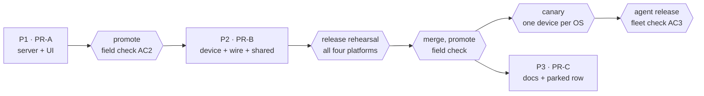

# FR-137: Hive leaves master — FR-90 parked on a branch, the fleet kept whole

**Issue:** [#3458](https://github.com/gjovanov/roomler-ai/issues/3458) · **Status:** **claimed** 2026-11-04; D1–D11 confirmed the same day; P1, P2 and P3 merged and promoted, P2 released in agent 0.4.201, every criterion met 2026-11-05 ·
**Anchors:** master `8f7533e96` (2026-11-04) unless a row says otherwise ·
**Parks:** [FR-90](https://github.com/gjovanov/roomler-ai/blob/park/hive-fr90/docs/fr/FR-90-hive-agent-sessions.md)
([#1827](https://github.com/gjovanov/roomler-ai/issues/1827)), parked on
[`park/hive-fr90`](https://github.com/gjovanov/roomler-ai/tree/park/hive-fr90) at `7106d588d`

## 1. Goal

On 2026-11-04 the operator decided that FR-90 (Hive) will not be built now. It is parked whole on a branch
and taken off master; it may come back, possibly changed. That covers everything FR-90 built:

- agent sessions;
- the vault, and knowhow (the map and the brain);
- archive replicas and `roomler connect`;
- `crates/hive-node`;
- the `hive`, `vault` and `knowhow` server modules;
- their UI, tests, CI lanes, release features and docs.

This FR removes it **without costing the fleet or production anything**:

- every enrolled device stays connected and keeps every non-Hive capability, through every mix of old and
  new agents and servers;
- no stored row stops loading, no data is dropped, and no retired spelling or bit can be handed to
  something new;
- the release lanes stay buildable at tag time.

What stays on master is a short list of **fleet-safety stubs** (§3.3), each with the reason it exists and
the condition for its removal, plus FR-90's registry row, which reads parked and names the branch.

## 2. Evidence

### 2.1 The footprint (measured on `7106d588d`, the parked head)

Hive is spread across the product. 405 tracked files and 19,881 lines match
`(?<!arc)hive|vault|knowhow|\bbrain\b|archive_replica|net_?grant|ssh_?ticket|roomler connect|connectcmd`.
The lookbehind matters: `hive` also matches "arc**hive**". Of those files, 215 (12,273 lines) sit outside
the Hive-only directories.

| | Whole files deleted | Lines | Shared files edited |
|---|---|---|---|
| P1 (PR-A): server + UI | 3 modules, 2 UI dirs, 29 + 12 integration-test files, 28 UI files | ≈ 88.9k | ~85 cited by line. Server rows alone: 112 cut, 25 stubbed, 10 kept as generic; the UI and test rows come on top |
| P2 (PR-B): device + wire + shared | `crates/hive-node`, roomlerd's `hive/` and `vault_proxy/`, 14 single files | ≈ 113.7k | ~70 cited by line: 214 rows cut, 23 stubbed, 9 kept as generic |
| P3 (PR-C): docs | 5 docs and FR-90's spec | 18,312 | 28: ~910 lines cut, ~45 rewritten |

Five classes of match are **not** Hive. The inventories mark the first three false positives, and AC1's
read after P3 (§8) found the last two:

- "archive";
- the Windows **registry hive** (`crates/agent-core/src/companion_autostart.rs`, `scripts/install.ps1`);
- FR-52's `connect_code`;
- **"split-brain"**: the `\bbrain\b` alternative matches it, because a hyphen is a word boundary. On master
  `a19e4573f` that is 16 lines in 8 files: `agents/roomler-desktop/src/commands.rs` 5,
  `crates/modules/network/src/derp.rs` 4, `crates/modules/conference/src/media_cluster.rs` 2, and one each
  in `crates/agent-core/src/appdirs.rs`, `crates/core/src/cluster/directory.rs`,
  `crates/core/src/cluster/metrics.rs`, `crates/modules/network/src/lib.rs` and
  `crates/modules/network/src/overlay.rs`;
- **history notes**: a comment that records when FR-90 changed something else. There is one,
  `.github/workflows/release-agent.yml:2321` (on `a19e4573f`), in the MSI size-history comment: it dates the
  0.4.124 MSI step to FR-90's `hive` entering the Windows build (#1915). It stays as written, because it is
  the history the size baseline was measured from.

FR-90 also left code that never says hive:

- the UI's `toolView`, `lineDiff` and `ansi` utilities;
- chat's room and message **binding**;
- the `approval_request` notification kind;
- the SSH **one-command** grant;
- `turn_creds::issue_for_session_with_ttl`;
- SOCKS5 `negotiate()` and `flow_listener::bind()`.

The inventories sort each of these into cut, stub and keep.

### 2.2 What production runs today

On production:

- Hive is switched on for one test organization only, and knowhow for two organizations.
- The vault is switched off and was never mounted, so its eight collections were never created
  (fact 12).
- Replication is off (`hive.replicaset = false`), so no replica stream crosses DERP.
- Agent releases compile the `hive` feature on all four release lines
  (`.github/workflows/release-agent.yml:552`, `:1185`, `:1717`, `:2809`). The `vault` feature ships in no
  release.
- Every `config.toml` saved by a recent agent carries the 23 Hive config keys (`false` and `[]` included),
  whether or not that host ever ran Hive (§2.3, fact 1).

### 2.3 The compatibility facts that shape the design

32 facts, each with its check and evidence, are in the companion file `compat.md`. The twelve that decide
the design:

| # | Fact | Evidence | Consequence |
|---|---|---|---|
| 1 | The agent config keeps keys it doesn't know, through every save. | no `deny_unknown_fields` (`crates/agent-core/src/config.rs:24`); `unknown_keys` (`:4328`) and `merge_unknown_keys` (`:4457`), locked by `:4994` | Removing the 23 keys strands nothing, and a rollback finds them again. |
| 2 | The server's settings ignore unknown env. | no `deny_unknown_fields` (`crates/config/src/settings.rs:15`); env read at `:1839`, deserialized at `:1959`; `config` 0.14.1 maps `ROOMLER__HIVE__X` to `hive.x` and serde ignores it | `ROOMLER__HIVE__*` and its siblings stay harmless, but **an absent tenant list means every organization** (Hive `crates/config/src/settings.rs:52-53`, vault `:56-58`, knowhow `:61-62`), so a rollback must never meet a switch that is on without its list (D3). |
| 3 | While the wire is unchanged, a 0.4.199 Hive frame still parses on a server with no Hive module. | owner routing at `crates/modules/fleet/src/socket.rs:605`; no handler (`:612`); then `warn!("unexpected msg for role {role:?}: {:?}", msg)` (`crates/modules/fleet/src/hub.rs:4411`) and `crates/modules/fleet/src/socket.rs:801` | Without a stub, P1 would log **two WARNs per frame with the frame dumped**, which includes a device's account map. Hence S-A1. |
| 4 | An agent drops a frame it can't parse and keeps the socket. | `agents/roomlerd/src/signaling.rs:3100`, `:3105`, "Deliberately not fatal" (`:3097`) | The agent needs no stub variant. |
| 5 | `ClientMsg` ignores unknown fields. | `crates/remote_control/src/signaling.rs:523-525` | If P2 dropped `ssh_ticket` or `net_grant`, an old agent's ticketed request would parse as **the owner's own**. Hence S-B3. |
| 6 | Role reconcile only adds bits. | `let reconciled = stored \| def.permissions;` (`crates/services/src/dao/tenant.rs:427`) | Bits 32-34 stay in stored masks for good. A deleted name would let a future bit pass both bit tests (`crates/db/src/models/role.rs:529`, `:544`) and reach every member. Hence S-A5. |
| 7 | `SshDenyReason` is a strict enum in stored audit rows. | `pub enum SshDenyReason` (`crates/remote_control/src/models.rs:5253`); a 90-day TTL (`:5546`); one unknown word fails a page (`crates/services/src/dao/base.rs:237`) | Its three FR-90 variants stay (S-A6, S-B5). |
| 8 | DERP's `RMHIVE01` demux keeps a replica frame away from WireGuard. | `crates/tunnel-core/src/transport/derp.rs:566`, `:570`; otherwise `Unrouted` (`:625`) leads to `demote_follow` (`crates/tunnel-core/src/overlay/runtime.rs:2875`) | Without a stub, a 0.4.199 peer's frame would pin a healthy direct pair to the relay for up to 15 minutes at a time. Hence S-B1. |
| 9 | The module ids are part of core's contract. | every wire owner must be a module (`crates/core/src/composition.rs:264`); `HOOK_ORDER` must equal the modules (`crates/core/src/hooks.rs:483`) | `hive`, `vault` and `knowhow` leave `graph::MODULES` in P2 with the wire, not in P1. |
| 10 | A release list that names a missing feature fails at **tag** time. | the four lines in §2.2; the features at `agents/roomlerd/Cargo.toml:806`, `:814`, `:823` | The crate's features and all four lists change in one commit, rehearsed before merge (B-I1). |
| 11 | The updater never moves down. | `if !is_newer(&latest_parsed, &current)` (`agents/roomlerd/src/updater.rs:1864`); both MSI flavours refuse a downgrade (`:1796`) | P2's kill switch on the fleet is a **new** release built from the revert, never a reinstall of 0.4.199. |
| 12 | Boot drops no collection and no index outside the plan, but TTL indexes keep running. | `apply_index_sets` walks the plan only (`crates/db/src/indexes.rs:72`, `:80`) | Every FR-90 collection stays. Production holds 13 of the 21 the plan names, with 48 indexes: boot applies only mounted modules' index sets, so the vault's eight were never created. Six of the 13 keep expiring rows on their own TTL (D2). |

Three of the brief's starting assumptions were wrong. Each is corrected in `compat.md`:

- The server does *not* simply ignore old Hive frames until P2; fact 3 above shows what it does.
- The Hive cap gate is at `crates/modules/fleet/src/socket.rs:191` and `:307`, not where it was first
  cited.
- The DERP demux needs a stub. It cannot simply go.

## 3. Key design

### 3.1 Three PRs, in this order

- **P1 (PR-A): the server and the UI.** It deletes the three modules, their routes, settings, auth token
  types, UI, integration tests and their index sets from the plan. It cuts their uses in core, fleet,
  network, chat, services and db, re-records the baseline (−42 routes, −21 index sets per mode), and adds
  the stubs S-A1…S-A8. It changes **one server image and no client binary** (A-I1). Inventory:
  `inventory-A.md`.
- **P2 (PR-B): the device, the wire and the shared crates.** It deletes:
  - roomlerd's Hive code, `crates/hive-node`, agent-core's 23 keys and `probe_reach.rs`;
  - tunnel-core's session branches, localapi's verbs, and the CLI's `hive` and `connect`;
  - the wire's 78 variants, 21 verbs, three owners and the echo fields;
  - the CI lanes, the release features, the licence rows and the hive-archive image.

  It removes the placeholders P1 left in the server, re-records the baseline (−78 wire names, −36
  namespaces) and adds the stubs S-B1…S-B8 and the compatibility tests. P2 is **both a server roll and an
  agent release**. Inventory: `inventory-B.md`.
- **P3 (PR-C): the docs.** It deletes `docs/{hive,vault,knowhow,brain,roomler-hive-design}.md` and
  FR-90's spec, cleans the 28 surviving files that cite them, and makes FR-90's registry row read parked
  with a full-URL link to the branch. That link change goes **in the same commit** as the spec's deletion,
  because `fr-registry` checks the link. P3 also writes this FR's own docs (§4, AC7). Inventory:
  `inventory-C.md`.

No CI job checks that a doc anchor points at a live line (the doc audits are `fr-registry`,
`anchor-ranges` and `mermaid-sequences`, at `.github/workflows/ci.yml:2295` and `:2320`). So P1 and P2
cannot turn CI red through the docs they leave stale. Each still follows the house gate: it shifts the
anchors of surviving non-Hive docs that point into the files it edits, and skips the six docs P3 deletes.

### 3.2 The invariants each PR keeps

| # | Invariant | Why |
|---|---|---|
| A-I1 | P1 edits no crate that a shipped client links (`remote_control`, `tunnel-core`, `agent-core`, `localapi`, `hive-node`, `tcp-turn-conn`, `roomler-setup-core`, anything under `agents/`). | The closures of `roomlerd`, `roomler-cli`, `roomler-desktop`, `roomler-setup` and `derp-relay` hold only those crates (`cargo metadata`). So P1 cannot change a client, and any agent release cut between P1 and P2 still carries Hive in full, exactly like 0.4.199. |
| A-I2 | P1 leaves the wire unchanged: the baseline's `wire` and `namespaces` stay identical. | The wire lives in `remote_control` (A-I1). |
| A-I3 | P1 keeps `hive`, `vault` and `knowhow` in `graph::MODULES` (`crates/core/src/graph.rs:17-19`) and `HOOK_ORDER` (`crates/core/src/hooks.rs:52`). | Fact 9 |
| A-I4 | No PR drops a collection or an index. | D2 |
| B-I6 | No removal changes how an old agent's frame parses on the server, except as intended: a retired variant fails the parse (`debug!`), and `ssh_ticket` / `net_grant` stay so they can be refused. | Fact 5. A hello that failed to parse would leave the device unregistered without a word (`crates/modules/fleet/src/socket.rs:1309`). |
| B-I1 | In P2, one commit drops `hive`, `vault` and `hive-test-launcher` from the crate and `hive,` from all four release lists. | Fact 10 |
| B-I2 | `ssh-one-command` stops being advertised (`agents/roomlerd/src/encode/caps.rs:4465`) in the same PR that removes the agent's enforcement of it. | A build that advertised the verb and ignored the field would serve an agent session's key a full session on a pre-P1 server. Not advertising is fail-closed: the old server refuses `TargetTooOld` (`crates/modules/network/src/routes/agent_ssh.rs:509`). |
| B-I3 | Each `cfg(hive_host)` and `cfg(worker_calls)` leaves together with its `rustc-check-cfg` line. | `unexpected_cfgs` fails `clippy -D warnings`. |
| B-I4 | A 0.4.199 peer's `RMHIVE01` frame never reaches WireGuard, a tunnel consumer or `Unrouted`. | Fact 8 |
| B-I5 | Every removed wire spelling stays reserved. | Verb matching is equality (`crates/remote_control/src/models.rs:1474`), and 0.4.199 agents keep advertising the 21 verbs until they update. A reused spelling would be claimed by each of them. |

### 3.3 The stubs that stay

| Stub | Where | Why | It may go when |
|---|---|---|---|
| **S-A1**: a `debug!` + `continue` arm for `Owner::{Hive,Vault,Knowhow}` | after `Owner::Fleet => parsed,` (`crates/modules/fleet/src/socket.rs:606`) | fact 3 | P2 removes it with the variants. |
| **S-A2**: refuse a request that carries `ssh_ticket` (`TicketRefused`, audited) or `net_grant` (`NET_GRANT_REFUSED`), never falling back to the owner's or the device's principal | `crates/modules/network/src/agent_arms.rs:193`; `crates/modules/network/src/tunnel.rs:820` | fact 5 | It becomes S-B3. |
| **S-A3**: the hello's `vault_key` bound as `_`; `Agent{}` literals keep `vault_key: String::new()` | `crates/modules/fleet/src/socket.rs:71` | These are wire and model fields (A-I1). | P2 |
| **S-A4**: echo and model fields written neutral (`None` / `false`) | network and fleet | A-I1 | P2 |
| **S-A5**: role bits 32-34 kept as consts and names marked RESERVED; `ALL` unchanged; dropped from `DEFAULT_MEMBER` and `DEFAULT_ADMIN`; hidden in the UI catalog | `crates/db/src/models/role.rs:112`, `:125`, `:231` | fact 6 | Never (D1). |
| **S-A6 / S-B5**: `SshDenyReason::{TicketRefused,SessionNotAllowed,TargetTooOld}` | `crates/remote_control/src/models.rs:5253` | fact 7 | 90 days after P1's roll, or never with `#[serde(other)]` (D7). |
| **S-A7**: the three module ids | `crates/core/src/graph.rs:17-19`, `crates/core/src/hooks.rs:52` | fact 9 | P2 |
| **S-A8**: the UI's `DEFAULT_OFF` mechanism kept, with no member | `ui/src/modules/registry.ts:39` | It mirrors the server's list for the next default-off module. | — |
| **S-B1**: `HIVE_MAGIC` + drop-and-count first in `DerpMux::deliver`, with one test | `crates/tunnel-core/src/transport/derp.rs:155`, `:566` | fact 8 | No deployed agent can send the magic, i.e. past the rollback reach of the last Hive release. |
| **S-B2**: a hidden `roomler hive hook` that exits 0 | `agents/roomler-cli/src/cli.rs` | Adopted terminals' Claude Code hooks call it on every session event (`agents/roomler-cli/src/hive_hooks.rs:34`). Their contract is "prints nothing and always exits 0" (`:17`). | Those accounts are unadopted (D6). |
| **S-B3**: `SshRequest.ssh_ticket` and `TunnelOpen.net_grant` stay on the wire, parse-only and refused | `crates/remote_control/src/signaling.rs` | fact 5 | The last ≤0.4.199 agent is gone (D8). |
| **S-B4**: `RETIRED_RPC_VERBS` (the 21 spellings) and a test that guards them, the tag families `rc:hive.`, `rc:vault.`, `rc:knowhow.`, the user socket's `hive:` and the module ids | `crates/remote_control/src/models.rs` | B-I5 | Never. |
| **S-B6**: the agent config's unknown-key merge, unchanged | `crates/agent-core/src/config.rs:4328`, `:4457` | fact 1 | Never; and never add `deny_unknown_fields` to `AgentConfig`. |
| **S-B7** (optional): the 23 retired keys exempt from the once-per-start WARN | `crates/agent-core/src/config.rs:4562` | Every host carries them (§2.2). | — (D11) |
| **S-B8**: FR-90's refactors of shipped code: SOCKS5 `negotiate()`, `flow_listener::bind()`, `TempDir::named`, `within_ngroups_max`, the Windows Job Object code, shared `windows-sys` features and deps | `inventory-B.md` §B1 | Shipped paths now run on them. | Never. |

Two decisions also keep lines that name Hive. They are not stubs, and AC1's read classes them here
(anchors on `a19e4573f`):

| Kept line | Where | Why | It may go when |
|---|---|---|---|
| **The parked rows' binding**: the doc comment and the shape test that spell `{module: "hive", ref: …}`, and the SPA's note that such a room opens as a plain Secret room | `crates/db/src/models/binding.rs:8-9`, `:42`, `:45`; `ui/src/stores/rooms.ts:37` | D2 keeps the rooms bound to `hive` (73 on production), and D9 opens them as plain Secret rooms. The comment says which rows carry the binding and why chat never reads it. | Those rows are dropped (out of scope, §7), or Hive returns and owns them again. |
| **D3's retired-switch test**: `a_retired_module_switch_loads_and_switches_nothing` | `crates/config/src/settings.rs:1786`, its two `toml::from_str` lines at `:1788` and `:1792` | A config that still sets `hive`, `vault` or `knowhow` under `[modules]` must load and switch nothing. D3 removed production's Hive env on 2026-11-05 (AC8), but an older deploy or a self-host config can still carry a switch. | No supported config can carry a retired switch, or never: the test costs nothing. |

LocalAPI needs no verb stubs. An unknown verb answers `Error("bad request: …")` and the connection lives on
(`crates/localapi/src/lib.rs:3614`). The 0.4.199 macOS update helper therefore installs without a Hive hold,
failing open by design (`agents/roomlerd/src/updater.rs:3861`). Remote config needs nothing either:
`DesiredConfig` has no Hive key (`crates/remote_control/src/models.rs:2970`), and an absent field leaves the
device's own value alone (`agents/roomlerd/src/remote_config.rs:396`).

### 3.4 The fleet's view of the order

| Agent ↓ / server → | today | after P1 | after P2 |
|---|---|---|---|
| **0.4.199**, or any release cut before P2 | as today | **case 1** | **case 5** |
| **P2's release** | **case 2** (P1 rolled back) | case 6 | the target |

1. **A 0.4.199 agent against P1's server.**
   - Its Hive, vault and knowhow frames parse and S-A1 drops them at `debug!`. On production that is
     knowhow scan results from two organizations' devices and Hive state from one test organization's
     devices.
   - The server builds no Hive frame. An old pod's cross-pod purge envelope falls to `_ => {}`
     (`crates/modules/fleet/src/ctrl.rs:311`) during the roll.
   - The hello's `vault_key` is ignored (S-A3).
   - A ticket or grant is refused (S-A2).
   - Every 0.4.199 SYSTEM SSH service still claims with `&one_command=true`
     (`agents/roomlerd/src/ssh_service.rs:638`). The field is gone and axum ignores it. No pending row with
     `one_command: true` was ever written, because gate 3 refused every session first
     (`crates/modules/network/src/routes/agent_ssh.rs:324`).
   - A session still running on a test device keeps running locally with no viewer, so stop them first (D4).
   - A stale browser tab's `hive:*` frame finds no handler and gets `debug!` "Unknown WS message type"
     (`crates/api/src/ws/handler.rs:414`).
2. **P2's agent against a pre-P1 server** (P1 rolled back).
   - The agent advertises no Hive verb and no `ssh-one-command`, and sends no vault key. So every Hive push
     stays gated off (`crates/modules/fleet/src/hub.rs:3005`), and a session SSH grant is refused
     `TargetTooOld`.
   - Vault and knowhow push nothing either, because their pushes read the stored caps. One edge: a
     failed hello update can leave the old caps on the row for one connection, and that costs one WARN on
     the agent. Safe.
3. **Stored roles and settings after P1.**
   - Bits 32-34 stay in stored masks under their reserved names. `names()` renders any unnamed bit as hex
     (`crates/db/src/models/role.rs:236`), and the role editor keeps bits it doesn't show
     (`ui/src/components/admin/RolesSection.vue:395`).
   - New roles' presets lack the bits.
   - Production's `ROOMLER__HIVE__*`, `ROOMLER__VAULT__*` and `ROOMLER__KNOWHOW__*` are ignored, and must
     stay until P1 is past rollback (D3). The vault's key-encryption key is never deleted: it alone opens
     the parked secrets (`crates/config/src/settings.rs:230`).
4. **An agent rolled back from P2 to Hive.**
   - The updater only moves up (fact 11). On Windows the MSI also refuses a downgrade, so a rollback is a
     new release built from P2's revert.
   - On that release every Hive key is still in `config.toml` (S-B6), and any device-side replica store is
     untouched on disk.
   - Its Hive frames meet P1's stub, or `debug!` after P2's server roll.
5. **A 0.4.199 agent against P2's server.**
   - A retired frame fails the parse and lands at `debug!` (`crates/modules/fleet/src/socket.rs:904` on
     master `a19e4573f`, after P2), with no disconnect. P2's server GREEN saw exactly that on production
     (§8).
   - The hello still parses: `vault_key` is an ignored field and the verbs are strings. A frozen-hello test
     pins this, because `read_next_rc` drops an unparseable hello without a word
     (`crates/modules/fleet/src/socket.rs:1201` on `a19e4573f`).
   - A ticket or grant is still refused (S-B3).
   - DERP traffic is opaque to the relay.
6. **P2's agent against P1's server.** Nothing Hive flows either way, and `one_command` is always `false`.

### 3.5 What the design refuses

- **P2 before P1.** The server still drives Hive and still uses the wire types: the `push_hive*` family,
  the cross-pod purge, and network's ticket and grant binding. P2 could not delete the wire without cutting
  the server first, so it would contain P1.
- **One PR.** That is about 220k lines with two different rolls (a server promote and an agent release)
  and two rollback stories. P1 → P2 also gives a checkpoint: the server proves it lives with 0.4.199
  agents before any agent changes.
- **The docs first, or inside P1 and P2.** Docs first would deny code still on master. Inside P1 and P2,
  most of the 28 surviving docs would be edited twice, because each describes both halves. And the
  registry row is coupled to the spec's deletion by `fr-registry`.
- **Splitting P2 by layer** (wire / agent / CI). The wire variants' users span the agent, the shared
  crates and P1's server placeholders. Every split leaves a commit that does not compile, or a release
  whose feature list names a removed feature (B-I1).
- **Splitting P1 into server and UI.** One image ships both, so the split buys a second field check and
  nothing else.
- **Switching it off instead of deleting it** (`[modules] … = false` everywhere, the code kept). That is
  not what the operator decided, and it keeps about 220k lines building and testing on every PR.
- **Deleting the role bits' names, or reusing a spelling.** Facts 6 and B-I5: either one is a silent
  grant or a silent claim, fleet-wide.

## 4. Phases

Each phase is one PR. Its kill switch is its revert:

- for P1, the previous server image (promote it), as long as D3's env vars are still in place;
- for P2, the previous server image, and a **new** agent release built from the revert (fact 11);
- for P3, the revert.

Each field check is run **RED first** on the current deploy, then GREEN.

| Phase | What | Verified by | Status |
|---|---|---|---|
| **P0** | this spec, the claim, the inventories (`inventory-{A,B,C}.md`), the compatibility facts (`compat.md`) and the anchor check | 627 inventory anchors + 2 in range, and every spec anchor, checked on master `8f7533e96` | drafted 2026-11-04 |
| **P1** | PR-A (`inventory-A.md`): the server and the UI, stubs S-A1…S-A8 | §4.1 | merged 2026-11-04 as `97dea2554` and promoted as `hosted-20261104-97dea25`; GREEN 2026-11-04 ([#3458](https://github.com/gjovanov/roomler-ai/issues/3458#issuecomment-6636996599)) |
| **P2** | PR-B (`inventory-B.md`): the device, the wire and the shared crates, stubs S-B1…S-B8, the compatibility tests | §4.2 | merged 2026-11-04 as `9da76c4e6` (#3475), promoted as `hosted-20261104-9da76c4` on 2026-11-05 and released in agent 0.4.201 the same day; server GREEN ([#3458](https://github.com/gjovanov/roomler-ai/issues/3458#issuecomment-6647220111)), fleet GREEN ([#3458](https://github.com/gjovanov/roomler-ai/issues/3458#issuecomment-6663046866)) |
| **P3** | PR-C (`inventory-C.md`): the six docs leave, 28 files cleaned, FR-90's row parked, and this FR's docs: the reserved surfaces, each in its home doc, a checklist section with a mermaid diagram of where each retired surface lands, linked from `docs/README.md` | §4.3 | RED read 2026-11-04 ([#3458](https://github.com/gjovanov/roomler-ai/issues/3458#issuecomment-6635837269)); merged 2026-11-05 as `225de0828` (#3490) and promoted as `hosted-20261105-225de08`; GREEN ([#3458](https://github.com/gjovanov/roomler-ai/issues/3458#issuecomment-6649560305)) |

### 4.1 P1: what proves it

- **CI:** every lane, the integration lane dispatched on the branch (`RUST_MIN_STACK=8388608`), the UI build
  and Vitest, licensing and profiles.
  - The composition baseline diff must read exactly −42 routes (hive 14, vault 15, knowhow 13), −21 index
    sets per mode (56 index models), 0 wire names and 0 namespaces.
  - `git diff --stat` touches nothing under A-I1's crates.
- **RED on today's deploy:**
  - `/api/capabilities` and `/health` name `hive`, `vault` and `knowhow` under `compiled`
    (`crates/api/src/lib.rs:459`).
  - A member of the test organization gets 200 from a Hive route.
- **GREEN after the promote:**
  - pods on the new image; `/health`;
  - capabilities and health name none of the three, and the Hive route answers 404;
  - an RC session paints and takes input;
  - chat sends and receives;
  - a two-party conference call carries frames both ways;
  - a remote-config push reports applied, and an exec returns;
  - the server's online-agent count is unchanged across the roll, read from the server, not from an exec
    sweep;
  - the test organization's devices are still connected;
  - for an hour, pod logs hold no `unexpected msg for role` and no `rc:* dispatch failed (agent)`;
  - the `ssh_audit` and notification listings load;
  - a parked session room opens as a plain Secret room.

### 4.2 P2: what proves it

- **CI:**
  - every lane, including the renamed Windows and macOS agent lanes;
  - the compatibility tests (`inventory-B.md` §B2): a frozen 0.4.199 hello parses; a ticketed
    `rc:ssh.request` and a granted `rc:tunnel.open` are refused; a retired `ServerMsg` is dropped and the
    agent keeps its socket; the DERP drop; the retired spellings; stored deny reasons load; `HOLD_UNDER`
    holds; the 23 real keys survive two saves;
  - the baseline diff reads exactly −78 wire names (189 → 111, minimum 80) and −36 namespaces
    (90 → 54, minimum 40).
- **Before the merge:** a `workflow_dispatch` of `release-agent.yml` from the branch with
  `publish_release=false` (the input at `.github/workflows/release-agent.yml:53`), green on all four
  platforms (B-I1).
- **RED on today's fleet:** a current device's stored `capabilities.rpc` lists the Hive verbs its build
  advertises (most are build-gated; a few also need a config switch or a unix host) and `ssh-one-command`.
- **GREEN, server:** after the promote, §4.1's GREEN list again, plus the DERP relay's health. Only the
  build shares the image: `Dockerfile:78` builds `derp-relay` and `:131` copies it in, but no deployed
  relay runs the promoted image. The regional PoPs run a binary staged on each relay host, and the
  in-cluster relay is a `stats` sidecar pinned to its own image. The DERP a promote rolls is the app pods'
  in-process `/derp`, so that is the one this read checks, with the PoPs' `/healthz` read beside it.
  `crates/derp-relay` names no Hive item.
- **GREEN, canary:** before publishing, one device per OS on the rehearsal's build with auto-update off:
  - the version;
  - an RC session;
  - an overlay pair with a 0.4.199 peer stays **direct**: no `Unrouted`, and `dropped_hive` counts if
    such a peer sends replica frames;
  - a tunnel forward;
  - `roomler ssh`.
- **GREEN, fleet:** after the release:
  - versions from the server's denominator;
  - the canary list on one device per OS;
  - a device whose `config.toml` sets `hive_enabled` still holds that key after a save (read that one key
    only);
  - an adopted terminal's hook exits 0 (if D6 keeps S-B2).

### 4.3 P3: what proves it

- `fr-registry`, `anchor-ranges`, `mermaid-sequences` and the docs-site build all pass
  (`.github/workflows/ci.yml:2609`).
- FR-90's row (`docs/fr/README.md:188`) links the branch by full URL and holds no `|` in its prose.
- No surviving doc links a deleted doc.
- `CLAUDE.md`, `.claude/rules/modular-monolith.md` and `docs/README.md` keep no Hive text beyond the
  parked pointer.

## 5. Acceptance criteria

- [x] **AC1, master carries no Hive.** After P3, `cargo metadata` lists no `roomler-ai-mod-hive`,
  `roomler-ai-mod-vault`, `roomler-ai-mod-knowhow` or `roomler-hive-node`. No CI lane or release list names
  a `hive` or `vault` feature. And §2.1's regex over `crates agents ui .github scripts Cargo.toml
  Dockerfile* docker-compose*` returns only §3.3's stubs and §2.1's false-positive classes, with the list
  recorded in §8. *(Read on master `225de0828` after P3 ([#3458](https://github.com/gjovanov/roomler-ai/issues/3458#issuecomment-6646280609)), and again on `a19e4573f` for this commit, which adds the classes the first read found unlisted: §2.1's "split-brain" and history notes, and §3.3's kept decision lines. §8 has the per-class totals.)*
- [x] **AC2, P1 is promoted and production holds.** §4.1's RED reading before, and every GREEN item after. *(GREEN 2026-11-04: [#3458](https://github.com/gjovanov/roomler-ai/issues/3458#issuecomment-6636996599).)*
- [x] **AC3, P2 is promoted and released, and the fleet holds.** §4.2's rehearsal, server, canary and fleet
  readings. The first release after P2 builds from its tag on all four platforms and re-pins the MSI size
  baseline (D10). *(GREEN 2026-11-05: the [fleet read](https://github.com/gjovanov/roomler-ai/issues/3458#issuecomment-6663046866), after the [server GREEN](https://github.com/gjovanov/roomler-ai/issues/3458#issuecomment-6647220111) and the canary ([#3458](https://github.com/gjovanov/roomler-ai/issues/3458#issuecomment-6632461736)); agent-v0.4.201 built from its tag on all four platforms ([run 42042701635](https://github.com/gjovanov/roomler-ai/actions/runs/42042701635)), and #3510 (`fa868aae6`) re-pinned the MSI size baseline.)*
- [x] **AC4, the compatibility tests are in CI and green.** §4.2's list runs in the default lanes. *(GREEN 2026-11-05: each ran `ok` by name on master's push runs for `9da76c4e6`, [CI 41935772637](https://github.com/gjovanov/roomler-ai/actions/runs/41935772637) and [integration 41935772710](https://github.com/gjovanov/roomler-ai/actions/runs/41935772710); listed in the [fleet read](https://github.com/gjovanov/roomler-ai/issues/3458#issuecomment-6663046866).)*
- [x] **AC5, no data is dropped.** Read-only and bounded (`estimatedDocumentCount()` and `getIndexes()`,
  never a scan), FR-90's collections and their indexes are all present before P1 and after P3 (production
  holds 13 collections and 48 indexes; the plan names 21, and the vault's eight never existed), and D2's
  TTL decision is applied as decided. *(GREEN 2026-11-05, after P3: the same 13 collections and 48 indexes, each list identical, the six TTLs unchanged ([#3458](https://github.com/gjovanov/roomler-ai/issues/3458#issuecomment-6646318716)).)*
- [x] **AC6, nothing is reused.** `RETIRED_RPC_VERBS` and its test are on master. Role bits 32-34 are
  named RESERVED with a test. The `SshDenyReason` variants are kept per D7. *(GREEN 2026-11-05: `retired_rpc_verbs_are_never_reused`, `retired_wire_families_and_module_ids_are_never_reused` and `the_reserved_bits_stay_named_and_seeded_by_no_row_below_the_owner` ran `ok` in master [run 42025637832](https://github.com/gjovanov/roomler-ai/actions/runs/42025637832) on `4df9cbe74`.)*
- [x] **AC7, docs (the docs criterion).** The six docs are off master. FR-90's row reads parked with the
  branch URL. No link dangles. The four doc gates pass. Each reserved surface is documented in its home
  doc (`docs/permissions.md`, `docs/data-model.md`, `docs/real-time.md`, `docs/overlay-nat-traversal.md`,
  `docs/roomler-ssh.md`, `docs/tunnels.md`, the public configuration reference). A checklist section in
  `docs/retired-names.md` links them, with a mermaid diagram of where each retired surface lands, and is
  named in its `docs/README.md` row (`docs/README.md:182` on `8f7533e96`, `:163` on `a19e4573f`). *(GREEN 2026-11-05: PR-C #3490 merged as `225de0828`, its image promoted, the live configuration reference read ([#3458](https://github.com/gjovanov/roomler-ai/issues/3458#issuecomment-6649560305)).)*
- [x] **AC8, the operator's follow-ups.** D3 (the deploy env) and D5 (the GHCR image) are done as decided. *(GREEN 2026-11-05 ([#3458](https://github.com/gjovanov/roomler-ai/issues/3458#issuecomment-6663438989)).)*

## 6. Open decisions

The operator confirmed every recommendation on 2026-11-04
([#3458](https://github.com/gjovanov/roomler-ai/issues/3458#issuecomment-6625433694)): D1 (a), D2 (a), D3 (a),
D4's stop and (a), D5 (a), D6 (a), D7 (a), D8 (a), D9 (a), D10 and D11 (a). The options stay below for the
record, the confirmed one first.

1. **D1, role bits 32-34.**
   - **(a) confirmed:** keep `HIVE_RUN`, `KNOWHOW_VIEW` and `KNOWHOW_EDIT` as consts and named entries
     marked RESERVED, keep `ALL`, drop them from the presets, and hide them in the UI.
   - (b) Rename them `RESERVED_32…34`. Cost: role names in error messages and boot logs change wording.
   - (c) Delete them. Rejected: a future bit 33 would be granted at once to every member of every
     reconciled organization.
2. **D2, production's Hive data.**
   - **(a) confirmed:** keep every FR-90 collection as it is (13 on production; the vault's eight were
     never created), and let the six live TTL indexes keep running as FR-90 designed them: 90 days on
     `agent_approvals`, `hive_audit`, `hive_purges`, `knowhow_probes` and `knowhow_scans`, 1 day on
     `hive_session_memory`. Hive ran on one test organization, and its audit trail ages out as it always
     would have.
   - (b) `collMod` the six TTLs so "parked" means kept. Cost: a hand edit of production's database that no
     code owns, under the bounded-read discipline.
   - (c) Drop the data. Out of scope here.
3. **D3, the deploy repo's env.**
   - **(a) confirmed:** after P1 is past its rollback window (at P2's promote at the earliest), remove
     `ROOMLER__MODULES__{HIVE,VAULT,KNOWHOW}` **together with** the `ROOMLER__HIVE__*`,
     `ROOMLER__KNOWHOW__*` and `ROOMLER__VAULT__*` lists. Never remove a tenant list while its switch is on:
     an absent list means every organization (`crates/config/src/settings.rs:52-53`, `:56-58`, `:61-62`),
     so a rollback would open that module to all of them. Keep the vault's key-encryption key stored,
     always.
   - (b) Leave them. Cost: dead config that a future reader takes for live.
4. **D4, the test organization.**
   - Stop running sessions before P1's promote. This one is owed, whatever else is chosen.
   - **(a) confirmed:** leave the devices' local Hive copies.
   - (b) Purge them first, while the code still can. Cost: an operator action per device.
5. **D5, the published `hive-archive` image** (GHCR, one version).
   - **(a) confirmed:** keep it, parked like the branch. Deleting a published package is irreversible
     and can happen later.
   - (b) Delete it. Cost: a rebuild if Hive returns.
6. **D6, adopted terminals.**
   - **(a) confirmed:** the hidden `hive hook` stub (S-B2, about 20 lines).
   - (b) Run `roomler hive unadopt` on every adopted account before P2. Cost: finding every such account;
     one missed account exits 2 on every Claude Code session event.
7. **D7, `SshDenyReason`.**
   - **(a) confirmed:** keep the three variants, and remove them no sooner than 90 days after P1's roll.
   - (b) Add `#[serde(other)] Other` now. Cost: it changes a strict enum's contract for every future
     reason.
8. **D8, `ssh_ticket` and `net_grant` on the wire.**
   - **(a) confirmed:** keep them parse-only and refused while any ≤0.4.199 agent exists.
   - (b) Drop them. Rejected (fact 5).
9. **D9, parked session rooms.**
   - **(a) confirmed:** they become plain Secret rooms.
   - (b) A read-only rule for bound rooms. Cost: new code for a parked feature.
10. **D10, the MSI size baseline.** **Confirmed:** re-pin it from the first P2 release's measured size
    (about 1.5 MB smaller). The guard has no floor, and a baseline left high hides growth.
11. **D11, the 23 retired keys' WARN.**
    - **(a) confirmed:** exempt them (S-B7).
    - (b) Leave it. Cost: one WARN line per start on every host.

## 7. Out of scope

- Dropping any MongoDB data, and any hand edit of production's database (D2 is the operator's).
- The deploy repo itself (D3 is the operator's).
- Any change on `park/hive-fr90`, on the parked Hive branches, or to FR-90's open issues. They are parked
  with it, and #1827 holds their notes.
- Redesigning Hive, or deciding whether it returns.
- Un-reserving role bits 32-34, or reusing any retired spelling.

## 8. Field-verification log

| When | What | Result |
|---|---|---|
| 2026-11-04 ~01:00Z | The operator decided to park FR-90 on a branch and take it off master. | `park/hive-fr90` at `7106d588d`; #1827 retitled "FR-90 (parked)" |
| 2026-11-04 | P0, static, on `7106d588d`: footprint, false positives, FR-90 code that never says hive (§2.1) | 405 files / 19,881 matching lines; whole-file deletes ≈ 221k lines (P1 ≈ 88.9k, P2 ≈ 113.7k, P3 18.3k) |
| 2026-11-04 | P0, the inventories and the 32 compatibility facts | inventory tables: 627 anchors + 2 in range, 0 mismatched on `8f7533e96`; 3 of the brief's 12 facts corrected (§2.3) |
| 2026-11-04 | The operator's decisions | D1–D11 confirmed as recommended ([#3458](https://github.com/gjovanov/roomler-ai/issues/3458#issuecomment-6625433694)) |
| 2026-11-04 07:44–07:47Z | P1 RED, on production before the merge (`hosted-20261103-5f12695`, server 0.4.197) | `/health` and `/api/capabilities` name `hive`, `vault` and `knowhow` under `compiled` (6 of 6 reads); the test organization's admin gets 200 from `GET /api/tenant/{id}/hive`, another organization 404, no credential 401 ([#3458](https://github.com/gjovanov/roomler-ai/issues/3458#issuecomment-6625555835)) |
| 2026-11-04 | AC5's "before" read, bounded | 13 of the plan's 21 collections exist, with 48 indexes: the vault's eight never existed (the vault was never mounted), and six TTL indexes are live, not ten. §2.2, fact 12, D2 and AC5 corrected to match |
| 2026-11-04 13:47–15:18Z | D4: the test organization's live Hive sessions, before and after the promote | 0 live in four reads, the third with the stop armed and the fourth after the roll; all 73 sessions kept; no stop needed ([#3458](https://github.com/gjovanov/roomler-ai/issues/3458#issuecomment-6632302719)) |
| 2026-11-04 13:51Z, 15:13Z | P1 merged as `97dea2554` (#3461), and promoted as `hosted-20261104-97dea25` | both pods Ready with 0 restarts; the online-agent count 22 before and 22 after ([step log](https://github.com/gjovanov/roomler-ai/issues/3458#issuecomment-6632438977)) |
| 2026-11-04 15:14–17:09Z | P1 GREEN, on production after the promote | every §4.1 item GREEN, the test-organization row with a caveat: its one connected device predates FR-90, and the Hive-capable hello is shown on 20 of 20 0.4.199 devices. Two earlier reads corrected: the probe's device list was its first page (25 of 48), and the pre-roll `rc:*` regex could never match ([#3458](https://github.com/gjovanov/roomler-ai/issues/3458#issuecomment-6636996599)) |
| 2026-11-04 16:19–16:20Z | P3 RED, on master `14c8937c9` and the live site, before PR-C | the six docs present (18,312 lines); FR-90's row linked its spec by relative path; 40 links on 34 lines of 9 surviving docs pointed into the six; the public configuration reference listed 13 `hive_*` rows ([#3458](https://github.com/gjovanov/roomler-ai/issues/3458#issuecomment-6635837269)) |
| 2026-11-04 23:41Z | P2 merged as `9da76c4e6` (#3475), after 0.4.200 was published (22:14Z) | its squash tree equals PR-B's tested head `fb3577c05` (tree `a9eb97648`); P2 rides 0.4.201 |
| 2026-11-04 | P3 on PR-C's head (#3490), static | `fr-registry`, `anchor-ranges` and `mermaid-sequences` report 0 faults, and the docs-site build passes (98 pages, its link and anchor checks included); 0 links into the six docs; FR-90's row links the branch by full URL; `CLAUDE.md` and the modular-monolith rule hold no Hive text, and `docs/README.md` only its retired-names row's pointer to the checklist |
| 2026-11-05 00:13Z | P2 promoted as `hosted-20261104-9da76c4` ([run 41939707249](https://github.com/gjovanov/roomler-ai/actions/runs/41939707249)) | both pods started at 00:13:36Z and 00:13:53Z |
| 2026-11-05 00:17–01:35Z | P2 GREEN, server, on production after the promote | every §4.1 item GREEN. The DERP a promote rolls is the pods' in-process `/derp` (registrations 19 before, 20 after); the four regional PoPs answer `/healthz` and were not touched, which corrected §4.2's "the relay rides the same image". 19 `rc:hive.manifest` frames from 0.4.199/0.4.200 devices were dropped at DEBUG and no socket closed on one (§3.4 case 5); in an hour of pod logs, 0 `unexpected msg for role` and 0 `rc:* dispatch failed (agent)` ([#3458](https://github.com/gjovanov/roomler-ai/issues/3458#issuecomment-6647220111)) |
| 2026-11-05 00:32Z | P3 merged as `225de0828` (#3490) | its squash tree equals PR-C's tested head `0a6af0c49` merged onto that master |
| 2026-11-05 00:37–00:43Z | AC1 and AC5 after P3, on master `225de0828` and production | AC1: `cargo metadata` lists 26 packages, none of them Hive; 0 CI or release lines name a Hive feature; the regex gives 312 lines in 61 files, every one classed, 24 of them in classes §2.1 and §3.3 did not list yet ([#3458](https://github.com/gjovanov/roomler-ai/issues/3458#issuecomment-6646280609)). AC5, bounded: the same 13 collections, 48 indexes with identical lists, and the six TTLs unchanged. `hive_session_memory` aged 2 → 0 on its own TTL, and two knowhow counts rose before P1's roll, dated by one `_id`-sorted `limit(1)` read each ([#3458](https://github.com/gjovanov/roomler-ai/issues/3458#issuecomment-6646318716)) |
| 2026-11-05 01:35Z, 04:16Z | P3 promoted as `hosted-20261105-225de08` ([run 41949562673](https://github.com/gjovanov/roomler-ai/actions/runs/41949562673)); AC7's live read | the public configuration reference shows 0 `hive_*` rows (13 at the RED) and the parked-keys sentence; 0 links into the six docs over all 334 tracked `.md` files on `944319385` ([#3458](https://github.com/gjovanov/roomler-ai/issues/3458#issuecomment-6649560305)) |
| 2026-11-05 | The 0.4.201 canary: one device per OS on the release tree's rehearsal build ([run 42021537746](https://github.com/gjovanov/roomler-ai/actions/runs/42021537746)), auto-update off | GREEN on Linux, macOS and Windows. Each advertised RPC set lost exactly the retired verbs (33 → 18, 32 → 17, 31 → 18); RC painted and took input; overlay pairs as before, with no `Unrouted`; tunnels over `quic-v1`; `roomler ssh` returned 0; the retired keys survived saves. One installer finding, not P2's (#1683) ([#3458](https://github.com/gjovanov/roomler-ai/issues/3458#issuecomment-6632461736)) |
| 2026-11-05 14:17:45Z | agent-v0.4.201 published, built from its tag on all four platforms ([run 42042701635](https://github.com/gjovanov/roomler-ai/actions/runs/42042701635)) | D10: the MSIs measured 19.15 MiB (per-user) and 19.28 MiB (per-machine); #3510 (`fa868aae6`) moved the baseline 22.00 → 19.28 MiB and the ceiling 26 → 23 MiB |
| 2026-11-05 14:44–16:16Z | P2 GREEN, fleet, on the official 0.4.201 bytes | at 16:08Z, 20 of 22 online devices ran 0.4.201, and none of those 20 advertised a retired verb. On one device per OS: RC, the overlay with no `Unrouted`, a tunnel forward, `roomler ssh`, `hive_enabled` kept through a save, and the S-B2 hook exiting 0. One Windows PC refuses SSH grants on a 73 s clock skew, not P2's (#3511) ([#3458](https://github.com/gjovanov/roomler-ai/issues/3458#issuecomment-6663046866)). AC3 and AC4 ticked on #3458 |
| 2026-11-05 | AC6, on master | role bits 32–34 named `RESERVED` (`crates/db/src/models/role.rs:472`'s test) and `RETIRED_RPC_VERBS` with its two tests (`crates/remote_control/src/models.rs:7980`, `:8049`), all `ok` in master [run 42025637832](https://github.com/gjovanov/roomler-ai/actions/runs/42025637832) on `4df9cbe74` |
| 2026-11-05 16:22–16:33Z | AC8: D3 and D5, on production | the deploy repo's change merged at 16:22:09Z and rolled both pods (Ready by 16:23:16Z) on the image already live. The ConfigMap went from 64 keys to 61, the three FR-90 keys gone; no `ROOMLER__MODULES__{HIVE,VAULT,KNOWHOW}` or `ROOMLER__VAULT__*` was set anywhere. At +10 min (16:33Z), `agents_online` read 22, as before the merge. The `hive-archive` image is kept, 1 version (D5) ([#3458](https://github.com/gjovanov/roomler-ai/issues/3458#issuecomment-6663438989)) |
| 2026-11-05 | AC1 for the closing docs commit, static, on master `a19e4573f` | `cargo metadata`: 26 packages, none Hive, no Hive feature or dependency. 0 CI or release lines name a Hive feature. The regex: **312 lines in 61 files, all classed.** §3.3's stubs 180 (S-B4 58, S-B6/S-B7 45, S-A2/S-B3 32, S-B6 23, S-B1 13, S-B2 4, S-A6/S-B5 3, S-A8 2); §3.3's kept decision lines 7 (the binding 5, D3's test 2); §2.1's classes 125 ("archive" 54, the registry hive 54, "split-brain" 16, history notes 1, `connect_code` 0). 180 + 7 + 125 = 312. This commit adds the last three classes to §2.1 and §3.3 |
