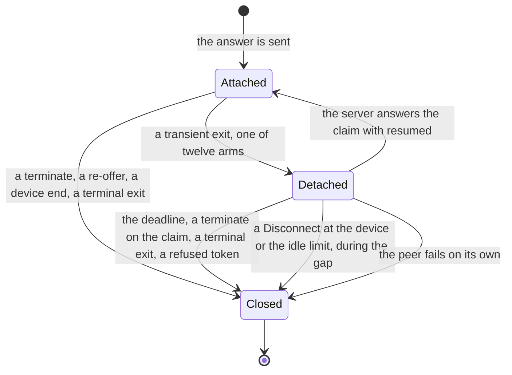
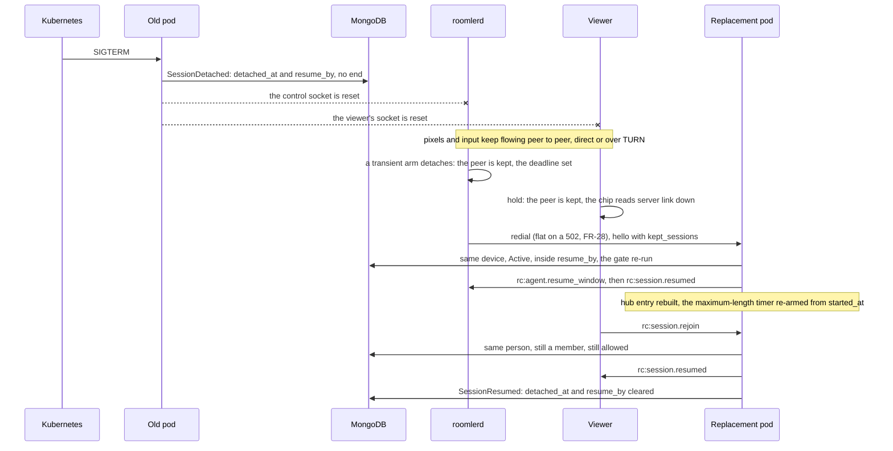
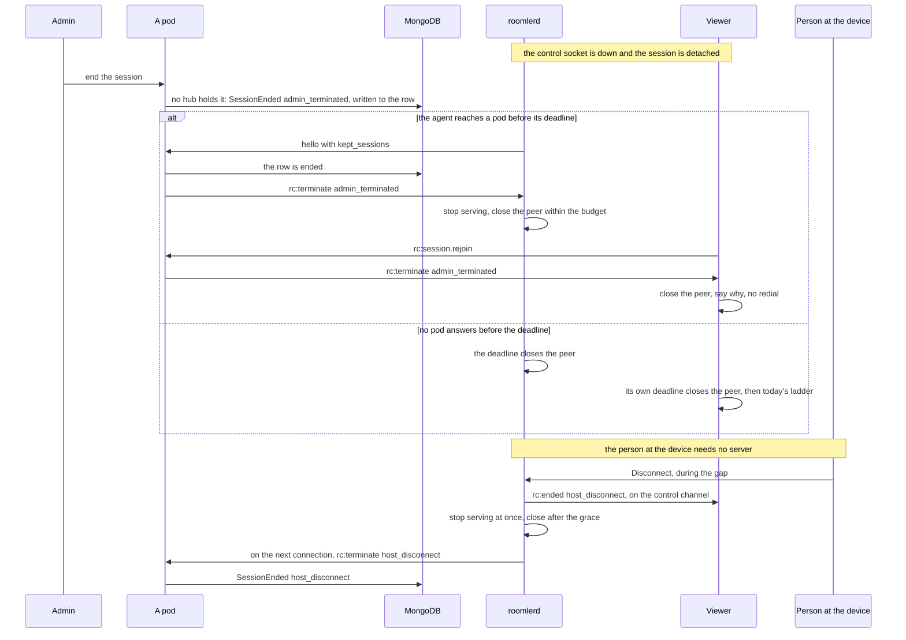

# FR-138: A server roll no longer ends a remote-control session — the session outlives its control socket

**Issue:** [#3604](https://github.com/gjovanov/roomler-ai/issues/3604) · **Status:** claimed 2026-11-09; a spec, nothing built; D1–D4 (§8) wait for the operator · **Owner:** the agent's signalling loop, the fleet hub and the remote module, the viewer's session page · **Anchors:** master `c200023ea`, a doc-level pin: every `file:line` below is at that commit, and a later PR does not shift them · **Opened by:** [FR-135](FR-135-one-rc-media-pipeline.md) D15 = C, the operator, 2026-11-02 · **Builds on:** [FR-28](FR-28-derp-drain-on-pod-roll.md) (the flat redial and the pre-pull: the reattach this FR waits through), R3 (`tunnel_peers_survive_reattach`: the same shape for QUIC tunnel peers), [FR-85](FR-85-hq-screen-recording.md) P3b-3 (a recording's re-attach grace), [FR-101](FR-101-rc-session-hygiene.md) (the limits a resumed session keeps), [FR-27](FR-27-consent-surfaces-and-desktop-companion.md) (consent and the host's Disconnect) · **Related:** #3429, [FR-22](FR-22-time-to-first-frame.md), [FR-52](FR-52-cross-org-remote-access.md), [FR-43](FR-43-macos-single-enrollment.md)

## Summary, for the operator

**Today** a server roll ends every live remote-control session: 9 of 9 in FR-28's read, 10 in FR-135's window,
9 of them inside a promote run. The pixels never crossed the server. Only the control socket dropped, and the agent
answers a dropped control socket by closing every peer. The page then opens a new session, which costs the person
6–24 s, a new row and, on a device that asks, a new consent prompt.

**After** a live session rides out the loss of its control socket for a bounded window (60 s, D1). The agent keeps
the peer, the server keeps the row, and both ends claim the same session again on whichever pod they reach. The
server decides at that claim whether the session may go on. A kick or a revoke issued during the gap ends the
session at the reconnect, and never later than the window.

**What it costs**: three sides change (agent, server, viewer) behind two switches that are off by default, the
server's window, which the viewer follows, and the agent's own. FR-28's three constraints each get a mechanism (§3). Four decisions: the window (D1), what the session may do
during the gap (D2), external sessions (D3), and how the agent's default flips (D4).

## 1. Goal

A server roll, or any other loss of the agent's control socket while the device stays up, no longer ends a healthy
remote-control session. The person at the viewer sees no new session, no new consent prompt and, on a direct or
TURN carrier, no gap in the picture. Every guarantee the session had stays: the server still decides who may
control the device, a kick still lands, and every WebRTC peer that really ends is still closed.

## 2. Evidence

[M] measured, [R] read from the code at the pin, *reasoned* where neither.

### 2.1 What a roll does to a session today [M]

| Read | What it found |
|---|---|
| FR-28, 14 rolls of 2026-10-26 to 10-31, from `agent_logs` and `remote_sessions` | **9 of 9** sessions Active at a roll ended `agent_disconnect`, 7 on `direct`, 2 on `derp`. A new session was Active 8.4–18.6 s after the cut, median 10.9 s |
| FR-28, the roll of 2026-11-02 12:43Z, 22 hosts | Every control socket died with `Connection reset without closing handshake`. Control-socket close to `control-WS reattached`: p50 7.8 s, p90 8.8 s, max 60.1 s (n 15) |
| FR-135 S19 and D15, a 71.9-hour window | 32 sessions ended `agent_disconnect`. 10 of them were a healthy host losing its control socket (9.24 h of sessions), and **9 of those 10 fell inside one of the window's 20 promote runs**. The agent logs `torn down peers + hid indicator overlays on ws disconnect` at +0.1–0.3 s and says hello again at +3.6–9.6 s. Each costs a person 6–24 s |
| FR-28, 2026-08-29, a session driven in a browser | A 2436 ms `video DC delivery gap` and a decode stall on an idle session, at a roll. This was FR-28's AC1, which moved here |
| #3582, filed 2026-11-08 | One controller's tab, 8 sessions across three promotes: each time the session ended at the roll and the page opened the next one by itself within seconds |
| The roll of `hosted-20261109-9192b6d`, 2026-11-09 (#3582's proof run, comment 6741179894) | The promote was dispatched at 13:18:39Z, the pods restarted at 13:19:25Z and 13:19:38Z, both Ready at 13:19:58Z. A live session to a Linux lab desktop on a direct or TURN carrier, live since 13:06:03Z, was cut. The page redialed in place: `rc.connect` `v=2 after_drop=true`, attempt 2 `WARN` at 13:19:41Z, attempt 3 `INFO` (first frame) at 13:19:42Z. A **new** `remote_sessions` row at 13:19:41.997Z, and the 13:06:03Z row ended |

### 2.2 The mechanism, in the code [R]

The agent closes every peer on every way its control socket can end. `close_all_peers`
(`agents/roomlerd/src/signaling.rs:6340`) drains the connection's session map, ends each session's recording
(`:6362`), takes its banner down (`:6363`) and closes the peer within the 5 s budget (`:6368`, `PEER_CLOSE_BUDGET`
at `:204`). Seventeen arms call it, and the loop that owns the map returns after each:

| Arm | Call | What ended | Kind |
|---|---|---|---|
| shutdown: a stop, an update, a restart | `signaling.rs:2228` | the process | terminal |
| the computer is going to sleep (FR-55 P4) | `:2257` | the machine | terminal |
| a resume from suspend, ≥ 120 s napped | `:2312` | the machine, a while ago | terminal |
| no inbound frame within the RX deadline | `:2344` | the path | transient |
| net-change probe, two strikes | `:2374` | the path | transient |
| net-change re-probe ping failed | `:2394` | the path | transient |
| keepalive ping unanswered, two strikes | `:2428` | the path | transient |
| keepalive ping send failed | `:2449` | the path | transient |
| net-change probe ping send failed | `:2487` | the path | transient |
| heartbeat send failed | `:2726` | the path | transient |
| a peer's message could not be flushed | `:2792` | the path | transient |
| pong reply failed | `:3309` | the path | transient |
| the server closed the socket | `:3319` | the server's end | transient |
| a read error | `:3328` | the server's end. **A roll takes this arm**: 22 of 22 hosts on FR-28's 12:43Z read logged `Connection reset without closing handshake` | transient |
| pong RTT degraded, two strikes | `:3367` | the path | transient |
| `rc:goodbye`: deleted, refused, displaced | `:4949` | the device's standing | terminal |
| FR-40's key rotation | `:6221` | the device's identity | terminal |

The map is the connection's own (`let mut peers` at `:2067`), and so is the sender every peer was built with
(`outbound_tx` at `:1950`, held as `AgentPeer::outbound`, `agents/roomlerd/src/peer.rs:299`). A connection that ends
takes both with it, so nothing can outlive it unless it is moved out first. The loop that redials (`run`, the call at
`signaling.rs:1226`) already keeps what must span reconnects: the host's Disconnect channel, the idle channel, the
carrier channel, FR-28's flat redial (`:1524`).

**The server** ends the session on both sockets' loss, from memory that is the pod's own. When the agent's socket
goes, `unregister_agent` (`crates/modules/fleet/src/hub.rs:1125`) calls `end_agent_sessions` (`:1148`), which
terminates each of the agent's sessions as `agent_disconnect` (`:1154-1165`). When the viewer's socket goes, the user
socket's cleanup (`crates/api/src/ws/handler.rs:292`) calls `unregister_controller` (`hub.rs:1299`), which terminates
the sessions that connection owns as `controller_hangup` (`:1334`). When the agent registers again, the hub reaps any
Active session it still holds for it, on a premise stated in its comment: "An ACTIVE session cannot survive the
agent's control-WS death: every agent-side connection-teardown path closes its peers" (`:1048-1079`). That premise is
the one this FR changes.

The row follows the hub through the audit stream. `Hub::terminate` removes the session from the pod's map and audits
`SessionEnded` (`hub.rs:2427`, `:2473-2481`), and the audit sink projects every audit event onto `remote_sessions`
(`crates/remote_control/src/audit.rs:10-16`, the end at `:216`). ⚠️ `Hub::terminate` on a pod that does not hold the
session returns at once and writes nothing (`hub.rs:2440-2442`). An admin's end therefore also broadcasts a control
event that "only acts on a hub that actually holds the session" (`crates/modules/remote/src/routes.rs:110`, `:123`).
A session no pod holds cannot be ended that way, which is exactly the state a kept session would be in during a gap.

A dying pod may also write nothing at all. Its shutdown cancels every agent socket with `notify_waiters`
(`hub.rs:1283`), the primitive whose lost signal for a busy loop `crates/api/src/state.rs:520-530` documents, so a loop
that is mid-work at that instant runs no teardown. The audit sink batches for up to 200 ms
(`crates/remote_control/src/audit.rs:40`) and nothing flushes it at exit. A row that misses its `SessionEnded` stays
Active until its 25-month TTL: no sweep closes rows a dead pod left open.

**The viewer** (`ui/src/composables/useRemoteControl.ts`, "the page" below) keeps its peer through its own socket's
loss: only a chip changes, `connected · server link down` (`signalling_offline` at `useRemoteControl.ts:980`,
worded at `ui/src/views/remote/RemoteControl.vue:5203`). What ends the session is a transport signal or a terminate,
and each one reads as a drop: the control channel closing (`useRemoteControl.ts:10916-10920`), the peer `failed`
(`:10215-10220`) or `disconnected` past 4 s (`:276`), and `rc:terminate` with `agent_disconnect` or `error`
(`:347-350`). The redial is a full new session: `rc:session.request` names no old session (`:11539-11544`), and the
ladder runs 250 ms to 8 s and never gives up (`:180`, `:195`). Once the page is redialing it ignores every
`rc:terminate` (`:9294`), so a deliberate end that lands after a transport signal is never seen.

### 2.3 What else a roll costs today [R, reasoned]

- **A screen may lock.** `close_all_peers` takes each session's banner down, and that is FR-99's session end:
  `indicator.hide_session` calls `lock_on_end::session_ended` (`agents/roomlerd/src/indicator/mod.rs:329`), which
  locks the computer when the last live session ends "whatever ended it" (`agents/roomlerd/src/lock_on_end.rs:246`).
  On a device set to `always`, or `auto` on a session that began locked or unattended, a roll locks the screen
  under a person who is still working. Reasoned from the code, not measured.
- **A recording detaches.** It survives through FR-85's 60 s re-attach grace
  (`agents/roomlerd/src/recording/manager.rs:166`) and is picked up by the redial's new session, so nothing is lost,
  but its banner reads "reconnecting".
- **The person at the device is asked again.** On a device in `prompt` mode the redial's new session raises a new
  prompt, and an unanswered one ends in `consent_timeout`, which is terminal (`useRemoteControl.ts:339-341`). On an
  unattended device in that mode, a roll ends remote access until someone is at the machine. Reasoned from the code.
- **No instrument sees the gap.** A session that painted and then dropped leaves no viewer record of the drop: the
  `rc.connect` records belong to the redial's attempts, under the new session's id. The `video DC delivery gap`
  warning is console-only, floored at 1500 ms (`ui/src/workers/rc-video-channel.ts:18`), and reset on each new path.

### 2.4 What the code already has [R]

Every piece this FR needs has a precedent in the repository. None of them covers an RC peer.

| Precedent | What it does | Where |
|---|---|---|
| R3, tunnel peers survive a reattach | On a transient exit the agent parks its QUIC tunnel peers in a per-tenant stash capped at 32, and the next connection reclaims them; a peer whose client left while parked is closed, not re-adopted (#1754). The server waits `ROOMLER__RC__TUNNEL_GRACE_SECS` before terminating a tunnel session whose agent dropped, and keeps it if the agent is back on this pod or on another (a fresh foreign Redis presence). Both default off | `signaling.rs:6483`, `:6488`, `:6524`, `:6543`; `crates/modules/network/src/tunnel.rs:1929`, `:1937`; `crates/config/src/settings.rs:978` |
| FR-85 P3b-3, a recording's re-attach grace | A recording whose session goes is detached, not stopped: its banner stays, marked reconnecting; only the same controller picks it up; after 60 s with nobody back it stops; the owner's off still stops it meanwhile | `agents/roomlerd/src/recording/remote.rs:52-66`; `manager.rs:166` |
| The session watchdog (rc.190) | Ends a session whose peer never connects within 45 s or sits `Disconnected` for 20 s, and closes it itself | `peer.rs:1066`, `:1083`, `:1084`, `:1147` |
| FR-43's re-pointed sender | The delegation host's channel to the control socket is set again on each connect | `agents/roomlerd/src/delegate.rs:884` |
| A report kept for the next connection (FR-40 P1c) | A key-rotation report is queued so the next healthy connection says it again | `signaling.rs:3486`, `:3492` |
| The two-pod test harness | `TestApp::spawn_pair` runs two in-process pods on one Redis; a controller on one pod drives an agent on the other, and a kick on one pod reaches the other's hub | `crates/tests/src/cluster_tests.rs:183`, `:442` |

⚠️ **R3's server grace does not survive a roll.** It is a timer on the pod that saw the drop
(`tunnel.rs:1937` onward), and at a roll that pod is the one going away. A session that must outlive its pod needs
its state somewhere the replacement can read: the row.

### 2.5 Found, not changed

Read while mapping the lifecycle. Each belongs to its own owner, and this FR's phases either route around it or carry
it to the docs phase.

| Finding | Where | What this FR does with it |
|---|---|---|
| `AgentPeer`'s `Drop` releases the session's bookkeeping but never closes its `RTCPeerConnection` | `agents/roomlerd/src/peer.rs:1973` | The reason the table may never drop a peer it has not closed (§4.2) |
| The shutdown hook cancels agent sockets with `notify_waiters`, which loses the signal for a busy loop, so a pod may die without ending or detaching anything | `crates/modules/fleet/src/hub.rs:1283` | Routed around: the claim decides, and registration and the sweep close what the dead pod left (§4.4) |
| No sweep ends a `remote_sessions` row that a dead pod left Active | `crates/remote_control/src/audit.rs:216` (the end is written only from the audit stream) | Closed by the registration read and the sweep (§4.4) |
| Removing a member, or the right to control a device, never ends a live session; the gate runs once, at the request | `crates/modules/remote/src/controller.rs:729` | The claim re-runs the gate (§4.4); between rolls, unchanged |
| An admin's end shows the viewer no reason, and its audit row names no actor | `useRemoteControl.ts:957-958`; `hub.rs:2473-2481` | The viewer gains a sentence in P1. The actor is not this FR's |
| A TURN credential lives 600 s and bounds its allocation's whole life, by the code's own comment | `crates/remote_control/src/turn_creds.rs:57-63` | A resume mints nothing and keeps the allocation it had. §6 starts each TURN session shortly before the roll |
| `docs/multi-pod-scale-out.md` says cross-pod frame relay is rejected permanently, names `rc:session.rehome`, and places the cluster code in `crates/api/src/cluster/`; the relay ships and answers a miss first, the rehome reply is `rc:error agent_on_other_pod` and only the relay's fallback (`crates/modules/remote/src/controller.rs:379`), and the code is in `crates/core/src/cluster/`. Its failure table says an agent socket's loss ends that pod's sessions | `docs/multi-pod-scale-out.md:35`, `:50`, `:73`, `:106`, `:111-115`, `:182`, `:197`, `:206`; `crates/modules/remote/src/relay.rs:3-31` | Corrected in the PR that lands this spec, line for line, where the doc is already wrong: the paths, the rehome reply and the relay. The failure table at `:182` is true until P3, so the docs phase rewrites it |
| Two comments on the viewer still promise a give-up the ladder no longer has | `useRemoteControl.ts:177-178`, `:9472-9475` | The docs phase, with P1's viewer change |
| Four server comments point at code that no longer exists: `ws/rc_relay.rs`, `Self::run_consent_flow`, `crates/api/src/ws/tunnel.rs`, and `crates/api/src/ws/handler.rs:189` with `crates/remote_control/src/hub.rs` | `crates/modules/fleet/src/hub.rs:815`, `:1393`, `:2553`; `crates/remote_control/src/signaling.rs:2628-2630` | P1, which edits both files |

## 3. FR-28's three constraints, and what holds each

| Constraint | What holds it in this design |
|---|---|
| **1. The Hub is pod-local**, so a socket comes back to a different pod | Nothing in memory has to survive. The row is the session's state between pods: it stays Active, and carries `detached_at` and `resume_by` when the dying pod gets to write them. The agent's claim and the viewer's rejoin carry the session id to whichever pod they reach, that pod rebuilds its hub entry from the row, and the existing cross-pod relay joins a viewer on one pod to an agent on another (§4.4) |
| **2. `close_all_peers` is what stops a peer leaking its sockets** | It stays the close for every terminal exit. A kept peer moves from the connection to the org loop's session table, which closes it on every real end, through the same `close_within_budget` (`signaling.rs:311`), with a hard deadline that no reconnect extends (§4.2). Off is `close_all_peers` at every arm, byte for byte |
| **3. Consent and kick must still reach the session** | A resumed session is the same session, so its consent stands, decided once at its start. Every server-side end writes the row, which the claim reads, so an end issued during the gap is enforced at the reconnect. The person's Disconnect needs no server: the agent serves it during the gap and reports it at the reconnect (§4.6) |

## 4. Design

### 4.1 What survives, and for how long

| | Kept | For how long |
|---|---|---|
| A live session's peer on the agent: the WebRTC connection, its media pumps, its channels, its input registration, its banner, its idle clock, its recording | yes | until it is re-claimed, or the window from the moment it was detached, whichever comes first |
| A session still waiting for consent or for its offer | no, as today (#2416: `signaling.rs:410` withdraws the prompt) | — |
| An external session (FR-52) | no, as today (D3) | — |
| The viewer's peer and its decode worker | yes | until `resume_by` plus 5 s, then today's redial |
| The row | stays Active, with `detached_at` and `resume_by` | until resumed, ended, or swept past `resume_by` |
| Anything in the dying pod's memory | no | — |

**The window** is the server's: `ROOMLER__RC__SESSION_RESUME_SECS`, 0 (off) until P3 sets it to what D1 picks (60 s
recommended), announced to each capable agent on its connection. The agent caps it at 120 s whatever the server says, so a wrong setting cannot keep
a peer for an hour. A peer is kept only when three things hold: the agent's switch is on, the server it last spoke to
announced a window, and the session was live.

**Which exits keep peers.** The twelve transient arms in §2.2 detach. The five terminal arms close as today, and so
does a refused token on the next dial (`ConnectError::AuthRejected`): the device's credential is gone, so its
sessions go with it. A resume from suspend stays terminal: after a nap of at least 120 s (`RESUME_SKEW_MIN`,
`signaling.rs:598`) the viewer's ICE consent has long failed.

### 4.2 Who owns a kept peer

The session map moves out of the connection into the org loop that redials (`run`), beside the channels that already
span reconnects. Each session in it is either **attached** to the current connection or **detached** with a deadline.
The connection borrows the table. A transient exit detaches every attached session instead of calling
`close_all_peers`; a terminal exit calls it, and it closes the detached ones too.

Each arrow into `Closed` goes through `close_within_budget`, so an overrun still says so
(`signaling.rs:311`, #1738). Nothing may leave the table any other way: `AgentPeer`'s `Drop` does not close the
peer connection (`peer.rs:1973`), so a kept peer that is dropped is exactly the leak CLAUDE.md warns of. Ownership
rules:

- **The deadline is hard.** It is set once, at the detach, to the window. Reconnecting does not move it, and a claim
  the server has not answered by then is a claim refused. Between connections, `run`'s backoff wait gains the
  earliest deadline as an arm, so a peer is closed on time while no connection exists; a connection that is up serves
  the same deadline in its own loop until the claim is answered.
- **The person at the device is served during the gap.** The backoff wait also drains the Disconnect and idle
  channels, which `run` already lends each connection so that they span reconnects (`signaling.rs:1722`, `:1739`).
  It stops serving at once, says `rc:ended` on the session's control channel, closes after the grace, and queues
  `rc:terminate` with the reason for the next connection, the way FR-40 keeps its report (`signaling.rs:3486`).
- **The sender is re-pointed, not owned.** A kept peer's sender (`AgentPeer::outbound`) is pointed at each new
  connection, the way FR-43 points the delegation host (`delegate.rs:884`). While detached it points nowhere: the
  peer's own `Terminate` on `Failed` (`peer.rs:991`) has no socket to reach, so the table closes a failed peer
  itself and queues the end for the next connection. ⚠️ `await_prompt_or_socket_end` (`signaling.rs:410`) reads the
  connection's own sender closing to withdraw a pending prompt, so the connection keeps its own sender for that.
- **Bounded.** A detached session still counts against the device's capacity (`rc_max_sessions`,
  `agents/roomlerd/src/encode/caps.rs:4830`): in the table, and in the hub's busy gate from the moment of the claim
  (`hub.rs:1711-1712`). A request that would exceed it is refused as busy, never served beside a kept peer.
- **The banner, the lock and the recording follow the session, not the socket.** A detach leaves the banner up,
  since the session is live and its pixels still flow, and it neither calls `lock_on_end` nor detaches a recording.
  Only the real end takes the banner down (`signaling.rs:6363` today), so only the real end can lock the screen.
- **A delegated session** (a supervised Mac, FR-43) keeps its peer in the GUI worker, while the daemon's socket
  carries its signalling (`signaling.rs:1977` drops a worker's reply while no socket is up). The daemon claims it;
  the worker keeps and closes it. P2b carries this, and until it ships a delegated session ends as today.

### 4.3 The wire, all additive

| Message | Direction | Carries | An older peer |
|---|---|---|---|
| `rc-resume` in `AgentCaps.rpc` (a `RpcCap` verb, equality-matched) | agent → server, in the hello | "this device keeps its peers across a socket loss" | ignored, as every unknown verb is |
| `kept_sessions` on `rc:agent.hello` (`crates/remote_control/src/signaling.rs:506`) | agent → server | the ids of the sessions it detached | an older server ignores the field (no `deny_unknown_fields`); its sessions end at the deadline |
| `rc:agent.resume_window {secs}` | server → agent | the window, sent once after the hello to a capable agent | never sent to one without the verb |
| `rc:session.resumed {session_id}` | server → agent and viewer | the claim is accepted | — |
| `rc:terminate` | server → agent and viewer | a claim refused, with the reason; the existing message | as today |
| `rc:session.detached {session_id, resume_by}` | server → viewer | the device's control socket dropped, the session is kept | an older viewer ignores it and redials as today |
| `rc:session.rejoin {session_id}` | viewer → server | the viewer claims its session | an older server drops it, and the viewer's own deadline falls back to the redial |
| `resume_secs` on `rc:session.created` | server → viewer | this session may be held | absent: the viewer never holds |
| `rc:ended {reason}` on the session's control channel | agent → viewer, peer to peer | the person at the device ended it during the gap | an older viewer reads a drop and redials, as today |

The new wire names re-record the composition baseline (`COMPOSITION_UPDATE=1`, saying why).

### 4.4 The server: keep the row, rebuild the rest

The server keeps nothing in memory across a gap. It keeps the row, and it rebuilds the rest on the pod that the claim
reaches. That keeps `docs/multi-pod-scale-out.md`'s fourth principle, "No live-state handoff anywhere" (`:29-31`):
the new pod folds the session back from the row through a join path, the claim and the rejoin.

**At the drop, best effort.** When the socket of an agent that advertised `rc-resume` goes, and the window is on, the
hub does not call `end_agent_sessions` for its live sessions. It audits a new `SessionDetached` instead, which the
sink projects onto the row as `detached_at` and `resume_by` (now plus the window), and it tells each session's viewer
`rc:session.detached` if the viewer's socket is still up. The controller's side is the same: when a viewer's socket
goes, `unregister_controller`, and the cross-pod relay's `rc.conn_closed`, detach a resumable session instead of ending
it as `controller_hangup`; the hub that holds it keeps it with no controller until the rejoin or `resume_by`, and
`create_session`'s orphan reap (`hub.rs:1522-1555`) spares it meanwhile. A session still waiting for consent or for
its offer ends as today. ⚠️ A dying pod may write none of this (§2.2), so nothing below depends on it.

**The claim, which decides.** It rides the agent's hello, so it is atomic with registration. For each id in
`kept_sessions`, the pod that receives it answers `rc:session.resumed` only if all of these hold, and `rc:terminate`
with the reason otherwise. A row with no `detached_at`, left by a pod that died without a word, is claimable too:
the agent's own deadline bounds it.

| Check | Fails as |
|---|---|
| The row exists in the agent's tenant, names this agent, is Active, and is not ended | `agent_disconnect` |
| `resume_by` has not passed, when the row carries one | `agent_disconnect` |
| The device is not removed or quarantined: the upgrade already loads the row and refuses a missing one with 401 (`crates/modules/fleet/src/auth_agent.rs:10-11`, `crates/modules/fleet/src/socket.rs:1441-1446`) | the socket is refused before any claim; the agent closes its kept peers at a refused token, and at the latest at its deadline (§4.1) |
| The controller is still a member of the org and still holds what a new request needs on this device, re-run through the gate a request uses (`resolve_session_authz`, `crates/modules/remote/src/controller.rs:729`) | `admin_terminated` |
| The session is not external (D3) | `agent_disconnect` |
| The FR-115 slot is claimed again under the session's own id. A lease lives 90 s (`crates/core/src/cluster/session_slots.rs:37`), longer than the window, and a replacement on the same node shares the dead process's pod id, so the claim finds its own lease or drops it as stale (`crates/modules/remote/src/slots.rs:12-20`) | the slot refusal a request gets |

Consent is the one check not re-run: the session is the same one the device already decided on, at its start. Today
a roll costs the same gate anyway, through the redial's new request, so the re-run takes nothing a roll does not.

**Registration reads the collection, not the pod's memory.** The pod reads the agent's Active rows (an agent holds at
most its capacity) and ends, as `agent_disconnect`, every one the claim does not name. An agent with no
`kept_sessions` is therefore reaped as today, and more completely: today's reap reads only the pod's own map
(`hub.rs:1048-1079`), so after a roll it finds nothing, and a row the dead pod never ended stays open.

**What the pod rebuilds** from the row and the claim, on whichever pod it is:

- **Routing**: the hub entry, with the agent's connection, and the viewer's once it rejoins. A viewer whose socket
  lands on another pod reaches the agent's pod through the existing cross-pod relay, which already lets "a controller
  whose WS sits on pod A … run a session with an agent homed on pod B" (`crates/modules/remote/src/relay.rs:7-9`).
- **The limits**: FR-101's maximum length is a timer on the pod that holds the session, armed when it went live
  (`docs/fr/FR-101-rc-session-hygiene.md` §3c), so a resume re-arms it from the row's `started_at`, never from the
  resume. The idle limit lives on the agent, with the peer it keeps.
- **The capacity count** includes resumed sessions from the moment of the claim, so a new request cannot slip into a
  slot a kept session holds.
- **The audit**: `SessionResumed`, which the sink projects by clearing `detached_at` and `resume_by` and counting the
  resume on the row. `SessionEnded` stays the only end, with today's reasons, so every reader of `end_reason` keeps
  working.

**The sweep.** One pod at a time, as the presence sweep already runs (`crates/modules/fleet/src/presence.rs:13-14`),
ends Active rows whose `resume_by` has passed, as `agent_disconnect`, through `SessionEnded`. It also ends an Active
row with no `resume_by` whose device the presence sweep has found offline for longer than the window: the pod that
died without a word, for a device that has not come back. Nothing in memory has to outlive the pod that saw the drop,
which is where R3's grace falls short (§2.4).

⚠️ **An end wins over a resume.** Every end writes the row conditionally on its being Active, then publishes today's
control event. A resume commits with a conditional update on Active and inside `resume_by`, and reads the row once
more after its hub entry is built. A resume that loses the race answers `rc:terminate`. An end that lands just after
the commit is found by that re-read, or reaches the hub by the control event, as any kick does today.

### 4.5 The viewer: hold, then rejoin

The page already keeps its peer through its own socket's loss (§2.2). It needs to stop treating a roll as a drop,
and to claim its session back.

- **Hold.** On a session the server called resumable (`resume_secs` on `rc:session.created`), the page holds through
  its own socket's loss and through `rc:session.detached`: the phase stays `connected`, so the stage stays mounted
  (it renders only there, `RemoteControl.vue:1313-1314`), the chip reads `connected · server link down`, and the
  peer, its channels and the decode worker are kept. A kept peer on the agent fires no transport signal, so none of
  today's redial triggers runs.
- **Rejoin.** When its socket is back (`ws:reconnected`, `ui/src/stores/ws.ts:178`), the page sends
  `rc:session.rejoin {session_id}`. The server checks the row names this person, then re-runs the request's gate.
  `rc:session.resumed` clears the chip. `rc:terminate` ends the session with its reason, as today, and a retryable
  reason starts today's ladder. A rejoin that arrives before the device's claim is answered `rc:session.detached`
  again, and the page asks once a second until `resume_by`.
- **Fall back.** A transport signal during the hold keeps today's meaning: the peer failed, so the page redials. With
  no answer by `resume_by` plus 5 s the page closes its peer and starts today's ladder. That is the viewer's
  deadline, and an older server that never answers costs no more than it.
- **The person's Disconnect during the gap** arrives as `rc:ended` on the control channel, and the page closes as it
  does for `host_disconnect` today: no ladder, the replay arguments dropped (`useRemoteControl.ts:9315-9327`).
- **A record of its own.** A resumed session writes no `rc.connect` record, because no attempt starts. The page sends
  `rc.resume` (`v`, `outcome` resumed, ended or expired, `gap_ms` from the last frame painted before the cut to the
  first after it, `ws_down_ms`) through `/api/log/browser`, the road `rc.connect` takes
  (`ui/src/composables/rcConnectTimingUpload.ts:82`). It is AC2's instrument.
- **The stale-build reload is untouched.** #3582's policy takes over only a `redialing` session, and a held one reads
  `live` (`useRemoteControl.ts:452-454`), so it gets the banner, never a reload in the middle of a hold.

### 4.6 A kick or a revoke during the gap

During a gap no pod holds the session, so an end cannot be pushed to it. It waits in the row, and the claim reads it.

| Issued during the gap | Today, were the session kept | With this FR |
|---|---|---|
| An admin ends the session (`routes.rs:68`) | the local terminate and the control event both find no hub, and the end is lost | the pod that takes the request writes the end to the row when no hub holds the session; the claim and the rejoin read it and get `rc:terminate admin_terminated` |
| The device is removed or quarantined | — | the next upgrade is refused (§4.4); the agent closes at the refusal, or at its deadline |
| The controller loses the org or the right to control the device | — | the claim's re-run gate refuses it (§4.4) |
| The person at the device presses Disconnect | the kill arm runs only inside a connection | the table serves it at once (§4.2): stop serving, `rc:ended` to the viewer peer to peer, close after the grace, and `rc:terminate host_disconnect` sent on the next connection |
| The session reaches its idle limit | as above | as the Disconnect, with `idle_timeout` |
| The session passes the org's maximum length | the timer died with its pod | the claim answers `rc:terminate idle_timeout` with `limit: max_duration` |

**The bound.** An end issued during a gap takes effect at the claim. On a roll that is the reconnect: p50 7.8 s today,
and FR-28 expects about 3 s once its flat redial and pre-pull are on. It is never later than the agent's deadline,
because no claim the server has not answered survives it. The viewer learns the reason at its rejoin, or closes at its
own deadline. Until then the controller keeps the control it had (D2).

### 4.7 A roll, end to end

### 4.8 A revoke during the gap

### 4.9 Leak guarantees

1. Every kept peer is closed by exactly one path in §4.2's diagram, each through `close_within_budget`.
2. No detached peer lives past its detach plus the window plus `PEER_CLOSE_BUDGET` (5 s): at most 125 s with the
   agent's cap.
3. The table never holds more sessions than the device's capacity.
4. The viewer closes its `RTCPeerConnection` on every end it closes on today, and at its own hold deadline.
5. Off is today: with the switch off, or no window announced, every arm calls `close_all_peers` as at the pin.
6. The field signature stays readable: the daemon's UDP socket count returns to its baseline after each real end,
   and each `detached` line is followed by one `resumed` or one `closed` line for the same session.

### 4.10 The commitments

- **The server coordinates and never carries plaintext.** Nothing here routes media through a pod. The claim and
  the rejoin carry a session id; the pixels and keys keep the path they had.
- **Authorization stays server-side, bounded during the gap.** The agent never decides that a session may go on: it
  keeps a peer only while it waits for the server's answer, and the deadline ends the wait. Every claim re-runs the
  checks a new request runs, consent aside (§4.4).
- **Nothing weakens the leak invariant.** A peer is still closed on every end, and the only new owner (the table)
  has a deadline, a bound and a test per path.

## 5. Phases

Each phase ships dark and is proven RED first. The server and the viewer ride the hosted image; the agent rides an
agent release. FR-135's debt ledger (`docs/plans/rc-media-debt.tsv`) tracks the media path's knobs, and these
switches sit in the control path, so each carries its retire condition here instead.

| Phase | What | Lives in | Kill switch, default | RED | GREEN | Retires |
|---|---|---|---|---|---|---|
| **P0** | The roll read (§6) as a script, and the baseline on today's deploy | `scripts/` | none: a read | The §6 roll on the current deploy: every live session ends `agent_disconnect`, the page redials (`after_drop`), a new row, the media gap is the redial's | none: it is the baseline | — |
| **P1** | The server and the viewer: the wire (§4.3), the durable detach, the claim and the rejoin with the checks re-run, the sweep, the ends of a detached session, the audit kinds, the viewer's hold | hub, remote module, `crates/remote_control`, `useRemoteControl.ts`, the composition baseline | `ROOMLER__RC__SESSION_RESUME_SECS`, **0**: the hub announces no window, ends a session at a socket loss as today, and answers any claim with `rc:terminate`; the viewer never holds | Integration tests on `TestApp::spawn_pair`, written first, fail on the pin: an agent's socket drop ends the row `agent_disconnect` | The same tests pass with a window: the claim on pod 2 resumes, the viewer rejoins through pod 2, a kick on pod 2 during the gap ends it at the claim, an unclaimed session ends at the sweep, an agent without the verb ends as today, a claim for another device's session is refused. In the field, after the promote, the §6 roll with the window at 0 reads as P0, and again at 60 with no agent advertising the verb | Stays: it is the window, and 0 is off |
| **P2a** | The agent keeps its own sessions: the table in `run`, the twelve detaching arms, the deadline, the person's Disconnect and the idle limit during the gap, `rc:ended`, the queued end, the claim in the hello, the re-pointed sender, the verb advertised only with the switch on, and one log line per detach, resume and close | `signaling.rs`, `peer.rs`, the config | `rc_sessions_survive_reattach`, or `ROOMLERD_RC_SESSIONS_SURVIVE_REATTACH`: **off**. Device-side and not pushable, as `ws_flat_redial` and `tunnel_peers_survive_reattach` are. Read once per connection; on, it still keeps nothing unless the server announced a window | A unit test per arm, written first, shows each of the seventeen closes every peer at the pin | The twelve detach and the five close; the deadline closes; a Disconnect in the gap closes and queues its end; a refused token closes; the bound holds. In the field, the release with the switch off reads as P0 | Stays as the device's off switch after P4 |
| **P2b** | The supervised Mac: the daemon claims a delegated session, the GUI worker keeps and closes its peer, and the claim's answer reaches the worker on the delegation channel | `delegate.rs`, `delegate_worker.rs` | the same switch | P3's read on a supervised Mac: its delegated session ends while P2a's own sessions survive | It survives too | With the switch |
| **P3** | The field flip: production's window at 60, the switch on for at least two hosts of each OS class, standing-consent devices and test guests only | config | the window back to 0 (it lands with the pods it rolls); the switch off on a device | P0's read | §6's roll reads AC1–AC4 | — |
| **P4** | The agent's default flips on, staged by class (D4) | an agent release | the switch, per device; the window, for the fleet at once | The P3 hosts against the fleet in one roll | AC7: a week of rolls with no `agent_disconnect` end inside a promote run on hosts with the switch on | — |
| **Docs** | §7's AC8: `docs/remote-control.md`, `docs/multi-pod-scale-out.md`, `docs/deployment.md`, the operator docs for both switches, the index row | docs | none | — | Written with each phase; the field numbers come with P3 | — |

⚠️ **Either half alone is inert, by construction.** The agent keeps nothing unless its server announced a window,
and the server detaches nothing unless the agent advertised the verb, which it does only with its switch on. The verb
is the agent's promise and the window is the server's, so whichever half ships first changes nothing. P3 needs both.

## 6. The field read

The same read for every RED and GREEN, so that they compare.

1. **Sessions.** One live session on each carrier, `direct`, `turn` and `derp` (FR-102 P9c's `remote_sessions.carrier`),
   to a Windows, a Linux and a macOS host, each started a few minutes before the roll (§2.5's TURN line). Standing-
   consent devices and test guests only, never a corporate laptop without its owner's agreement. Read the open
   sessions before the roll: a roll ends every one of them today.
2. **Before.** On each host, the daemon's UDP socket count, and the `remote_sessions` rows of the hosts.
3. **The roll.** `kubectl rollout restart deploy/roomler2`, the timestamps of both waves from the pods.
4. **After.** Per session: the rows (a new one, or the same one with its `detached_at` gone); the viewer's `rc.connect`
   records with `after_drop`; any consent prompt raised; the agent's `detached`, `resumed` and `closed` lines; and
   the media gap. No record measures the gap today (§2.3), so the RED reads it from the old row's `ended_at` to the
   redial's `first_frame` record, and the GREEN from `rc.resume`'s `gap_ms` (§4.5).
5. **After the end.** Each session ended by hand; five minutes later the daemon's UDP socket count again. It must be
   back at the step 2 baseline: that is the leak signature.

## 7. Acceptance criteria

- [ ] **AC1, a roll keeps the session.** Through §6's roll, every live session on `direct` and `turn`, to a Windows,
  a Linux and a macOS host, keeps its `remote_sessions` row (no new row, no end), the page records no `after_drop`
  redial for it, and the device raises no consent prompt. Shown RED first: today all of them end (FR-28's 9 of 9,
  and the 2026-11-09 roll).
- [ ] **AC2, the picture (FR-28's AC1, moved here).** On `direct` and `turn`, no gap above 500 ms in the frames the
  viewer paints across the roll, read from `rc.resume`'s `gap_ms`; 2436 ms was measured on 2026-08-29, and today a
  roll costs a new session. On `derp`, the session keeps its row and its gap is no longer than `/derp`'s own reattach
  plus 1 s. (FR-28's wording named the `video DC delivery gap` line, which is console-only and floored at 1500 ms,
  so it cannot read 500 ms.)
- [ ] **AC3, nothing leaks.** On each OS class the daemon's UDP socket count returns to its step-2 baseline within
  five minutes of each session's real end; every `detached` line is followed by one `resumed` or one `closed` line
  for the same session; no `peer close overran its budget` line names a kept peer.
- [ ] **AC4, the server still decides.** In integration tests, and once in the field on a test guest: an admin's end,
  the device's removal and the controller's removal from the org, each issued while the agent's socket is down, end
  the session within 5 s of the agent's next registration and never later than the window plus the close budget. A
  session nobody claims ends at the window as `agent_disconnect`. The person's Disconnect during the gap ends it at
  once, and the row records `host_disconnect`.
- [ ] **AC5, old meets new.** An agent without the verb, an agent with the switch off, a server with the window at 0,
  an older viewer, and a server rolled back to an older image during a gap each behave as today or end at the
  window, one test each, and the matrix is in the docs.
- [ ] **AC6, everything else still ends.** A shutdown, an update, sleep, a resume from suspend, `rc:goodbye`, a key
  rotation and a refused token each close every peer at once (a unit test per arm). A session not yet live, and an
  external one, end as today.
- [ ] **AC7, the class reads zero.** A week of production promotes after P4 reads no session ended `agent_disconnect`
  inside a promote run on a host with the switch on (FR-135 S19's first class). That answers FR-135's AC21 for its
  owner.
- [ ] **AC8, docs.** `docs/remote-control.md` gains a section on a session that outlives its control socket, with
  both sequence diagrams, the state diagram and the old-and-new matrix; `docs/multi-pod-scale-out.md` and
  `docs/deployment.md` say what a roll does to a session now; both switches are in the operator docs; and any page
  added gets its row in `docs/README.md`'s index.

## 8. Open decisions for the operator

| # | Question | Options | Recommend | Why, and what it costs |
|---|---|---|---|---|
| **D1** | How long may a session wait for its control socket? | A: 30 s. B: 60 s. C: 120 s | **B, 60 s** | It covers FR-28's p90 of 8.8 s many times over, and the old ladder's worst landing (+31 s on the control socket). It matches FR-85's re-attach grace, so a recording and its session wait alike. It is also the longest a kick can wait if no pod answers the device. A costs the slow tail of rolls; C doubles the worst case of a missed kick |
| **D2** | What may the controller do while the socket is down? | A: everything it could, until the server answers or the window ends. B: watch only, input held until the server answers. C: nothing, the picture frozen until then | **A** | On a roll the gap is the reconnect, 3–9 s, and every end the server issued meanwhile lands at the claim. The person at the device can end the session at any moment without the server. B and C make every roll visible to the person working, which is what this FR removes. A gives up up to the window of control after a kick that was issued while no pod could reach the device |
| **D3** | External sessions (FR-52)? | A: end at a socket loss, as today. B: resume, with the outsider's binding proven again | **A** | The outsider's authority is a login bound by MACs over both DTLS fingerprints; re-proving it on a new pod is a design of its own. The redial does not take an external session over today either (`docs/remote-control.md` §11.15). A costs outsiders a new login at a roll |
| **D4** | How does the agent's default flip? | A: after P3's GREEN, by class: test guests and standing-consent devices, then Linux and macOS, then Windows, then corporate and office hosts. B: never by default, a device opts in. C: one release, all at once | **A** | The switch keeps a peer the old code closed. A leak on a corporate laptop is the failure CLAUDE.md warns of first (a leaked peer once ate the ephemeral port range and took a host's DNS down), and those hosts have the least margin. A staged flip lets AC3 read on each class before the next. B leaves the fleet where it is; C bets the fleet on one read |

## 9. Out of scope

- **A process that ends**: an update, a restart, a crash, a worker swap (#3429). The peer's keys live in that
  process, so nothing here can keep its session. The shutdown arm stays terminal.
- **The machine sleeping**, and a resume from suspend.
- **A session not yet live**: a consent prompt or an offer in flight ends as today (#2416).
- **`/derp`'s own outage at a roll** (FR-28): a session on `derp` keeps its row here, and its picture waits for
  `/derp` to come back.
- **A cluster-wide hub.** The row and the two claims are enough; moving the hub's state into Redis is a larger change
  and this FR does not need it.
- **Tunnel, SSH and conference sessions.** Tunnels have R3; a meeting's media runs through the SFU in the pod and
  cannot outlive it.
- **External sessions** (D3), and a key rotation's reconnect.
- **Time to first frame** (FR-22): a session that survives never pays it again, but a new one pays what it pays.
- **Reloading the viewer's page.** The page's peer dies with it; #3582's resume covers that case.

## 10. Field log

| date | build | result |
|---|---|---|
| 2026-08-29 | 0.4.15 | FR-28: a 2436 ms `video DC delivery gap` and a decode stall on an idle session at a roll. FR-28's AC1, moved here |
| 2026-10-31 | the fleet of 10-26 to 10-31 | FR-28's RED: 9 of 9 sessions Active at a roll ended `agent_disconnect`, 7 on `direct`, 2 on `derp`; a new session Active 8.4–18.6 s after the cut, median 10.9 s |
| 2026-11-02 | 0.4.197, `hosted-20261102-b8c6d1b` | FR-28's RED for its AC3: control-socket close to `control-WS reattached` p50 7.8 s, p90 8.8 s, max 60.1 s, on 22 hosts |
| 2026-11-02 | FR-135 S19's window | 10 sessions ended on healthy hosts that lost their control socket, 9 inside a promote run, 6–24 s for a person each. D15 = C opens this FR |
| 2026-11-09 | `hosted-20261109-9192b6d`, from `hosted-20261109-5f8114a` | RED for AC1, #3582's proof run: the pods restarted at 13:19:25Z and 13:19:38Z and cut a live session to a Linux lab desktop, direct or TURN, live since 13:06:03Z. The page redialed in place, `rc.connect` `v=2 after_drop=true`: attempt 2 `WARN` at 13:19:41Z, attempt 3 `INFO` at 13:19:42Z. A new `remote_sessions` row at 13:19:41.997Z, and the 13:06:03Z row ended |
