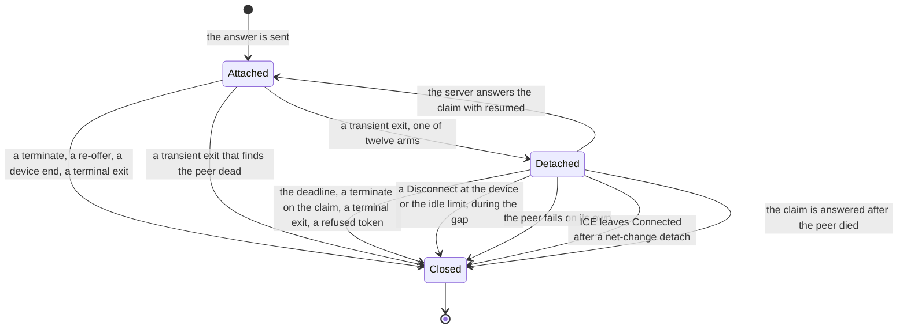
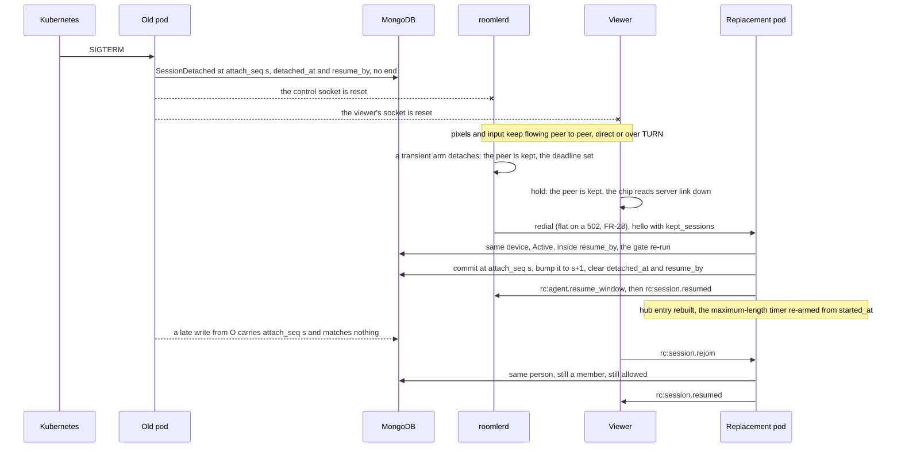
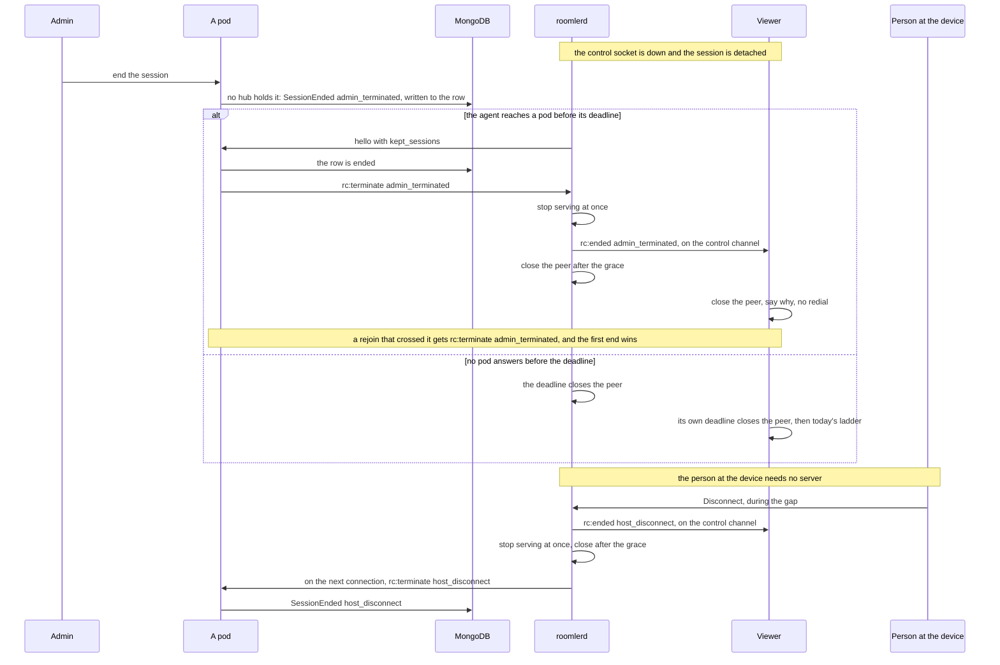

# FR-138: A server roll no longer ends a remote-control session — the session outlives its control socket

**Issue:** [#3604](https://github.com/gjovanov/roomler-ai/issues/3604) · **Status:** claimed 2026-11-09; D1–D4 (§8) decided by the operator 2026-11-09, each as recommended, and D5 on 2026-11-11; P0's baseline read 2026-11-09 (§10); built: P1a, P1b-1, P1b-2, P1c, P2a, P2a-2 and P2b (§5), and three follow-up PRs (#3641, #3658, and #3693, which carries D5); P3 in the field since 2026-11-10, with production's window at 60 for the devices in the resume scope: GREEN on `direct` and `turn` on Linux, Windows and macOS (macOS with P2b, agent 0.4.215), which meets AC1, and in every field cell of AC4 and AC9; on `derp`, a Windows session was kept through a roll on agent 0.4.216 (§10). AC1–AC6, AC8 and AC9 are ticked, and AC7 waits on P4 · **Owner:** the agent's signalling loop, the fleet hub and the remote module, the viewer's session page · **Anchors:** master `c200023ea`, a doc-level pin: every `file:line` below is at that commit, and a later PR does not shift them · **Opened by:** [FR-135](FR-135-one-rc-media-pipeline.md) D15 = C, the operator, 2026-11-02 · **Builds on:** [FR-28](FR-28-derp-drain-on-pod-roll.md) (the flat redial and the pre-pull: the reattach this FR waits through), R3 (`tunnel_peers_survive_reattach`: the same shape for QUIC tunnel peers), [FR-85](FR-85-hq-screen-recording.md) P3b-3 (a recording's re-attach grace), [FR-101](FR-101-rc-session-hygiene.md) (the limits a resumed session keeps), [FR-27](FR-27-consent-surfaces-and-desktop-companion.md) (consent and the host's Disconnect) · **Related:** #3429, [FR-22](FR-22-time-to-first-frame.md), [FR-52](FR-52-cross-org-remote-access.md), [FR-43](FR-43-macos-single-enrollment.md)

## Summary, for the operator

**Today** a server roll ends every live remote-control session: 9 of 9 in FR-28's read, 10 in FR-135's window,
9 of them inside a promote run. The pixels never crossed the server. Only the control socket dropped, and the agent
answers a dropped control socket by closing every peer. The page then opens a new session, which costs the person
6–24 s, a new row and, on a device that asks, a new consent prompt.

**After** a live session rides out the loss of its control socket for a bounded window (60 s, D1). The agent keeps
the peer, the server keeps the row, and both ends claim the same session again on whichever pod they reach. The
server decides at that claim whether the session may go on. A kick or a revoke issued during the gap ends the
session at the reconnect, and never later than the window.

**What it costs**: three sides change (agent, server, viewer) behind two switches that are off by default: the
server's window, with the list of orgs and devices it is announced to, and the agent's own switch. The viewer
follows the server. FR-28's three constraints each get a mechanism (§3). The operator took the four decisions on
2026-11-09, each as recommended: the window is 60 s (D1), the controller keeps full control during the gap (D2),
external sessions end as today (D3), and the fleet is staged server-side through the resume scope, corporate and
office hosts last (D4).

## 1. Goal

A server roll, or any other loss of the agent's control socket while the device stays up, no longer ends a healthy
remote-control session. The person at the viewer sees no new session, no new consent prompt and, on a direct or
TURN carrier, no gap in the picture. Every guarantee the session had stays: the server still decides who may
control the device, a kick still lands, and every WebRTC peer that really ends is still closed.

## 2. Evidence

[M] measured, [R] read from the code at the pin, *reasoned* where neither.

### 2.1 What a roll does to a session today [M]

| Read | What it found |
|---|---|
| FR-28, 14 rolls of 2026-10-26 to 10-31, from `agent_logs` and `remote_sessions` | **9 of 9** sessions Active at a roll ended `agent_disconnect`, 7 on `direct`, 2 on `derp`. A new session was Active 8.4–18.6 s after the cut, median 10.9 s |
| FR-28, the roll of 2026-11-02 12:43Z, 22 hosts | Every control socket died with `Connection reset without closing handshake`. Control-socket close to `control-WS reattached`: p50 7.8 s, p90 8.8 s, max 60.1 s (n 15) |
| FR-135 S19 and D15, a 71.9-hour window | 32 sessions ended `agent_disconnect`. 10 of them were a healthy host losing its control socket (9.24 h of sessions), and **9 of those 10 fell inside one of the window's 20 promote runs**. The agent logs `torn down peers + hid indicator overlays on ws disconnect` at +0.1–0.3 s and says hello again at +3.6–9.6 s. Each costs a person 6–24 s |
| FR-28, 2026-08-29, a session driven in a browser | A 2436 ms `video DC delivery gap` and a decode stall on an idle session, at a roll. This was FR-28's AC1, which moved here |
| #3582, filed 2026-11-08 | One controller's tab, 8 sessions across three promotes: each time the session ended at the roll and the page opened the next one by itself within seconds |
| The roll of `hosted-20261109-9192b6d`, 2026-11-09 (#3582's proof run, comment 6741179894) | The promote was dispatched at 13:18:39Z, the pods restarted at 13:19:25Z and 13:19:38Z, both Ready at 13:19:58Z. A live session to a Linux lab desktop on a direct or TURN carrier, live since 13:06:03Z, was cut. The page redialed in place: `rc.connect` `v=2 after_drop=true`, attempt 2 `WARN` at 13:19:41Z, attempt 3 `INFO` (first frame) at 13:19:42Z. A **new** `remote_sessions` row at 13:19:41.997Z, and the 13:06:03Z row ended |

### 2.2 The mechanism, in the code [R]

The agent closes every peer on every way its control socket can end. `close_all_peers`
(`agents/roomlerd/src/signaling.rs:6340`) drains the connection's session map, ends each session's recording
(`:6362`), takes its banner down (`:6363`) and closes the peer within the 5 s budget (`:6368`, `PEER_CLOSE_BUDGET`
at `:204`). Seventeen arms call it, and the loop that owns the map returns after each:

| Arm | Call | What ended | Kind |
|---|---|---|---|
| shutdown: a stop, an update, a restart | `signaling.rs:2228` | the process | terminal |
| the computer is going to sleep (FR-55 P4) | `:2257` | the machine | terminal |
| a resume from suspend, ≥ 120 s napped | `:2312` | the machine, a while ago | terminal |
| no inbound frame within the RX deadline | `:2344` | the path | transient |
| net-change probe, two strikes | `:2374` | the path | transient |
| net-change re-probe ping failed | `:2394` | the path | transient |
| keepalive ping unanswered, two strikes | `:2428` | the path | transient |
| keepalive ping send failed | `:2449` | the path | transient |
| net-change probe ping send failed | `:2487` | the path | transient |
| heartbeat send failed | `:2726` | the path | transient |
| a peer's message could not be flushed | `:2792` | the path | transient |
| pong reply failed | `:3309` | the path | transient |
| the server closed the socket | `:3319` | the server's end | transient |
| a read error | `:3328` | the server's end. **A roll takes this arm**: 22 of 22 hosts on FR-28's 12:43Z read logged `Connection reset without closing handshake` | transient |
| pong RTT degraded, two strikes | `:3367` | the path | transient |
| `rc:goodbye`: deleted, refused, displaced | `:4949` | the device's standing | terminal |
| FR-40's key rotation | `:6221` | the device's identity | terminal |

The map is the connection's own (`let mut peers` at `:2067`), and so is the sender every peer was built with
(`outbound_tx` at `:1950`, held as `AgentPeer::outbound`, `agents/roomlerd/src/peer.rs:299`). A connection that ends
takes both with it, so nothing can outlive it unless it is moved out first. The loop that redials (`run`, the call at
`signaling.rs:1226`) already keeps what must span reconnects: the host's Disconnect channel, the idle channel, the
carrier channel, FR-28's flat redial (`:1524`).

**The server** ends the session on both sockets' loss, from memory that is the pod's own. When the agent's socket
goes, `unregister_agent` (`crates/modules/fleet/src/hub.rs:1125`) calls `end_agent_sessions` (`:1148`), which
terminates each of the agent's sessions as `agent_disconnect` (`:1154-1165`). When the viewer's socket goes, the user
socket's cleanup (`crates/api/src/ws/handler.rs:292`) calls `unregister_controller` (`hub.rs:1299`), which terminates
the sessions that connection owns as `controller_hangup` (`:1334`). When the agent registers again, the hub reaps any
Active session it still holds for it, on a premise stated in its comment: "An ACTIVE session cannot survive the
agent's control-WS death: every agent-side connection-teardown path closes its peers" (`:1048-1079`). That premise is
the one this FR changes.

The row follows the hub through the audit stream. `Hub::terminate` removes the session from the pod's map and audits
`SessionEnded` (`hub.rs:2427`, `:2473-2481`), and the audit sink projects every audit event onto `remote_sessions`
(`crates/remote_control/src/audit.rs:10-16`, the end at `:216`). ⚠️ `Hub::terminate` on a pod that does not hold the
session returns at once and writes nothing (`hub.rs:2440-2442`). An admin's end therefore also broadcasts a control
event that "only acts on a hub that actually holds the session" (`crates/modules/remote/src/routes.rs:110`, `:123`).
A session no pod holds cannot be ended that way, which is exactly the state a kept session would be in during a gap.

A dying pod may also write nothing at all. Its shutdown cancels every agent socket with `notify_waiters`
(`hub.rs:1283`), the primitive whose lost signal for a busy loop `crates/api/src/state.rs:520-530` documents, so a loop
that is mid-work at that instant runs no teardown. The audit sink batches for up to 200 ms
(`crates/remote_control/src/audit.rs:40`) and nothing flushes it at exit. A row that misses its `SessionEnded` stays
Active until its 25-month TTL: no sweep closes rows a dead pod left open.

**The viewer** (`ui/src/composables/useRemoteControl.ts`, "the page" below) keeps its peer through its own socket's
loss: only a chip changes, `connected · server link down` (`signalling_offline` at `useRemoteControl.ts:980`,
worded at `ui/src/views/remote/RemoteControl.vue:5203`). What ends the session is a transport signal or a terminate,
and each one reads as a drop: the control channel closing (`useRemoteControl.ts:10916-10920`), the peer `failed`
(`:10215-10220`) or `disconnected` past 4 s (`:276`), and `rc:terminate` with `agent_disconnect` or `error`
(`:347-350`). The redial is a full new session: `rc:session.request` names no old session (`:11539-11544`), and the
ladder runs 250 ms to 8 s and never gives up (`:180`, `:195`). Once the page is redialing it ignores every
`rc:terminate` (`:9294`), so a deliberate end that lands after a transport signal is never seen.

### 2.3 What else a roll costs today [R, reasoned]

- **A screen may lock.** `close_all_peers` takes each session's banner down, and that is FR-99's session end:
  `indicator.hide_session` calls `lock_on_end::session_ended` (`agents/roomlerd/src/indicator/mod.rs:329`), which
  locks the computer when the last live session ends "whatever ended it" (`agents/roomlerd/src/lock_on_end.rs:246`).
  On a device set to `always`, or `auto` on a session that began locked or unattended, a roll locks the screen
  under a person who is still working. Reasoned from the code, not measured.
- **A recording detaches.** It survives through FR-85's 60 s re-attach grace
  (`agents/roomlerd/src/recording/manager.rs:166`) and is picked up by the redial's new session, so nothing is lost,
  but its banner reads "reconnecting".
- **The person at the device is asked again.** On a device in `prompt` mode the redial's new session raises a new
  prompt, and an unanswered one ends in `consent_timeout`, which is terminal (`useRemoteControl.ts:339-341`). On an
  unattended device in that mode, a roll ends remote access until someone is at the machine. Reasoned from the code.
- **No instrument sees the gap.** A session that painted and then dropped leaves no viewer record of the drop: the
  `rc.connect` records belong to the redial's attempts, under the new session's id. The `video DC delivery gap`
  warning is console-only, floored at 1500 ms (`ui/src/workers/rc-video-channel.ts:18`), and reset on each new path.
- **A row a dying pod never ended counts as live until now.** The growth digest reads an open row's end as the
  present (`crates/api/src/growth/digest.rs:1717`), and no sweep closes such a row (§2.2), so every one a roll
  leaves open inflates the hour-weighted reads. P0 counted them on 2026-11-09: 11 rows, started from 2026-08-12 to
  2026-10-31, each on a device that has had a session since, and together 17,757.7 hours open (§10).

### 2.4 What the code already has [R]

Every piece this FR needs has a precedent in the repository. None of them covers an RC peer.

| Precedent | What it does | Where |
|---|---|---|
| R3, tunnel peers survive a reattach | On a transient exit the agent parks its QUIC tunnel peers in a per-tenant stash capped at 32, and the next connection reclaims them; a peer whose client left while parked is closed, not re-adopted (#1754). The server waits `ROOMLER__RC__TUNNEL_GRACE_SECS` before terminating a tunnel session whose agent dropped, and keeps it if the agent is back on this pod or on another (a fresh foreign Redis presence). Both default off | `signaling.rs:6483`, `:6488`, `:6524`, `:6543`; `crates/modules/network/src/tunnel.rs:1929`, `:1937`; `crates/config/src/settings.rs:978` |
| FR-85 P3b-3, a recording's re-attach grace | A recording whose session goes is detached, not stopped: its banner stays, marked reconnecting; only the same controller picks it up; after 60 s with nobody back it stops; the owner's off still stops it meanwhile | `agents/roomlerd/src/recording/remote.rs:52-66`; `manager.rs:166` |
| The session watchdog (rc.190) | Ends a session whose peer never connects within 45 s or sits `Disconnected` for 20 s, and closes it itself | `peer.rs:1066`, `:1083`, `:1084`, `:1147` |
| FR-43's re-pointed sender | The delegation host's channel to the control socket is set again on each connect | `agents/roomlerd/src/delegate.rs:884` |
| A report kept for the next connection (FR-40 P1c) | A key-rotation report is queued so the next healthy connection says it again | `signaling.rs:3486`, `:3492` |
| The two-pod test harness | `TestApp::spawn_pair` runs two in-process pods on one Redis; a controller on one pod drives an agent on the other, and a kick on one pod reaches the other's hub | `crates/tests/src/cluster_tests.rs:183`, `:442` |

⚠️ **R3's server grace does not survive a roll.** It is a timer on the pod that saw the drop
(`tunnel.rs:1937` onward), and at a roll that pod is the one going away. A session that must outlive its pod needs
its state somewhere the replacement can read: the row.

### 2.5 Found, not changed

Read while mapping the lifecycle. Each belongs to its own owner, and this FR's phases either route around it or carry
it to the docs phase.

| Finding | Where | What this FR does with it |
|---|---|---|
| `AgentPeer`'s `Drop` releases the session's bookkeeping but never closes its `RTCPeerConnection` | `agents/roomlerd/src/peer.rs:1973` | The reason the table may never drop a peer it has not closed (§4.2) |
| The shutdown hook cancels agent sockets with `notify_waiters`, which loses the signal for a busy loop, so a pod may die without ending or detaching anything | `crates/modules/fleet/src/hub.rs:1283` | Routed around: the claim decides, and registration and the sweep close what the dead pod left (§4.4) |
| No sweep ends a `remote_sessions` row that a dead pod left Active | `crates/remote_control/src/audit.rs:216` (the end is written only from the audit stream) | Closed by the registration read and the sweep (§4.4) |
| A session's authorization gate runs when it is requested; the claim runs it again at a resume (§4.4) | `crates/modules/remote/src/controller.rs:729` | The claim re-runs the gate (§4.4); between rolls, unchanged |
| An admin's end shows the viewer no reason, and its audit row names no actor | `useRemoteControl.ts:957-958`; `hub.rs:2473-2481` | The viewer gains a sentence in P1. The actor is not this FR's |
| A TURN credential lives 600 s and bounds its allocation's whole life, by the code's own comment | `crates/remote_control/src/turn_creds.rs:57-63` | A resume mints nothing and keeps the allocation it had. §6 starts each TURN session shortly before the roll |
| `docs/multi-pod-scale-out.md` says cross-pod frame relay is rejected permanently, names `rc:session.rehome`, and places the cluster code in `crates/api/src/cluster/`; the relay ships and answers a miss first, the rehome reply is `rc:error agent_on_other_pod` and only the relay's fallback (`crates/modules/remote/src/controller.rs:379`), and the code is in `crates/core/src/cluster/`. Its failure table says an agent socket's loss ends that pod's sessions | `docs/multi-pod-scale-out.md:35`, `:50`, `:73`, `:106`, `:111-115`, `:182`, `:197`, `:206`; `crates/modules/remote/src/relay.rs:3-31` | Corrected in the PR that lands this spec, line for line, where the doc is already wrong: the paths, the rehome reply and the relay. The failure table at `:182` is true until P3, so the docs phase rewrites it |
| Two comments on the viewer still promise a give-up the ladder no longer has, and a third says a device allows one session by default; the agent advertises `rc_max_sessions`, two unless set (`agents/roomlerd/src/encode/caps.rs:4331`, `:4828-4834`), and the hub takes it as sent (`crates/modules/fleet/src/socket.rs:170`) | `useRemoteControl.ts:177-178`, `:9472-9475`, `:9515-9516` | The docs phase, with P1's viewer change |
| A redial's hangup goes through `sendRaw`, which drops a message while the socket is not open, and the page then forgets the session's id | `ui/src/stores/ws.ts:443-449`; `useRemoteControl.ts:9521-9528` | The redial names the session it replaces (§4.4, §4.5): a held session must not cost a viewer its slot |
| `AuditKind` is internally tagged with no `#[serde(other)]`, and the audit listing reads a whole `Vec`, so one unknown kind fails it: the class FR-137 S-B5 hit for `ssh_audit` | `crates/remote_control/src/models.rs:6560-6562`, `:5148-5152`; `crates/modules/remote/src/routes.rs:140` | P1 adds a tolerant variant before any image writes a new kind, and §5 names the rollback floor |
| A peer's callbacks hold their own clones of the connection's sender, taken at creation | `agents/roomlerd/src/peer.rs:884`, `:943`, `:1081` | P2a routes every sender a session holds through one handle (§4.2) |
| The stats merge writes no time, and `shared_seconds` counts a shared pipeline's seconds, not the session's, so a row records no clock of its own liveness | `crates/services/src/dao/remote_session.rs:119`; `crates/remote_control/src/models.rs:5897-5900` | P1 adds `stats_at` to the merge, the clock an inferred end reads (§4.4) |
| Four server comments point at code that no longer exists: `ws/rc_relay.rs`, `Self::run_consent_flow`, `crates/api/src/ws/tunnel.rs`, and `crates/api/src/ws/handler.rs:189` with `crates/remote_control/src/hub.rs` | `crates/modules/fleet/src/hub.rs:815`, `:1393`, `:2553`; `crates/remote_control/src/signaling.rs:2628-2630` | P1, which edits both files |

## 3. FR-28's three constraints, and what holds each

| Constraint | What holds it in this design |
|---|---|
| **1. The Hub is pod-local**, so a socket comes back to a different pod | Nothing in memory has to survive. The row is the session's state between pods: it stays Active, and carries `detached_at` and `resume_by` when the dying pod gets to write them. The agent's claim and the viewer's rejoin carry the session id to whichever pod they reach, that pod rebuilds its hub entry from the row, and the existing cross-pod relay joins a viewer on one pod to an agent on another. A fencing number on the row, bumped by each resume, keeps a pod that no longer holds the session from undoing one (§4.4) |
| **2. `close_all_peers` is what stops a peer leaking its sockets** | It stays the close for every terminal exit. A kept peer moves from the connection to the org loop's session table, which closes it on every real end, through the same `close_within_budget` (`signaling.rs:311`), with a hard deadline that no reconnect extends (§4.2). Off is `close_all_peers` at every arm, byte for byte |
| **3. Consent and kick must still reach the session** | A resumed session is the same session, so its consent stands, decided once at its start. Every end someone asks for, an admin's or the controller's own, writes the row when no hub holds the session, and the claim reads it, so an end issued during the gap is enforced at the reconnect. The person's Disconnect needs no server: the agent serves it during the gap and reports it at the reconnect (§4.6) |

## 4. Design

### 4.1 What survives, and for how long

| | Kept | For how long |
|---|---|---|
| A live session's peer on the agent: the WebRTC connection, its media pumps, its channels, its input registration, its banner, its idle clock, its recording | yes | until it is re-claimed, or the window from the moment it was detached, whichever comes first |
| A session still waiting for consent or for its offer | no, as today (#2416: `signaling.rs:410` withdraws the prompt) | — |
| An external session (FR-52) | no, as today (D3) | — |
| A session on `derp` | yes, when its DERP path comes back before ICE gives up on the pair, as it did on 2026-11-12 (§10). Otherwise the viewer redials as today (§4.5), and its new request ends the old session at once | as above, or until the viewer's redial |
| The viewer's peer and its decode worker | yes | until `resume_by` plus 5 s, then today's redial; a page that never got `resume_by` counts from its own socket's loss (§4.5) |
| The row | stays Active, with `detached_at`, `resume_by` and its fencing number `attach_seq` | until resumed, ended, or swept past `resume_by` |
| Anything in the dying pod's memory | no | — |

**The window** is the server's: `ROOMLER__RC__SESSION_RESUME_SECS`, 0 (off) until P3 sets it to D1's 60 s (decided
2026-11-09). It is announced device by device: the hub announces it to a capable agent only when the device or its
org is on the **resume scope**, a list a platform admin keeps as data, which reads `all` once P4 is done (D4). The
hub reads the scope when a device registers, and re-announces the window to a connected device when its entry
changes, 0 to withdraw it, so a change needs no roll and reverses at once. The setting stays the ceiling and the
fleet-wide off. The agent caps the window at 120 s whatever the server says, so a wrong setting cannot keep a peer
for an hour. A peer is kept only when three things hold: the agent's switch is on, the server it last spoke to
announced it a window, and the session was live.

There is no store for such a list today: no platform setting and no feature flag in `crates/` at the pin. A device's
`tags` are "free-form admin labels for fleet filtering/search" (`crates/remote_control/src/models.rs:2133-2135`),
not a platform's switch. P1 adds the list.

**Which exits keep peers.** The twelve transient arms in §2.2 detach. The five terminal arms close as today, and so
does a refused token on the next dial (`ConnectError::AuthRejected`): the device's credential is gone, so its
sessions go with it. A resume from suspend stays terminal: after a nap of at least 120 s (`RESUME_SKEW_MIN`,
`signaling.rs:598`) the viewer's ICE consent has long failed. Where the monotonic clock counts the sleep, as
Windows' does, the wall-clock check never sees the nap and the RX deadline trips first; there the pause its late
keepalive measured decides, and one of at least `RESUME_SKEW_MIN` ends the connection as the resume it is
(P2a-2, `ConnExit::after_rx_deadline`; FR-140 swaps the signal that measures it, not this line).

### 4.2 Who owns a kept peer

The session map moves out of the connection into the org loop that redials (`run`), beside the channels that already
span reconnects. Each session in it is either **attached** to the current connection or **detached** with a deadline.
The connection borrows the table. A transient exit detaches every attached session instead of calling
`close_all_peers`; a terminal exit calls it, and it closes the detached ones too.

Each arrow into `Closed` goes through `close_within_budget`, so an overrun still says so
(`signaling.rs:311`, #1738). Nothing may leave the table any other way: `AgentPeer`'s `Drop` does not close the
peer connection (`peer.rs:1973`), so a kept peer that is dropped is exactly the leak CLAUDE.md warns of. Ownership
rules:

- **The deadline is hard.** It is set once, at the detach, to the window. Reconnecting does not move it, and a claim
  the server has not answered by then is a claim refused. Between connections, `run`'s backoff wait gains the
  earliest deadline as an arm, so a peer is closed on time while no connection exists; a connection that is up serves
  the same deadline in its own loop until the claim is answered, and in its setup before that loop: the hello's send
  and the overlay's start (P2a-2). The window arrives after the hello, so a connection can end before it: one that
  does closes only what it built, and what the last connection kept keeps its own deadline (P2a-2).
- **The person at the device is served during the gap.** The backoff wait also drains the Disconnect and idle
  channels, which `run` already lends each connection so that they span reconnects (`signaling.rs:1722`, `:1739`).
  It stops serving at once, says `rc:ended` on the session's control channel, closes after the grace, and queues
  `rc:terminate` with the reason for the next connection, the way FR-40 keeps its report (`signaling.rs:3486`). A
  pump with no encoder asks through the Disconnect channel too, and a kept one's end is `no_video`, not the
  person's `host_disconnect` (P2a-2).
- **What the server must hear is never lost to a full queue** (P2a-2): an end at the device, a kept session's own
  end and its reports, the answer to a claim the device can no longer honour, a request refused as busy. It waits,
  in order, for room on the connection that is up, and goes the moment there is room, or follows the next hello.
  Nothing in the loop waits on it.
- **The server's end is said peer to peer too** (P2a-2). When the server's `rc:terminate` reaches the device for a
  session it holds, attached or detached (a kick, the maximum length, a refused claim), the session stops serving
  at once, says `rc:ended` with the same reason and limit on its control channel, and closes after the grace. Its
  viewer may not have rejoined since a resume, and to a viewer a peer that just dies reads as a drop, which it
  redials: on an owner's or an auto-consent device that would undo the kick. With the switch off, or with no window
  announced on the connection (P4-0), the end closes the peer at once, as today.
- **Every sender a session holds is one handle, re-pointed and never owned.** Today a peer's sender is the
  connection's (`AgentPeer::outbound`, `peer.rs:299`), and its callbacks take their own clones of it at creation: the
  ICE-candidate handler (`peer.rs:884`), the state handler that sends `Terminate` on `Failed` (`:943`, the send at
  `:991`), and the watchdog (`:1081`). `signaling.rs` takes 19 more `outbound_tx.clone()`s. Re-pointing
  `AgentPeer::outbound` alone would leave every clone on the dead connection, so a resumed peer that later failed, or
  that the watchdog ended, would tell the server nothing. P2a gives each session one handle that every sender it
  holds goes through, and the table points it at each new connection, the way FR-43 points the delegation host
  (`delegate.rs:884`). ⚠️ `await_prompt_or_socket_end` (`signaling.rs:410`) reads the connection's own sender
  closing to withdraw a pending prompt, so the connection keeps its own sender for that.
- **No send by a kept peer blocks during the gap.** The connection's channel is bounded (`PEER_OUTBOUND_CAP`, 64:
  `signaling.rs:38`, `:1950`), and nobody polls a dead connection's receiver. While detached, the handle drops what
  it is given (ICE candidates, stats) and never waits. Two kinds are the exception: the session's own end, for which
  the table closes the peer itself and queues the end for the next connection, and the activity its recording and
  its curtain report, which the table queues for the audit as it queues an end (P2a-2).
- **A peer that cannot recover is closed at once.** The RC path has no ICE restart: no hit for one in `peer.rs`,
  `signaling.rs` or `useRemoteControl.ts` at the pin. A peer detached by one of the three net-change arms
  (`signaling.rs:2374`, `:2394`, `:2487`), where the host's addresses just changed, cannot get its path back once
  its connection leaves `Connected`, so the table closes it then instead of holding it to the watchdog's 20 s
  (`peer.rs:1084`). After any other arm it keeps today's watchdog, since a path the roll did not touch can come back
  from a brief loss. A dead peer is never kept (P2a-2): one whose connection is `Failed` or `Closed` at a transient
  exit is closed and its end, `error`, said on the next connection, because its own `Terminate`, sent once on
  `Failed`, may have gone with the dying socket; and a claim answered after the peer died is refused the same way.
- **Bounded.** A detached session still counts against the device's capacity (`rc_max_sessions`,
  `agents/roomlerd/src/encode/caps.rs:4830`): in the table, and in the hub's busy gate from the moment of the claim
  (`hub.rs:1711-1712`). A request that would exceed it is refused as busy, never served beside a kept peer.
- **The banner, the lock and the recording follow the session, not the socket.** A detach leaves the banner up,
  since the session is live and its pixels still flow, and it neither calls `lock_on_end` nor detaches a recording.
  Only the real end takes the banner down (`signaling.rs:6363` today), so only the real end can lock the screen.
- **A delegated session** (a supervised Mac, FR-43) keeps its peer in the GUI worker, while the daemon's socket
  carries its signalling (`signaling.rs:1977` drops a worker's reply while no socket is up). The daemon claims it,
  in a record that holds no peer; the worker keeps and closes it, on a second session table that the daemon's
  orders drive (P2b, `docs/remote-control.md` §11.16.1). The server's end of such a session is one of those orders
  too, so it reaches the peer while the worker's own socket redials, and the end of the channel between them ends
  them all, however it ends. With the switch on, a loop that holds the delegation host
  says `rc-resume` as every loop does, and once a window is announced (P4-0) it keeps delegated sessions and a
  server's end for a session the daemon serves itself no longer crosses to the worker. A delegated session it cannot keep (an older worker's, or one with no worker attached) it does not
  claim, and the server ends that one at the hello.

The P2a-2 rules, with their anchors, are in `docs/remote-control.md` §11.16.

### 4.3 The wire, all additive

| Message | Direction | Carries | An older peer |
|---|---|---|---|
| `rc-resume` in `AgentCaps.rpc` (a `RpcCap` verb, equality-matched) | agent → server, in the hello | "this device keeps its peers across a socket loss" | ignored, as every unknown verb is |
| `kept_sessions` on `rc:agent.hello` (`crates/remote_control/src/signaling.rs:506`) | agent → server | the ids of the sessions it detached | an older server ignores the field (no `deny_unknown_fields`); its sessions end at the deadline |
| `rc:agent.resume_window {secs}` | server → agent | the window, sent after the hello to a capable agent in the resume scope, and again when its entry changes; 0 withdraws it | never sent to one without the verb |
| `rc:session.resumed {session_id}` | server → agent and viewer | the claim is accepted | — |
| `rc:terminate` | server → agent and viewer | a claim refused, with the reason; the existing message | as today |
| `rc:session.detached {session_id, resume_by}` | server → viewer | the device's control socket dropped, the session is kept | an older viewer ignores it and redials as today; a page from before D5 still hangs up before it redials a detached session, so that row still reads `controller_hangup` (§8) |
| `rc:session.rejoin {session_id}` | viewer → server | the viewer claims its session | an older server drops it, and the viewer's own deadline falls back to the redial |
| `replaces` on `rc:session.request` (`crates/remote_control/src/signaling.rs:1122-1123`) | viewer → server | the session a redial replaces, which the server ends before its capacity gate (§4.4) | an older server ignores the field; it never holds a session, so the old one already ended |
| `resume_secs` on `rc:session.created` | server → viewer | this session may be held | absent: the viewer never holds |
| `rc:ended {reason, limit}` on the session's control channel | agent → viewer, peer to peer | the person at the device ended it during the gap; or the server ended a session the device holds, attached or detached, whose viewer may not have rejoined (P2a-2) | an older viewer reads a drop and redials, as today |

The new wire names re-record the composition baseline (`COMPOSITION_UPDATE=1`, saying why).

### 4.4 The server: keep the row, rebuild the rest

The server keeps nothing in memory across a gap. It keeps the row, and it rebuilds the rest on the pod that the claim
reaches. That keeps `docs/multi-pod-scale-out.md`'s fourth principle, "No live-state handoff anywhere" (`:29-31`):
the new pod folds the session back from the row through a join path, the claim and the rejoin.

**At the drop, best effort.** When an agent that advertised `rc-resume`, and was announced a window, loses its
socket, the hub does not call `end_agent_sessions` for its live sessions. It audits a new `SessionDetached` instead,
carrying the `attach_seq` it holds (fencing, below). The sink projects it onto the row as `detached_at` and
`resume_by` (now plus the window), and the hub tells each session's viewer `rc:session.detached` if the viewer's
socket is still up. A detach keeps the session's FR-115 slot: only an end releases one (`hub.rs:2444-2446`), and the
detach keeps its lease until `resume_by` plus 10 s, when a lease nobody claimed frees itself. A session still waiting
for consent or for its offer ends as today. ⚠️ A dying pod may write none of this (§2.2), so nothing below depends on
it.

**The controller's side stays in memory.** When a viewer's socket goes, `unregister_controller`, and the cross-pod
relay's `rc.conn_closed`, detach a resumable session instead of ending it as `controller_hangup`. The hub that holds
the session keeps it with no controller until that viewer rejoins or the window ends, and writes nothing to the row.
A late call for an old connection is already fenced: the hub matches the departing connection's sender by identity
(`hub.rs:1309-1329`), and a rejoined session holds the new connection's sender. If the holding pod dies meanwhile, the
agent's socket goes with it, and the agent's side above takes over.

**A held session never costs its own viewer the slot.** Today a viewer's socket loss ends its session at once
(`hub.rs:1334`), so a redial finds the slot free. A held session would keep it. When a viewer's own socket and its
path die together (a Wi-Fi roam, a VPN connecting), the page's redial hangs up through `sendRaw`, which drops the
message while the socket is down (`ui/src/stores/ws.ts:443-449`), and then forgets the id
(`useRemoteControl.ts:9521-9528`). The new request arrives on a new connection, which #1045's coalesce does not
match (`hub.rs:1557-1582`, keyed on the connection). On a device that allows one session, the busy gate then answers
`agent_busy` (`hub.rs:1711-1712`) until the agent's watchdog ends the old peer (20 s, `peer.rs:1084`) or `resume_by`
passes; on a default device, which allows two, the held session takes the second slot. Three rules keep this no
worse than today:

- The redial's `rc:session.request` names the session it replaces (`replaces`, §4.3), and the page keeps that id
  until the request is answered (§4.5). Before its capacity gate, the pod that takes the request ends that session
  as `controller_hangup` when its row names the same user and the same device: on the hub that holds it, else in
  the row. A row its device's socket left detached, which no pod holds, ends instead as `agent_disconnect`, marked
  `end_source: redial` and dated by its own last clock, fenced at the row as read (D5 = A, §8): a page that knows
  the session is detached sends no hangup first, and gives it up only once its peer went or its own deadline
  passed, so the session ended on the device's side. Its FR-115 slot is given back at the same write.
- `create_session`'s orphan reap (`hub.rs:1522-1555`) spares a controller-detached session only against another
  user's request. A request from the same user, from a page too old to send `replaces` or from the user's other tab,
  reaps it as today.
- A controller's own `rc:terminate` for a session no hub holds is written to the row, conditional on Active and on
  the row naming that user, as an admin's end is (§4.6). Today `Hub::terminate` writes nothing there
  (`hub.rs:2440-2442`).

**The claim, which decides.** It rides the agent's hello, so it is atomic with registration. For each id in
`kept_sessions`, the pod that receives it answers `rc:session.resumed` only if all of these hold, and `rc:terminate`
with the reason otherwise. It commits by bumping the row's `attach_seq` (fencing, below). A row with no `detached_at`,
left by a pod that died without a word, is claimable too: the agent's own deadline bounds it.

| Check | Fails as |
|---|---|
| The row exists in the agent's tenant, names this agent, is Active, and is not ended | `agent_disconnect` |
| `resume_by` has not passed, when the row carries one | `agent_disconnect` |
| The device is not removed or quarantined: the upgrade already loads the row and refuses a missing one with 401 (`crates/modules/fleet/src/auth_agent.rs:10-11`, `crates/modules/fleet/src/socket.rs:1441-1446`) | the socket is refused before any claim; the agent closes its kept peers at a refused token, and at the latest at its deadline (§4.1) |
| The controller is still a member of the org and still holds what a new request needs on this device, re-run through the gate a request uses (`resolve_session_authz`, `crates/modules/remote/src/controller.rs:729`) | `admin_terminated` |
| The session is not external (D3) | `agent_disconnect` |
| The FR-115 slot is taken again under the session's own id, once the commit has been won and before the session is rebuilt: a claim that took it before its commit and then lost had already renewed the winner's lease and written its own pod into it, and one that took it after the rebuild could find the session already detached again, with no lease to keep. A lease lives 90 s (`crates/core/src/cluster/session_slots.rs:37`), and the detach keeps it until `resume_by` plus 10 s, so the claim finds its own lease. A replacement on the same node shares the dead process's pod id, and its stale check reads the row first, so it drops only the lease of a session that is over (`crates/modules/remote/src/slots.rs:12-20`) | `agent_disconnect`, before the session is rebuilt, fenced at the number committed |

Consent is the one check not re-run: the session is the same one the device already decided on, at its start. Today
a roll costs the same gate anyway, through the redial's new request, so the re-run takes nothing a roll does not.

**Registration reads the collection, not the pod's memory, once the window is on.** For a device it announced a
window to, the pod reads the agent's Active rows created before this registration (an agent holds at most its
capacity), and ends, as `agent_disconnect`, every one the claim does not name. A row created after the registration
belongs to the new connection, so the read never ends it. An agent with no `kept_sessions` is therefore reaped as
today, and more completely: today's reap reads only the pod's own map (`hub.rs:1048-1079`), so after a roll it finds
nothing, and a row the dead pod never ended stays open. With the window at 0, registration runs today's in-memory reap
and nothing more.

**What the pod rebuilds** from the row and the claim, on whichever pod it is:

- **Routing**: the hub entry, with the agent's connection, and the viewer's once it rejoins. A viewer whose socket
  lands on another pod reaches the agent's pod through the existing cross-pod relay, which already lets "a controller
  whose WS sits on pod A … run a session with an agent homed on pod B" (`crates/modules/remote/src/relay.rs:7-9`).
- **The limits**: FR-101's maximum length is a timer on the pod that holds the session, armed when it went live
  (`docs/fr/FR-101-rc-session-hygiene.md` §3c), so a resume re-arms it from the row's `started_at`, never from the
  resume. The idle limit lives on the agent, with the peer it keeps.
- **The capacity count** includes resumed sessions from the moment of the claim, so a new request cannot slip into a
  slot a kept session holds.
- **The audit**: `SessionDetached` and `SessionResumed` join the audit kinds. The claim clears `detached_at` and
  `resume_by` itself, in its fencing update, and the sink only counts the resume on the row. `SessionEnded` stays the
  only end, with today's reasons, so every reader of `end_reason` keeps working. The new kinds set a rollback floor
  (§5).

**Fencing: `attach_seq`.** The row carries a fencing number, 0 when the session is created. Every accepted claim
commits with one conditional update that matches the `attach_seq` it read, bumps it, and clears `detached_at` and
`resume_by`; a claim whose update matches nothing reads the row again and answers from what it finds. Every write a
hub makes about a session it holds carries the number it holds and applies only at that number: a detach, and every
end the hub decides on its own (`agent_disconnect` at a socket loss, `controller_hangup` at an orphan, the length
limit, the reapers). So a pod that no longer holds the session cannot detach or end one that another pod resumed:
not one whose half-open socket a TLS-inspecting middlebox kept alive, and not one whose sink flushes late (it batches
for up to 200 ms, `crates/remote_control/src/audit.rs:40`). An end someone asks for (an admin's, a revoke, the
controller's own, the person's at the device) applies at any number while the row is Active.

**The sweep.** One pod at a time, as the presence sweep already runs (`crates/modules/fleet/src/presence.rs:13-14`),
it ends Active rows whose `resume_by` has passed, as `agent_disconnect` through `SessionEnded`, each conditional on
the `attach_seq` and `resume_by` it read. Only a device that was announced a window gets a `resume_by`, so with the
window at 0 from the start this ends nothing, and a window turned back to 0 still ends what was detached before. It
also ends an Active row with no `resume_by` whose device is in the scope and which the presence sweep has found
offline for longer than the window: the pod that died without a word, for a device that has not come back. Outside
the scope such a row stays as it is today, until the scope reaches its device. Nothing in memory has to outlive the
pod that saw the drop, which is where R3's grace falls short (§2.4).

**An inferred end is dated honestly, and marked.** The registration read and the sweep end rows whose end nobody
saw, and so does a redial's `replaces` of a detached row (D5 = A). They write `ended_at` as the best-known real end,
never their own clock:

1. the row's `detached_at`;
2. else its `stats_at`, the time of its last stats merge, which P1 adds to `merge_live_stats`
   (`crates/services/src/dao/remote_session.rs:119`); stats arrive about every 15 s while a session is live
   (`crates/remote_control/src/signaling.rs:705-706`);
3. else its `started_at`, so a row from before P1 adds no hours.

The agent's `last_seen_at` is not used: the hello, the offline paths and the heartbeat all stamp it
(`crates/services/src/dao/agent.rs:541`, `:629`, `:674`, `:791`), so it dates the agent's last connection, not this
row's. Each such row also gets `end_source`, `registration`, `sweep` or `redial`, so a read can tell it apart, and
a device that ended the session itself during the gap replaces the inference with its own reason after its hello,
whichever of the three inferred it (AC4). The growth
digest counts its hours up to that inferred end, a proven lower bound, as `growth_org_daily` does, and leaves it out
of its quality section's ends (`digest.rs:1698-1717`; decided at P1b-2's review, 2026-11-10, so the live digest and
the nightly freeze agree); FR-135's R0 and S19 weights face the same choice, which P1's PR names for their owner.
P0 counted the rows first: 11 on 5 devices, none started in the 8 days before (§10).

⚠️ **An end wins over a resume.** Every end writes the row conditionally on its being Active, then publishes today's
control event. A resume commits with its fencing update, which also requires Active and an unexpired `resume_by`, and
reads the row once more after its hub entry is built. A resume that loses the race answers `rc:terminate`. An end
that lands just after the commit is found by that re-read, or reaches the hub by the control event, as any kick does
today.

### 4.5 The viewer: hold, then rejoin

The page already keeps its peer through its own socket's loss (§2.2). It needs to stop treating a roll as a drop,
and to claim its session back.

- **Hold.** On a session the server called resumable (`resume_secs` on `rc:session.created`), the page holds through
  its own socket's loss and through `rc:session.detached`: the phase stays `connected`, so the stage stays mounted
  (it renders only there, `RemoteControl.vue:1313-1314`), the chip reads `connected · server link down`, and the
  peer, its channels and the decode worker are kept. A kept peer on the agent fires no transport signal, so none of
  today's redial triggers runs.
- **Rejoin.** When its socket is back (`ws:reconnected`, `ui/src/stores/ws.ts:178`), the page sends
  `rc:session.rejoin {session_id}`. The server checks the row names this person, then re-runs the request's gate.
  `rc:session.resumed` clears the chip. `rc:terminate` ends the session with its reason, as today, and a retryable
  reason starts today's ladder. A rejoin that arrives before the device's claim is answered `rc:session.detached`
  again, and the page asks once a second until `resume_by`. Each rejoin gets exactly one of those three answers,
  naming its session, and never an `rc:error`: one the server cannot decide (a read failed) is answered
  `rc:session.detached`, so the page asks again (`docs/remote-control.md` §11.18).
- **Fall back.** A transport signal during the hold keeps today's meaning: the peer failed, so the page redials. With
  no answer by `resume_by` plus 5 s the page closes its peer and starts today's ladder. That is the viewer's
  deadline, and an older server that never answers costs no more than it. Once the server has told the page the
  session is detached (`rc:session.detached`, at the drop or as a rejoin's answer), neither redial sends the
  automatic `rc:terminate controller_hangup` first (D5 = A, §8): the session ended on the device's side, and
  `replaces` ends its row so (§4.4). With the page's own socket down there is nothing to send it over, as before,
  and the person's own Disconnect still sends `controller_hangup`. A dying pod may never send
  `rc:session.detached`, so a page that holds no `resume_by` counts from the moment its own socket dropped: that,
  plus `resume_secs`, plus 5 s.
- **A redial names what it replaces.** Whenever the page redials a held session, for any of the reasons above, it
  keeps that session's id instead of dropping it (`useRemoteControl.ts:9528` today) and sends it as `replaces` on
  the new `rc:session.request`, so the server ends the old session before its capacity gate (§4.4). Today's
  best-effort hangup stays, except before a redial of a session the server said is detached (D5 = A), and is no
  longer the only thing that frees the slot.
- **A session on `derp` is kept when its DERP path returns in time, and redials otherwise.** Its pair rides the
  overlay through the DERP floor (`agents/roomlerd/src/session_carrier.rs:69-70`), and `/derp` is pod-local, so a
  roll takes that path down until the overlay reattaches, and the pair's connectivity checks go unanswered
  meanwhile. When the mesh rebuilds its DERP carrier before ICE gives up on the pair, no transport signal fires and
  the session is kept like one on `direct` or `turn`: on 2026-11-12 a Windows session's carrier was back about 4 s
  after the cut, the device's peer never left `Connected`, and the session resumed with no redial and no
  `agent_busy` (§10). Nothing bounds `/derp`'s return, though. When the outage outlasts what ICE tolerates, the
  viewer's peer goes `disconnected` past the page's 4 s grace (`useRemoteControl.ts:276`), or `failed`, and the
  page redials. Its `replaces` frees the old session's slot at once. When the roll has also cut the device's
  control socket, so the session is detached, that redial ends its row `agent_disconnect` (`end_source: redial`,
  D5 = A): the roll's end, counted as one, which is why AC7 reads `direct` and `turn`. FR-28 is the work that
  shortens that outage.
- **The person's Disconnect during the gap** arrives as `rc:ended` on the control channel, and the page closes as it
  does for `host_disconnect` today: no ladder, the replay arguments dropped (`useRemoteControl.ts:9315-9327`).
- **A record of its own.** A resumed session writes no `rc.connect` record, because no attempt starts. The page sends
  `rc.resume` (`v`, `outcome` resumed, ended or expired, `gap_ms` from the last frame painted before the cut to the
  first after it, `ws_down_ms`) through `/api/log/browser`, the road `rc.connect` takes
  (`ui/src/composables/rcConnectTimingUpload.ts:82`). It is AC2's instrument. Only the first frame painted after
  the cut counts (`createHoldPaintGap`), so `gap_ms` reads the gap the cut opened, never a stall that starts after
  that frame. `direct` and `turn` media never crosses the server, so there it is a fair reading: the 2026-11-12
  macOS `turn` cell's pump sent 20 frames every 2 s straight through its detach. On `derp` the frames already in
  flight land first and the stall comes after them, so `gap_ms` under-reads it: 128 ms on 2026-11-12, while the
  device's data channel buffered about 3 s of video (§10).
- **The stale-build reload is untouched.** #3582's policy takes over only a `redialing` session, and a held one reads
  `live` (`useRemoteControl.ts:452-454`), so it gets the banner, never a reload in the middle of a hold.

### 4.6 A kick or a revoke during the gap

During a gap no pod holds the session, so an end cannot be pushed to it. It waits in the row, and the claim reads it.

| Issued during the gap | Today, were the session kept | With this FR |
|---|---|---|
| An admin ends the session (`routes.rs:68`) | the local terminate and the control event both find no hub, and the end is lost | the pod that takes the request writes the end to the row when no hub holds the session; the claim and the rejoin read it and get `rc:terminate admin_terminated` |
| The device is removed or quarantined | — | the next upgrade is refused (§4.4); the agent closes at the refusal, or at its deadline |
| The controller loses the org or the right to control the device | — | the claim's re-run gate refuses it (§4.4) |
| The controller ends it | `Hub::terminate` finds no hub and writes nothing (`hub.rs:2440-2442`) | the pod that takes it ends the session on the hub that holds it, else writes the end to the row, conditional on Active and on the row naming that user; the claim then answers `rc:terminate controller_hangup` (§4.4). The person's own choice: it stays `controller_hangup` after D5 |
| Its viewer's redial names it in `replaces` | as above | D5 = A: the row, detached and naming that user and that device, ends `agent_disconnect`, marked `end_source: redial`, dated by its own last clock and fenced at the row as read; the claim then answers `rc:terminate agent_disconnect`, and a device that ended it itself replaces that reason after its hello (§4.4). A page from before D5 hangs up first, so that row reads `controller_hangup` |
| The person at the device presses Disconnect | the kill arm runs only inside a connection | the table serves it at once (§4.2): stop serving, `rc:ended` to the viewer peer to peer, close after the grace, and `rc:terminate host_disconnect` sent on the next connection |
| The session reaches its idle limit | as above | as the Disconnect, with `idle_timeout` |
| The session passes the org's maximum length | the timer died with its pod | the claim answers `rc:terminate idle_timeout` with `limit: max_duration` |

**The bound.** An end issued during a gap takes effect at the claim. On a roll that is the reconnect: p50 7.8 s today,
and FR-28 expects about 3 s once its flat redial and pre-pull are on. It is never later than the agent's deadline,
because no claim the server has not answered survives it. The viewer learns the reason peer to peer, from the
device's `rc:ended` as the device closes (§4.2, P2a-2), or at its rejoin, whichever comes first, or closes at its
own deadline. Until then the controller keeps the control it had (D2).

### 4.7 A roll, end to end

### 4.8 A revoke during the gap

### 4.9 Leak guarantees

1. Every kept peer is closed by exactly one path in §4.2's diagram, each through `close_within_budget`.
2. No detached peer lives past its detach plus the window plus `PEER_CLOSE_BUDGET` (5 s): at most 125 s with the
   agent's cap.
3. The table never holds more sessions than the device's capacity.
4. The viewer closes its `RTCPeerConnection` on every end it closes on today, and at its own hold deadline.
5. Off is today: with the switch off, or no window announced, every arm calls `close_all_peers` as at the pin; with
   the window at 0, the server ends at a socket loss what it ends today, and its registration read and sweep end no
   row that no detach marked.
6. The field signature stays readable: the daemon's UDP socket count returns to its baseline after each real end,
   and each `detached` line is followed by one `resumed` or one `closed` line for the same session.
7. No send by a kept peer blocks while it is detached, and every sender a session holds follows it to the next
   connection (§4.2).
8. A held session never holds its own viewer's slot: a redial's `replaces` ends it first (§4.4).

### 4.10 The commitments

- **The server coordinates and never carries plaintext.** Nothing here routes media through a pod. The claim and
  the rejoin carry a session id; the pixels and keys keep the path they had.
- **Authorization stays server-side, bounded during the gap.** The agent never decides that a session may go on: it
  keeps a peer only while it waits for the server's answer, and the deadline ends the wait. Every claim re-runs the
  checks a new request runs, consent aside (§4.4).
- **Nothing weakens the leak invariant.** A peer is still closed on every end, and the only new owner (the table)
  has a deadline, a bound and a test per path.

## 5. Phases

Each phase ships dark and is proven RED first. The server and the viewer ride the hosted image; the agent rides an
agent release. FR-135's debt ledger (`docs/plans/rc-media-debt.tsv`) tracks the media path's knobs, and these
switches sit in the control path, so each carries its retire condition here instead.

| Phase | What | Lives in | Kill switch, default | RED | GREEN | Retires |
|---|---|---|---|---|---|---|
| **P0** | The roll read (§6) as a script, the baseline on today's deploy, and a bounded count of today's Active rows (capped by `limit` and `maxTimeMS`, with the oldest few by `started_at`, never an unbounded scan), so the backfill's size is known before any sweep runs | `scripts/fr138-roll-read.sh` | none: a read | The §6 roll on the current deploy: every live session ends `agent_disconnect`, the page redials (`after_drop`), a new row, the media gap is the redial's | none: it is the baseline, and the count | — |
| **P1** | The server and the viewer: the wire (§4.3), the resume scope, the durable detach, the claim and the rejoin with the checks re-run, `attach_seq`, the sweep, the ends of a detached session, the redial's `replaces` with the same-user orphan rule, the controller's end written to the row, `stats_at` and `end_source` with the growth digest's filter, the audit kinds with a tolerant read, the viewer's hold | hub, remote module, `crates/remote_control`, `crates/services`, the growth digest, `useRemoteControl.ts`, the composition baseline | `ROOMLER__RC__SESSION_RESUME_SECS`, **0**: the hub announces no window, ends a session at a socket loss as today, runs no registration read and no sweep, and answers any claim with `rc:terminate`; the viewer never holds. The resume scope is empty until P3 | Integration tests on `TestApp::spawn_pair`, written first, fail on the pin: an agent's socket drop ends the row `agent_disconnect` | The same tests pass with a window: the claim on pod 2 resumes, the viewer rejoins through pod 2, a kick on pod 2 during the gap ends it at the claim, an unclaimed session ends at the sweep, an agent without the verb ends as today, a claim for another device's session is refused. Also: a viewer's socket drops and the same user's new request, on a device that allows one session, gets no `agent_busy`, with `replaces` and without it; a resume on pod 2, then pod 1's late detach, leaves the row attached, and the sweep leaves it too; with the window at 0, a row a dead pod left Active stays as at the pin; an inferred end takes `detached_at`, else `stats_at`, else `started_at`, and sets `end_source`; an audit listing holding the new kinds reads. In the field, after the promote, the §6 roll with the window at 0 reads as P0, and again at 60 with an empty scope | Stays: it is the window, and 0 is off |
| **P2a** | The agent keeps its own sessions: the table in `run`, the twelve detaching arms, the deadline, the person's Disconnect and the idle limit during the gap, `rc:ended`, the queued end, the claim in the hello, one re-pointable handle for every sender a session holds, sends that never block while detached, the net-change close, the verb advertised only with the switch on, and one log line per detach, resume and close | `signaling.rs`, `peer.rs`, the config | `rc_sessions_survive_reattach`, or `ROOMLERD_RC_SESSIONS_SURVIVE_REATTACH`: **off**. Device-side and not pushable, as `ws_flat_redial` and `tunnel_peers_survive_reattach` are. Read once per connection; on, it still keeps nothing unless the server announced a window | A unit test per arm, written first, shows each of the seventeen closes every peer at the pin | The twelve detach and the five close; the deadline closes; a Disconnect in the gap closes and queues its end; a refused token closes; the bound holds. A resumed peer that then fails sends its `Terminate` on the new connection; a detached peer's sends never wait on the bounded channel; after a net-change detach, a peer whose connection leaves `Connected` closes at once. In the field, the release with the switch off reads as P0 | Stays as the device's off switch after P4 |
| **P2a-2** | The device's fixes from P2a's independent review: the server's end said on the control channel before the close (C1's device part), a dead peer never kept or resumed (M1), a Windows resume from suspend read at the RX deadline (M2), the kept sessions left to their deadline by a connection that ends before its window (M3), ends and claim answers never lost to a full queue (L7), the setup serving the kept sessions (L8), a kept session's activity reaching the audit (L9), a kept session's `no_video` end named so (L10), and no `rc-resume` from a loop that holds the delegation host (L11) | `session_table.rs`, `signaling.rs`, `peer.rs` | the same switch, off | A unit test per finding, written first, fails at master on its assertion | They pass. With the switch off the loop is P2a's | With the switch |
| **P2b** | The supervised Mac: the daemon claims a delegated session in a record that holds no peer, the GUI worker keeps and closes its peer on a second table, and the daemon's orders (`Detached`, `Resumed`, `Close`, and the server's end as `Ended`) and the claim's answer reach the worker on the delegation channel, served while the worker's own socket is down; a channel end closes the worker's delegated sessions, since the daemon ends each as `error`. Both ends must say so (`keep-delegated` in the worker's caps, `keepable` in each session's params), so an older one on either side gets today's path. A loop that holds the delegation host says `rc-resume` with the switch on (L11 lifted) | `delegate.rs`, `delegate_worker.rs`, `session_table.rs`, `signaling.rs` | the same switch | P3's read on a supervised Mac: its delegated session ends while P2a's own sessions survive | It survives too | With the switch |
| **P3** | The field flip: production's window at 60, and the resume scope naming at least two hosts of each OS class, standing-consent devices and test guests only, with the agent switch set on there | config, and the scope | a host taken out of the scope, which withdraws its window at once; the window back to 0 for the fleet (it lands with the pods it rolls); the switch off on a device | P0's read | §6's roll reads AC1–AC4 and AC9 | — |
| **P4** | The fleet, staged server-side (D4). First P4-0: every behaviour the switch gated alone (the server's end said peer to peer, a supervised Mac's delegated record, the daemon serving a session it holds) waits for an announced window, and the root's switch binds the GUI worker, so a device the scope does not cover behaves as with its switch off. Then P4-1: the agent's default flips on in one release (only `0`, `false`, `no` or `off` turns the switch off, and an empty or unknown value is on; one device's lever is `roomler config set rc_sessions_survive_reattach off` and a restart), and the scope widens class by class until it reads `all` | an agent release, and the scope | a class taken out of the scope, at once; the switch, per device; the window, for the fleet | The scope's hosts against the rest in one roll | AC7: a week of rolls with no `agent_disconnect` end inside a promote run on hosts in the scope | — |
| **Docs** | §7's AC8: `docs/remote-control.md`, `docs/multi-pod-scale-out.md`, `docs/deployment.md`, the operator docs for both switches, the index row | docs | none | — | Written with each phase; the field numbers come with P3 | — |

⚠️ **Either half alone is inert, by construction.** The agent keeps nothing unless its server announced it a window,
which the server does only for a device in the resume scope, and the server detaches nothing unless the agent
advertised the verb, which it does only with its switch on. The verb is the agent's promise and the window is the
server's, so whichever half ships first changes nothing. P3 needs both.

⚠️ **The rollback floor.** P1 adds a `#[serde(other)]` variant to `AuditKind` in the same image that can write
`SessionDetached` and `SessionResumed`, and nothing writes them until P3: the audit listing reads a whole
`Vec<RemoteAuditEvent>`, so one unknown kind would fail it (§2.5). Once P3 has written the new kinds, no server
rollback goes to an image older than P1's. The row itself sets no floor: `RemoteSession` denies no unknown field
(`crates/remote_control/src/models.rs:6032-6033`), so an older image reads a row that carries `attach_seq`,
`detached_at`, `resume_by`, `stats_at` or `end_source` and ignores them, and no new `EndReason` or phase is added.
D5 = A adds one `end_source` value, `redial`: an image from P1 on reads it as `Unknown` (`EndSource`'s
`#[serde(other)]`), on the row and in the audit, and one before P1 ignores the field, so it moves no floor. Rolled
back, a server writes `controller_hangup` at such a redial again, and no longer replaces a `redial` inference with
the device's own reason.

## 6. The field read

The same read for every RED and GREEN, so that they compare.

1. **Sessions.** One live session on each carrier, `direct`, `turn` and `derp` (FR-102 P9c's `remote_sessions.carrier`),
   to a Windows, a Linux and a macOS host, each started a few minutes before the roll (§2.5's TURN line). Standing-
   consent devices and test guests only, never a corporate laptop without its owner's agreement. Read the open
   sessions before the roll: a roll ends every one of them today. After P3 the `derp` session is kept when its DERP
   path returns in time, and redials otherwise (§4.5): it is read for which of the two it did and, when it redials,
   for its slot, freed at once by `replaces`. Its `gap_ms` under-reads a stall on `derp` (§4.5), so its picture is
   read from the device's data-channel sends as well.
2. **Before.** On each host, the daemon's UDP socket count, and the `remote_sessions` rows of the hosts.
3. **The roll.** `kubectl rollout restart deploy/roomler2`, the timestamps of both waves from the pods.
4. **After.** Per session: the rows (a new one, or the same one with its `detached_at` gone); the viewer's `rc.connect`
   records with `after_drop`; any consent prompt raised; the agent's `detached`, `resumed` and `closed` lines; and
   the media gap. No record measures the gap today (§2.3), so the RED reads it from the old row's `ended_at` to the
   redial's `first_frame` record, and the GREEN from `rc.resume`'s `gap_ms` (§4.5).
5. **After the end.** Each session ended by hand; five minutes later the daemon's UDP socket count again. It must be
   back at the step 2 baseline: that is the leak signature.

## 7. Acceptance criteria

- [x] **AC1, a roll keeps the session.** Through §6's roll, every live session on `direct` and `turn`, to a Windows,
  a Linux and a macOS host, keeps its `remote_sessions` row (no new row, no end), the page records no `after_drop`
  redial for it, and the device raises no consent prompt. Shown RED first: today all of them end (FR-28's 9 of 9,
  and the 2026-11-09 roll).
- [x] **AC2, the picture (FR-28's AC1, moved here).** On `direct` and `turn`, no gap above 500 ms in the frames the
  viewer paints across the roll, read from `rc.resume`'s `gap_ms`; 2436 ms was measured on 2026-08-29, and today a
  roll costs a new session. A session on `derp` is kept when its DERP path returns within what ICE tolerates, and
  redials otherwise (§4.5). Either way there is no `agent_busy`, and when it redials, its old row ends at its new
  request. `gap_ms` under-reads a stall on `derp` (§4.5), so the 500 ms bound reads `direct` and `turn` only.
  (FR-28's wording named the `video DC delivery gap` line, which is console-only and floored at 1500 ms, so it
  cannot read 500 ms.)
- [x] **AC3, nothing leaks.** On each OS class the daemon's UDP socket count returns to its step-2 baseline within
  five minutes of each session's real end; every `detached` line is followed by one `resumed` or one `closed` line
  for the same session; no `peer close overran its budget` line names a kept peer.
- [x] **AC4, the server still decides.** In integration tests, and once in the field on a test guest: an admin's end,
  the device's removal and the controller's removal from the org, each issued while the agent's socket is down, end
  the session within 5 s of the agent's next registration and never later than the window plus the close budget. A
  session nobody claims ends at the window as `agent_disconnect`. The person's Disconnect during the gap ends it at
  once, and the row records `host_disconnect`.
- [x] **AC5, old meets new.** An agent without the verb, an agent with the switch off, a server with the window at 0,
  a device outside the scope, an older viewer, and a server rolled back to an older image during a gap each behave
  as today or end at the window, one test each, and the matrix is in the docs. The rollback case reads the audit
  listing of a session that holds the new kinds, on P1's image, and the docs state the floor (§5).
- [x] **AC6, everything else still ends.** A shutdown, an update, sleep, a resume from suspend, `rc:goodbye`, a key
  rotation and a refused token each close every peer at once (a unit test per arm). A session not yet live, and an
  external one, end as today.
- [ ] **AC7, the class reads zero.** A week of production promotes after P4 reads no session on `direct` and `turn`
  ended `agent_disconnect` inside a promote run on a host in the scope (FR-135 S19's first class). That answers
  FR-135's AC21 for its owner. A session on `derp` redials at a roll when its DERP path is not back in time
  (§4.5), and since D5 = A its old row then ends `agent_disconnect` at that redial, the roll's end counted
  honestly, so AC7 does not read `derp`.
- [x] **AC8, docs.** `docs/remote-control.md` gains a section on a session that outlives its control socket, with
  both sequence diagrams, the state diagram and the old-and-new matrix; `docs/multi-pod-scale-out.md` and
  `docs/deployment.md` say what a roll does to a session now; the window, the scope and the agent's switch are in the
  operator docs; and any page added gets its row in `docs/README.md`'s index.
- [x] **AC9, never worse than today.** In integration tests, and once in the field on a test guest: a viewer whose
  own socket and peer die together gets its new session with no `agent_busy`, on a device that allows one session,
  and its old session ends at that request. With the window at 0, the server ends at a socket loss what it ends
  today, and neither the registration read nor the sweep ends a row that no detach marked. A row ended by inference
  carries `end_source`, and its `ended_at` is never later than its own last clock (§4.4).

## 8. Decisions for the operator

The operator answered D1–D4 on 2026-11-09, at about 17:20Z, each as recommended, and D5, which AC4's field read
raised, on 2026-11-11.

| # | Question | Options | Recommend, and the decision | Why, and what it costs |
|---|---|---|---|---|
| **D1** | How long may a session wait for its control socket? | A: 30 s. B: 60 s. C: 120 s | **B, 60 s**. Decided B, 2026-11-09 | It covers FR-28's p90 of 8.8 s many times over, and the old ladder's worst landing (+31 s on the control socket). It matches FR-85's re-attach grace, so a recording and its session wait alike. It is also the longest a kick can wait if no pod answers the device. A costs the slow tail of rolls; C doubles the worst case of a missed kick |
| **D2** | What may the controller do while the socket is down? | A: everything it could, until the server answers or the window ends. B: watch only, input held until the server answers. C: nothing, the picture frozen until then | **A**. Decided A, 2026-11-09 | On a roll the gap is the reconnect, 3–9 s, and every end the server issued meanwhile lands at the claim. The person at the device can end the session at any moment without the server. B and C make every roll visible to the person working, which is what this FR removes. A gives up up to the window of control after a kick that was issued while no pod could reach the device |
| **D3** | External sessions (FR-52)? | A: end at a socket loss, as today. B: resume, with the outsider's binding proven again | **A**. Decided A, 2026-11-09 | The outsider's authority is a login bound by MACs over both DTLS fingerprints; re-proving it on a new pod is a design of its own. The redial does not take an external session over today either (`docs/remote-control.md` §11.15). A costs outsiders a new login at a roll |
| **D4** | How is the fleet staged? | A: server-side. After P3's GREEN the agent's default flips on in one release (still capped at 120 s, still a local off), and the hub announces the window only to the resume scope, which widens class by class: test guests and standing-consent devices, then Linux and macOS, then Windows, then corporate and office hosts, then `all`. B: device by device. The agent's switch stays off by default, and a person sets it host by host where the owner agrees, as FR-135's D17-A does for a push. C: at once. The default flips and the scope reads `all` in the same week | **A**. Decided A, 2026-11-09 | The agent keeps nothing without a window, so the scope reaches every class, including the corporate and office hosts that no push reaches (FR-135 §7.1, D17). It needs no device config, and it reverses at once: a class taken out of the scope has the window withdrawn on its open connections. A release can stage by OS at most, and slowly: a forward release takes hours (D17's C). Staging lets AC3 read on each class before the next, and corporate hosts go last because a leak there is the failure CLAUDE.md warns of first (a leaked peer once ate the ephemeral port range and took a host's DNS down). The cost: a list to keep on the server, and once the default flips every device runs the new connection code, with the window as its only gate. B leaves the corporate and office classes where they are; C bets the fleet on one read |
| **D5** | What ends a detached session whose viewer gives it up: its peer gone, or its own deadline passed? | A: a `replaces` of ANY detached row records `agent_disconnect`, marked inferred, and the viewer skips its automatic hangup on every automatic redial while the server has told it the session is detached, its own deadline included. The alternative kept what P1 wrote, `controller_hangup` | Decided **A**, 2026-11-11 | AC4's cell (d) (§10, #3604 comment 6796347018): nobody claimed the session, and it ended at the window, but as `controller_hangup`. The device's own deadline closed its kept peer, the page saw its control channel close, and before its redial it sent its automatic `rc:terminate controller_hangup` over its own socket, which was up: only the device's socket was down. `row_end::controller_end` wrote that to the detached row, and the redial's `replaces` would have written the same. The device was the side that failed, and AC7 counts `agent_disconnect` ends inside a promote run, so a device that missed its window would count as a controller's hangup, and AC7 could read zero for the wrong reason. A person's deliberate Disconnect still sends `controller_hangup`, and their own `rc:terminate` during a gap is still written as one. The cost: a `derp` session's redial during a roll now counts as the roll's end, so AC7 narrows to `direct` and `turn`; and a page from before D5 still hangs up first (§4.3) |

## 9. Out of scope

- **A process that ends**: an update, a restart, a crash, a worker swap (#3429). The peer's keys live in that
  process, so nothing here can keep its session. The shutdown arm stays terminal.
- **The machine sleeping**, and a resume from suspend.
- **A session not yet live**: a consent prompt or an offer in flight ends as today (#2416).
- **`/derp`'s own outage at a roll** (FR-28): this FR does not shorten it. A session on `derp` is kept when its DERP
  path returns within what ICE tolerates, and otherwise redials, because its viewer reads the outage as a drop
  (§4.5). `replaces` frees its slot at once, and when the roll also detached the session, ends its row
  `agent_disconnect` (D5 = A), which is why AC7 reads `direct` and `turn` only.
- **A cluster-wide hub.** The row and the two claims are enough; moving the hub's state into Redis is a larger change
  and this FR does not need it.
- **Tunnel, SSH and conference sessions.** Tunnels have R3; a meeting's media runs through the SFU in the pod and
  cannot outlive it.
- **External sessions** (D3), and a key rotation's reconnect.
- **Time to first frame** (FR-22): a session that survives never pays it again, but a new one pays what it pays.
- **Reloading the viewer's page.** The page's peer dies with it; #3582's resume covers that case.

## 10. Field log

| date | build | result |
|---|---|---|
| 2026-08-29 | 0.4.15 | FR-28: a 2436 ms `video DC delivery gap` and a decode stall on an idle session at a roll. FR-28's AC1, moved here |
| 2026-10-31 | the fleet of 10-26 to 10-31 | FR-28's RED: 9 of 9 sessions Active at a roll ended `agent_disconnect`, 7 on `direct`, 2 on `derp`; a new session Active 8.4–18.6 s after the cut, median 10.9 s |
| 2026-11-02 | 0.4.197, `hosted-20261102-b8c6d1b` | FR-28's RED for its AC3: control-socket close to `control-WS reattached` p50 7.8 s, p90 8.8 s, max 60.1 s, on 22 hosts |
| 2026-11-02 | FR-135 S19's window | 10 sessions ended on healthy hosts that lost their control socket, 9 inside a promote run, 6–24 s for a person each. D15 = C opens this FR |
| 2026-11-09 | `hosted-20261109-9192b6d`, from `hosted-20261109-5f8114a` | RED for AC1, #3582's proof run: the pods restarted at 13:19:25Z and 13:19:38Z and cut a live session to a Linux lab desktop, direct or TURN, live since 13:06:03Z. The page redialed in place, `rc.connect` `v=2 after_drop=true`: attempt 2 `WARN` at 13:19:41Z, attempt 3 `INFO` at 13:19:42Z. A new `remote_sessions` row at 13:19:41.997Z, and the 13:06:03Z row ended |
| 2026-11-09 | `hosted-20261109-9192b6d`; P0's read, `scripts/fr138-roll-read.sh`, run 17:56Z | **P0, the roll of 13:19Z (RED for AC1).** The read took the roll from the replica set's creation, 13:19:24Z, to both pods Ready, 13:19:58Z. One session was live at it, the one in the row above: a Linux lab desktop on `turn`, consent `auto`, agent 0.4.206, its machine enrolled in two orgs. Its old row ended `agent_disconnect` at 13:19:37.059Z, with the pod's `session_ended` audit at the same instant: 13.1 s after the first pod went, when the second one did. The daemon's other enrollment, which held no RC peer, lost its socket at +0.1 s and said hello again at +3.2 s. The session's own connection lost its socket at +13.2 s and closed its one peer (`torn down peers`). The redial's two `rc.connect` records both say `after_drop=true`: attempt 2 `abandoned`, stalled at `session_created`, at 13:19:41.463Z, and attempt 3 `first_frame` at 13:19:42.648Z, `ttff_ms` 668. The next row came 4.9 s after the old end. `consent_prompted` to `consent_granted` took 1 ms and the agent logged no `consent prompt surface`: no prompt was raised. **The media gap was 5.6 s**, from the old row's `ended_at` to the first-frame record (5.5 s by the server's receipt of that record). Detach, resume and close lines: absent at P0. About 100 s later the daemon restarted (its uploaded log reads `agent starting`), a process end (§9), and the new row ended `agent_disconnect` too |
| 2026-11-09 | `hosted-20261109-753e68d`; the same script | **P0, the roll of 14:42Z.** The promote run finished at 14:53:03Z; the replica set was created at 14:42:34Z and the pods were Ready at 14:42:46Z and 14:42:58Z. No session was live at the roll, no row was created from 14:42:34Z to 14:47:58Z, and no `rc.connect` record was uploaded in that window. Nothing to read |
| 2026-11-09 | production, the same script with `--active`, run 17:57Z | **P0's count of rows with no end: 11.** All 11 are in phase `active`, and all started more than 24 h before the read: 0 under 1 h, 0 from 1 to 24 h, 11 over 24 h. They started from 2026-08-12T22:05Z to 2026-10-31T21:18Z. The oldest five, 2026-08-12 to 08-15, carry no `carrier` and `bytes_sent` 0: two are on Windows devices online now, three on devices offline now (last seen 622 h, 622 h and 1.2 h before). Every one of the 11 is on a device that has a later row. 7 are on devices offline now, none on a removed device; they sit on 5 devices, at most 3 on one. Together they hold 17,757.7 hours of open age, which the growth digest counts as session time (§2.3). This is the backfill P1's registration read and sweep start from |
| 2026-11-10 | `hosted-20261110-9b0b58b`, its promote; agent 0.4.209; the same script with P2a's lines and `rc.resume` | **P3, the window-0 read, the roll of 20:15:05Z to 20:15:46Z: it reads as P0.** P1's owed check. The session ran to a Linux lab desktop on `direct`, its device in the resume scope with its switch on, but it was created on a pod whose window was 0. Its row ended `agent_disconnect` at 20:15:18.949Z (+13.9 s), when the second pod went. The agent logged today's teardown (`torn down peers`, one peer) and no FR-138 line: with no window announced, the switch keeps nothing. The page redialed, `rc.connect` v=2 `after_drop=true`, `first_frame`, `ttff_ms` 716. The new row came 4.0 s after the old end, and the media gap was 4.7 s, against P0's 5.6 s. No consent prompt was raised. On its new connection a pod on the new image announced the device a window of 60 s |
| 2026-11-10 | `hosted-20261110-9b0b58b` at window 60, a config-rev roll; agent 0.4.209 | **P3's first GREEN, the roll of 20:26:13Z to 20:26:35Z: Linux, `direct`.** The session had been live for 644 s, created under the window. **It kept its row, Active**, with no end and no new row. The page recorded no `after_drop` redial, and the device raised no consent prompt (AC1). The device logged `rc session detached` (`window_s=60`, `exit=read_error`) at 20:26:24.322Z, when the pod that held the org went. It logged `rc session resumed` at 20:26:27.478Z, `kept_ms` 3156. The viewer's `rc.resume`: `outcome=resumed`, **`gap_ms` 154**, `ws_down_ms` 4353, `held_ms` 4975 (AC2's bound is 500 ms). The daemon held 27 UDP sockets with the session up, and the same after the resume. After an admin's terminate at 20:28:59Z the device said the end on the session's control channel, and it was back at its idle 5 by 20:29:08Z (AC3, Linux). A short session to another org's device, started after the pre-roll read, ended by its own viewer before the first pod went: a pre-roll read has that race window |
| 2026-11-11 | `hosted-20261110-956d04e`, PR D's server code (#3658), its promote; agent 0.4.209 | **P3's second GREEN, the roll of 08:26:04Z to 08:26:29Z: Linux, `direct`, on PR D's code.** The session had been live for 1000 s. **It kept its row, Active**, with no end and no new row. The page uploaded no `rc.connect` record, and the device raised no consent prompt (AC1). The device logged `rc session detached` (`window_s=60`, `exit=read_error`) at 08:26:04.529Z, when the first pod went. It logged `rc session resumed` at 08:26:07.696Z, `kept_ms` 3166. A pod on the new image answered the claim (`attach_seq=1`) at 08:26:07.668Z, ten seconds before Kubernetes counted it Ready: the edge targets host IPs. The viewer's `rc.resume`: `outcome=resumed`, **`gap_ms` 68**, `ws_down_ms` 3777, `held_ms` 4163. The second wave cut only the daemon's other org connection. The daemon held 27 UDP sockets with the session up, and the same after the resume. After the viewer's Disconnect at 08:30:05.7Z it was at its idle 5 at +15 s and at +5 min (AC3, Linux). A session to another org's headless device, created after the pre-roll read, ended `controller_hangup` 1.5 s before the first pod's sweep. Its audit and its agent's lines show its viewer's own hangup |
| 2026-11-11 | `hosted-20261111-18f2e1d`, 0.4.210's server, its promote; agent 0.4.210; window 60 | **P2b's RED, the roll of 10:49:53Z to 10:50:19Z: the supervised Mac, `direct`. Its session ended at the roll, as §5 expects until P2b.** The Mac's daemon row had been in the resume scope since 09:28:15Z, and its switch was on: the loop that holds the delegation host logs that it keeps no session through the control socket's loss until P2b. A view-only session to it on `direct` began at 10:48:22Z; the GUI worker held 19 UDP sockets with it up, and the daemon 5. The promote was dispatched at 10:49:05Z; the first pod went at 10:49:53Z, the second at 10:50:06Z, and both new pods were Ready at 10:50:19Z. **The row ended `agent_disconnect`** at 10:49:53.916Z, when the first pod went, and AC7 counts it. The device logged no FR-138 detach, resume or close line: the daemon lost its socket at 10:49:54.1Z (`reset_without_close`) and said hello again at 10:49:57.9Z. The page redialed, `rc.connect` v=2 `after_drop=true`: attempt 5 `agent_offline` at 10:49:57.6Z, then attempt 6 `first_frame` at 10:50:02.9Z, `ttff_ms` 613. The new row came 8.4 s after the old end, no consent prompt was surfaced, and **the media gap was 9.0 s**, from the old row's end to the redial's first frame. The daemon held 5 UDP sockets throughout. The GUI worker held 19 with the session up, and 18 both 15 s and 5 min after the redialed session ended; its count before the session was not taken, so this read does not answer AC3 for macOS (#3604 comment 6793956854) |
| 2026-11-11 | `hosted-20261111-18f2e1d`, a config-rev roll on the same image; agent 0.4.210; window 60 | **P3's first Windows GREEN, the roll of 11:42:57Z to 11:43:21Z: Windows, `direct`.** A throwaway lab Windows 11 guest: the MSI installed system-wide, enrolled ephemeral in the lab org, its switch set in its config before the daemon's first start. All 18 of the lab cell's checks passed, and the device advertised `rc-resume`. Its consent was set to `auto`, since it was an unattended guest driven by a non-owner, and once it was in the resume scope the server announced it a 60 s window on its live connection, at 11:35:05Z. The session began at 11:36:39Z, on `direct`; the daemon in the user's session held 21 UDP sockets with it up, against 4 idle. The config-rev roll started at 11:42:54Z: the first pod went at 11:42:57Z and the second at 11:43:10Z, and both new pods were Ready at 11:43:21Z, with 0 restarts. **It kept its row, Active**, with no end and no new row. The page uploaded no `rc.connect` record, and the device raised no consent prompt (AC1). The device logged `rc session detached` (`exit=read_error`, `window_s=60`) at 11:42:58.0Z, when the first pod went, `hello sent` at 11:43:01.1Z, and `rc session resumed` at 11:43:01.2Z, `kept_ms` 3131. The second wave did not touch the session. The viewer's `rc.resume`: `outcome=resumed`, **`gap_ms` 73**, `ws_down_ms` 3409, `held_ms` 3781. The daemon held 21 UDP sockets before the roll and the same after the resume, with one detach line and one resume line. After the viewer's Disconnect at 11:51:30Z the daemon was at its idle 4 at +15 s and at +5 min (AC3, Windows). AC7 counted nothing (#3604 comment 6795154522) |
| 2026-11-11 | `hosted-20261111-18f2e1d`; agent 0.4.210; window 60 | **AC4's cells (a), (b), (c) and (e), and AC9's cell: GREEN.** A throwaway lab Ubuntu guest (GNOME on Wayland): the .deb installed system-wide, enrolled ephemeral in the lab org, its switch set before the daemon's first start, consent `auto`, in the resume scope from 12:30:42Z. Every session ran on `direct`. Each gap was made inside the guest: new TCP connections to the server's address on 443 were refused and the live ones reset with `ss -K`, and two independent timers undid it. The server detached each session 6 to 10 ms after the cut, and the agent's redials at 1, 3, 7, 15 and 31 s brought a 29 s gap back at about +31 s, inside the window. **(a) An admin's end** at +7.7 s, `POST …/session/{id}/terminate`, was answered `row_ended: true, terminated: false`: no pod held the session, so the end was written to its row, and the page said at once that an administrator had ended it. The claim in the hello at +31.06 s was answered `rc:terminate admin_terminated` 51 ms later, and the kept peer closed after its 1 s grace, `kept_ms` 31108. **(b) The device's removal:** an admin deleted the device at +8.3 s, and the row ended `admin_terminated`. Its redial at +31.06 s was refused (401), and the kept session closed in the same millisecond, `why=token_refused`, `kept_ms` 31058. **(c) The controller's removal from the org** at +19.0 s: the claim in the hello at +31.06 s was answered `rc:terminate admin_terminated` 49 ms later, `kept_ms` 31105, and the membership was put back as it was 38 s later. **(e) The person's Disconnect**, `roomler rc --disconnect` on the guest at +5.0 s, ended the session at the device 8 ms after the press, and the page said "The person at the device ended the session", heard peer to peer. After the hello at +31.07 s the row records `host_disconnect`: it replaced the registration read's inferred `agent_disconnect` 2 ms later, and its `ended_at` is the detach, the row's own last clock. **AC9:** the guest was set to one session (`rc_max_sessions = 1`, then `roomler restart`), and the server read `max_simultaneous_sessions: 1`. A reload of the viewer's page killed its socket and its peer together, and Connect 7 s later ended the old session `controller_hangup` in the same millisecond as the new request: the device received that terminate and, 0.1 ms later, the new request, and its new peer was live 55 ms after that, with **no `agent_busy`** while the old peer was still in its grace. With Connect 32 s after a reload, the old session had already ended `error`, 29.6 s after the reload, so the slot was free and the race was not exercised. A reloaded page does not resume by itself: it shows Connect. The daemon held 5 UDP sockets 23 s after cell (a)'s close and 5 again 42 s after the last close, against 21 with a session up. In the five AC4 cells every `detached` line was followed by exactly one `closed` line for the same session, and no `peer close overran its budget` line appeared (#3604 comment 6796347018; cell (d), from the same run, is the row below) |
| 2026-11-11 | `hosted-20261111-18f2e1d`; agent 0.4.210; window 60 | **AC4's cell (d), nobody claims the session: it ended at the window, but as `controller_hangup` (RED for the reason).** A Linux lab guest, the viewer's page open, the device's control socket cut for 70 s, past the window. The device logged `rc session detached` (`window_s=60`) at 12:37:43.202Z, and the server's `session_detached` came at 12:37:43.205Z, `resume_by` 12:38:43.205Z. The device's own deadline closed the kept peer (`why="deadline"`, `kept_ms=60000`) at 12:38:43.203Z. The row ended `controller_hangup` at 12:38:43.260Z, 55 ms after `resume_by`, and its audit event carried no `attach_seq`: an end written to the row, not a hub's. The page had seen its control channel close while it held the session and sent its automatic pre-redial `rc:terminate controller_hangup` over its own socket, which was up, and `row_end::controller_end` wrote it to the detached row (#3604 comment 6796347018, which also reads cells (a), (b), (c) and (e) and AC9's cell GREEN). D5 = A is the fix (§8); the cell is read again once it ships |
| 2026-11-11 | `hosted-20261111-1290d18`, its promote; agent 0.4.211; window 60 | **P3's first `turn` GREEN, the promote of 14:32:05Z: Linux, `turn`.** A throwaway lab Ubuntu guest: the .deb installed system-wide, enrolled ephemeral in the lab org, its switch set before the daemon's first start, consent `auto`, in the resume scope from 13:51:42Z, when the window was announced at once. At 13:51:52Z its outbound UDP was dropped inside the guest, except loopback, DNS and DHCP, which left the control socket and TURNS (TCP 5349) open; the daemon held 4 UDP sockets idle. The session began at 13:52:08Z on **`turn`**: the guest's side a relay candidate on the TURN server, reached over 2 TURNS/TCP links, and the viewer's side server-reflexive, with 6 UDP sockets up. The pre-roll read saw one open RC session, this one, and 0 meetings, and both new pods were Ready by 14:33:22Z, with 0 restarts. **It kept its row, Active**, with no end and no new row. The page uploaded no `rc.connect` record, and the device raised no consent prompt (AC1). The device logged `rc session detached` (`exit=read_error`, `window_s=60`) at 14:32:49.1Z, when its pod went. Its first redial met a 502 while the load balancer had no pod for the org; the next one sent its hello at 14:32:52.2Z, and `rc session resumed` followed at 14:32:52.3Z, `kept_ms` 3114. The viewer's `rc.resume`: `outcome=resumed`, **`gap_ms` 262**, `ws_down_ms` 3877, `held_ms` 4338. The daemon held 6 UDP sockets and 2 TURNS links before the roll and the same after the resume, with one detach line and one resume line. After the viewer's Disconnect at 14:34:26Z the daemon was at its idle 4 at +16 s and at +5 min, and no `peer close overran its budget` line appeared (AC3, Linux, on `turn`). The one `ERROR` line in the window, `Failed to send mDNS packet`, is the UDP block's own. AC7 counted nothing (#3604 comment 6798786227) |
| 2026-11-11 | `hosted-20261111-14a5165`, PR E's code (#3693, D5 = A, merged as `14a516541`), its promote; agent 0.4.211; window 60 | **P3's Windows `turn` GREEN, the promote of 20:15:18Z: Windows, `turn`.** The pods were Ready at 20:16:19Z and 20:16:31Z, with 0 restarts and health 200, and the UI's build id changed from `69fdf23c0e9a32aa` to `49d9c227405b21f3`. The pre-roll read at 20:15Z found 0 meetings and three open sessions: this one, and two on devices outside the scope, cleared for the roll, which ended `agent_disconnect` at the roll while their pages redialed in 4.4 s and 4.9 s, as expected outside the scope. This session ran to a lab Windows 11 guest on agent 0.4.211, its switch on, in the scope, with its UDP dropped on the lab host: a block inside the guest alone had left the pair on `direct`. It detached at 20:16:20.395Z (`read_error`, window 60) and resumed at 20:16:23.519Z, `kept_ms` 3123. **It kept its row**, with no `rc.connect` record and no prompt (AC1). The viewer's `rc.resume`: **`gap_ms` 81**, `ws_down_ms` 3348, `held_ms` 3738. The user-session worker held 7 UDP sockets with the session up, and 5 at +15 s and at +5 min after the Disconnect, with none of this session's sockets left; an earlier session on the guest had left its own, the last row (#3604 comment 6806568794) |
| 2026-11-11 | `hosted-20261111-14a5165`, PR E's code (#3693); agent 0.4.211; window 60 | **AC4's cell (d) on PR E's code, nobody claims the session: it ended at the window as `agent_disconnect` (GREEN).** A lab Ubuntu guest on agent 0.4.211, the viewer's page loaded on the new build and open, and a 70 s control-socket gap made inside the guest, longer than the window. It detached at 20:27:40.880Z, `resume_by` 20:28:40.880Z, and the device's deadline closed its kept peer at 20:28:40.888Z (`kept_ms` 60000). The row ended **`agent_disconnect`, `end_source: redial`**, its `ended_at` at the detach, written at 20:28:41.599Z, 0.72 s after `resume_by`, and there is no `controller_hangup` anywhere in its audit. The device came back at 20:29:43.9Z, and the page's redial got a new row. Before PR E the same cell ended `controller_hangup` (the 12:37Z row above), and every AC4 field cell is now GREEN (#3604 comment 6806568794) |
| 2026-11-11 | agent 0.4.211, its switch on | **Found, #3716: a peer that fails on a TURNS-over-TCP relay overruns its close.** On the guest of the Windows `turn` row above, two sessions on `turn` (TURNS over TCP) ended `error` when their viewer's tab was closed, at 19:43:13Z and 20:37:33Z, and each close overran its 5 s budget and was dropped, so the host-candidate UDP socket, four `Bound` TCP sockets and the SCTP association stay alive until the daemon exits; three sessions there that ended by Disconnect, one of them on `turn`, closed cleanly. Neither peer was kept: each failed while its device's control socket was up and the server's end closed it, so this is not AC3's case, and the switch only moves that close onto its own task after a 1 s grace (#3716 expects the same overrun with the switch off, not yet read) |
| 2026-11-12 | `hosted-20261112-ee0797e`, both pods deleted in turn on the same image; agent 0.4.215; window 60 | **P2b's GREEN, the roll of 12:43:45Z to 12:44:11Z: the supervised Mac, `direct`. A delegated session outlived the daemon's control socket.** The Mac took agent 0.4.215 at 12:39:46Z and kept its device row. The GUI worker announced `features=["keep-delegated"]`, the daemon logged that the GUI worker keeps its delegated sessions with the switch on, and the server announced a window of 60 s. A session to it on `direct` was live at the roll. The daemon logged `rc session detached (delegated)` at 12:43:58.7Z and `rc session resumed (delegated)` at 12:44:02.4Z, `kept_ms` 3679, `told=true`. The GUI worker kept its peer, and its encoder's heartbeats ran unbroken through the gap. **It kept its row**, `attach_seq` 1, and the page did not redial. The viewer's `rc.resume`: `outcome=resumed`, **`gap_ms` 13**, `held_ms` 4182. At the session's end the GUI worker's UDP sockets went from 17 to 0 within 15 s and were still 0 at +5 min, and the root daemon stayed at its 5. No `peer close overran its budget` line appeared (#3604 comment 6824113872) |
| 2026-11-12 | the same roll; agent 0.4.215; window 60 | **P3 read again on agent 0.4.215: a Linux lab desktop, `turn`, GREEN.** The roll cut it at the same instant as the Mac's session. The device logged `rc session detached` at 12:43:58.7Z and `rc session resumed` at 12:44:01.8Z, `kept_ms` 3118. **It kept its row**, and the page did not redial. The viewer's `rc.resume`: **`gap_ms` 66**, `held_ms` 4069. The daemon held 12 UDP sockets before the session and 27 during it, and 5 at +15 s and at +5 min after its end. No `peer close overran its budget` line appeared (#3604 comment 6824113872) |
| 2026-11-12 | `hosted-20261112-ee0797e`, both pods deleted in turn on the same image; agent 0.4.215; window 60 | **AC1's macOS `turn` cell, GREEN: the roll of 15:43:14Z to 15:43:40Z.** A throwaway macOS lab guest with the published one-row install, the supervised shape: the root daemon and the signed-in person's GUI worker, whose sessions are delegated (P2b). Its switch was on, it was in the resume scope, and its consent was `auto`. Every UDP packet was dropped inside the guest, so the session rode a TURN relay over TCP: the row's `carrier` was `turn`, and the viewer's `rc:video-info` said `transport: relay`. The session began at 15:42:04Z, under two minutes before the roll (a TURN credential bounds its allocation, §2.5); the guest's UDP baseline before it was 5 sockets for the daemon and 0 for the GUI worker, and no other session or call was open. The device's control socket dropped at 15:43:27.6Z: the daemon detached the delegated session and the GUI worker kept its peer, and the daemon claimed it on its new connection, resumed it at 15:43:31.3Z, `kept_ms` 3723, and told the worker. **It kept its row**, Active, `attach_seq` 1, with no new row. The page uploaded one `rc.connect` record (attempt 1, `after_drop: false`) and did not redial, and no consent prompt was raised at the resume (AC1). The viewer's `rc.resume`: `outcome=resumed`, **`gap_ms` 112**, `ws_down_ms` 4055, `held_ms` 4492, with the viewer's tab hidden throughout. After the viewer's Disconnect at 15:45:12Z the daemon closed the session on the server's end, and the worker's peer reached `Closed` 1.0 s later, the close grace, with no `overran its budget` line. The daemon and the GUI worker were back at 5 and 0 UDP sockets by 2 min 48 s after the end, and still there at 5 min 40 s. The `detached` line was followed by one `resumed` line, and the end by one close. With this cell AC1 holds on every combination it names (#3604 comment 6828472977) |
| 2026-11-12 | #3784: tests and one server refusal, no roll | **AC5, AC6 and AC8 ticked.** AC6's two links that no test held now have one each. An update reaches the shutdown arm that closes every peer: `an_update_reaches_the_shutdown_that_closes_every_peer` reads the daemon's shutdown watch `true` once the installer is running. An external session (FR-52) is built with no link, so it closes at every exit: `an_external_session_is_built_without_a_link`. Each failed on its assertion against a local mutant that removed the line it guards. A desired-config push naming `rc_sessions_survive_reattach` is now refused 403 by its whole name, as `rc_media_canary` is, and audited as `device_owned_switch` (`a_push_naming_the_resume_switch_is_refused_by_its_whole_name`, RED in integration-tests run 43285814982, where the push answered 200). AC5's matrix and AC6's table, with the test behind each cell, are in `docs/remote-control.md` §11.19, and the rest of AC8's pages came with #3770 |
| 2026-11-12 | agent 0.4.216, which carries #3744; its switch on; window 60 | **#3716's Repro passes: a peer that fails on a TURNS-over-TCP relay closes inside its budget.** A throwaway Windows 11 lab guest, self-update off, in the resume scope. Its UDP was dropped on the hypervisor, so the session rode `turn`, TURNS over TCP, on four relay links. The tab was closed without Disconnect at about 19:17Z, and the session ended `error` 26 s later. The device's peer went `Failed` in the same second as the server's terminate, and `Closed` 1 s later, FR-138's close grace, with no `peer close overran its budget` line. The session's sockets were gone 93 s after the end and still gone at +4 min, its worker back at its idle 4 UDP sockets. #3716 is closed (#3716 comment 6833616467) |
| 2026-11-12 | both pods deleted in turn on the same image; agent 0.4.216; window 60 | **The `derp` cell: the session was KEPT through the roll of 20:08:47Z to 20:09:14Z, not redialed.** The same guest, enrolled in an org it shares with the viewer's machine, so that a session could ride the mesh. Its UDP and its TCP to every TURN server were dropped, `rc_overlay: true` was set on the device, and relay assist was off in the viewer, so the row's `carrier` read `derp`. When the first pod went, the device logged `rc session detached` (`exit="read_error"`, `window_s=60`) and `/derp WS closed; reconnecting` at the same instant, then `rc session resumed`, `kept_ms` 3120. The mesh's DERP carrier to the viewer's machine was rebuilt about 4 s after the cut, and the device's peer never left `Connected`: no `Disconnected` and no `Failed` line. **It kept its row**, `attach_seq` 1, carrier `derp`, until it ended `controller_hangup` at the Disconnect 4 min later, and there was no `agent_busy` anywhere. The page uploaded one `rc.connect` record, the original, and did not redial. The viewer's `rc.resume`: `outcome=resumed`, **`gap_ms` 128**, `ws_down_ms` 3888, `held_ms` 4241, `hidden: true`. While `/derp` was down, the device's data channel buffered about 3 s of throttled sends, its buffer over the high watermark. `gap_ms` does not show that stall: it spans the last frame painted before the cut to the first after it, and the frames already in flight landed first (§4.5). §4.5 had said that a `derp` session redials at a roll. On this cell and AC1's, whose `direct` and `turn` sessions read `gap_ms` 13 to 262 ms, the operator ticked AC2 and fixed its wording: a `derp` session is kept when its DERP path returns within what ICE tolerates, and redials otherwise (#3604 comments 6834852470 and 6835065673) |
| 2026-11-12 | agent 0.4.216 | **AC3 on Windows, read on the same guest: ticked.** After both sessions ended, the worker's UDP was back at its idle 4 within 93 s for the `turn` session and within 3 min for the `derp` one. The one `detached` line was followed by one `resumed` line, and no `peer close overran its budget` line appeared in any of the device's five logs. With Linux (the 0.4.216 lab: UDP 0 within 20 to 30 s of each close) and macOS (the 11-12 `turn` cell: back at its baseline within 3 min), every OS class has its read (#3604 comment 6834852470) |
| 2026-11-12 | #3784, merged as `5d4a2795d`; no roll | **#3784 merged at 20:25Z, with the operator's sign-off.** Its integration run was GREEN, 43290455722 (986 tests), after the RED 43285814982 in the #3784 row above. Every arm of AC6 has a test, so AC6 is ticked (#3604 comment 6835065673) |
