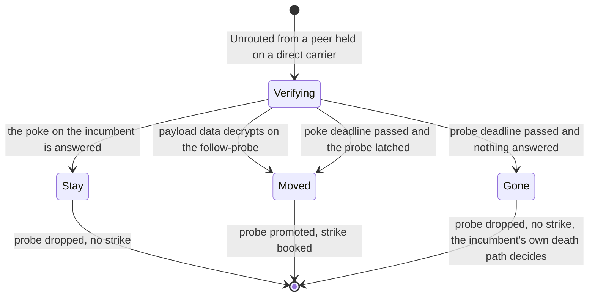
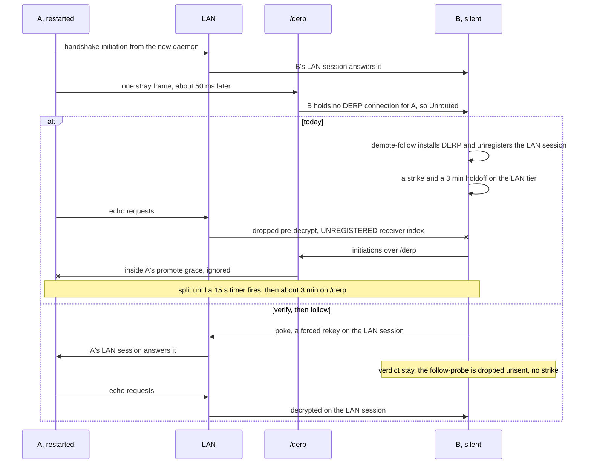

# FR-139: A daemon restart never splits a pair — every carrier transition is make-before-break on both ends

**Issue:** [#3618](https://github.com/gjovanov/roomler-ai/issues/3618) · **Status:** claimed 2026-11-10; D1–D5 (§7) open; nothing built · **Owner:** the overlay's carrier state machine (`crates/tunnel-core/src/overlay`) · **Anchors:** master `0d0f55d55`, a doc-level pin: every `file:line` below is at that commit, and a later PR does not shift them · **Opened by:** [#3541](https://github.com/gjovanov/roomler-ai/issues/3541), found by #3528's lab and re-specced by its triage on 2026-11-08 · **Builds on:** [FR-9](FR-9-lan-pairs-converge-direct.md) (the promote grace), the demote-follow and its holdoff (#27, #31 and #34 in the code's notes), the DERP stamp probe (#2820), the shadow `Tunn` (#3602) · **Related:** #3528, #3539

## Summary, for the operator

**Today** a daemon restart can split a pair that holds each other on a direct carrier. An update, a
`roomler restart`, a crash and a reboot are all restarts. In the lab, 7 of 7 LAN restarts left the
restarted side's traffic going nowhere for **15.7 s**, while the peer had nothing of its own to send. On a
Windows LAN pair the same restart then held the pair on `/derp` for **about 3 minutes**, at 81–167 ms
instead of 6 ms. A fleet roll restarts every daemon, so every roll can pay this on every direct pair.

**Why.** Each end guesses the other's carrier from where the peer's frames arrive. A `/derp` frame from a
peer held on a direct carrier reads as "the peer has moved to the relay". The end that reads it follows at
once and break-before-make, and books a 3-minute holdoff on the direct tier. A restarting peer sends one
such frame about 50 ms after it re-handshakes on the LAN, without having moved.

**After.** Before a follow leaves a direct carrier, it first asks that carrier whether the peer is still
there: a forced rekey, answered in one round trip. A `/derp` probe waits ready beside it. The pair moves
only if the rekey goes unanswered and the probe has latched. The holdoff is booked only when the peer
really moved. The restarted side stops sending the stray frame, which also protects a peer still on an
older release. A real move is still followed, within about 2 s, or in under a second when the peer has
traffic to send. Before the follow existed, it took 67 s.

**What you decide** (§7): the scope (the follow first, or every transition in one program), the model
(per-carrier sessions, or one session per peer), the deadlines, how it ships, and whether a resume clears
the holdoff. Each one has a recommendation.

## 1. Goal

A carrier transition is make-before-break on both ends:

- A restart, a resume or a stray frame never splits a pair that both ends can still reach over their
  current carrier.
- A transition costs a pair no more than one round trip on the path it leaves.
- The relayed-instead holdoff is booked only when the peer really moved.

The first target is the demote-follow. The other two transitions that are still break-before-make follow
it in later phases, if D1 = B: a promotion (for the far end) and the DERP→TURN regrade.

## 2. Evidence

### 2.1 The lab cells [M]

Measured for #3528 as its controls, on agent 0.4.203. Two Linux root daemons share one LAN /24 and hold
each other on a direct LAN carrier. **A** restarts its daemon cleanly, then pings B's overlay address
every 0.2 s and times the first reply from the moment it is up. **B** has nothing of its own to send. B
runs `tunnel_core::overlay::wg=debug,boringtun=debug`, with a packet capture of A's LAN address.

| B's carrier for A at the restart | B accepted A's new LAN initiation? | Cells | First reply after A is up |
|---|---|---|---|
| LAN | yes | 7 (3 with no clock step, 4 with a forward step) | **15.67–15.68 s**, every one |
| LAN | no, refused as `WrongTai64nTimestamp` (#3528, a backward step) | 4 | 0.00–0.05 s |
| relay | yes, as a make-before-break probe | 1 | 0.00 s |

The timeline of the no-step cell c0-900, with t = 0 at A's first LAN initiation after the restart:

| t | Where | What |
|---|---|---|
| 0 | B's capture | A's initiation (148 B). B answers (92 B) in 0.3 ms and logs `New session`. |
| +50 ms | B | `DERP link ready`, then `peer is relaying to us over /derp while we hold another carrier — following it onto DERP now (demote-follow) … was=Some(Lan)`. B initiates over `/derp`. |
| +139 ms to +11 s | B | `session datagram for an UNREGISTERED receiver index — dropped pre-decrypt`. A's echo requests arrive on the LAN, and none is answered. |
| +5.05 s, +10.05 s | B | `HANDSHAKE(REKEY_TIMEOUT)`: A ignores B's initiations over `/derp`. |
| +15.0 s | A, then B | A re-initiates on the LAN (boringtun's 15 s timer). B now holds A on a relay, so it takes the initiation as a make-before-break probe and promotes it. The first reply follows. |

### 2.2 The Windows datapoint [M]

Two Windows per-machine installs, in SystemContext mode, on one LAN, held each other direct at 6 ms. A
was a corporate-managed laptop and got a clean `roomler restart` on agent 0.4.204 (#3541, comment of
2026-11-07T16:26Z).

| t (UTC) | Where | What |
|---|---|---|
| 16:21:41.477 | A | `agent starting version="0.4.204"` |
| 16:22:08.691 | B | `DERP link ready`, then the demote-follow, `was=Some(Lan)` |
| 16:25:10.233 | B | `make-before-break — probing direct upgrade … tier=Lan` |
| 16:25:10.243 | B | `direct carrier promoted … probe_ms=9 via="latch"` |

- The pair sat on `/derp` at 81–167 ms for about 3 minutes, which is the relayed-instead holdoff (§2.3).
  The probe that ended it took 9 ms.
- At the same time A was direct to four other peers at 4–5 ms, so the relay was this pair's state, not A's
  path.
- No echo was timed, so the split itself was not measured on Windows. B's log has no `UNREGISTERED`
  line in this window.

### 2.3 The mechanism, in the code [R]

1. **The signal.** A frame over `/derp` from a known peer, for which B holds no DERP connection, becomes
   `MuxEvent::Unrouted` (`crates/tunnel-core/src/transport/derp.rs:556-573`). The same happens when the
   connection's channel is full or closed. The signal is level-triggered (`derp.rs:83`). The runtime
   hands it to the follow (`crates/tunnel-core/src/overlay/runtime.rs:2883`).
2. **The follow** is `demote_follow` (`crates/tunnel-core/src/overlay/runtime/establish.rs:2777-2879`).
   It runs these gates in order:
   - an unknown pubkey is ignored (`:2791-2800`);
   - the promote grace: a direct carrier installed less than `PROMOTE_FOLLOW_GRACE` (15 s) ago is left
     alone (`:2821-2831`);
   - a peer already on DERP is left alone (`:2835-2840`);
   - one follow per peer per `DERP_FOLLOW_COOLDOWN` (5 s) (`:2842-2848`,
     `crates/tunnel-core/src/overlay/runtime.rs:540`).
3. **The grace reads the wrong time.** It compares against `Installed::since`, the time the carrier was
   installed (`runtime.rs:343-344`). In §2.1, B's LAN carrier predates A's restart, so the gate passes,
   although the session on it is 50 ms old. The grace was written for a different race: a carrier that
   *we* just promoted while the peer finishes its own cutover (`runtime.rs:542-548`, measured 4.2–7.4 s).
4. **The follow is break-before-make.** `RelayCoordinator::follow_peer_to_derp`
   (`crates/tunnel-core/src/overlay/relay_link.rs:973`) builds the DERP link, and `install_ready`
   (`establish.rs:2868`) installs it over the direct carrier. `WgDevice::add_peer` replaces the peer's
   entry and unregisters the old session's receiver index (`crates/tunnel-core/src/overlay/wg.rs:1683-1693`).
   From then on the carrier plane drops every datagram of that session before decrypting it
   (`crates/tunnel-core/src/overlay/carrier_plane.rs:808-833`).
5. **The follow books a strike.** When the carrier it left was direct, the follow calls
   `PathMonitor::on_peer_relayed_instead` (`establish.rs:2864-2867`,
   `crates/tunnel-core/src/overlay/path.rs:609`). That books a failure on the tier and a hard holdoff of
   `RELAYED_INSTEAD_HOLDOFF` (3 min, `path.rs:193`). The holdoff doubles on repeats inside
   `RELAYED_INSTEAD_MEMORY` (30 min, `path.rs:199`), up to `H_ESCALATED` (15 min, `path.rs:185`). This is
   the 3 minutes of §2.2.
6. **The other end ignores the way back.** B's initiations over `/derp` reach A as `Unrouted` too, and A's
   LAN carrier is seconds old, so A's own grace returns early (`establish.rs:2821-2831`, at DEBUG only).
   The split lasts until boringtun's 15 s re-initiation on A (boringtun 0.7.1, `src/noise/timers.rs`).
   By then B holds A on a relay, so B's inbound path takes the LAN initiation as a probe
   (`crates/tunnel-core/src/overlay/runtime/inbound.rs:123-168`).

The guard is `is_direct`, not LAN, so the public-direct and srflx tiers can split the same way. Neither has
been measured.

### 2.4 Why the follow exists [R]

Before the follow, a network change on one end left the other end dark. On 2026-08-24 the end whose network
changed demoted in 2.3 s, its peer took **67 s**, and the pair was dark in both directions for the whole
gap (`docs/overlay-nat-traversal.md:404-418`). The follow made a `/derp` frame a signal, on this premise:
"a peer only relays once it has demoted".

**A restart breaks that premise.** The restarted end sends a `/derp` frame without having demoted. Every
fix in this FR has to keep the follow's 67 s → seconds win for a real move. §3.10 shows the cost of a real
move under the new rule.

### 2.5 What the code already has [R]

| Piece | Where | Used for |
|---|---|---|
| The relay-probe slot: a carrier built beside the active one, initiating after a delay, latched by its handshake | `WgDevice::start_relay_probe`, `wg.rs:1715-1721`; one probe per peer, of any kind | the DERP stamp probe (#2820) |
| The stamp probe's split between probing and committing | `stamp_to_derp`, `commit_stamp_derp`, `note_stamp_probe_failed`, `relay_link.rs:1057`, `:1107`, `:1115`; `maybe_probe_stamp_to_derp`, `establish.rs:1073`; `STAMP_PROBE_INITIATE_AFTER` 500 ms and `STAMP_PROBE_DEADLINE` 15 s, `establish.rs:35`, `:40` | moving a TURN pair to DERP without a gap |
| A forced rekey as a liveness question, answered in one round trip | `PokeArm`, `runtime.rs:319-334`; `peer_initiator_hs_answered`, `wg.rs:2588-2600`; `MAJOR_POKE_DEADLINE` 2 s, `crates/tunnel-core/src/overlay/lifecycle.rs:255-273` | re-validating a direct carrier after a network change |
| Promotion of a latched probe | `promote_direct_probe`, `wg.rs:2244-2262`; `drop_direct_probe`, `wg.rs:2277`; the sweep, `establish.rs:2164` | make-before-break direct upgrades |
| A second `Tunn` promoted only on proof from the peer | `HandshakeHeal`, `wg.rs:612-644` (#3602) | the backward clock step |
| A node env kill switch | `make_before_break_enabled`, `crates/tunnel-core/src/overlay/direct.rs:704-725` (`ROOMLERD_OVERLAY_MBB=0`); `node_env`, `crates/tunnel-core/src/env.rs:254`, which honours the `ROOMLERD_` and `ROOMLER_NODE_` prefixes (`env.rs:197`) | the pattern for every switch below |

⚠️ **The stamp probe depends on the follow.** Its doc says so: a peer on any agent "follows us onto it
(demote-follow) and answers" (`relay_link.rs:1040-1046`, `establish.rs:1064-1072`). A follow that never
answers a `/derp` initiation would break #2820. §3.4 keeps it working.

### 2.6 The other transitions that are break-before-make [R]

- **A promotion, for the far end.** `promote_direct_probe` unregisters the old carrier's session at once
  (`wg.rs:2261`). Frames the peer still sends on the old carrier are lost until the peer moves too. The
  grace's doc comment puts that window at 4.2–7.4 s on a healthy LAN (`runtime.rs:542-547`): the time
  the far end took to run its own probe, latch and cutover. **P0 measured it on 0.4.207, and on a LAN
  pair it is far shorter [M].** In 3 of 3 promotion cells (§9) the far end took the near end's handshake
  as a probe (`inbound.rs:168`) and promoted it 10–15 ms after the near end. Within 3 s of the switch no
  gap between its replies exceeded 0.19 s, so it lost at most one 0.1 s ping. What is left of this window
  is on the other tiers and on a far end that does not answer the probe, which is where P3 has to find
  its case (§3.8).
- **The DERP→TURN regrade.** `maybe_regrade_derp` removes the peer's state first and requests TURN after
  (`establish.rs:1148`, `:1184`, `:1197`). A build that needs the server's grant "lands later via the alloc
  queue" (`:1200`), and until then the pair has no carrier. P0 caught one in a promotion cell (§9): B
  logged the regrade (`:1179`) and removed A's state. A was pinging over `/derp`, so its next frame
  arrived 10 ms later, and B followed it back onto `/derp` (`was=None`). That closed the gap and undid the
  regrade: the TURN build never landed.

### 2.7 The stray frame, named in P0 [M]

P0's naming runs (§9) put A's `tunnel_core` at DEBUG. **The frame is the first send of the DERP floor
that A builds at birth.** A's establish walk finds B carrier-less and builds the floor before any direct
tier is up (`establish.rs:1961`, `relay_link.rs:2134`, logged `DERP floor installed at birth` at `:2207`).
`install_ready` installs it like any relay carrier, and that sends two frames to B over `/derp`:

1. **The 1-byte relay permission bootstrap** (`establish.rs:2595`, `assert_relay_permission` at
   `wg.rs:114`, logged with `context="install"`). It is shorter than any WireGuard message, so boringtun
   discards it as `InvalidPacket`.
2. **A WireGuard handshake initiation.** A relay carrier has one initiator, the smaller public key
   (`establish.rs:2898`), and on this pair that is A.

A then probes LAN make-before-break against the floor (`relay held`). The probe latches within 2 ms, and A
promotes LAN. But A's `/derp` WS has not registered yet. The frames wait in the WS writer's queue
(`agents/roomlerd/src/derp.rs:341`), which the writer starts to drain only after registration (`:404`,
`:485`). It sends a queued frame only while it is younger than FR-18's age bound, 100 ms by default
(`:503-510`, `transport/derp.rs:72-77`). In the three naming runs, the WS registered 45–47 ms after the LAN
probe went out (on A's clock), so both frames were sent. They reached B 49–52 ms after B made the new LAN
session (on B's clock). The
bootstrap byte arrives first, unrouted, and B follows (§2.3). The initiation then lands on the DERP
carrier that the follow has just installed.

So three things race at A's birth: the LAN probe, the WS registration and the 100 ms bound. If the probe
goes out first, the pair splits (9 of 10 runs in §5). If the WS registers first, B follows before the LAN
initiation reaches it and takes that initiation as a probe, so the pair does not split (run 5). If the WS
registers more than 100 ms after the floor's send, the writer sheds both frames, and B has nothing to
follow. The lab has not produced that third case.

**The frame is load-bearing.** The floor exists so that a reachable peer is never carrier-less, and on a
pair whose direct tiers never come up its first send is what opens the relay. So P2 defers it (§3.5); it
does not remove it.

**Two notes on the read.**

- **A server pin doubled the frames.** In all three naming runs the server had also force-pinned the pair
  to DERP (`relay_link.rs:920`, `server escalation — TURN churn`), as one pin with the same expiry. So A
  built a DERP link beside the floor (`:1490`, `:1973`), and the link sent the same two frames again,
  about 3 ms later. What set the pin was not read. The floor sends first and alone carries the frame.
- **§2.1's INFO log said nothing about the floor.** The packaged default level (`roomlerd=info,warn`)
  shows `tunnel_core` only at WARN, so `DERP floor installed at birth` could not appear there. The
  `/derp` lines that did appear are the daemon's own (`agents/roomlerd/src/derp.rs:404`, `overlay.rs:367`).

**Still not established:** why the Windows pair of §2.2 stayed on `/derp` for about 3 minutes. On this
Linux pair, B installs A's DERP carrier with `initiate=false`, so after B's follow nobody initiates over
`/derp`, and A's own 15 s WireGuard retry brings the pair back on LAN (§5). P0's reverse cell makes the
silent end the one with the smaller key, to test whether the order of the keys decides it (§9).

## 3. Design

### 3.1 The invariant

> A carrier transition never leaves a pair without a session that both ends will use. The session a pair
> is using stays registered until the new one has carried the peer's traffic, or the old one has been shown
> dead.

Two rules follow from it:

- **A follow is a question before it is a move.** "The peer's frames arrive on another carrier" means
  "the peer may have moved". It becomes "the peer has moved" only when the current carrier fails to answer.
- **A strike is booked only for a move that happened.** The relayed-instead holdoff punishes a direct tier
  for a peer that went elsewhere. A stray frame is not that.

### 3.2 Why a probe that latches on its handshake is not enough

The triage's re-spec proposed a follow that builds the `/derp` carrier as a probe and promotes it when its
handshake latches. That is not enough when both ends run it.

B's follow-probe sends an initiation over `/derp`. A still holds B on the LAN, so the frame is `Unrouted`
at A, and A starts its own follow-probe. The two probes then complete a handshake with each other. Both
latch, both promote, and both book a strike: a pair that never moved ends up on `/derp` on both ends, with
the holdoff on both. That is §2.2's three minutes on both sides instead of one.

The follow's own history taught this once already: a latched probe proves that a path carries, not that
the peer uses it. The grace does not close the hole either. It covers the first 15 s, and a 15 s probe
deadline puts B's last retransmit on A's grace boundary.

### 3.3 Verify, then follow: a direct incumbent

When `Unrouted` arrives for a known peer, the first gates are unchanged: an unknown pubkey, the grace, a
peer already on DERP, and the cooldown (§2.3). If the peer is held on a direct carrier (LAN, public or
srflx), the follow becomes a **verify**. Only one verify runs per peer at a time, and verifies for one
peer are spaced by `DERP_FOLLOW_COOLDOWN`.

1. **Keep the incumbent.** The direct carrier stays registered, carrying and answering.
2. **Ask it.** A forced rekey on the incumbent, read with `peer_initiator_hs_answered`. This is the
   Stage 2 poke's *question*, not its *verdict*: a new `Follow` class on `PokeArm` whose deadline hands the
   answer to the follow and convicts nothing. The deadline is `MAJOR_POKE_DEADLINE` (2 s, D3). An
   established path answers in one round trip.
3. **Get the way out ready.** Build the `/derp` carrier in the relay-probe slot (`start_relay_probe`),
   through a probe variant of `follow_peer_to_derp` that commits nothing, as `stamp_to_derp` does. The
   probe sends its first initiation after `STAMP_PROBE_INITIATE_AFTER` (500 ms), **and only if the poke is
   still unanswered by then**. A stray frame is therefore settled on the incumbent before this end sends
   anything over `/derp`. That matters most to a peer on an older release, which would follow such a
   frame break-before-make (§3.6).
4. **Decide.** The first verdict that holds wins, in this order:

| Verdict | When | Then |
|---|---|---|
| **stay** | the poke is answered | drop the probe (`drop_direct_probe`), book nothing, log one INFO line |
| **moved** | a data packet with a payload decrypts on the follow-probe | promote the probe at once, book the strike |
| **moved** | the poke deadline passed unanswered, and the probe latched | promote the probe, book the strike |
| **gone** | the probe deadline passed with neither answered | drop the probe, book nothing, and leave the incumbent to its own death path (the handshake deadline, the relay fallback, the DERP floor) |

- **Why payload data and not a keepalive.** #3602's shadow is promoted on a data packet or a keepalive
  (`wg.rs:628-629`), because its doubt is a replay, and only the real peer can complete the handshake. The
  follow's doubt is different: whether the peer *uses* the session. Two follow-probes that complete a
  handshake with each other exchange keepalives, but only the peer's *active* carrier sends payload. So
  payload data is the proof, and a keepalive is not.
- **Symmetry.** When the verifying end's probe does initiate, a new peer receives it as `Unrouted` and runs
  the same verify. Its poke on its own carrier is answered when that carrier works, so it stays. Two ends
  that never moved cannot follow each other.
- **One probe slot per peer** (`start_relay_probe` drops any probe already there). A direct upgrade probe
  already in flight is kept, and the verify waits for its verdict: a direct tier beats every relay tier,
  and that probe settles within its own deadline. The next `Unrouted` re-runs the verify.
- **The grace** stays as the first gate in P1, because it is cheap. Its key, `Installed::since`, is no
  longer load-bearing: the verify settles the stray frame whatever the carrier's age. A later phase may
  retire the grace after the fleet read.

### 3.4 A relay incumbent: a plain make-before-break follow

When the peer is held on TURN or an org relay (`RelayKind`, `relay_link.rs:165-171`), there is no verify.
The follow becomes a make-before-break probe: build the `/derp` carrier in the relay-probe slot, keep the
relay carrier, promote when the probe's handshake latches, and drop the probe at its deadline.

- A relay-to-relay move cannot split a direct pair, and it books no strike today (`establish.rs:2864`), so a
  latch is proof enough.
- **It keeps the stamp probe working.** B's stamp probe nudges and initiates over `/derp`. A's follow-probe,
  now registered for B, answers. B's stamp latches and commits. A's probe latches on the same handshake and
  is promoted, so B's data after the commit decrypts on A's new carrier.
- A stray frame between two relay-held ends latches both probes and moves the pair from TURN to DERP: a
  relay sub-tier move with no split and no strike, the same outcome as today, without the gap.

### 3.5 The restarted side sends no stray frame (P2)

The rule: **a node sends nothing over `/derp` to a peer it holds, or is establishing, on a direct carrier,
except a follow-probe after its own poke went unanswered** (§3.3, step 3), or a stamp probe from a TURN
incumbent.

P0 named the frame (§2.7). It is the first send of the DERP floor built at birth: the permission bootstrap
byte and the floor's initiation, held in the `/derp` mux until the WS registers. It is load-bearing, so P2
defers it and does not remove it. There are two shapes, and P2 picks one with its own lab read:

- **Drop what was superseded.** At the writer's dequeue, where FR-18 already sheds a frame by age
  (`agents/roomlerd/src/derp.rs:503`), it also drops a frame queued for a carrier that is no longer
  installed, because a direct probe promoted in the meantime. This covers the ordering that splits the
  pair in §5, where the probe latches about 47 ms before the WS registers.
- **Hold the floor's first send while a direct probe is in flight.** The floor stays silent until the
  probe misses its deadline, or at once when no direct tier is a candidate. This also covers the ordering
  in which the WS registers first, which §5 measured once in 10 runs. In that ordering B follows before the
  LAN initiation reaches it, so the pair does not split, but B still books a strike.

### 3.6 Old meets new

A fleet roll is a mixed-version window, and **the end that restarts is always the end that just updated**.

| The end that restarts and sends the frame | The silent end | Today | With P1 | With P1 and P2 |
|---|---|---|---|---|
| old | old | split, then the holdoff | the same | the same |
| old | new | split, then the holdoff | **no split**: the silent end's verify is answered | no split |
| new | old | split, then the holdoff | split: the old end follows | **no split**: no stray frame is sent |
| new | new | split, then the holdoff | no split | no split |

So P1 alone fixes a pair only once its silent end has updated. P2 is what fixes a roll while it is running.
**P1 and P2 should ride one agent release** (D1, D4).

A new end that verifies never sends a `/derp` frame toward an old peer unless its poke went unanswered,
so it gives an old peer nothing to follow by mistake.

### 3.7 The strike, the holdoff and the resume seam (#3539)

- **The strike** (`on_peer_relayed_instead`, `path.rs:609`) moves from "a follow from a direct carrier" to
  "a *moved* verdict" (§3.3). Its escalation stays as it is (§2.3).
- **The seam with #3539.** #3539's FR owns *when* `PathMonitor::on_resume` runs (`path.rs:794-802`), and
  so when `on_network_changed` runs (`path.rs:810-812`). It calls `on_resume` from a new trigger, a
  Windows sleep, and changes neither function. Today `on_resume` resets each peer's tier scores, its relay
  quality and its last LAN attempt. It keeps the relayed-instead holdoff and its strike count
  (`relayed_instead_until`, `relayed_instead_strikes` and `relayed_instead_at`, `path.rs:376-384`).
  Whether a resume clears the holdoff is **this FR's call (D5)**.
- **The recommendation (D5 = A):** the clean slate clears the holdoff and its strikes too. `on_resume`'s
  own doc says why: "every score and suppression is stale evidence after a sleep". The holdoff is a
  suppression earned before the world moved. P1 carries it under its own switch.
- **A clean slate on one end looks like a restart to the far end**, because the far end sees a fresh
  handshake and, possibly, a stray frame. So §3.3 covers a resume's far end as well, and #3539's freeze
  and sleep cells must state whether their build carries this FR's P1 and P2.

### 3.8 The other transitions (P3, P4, if D1 = B)

- **Drain after a switch (P3).** When a promotion, a follow or a stamp commit switches the carrier, keep
  the old session registered, receive-only, until the peer's first packet arrives on the new carrier,
  capped at 15 s. This is make-before-break in reverse, and it closes §2.6's far-end window. With a
  drain, a peer still on the old relay delivers its frames there, so no `Unrouted` fires, and the grace
  stops being needed for the race it was written for. P0 measured that window at one 0.1 s ping at most
  on a LAN pair of 0.4.207 (§2.6). So P3 starts with a read: the same promotion cell on the srflx, TURN
  and org-relay tiers and on a mixed-version pair. It builds the drain only where that read shows a window
  worth closing.
- **The DERP→TURN regrade as a probe (P4).** Build TURN beside the established DERP carrier, which is the
  stamp probe in reverse. Promote the TURN carrier on its latch, and keep DERP until then. A build that
  waits for the server's grant then waits with a working carrier.

### 3.9 The deeper option: one session per peer (D2)

WireGuard and Tailscale hold **one Noise session per peer**, with the paths underneath it. Roomler holds one
`Tunn` per carrier and per probe, so every switch is a new handshake that both ends must agree on, and the
old receiver index goes away with it. One session per peer would remove this whole class structurally. It
would also remove the per-carrier rebuilds that #3528's refusal multiplied.

What it would change:

- `WgDevice`'s core, where `peers` is a `Tunn` plus a carrier plus its tasks;
- the carrier plane's index routing;
- the probes, which would become path validation (a disco-style exchange on the direct plane already
  exists, demuxed by shape);
- the QUIC-over-TURN carrier;
- the health counters, which are per carrier today.

The wire stays WireGuard, so a mixed fleet would still interoperate.

**Recommend: not in this FR.** Make-before-break on today's sessions fixes the measured cost with changes
inside the follow, the sweep and the probe slot. One session per peer is a separate FR if P1's field read
shows that per-carrier make-before-break is not enough (D2 = C records that follow-up).

### 3.10 What a real move costs

| Rule | The silent end's dark time after the peer really moves |
|---|---|
| Before the follow (2026-08-24) | 67 s, dark both ways (§2.4) |
| Today's follow | about one DERP round trip when this end initiates. Up to 5 s when it does not: the peer's initiation was consumed as `Unrouted`, and the new carrier initiates only when `is_direct()` or our key sorts lower (`establish.rs:2898`), so it waits for the peer's retransmit |
| Verify, then follow | about 0.5 s plus two DERP round trips when the peer has traffic (the payload rule: the probe's initiation, the response, our first transport message, then the peer's data), else `MAJOR_POKE_DEADLINE`, 2 s. Independent of key order, because the probe always initiates |

### 3.11 What the operator can read

- **One INFO line per verdict:** `overlay relay: follow verdict`, with the peer, the carrier left
  (`was=Lan`), the verdict (`stay`, `moved` or `gone`), `poke_ms` and `probe_ms`.
- **Counters** beside `DERP_INBOUND_UNROUTED` (`derp.rs:571`): `FOLLOW_STAY`, `FOLLOW_MOVED`,
  `FOLLOW_GONE`, and `FOLLOW_LEGACY` for a follow taken with the switch off. P0 specifies where they are
  read (`roomler why` or the daemon's stats), and P1 adds them.

## 4. Phases

Each phase is one PR. Each is shown RED on the release before it, in the lab of §5. Every switch is a node
env read through `node_env`, so `ROOMLERD_<NAME>` and `ROOMLER_NODE_<NAME>` both work (`env.rs:197`, `:254`).
Setting a switch to `0` restores today's behaviour byte for byte.

| Phase | What | Lives in | Kill switch, default | RED | GREEN | Retires |
|---|---|---|---|---|---|---|
| **P0** | The lab rig and the restart cell as a script. The RED on the current release, 10 runs of §5's LAN cell. The stray frame named, with A at DEBUG; if the existing DEBUG lines cannot name it, one DEBUG line at the `/derp` send path naming each frame's kind (inert). The far-end loss window at a promotion measured, for P3. Each tier's topology proven to classify (`roomler peers` reads the tier) before its RED. **As run (§9): the LAN pair only.** The RED, the named frame, three promotion cells and three reverse cells. The other tiers' topology proof and their REDs open P1's field read, in a lab that can route them | `scripts/` (the cell), the lab | none: a read | — | The RED in §9 | — |
| **P1** | Verify, then follow, for a direct incumbent (§3.3). A plain make-before-break follow for a relay incumbent (§3.4). The strike only on a *moved* verdict (§3.7). The verdict line and counters (§3.11). A resume clears the holdoff, if D5 = A | `runtime/establish.rs`, `runtime.rs` (`PokeArm`), `relay_link.rs` (the probe variant of the follow), `wg.rs` (payload counted on a probe), `path.rs` | `ROOMLERD_OVERLAY_FOLLOW_MBB`, on (D4) | §5's LAN, public and srflx cells, and the mixed pair (old restarts, new is silent) | §6's AC1–AC3, AC5, AC6 | the switch, one release after the fleet read is GREEN |
| **P2** | The restarted side sends no stray frame (§3.5) | `relay_link.rs` (`build_floor`), `runtime/establish.rs` (`install_ready`), the `/derp` mux's flush at registration | `ROOMLERD_OVERLAY_DERP_QUIET`, on (D4) | the mixed pair (new restarts, old is silent) | AC4 | as P1 |
| **P3** | The drain after any switch (§3.8), if D1 = B | `wg.rs` (`promote_direct_probe`, `add_peer`), `carrier_plane.rs` | `ROOMLERD_OVERLAY_SWITCH_DRAIN`, on | P0's far-end window | AC7 | as P1 |
| **P4** | The DERP→TURN regrade as a probe (§3.8), if D1 = B | `runtime/establish.rs` (`maybe_regrade_derp`), `relay_link.rs` (`derp_regrade_due`, `:1294`) | `ROOMLERD_OVERLAY_REGRADE_MBB`, on | a regrade's carrier-less gap, read in the lab | AC8 | as P1 |
| **PF** | The fleet read after the release that carries P1 and P2 rolls (AC10) | a read, with the hub's OK per device | none: a read | — | AC10 | — |
| **Docs** | AC11 | `docs/overlay-nat-traversal.md`, `docs/overlay-communication.md`, the node-env table, a `docs/README.md` row for any page added | none | — | Written with each phase | — |

⚠️ **A switch restores the old behaviour only on its own end.** §3.6 is the matrix of mixed ends, and a
node with its switch off behaves as the old release does.

## 5. The field read

**The lab.** Two Linux root daemons on throwaway Ubuntu guests of the vmtest lab, 4 GiB each, on one /24.
They run the current release with auto-update off (`auto_update = false` and `ROOMLERD_AUTO_UPDATE=0`),
enrolled with the lab org's ephemeral key, so each row removes itself on a clean stop. The cell is
`scripts/fr139-restart-cell.sh` (P0), grown from #3528's restart cell. It refuses every host except a lab
guest of its rig, and it reads each daemon's own log file. Every boot of the lab hypervisor needs the hub's
GO (guests, GiB, hours). Fleet devices are read only, with the hub's OK for each one.

**One run of the restart cell:**

1. **Precondition.** B's `roomler peers` reads A on the cell's carrier (direct `Lan` for the LAN cell),
   established, and B has been silent for at least 30 s. A run starts only when this holds again. After a
   RED run that means the holdoff plus one make-before-break cycle, about 4 minutes.
2. **B.** A mark in its log file, a capture of every UDP datagram to and from A's LAN address (the WireGuard
   lengths 148/92/64/32 tell an initiation, a response, a cookie and a keepalive apart), a 2 s sampler of
   B's `roomler peers` row for A, and the log drop-in that puts `tunnel_core::overlay::wg`,
   `tunnel_core::overlay::runtime::establish` and `boringtun` at DEBUG.
3. **A.** `roomler restart`, then wait for a new pid that holds an overlay address (`daemon_up`). For the
   RED, A runs the packaged default level. Only P0's naming runs raise it, to `tunnel_core=debug,boringtun=debug`,
   to name the frame (§2.7).
4. **The number.** A pings B's overlay address every 0.2 s, with a 1 s timeout. `first_reply` is the time
   from `daemon_up` to the first echo reply, on A's monotonic clock. Then a 0.5 s ping runs for 200 s, and
   its gaps are read from when each reply arrived (ping's own receive stamps), not from its sequence numbers.
5. **After.** At +60 s and at +180 s, read both ends' `roomler peers` rows for each other, with the holdoff
   and its strikes. Count, in B's log for the cell's window: `demote-follow`, `UNREGISTERED receiver index`,
   and (from P1) `follow verdict`. Count them for A only, by A's node id or a datagram from A's LAN address,
   because a lab org can hold other guests on the same LAN.

**RED, read on 0.4.207 (§9). It is AC1's and AC2's baseline.** 9 of 10 runs split the pair, with
`first_reply` at 15.68–15.70 s. B logs one `demote-follow` with `was=Some(Lan)` in every run. In the nine
runs that split, it also logs two `UNREGISTERED receiver index` warnings: the warning is throttled to one
line per 10 s, so two lines cover 15 s of drops.

- **The split is a race between A's two frames at B.** In the nine runs that split, A's LAN initiation
  reached B 46–52 ms before its `/derp` frame. B made the new session on its LAN carrier, and the follow
  then tore it down (§2.3). In run 5 the `/derp` frame reached B 8 ms first. B had already followed, so it
  took the initiation as a make-before-break probe and promoted LAN 2 ms later, with no split.
- **The split ends at 15 s.** A's WireGuard re-initiates after 15 s of sending with nothing received. By
  then B holds A on `/derp`, so it answers the initiation as a shadow probe and promotes it on the latch
  (`establish.rs:2164`). Since #33 it answers even inside the relayed-instead holdoff
  (`path.rs:1313-1315`), because the holdoff gates only what B starts itself (`eligible`, `path.rs:900`).
  So B reads A on `lan` again by +60 s in every run, and the holdoff never holds this pair on the relay.
- **The holdoff is booked anyway, split or not.** It climbs while the restarts land inside its 30 min
  memory: 3, 6 and 12 min, then the 15 min cap from the fourth follow on (`path.rs:641`). So AC2 reads RED
  in 10 of 10 runs.

Nothing touched the follow between #3541's anchor `28a268086` and the release that was read (§9).

**GREEN.** `first_reply` ≤ 1 s in 10 of 10 runs. No `UNREGISTERED receiver index` drop and no
`demote-follow` on B. One `follow verdict … stay` line per stray frame (P1), or no stray frame at all (P2).
Both ends read the pair direct on the cell's tier at +60 s. `roomler why` shows no relayed-instead holdoff.

**The matrix.** Every cell is RED first on the release before the phase, then GREEN.

| Cell | Topology | What runs | GREEN reads |
|---|---|---|---|
| LAN | two Ubuntu guests on one /24 | A restarts, B silent | as above |
| Public direct | two guests on two routed TEST-NET subnets (`198.51.100.0/24`, `203.0.113.0/24`), routed by the hypervisor, plus a NAT NIC each for the control plane. TEST-NET counts as public (`direct.rs:934-951`) | as LAN | as LAN, tier `Public` |
| srflx | two guests behind two NATs with distinct public egress addresses. P0 proves `tier=Srflx` first; if the lab cannot produce it, the cell needs the operator's go for a fleet pair | as LAN | as LAN, tier `Srflx` |
| TURN | the LAN pair with direct UDP blocked between the guests (#3528's rig), B holding A on `relay:turn` | as LAN | no split, no strike (the relay cell of §2.1 read 0.00 s) |
| Org relay | as TURN, through an org relay in the lab org | as LAN | as TURN |
| Windows LAN | two Win11 guests from the current golden image, renamed before they enrol, per-machine installs | as LAN | as LAN |
| Mixed, old restarts | LAN, A on the release before the change, B new | as LAN | as LAN (P1) |
| Mixed, new restarts | LAN, A new, B on the release before the change | as LAN | as LAN (P2) |
| A real move | LAN, A's UDP to B blocked mid-session, both sending | no restart | B follows: an echo gap of at most 2 s plus one DERP round trip, a `moved` verdict, a strike booked |
| Promotion (P3's baseline) | LAN, A's UDP to B blocked inside guest A until both ends read a relay, then lifted; both ends ping every 0.1 s | no restart | P0 read it on 0.4.207 (§2.6): the far end promotes 10–15 ms after the near end and loses at most one 0.1 s ping. P3 repeats it per tier |
| The stamp probe | B holds A on TURN, DERP is the better relay | no restart | B's stamp probe commits, A follows make-before-break, no echo gap above one DERP round trip |

## 6. Acceptance criteria

- [ ] **AC1, a restart does not split a LAN pair.** §5's LAN cell: `first_reply` ≤ 1 s in 10 of 10 runs, and
  B logs no `UNREGISTERED receiver index` drop and no `demote-follow`. Shown RED first on the current release
  (§5).
- [ ] **AC2, and leaves no holdoff.** In the same runs, `roomler peers` on both ends reads the pair direct on
  LAN within one make-before-break cycle, and `roomler why` shows no relayed-instead holdoff booked.
- [ ] **AC3, a real move is still followed.** In §5's real-move cell, B follows A to `/derp`, and the pair
  carries traffic again within 2 s plus one DERP round trip. The verdict is `moved`, and a strike is booked.
- [ ] **AC4, old meets new.** Both mixed cells of §5 read as §3.6 says: no split when the old end restarts
  and the new end is silent, and no split when the new end restarts and the old end is silent.
- [ ] **AC5, every tier.** The restart cell on a public-direct pair and on an srflx pair meets AC1 and AC2,
  each RED first. A TURN pair and an org-relay pair show no split and no strike. The stamp-probe cell still
  commits (#2820).
- [ ] **AC6, Windows.** The restart cell on a Windows ↔ Windows LAN pair, on per-machine installs, meets AC1
  and AC2.
- [ ] **AC7, the drain** (P3, if D1 = B). At a promotion, the far end's frames on the old carrier are
  delivered, against P0's measured loss window.
- [ ] **AC8, the regrade** (P4, if D1 = B). A DERP→TURN regrade leaves no gap without a carrier, read in the
  lab.
- [ ] **AC9, the switches.** Each phase's switch set to `0` restores today's behaviour: a unit test per
  switch, and one lab run of the LAN cell with P1's and P2's switches off reproducing the RED.
- [ ] **AC10, the fleet.** After the release that carries P1 and P2 rolls, a read-only sweep of the
  standing-consent devices finds no direct pair split by a peer's restart. That means no
  `UNREGISTERED receiver index` drop and no strike within 30 s of a peer's daemon start, and verdict
  counters with `stay` at restarts and no `moved` without a move. The denominator comes from the server.
- [ ] **AC11, docs.** `docs/overlay-nat-traversal.md`'s follow section (`:404-418`) and its stamp-probe
  section say what the follow does now, with §3.3's state diagram and sequence diagram and §3.6's matrix.
  `docs/overlay-communication.md`'s clock-step table (`:998`) is updated where it names the follow. The
  switches are in the node-env table, and any page added gets its row in `docs/README.md`.

## 7. Decisions for the operator

| # | Question | Options | Recommend | Why, and what it costs |
|---|---|---|---|---|
| **D1** | How much is this FR? | A: the follow only, the other transitions get their own issues. B: one program, every transition, phased, the follow first. C: every transition at once | **B** | The drain and the regrade are the same class, and they share the probe slot, the verdicts and the switch pattern. Phasing keeps every PR small, and P1 and P2 ship first |
| **D2** | Which model? | A: make-before-break on today's per-carrier sessions (§3.3–§3.8). B: one session per peer (§3.9). C: A now, and B as a separate FR after A's field read | **A** (C if you want B on record) | A changes the follow, the sweep and the probe slot. B rewrites the device core, the plane's routing and the probes, which is far more than the measured cost needs |
| **D3** | The deadlines? | A: the poke 2 s and the probe 15 s, reusing `MAJOR_POKE_DEADLINE` and `STAMP_PROBE_DEADLINE`. B: the poke 2 s and the probe 6 s (one retransmit). C: a poke per tier (LAN 1 s, public and srflx 2 s) | **A** | The probe deadline matters only once the poke went unanswered, and by then the carrier is dead and its own death path takes over. Reusing both keeps one rule for "re-validate an established carrier" |
| **D4** | How does it ship? | A: on by default in the release after the lab matrix is GREEN, with the switch per node, and PF's fleet read right after the roll. B: dark in that release, switched on through the node env on standing-consent devices first, on by default in the next release | **A** | The same pattern as `ROOMLERD_OVERLAY_MBB`. A new end changes nothing until a `/derp` frame arrives from a peer it holds direct, and the worst case is bounded by the existing death path. B means editing the environment of every opted-in host |
| **D5** | Does a resume clear the holdoff? (the seam with #3539) | A: yes, `on_resume` and so `on_network_changed` clear the relayed-instead holdoff and its strikes, under P1's switch. B: no, the holdoff survives a resume, as today | **A** | `on_resume`'s own rule is that every suppression is stale evidence after a sleep, and the holdoff is a suppression. The cost is at most one extra probe cycle per resume |

## 8. Out of scope

- **The WireGuard refusal after a backward clock step** (#3528, fixed by #3602).
- **Which tier the server's verdict picks.**
- **When a resume runs**: the pause and resume signal is #3539's. Whether a resume clears the holdoff is
  here (D5), and nothing else in `on_resume` changes.
- **One session per peer**, if D2 = A or C (§3.9).
- **A process that ends.** The restarted side's own sessions die with it, so a restart still costs that
  side one new handshake. This FR removes the split on the *other* side.
- **The other consumers of `/derp`.** Tunnel QUIC endpoints never raise `Unrouted` (`derp.rs:520-547`).

## 9. Field log

| date | build | result |
|---|---|---|
| 2026-11-07 | 0.4.203, two Linux root daemons on one LAN | #3528's controls: 7 of 7 restarts where B held A on LAN and accepted its new initiation stalled 15.67–15.68 s. 0 of 4 stalled where B refused the initiation (a backward step), and 0 of 1 where B held A on a relay (§2.1) |
| 2026-11-07 | 0.4.204, Windows ↔ Windows on one LAN | one restart: the peer demote-followed away from LAN and stayed on `/derp` at 81–167 ms for about 3 minutes, until a 9 ms probe brought the pair back (§2.2) |
| 2026-11-10 | master `0d0f55d55`, agent 0.4.207 | spec drafted and claimed as FR-139 (#3618), every anchor verified at the pin. Nothing has touched the follow, the grace, `follow_peer_to_derp` or the relayed-instead holdoff since #3541's anchor `28a268086`, so 0.4.207 carries the same follow, and P0's RED is expected to reproduce on it |
| 2026-11-10 | 0.4.207, two Linux root daemons on one LAN (P0, the restart cell of §5) | **The RED.** 9 of 10 restarts split the pair, with `first_reply` at 15.68–15.70 s; run 5 did not (0.00 s). B followed with `was=Some(Lan)` and booked a strike in every run, and its holdoff reached the 15 min cap from run 3 on, yet B read A on `lan` again before +60 s in every run. In the 9 split runs B's follow came 45.8–51.5 ms after A's LAN initiation reached it; in run 5 it came 7.8 ms before (B's capture against B's log). On #3618 |
| 2026-11-10 | 0.4.207, the same pair, A's `tunnel_core` at DEBUG | **The frame named.** 3 runs, all split at 15.68–15.69 s. The stray frame is the first send of the DERP floor that A builds at birth: the permission bootstrap byte, then a WireGuard initiation, held in the `/derp` writer's queue until the WS registered 44.8–47.0 ms after A's LAN probe (§2.7). A server pin built a second DERP link that resent both frames about 3 ms later |
| 2026-11-10 | 0.4.207, the same pair, A's UDP to B's LAN blocked inside guest A until both ends read `/derp`, then lifted | **Promotion cells, P3's baseline.** 3 of 3: the far end promoted 10–15 ms after the near end and lost at most one 0.1 s ping (§2.6). The pair returned to `lan` 31.8, 28.1 and 135.2 s after the lift. Cell 3 waited out a 3 min holdoff that A booked by following B 48.7 s into the hold, when its LAN path really was blocked. In cell 3, B also ran a DERP→TURN regrade that A's next `/derp` frame undid 10 ms later (§2.6) |
