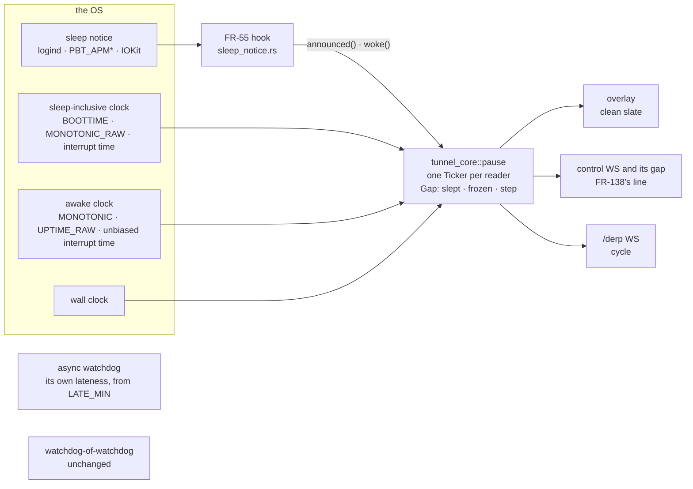
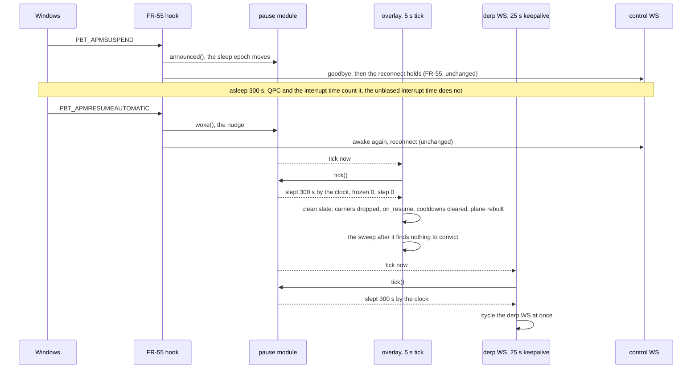

# FR-140: One pause signal — a host's sleep reads as a sleep on every OS, and every loop hears it the same way

**Issue:** [#3619](https://github.com/gjovanov/roomler-ai/issues/3619) · **Status:** claimed 2026-11-10; D1–D6 (§8) open; nothing built · **Owner:** the overlay runtime (tunnel-core), the agent's control and `/derp` WS loops, the agent's watchdog, FR-55's sleep hook · **Anchors:** master `814db2dd5`, a doc-level pin: every `file:line` below is at that commit, and a later PR does not shift them · **Opened by:** [#3539](https://github.com/gjovanov/roomler-ai/issues/3539), from its triage re-spec of 2026-11-08, which also closed [#3540](https://github.com/gjovanov/roomler-ai/issues/3540) into it · **Builds on:** [FR-55](FR-55-always-reachable.md) P4 (the OS sleep hook), #3530 (`tunnel_core::frozen` and the watchdog-of-watchdog's late bound), the overlay's P8 (the clean slate after a resume) · **Related:** [FR-139](FR-139-carrier-transitions-make-before-break.md) (#3541, the demote-follow), [FR-138](FR-138-the-session-outlives-its-control-socket.md) (which `ConnExit` a sleep produces, and the line at which it ends a session), #3528 (a clock step and WireGuard)

## Summary, for the operator

**Today** five loops in the daemon each decide whether the process was paused, each from its own pair of clocks and
with its own threshold, and the clocks mean different things on each OS. On Windows the monotonic clock counts a
sleep, so no sleep check fires there: the overlay's first sweep after the wake convicts each silent carrier on its own
and books a strike and a penalty on each direct tier, where a Linux or macOS wake takes a clean slate. A forward clock
step of more than 120 s reads as a sleep on every OS: it drops every carrier and ends every live remote session. And
FR-55's own lab read shows the monotonic clock running through a VM guest's suspend, so the lab's Linux guests
behave like Windows today.

**After** one module in tunnel-core measures each pause from the OS, and every loop reads it at its own tick. The
OS's sleep clock says how long the host slept wherever the OS keeps one. Where the clocks ran through the sleep, the
sleep notice FR-55 already receives marks the late tick as a sleep. A late tick with no notice is a freeze, and a
wall-clock jump that neither explains is a step. Each loop keeps its own policy: the overlay takes the clean slate
after any real sleep, on every OS, and the `/derp` WS cycles at once; the control WS ends a slept connection by
FR-138's rule, so a remote session closes after a sleep of 120 s or more and is kept through a shorter one; the async
watchdog takes the pause off its pumps' ages; a step is logged and drops nothing.

**What it costs**: one module with three OS clock reads (no new crate), four readers, and a shadow phase that logs
what each reader would do before any of them acts. Every reader ships dark behind its own switch, and one switch puts
all of them back on today's rules. The six decisions (§8): the source model (D1), the overlay's sleep threshold (D2),
the freeze policy (D3), the hook when FR-55's switches are off (D4), the clock step (D5), and where the Windows RED
runs (D6). The line at which a sleep ends a remote session is not among them: it stays FR-138's (§4).

## 1. Goal

A pause of the process means the same thing to every loop that reads it, on every OS:

- After any real sleep the overlay takes the same clean slate on Windows, Linux and macOS, with no strike and no
  penalty booked from the sleep's own silence, and the `/derp` WS reconnects at the wake.
- A remote session ends at a sleep by FR-138's rule on every OS: at a sleep FR-55 announced, or after a measured
  sleep of at least `RESUME_SKEW_MIN` (120 s), including one that starts while FR-138 keeps the session through its
  gap. A shorter sleep keeps it, and so does a freeze.
- A wall-clock step is not a sleep: it drops no carrier, cycles no socket and ends no remote session.
- A freeze (SIGSTOP, a cgroup freeze, a VM pause, a debugger) is told apart from a sleep, and gets its own policy.
- The async watchdog convicts no pump for time the process did not run (#3540's class).
- One module measures, and no loop derives a pause from its own clocks.

## 2. Evidence

[M] measured, [R] read from the code at the pin, *reasoned* where neither.

### 2.1 Five judges, and what each makes of each pause [R]

| judge | where | its rule | a sleep the awake clock leaves out (Linux on hardware, macOS) | a sleep the awake clock counts (Windows; a VM guest's suspend, §2.3) | a freeze, any OS | a forward wall step of 300 s |
|---|---|---|---|---|---|---|
| the overlay's P8 | `crates/tunnel-core/src/overlay/runtime.rs:571`, used at `:3088` | wall clock minus monotonic over 120 s, between two 5 s ticks | the clean slate if 120 s or more, nothing below | never | never | the clean slate, falsely |
| the control WS's A5 | `agents/roomlerd/src/signaling.rs:600`, used at `:2342` | the same, at the 25 s keepalive | cycles as `ResumeFromSuspend` if 120 s or more | never: the 80 s RX deadline (`:2357`) trips at the first keepalive after a pause of more than about 55 s, as `RxDeadline`, with the "did not run" wording | as the column before | cycles as `ResumeFromSuspend`, falsely |
| the `/derp` WS's A5 | `agents/roomlerd/src/derp.rs:429` | the same, inline | cycles if 120 s or more | never: its own RX deadline (`:437`) | as the column before | cycles, falsely |
| the async watchdog | `agents/roomlerd/src/watchdog.rs:561` | a scan more than 5 + 60 s late resets every pump | nothing: neither the scan nor the pumps' ages saw the sleep | past 65 s every pump is reset; under it the pause counts against each pump's age | as the column before | nothing |
| the watchdog-of-watchdog | `watchdog.rs:624` | a sleep that came back more than 10 s late takes a new baseline | nothing | a new baseline | a new baseline | nothing |

Four things follow.

- **The middle two columns are one column today.** Nothing in the daemon tells a Windows sleep or a VM's suspend
  from a freeze, so all three get a freeze's treatment: the sweep's convictions and the RX deadlines.
- **The 120 s bar is there for the step's sake, and real sleeps pay for it.** It sits above any NTP correction
  because the skew rule cannot tell a step from a sleep. So a Linux or macOS sleep of 60–120 s takes no clean slate,
  although the far end convicted our direct carrier 60 s into the silence (`DIRECT_RX_STALE_DEADLINE`,
  `crates/tunnel-core/src/overlay/lifecycle.rs:183`).
- **A step ends remote sessions.** The control WS's cycle is `ResumeFromSuspend`, which FR-138 keeps terminal
  (`agents/roomlerd/src/session_table.rs:171-172`): every peer closes.
- **A Windows sleep with no goodbye keeps the sessions FR-138 would close.** Where FR-55 said no goodbye (its
  announcement off, or a sleep the OS did not announce), the control WS ends at the RX deadline as `RxDeadline`
  (`signaling.rs:2357-2390`), however long the sleep. With FR-138's keep switch on (`ROOMLERD_RC_SESSIONS_SURVIVE_REATTACH`,
  off by default, `session_table.rs:73-76`) that exit keeps every session. FR-138's owner found it in the review of
  FR-138 P2a (its finding M2), and FR-138 plans the fix as P2a-2 (§4).

### 2.2 What the overlay loses after a Windows sleep [R]

P8 (`runtime.rs:3067-3125`) runs in the 5 s fallback arm (`:3011`), before that arm's sweep (`:3218`), and does four
things:

1. it drops every carrier through the shared teardown (`remove_peer_state`, `:3093-3104`);
2. it clears the relay refresh cooldowns (`:3105`);
3. it clears the path monitor's evidence (`PathMonitor::on_resume`, `crates/tunnel-core/src/overlay/path.rs:794`:
   every tier's quality, penalty and fail count, the relay quality, the last LAN attempt);
4. it rebuilds the direct plane, authoritatively (`:3120`, or `:3122` without a plane).

After a Windows sleep none of that runs. The sweep (`crates/tunnel-core/src/overlay/runtime/establish.rs:315`) finds
each established carrier silent past its rx-stale deadline (direct 60 s, relay 90 s; `lifecycle.rs:183`, `:186`) and
convicts it alone. A direct conviction goes through `PathMonitor::on_death` (`path.rs:561`, called at
`establish.rs:622`), which books a strike and a suppression penalty on the tier. Since #3536 the line reads
`overlay: established direct carrier went silent while this agent did not run for ~N s (frozen or suspended)`
(`establish.rs:700`), but that is wording only (`crates/tunnel-core/src/frozen.rs:19-21`): the strike, the penalty and
the rebuild stay. P8 was built for a hibernate wake that left the mesh relay-wedged for hours (field 2026-07-25,
cited at `runtime.rs:3073-3074`), and a Windows laptop that sleeps several times a day walks toward the same wedge.
Nobody has watched that on Windows yet: it is P0's RED (§6).

**A Wi-Fi laptop may hide it.** A wake that is also a Major network change runs `PathMonitor::on_network_changed`
(`runtime.rs:3499`), which is `on_resume` (`path.rs:810-812`), a forced revalidation sweep (`runtime.rs:3503-3507`)
and a plane rebuild (`:3451`). So the penalties go anyway, though the carriers are not dropped and the cooldowns are
not cleared. A wired desktop has no such event. Every cell in §6 says which case it measured.

`on_resume` does not clear a peer's relayed-instead holdoff (`relayed_instead_until`, `path.rs:376`, and its strikes,
`:383-384`). That is FR-139's (§4).

### 2.3 What the clocks count, per OS

`docs/remote-control.md` § "Across a freeze or a suspend" (`:5295`) has the table, with its sources [R]. `Instant` is
`QueryPerformanceCounter` on Windows, `CLOCK_MONOTONIC` on Linux and `CLOCK_UPTIME_RAW` on macOS. QPC counts a host
sleep ("including the time when the machine was in a sleep state such as standby, hibernate, or connected standby");
the other two stop. A timeout stops across a sleep on all three (on Windows since Windows 8), and all three count a
freeze.

Every OS also keeps a clock that counts the sleep beside one that does not. Their difference grows by exactly the time
asleep, and neither a wall-clock step nor a cancelled sleep moves it:

| OS | counts the sleep | leaves it out | source, and what is not yet known |
|---|---|---|---|
| Linux | `CLOCK_BOOTTIME` | `CLOCK_MONOTONIC` (`Instant`) | [`clock_gettime(2)`](https://man7.org/linux/man-pages/man2/clock_gettime.2.html): BOOTTIME "is identical to CLOCK_MONOTONIC, except that it also includes any time that the system is suspended". Not across a VM guest's suspend (below) |
| macOS | `CLOCK_MONOTONIC_RAW` (`mach_continuous_time`) | `CLOCK_UPTIME_RAW` (`mach_absolute_time`, which is `Instant`) | the `clock_gettime(3)` man page: UPTIME_RAW "does not increment while the system is asleep", and the MONOTONIC clocks keep counting. From the man page, not yet read on a Mac: P1 |
| Windows | `QueryInterruptTime` | `QueryUnbiasedInterruptTime`, which "does not include time the system spends in sleep or hibernation" | both are in `windows-sys` 0.61's `Win32_System_WindowsProgramming`, the version tunnel-core already uses (`crates/tunnel-core/Cargo.toml:182-195`). **Not known: whether Modern Standby counts as sleep there.** P1 reads it on a Modern Standby laptop |

**[M] A VM guest's suspend kept the monotonic clock running.** In FR-55's lab read of 2026-10-31 a Linux lab guest
slept 79 s in s2idle, and the 60 s reconnect hold, which runs on `Instant`, expired 40 ms before logind's wake
(`docs/fr/FR-55-always-reachable.md:435-438`). *Reasoned:* the guest has no cpuidle driver, so the kernel's
suspend-to-idle idles in its default loop and never freezes timekeeping (`kernel/sched/idle.c`,
`cpuidle_idle_call`), while on hardware with a cpuidle driver it does, and `clock_gettime(2)`'s rule holds. If so,
`CLOCK_BOOTTIME` minus `CLOCK_MONOTONIC` read 0 across that suspend too, and P8 stayed silent through it. Only FR-55's
notice saw that sleep. P0 reads whether P8 fired on such a suspend, and P1 reads the clock pair.

***Reasoned:* a WSL2 guest's clocks stand still while its Windows host sleeps**, and time sync steps its wall clock
later, so there only a step shows the sleep. P1 reads it where a WSL2 host is reachable.

### 2.4 The freeze rounds of 2026-11-07 [M]

From #3539's field comment, #3530's lab: a root daemon on an Ubuntu 24.04 lab guest (kernel 6.8, cgroup v2), frozen
70 s a round. 20 rounds of `SIGSTOP` ran on the release 0.4.203; then, on a build of #3536, 20 of `SIGSTOP`, 10 of
`systemctl freeze` and 10 of `cgroup.freeze`. None of the 60 logged `overlay: resume from suspend`: Linux's monotonic
clock counts a freeze, so P8 cannot fire on one.

On the frozen end's pair to a lab node that kept running, which rode `/derp` in every round, 13 of the 60 rounds logged
`overlay: relay carrier failed active revalidation (forced rekey unanswered — one-way over /derp) — rebuilding the
/derp carrier` in the minute after the thaw:

| build | freeze | rounds with the line | seconds after the thaw |
|---|---|---|---|
| 0.4.203 | `SIGSTOP` | 1 of 20 | 47.3 |
| #3536 | `SIGSTOP` | 5 of 20 | 46.3–47.2 |
| #3536 | `systemctl freeze` | 2 of 10 | 45.2–45.3 |
| #3536 | `cgroup.freeze` | 5 of 10 | 49.1, and one at the thaw itself |

- In round 11 of the `SIGSTOP` loop the `/derp` WS stayed up. The line came at +46.3 s, three
  `HANDSHAKE(REKEY_TIMEOUT)` lines followed 5 s apart, and the pair settled by demote-follow at +64.8 s.
- The line at the thaw itself (round 1 of `cgroup.freeze`) came from a forced rekey whose window closed during the
  freeze, judged by the first sweep after the thaw, which ran about 70 s late.
- The sweeps that convicted at 45–49 s ran on time, so lateness cannot see them. Whether a clean slate at the thaw
  avoids the unsettled minute was not tested, and why the far end did not answer the rekeys is not established: its
  log was not read.
- The 0.4.203 row is not a like-for-like rate: that release force-exited on 9 of its 20 rounds, and each restart
  rebuilt its carriers.

### 2.5 The OS notice: its sleep half is proven, its wake half is not

- **[R] The hook.** FR-55 P4's `sleep_notice` listens on all three OSes (`agents/roomlerd/src/sleep_notice.rs:46-51`):
  logind's `PrepareForSleep` on Linux, which needs D-Bus (`portal-capture`, `:26`, part of `full`,
  `agents/roomlerd/Cargo.toml:756`) and logind at run time; `PowerRegisterSuspendResumeNotification` on Windows;
  IOKit's `IORegisterForSystemPower` on macOS. It starts only while one of FR-55's two switches is on (`start`,
  `sleep_notice.rs:534-550`), and only the control WS's reconnect hold reads it (`hold_while_asleep`, called at
  `signaling.rs:1206`).
- **[M] The sleep half.** Three Windows laptops logged 11 goodbyes on 0.4.190–0.4.194
  (`FR-55-always-reachable.md:192`), and the Linux lab's suspends read `asleep` on the server (`:397-404`).
- **The wake half on Windows is not proven.** FR-55's "the wake works too" (`:466`) reads that the machines
  reconnected and uploaded. Which path ended the hold is in `hold_for`'s two lines: `awake again: reconnecting (FR-55
  P4)` (`sleep_notice.rs:336`) means the wake reached the hook first, and `no wake reported within the hold:
  reconnecting anyway (FR-55 P4)` (`:339`) means the timer did. On Windows the hold's timer runs on `Instant`, which
  counts the sleep, so after any sleep over 60 s both are ready at the wake and either can win (*reasoned*): only
  `awake again` proves the callback. Both lines reach `agent_logs`, because the upload layer takes every line the
  filter passes (`crates/agent-core/src/logging.rs:213-220`). P0 reads them.
- **[R] The notice says that a sleep happened, not how long it lasted.** `woke()` (`sleep_notice.rs:446`) is also
  what a cancelled or failed sleep calls: macOS's `kIOMessageSystemWillNotSleep` (`:898`), and logind's
  `PrepareForSleep(false)` (`:676`), which logind also sends when a suspend fails. Windows may deliver both
  `PBT_APMRESUMEAUTOMATIC` and `PBT_APMRESUMESUSPEND` for one wake (`:772`). And the wall clock between a sleep notice
  and its wake moves with a step.

### 2.6 #3540: the async watchdog against its pumps [R]

#3540, closed into this FR on 2026-11-08: a 30–65 s freeze during a remote session forces an exit through the
encoder's and the capture's 30 s thresholds, because the async watchdog resets its pumps only once a scan is more than
5 + 60 = 65 s late (`watchdog.rs:561`); under that, the pause counts against each pump's age. On master both pumps
are registered inactive (`agents/roomlerd/src/app.rs:4518-4519`) and nothing gates them on (only the signaling pump
is gated, `signaling.rs:816`, `:823`), so the class is dormant and no field RED is possible on the release. Its RED is
a unit test at the pin with a 30 s pump gated on. Its proposal is P4 here: take the scan's own lateness off every
pump's age, still catch a real stall at most one scan later, and pin both with an injected-clock test like
`spawn_thread_watchdog_with`'s (`watchdog.rs:599`).

### 2.7 Found on the way

- P8's doc comment says QPC stops across a sleep (`runtime.rs:559-562`). It counts it. P2 corrects the comment.
- `ConnExit::ResumeFromSuspend`'s doc says "at least `RESUME_SKEW_MIN` napped" (`session_table.rs:99`). P3 rewords it.
- `docs/remote-control.md` cited `RESUME_SKEW_MIN` at `signaling.rs:599` (`:5308`); it is at `:600`. Fixed in the
  commit that adds this spec.
- FR-55's `HOLD_MAX` doc says the sleep stops its clock on Linux and macOS (`sleep_notice.rs:300-303`). It does not on
  Windows, nor in FR-55's lab guest. Both paths reconnect, so it stays out of scope (§9).

## 3. Design

### 3.1 One measure, many readers



The measure lives in tunnel-core beside `frozen` (`crates/tunnel-core/src/lib.rs:55`), because the overlay reads it
and tunnel-core cannot depend on the daemon. The daemon feeds it the notice through two calls, and nothing else
crosses that seam. The module holds no policy: each reader keeps its own.

### 3.2 The four sources

| source | what it is | what it tells | blind to |
|---|---|---|---|
| **S1, the sleep clock** | the OS's pair (§2.3), sampled at each tick | how long the host slept, exactly | a sleep the OS keeps on its awake clock: a VM guest's suspend (§2.3), WSL2, perhaps Modern Standby (P1) |
| **S2, the notice** | FR-55's hook calls `pause::announced()` at the OS's sleep warning and `pause::woke()` at the wake or the cancel | a late tick after a sleep notice is a sleep the clocks ran through; and the wake pulls every reader's tick in at once | a host where the hook does not run (no logind or D-Bus, a container, both FR-55 switches off: D4); it cannot say how long |
| **S3, lateness** | how late the tick came on the awake clock, from `frozen::LATE_MIN` (10 s) | how long the process did not run while the host did not sleep: a freeze | nothing a freeze does; a sleep that S1 and S2 both missed reads as a freeze |
| **S4, the step** | the wall clock's move minus the sleep-inclusive clock's | a wall-clock step, signed | — |

A tick reads them in this order:

1. S1 over 1 s: **slept** for that long, by the clock.
2. Else, lateness from `LATE_MIN` with a sleep announced since the last tick: **slept** for the lateness, by the
   notice.
3. Else, lateness from `LATE_MIN`: **frozen** for that long.
4. Apart from those, S4 beyond a tolerance (P1 sets it from the field, a few seconds): a **step**.

Slept and frozen can both be non-zero in one interval. "The awake clock" is `Instant` on Linux and macOS, and the
unbiased interrupt time on Windows, where `Instant` counts the sleep.

**The nudge.** `pause::woke()` moves a `watch` channel that every reader selects on. A reader that sees it runs its
tick at once (tokio's `Interval::reset_immediately`, already used at `signaling.rs:2541`), so it acts at the wake,
not up to a period later (5 s for the overlay, 25 s for the WS loops). A nudge that finds nothing measured does
nothing: a cancelled sleep, or Windows' second resume message.

### 3.3 The module, a sketch

```rust
// crates/tunnel-core/src/pause.rs, beside frozen.rs
pub struct Gap {
    pub slept: Duration,          // the host slept this long since the reader's last tick
    pub slept_by: Option<Source>, // Clock (S1) or Notice (S2)
    pub frozen: Duration,         // the process did not run this long otherwise (0 under LATE_MIN)
    pub step_ms: i64,             // a wall-clock step (0 inside the tolerance)
}
pub enum Source { Clock, Notice }

/// One per reader: its own period and its own last sample
/// (awake clock, sleep-inclusive clock, wall clock, sleep epoch).
pub struct Ticker { /* … */ }
impl Ticker {
    pub fn new(period: Duration) -> Self;
    pub fn tick(&mut self) -> Gap;
}

pub fn announced();                     // from sleep_notice's will_sleep
pub fn woke();                          // from sleep_notice's woke(): the nudge
pub fn wakes() -> watch::Receiver<u64>; // what a reader selects on
pub fn sleeps() -> watch::Receiver<u64>; // each announced sleep: what FR-138's gap selects on (§3.4)
```

Each reader's period is its own (the overlay's 5 s, the keepalives' 25 s), so its lateness reads against what that
reader expected.

### 3.4 The readers

| reader | where | today | a sleep | a freeze | a step | the nudge |
|---|---|---|---|---|---|---|
| the overlay | `runtime.rs:3067-3125`, before the sweep at `:3218`, as today | P8's skew rule | from D2's bar: P8's clean slate, all four parts (§2.2), one line naming the source and the seconds | D3 | one line, nothing dropped (D5) | the fallback tick at once |
| the control WS | `signaling.rs:2338-2356` | A5's skew rule | from `RESUME_SKEW_MIN` (120 s), FR-138's line: end at once as `ResumeFromSuspend`, which closes every session FR-138 keeps. Under it nothing new: the RX deadline decides, as `RxDeadline`, which keeps them | today's RX deadline, `RxDeadline` | nothing | the keepalive at once |
| the control WS's gap, while FR-138 keeps sessions and no connection exists | `run`'s backoff wait and its dial; FR-55's hold is read only before a dial (`signaling.rs:1206-1218`) | nothing: a sleep that starts in the gap closes nothing | an announced sleep closes the kept sessions as `Sleep`; a wake measured from `RESUME_SKEW_MIN` closes them as `ResumeFromSuspend` | nothing: kept | nothing | the gap reads the wake at once |
| the `/derp` WS | `derp.rs:421-436` | A5's skew rule | from D2's bar: cycle at once | today's RX deadline | nothing | the keepalive at once |
| the async watchdog | `watchdog.rs:537-577` | every pump reset past 65 s | the scan's own lateness, from `LATE_MIN`, taken off every pump's age | the same | nothing: it reads `Instant` | — |
| the watchdog-of-watchdog | `watchdog.rs:599` | a new baseline past 10 s late | unchanged | unchanged | — | — |

- **The async watchdog reads its own lateness**, on `Instant`, the clock its pumps' ages are on. That is right for a
  sleep and a freeze alike on every OS, so it shares `LATE_MIN` with the module rather than the module itself. A pump
  still stuck after the pause exits at its own threshold, one scan later at most.
- **The control WS ends a slept connection at FR-138's line, not at D2's.** After a sleep FR-55 announced it seldom
  has a socket: the goodbye ended it at the sleep (`ConnExit::Sleep`, `signaling.rs:2292`), and the reconnect waits in
  the hold. Its new arm matters where no goodbye was said: the announcement off, no hook, or a sleep the OS did not
  announce. There a measured sleep of at least `RESUME_SKEW_MIN` ends the connection as `ResumeFromSuspend`, and a
  shorter one leaves the RX deadline to decide, as today. The line is FR-138's (§4): under it FR-138 keeps a session
  through the socket's loss on purpose, and over it the viewer's ICE consent has long failed. This is FR-138's
  planned P2a-2, fed by the signal.
- **FR-138's gap hears a sleep too** (FR-138's finding L12). While FR-138 keeps sessions and no connection exists,
  `run` reads FR-55's hold only before a dial (`signaling.rs:1206-1218`). A sleep that starts in the backoff wait or
  during a dial is over by the next look, unless that look falls in the seconds before the host sleeps, so it closes
  nothing, and the kept sessions outlive it. The gap selects on `pause::sleeps()` and `pause::wakes()` wherever it
  waits: an announced sleep closes the kept sessions as `Sleep`, as a connected loop's goodbye does, and a wake
  measured from `RESUME_SKEW_MIN` closes them as `ResumeFromSuspend`.
- **The `/derp` WS carries no session.** It gets no goodbye either, so it is the socket that changes at every wake,
  from D2's bar, and cycling it costs a reconnect and nothing FR-138 keeps.
- **The watchdog-of-watchdog already reads lateness** (#3530) and conforms. It is listed so the class is complete.

### 3.5 A wake, end to end

A wired Windows desktop, asleep 300 s, after P2 and P3:



On the release the same wake logs no `resume from suspend`: the sweep convicts each direct carrier with a strike and
a penalty, and the `/derp` WS waits for its RX deadline at its next keepalive (§2.1).

### 3.6 Kill switches

| switch | default | off means |
|---|---|---|
| `ROOMLERD_PAUSE_SIGNAL` | on from P1 | the module samples and logs nothing, and every reader runs the release's rule, byte for byte |
| `ROOMLERD_PAUSE_OVERLAY` | off as P2 ships; on once AC2–AC5 read GREEN | the overlay keeps P8's skew rule |
| `ROOMLERD_PAUSE_WS` | off as P3 ships; on once AC3's `/derp` line, AC6 and AC10 read GREEN | both WS loops keep A5's skew rule (or FR-138's P2a-2, if it landed first), and FR-138's gap reads only the hold, as today |
| `ROOMLERD_PAUSE_WATCHDOG` | off as P4 ships; on once AC8 reads GREEN | the async watchdog keeps its 65 s reset alone |
| `ROOMLERD_PAUSE_FREEZE_SLATE` | off until F8 beats P0's baseline (D3) | a freeze takes no clean slate |

Each is read once per process through `tunnel_core::env::flag` (`crates/tunnel-core/src/env.rs:272`), so the node's
environment or its config file sets it. The skew rules stay in the code behind these switches until P5.

### 3.7 What does not change

- FR-55's goodbye and its hold, and the control WS's `ConnExit::Sleep` at a sleep FR-55 announced.
- FR-138's line, `RESUME_SKEW_MIN`, and which `ConnExit` kinds keep a session.
- The sweep's deadlines, its conviction of a carrier that goes silent while the process runs, and the "did not run"
  wording (`frozen::did_not_run_for`).
- The network-change lane: `on_network_changed`, its forced revalidation and its rebuild.
- The watchdog-of-watchdog (#3530).
- Every threshold: `SUSPEND_TOLERANCE`, the pumps', the RX deadlines, the rx-stale deadlines.

## 4. Seams with other work

| with | where the two meet | the line between them |
|---|---|---|
| [FR-139](FR-139-carrier-transitions-make-before-break.md) (#3541), the demote-follow | `PathMonitor` (`path.rs`), not one function | This FR calls `on_resume` (`:794`) unchanged, from a new trigger, and touches neither the demote-follow nor `on_peer_relayed_instead` (`:609`). `on_resume` leaves the relayed-instead holdoff (`:376-384`) as it is: whether a resume clears it is FR-139's D5. A clean slate on the slept side looks like a restart from the far end, so FR-139's restart split can follow it until FR-139's fix lands, and every cell in §6 names whether its build carries that fix. #3539's round 11 settled by demote-follow, at +64.8 s |
| FR-138 | `ConnExit` (`session_table.rs:98-102`, `kind()` at `:168-178`; `docs/remote-control.md:3639`), and `run`'s gap (`signaling.rs:1206-1218`) | **The line is FR-138's, as its owner set it on 2026-11-10:** a measured pause of at least `RESUME_SKEW_MIN` ends the control connection as `ResumeFromSuspend`, which closes the sessions FR-138 keeps, and a shorter pause stays transient, so they are kept. This FR measures the pause and does not move the line. (1) FR-138's finding M2 (§2.1): a Windows sleep with no goodbye ends as `RxDeadline` today, which P2a keeps however long the sleep. FR-138's P2a-2, not yet started, fixes it on the RX-deadline exit (`ResumeFromSuspend` when the measured pause is at least `RESUME_SKEW_MIN`) and may land first, as agent code in 0.4.209 or later; P3 here then swaps in the one signal without changing the outcome. (2) FR-138's finding L12: a sleep that starts during the gap closes nothing; P3's gap reader closes the kept sessions (§3.4). A freeze stays `RxDeadline`, and a step stops ending sessions. FR-138's owner reviews P3 |
| FR-55 P4 | `sleep_notice.rs` | The hook stays listen-only. `will_sleep` and `woke()` gain one call each into the module, and the goodbye and the hold do not change. D4 decides whether the hook starts while both FR-55 switches are off |
| #3528 (fixed by #3602) | the clean slate's handshakes | A forward step's false clean slate handshakes again at the stepped clock and raises every peer's replay mark. With D5 = A a step no longer does that |

## 5. Phases

Each phase ships dark and is proven RED first. Every phase is one PR, and its docs ride in the same PR.

| Phase | What | Lives in | Kill switch, default | RED | GREEN | Retires |
|---|---|---|---|---|---|---|
| **P0** | The reads, on the current release, no code: (a) the Windows wake half from `agent_logs`, bounded (§2.5, F1); (b) whether a lab Win11 guest can sleep (S3 by `virsh dompmsuspend --target mem`, else S4 by `shutdown /h` and a start 300 s later), whether it logs a Major net change at the wake, and whether the lab host's VM watchdog leaves a sleeping guest alone; (c) the REDs of §6 on the release: F2, F4, F5, F7 and F11, and F3 with the operator's OK; (d) #3539's freeze loop again as the baseline (F8), because the release carries #3602 since 0.4.207; (e) a fresh daemon start's time back to LAN direct on F2's pair, which is AC3's bar | `scripts/fr140-pause-read.sh`, the field log | none: reads | — | — | — |
| **P1** | The signal in shadow: `tunnel_core::pause` with the three OS clock pairs, `announced()` and `woke()` called from `sleep_notice`, and every reader logging one `pause (shadow)` line (`slept_s`, `by`, `frozen_s`, `step_s`, `would`) whenever one is non-zero. It changes nothing | `crates/tunnel-core/src/pause.rs` and one `windows-sys` feature, `sleep_notice.rs`, the four readers | `ROOMLERD_PAUSE_SIGNAL`, on | — (it acts on nothing) | AC1's cells | stays as the signal's off switch |
| **P2** | The overlay reads it: P8's skew rule replaced (a sleep from D2's bar takes the clean slate and names its source, a step is one line, a freeze takes D3's arm), the nudge, P8's doc comment corrected | `runtime.rs` | `ROOMLERD_PAUSE_OVERLAY`, off, then on; `ROOMLERD_PAUSE_FREEZE_SLATE`, off | P0's F2, F4, F5 and F7 on the release | AC2–AC6 for the overlay, and AC7 once the freeze arm is tried | the skew rule, at P5 |
| **P3** | The WS loops read it: both A5 skew rules replaced (the `/derp` WS cycles at once from D2's bar; the control WS ends as `ResumeFromSuspend` from `RESUME_SKEW_MIN`, FR-138's line, on every OS, or feeds FR-138's P2a-2 arm the signal if that landed first; a freeze keeps the RX deadline; a step does nothing), FR-138's gap hears a sleep (L12), the nudge, `session_table.rs:99` reworded | `signaling.rs`, `derp.rs`, `session_table.rs` | `ROOMLERD_PAUSE_WS`, off, then on | P0's F2, F7 and F11, their WS lines; the gap's test at the pin | AC3's `/derp` line, AC6 and AC10 | the skew rules, at P5 |
| **P4** | The async watchdog takes each scan's own lateness off its pumps' ages (#3540) | `watchdog.rs` | `ROOMLERD_PAUSE_WATCHDOG`, off, then on | the unit test at the pin (AC8) | AC8 | — |
| **Docs** | AC11 | docs | none | — | written with each phase | — |
| **P5** | After one release with every reader on and no regression: the skew rules retire, the step line stays, and the skew rule stays only where P1 found both other sources blind (D5) | the three skew readers | — | — | AC9 and AC10 still hold | the skew rules |

⚠️ **P1 before any reader acts.** Its shadow lines are the fleet-wide read of what each reader would have done, at
every pause, on every OS the fleet runs. A reader whose shadow line fires where no pause happened does not ship.

## 6. The field cells

The same reads for every RED and GREEN, so that they compare. "The release" is the current agent release, 0.4.207 at
this writing. Every cell records its build, whether that build carries FR-139's fix, and whether a Major network
change fired at the wake.

| # | cell | where | how | RED on the release: the lines, and the numbers | GREEN |
|---|---|---|---|---|---|
| **F1** | the Windows wake notice, once per wake (the re-spec's first read) | (a) `agent_logs` of every Windows device since 0.4.190; (b) F2's guest and F3's laptop, in P1 | (a) after each `saying goodbye to the server` line on a Windows device, which of `awake again: reconnecting (FR-55 P4)` and `no wake reported within the hold: reconnecting anyway (FR-55 P4)` came next, read with a `limit` and a `maxTimeMS`, never an unbounded scan; (b) P1's line per resume message | — (a read; `no wake reported` after a sleep over 60 s proves nothing either way, §2.5) | at least one `awake again` on a Windows device of each class (S3, Modern Standby); in P1 every wake gives one `pause (shadow)` line however many resume messages came |
| **F2** | a wired Windows sleep with no network change, 300 s | a lab Win11 guest (D6) with a direct LAN pair to a Linux lab guest, both on the release | S3: `virsh dompmsuspend <guest> --target mem`, then `virsh dompmwakeup` after 300 s; else S4: `shutdown /h` in the guest, then `virsh start` after 300 s. The guest's System log (Kernel-Power 42, Power-Troubleshooter 1) gives the sleep's own times. The cell counts only if the daemon logs no Major net change at the wake (P0 picks the sleep that gives none) | 0 `overlay: resume from suspend`; at least 1 `overlay: established direct carrier went silent while this agent did not run for ~` per direct pair; `roomler why <peer> --json` on the guest shows the LAN tier's `penalty` above 0; the `/derp` WS's `no inbound frames within the RX deadline, but this agent did not run for ~` | exactly 1 `overlay: resume from suspend` per wake, by the clock; 0 rx-stale convictions for the pair in the minute after the wake; the LAN tier's penalty 0; the pair back on LAN direct within AC3's bar; the `/derp` WS cycles once at the wake |
| **F3** | a Wi-Fi laptop's wake, Modern Standby if it has it | an operator Windows laptop on Wi-Fi, with the operator's OK, while nobody uses it (D6) | asleep 5 min or more; `powercfg /a` says S3 or Modern Standby | F2's lines, and whether a Major net change fired at the wake | F2's GREEN, naming its source; on Modern Standby, what P1 read |
| **F4** | a Linux suspend in the lab | a Linux lab guest pair | `systemctl suspend`, woken by `virsh send-key` after 300 s (FR-55's method) | expected as on Windows (§2.3): 0 `resume from suspend`, the "did not run" convictions. If P8 does fire, this guest's clock stops, and the cell reads like F5 | exactly 1 clean slate per wake, by the notice; the `/derp` WS cycles once |
| **F5** | a Linux suspend on hardware | a Linux laptop or desktop where one is reachable, `[~]` otherwise | `systemctl suspend`, for 90 s and for 300 s | P8 fires at 300 s, so the RED is the 90 s sleep: no clean slate on the release | exactly 1 per wake for both, by the clock |
| **F6** | a macOS sleep | a Mac where one is reachable, `[~]` otherwise | `pmset sleepnow`, woken after 90 s and after 300 s; `pmset -g log` gives the times | the 90 s sleep: no clean slate on the release | 1 per wake for both, by the clock; dark wakes counted per night |
| **F7** | a forward wall-clock step | a Linux lab guest pair, with a remote session live to one of them from a lab browser | `timedatectl set-ntp false`, `date -s '+300 seconds'`, two minutes, then NTP back on (the release carries #3602, so the step back is safe: #3528) | 1 `overlay: resume from suspend`; `suspend/resume detected at keepalive — cycling the control WS`; `overlay derp: suspend/resume detected — cycling the /derp WS`; the session ends, by its `remote_sessions` row | 0, 0, 0; one step line each way; the session lives |
| **F8** | freezes | a Linux lab guest pair, #3539's loop: the frozen end's pair on `/derp` as on 2026-11-07, and one direct pair | 10 rounds of `SIGSTOP`, 5 of `systemctl freeze`, 5 of `cgroup.freeze`, 70 s each | the baseline, per round: `overlay: resume from suspend` (expect 0), a `failed active revalidation` or an rx-stale conviction in the minute after the thaw (13 of 60 on 2026-11-07), and the seconds to settle | per D3; and the signal reads `frozen` with slept 0 (AC1) |
| **F9** | the watchdog | unit tests at the pin; in the field, F8's loop on a lab desktop guest with a remote session live | an injected clock | the test fails at the pin: a scan 40 s late with a 30 s pump gated on exits | the test passes; 0 watchdog exits in the field loop |
| **F10** | WSL2, read only | a Windows host running the daemon in WSL2, where one is reachable | the host asleep 300 s | — | P1 reads what the signal saw: D5's input |
| **F11** | a sleep with no goodbye while a remote session is live: FR-138's line | F2's lab Win11 guest with FR-55's announcement off (`ROOMLERD_SLEEP_ANNOUNCE=0`: the hook still hears the OS, but says no goodbye) and FR-138's keep switch on (`ROOMLERD_RC_SESSIONS_SURVIVE_REATTACH=1`), a remote session live from a lab browser | F2's sleep, for 90 s and for 300 s | the 300 s sleep: `no inbound WS frames within the RX deadline, but this agent did not run for ~` at the wake, and the session kept, its `remote_sessions` row not ended (M2). If FR-138's P2a-2 is in the release, the release already closes it, and the cell is P3's baseline instead of its RED | the 300 s sleep: the control WS's resume line, naming its source, at the wake, `ResumeFromSuspend`, and the session closed; the 90 s sleep: the session kept, and the viewer rejoins it |

## 7. Acceptance criteria

- [ ] **AC1, the signal reads each pause for what it was** (P1, in shadow). On F2–F6 and F10, every sleep reads as
  slept within 2 s of the OS's own log of it (the Windows System log, the journal's `PM: suspend entry` and `exit`,
  `pmset -g log`), names its source, and reads once per wake however many resume messages came. F8's freezes read
  frozen with slept 0, and F7's step reads as a step with slept 0 and frozen 0. A cell no host reaches is `[~]`, with
  the reason. First of all, F1: the Windows wake notice reaches the hook on an S3 machine and on a Modern Standby one.
- [ ] **AC2, RED on the release.** F2 on the release: 0 `overlay: resume from suspend`, at least one "did not run"
  direct conviction per direct pair, the LAN tier's penalty above 0 in `roomler why <peer> --json`, and no Major net
  change. F4, F5's 90 s sleep and F7 likewise, each with its lines in the field log.
- [ ] **AC3, GREEN after a Windows sleep.** F2 with P2 and P3 on: exactly one `overlay: resume from suspend` per wake,
  by the clock; 0 rx-stale convictions for the pair in the minute after the wake; the LAN tier's penalty 0; the pair
  back on LAN direct within 30 s of the wake, or within P0's fresh-start time on the pair if that is longer; one
  `/derp` WS cycle at the wake.
- [ ] **AC4, a Wi-Fi laptop's wake.** F3: AC3's GREEN, with the log saying whether a Major net change also fired, so
  it is clear which case was measured; on a Modern Standby laptop, the source the signal used.
- [ ] **AC5, Linux and macOS, once per wake.** F4 and F5: exactly one clean slate per wake, the 90 s sleep included,
  and never one from the skew rule and one from the signal. F6 the same where a Mac is reachable, `[~]` otherwise.
- [ ] **AC6, a clock step is not a sleep.** F7 with P2 and P3 on: 0 `resume from suspend`, 0 carriers dropped, 0 WS
  cycles, one step line each way, and the live remote session is not ended. Shown RED on the release first.
- [ ] **AC7, the freeze policy holds** (D3). F8 against P0's baseline: with D3's arm on, fewer rounds with an
  unsettled minute than the baseline, and none that settles later than the baseline's slowest; with it off, the
  baseline. The arm's default flips only on that read.
- [ ] **AC8, the watchdog does not convict a pause** (#3540). Injected-clock tests: a scan 40 s late with a 30 s pump
  gated on does not exit, and a pump that stays stuck after the pause exits within one scan of its threshold; the
  first fails at the pin. In the field, F9: 0 watchdog exits.
- [ ] **AC9, old and new.** With `ROOMLERD_PAUSE_SIGNAL=0` every reader behaves as on the release (a unit test per
  reader), and with a reader's own switch off, that reader does.
- [ ] **AC10, a sleep ends remote sessions at FR-138's line** (§4). Unit tests on the control WS's exit: a measured
  sleep of at least `RESUME_SKEW_MIN` gives `ResumeFromSuspend`, which closes every kept session, on every OS; a
  shorter one keeps today's exit (`RxDeadline`, kept); a freeze gives `RxDeadline`; a step gives none. In FR-138's
  gap (L12): an announced sleep closes the kept sessions as `Sleep`, and a wake measured from `RESUME_SKEW_MIN`
  closes them as `ResumeFromSuspend`; the first fails at the pin. In the field, F11: the 300 s sleep closes the session
  and the 90 s one keeps it, each read on the release first.
- [ ] **AC11, docs.** `docs/remote-control.md` § "Across a freeze or a suspend" says which source each reader uses on
  each OS, with the wake's sequence diagram and the switches, and its `ConnExit` table (`:3639`) says that the pause
  is measured; `docs/overlay-communication.md`'s PathMonitor section (`:283`) gains the resume path; `docs/power.md` §3
  names the notice's second reader, and its §3.6 the switches; the `docs/README.md` rows of those pages say so, and
  any page added gets its row.

## 8. Decisions for the operator

| # | Question | Options | Recommend | Why, and what it costs |
|---|---|---|---|---|
| **D1** | What says the host slept? | A: the OS's notice, as the re-spec has it: FR-55's hook publishes each wake with the sleep's length by the wall clock, lateness is a freeze, and the skew rule stays where there is no hook. B: the OS's sleep clock measures; the notice marks a late tick as a sleep where the clocks ran through it, and wakes every reader at once; lateness with no notice is a freeze (§3.2). C: the sleep clock alone | **B** | The notice cannot say how long: a cancelled sleep calls the same `woke()`, Windows may say it twice, and the wall clock between the two notices moves with a step. It is also absent wherever the hook does not run (no logind or D-Bus, a container, both FR-55 switches off). The clock alone missed FR-55's lab guest, whose suspend ran its monotonic clock (§2.3). B takes each source where it is right. Cost: two sources to reason about, and three OS clock reads (no new crate). If P1 finds Windows' clock blind to Modern Standby, the notice is that cell's witness, as it is on a VM |
| **D2** | How long must a sleep be to take the overlay's clean slate and the `/derp` WS's cycle? (Not the control WS's: it ends a slept connection at FR-138's line, `RESUME_SKEW_MIN`, which is not open here, §4) | A: 120 s, today's bar. B: any sleep the signal measures, from `LATE_MIN` (10 s). C: 60 s, the direct rx-stale deadline | **B** | The bar sat at 120 s only to clear clock steps, which the signal no longer reads as sleeps. On Windows the sweep convicts once the silence passes 60 s, and up to 35 s of it may be the quiet before the sleep, so a sleep from about 25 s can be convicted: from 10 s no such sleep escapes the clean slate, and the sweep needs no change. The `/derp` WS carries no session, so its cycle costs a reconnect and nothing FR-138 keeps. Cost: a 10–60 s sleep whose carriers might have lived re-coordinates (P0 measures what that costs on a LAN pair), and each of a Mac's dark wakes takes a clean slate, as today's P8 already does past 120 s. A leaves Windows sleeps from about 25 s to 120 s convicting with penalties, and C those up to 60 s, unless the sweep also learns to discount the sleep. Revised 2026-11-10, after FR-138's owner answered on the seam: the first draft put the control WS's cycle under this bar too, which would have closed FR-138's kept sessions after a sleep of 10–120 s |
| **D3** | Does a freeze take the clean slate? (the re-spec's question) | A: no, as today. B: a freeze of 60 s or more takes it without the plane rebuild, behind `ROOMLERD_PAUSE_FREEZE_SLATE`, off until F8 beats P0's baseline. C: as B, from 10 s | **B** | 60 s into our silence the far end convicts our direct carrier (`lifecycle.rs:183`), so after a longer freeze the carrier is dead at its end, while a shorter one may leave it alive, and a slate would only cost churn. The network did not move, so the plane is not rebuilt. The data has 70 s freezes only, and does not show that a slate fixes the unsettled minute (§2.4), so the arm stays off until F8 says so. Cost: one more switch, and a bound that is reasoned, not measured. C takes a slate at every 10 s stall |
| **D4** | Does FR-55's hook start while both its switches are off? (the re-spec's question) | A: yes, listen-only (no inhibitor, no goodbye), whenever `ROOMLERD_PAUSE_SIGNAL` is on. B: no, as today | **B**, unless D1 = A, which forces A | Both switches off is FR-55's emergency stance, and off should keep meaning that the hook does not run. Under D1 = B the signal keeps the clock and lateness, and only a sleep the clocks ran through reads as a freeze, which D3's policy takes. Cost: in that stance a VM's suspend, and Modern Standby if P1 finds it so, reads as a freeze |
| **D5** | What is a forward wall-clock step? | A: logged, and never a sleep, except where P1 finds the clock and the notice both blind (WSL2), which keeps today's skew rule. B: never a sleep, anywhere. C: today's rule everywhere | **A** | A step drops every carrier and ends every remote session today (§2.1). Where a step is a sleep's only witness, the skew rule is all there is. Cost: one host class keeps today's false positives. B leaves a WSL2 host's sleep unread; C keeps the false positives everywhere |
| **D6** | Where does the Windows RED run? | A: a lab Win11 guest, by S3 (`virsh dompmsuspend --target mem`, which needs the guest agent and S3 in the domain) or else S4 (`shutdown /h`, and a start 300 s later), on a lab boot the hub clears. B: an operator Windows laptop, with the operator's OK, while nobody uses it. C: both: the lab for F2 (AC2, AC3), and the laptop for F3 and the Modern Standby read (AC1, AC4) | **C** | F2 needs a sleep with no network change that repeats on demand, which a lab guest gives if it can sleep at all: P0 checks that, and that the lab host's VM watchdog leaves a sleeping guest alone. Wi-Fi and Modern Standby exist only on a real laptop. Cost: the lab path is unproven, and the laptop's sleeps are the operator's time |

## 9. Out of scope

- **FR-139's demote-follow** (#3541) and the relayed-instead holdoff, beyond the seam in §4.
- **The WireGuard refusal after a clock step** (#3528, fixed by #3602).
- **The watchdogs' thresholds**, and the watchdog-of-watchdog's guard (#3530, done).
- **FR-55's goodbye and `HOLD_MAX`.** On Windows the hold's timer runs through the sleep, and both paths reconnect.
- **A process that ends**: a restart, an update, a crash.
- **FR-138's arms and its line.** `RESUME_SKEW_MIN` stays FR-138's bar. This FR decides only which `ConnExit` a sleep,
  a freeze and a step produce, from a measured pause, and reaches FR-138's gap only to close kept sessions at a sleep
  (L12).
- **Why a host slept, and holding it awake** (FR-55).

## 10. Field log

| date | build | result |
|---|---|---|
| 2026-10-31 | 0.4.190, a Linux lab guest | FR-55's GREEN 1: a 79 s s2idle suspend ran the monotonic clock, and the 60 s hold expired 40 ms before logind's wake. The basis of §2.3's VM row |
| 2026-11-01 | 0.4.190–0.4.194 | FR-55: three Windows laptops logged 11 goodbyes, the sleep half on Windows. The wake half was not read (§2.5) |
| 2026-11-07 | 0.4.203 and a build of #3536, a Linux lab guest | #3539's 60 freeze rounds: 0 `resume from suspend`; 13 rounds with an unsettled minute on a `/derp` pair (§2.4) |
| 2026-11-10 | — | Spec drafted at master `0d0f55d55`. P0 not run |
| 2026-11-10 | — | FR-138's owner answered on the seam: a slept host's sessions close, at FR-138's line. D2 now covers the overlay and the `/derp` WS only; the control WS keeps `RESUME_SKEW_MIN`; FR-138's gap (L12) joined P3, with AC10 and F11. Anchors moved to master `814db2dd5` |
