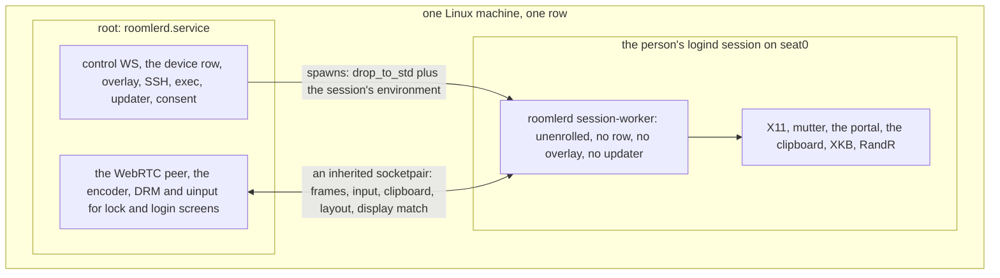

# FR-142: A Linux system install gives the person's full desktop on its one row — a session worker under the system daemon

**Issue:** [#3680](https://github.com/gjovanov/roomler-ai/issues/3680) · **Status:** P0's code read is in [Design](#design) (2026-11-11), for review before any code; P0's field read and everything after are not started, and nothing is built
**Builds on:** FR-95 ([#2041](https://github.com/gjovanov/roomler-ai/issues/2041)) and FR-113 ([#2458](https://github.com/gjovanov/roomler-ai/issues/2458)), a system install shows Wayland and X11 desktops; FR-43 ([#971](https://github.com/gjovanov/roomler-ai/issues/971)), the macOS supervisor and its unenrolled worker
**Related:** [FR-141](FR-141-one-run-one-row.md) (the wizard's one run, whose Linux criteria are met without this FR), FR-93 P7 (a root daemon's clipboard through the session, never built), #2531

## Goal

A Linux machine installed with the system card (one root daemon, one row, the TUN mesh) gives a viewer the same
desktop a per-user install gives: clipboard both ways, the keyboard layout read and switched, the display matched to
the viewer, and desktops other than GNOME and KDE, on that same row. The operator asked for "both, under a single
row" on 2026-11-11.

## Evidence

Anchors are master `1e29eeae6` (2026-11-11). "Code" means read in the tree; "inferred" means not read.

- **What a system install lacks today** (docs, `docs/platform-support.md:97`, `:106`, `:108-109`): the person's
  desktop only on GNOME or KDE, only unlocked and on screen; no clipboard (`no-session`), no layout read or
  switch, no display match. An X11 desktop that does not report its lock to logind (XFCE, i3, xscreensaver) is
  refused with `x11_not_enabled` (`agents/roomlerd/src/capture/mod.rs:735`).
- **The clipboard says no on purpose** (code): `clipboard_reachable` is false for a root daemon with no display
  variable, and its comment says "FR-93 P7 makes the root case work through the session; until then the honest
  answer is no" (`agents/roomlerd/src/encode/caps.rs:2961-2979`). FR-93 planned P7 as "the helper pattern"
  (`docs/fr/FR-93-wayland-out-of-the-box.md:626-630`, kill switch `ROOMLERD_SESSION_CLIPBOARD=0` at `:693`). A
  grep of `agents/` and `crates/` finds that switch nowhere, and FR-93 closed on 2026-10-18.
- **A root daemon already starts itself in the person's session, for one job** (code): the portal helper runs as
  the console user with that session's variables, root dropping its privileges, the session's owner running as
  itself, anyone else refused (`agents/roomlerd/src/capture/portal/mod.rs:1407-1415`, `spawn_in_session` `:1417`).
- **The shape exists on a Mac** (code and field): FR-43's root daemon starts a worker in the person's session,
  `run --supervised --unenrolled`, and serves sessions through it over `/var/run/roomler-delegate`, field-verified
  on 0.4.200 (`docs/fr/FR-43-macos-single-enrollment.md:470-664`).
- **Not read by anyone yet**: what a Linux worker would need from the person's session on Wayland (portal or
  mutter, which need the session bus) against X11 (`DISPLAY`, `XAUTHORITY`); whether one worker per graphical
  session is enough under fast user switching; what the one-daemon rule (`docs/multi-org.md:35-51`) allows a
  worker to own.

## Design questions (P0 answers them from the code)

P0 reads these files and writes the answers into this spec, with anchors. Each answer names what it read.

| Question | Read |
|---|---|
| How does the system daemon find the person's session, and follow logins, locks and user switches? | `agents/roomlerd/src/keep_busy/logind.rs`, `agents/roomlerd/src/companion.rs` (`graphical_session`), `agents/roomlerd/src/desktop_brief.rs` |
| What does the portal helper's spawn and privilege drop give a longer-lived worker, and what does it lack? | `agents/roomlerd/src/capture/portal/mod.rs` (`run_as`, `spawn_child`, `spawn_in_session`), `capture/portal/backend.rs` |
| Which capture and input arm should a worker run per session type (X11, Wayland via mutter or the portal), against the root's DRM and `uinput`? | `agents/roomlerd/src/capture/mod.rs` (the cascade), `docs/linux-capture.md` §1.2.1, §1.2.2, §4, §5 |
| How do clipboard, layout and display match reach a session today in a per-user install? | `agents/roomlerd/src/clipboard.rs`, `agents/roomlerd/src/input/layout_x11.rs`, `agents/roomlerd/src/display_match.rs`, `agents/roomlerd/src/encode/caps.rs` |
| Can FR-43's delegation (supervisor, worker, channel, caps on the heartbeat) be reused on Linux, and what is macOS-only in it? | `agents/roomlerd/src/macos_supervisor.rs`, `agents/roomlerd/src/delegate.rs`, `agents/roomlerd/src/delegate_worker.rs`, `agents/roomlerd/src/supervision.rs` |
| What does the root daemon already serve in the person's runtime directory, and who may call it? | `agents/roomlerd/src/person_socket.rs`, #2531 |
| What does the Windows supervisor do that Linux would need (session change, respawn)? | `agents/roomlerd/src/win_service/supervisor.rs` |

P0 ends with a design section here, its kill switch named, reviewed before any code.

## Design

P0's code read, 2026-11-11. Anchors are master `c41c859ae`; the code files cited did not move from `1290d1868`,
where the read began. Each statement is marked **code** (read at that line), **doc** (a doc read at that line),
**inferred** (reasoned, not read) or **field question** (only W11's field read, or a later one, can answer it).
Files read beyond the table's list: `capture/seat_guard.rs` (the session follower that already exists),
`exec.rs` (the privilege drop), `crates/localapi/src/lib.rs` (the person socket's ACL), `agents/roomlerd/src/lib.rs`.

### The answers to the seven questions

| # | Answer | Anchors |
|---|---|---|
| 1 | **Three followers exist, with two rules.** The seat guard watches logind's D-Bus (`PropertiesChanged` under `/org/freedesktop/login1`) and re-reads seat0's `ActiveSession`, `Class`, `LockedHint` and `State` every second, failing closed after 5 s; it judges a bound session `Open`, `Locked` or `Away` by **session id, never by user** (code). The desktop brief polls `loginctl` every 60 s for the hello (code). `graphical_session()` takes the first active graphical session ANYWHERE, which can be a remote login; `seat0_uid()` takes seat0's active session only, class `user`, not `Remote=yes` (code). No logind `SessionNew`/`SessionRemoved` subscription exists (code, by grep). | `capture/seat_guard.rs:15-21`, `:30`, `:33`, `:75-91`, `:257-290`, `:300-335`; `desktop_brief.rs:21`, `:147-156`; `companion.rs:1115-1172`, `:1186-1195`, `:1249-1260`; `keep_busy/logind.rs:36-54`, `:65` |
| 2 | **The helper's spawn gives the drop and the bus, not a life.** `spawn_child` resolves the session with `graphical_session()` (the anywhere rule), sets `XDG_RUNTIME_DIR`, the session bus, `DISPLAY` and a GUESSED `WAYLAND_DISPLAY=wayland-0`, and drops through `drop_to_std` (getpwnam, `setgroups` then `setgid` then `setuid`, verified) (code). It sets no `XAUTHORITY` and none of the session's own environment, which the companion's launch reads from `systemctl --user show-environment` as the person (code). The child lives in the daemon's cgroup, not the person's session (inferred), one per capture, killed on drop, with no respawn, no death signal and no channel but its stdin and stdout (code). | `capture/portal/mod.rs:1306-1384`, `:1315-1319`, `:1338-1358`, `:1407-1415`; `exec.rs:1170-1200`, `:1325-1337`; `companion.rs:859-878`, `:911-945`, `:1160-1165`; `capture/portal/backend.rs:269-286` |
| 3 | **Root keeps DRM and `uinput`; the worker adds the arms that need the session.** A root daemon's automatic plan is DRM + `uinput`, bound to the logind session on screen, only while it is unlocked, only where the person can be told, and on X11 only under a lock-reporting shell (code, doc). A worker in the session can run what root cannot: X11 (XShm/XTest with `DISPLAY` and `XAUTHORITY`), mutter's ScreenCast and RemoteDesktop, the portal (code: the helper already runs these as the person). GNOME closes every mutter and portal session at its lock and refuses new ones until unlock (doc), so the lock and login screens stay root's (DRM with `drm_capture`). | `capture/mod.rs:629`, `:1058`, `:1119`, `:1235`, `:1384`, `:1456`; `docs/linux-capture.md:335-360`, `:1789-1800` |
| 4 | **All three are X11 calls in the process that holds the session.** The clipboard is the WebRTC `clipboard` data channel, served where the peer is, through `arboard` built with `image-data` only, so the X11 protocol (code); image change-watching is X11-only (code). The layout is X11 only, "not under Wayland ... nor on a system install", and GNOME reports without switching (code). Display match is X11 only, never on a virtual desktop (code). ⚠️ So a **per-user** install on GNOME or KDE Wayland gives the clipboard (through Xwayland: field question) and neither the layout nor display match today. | `clipboard.rs:3-10`, `:633-635`; `Cargo.toml:320`; `agents/roomlerd/Cargo.toml:328`; `input/layout_x11.rs:27-34`, `:62`, `:79`; `display_match.rs:333-339`; `encode/caps.rs:2775`, `:2793`, `:2831`, `:2961-2979` |
| 5 | **The protocol and its gates carry over; the spawn chain and the session model do not.** Reusable (code): `DelegateFrame` (`WorkerCaps`, `WorkerLogs`, `PersonFloor` that only tightens), default-deny three ways (no secret, one worker, revoked on stop), the lifeline (pipe end = worker stops), the stale-worker reap, the backoff constants. macOS-only (code): `launchctl asuser` + `sudo`, whose `env_reset` and closed descriptors are why a secret on stdin exists at all; the `MacosSupervisor` supervision row is compiled for macOS only. On a Mac the worker holds the **peer** (`ToWorker{ServerMsg}` / `FromWorker{ClientMsg}`): root cannot capture there at all. | `macos_supervisor.rs:5-11`, `:34-36`, `:38-52`, `:372`, `:470`, `:641`, `:699`; `delegate.rs:16-53`, `:81`, `:94`, `:116-127`, `:172-188`, `:1274`, `:1300`, `:1519`; `delegate_worker.rs:33-43`, `:176`; `supervision.rs:21`, `:246`; `lib.rs:49-51` |
| 6 | **A person socket, callable by anything running as the person.** Root binds `/run/user/<uid>/<socket>` as the person, admits a connection whose `SO_PEERCRED` uid is the person's or root's, and serves the exhaustive `person_may` list: status, sessions and Disconnect, consent and its answer, keep busy, Devices/Mesh/Peers, recording, the config listing and `ConfigSet` of the console person's keys (code). It follows seat0's person by **uid** every 5 s (code), which #2531 (open) shows breaks when a re-login of the same uid recreates `/run/user/<uid>`. | `person_socket.rs:16-22`, `:52-54`, `:72`; `crates/localapi/src/lib.rs:3350`, `:4412-4414`, `:4440-4466`, `:4523`; #2531 |
| 7 | **Session change in, respawn with backoff, and one lesson.** The SCM's `SessionChanged` tears the old worker down and spawns in the new session (`WTSQueryUserToken` + `CreateProcessAsUserW`, a kill-on-close job), backing off 2 s to 60 s (code). ⚠️ Its field lesson: swapping the process that holds the stream mid-session took about 13 s, longer than the browser's 16 s reconnect ladder allows across its attempts, so every connect killed itself, and the SYSTEM worker lost the clipboard and file channels (code comment, field 2026-05-06). | `win_service/supervisor.rs:3-22`, `:55`, `:79-83`, `:98`, `:282`, `:855-892` |

### How the root daemon finds and follows the person's session

The worker is bound to ONE logind session id: seat0's `ActiveSession`, class `user`, not `Remote=yes`, by
`seat0_uid()`'s rule (`companion.rs:1249-1260`) and the seat guard's id match (`seat_guard.rs:75-91`). Never by uid
(#2531), never by `graphical_session()` (`companion.rs:1186-1195`). The seat guard's watcher is the event source
(`seat_guard.rs:257-290`); its 1 s tick and 5 s staleness hold for the worker too (inferred).

| event | logind shows (code: `seat_guard.rs:300-335`) | which session has a worker | a live remote-desktop session |
|---|---|---|---|
| login | a new id, class `user`, `active` | the new id gets one (spawned at once while the key is on, D5) | none yet |
| lock | same id, `LockedHint=yes` | kept; the worker's mutter/portal stream ends (GNOME, `docs/linux-capture.md:1789-1800`) | the peer stays in root; `GuardLocked` as today, or DRM reads the lock screen where `drm_capture` is set; clipboard and layout are refused while locked (D6) |
| unlock | same id, `LockedHint=no` | the same worker reopens its sources | resumes on the same peer, no renegotiation |
| user switch, greeter in front | another id, or class `greeter`; ours `online` (`keep_busy/logind.rs:65`) | ours kept, serves nothing while `Away`; the other person gets a worker only for a session opened to them | waits `GuardAway`, as today; never follows to the new person, who was not told (`seat_guard.rs:8-13`) |
| several graphical sessions (xrdp, a second seat) | not seat0's active one | none | not served (out of scope) |
| logout, session `closing` | `State=closing`, up to 90 s (`seat_guard.rs:78-84`) | stopped at once (the socket closed, a TERM, a KILL after a grace) | `Away`, then ended as today |

### The worker

- **Start** (inferred design): a direct child of the root daemon, not a `systemd-run` unit, so it can never outlive
  the daemon (the #2987 class, `macos_supervisor.rs:38-52`) and can inherit one end of a socketpair. It is spawned
  from the daemon's own executable, as the portal helper's drop does (`capture/portal/mod.rs:1360-1384`), with the
  session's bus and runtime dir, `DISPLAY` from logind, `XAUTHORITY` and the desktop's keys from the person's user
  manager (`companion.rs:859-878`, `:911-945`), and `WAYLAND_DISPLAY` read, not guessed (`companion.rs:1160-1165`
  guesses). A subcommand of its own, not `run`, so the worker reads no config, holds no enrollment and starts no
  WS, overlay or updater (the one-daemon rule).
- **What it lacks against the helper's spawn**: the seat0-by-id rule, the session's environment, a long life with
  respawn (2 s to 60 s, `win_service/supervisor.rs:79-83`; stop after five fast exits, `macos_supervisor.rs:72`),
  and a channel in both directions. Supervision needs a Linux row: `--supervised` reads as macOS only
  (`supervision.rs:246`), and a child that inherits `INVOCATION_ID` and the unit's cgroup would read as systemd
  (`supervision.rs:23`, inferred).
- **What it owns, per session type** (code for what each reaches, inferred for the split):

| | X11 (GNOME or KDE on Xorg) | Wayland (GNOME: mutter; KDE: the portal) |
|---|---|---|
| capture and input while unlocked | P1: root's DRM + `uinput` as today. P2: the worker's XShm and XTest where DRM cannot serve | P1: root's DRM + `uinput`. P2: the worker's mutter or portal arm, as the helper runs them today |
| clipboard | the worker, `arboard` on the X display | the worker, `arboard` through Xwayland (field question: GNOME's and KWin's Xwayland clipboard sync) |
| layout read / switch | the worker, XKB; GNOME reads only (`input/layout_x11.rs:31-34`) | none, as per-user (`input/layout_x11.rs:27-30`), unless D3 |
| display match | the worker, RandR, under the owner's FR-108 rule (`display_match.rs:28-32`) | none, as per-user, unless D3 |
| lock and login screens | root: DRM with `drm_capture`, `uinput` | root, the same |

### The channel between them, and its trust boundary

- **Not a secret, an inherited descriptor**: FR-43 rejected a socketpair only because `sudo` closes inherited
  descriptors, and called it "strictly better" (`delegate.rs:38-42`). Linux has no `sudo` in the chain, so
  possession of the fd is the attach, and `SO_PEERCRED` on it must name the pid root spawned (inferred). Nothing is
  listening for anyone else, so the 0711 directory and per-uid socket (`delegate.rs:808-823`) are not needed.
  FR-43's other gates carry over: one worker per session, refused while one is attached (`delegate.rs:1300`), and
  the channel's end stops the worker, the lifeline (`macos_supervisor.rs:372`).
- **What root accepts from the worker**: a handshake with its version and the caps it can serve, which may only
  NARROW the hello as `PersonFloor` only tightens (`delegate.rs:172-188`); frames; clipboard content and change
  events; the layout snapshot; the display-match state; its log lines (`WorkerLogs`, `delegate.rs:164-171`).
  Nothing else: no LocalAPI verb, no config, no consent answer, no exec.
- **What the worker accepts from root**: open or close a source; input events; clipboard read and write; a layout
  token; a display mode. Only while root's guard is `Open` for the worker's session (inferred).
- **Why that boundary**: a process running as the person can already call the person socket (`crates/localapi/src/lib.rs:3350`,
  `:4440-4466`) and, as the same uid, can reach the worker's memory (inferred). So the worker is trusted as much as
  the person's account and no more: what it says is the person's claim, and it can never decide anything root's
  gates own.

### Which media path carries the pixels

**The peer stays in the root daemon** (recommended, D4). The worker is a source and a sink; the pump, the encoder and
the peer do not move.

| | peer in root (recommended) | peer in the worker (FR-43's shape) |
|---|---|---|
| lock and unlock | the source changes under one peer; no process swap | a second peer or a swap, the 13 s Windows lesson (`win_service/supervisor.rs:855-892`) |
| encoder | as root, as a system install encodes today | as the person (render node access: field question) |
| pixels | copied across the process boundary, as the portal helper's are (`capture/portal/backend.rs:5-13`, `:29-33`); 4K at 60 fps: field question | none cross |
| `close()` | one owner, today's | the worker must close it, and root must close its relay |
| worker crash | a source error: the cascade's fall-through, the viewer told | the session is lost |
| signalling, ICE, consent, overlay footprint | unchanged | forwarded to the worker, as `OverlayFootprint` had to be (`delegate.rs:131-145`) |

### The kill switch

**`linux_session_worker`**, a key of the root daemon's config (`/etc/roomler/config.toml`), env
`ROOMLERD_LINUX_SESSION_WORKER`, default **off**. Off, the supervisor task is never started, so no worker, no
socketpair and no worker caps exist, and the hello keeps `clipboard_reachable`'s honest "no"
(`encode/caps.rs:2961-2979`): today's system install byte for byte, the same shape as
`macos_supervise_gui_worker` (`macos_supervisor.rs:34-36`). Per device from the server later: the remote-config
surface, which applies a key only where the device's own `remote_config_enabled` is on (rule, `networking.md`;
`docs/remote-config.md`), not designed here.

### Phases refined, and the acceptance criteria checked

- **P1** (first shippable slice): the worker under the key, for the four sessions the system card serves (GNOME and
  KDE, Wayland and X11), owning the clipboard everywhere and the layout and display match on X11. Capture and input
  stay root's DRM and `uinput`, so the lock, the greeter and the seat guard are unchanged. Not covered: capture in
  the worker, the refused X11 desktops, Wayland layout and display match.
- **P2**: capture and input in the worker for hosts where DRM cannot serve (no CRTC), and the X11 desktops refused
  with `x11_not_enabled` once their lock can be seen (D1).
- **P3**: the default flips after the field read. **P4**: docs.

| AC | what the design can meet |
|---|---|
| AC1 | this section, once reviewed |
| AC2 | text and image both ways on GNOME Wayland: yes, if Xwayland's clipboard is the desktop's (field question). The layout and display match: **not at per-user parity** (question 4): D3 |
| AC3 | GNOME on Xorg: clipboard and display match; the layout read only (GNOME switches nothing). KDE on Xorg: all three. KDE Wayland: the clipboard only, unless D3 |
| AC4 | yes: the mesh, `drm_capture` and SSH stay in root and are not touched |
| AC5 | yes: the key's off path above |
| AC6 | P4 |

### What can go wrong

| failure | what a person would see | what the design does |
|---|---|---|
| the worker dies mid-session | the clipboard and layout chip stop; the picture goes on (P1) or stops with a reason (P2) | root's peer lives on; respawn with backoff; the caps narrow until the worker is back |
| the worker cannot start: no session bus, a home it cannot enter, a session type nobody planned for (a tty, a WSL2 distro, `docs/linux-capture.md:1668-1690`) | the features answer `no-session`, as today | five fast exits stop the respawns (`macos_supervisor.rs:72`), the reason is logged and in the hello's `unavailable` |
| two people logged in | only the person on seat0 is served | one worker per session id; the one in the background serves nothing while `Away` |
| an update replaces the binary under a running worker | nothing, until the daemon restarts | the worker is spawned from the daemon's own image (inferred: `/proc/self/exe`), and the lifeline ends it with its daemon; the next daemon spawns the new one |
| the portal asks the person a question nobody is there to answer (KDE, P2) | a dialog on an unattended screen | the 120 s bound (`capture/portal/mod.rs:1505`) fails the open and the cascade falls through, as today; P1 opens no portal |
| a re-login of the same uid recreates `/run/user/<uid>` (#2531) | the companion, not the worker, loses its socket | the worker follows the session id, so a new session is a new worker |
| display match changed and the worker dies | the screen stays in the viewer's mode | inferred: X11 has no temporary mode like Windows' (`display_match.rs:19-20`), so root must restore it; field question |
| the session is `closing` for 90 s | nothing | `Away` at once (`seat_guard.rs:78-84`), the worker stopped |

## Phases

| phase | what | kill switch | status |
|---|---|---|---|
| P0 | Read the files above; write the design; field read on the released daemon, recorded RED: a system install on GNOME Wayland, GNOME on Xorg, KDE, and one X11 desktop that is refused today (clipboard, layout, display match, the refusal) | read only | code read written ([Design](#design)); field read running |
| P1 | The worker under the system daemon, its first desktop and features as D1 decides | a config key of the root daemon, default off (named by P0): off = today's system install byte for byte | not started |
| P2 | The rest of D1's desktops | the same key | not started |
| P3 | The default flips, on the operator's word, after the field read | the same key | not started |
| P4 | Docs: `docs/linux-capture.md`, `docs/platform-support.md` §3, the wizard's system card (with FR-141) | none | not started |

## Acceptance criteria

- [ ] **AC1**: P0's design is in this spec, every claim anchored to code read at a named master.
- [ ] **AC2**: on released builds, a system install on Ubuntu GNOME Wayland, one row: a session copies text and an
  image both ways, reads and switches the layout, matches the display. Field read, RED first on today's release.
- [ ] **AC3**: the same on GNOME on Xorg and on KDE Plasma, as far as D1 covers them.
- [ ] **AC4**: the mesh, the lock screen with `drm_capture`, and `roomler ssh` behave as before on that row.
- [ ] **AC5**: with the key off, the system install is today's, read in the field.
- [ ] **AC6**: docs updated in house style, linked from a row in `docs/README.md`.

## Open decisions

- **D1. Which sessions first?** Recommendation: GNOME and KDE on Wayland and on X11 (the four the system card
  serves today), then the X11 desktops refused with `x11_not_enabled`. Cost: those desktops wait a phase.
  Sharpened by P0: a worker reaches those desktops, but they are refused because their lock is not reported to
  logind (`capture/mod.rs:1235`), and a worker does not change that. They need a lock signal of their own first.
- **D2. What the system card says until this ships** is FR-141's D3.
- **D3. AC2's and AC3's bar.** Recommendation: per-user parity, which on Wayland is the clipboard alone, and the
  layout read without a switch on GNOME. Cost: AC2 is reworded; Wayland layout and display match become a later FR.
- **D4. Where the peer lives.** Recommendation: the root daemon. Cost: frames are copied across processes.
- **D5. When the worker starts.** Recommendation: at login, while the key is on, so the hello is honest at once.
  Cost: one idle process per signed-in person.
- **D6. The clipboard while the screen is locked.** Recommendation: refused. Cost: a copy made before the lock waits
  for the unlock.

## Out of scope

- The wizard's pages and the one run: FR-141.
- A per-user install with a TUN mesh, which the one-daemon rule forbids.
- The lock and login screens beyond `drm_capture`.
- macOS and Windows.

## Field log

| date | what | result |
|---|---|---|
