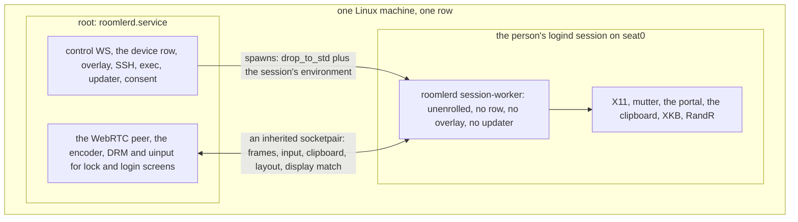

# FR-142: A Linux system install gives the person's full desktop on its one row — a session worker under the system daemon

**Issue:** [#3680](https://github.com/gjovanov/roomler-ai/issues/3680) · **Status:** P0 done 2026-11-11: its design ([Design](#design)), read from the code and corrected after its review the same day, merged as #3685 (`f8de61d8e`), and its field read is in the [field log](#field-log). D1 and D3 decided the same day. P1 onwards not started, and nothing is built
**Builds on:** FR-95 ([#2041](https://github.com/gjovanov/roomler-ai/issues/2041)) and FR-113 ([#2458](https://github.com/gjovanov/roomler-ai/issues/2458)), a system install shows Wayland and X11 desktops; FR-43 ([#971](https://github.com/gjovanov/roomler-ai/issues/971)), the macOS supervisor and its unenrolled worker
**Related:** [FR-141](FR-141-one-run-one-row.md) (the wizard's one run, whose Linux criteria are met without this FR), FR-93 P7 (a root daemon's clipboard through the session, never built), #2531

## Goal

A Linux machine installed with the system card (one root daemon, one row, the TUN mesh) gives a viewer the same
desktop a per-user install gives: clipboard both ways, the keyboard layout read and switched, the display matched to
the viewer, and desktops other than GNOME and KDE, on that same row. The operator asked for "both, under a single
row" on 2026-11-11.

## Evidence

Anchors are master `1e29eeae6` (2026-11-11). "Code" means read in the tree; "inferred" means not read.

- **What a system install lacks today** (docs, `docs/platform-support.md:97`, `:106`, `:108-109`): the person's
  desktop only on GNOME or KDE, only unlocked and on screen; no clipboard (`no-session`), no layout read or
  switch, no display match. An X11 desktop that does not report its lock to logind (XFCE, i3, xscreensaver) is
  refused with `x11_not_enabled` (`agents/roomlerd/src/capture/mod.rs:735`).
- **The clipboard says no on purpose** (code): `clipboard_reachable` is false for a root daemon with no display
  variable, and its comment says "FR-93 P7 makes the root case work through the session; until then the honest
  answer is no" (`agents/roomlerd/src/encode/caps.rs:2961-2979`). FR-93 planned P7 as "the helper pattern"
  (`docs/fr/FR-93-wayland-out-of-the-box.md:626-630`, kill switch `ROOMLERD_SESSION_CLIPBOARD=0` at `:693`). A
  grep of `agents/` and `crates/` finds that switch nowhere, and FR-93 closed on 2026-10-18.
- **A root daemon already starts itself in the person's session, for one job** (code): the portal helper runs as
  the console user with that session's variables, root dropping its privileges, the session's owner running as
  itself, anyone else refused (`agents/roomlerd/src/capture/portal/mod.rs:1407-1415`, `spawn_in_session` `:1417`).
- **The shape exists on a Mac** (code and field): FR-43's root daemon starts a worker in the person's session,
  `run --supervised --unenrolled`, and serves sessions through it over `/var/run/roomler-delegate`, field-verified
  on 0.4.200 (`docs/fr/FR-43-macos-single-enrollment.md:470-664`).
- **Not read by anyone yet**: what a Linux worker would need from the person's session on Wayland (portal or
  mutter, which need the session bus) against X11 (`DISPLAY`, `XAUTHORITY`); whether one worker per graphical
  session is enough under fast user switching; what the one-daemon rule (`docs/multi-org.md:35-51`) allows a
  worker to own.

## Design questions (P0 answers them from the code)

P0 reads these files and writes the answers into this spec, with anchors. Each answer names what it read.

| Question | Read |
|---|---|
| How does the system daemon find the person's session, and follow logins, locks and user switches? | `agents/roomlerd/src/keep_busy/logind.rs`, `agents/roomlerd/src/companion.rs` (`graphical_session`), `agents/roomlerd/src/desktop_brief.rs` |
| What does the portal helper's spawn and privilege drop give a longer-lived worker, and what does it lack? | `agents/roomlerd/src/capture/portal/mod.rs` (`run_as`, `spawn_child`, `spawn_in_session`), `capture/portal/backend.rs` |
| Which capture and input arm should a worker run per session type (X11, Wayland via mutter or the portal), against the root's DRM and `uinput`? | `agents/roomlerd/src/capture/mod.rs` (the cascade), `docs/linux-capture.md` §1.2.1, §1.2.2, §4, §5 |
| How do clipboard, layout and display match reach a session today in a per-user install? | `agents/roomlerd/src/clipboard.rs`, `agents/roomlerd/src/input/layout_x11.rs`, `agents/roomlerd/src/display_match.rs`, `agents/roomlerd/src/encode/caps.rs` |
| Can FR-43's delegation (supervisor, worker, channel, caps on the heartbeat) be reused on Linux, and what is macOS-only in it? | `agents/roomlerd/src/macos_supervisor.rs`, `agents/roomlerd/src/delegate.rs`, `agents/roomlerd/src/delegate_worker.rs`, `agents/roomlerd/src/supervision.rs` |
| What does the root daemon already serve in the person's runtime directory, and who may call it? | `agents/roomlerd/src/person_socket.rs`, #2531 |
| What does the Windows supervisor do that Linux would need (session change, respawn)? | `agents/roomlerd/src/win_service/supervisor.rs` |

P0 ends with a design section here, its kill switch named, reviewed before any code.

## Design

P0's code read, 2026-11-11, corrected after its review the same day. Anchors are master `c41c859ae`, except
`docs/linux-capture.md`, whose lines after 791 are cited at `c26c64869` (#3684 added three lines there); the code
files cited did not move from `1290d1868`, where the read began. Each statement is marked **code** (read at that
line), **doc** (a doc read at that line), **man** (a Linux manual page), **inferred** (reasoned, not read) or
**field question** (only W11's field read, or a later one, can answer it). Files read beyond the table's list:
`capture/seat_guard.rs` (the session follower that already exists), `exec.rs` (the privilege drop),
`crates/localapi/src/lib.rs` (the person socket's ACL), `agents/roomlerd/src/lib.rs`, `crates/tunnel-core/src/child.rs`
(what a child inherits), `capture/portal/wire.rs` (the helper's frame header), `virtual_desktop.rs`, `audio_source.rs`,
`signaling.rs` (the heartbeat's caps).

### The answers to the seven questions

| # | Answer | Anchors |
|---|---|---|
| 1 | **Three followers exist.** The seat guard watches logind's D-Bus (`PropertiesChanged` under `/org/freedesktop/login1`) and re-reads seat0's `ActiveSession`, `Class`, `LockedHint` and `State` every second, failing closed after 5 s; it judges a bound session `Open`, `Locked` or `Away` by **session id, never by user** (code). The desktop brief polls `loginctl` every 60 s for the hello (code). The session lookups in `companion.rs` differ in which session they take; the worker uses `seat0_uid()`'s: seat0's active session only, class `user`, not `Remote=yes` (code). No logind `SessionNew`/`SessionRemoved` subscription exists (code, by grep). | `capture/seat_guard.rs:15-21`, `:30`, `:33`, `:75-91`, `:257-290`, `:300-335`; `desktop_brief.rs:21`, `:147-156`; `companion.rs:1492-1503`; `keep_busy/logind.rs:36-54`, `:65` |
| 2 | **The helper's spawn gives the drop and the bus, not a life.** `spawn_child` sets `XDG_RUNTIME_DIR`, the session bus, `DISPLAY` and a GUESSED `WAYLAND_DISPLAY=wayland-0`, and drops through `drop_to_std` (getpwnam, `setgroups` then `setgid` then `setuid`, verified) (code). It sets no `XAUTHORITY` and none of the session's own environment, which the companion's launch reads from `systemctl --user show-environment` as the person (code). The child lives in the daemon's cgroup, not the person's session (inferred), one per capture, killed on drop, with no respawn, no death signal and no channel but its stdin and stdout (code). | `capture/portal/mod.rs:1306-1384`, `:1315-1319`, `:1338-1358`, `:1407-1415`; `exec.rs:1170-1200`, `:1325-1337`; `companion.rs:1102-1121`, `:1154-1188`, `:1403-1408`; `capture/portal/backend.rs:269-286` |
| 3 | **Root keeps DRM and `uinput`; the worker adds the arms that need the session.** A root daemon's automatic plan is DRM + `uinput`, bound to the logind session on screen, only while it is unlocked, only where the person can be told, and on X11 only under a lock-reporting shell (code, doc). A worker in the session can run what root cannot: X11 (XShm/XTest with `DISPLAY` and `XAUTHORITY`), mutter's ScreenCast and RemoteDesktop, the portal (code: the helper already runs these as the person). GNOME closes every mutter and portal session at its lock and refuses new ones until unlock (doc), so the lock and login screens stay root's (DRM with `drm_capture`). | `capture/mod.rs:629`, `:1058`, `:1119`, `:1235`, `:1384`, `:1456`; `docs/linux-capture.md:335-360`, `:1792-1803` |
| 4 | **All three are X11 calls in the process that holds the session.** The clipboard is the WebRTC `clipboard` data channel, served where the peer is, through `arboard` built with `image-data` only, so the X11 protocol (code); image change-watching is X11-only (code). The layout is X11 only, "not under Wayland ... nor on a system install", and GNOME reports without switching (code). Display match is X11 only: on a person's own X display (`x11_offered`, which leaves out the daemon's virtual desktop), and on that virtual desktop through a path of its own on Xorg's dummy driver (code). ⚠️ So a **per-user** install on GNOME or KDE Wayland gives the clipboard (through Xwayland: field question, no field read exists, see [the field question](#the-clipboard-under-wayland-a-field-question)) and neither the layout nor display match today. | `clipboard.rs:3-10`, `:633-635`; `Cargo.toml:320`; `agents/roomlerd/Cargo.toml:328`; `input/layout_x11.rs:27-34`, `:62`, `:79`; `display_match.rs:224`, `:326-339`, `:1079`; `encode/caps.rs:2775`, `:2793`, `:2831`, `:2961-2979` |
| 5 | **The protocol and its gates carry over; the spawn chain and the session model do not.** Reusable (code): `DelegateFrame` (`WorkerCaps`, `WorkerLogs`, `PersonFloor` that only tightens), default-deny three ways (no secret, one worker, revoked on stop), the lifeline (pipe end = worker stops), the stale-worker reap, the backoff constants. macOS-only (code): `launchctl asuser` + `sudo`, whose `env_reset` and closed descriptors are why a secret on stdin exists at all; the `MacosSupervisor` supervision row is compiled for macOS only. On a Mac the worker holds the **peer** (`ToWorker{ServerMsg}` / `FromWorker{ClientMsg}`): root cannot capture there at all. | `macos_supervisor.rs:5-11`, `:34-36`, `:38-52`, `:376`, `:474`, `:645`, `:703`; `delegate.rs:16-53`, `:81`, `:94`, `:116-127`, `:172-188`, `:1274`, `:1300`, `:1519`; `delegate_worker.rs:33-43`, `:176`; `supervision.rs:21`, `:246`; `lib.rs:49-51` |
| 6 | **A person socket, callable by anything running as the person.** Root binds `/run/user/<uid>/<socket>` as the person, admits a connection whose `SO_PEERCRED` uid is the person's or root's, and serves the exhaustive `person_may` list: status, sessions and Disconnect, consent and its answer, keep busy, Devices/Mesh/Peers, recording, the config listing and `ConfigSet` of the console person's keys (code). It follows seat0's person by **uid** every 5 s (code), which #2531 (open) shows breaks when a re-login of the same uid recreates `/run/user/<uid>`. | `person_socket.rs:16-22`, `:52-54`, `:72`; `crates/localapi/src/lib.rs:3380`, `:4593-4595`, `:4621-4647`, `:4704`; #2531 |
| 7 | **Session change in, respawn with backoff, and one lesson.** The SCM's `SessionChanged` tears the old worker down and spawns in the new session (`WTSQueryUserToken` + `CreateProcessAsUserW`, a kill-on-close job), backing off 2 s to 60 s (code). ⚠️ Its field lesson: swapping the process that holds the stream mid-session took about 13 s, longer than the browser's 16 s reconnect ladder allows across its attempts, so every connect killed itself, and the SYSTEM worker lost the clipboard and file channels (code comment, field 2026-05-06). | `win_service/supervisor.rs:3-22`, `:55`, `:79-83`, `:98`, `:282`, `:880-892` |

### How the root daemon finds and follows the person's session

The worker is bound to ONE logind session id: seat0's `ActiveSession`, class `user`, not `Remote=yes`, by
`seat0_uid()`'s rule (`companion.rs:1492-1503`) and the seat guard's id match (`seat_guard.rs:75-91`). Never by uid
(#2531). The seat guard's watcher is the event source
(`seat_guard.rs:257-290`).

**Its life and its cost today** (code): the watcher starts on the first `on_screen()` call, once a process
(`seat_guard.rs:117-120`, `:187-199`), and then loops for the daemon's whole life (`:221-242`). Its callers are the
system plan (`capture/mod.rs:1221`), the DRM arm (`capture/drm_backend.rs:855-868`, `:1465`) and the automatic
input gate (`input/mod.rs:232`, `:488`), so on a root daemon it may run from the first hello on (inferred: not
traced from the hello). With logind's bus it wakes on `PropertiesChanged` but also re-reads the seat with four
uncached `Properties.Get` calls every second, signal or not (`:29-30`, `:281-289`), because a reading older than
5 s closes the guard (`:18-21`, `:32-33`). D5's worker at login needs the follower always on, so P1 makes it
signal-driven while nothing is bound (inferred design): with no capture bound and no viewer counted
(`seat_guard.rs:132-185`), the loop waits on the signal alone and re-reads on a long timer (60 s, a missed signal's
bound); the 1 s re-read and the 5 s staleness come back while a capture is bound, so the fail-closed rule is
unchanged where it guards anything. The supervisor takes its login, lock and logout events from the same loop,
not from a second watcher. A build without zbus keeps today's 1 s `loginctl` loop (`:236-242`).

| event | logind shows (code: `seat_guard.rs:300-335`) | which session has a worker | a live remote-desktop session |
|---|---|---|---|
| login | a new id, class `user`, `active` | the new id gets one (spawned at once while the key is on, D5) | none yet |
| lock | same id, `LockedHint=yes` | kept; the worker's mutter/portal stream ends (GNOME, `docs/linux-capture.md:1792-1803`) | the peer stays in root; `GuardLocked` as today, or DRM reads the lock screen where `drm_capture` is set; clipboard and layout are refused while locked (D6) |
| unlock | same id, `LockedHint=no` | the same worker reopens its sources | resumes on the same peer, no renegotiation |
| user switch, greeter in front | another id, or class `greeter`; ours `online` (`keep_busy/logind.rs:65`) | ours kept, serves nothing while `Away`; the other person gets a worker only for a session opened to them | waits `GuardAway`, as today; never follows to the new person, who was not told (`seat_guard.rs:8-13`) |
| several graphical sessions (xrdp, a second seat) | not seat0's active one | none | not served (out of scope) |
| logout, session `closing` | `State=closing`, up to 90 s (`seat_guard.rs:78-84`) | stopped at once (the socket closed, a TERM, a KILL after a grace) | `Away`, then ended as today |

### The worker

- **Start** (inferred design): a direct child of the root daemon, not a `systemd-run` unit, so it can never outlive
  the daemon (the #2987 class, `macos_supervisor.rs:38-52`) and can inherit one end of a socketpair. It is spawned
  from the daemon's own executable, as the portal helper's drop does (`capture/portal/mod.rs:1360-1384`), with the
  session's bus and runtime dir, `DISPLAY` from logind, `XAUTHORITY` and the desktop's keys from the person's user
  manager (`companion.rs:1102-1121`, `:1154-1188`), and `WAYLAND_DISPLAY` read, not guessed (`companion.rs:1403-1408`
  guesses). A subcommand of its own, not `run`, so the worker reads no config, holds no enrollment and starts no
  WS, overlay or updater (the one-daemon rule).
- **What the worker needs beyond the helper's spawn**: its session chosen by `seat0_uid()`'s rule and followed by
  id, the session's environment, a long life with
  respawn (2 s to 60 s, `win_service/supervisor.rs:79-83`; stop after five fast exits, `macos_supervisor.rs:70-73`),
  and a channel in both directions.
- **Its supervisor is the virtual desktop's, not a new `Supervision` row** (code, corrected after review): the
  daemon already keeps a child alive on Linux for its whole life, the virtual desktop's X server: a thread waits for
  its exit, marks the desktop down first, kills and reaps the tree, and waits before the next start, 1 s doubling to
  300 s, a run of 60 s resetting it (`virtual_desktop.rs:1274-1300`, `:784-796`, `Backoff` `:1347`). The worker's
  supervisor reuses that loop and its `Backoff`, with the worker's own floor and ceiling (2 s to 60 s, five fast
  exits). `Supervision` names what restarts the DAEMON (`supervision.rs:240-253`); the worker is a subcommand that
  never takes `run`'s restart path, so it needs no row there.
- **A host whose only desktop is the virtual one gets no worker** (code and inferred): the daemon started that X
  server and holds `DISPLAY` itself (`apps/linux.rs:500-506`), display match has its own path there
  (`display_match.rs:224`), and no logind session sits on seat0 for a worker to join. The key changes nothing there.
- **What it owns, per session type** (code for what each reaches, inferred for the split):

| | X11 (GNOME or KDE on Xorg) | Wayland (GNOME: mutter; KDE: the portal) |
|---|---|---|
| capture and input while unlocked | P1: root's DRM + `uinput` as today. P2: the worker's XShm and XTest where DRM cannot serve | P1: root's DRM + `uinput`. P2: the worker's mutter or portal arm, as the helper runs them today |
| clipboard | the worker, `arboard` on the X display | the worker, `arboard` through Xwayland (field question: GNOME's and KWin's Xwayland clipboard sync) |
| layout read / switch | the worker, XKB; GNOME reads only (`input/layout_x11.rs:31-34`) | none, as per-user (`input/layout_x11.rs:27-30`), unless D3 |
| display match | the worker, RandR, under the owner's FR-108 rule (`display_match.rs:28-32`) | none, as per-user, unless D3 |
| lock and login screens | root: DRM with `drm_capture`, `uinput` | root, the same |

### The channel between them, and its trust boundary

- **Not a secret, an inherited descriptor**: FR-43 rejected a socketpair only because `sudo` closes inherited
  descriptors, and called it "strictly better" (`delegate.rs:38-42`). Linux has no `sudo` in the chain, so
  possession of the descriptor is the attach. ⚠️ No credential check on it can add anything: on a pair made by
  `socketpair(2)`, `SO_PEERCRED` returns "the credentials that were in effect at the time of the call to connect(2),
  listen(2), or socketpair(2)" (man: unix(7)), so both ends name the daemon that made the pair. The attach rests on
  where the two ends can be, and this invariant holds it:
  - The daemon makes the pair with `SOCK_CLOEXEC` asked for in the `socketpair` call itself (man: socketpair(2)),
    so neither end survives an `exec` in any child, and no thread can fork in between (the same reason the pty's
    ends are made that way, `pty/unix.rs:5-13`). Nothing in `agents/` or `crates/` forks without an exec (code,
    by grep: no `fork`, `forkpty` or `daemon` call).
  - Root's end stays in the daemon. The worker's end reaches exactly one `Command`, as its **stdin**: the helper
    already rides its standard streams (`capture/portal/mod.rs:1343-1352`), and std's `dup2` onto descriptor 0
    clears close-on-exec on 0 only. The parent drops its copy as soon as `spawn` returns, as the pty's parent drops
    the slave (`pty/unix.rs:278`).
  - The worker sweeps like every long-lived child and every child that runs a caller's code: the repository's
    guard is `tunnel_core::child::inherit_only_stdio` (#3080, `crates/tunnel-core/src/child.rs:3-25`, `:202-228`),
    used today by exec (`exec.rs:1811-1816`), the SSH shell (`pty/unix.rs:268-272`), the portal helper
    (`capture/portal/mod.rs:1380-1381`) and the virtual desktop (`virtual_desktop.rs:1845`, `:1858`). It marks every
    descriptor above stderr close-on-exec, so the channel must ride a standard stream or the sweep would close it.
    The companion's launch is a `systemd-run` client whose unit PID 1 starts (`companion.rs:1239-1242`), so it holds
    nothing of the daemon's either way.
  - At its start the worker moves the channel off descriptor 0 (`F_DUPFD_CLOEXEC`, then 0 reopened on
    `/dev/null`), so nothing it starts inherits it and no grandchild can hold the lifeline open, the #3080 class
    (inferred design). Root also waits on the worker's pid, so EOF is not its only sign of a death.
  - Tests that hold it (P1): both ends read `FD_CLOEXEC`; a sweeping child started while the pair is live has
    neither end open, the shape of `child.rs:497-532`; a stand-in for the worker started by the real builder has one
    socket, on descriptor 0, with the worker end's inode; after the worker's move, a child it starts has no socket;
    killing the worker gives root's end an EOF.

  Nothing is listening for anyone else, so the 0711 directory and per-uid socket (`delegate.rs:808-823`) are not
  needed. FR-43's other gates carry over: one worker per session, refused while one is attached (`delegate.rs:1300`),
  and the channel's end stops the worker, the lifeline (`macos_supervisor.rs:376`).
- **What root accepts from the worker**: a handshake with its version and the features it can serve now; frames
  (P2); clipboard content and change events; the layout snapshot; the display-match state; its log lines
  (`WorkerLogs`, `delegate.rs:164-171`). Nothing else: no LocalAPI verb, no config, no consent answer, no exec.
  The features only NARROW: root advertises a word when its own gate allows it AND the worker says it can serve
  it, as `PersonFloor` only tightens (`delegate.rs:172-188`). Root alone decides every word the worker does not
  serve, and the Linux worker never sends an `AgentCaps`.
- **What bounds root applies, per message** (inferred design; the caps it reuses are code). This is a boundary
  from a person's account into a root process: every message root reads from the worker has a length limit,
  enforced by root, per the table:

| message | bound on the root side |
|---|---|
| every frame | a length prefix, read and checked against its type's cap BEFORE anything is allocated; over the cap closes the channel; an unknown type is skipped and counted |
| handshake, features, layout, display state, a clipboard change event | one control frame, at most 64 KiB; the layout at most `MAX_GROUPS` (4) entries (`input/layout_x11.rs:51`), each token and tag at most 64 bytes; the display state one mode from the list root sent |
| clipboard content | root applies the caps the data channel already has: text 1 MiB, PNG 8 MiB and 4096 x 4096 pixels, HTML 4 MiB, the native set 16 MiB (`clipboard.rs:1449`, `:1551-1570`); UTF-8 checked. The worker applies the same caps where it reads the clipboard (`clipboard.rs:865-871`, `:1237`), and root checks again |
| log lines | as `WorkerLogs`: 100 a frame, each message cut to 8 KiB and marked by root (`delegate.rs:259-290`, `:742-758`), inside the frame cap above |
| pixels (P2) | root checks every frame's payload length against its stride and height before any consumer reads it: the payload is exactly `stride x height`, at most 256 MiB; the header carries the magic, the size the worker announced at open (non-zero, at most 8192 on a side) and a stride of at least four bytes a pixel; the frame lands in a buffer root reuses |
- **What the worker accepts from root**: open or close a source; input events; clipboard read and write; a layout
  token; a display mode. Only while root's guard is `Open` for the worker's session (inferred).
- **Why that boundary**: a process running as the person can already call the person socket (`crates/localapi/src/lib.rs:3380`,
  `:4440-4466`) and, as the same uid, can reach the worker's memory (inferred). So the worker is trusted as much as
  the person's account and no more: what it says is the person's claim, and it can never decide anything root's
  gates own.

### What differs between a per-user and a system install today

From `encode/caps.rs`'s host facts (`:2699-2740`, the only session-decided facts there) and each feature's own
test of root or of a display variable (code):

| capability | per-user | system | anchor | P1's worker |
|---|---|---|---|---|
| clipboard, text, HTML, images | yes (X11; Wayland through Xwayland) | `no-session` | `encode/caps.rs:2966-2979`, `:3001-3010` | yes, four sessions |
| a copied image reaches the viewer by itself | X11 only | no | `clipboard.rs:632-640`, `encode/caps.rs:2722-2727` | yes, X11 |
| layout read and switch | X11 (GNOME reads only) | no | `encode/caps.rs:2775-2805` | yes, X11 |
| display match | a person's X11 display | no (the virtual desktop has its own path) | `encode/caps.rs:2828-2832`, `display_match.rs:326-339` | yes, X11 |
| desktops served | any the cascade reaches | GNOME and KDE, unlocked; other X11 desktops `x11_not_enabled` | `capture/mod.rs:735`, `:1235` | no: P2, after a lock signal (D1) |
| the computer's sound | Pulse, directly | yes, through the session helper the released build carries (`portal-capture` is in `full`) | `audio_source.rs:210`, `:228-245`; `agents/roomlerd/Cargo.toml:743`, `:756` | left out: it already works |
| Remote Apps | yes | yes, run as whoever is at the screen | `apps/linux.rs:500-506`, `apps/mod.rs:396-404` | left out: same answer |
| files | as the person | writes as seat0's person; reads are #3688's subject | `files.rs:338-372` | left out: same feature |
| cursor shape | XFixes | the DRM arm's cursor plane | `capture/x11_cursor.rs:3-11`, `capture/cursor.rs:27-28` | left out: same answer |
| consent prompt | the companion or the desktop's own | the companion, by design | `.claude/rules/remote-desktop.md` | left out |

So the gap is the three features and the desktops the spec named; nothing else a system install lacks was found.
Not read: recording's session launch beyond `recording/launch.rs:1424-1431`, and which session the sound helper
picks.

### Capability changes while connected

Caps travel once in `rc:agent.hello`; after it the heartbeat carries a change, and only a change, for the
permission words, `record`, Remote Apps, audio and keep busy (`signaling.rs:2641-2680`), the path FR-43's
`WorkerCaps` takes on a Mac (code). Nothing carries a clipboard, layout or display-match change after the hello.
P1 adds those three to the heartbeat's change set, computed as root's own gate AND the worker's features, so a
worker that attaches, dies or comes back reaches the row within a beat (inferred design). An open viewer: not
read. P1 must read how the viewer learns a change mid-session; until then root answers a clipboard, layout or
display request with the hello's `unavailable` reason while no worker is attached, and the chip says so.

### The clipboard under Wayland, a field question

No field read of a per-user install's clipboard on GNOME Wayland or on KDE Wayland exists (doc): FR-93's baseline
left the clipboard owed (`docs/fr/FR-93-wayland-out-of-the-box.md:1157`), its P7 asked for Xwayland's bridge to be
measured in the lab before deciding (`:626-630`), and `docs/platform-support.md:109` says "per-user" with no
desktop or version. Both Wayland desktops lack a read; W11's P0 field read, or P1's, owns it.

### Which media path carries the pixels

**The peer stays in the root daemon** (recommended, D4). The worker is a source and a sink; the pump, the encoder and
the peer do not move.

| | peer in root (recommended) | peer in the worker (FR-43's shape) |
|---|---|---|
| lock and unlock | the source changes under one peer; no process swap | a second peer or a swap, the 13 s Windows lesson (`win_service/supervisor.rs:880-892`) |
| encoder | as root, as a system install encodes today | as the person (render node access: field question) |
| pixels | copied across the process boundary, as the portal helper's are (`capture/portal/backend.rs:5-13`, `:29-33`); 4K at 60 fps: field question | none cross |
| `close()` | one owner, today's | the worker must close it, and root must close its relay |
| worker crash | a source error: the cascade's fall-through, the viewer told | the session is lost |
| signalling, ICE, consent, overlay footprint | unchanged | forwarded to the worker, as `OverlayFootprint` had to be (`delegate.rs:131-145`) |

### The kill switch

**`linux_session_worker`**, a key of the root daemon's config (`/etc/roomler/config.toml`), env
`ROOMLERD_LINUX_SESSION_WORKER`, default **off**. Off, the supervisor task is never started, so no worker, no
socketpair and no worker caps exist, and the hello keeps `clipboard_reachable`'s honest "no"
(`encode/caps.rs:2961-2979`): today's system install byte for byte, the same shape as
`macos_supervise_gui_worker` (`macos_supervisor.rs:34-36`). Per device from the server later: the remote-config
surface, which applies a key only where the device's own `remote_config_enabled` is on (rule, `networking.md`;
`docs/remote-config.md`), not designed here.

### Phases refined, and the acceptance criteria checked

- **P1** (first shippable slice): the worker under the key, for the four sessions the system card serves (GNOME and
  KDE, Wayland and X11), owning the clipboard everywhere and the layout and display match on X11. Capture and input
  stay root's DRM and `uinput`, so the lock, the greeter and the seat guard are unchanged. Not covered: capture in
  the worker, the refused X11 desktops, Wayland layout and display match.
- **P2**: capture and input in the worker for hosts where DRM cannot serve (no CRTC), and the X11 desktops refused
  with `x11_not_enabled` once their lock can be seen (D1).
- **P3**: the default flips after the field read. **P4**: docs.

| AC | what the design can meet |
|---|---|
| AC1 | this section, once reviewed |
| AC2 | text and image both ways on GNOME Wayland: yes, if Xwayland's clipboard is the desktop's (field question). The layout and display match: **not at per-user parity** (question 4): D3 |
| AC3 | GNOME on Xorg: clipboard and display match; the layout read only (GNOME switches nothing). KDE on Xorg: all three. KDE Wayland: the clipboard only, unless D3 |
| AC4 | yes: the mesh, `drm_capture` and SSH stay in root and are not touched |
| AC5 | yes: the key's off path above |
| AC6 | P4 |

### What can go wrong

| failure | what a person would see | what the design does |
|---|---|---|
| the worker dies mid-session | the clipboard and layout chip stop; the picture goes on (P1) or stops with a reason (P2) | root's peer lives on; respawn with backoff; the caps narrow until the worker is back |
| the worker cannot start: no session bus, a home it cannot enter, a session type nobody planned for (a tty, a WSL2 distro, `docs/linux-capture.md:1671-1693`) | the features answer `no-session`, as today | five fast exits stop the respawns (`macos_supervisor.rs:70-73`), the reason is logged and in the hello's `unavailable` |
| two people logged in | only the person on seat0 is served | one worker per session id; the one in the background serves nothing while `Away` |
| an update replaces the binary under a running worker | nothing, until the daemon restarts | the worker is spawned from the daemon's own image (inferred: `/proc/self/exe`), and the lifeline ends it with its daemon; the next daemon spawns the new one |
| the portal asks the person a question nobody is there to answer (KDE, P2) | a dialog on an unattended screen | the 120 s bound (`capture/portal/mod.rs:1505`) fails the open and the cascade falls through, as today; P1 opens no portal |
| a re-login of the same uid recreates `/run/user/<uid>` (#2531) | the companion, not the worker, loses its socket | the worker follows the session id, so a new session is a new worker |
| display match changed and the worker dies | the screen stays in the viewer's mode | On Windows the agent's exit or the channel's close restores the mode (`display_match.rs:19-23`); a RandR mode set outlives its client (inferred), so here nothing restores it by itself. Root holds no X connection, so root keeps the DATA: the worker reports the pre-match mode before it applies a match, and root stores it with the session id. The next worker for that session restores it at its start, before it serves anything. If no worker can start again (five fast exits), the mode stays until the person changes it or the session ends, the X server going with it; the reason is logged. Field question |
| the session is `closing` for 90 s | nothing | `Away` at once (`seat_guard.rs:78-84`), the worker stopped |

## Phases

| phase | what | kill switch | status |
|---|---|---|---|
| P0 | Read the files above; write the design; field read on the released daemon, recorded RED: a system install on GNOME Wayland, GNOME on Xorg, KDE, and one X11 desktop that is refused today (clipboard, layout, display match, the refusal) | read only | done 2026-11-11: the design merged as #3685 (`f8de61d8e`), and the field read is in the [field log](#field-log) |
| P1 | The worker under the system daemon, its first desktop and features as D1 decides | a config key of the root daemon, default off (named by P0): off = today's system install byte for byte | not started |
| P2 | The rest of D1's desktops | the same key | not started |
| P3 | The default flips, on the operator's word, after the field read | the same key | not started |
| P4 | Docs: `docs/linux-capture.md`, `docs/platform-support.md` §3, the wizard's system card (with FR-141) | none | not started |

## Acceptance criteria

- [ ] **AC1**: P0's design is in this spec, every claim anchored to code read at a named master.
- [ ] **AC2**: on released builds, a system install on Ubuntu GNOME Wayland, one row: a session copies text and an
  image both ways, reads and switches the layout, matches the display. Field read, RED first on today's release.
- [ ] **AC3**: the same on GNOME on Xorg and on KDE Plasma, as far as D1 covers them.
- [ ] **AC4**: the mesh, the lock screen with `drm_capture`, and `roomler ssh` behave as before on that row.
- [ ] **AC5**: with the key off, the system install is today's, read in the field.
- [ ] **AC6**: docs updated in house style, linked from a row in `docs/README.md`.

## Open decisions

The operator decided D1 and D3 on 2026-11-11, each as recommended. D2 is FR-141's D3, decided the same day. D4, D5
and D6 are open.

- **D1. Which sessions first? Decided 2026-11-11, as recommended:** GNOME and KDE on Wayland and on X11 (the four
  the system card serves today), then the X11 desktops refused with `x11_not_enabled`. Cost: those desktops wait a
  phase.
  Sharpened by P0: a worker reaches those desktops, but they are refused because their lock is not reported to
  logind (`capture/mod.rs:1235`), and a worker does not change that. They need a lock signal of their own first.
- **D2. What the system card says until this ships** is FR-141's D3.
- **D3. AC2's and AC3's bar. Decided 2026-11-11, as recommended:** per-user parity, which on Wayland is the
  clipboard alone, and the layout read without a switch on GNOME. Cost: AC2 is reworded; Wayland layout and
  display match become a later FR.
  Sharpened by the review: a per-user install's Wayland clipboard has no field read either
  ([the field question](#the-clipboard-under-wayland-a-field-question)), so even the clipboard half of AC2 waits on
  one; and the sound, Remote Apps, files and the cursor already match a per-user install
  ([the table](#what-differs-between-a-per-user-and-a-system-install-today)), so the bar adds nothing there.
- **D4. Where the peer lives.** Recommendation: the root daemon. Cost: frames are copied across processes.
- **D5. When the worker starts.** Recommendation: at login, while the key is on, so the hello is honest at once.
  Cost: one idle process per signed-in person, and a follower that always runs, made signal-driven while nothing is
  bound ([its life and cost](#how-the-root-daemon-finds-and-follows-the-persons-session)).
- **D6. The clipboard while the screen is locked.** Recommendation: refused. Cost: a copy made before the lock waits
  for the unlock.

## Out of scope

- The wizard's pages and the one run: FR-141.
- A per-user install with a TUN mesh, which the one-daemon rule forbids.
- The lock and login screens beyond `drm_capture`.
- macOS and Windows.

## Field log

| date | what | result |
|---|---|---|
| 2026-11-11 | P0 RED, AC2: a system install (wizard, agent 0.4.210) on an Ubuntu 24.04 GNOME Wayland lab guest, production's viewer ([the read](https://github.com/gjovanov/roomler-ai/issues/3680#issuecomment-6796599384)) | Clipboard: both buttons greyed, "This daemon runs as root outside any desktop session, so it has no clipboard to reach."; text reached neither side; no image control; auto-sync disabled. Layout: no chip and no control on any settings tab (the guest had us + de). Display match: "1:1 MATCH HOST DISPLAY — ON" disabled ("… a Wayland desktop and a system install keep their screen as it is."); after a resize the host stayed at 1280×800. Row: `supports_clipboard: false`, `unavailable` clipboard `no-session`, display-match `unsupported`, sas `keys-only`, no layout entry, `desktop {session: user, type: wayland, capture_arm: drm, input_reach: full}`. Not held: RED on today's release, as AC2 asks first. |
| 2026-11-11 | P0 baseline, AC4, same row ([the read](https://github.com/gjovanov/roomler-ai/issues/3680#issuecomment-6796599384), [its correction](https://github.com/gjovanov/roomler-ai/issues/3680#issuecomment-6799225733)) | Lock (`LockedHint=yes`): the real screen "Display output is not active."; the viewer keeps the last frame (frames kept coming, 5 fps) with "Host locked" and "This computer's screen is locked. This install switched capture on by itself …"; the picture came back after the unlock. Mesh up, 5/5 pings each way; `roomler ssh` gives the organization's default refusal. Side finding (#3696): a second session about 3.5 min after this first one ended (the first had locked and unlocked) decoded no frame for about two minutes, through pointer moves, a click, typing and Ctrl+V; its first picture came 8 s after a lock and unlock. GNOME's idle blank does not explain it: GNOME on this image never blanks. Seen once. |
| 2026-11-11 | P0, AC5 ([the read](https://github.com/gjovanov/roomler-ai/issues/3680#issuecomment-6796599384)) | Not read: it needs the change's key. |
| 2026-11-11 | P0 RED, AC3, GNOME on Xorg: the same kind of system install (wizard, agent 0.4.210), production's viewer ([the read](https://github.com/gjovanov/roomler-ai/issues/3680#issuecomment-6797644557)) | As on GNOME Wayland: both clipboard buttons greyed with the no-session sentence; text reached neither side; no image control; auto-sync disabled. Layout: no chip and no control on any tab (the guest had us + de). Display match: "1:1 MATCH HOST DISPLAY — ON" disabled, the same sentence; after a resize the host stayed at 1280×800. Row: `supports_clipboard: false`, clipboard `no-session`, display-match `unsupported`, sas `keys-only`, no layout entry, `desktop {session: user, type: x11, capture_arm: drm, input_reach: full}`. Not held (RED) on GNOME on Xorg. |
| 2026-11-11 | P0 baseline, AC4, the same GNOME on Xorg row ([the read](https://github.com/gjovanov/roomler-ai/issues/3680#issuecomment-6797644557)) | Lock (`LockedHint=yes`): the real screen "Display output is not active."; the viewer keeps the last frame with "Host locked", "Waiting for this computer's screen to be unlocked." and the same sentence as on Wayland; after the unlock (`LockedHint=no`) "Host locked" is gone. `roomler0` up; 5/5 pings each way with the anchor peer; `roomler ssh`: the organization's default refusal. |
| 2026-11-11 | P0 RED, AC3, KDE Plasma on X11: a system install (wizard, agent 0.4.211), production's viewer ([the read](https://github.com/gjovanov/roomler-ai/issues/3680#issuecomment-6797644557)) | As on GNOME: both clipboard buttons greyed with the no-session sentence; text reached neither side; no image control; auto-sync disabled. Layout: KDE's list us,de; no chip and no control on any tab. Display match: "1:1 MATCH HOST DISPLAY — ON" disabled with the same sentence; after a resize the host stayed at 1280×800. Row: `supports_clipboard: false`, clipboard `no-session`, display-match `unsupported`, sas `keys-only`, no layout entry, `desktop {session: user, type: x11, desktop: KDE, capture_arm: drm, input_reach: full}`. Not held (RED) on KDE Plasma X11. |
| 2026-11-11 | P0 baseline, AC4, the same KDE row ([the read](https://github.com/gjovanov/roomler-ai/issues/3680#issuecomment-6797644557)) | Lock (`LockedHint=yes`): the real screen shows KDE's lock screen (clock and date over the wallpaper); the viewer's picture goes black while frames keep coming (4 fps), with "Host locked", "Waiting for this computer's screen to be unlocked." and the same sentence as on GNOME; the picture came back after the unlock. On GNOME the screen turns off and the viewer keeps the last frame. Both are the design (`docs/linux-capture.md` §1.2.1, `capture/seat_guard.rs`). A locked seat closes the guard, and the DRM capture then reads nothing (`DrmCapture::next_frame`). The agent sends no new picture and tells the controller `screen_unlock` (the pump's `hold` in `peer.rs`). So the viewer keeps the last picture it decoded before the guard closed. On KDE that is most likely the black that KDE's lock draws before `LockedHint` turns yes; the frames were not read one by one. On GNOME it is the desktop from before the screen turned off. What the fps pill counts during the lock was not compared with the agent's frame count. Mesh 5/5 each way; `roomler ssh`: the organization's default refusal. |
| 2026-11-11 | P0, a first session to a quiet screen, GNOME Wayland, a system install by script (agent 0.4.211) ([the read](https://github.com/gjovanov/roomler-ai/issues/3680#issuecomment-6798061010)) | No input and nobody connected for at least 6 min 28 s (GNOME never blanks here; IdleHint=no; the screen lit); a viewer then got its picture 1 s after connecting, with no input. #3696's case is a different one (a second session soon after a first) and was not tried on GNOME Wayland. On GNOME on Xorg (0.4.210), a second session about 2 min after a first one that had locked and unlocked got its picture within seconds. |
| 2026-11-11 | P0, AC3 as far as D1 covers it: XFCE 4.18 on X11, the same system install ([the read](https://github.com/gjovanov/roomler-ai/issues/3680#issuecomment-6798061010)) | Refused: no picture; "This device cannot capture its screen." + "This computer is showing an X11 desktop whose screen locker does not report a lock to the system (GNOME and KDE do; this desktop does not), so a system install does not capture it by itself …" + "Reported by the device as x11_not_enabled …"; a banner says no input path reaches the desktop (no X display, no uinput); row `desktop {session: none, type: none, capture_arm: none, input_reach: none}`. |
