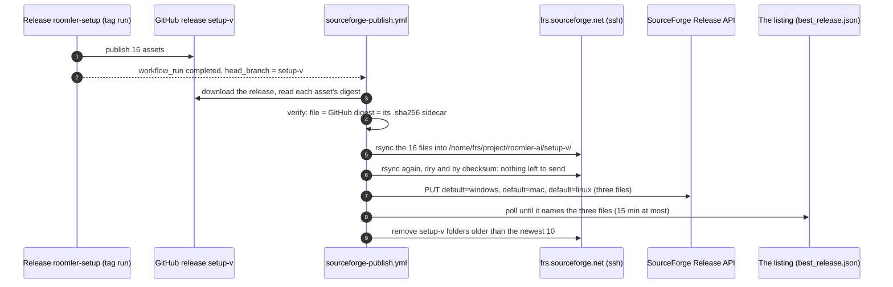

# FR-143: SourceForge gets each release's installers from our own workflow, and nothing else

**Issue:** [#3691](https://github.com/gjovanov/roomler-ai/issues/3691) · **Status:** P0 done by hand 2026-11-11, AC3 met; P1 in review; P2: the two credentials stored and the first live publish green 2026-11-11, AC5 met. AC1 waits for two real releases after P1 merges
**Related:** FR-129 ([#3022](https://github.com/gjovanov/roomler-ai/issues/3022), which left "SourceForge's per-OS default downloads on future releases" out of scope), FR-6 ([#773](https://github.com/gjovanov/roomler-ai/issues/773), the `seed-cache` release), FR-84 (the wizard's lockstep with the agent release)

## Goal

**The SourceForge listing's Download button serves the newest wizard for the visitor's platform
within minutes of a release, with nobody touching it. SourceForge holds only those installers,
the newest 10 versions, inside its 5 GB project limit.**

## Evidence

Measured 2026-11-11. Anchors are master `ba6a4b985`.

The operator's report: mails from SourceForge titled "GitHub Downloads Import Failed", the latest
at 12:16Z.

The listing ([sourceforge.net/projects/roomler-ai](https://sourceforge.net/projects/roomler-ai/))
was fed by SourceForge's "GitHub Releases Integration": a webhook on this repository's `release`
events. Its settings page has two fields, the repository and a "download button" checkbox. It has
no filter.

| read | value |
|---|---|
| webhook deliveries GitHub still held (11-08 15:50Z to 11-11 13:27Z, 70 h) | 1,571, every one answered 200 |
| of those, `edited` | 1,547; the rest are 8 releases × `created`, `published`, `released` |
| a sample of 40 across the three days | 36 name the release `seed-cache`, 4 name a product release |
| `seed-cache` on GitHub (the rolling CI cargo cache, [`docs/build-caches.md`](../build-caches.md)) | 58 assets, 29 GiB; the count moved between 55 and 58 inside single minutes as CI deleted and re-uploaded families |
| import runs in SourceForge's audit trail since 10-27 | 646, 20 to 70 a day |
| `seed-cache` folder in SourceForge's public Files | 62 files, 31 GiB, files no longer on GitHub among them: the import never removes |
| project size on SourceForge's "Large Files Management" page | "This project has a 5GB total file size limit, but is currently using 85.5 GB." |
| folders in SourceForge's Files | 265: 155 `agent-v*`, 106 `setup-v*`, `seed-cache`, `vendored-ffmpeg-9.0.1`, 2 `tunnel-v*` |
| what one version added there | 37 + 16 assets and two source archives per folder, about 310 MiB |
| `best_release.json`, which is what the Download button serves | `setup-v0.4.197` of 11-02 for Windows, macOS and Linux |
| what `roomler.ai/api/setup/*` served at the same moment | 0.4.210, then 0.4.211 |

Three things were wrong, and the mail reported only the first.

### The CI cache is a GitHub release, and SourceForge mirrored releases

Every cache write is a `release edited` event
([`ci-seed-save/action.yml:167`](../../.github/actions/ci-seed-save/action.yml#L167),
[`seed-cache-save/action.yml:72`](../../.github/actions/seed-cache-save/action.yml#L72)), so about
500 events a day told SourceForge to copy a 29 GiB release whose assets were being replaced
underneath it. Between 12:15:21Z and 12:16:48Z eight cache edits landed while two imports had
just started (12:15:08Z and 12:15:20Z in the audit trail); the mail followed. Why that import
failed is not readable from outside SourceForge. That it was importing the cache is.

### A mirror of every asset cannot fit

At about 310 MiB a version and two versions a day, a 5 GB limit is passed again a week after any
cleanup. SourceForge's own guidance is "5GB or less is ideal. 20-30GB may be permissible", and
"Clean-up temporary data when no longer needed".

### The import never set a Download default

"Default Download For" is per file. A new release folder arrived with none, so the button stayed
where a person had last put it by hand, in the browser, one file at a time. That had last
happened nine days and thirteen releases earlier, and nothing reported it. The wizard a visitor
downloaded was 0.4.197 while `roomler.ai` served 0.4.210.

Product releases themselves imported correctly throughout: `agent-v0.4.210` arrived with 37 of 37
assets and `setup-v0.4.210` with 16 of 16.

## Design

### P0: by hand, 2026-11-11

The webhook was switched off, the defaults moved to `setup-v0.4.211`, and the CI cache, the
vendored FFmpeg build, every `agent-v*` folder, the two `tunnel-v*` folders and all but the newest
10 `setup-v*` folders removed from SourceForge. The button the integration had appended to 67
releases' notes on GitHub was stripped. The field log has each step.

### P1: the workflow

[`.github/workflows/sourceforge-publish.yml`](../../.github/workflows/sourceforge-publish.yml)
does the steps in the diagram and stops at the first one that fails.

| choice | why |
|---|---|
| `workflow_run` on "Release roomler-setup", not `on: release` | The wizard lane publishes with `GITHUB_TOKEN`, and an event made with that token starts no workflow |
| not a step inside `release-setup.yml` | A run on a tag executes that file as it stood at the tag. This one runs from the default branch whatever the tag holds |
| the triggering run's conclusion is not read | The release exists on GitHub with every platform or it does not. A wizard run that published and then failed its cache refresh still has a release to carry |
| only the `setup-v<V>` assets | They are what a visitor downloads: the wizard for each platform with its checksum and signature, about 55 MiB. The wizard installs the newest packages itself |
| only the **newest** setup release takes the defaults and triggers retention | A re-run of an older tag cannot take the button back. It uploads its files and changes nothing else |
| retention after the listing serves the new files, never before | A default never points into a folder that is gone |
| the API key in the request body, from a shell builtin into curl's stdin | Never in an argument list or a URL |
| pinned host keys ([`scripts/sourceforge-known-hosts`](../../scripts/sourceforge-known-hosts)) | The three keys SourceForge publishes. A changed key ends the run |

⚠️ `workflow_run.head_branch` is text the triggering run chose. It reaches the shell only through
an environment variable, is never printed, and is used only after `valid-tag` has matched it
against `setup-v<major>.<minor>.<patch>`.

### Every decision is a pure function

[`scripts/sourceforge-publish.sh`](../../scripts/sourceforge-publish.sh) decides which tag is
final, which is the newest, which file is whose default, whether a downloaded release is the one
GitHub holds, and what retention removes. It makes no network call, so `--selftest` cannot reach
SourceForge: it runs on every pull request that touches these files and at the start of every
publish.

Retention removes only what it can name, a folder called exactly `setup-v<major>.<minor>.<patch>`.
Any other folder is left alone. It refuses to plan at all when the folder just published is not in
the listing, and it refuses a retention under three versions.

### A failed publish is loud

Nobody watches this lane. A release is green, the fleet updates, and the listing would quietly keep
its old button, which is the state this FR ends. A failed run opens one issue titled "SourceForge
publish failed", a repeat comments on it, and the next green publish closes it.

## Phases

| phase | what | kill switch | status |
|---|---|---|---|
| P0 | by hand: webhook off, defaults to `setup-v0.4.211`, everything but the ten newest wizards removed, the buttons stripped from GitHub release notes | `gh api -X PATCH repos/gjovanov/roomler-ai/hooks/703998184 -F active=true` brings the import back | done 2026-11-11 |
| P1 | the workflow, the script and its self-test, the pinned host keys | repository variable `SOURCEFORGE_PUBLISH=off`; without the two secrets a run reports that and skips | in review |
| P2 | the two credentials, a dry run, the first live publish | the same variable | done 2026-11-11: both secrets stored, the dry run and the live publish of `setup-v0.4.211` green on a runner. Until P1 merges, a release is published by a dispatch from the P1 branch |
| P3 | the webhook deleted for good | | after AC1 |
| P4 | docs: [`docs/sourceforge.md`](../sourceforge.md), its `docs/README.md` row, the `ship-it` skill | | with P1 |

## Acceptance criteria

- [ ] **AC1**: after a real release, `best_release.json` names that release's Windows, macOS and Linux installers within 15 minutes of the wizard run finishing, with no manual step. Read on two consecutive releases. The failing read is in the evidence table: 0.4.197 while production served 0.4.210.
- [ ] **AC2**: the bytes SourceForge serves are the release's. For one release, each of the three defaults downloaded from SourceForge hashes to the value in the GitHub release's `.sha256`.
- [x] **AC3**: SourceForge's Files hold `setup-v*` folders only, at most 10, and its Large Files page reports the project under 5 GB. The failing read: 85.5 GB in 265 folders. Met 2026-11-11 15:01Z: ten folders, `setup-v0.4.202` to `0.4.211`, and "Project's total usage size 1.6 GB".
- [ ] **AC4**: retention. The publish that makes an eleventh version removes the oldest, and no default pointed into a removed folder.
- [x] **AC5**: a forced failure opens exactly one issue, and the next green publish closes it. Met 2026-11-11, twice: #3708 opened and closed, then #3709 opened, commented on by a second failure and closed.
- [ ] **AC6**: the GitHub webhook to SourceForge is deleted, SourceForge's audit trail shows no import after 2026-11-11 14:02Z, and seven days pass with no "Import Failed" mail.
- [ ] **AC7**: docs. `docs/sourceforge.md` with its `docs/README.md` index row, the `ship-it` skill names the workflow, and FR-129's out-of-scope line points here.

## Open decisions

None. The operator decided all three on 2026-11-11.

- **D1: the SourceForge button in GitHub release notes: strip all of them.** The integration had
  appended a "Download" button to the notes of each release it imported through the webhook: 67
  releases (32 `agent-v*`, 32 `setup-v*`, one `tunnel-v*`, `seed-cache` and
  `vendored-ffmpeg-9.0.1`). On the 56 whose folders P0 removed it answered 404, the newest agent
  release among them. Done the same day; see the field log.
- **D2: the two `tunnel-v*` folders on SourceForge**, releases of the standalone tunnel CLI that the
  import had brought over: **remove both.** Done the same day.
- **D3: SourceForge carries the wizard only**, not the `agent-v` packages (MSI, `.deb`, `.pkg`).
  The wizard is the supported download, and an agent release is 177 MiB.

## Out of scope

- Moving the CI seed cache out of GitHub Releases. With the webhook gone it reaches nobody.
- The one-time code and ticket imports SourceForge made on 2026-10-27. They are not kept in sync.
- Download counts and badges.

## Field log

| date | what | result |
|---|---|---|
| 2026-11-11 | The failing baseline, read before anything changed | The evidence table above. `best_release.json` at 13:3xZ: all four entries `setup-v0.4.197`; `roomler.ai/api/setup/{windows,macos,linux}` served 0.4.210 |
| 2026-11-11 | P0, the webhook. `setup-v0.4.211` published at 13:59:55Z and SourceForge listed its 19 rows by 14:02:06Z; then `PATCH hooks/703998184 active=false` | Off at **14:02:20Z**, read back: `active: false`, the URL, the `release` event and the secret unchanged, so one call restores it. The last delivery GitHub holds is 14:01:16Z; CI wrote the cache again from 14:06Z to 14:25Z and none of it was delivered |
| 2026-11-11 | P0, the defaults, in the browser once the folder's 19 rows had stopped reading "Pending" (14:08Z). Each file's SHA-256 in SourceForge's panel was compared with the release's `.sha256` and GitHub's asset digest before its box was ticked | 3 of 3 matched. Saved at 14:08:49Z (Windows, the `.exe`), 14:09:25Z (macOS), 14:09:55Z (Linux x86_64). `best_release.json`: Windows only at 14:10:11Z, with the generic entry naming `agent-v0.4.211/roomler-desktop-…exe` in between; **all four entries on `setup-v0.4.211` at 14:11:57Z** |
| 2026-11-11 | P0, the removals, after re-reading the webhook (off) and `best_release.json` (4 of 4). Each is the request SourceForge's own trash icon sends. The old releases went in batches of 10, each batch re-reading the listing and refusing unless the newest ten `setup-v*` folders were `0.4.202` to `0.4.211` | `vendored-ffmpeg-9.0.1` and `seed-cache` at 14:14Z, then **155 `agent-v*` and 97 `setup-v*` folders**, done 14:26:14Z with no error. Left: the ten `setup-v0.4.202` to `0.4.211` and the two `tunnel-v*` (D2) |
| 2026-11-11 | Wrong turn: `seed-cache` came back | An import SourceForge had started at 14:02:29Z, from the last deliveries before the switch, was still copying the cache when the folder was removed at 14:14Z, and went on writing into it: 48 files and 24.3 GiB by 14:27Z, one of them an asset CI uploaded at 14:06Z. Switching the webhook off stops new imports, not one in flight. The Audit Trail's last "import files" row and the folder's file count are the two things to read before removing an imported folder. The count stood at 52 files and 26.5 GiB from 14:28:29Z; the eight assets it lacked were all ones CI had uploaded after 14:06Z. Removed again at **14:31:04Z**, and the listing read 12 folders with no `seed-cache` on every read after that |
| 2026-11-11 | SourceForge's Large Files page after the removals, 14:35Z | **"Project's total usage size 1.9 GB."** It read 85.5 GB before, and 25.5 GB at 14:26Z with the returned cache on it. 12 folders: `setup-v0.4.202` to `0.4.211` and the two `tunnel-v*`, so AC3 waits on D2 |
| 2026-11-11 | D2: the two `tunnel-v*` folders, 14:54:56Z | Removed. The listing is the ten `setup-v0.4.202` to `0.4.211` folders and nothing else |
| 2026-11-11 | D1: the button, 14:57Z to 15:00Z. Planned first for all 67: each body had exactly one button, at its very end, linking to its own tag's folder, and the original of every release was kept. One edit per release, sending the body alone, tried on `agent-v0.4.180` before the other 66 | **67 of 67 without the button, and every other field of every release unchanged** (tag, name, draft, pre-release, target, dates, assets), re-read from GitHub and compared with the kept originals. 136 to 145 characters went from each. GitHub's `/releases/latest` named `setup-v0.4.211` before the first edit and after the last. No release anywhere mentions SourceForge now. The webhook delivered nothing: its last delivery is still 14:01:16Z |
| 2026-11-11 | AC3, 15:01:40Z | SourceForge's Large Files page: "Project's total usage size 1.6 GB". Ten folders, all `setup-v*`. The Audit Trail's last import row is still 14:02:29Z |
| 2026-11-11 | A dry run on a GitHub runner, dispatched from the P1 branch with no secret set, 15:56Z (run 43053079962): `-f tag=setup-v0.4.211 -f dry_run=true` | The self-test passed, 62 checks. The real `setup-v0.4.211` release was downloaded and **all 16 files verified** against GitHub's digests and their `.sha256` sidecars, 56 MB. The three defaults it would set are the right files. **The runner could read `best_release.json`** (four entries, all `setup-v0.4.211`), so SourceForge's web tier, where the Release API lives, answers a runner. It then stopped as designed: "no SOURCEFORGE_SSH_KEY". Not exercised: ssh, the upload, the API write, retention |
| 2026-11-11 | P1 before any credential exists | `--selftest` 62 checks on Linux and Git-Bash; 13 mutations of the script, 10 fail the self-test and the other 3 are refused by a second check (a missing sidecar, a digest that is not hex, a path in an asset name). The workflow's own `run:` blocks, extracted verbatim and pointed at a throwaway sshd on 127.0.0.1: the listing, the upload and its checksum proof, the proof failing on a remote file with the right size and time and other bytes and a re-run repairing it, retention as a dry run, for real (an empty folder and file names with spaces included) and with a default still pointing into an aged-out folder, and a changed host key ending the run. The API answer's test against the documented success and error shapes and an HTML challenge page. What this does not cover: SourceForge's own ssh and API, which wait for P2 |
| 2026-11-11 | P2, the two credentials, 16:36Z to 16:43Z, on the operator's "create them and store them" | **`SOURCEFORGE_SSH_KEY`**: a new ed25519 pair (`SHA256:seAEUoRkM9LlmOpUuDaLanu9WQvS2VP/F//svd4V2vs`, comment `roomler-ai-sourceforge-publish-2026-11-11`). Its public half went on the account's SSH Settings, where the list was empty; its private half went to the secret from a file, was never printed, and the local copy was deleted. **`SOURCEFORGE_API_KEY`**: generated on the account, where none existed. It travelled from the page to `gh secret set` encrypted to a throwaway key and was never displayed. Stored as repository secrets, since GitHub Actions is the only reader |
| 2026-11-11 | What the ssh key can do, read from outside GitHub before the secret was trusted, 16:37Z | A listing answered at once, against the pinned host keys. **Every folder and file reads `allura root`, mode 755 and 644**: the old importer's user, not ours. Two reversible writes passed all the same: `mkdir` and `rmdir` of an empty folder at the project root, and a `rename` of a file inside an importer-made folder and back. So the key can make release folders and manage the importer's; the ownership shown is not what decides access |
| 2026-11-11 | The dry run again with the secrets set, on a runner, 16:44Z (run 43061199247) | It listed SourceForge over ssh with the stored key: 10 entries, `setup-v0.4.202` to `0.4.211`. Retention planned nothing: "keeping the newest 10". No key material in the log |
| 2026-11-11 | A change that proving the credentials suggested, before the live run | The upload no longer passes `-t`. With it, a re-publish would have tried to set the time of every file in a folder that belongs to another user. It now compares by checksum alone and leaves a file with the right bytes exactly as it is. The API key is stripped of whitespace before use. Rehearsed again against the local sshd |
| 2026-11-11 | **The first live publish**, `setup-v0.4.211`, on a runner, 16:49Z (run 43061873042) | Upload: `sent 899 bytes … total size is 58,226,955`, so nothing needed sending, and all 16 files matched by checksum. **The Release API accepted all three defaults on the first attempt**, from a runner, with the stored key. `best_release.json` named the three files at once. Retention: nothing aged out. Nothing on SourceForge changed: the folder's feed still lists its 19 files. Not yet exercised: a transfer that sends bytes, and a retention that removes a folder. Both happen at the next release |
| 2026-11-11 | The bytes SourceForge serves, 16:52Z: each of the three defaults streamed from `downloads.sourceforge.net` (a mirror answered) and hashed | 3 of 3 equal the release's `.sha256`. This is AC2's read, taken on a release the old import had placed. AC2 stays open until it is taken on a release this workflow uploads |
| 2026-11-11 | AC5, 16:54Z to 17:29Z. A failure was forced with a tag that has no release (`setup-v0.4.9999`), which never contacts SourceForge | Cycle 1: the failure opened #3708, and the next green publish closed it. Cycle 2: a failure opened #3709, a second failure commented "Failed again" on #3709 and opened nothing, and the next green publish closed it. `best_release.json` read 4 of 4 on `setup-v0.4.211` afterwards |
