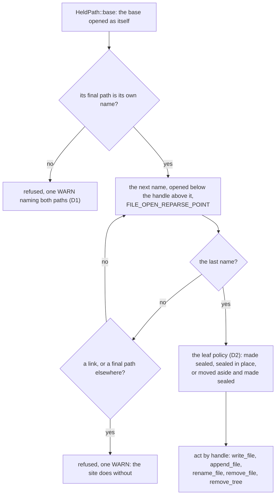

# FR-145: The Windows machine folder by handle — SYSTEM never writes, creates, renames or removes through a link, seals what it makes, and finds a person's profile by their SID

**Issue:** [#3752](https://github.com/gjovanov/roomler-ai/issues/3752) · **Status:** claimed 2026-11-12. Spec only, nothing built; P1 first. D1–D10 take their defaults (2026-11-12), and the operator may overturn any of them
**Builds on:** #3743 (`machine_tree`'s handle code: a folder held by its own handle, a file opened below it, a delete by handle), FR-94 ([#2035](https://github.com/gjovanov/roomler-ai/issues/2035): `machine_tree`'s repair, check and kill switches), #3702 (`appdirs::machine_program_data` and `appdirs::profile_of_account`: the machine's folders and a profile as the system records them)
**Related:** #3737

## Goal

On Windows the device's SYSTEM service, its SYSTEM workers and the per-Machine package's steps keep files of
their own in the machine folder (`%ProgramData%\roomler\<segment>`): crash records, service logs, small state
files. An elevated `roomlerd cleanup-legacy-install` removes some of those folders, and a person's data trees in
their profile, when an install changes flavour. After this FR:

- **Every file and folder that SYSTEM, or an elevated command, writes, creates, renames or removes there is
  reached by handle from a checked base**: one folder at a time, each opened below the handle above it, and never
  through a link or any other reparse point.
- **The folders it creates are sealed when they are created**: owned by Administrators, written by SYSTEM and
  Administrators alone, and read by Users only where a person's process reads them today.
- **The per-user clean-up finds a person's profile by their account's SID**, from the profile list the system
  keeps, never from their user name.
- **One helper, `machine_tree::HeldPath`, carries the rule**, so a new SYSTEM writer gets it by calling the
  helper rather than by re-deriving it.

## Evidence

Anchors are master `84a93e740` (2026-11-12). Everything below is code, read in the tree.

### Today: SYSTEM reaches these folders by path

| What | Today | Anchor |
|---|---|---|
| A crash record the service's supervisor writes | `create_dir_all` of `machine_global_dir()\crashes`; `<ts>-<pid>.json.tmp` created, written and flushed by path; `fs::rename` by path | `crates/agent-core/src/crash_recorder.rs:213-214`, `:275-293`, `:314-317` |
| A record that does not parse | `create_dir_all(crashes\malformed)`, `fs::rename` by path | `crash_recorder.rs:424-433` |
| The uploader, after a verdict | `std::fs::remove_file` of the sidecar's path | `agents/roomlerd/src/crash_uploader.rs:123`, `:135`, `:354-355` |
| The service logs | `create_dir_all(service-logs)`; `tracing_appender`'s daily appender opens `<basename>.<date>` by path at start, and again at every rotation | `crates/agent-core/src/logging.rs:227-238`, `:1044-1048` |
| The prune, the panic file, the stderr file | `read_dir` and `remove_file(entry.path())`; `fs::write(panic-<pid>-<ts>.log)`; an `OpenOptions` create-and-append | `logging.rs:1082-1104`, `:1124-1127`, `:795-801` |
| The clean-up's per-Machine arm | for both segments, `path.exists()`, then `remove_dir_all` of `<ProgramData>\roomler\<segment>\service-logs` | `agents/roomlerd/src/install_cleanup.rs:577-605` |
| The clean-up's per-user arm | each of the four trees checked by path (`appdirs::link_below`, `link_inside`), then removed by path in a second step | `install_cleanup.rs:462-471`, `:514-532` |
| The vacated install folder's sweep | `link_component` by path, then `remove_file` per product file and `remove_dir` by path | `install_cleanup.rs:267-320` |
| The per-user arm's profile | `C:\Users\<the session's user name>`; the clean-up is its only caller | `agents/roomlerd/src/system_context/user_profile.rs:63-67`, `install_cleanup.rs:375-378` |

Two things follow. A check made by path and an act made by path are two lookups of the same name. And the profile
folder the system records for an account can differ from `C:\Users\<name>` (`<name>.000`, `<name>.<DOMAIN>`, a
renamed account, a profile on another drive), while `C:\Users\<name>` can be another account's folder when a local
and a domain account share a name. `agents/roomlerd/src/win_identity.rs:16-20` records the same reasoning for the
file-transfer rule, which already takes the profile from the person's token.

### What #3743 already gives

| Piece | What it does | Anchor |
|---|---|---|
| `HeldFolder::open` | opens one folder itself (`FILE_FLAG_OPEN_REPARSE_POINT`; a reparse point refused) | `crates/agent-core/src/machine_tree.rs:1255-1262`, `win::open` `:1469-1507` |
| `HeldFolder::file` | opens a file below the folder's handle (`NtOpenFile` with the folder as its root, `FILE_OPEN_REPARSE_POINT`; a reparse point refused) | `machine_tree.rs:1274-1283`, `win::open_below` `:1538-1633` |
| `HeldFile::delete` | deletes through the file's own handle (`FileDispositionInfo`) | `machine_tree.rs:1310-1312`, `win::delete_by_handle` `:1638-1657` |

What this FR adds on top: a walk in which each component is opened relative to the handle above it. A single open
by path cannot give that, since its reparse-point flag governs the last component only; so today
`PrivateFolder::open` and the earlier anchor files' deletes check the components by path first
(`link_component`; `machine_tree.rs:1342-1353`, `agents/roomlerd/src/exec_service.rs:1277-1292`). And a create, a
write, a rename and a tree removal by handle, which nothing has yet.

### Who reads these folders today

Sealing closes the write side only. Every reader below keeps working.

| Folder | Read by | Anchor |
|---|---|---|
| `service-logs` | the tray's log view, "Open Logs Folder" and the log tail, as the signed-in person | `agents/roomler-desktop/src/commands.rs:179-190`, `:1916-1921` |
| `crashes` | a worker that runs as the signed-in person: its uploader drains the supervisor's records from that folder | `agents/roomlerd/src/app.rs:2290-2300`, `crash_recorder.rs:343-359`, `crash_uploader.rs:18-21` |
| the SystemContext attempt record | Setup, as the person who started it (Users read, `record_aces`) | `machine_tree.rs:537-551` |

## Design

### The rule

> A process running as SYSTEM, or elevated, acts on a path below a known base only through handles. The base is
> opened as itself, and its final path must be the base's own name. Every component below it is opened relative
> to the handle above it, never through a link, and its final path must be its parent's plus its own name. A
> folder it makes is sealed when it is made. A file it writes is made fresh and published by a rename relative to
> the held folder. A removal deletes, by handle, what the same walk opened.

The bases in use: `appdirs::machine_program_data()` (`crates/agent-core/src/appdirs.rs:201-207`),
`appdirs::machine_program_files()` (`:212-214`) and `appdirs::profile_of_account(sid)` (`:222-234`).

The writer's walk (`walk_sealed`); the clean-up's `walk` makes nothing and ends in `remove_tree`:

### The helper: `machine_tree::HeldPath`

Home: `crates/agent-core/src/machine_tree/held.rs`, a child module of `machine_tree.rs` (already 4,000 lines),
re-exported as `machine_tree::{HeldPath, Seal, Refusal, Why, TreeRemoval}`. It reuses `win::open`,
`win::open_below`, `win::delete_by_handle`, `win::set_sd` (`machine_tree.rs:1859`) and `sealed_aces`
(`:518-535`). Windows only.

| Call | What it does |
|---|---|
| `HeldPath::base(base)` | opens the base itself (a reparse point refused); `GetFinalPathNameByHandleW` must equal `GetLongPathNameW(base)`, both without `\\?\` and compared case-insensitively; a `\\?\UNC\` path is refused |
| `open_dir(name)`, `walk(names)` | each name opened below the previous handle (`NtCreateFile` with `RootDirectory`, `FILE_OPEN`, `FILE_DIRECTORY_FILE` and `FILE_OPEN_REPARSE_POINT`), a reparse point refused, its final path checked. `Ok(None)` when a name is not there. Makes nothing |
| `sealed_dir(name, seal)`, `walk_sealed(names, seal)` | as `walk`, and a folder that is not there is made with the seal's security descriptor in `OBJECT_ATTRIBUTES` (`FILE_OPEN_IF`): sealed from its creation, with no moment in between. The last name gets the leaf policy below |
| `HeldPath::machine(target, seal)` | `base(machine_program_data())`, then `walk_sealed` down the names below it (`appdirs::names_below`, `appdirs.rs:394-420`), so every site names its folder as it does today and the segment rule (`resolve_machine_global`, `appdirs.rs:515-523`) stays in one place. The machine folder and its parent, whether passed through or the `target` itself, are only opened (made sealed when they are not there): the leaf policy never moves or re-seals an existing one of those two, which hold the machine config and are FR-94's to repair, and the seal then goes on the files written in them |
| `write_file(name, bytes, seal)` | a fresh temp below the held folder (`FILE_CREATE`, so an entry already there is never written into), written and flushed (#2955), then renamed onto `name` with `FileRenameInformation` whose `RootDirectory` is the held folder. A folder at `name` fails the rename, and the temp is deleted by handle |
| `write_file_new(name, bytes, seal)` | `FILE_CREATE` straight into `name`: the first writer wins (`Ok(false)` when it was there) |
| `append_file(name, seal)` | for logs: `FILE_OPEN_IF` and append. A file already there must be a plain file with one link, owned by SYSTEM or Administrators; otherwise it is deleted by handle and made again |
| `read_file(name, max_len)`, `entries()` | read below the held folder, never through a link (the listing through `GetFileInformationByHandleEx` with `FileIdExtdDirectoryInfo`) |
| `remove_file(name)`, `remove_empty_dir(name)` | opened below the held folder with `DELETE` and deleted by handle (#3743's `HeldFile::delete`); a link at `name` is refused, never followed |
| `rename_file(from, into, to, replace)` | `from` opened below this folder with `DELETE`, renamed with `RootDirectory` set to `into`'s handle |
| `remove_tree(name, dry_run)` | bottom-up by handle: each entry opened below its folder with `FILE_OPEN_REPARSE_POINT` and deleted with `FileDispositionInfoEx` (POSIX semantics, read-only ignored), falling back to `FileDispositionInfo`. A link met anywhere is never followed and never deleted: it stays, with the folders above it, and `TreeRemoval::left` names it. A first pass leaves the whole tree when it holds a link; the delete pass leaves any link that appeared since |

A refusal is `Refusal { at, why }`, with `Why` one of `Link`, `NotFolder`, `NotFile`, `Elsewhere { final_path }`,
`Foreign { owner }`, `TooManyLinks` and `Io`. A site logs it, or puts it in a report line.

| `Seal` | Owner and DACL | Used for |
|---|---|---|
| `Private` | owner Administrators; protected; SYSTEM and Administrators full control, inherited by what is made below (`sealed_aces`, `machine_tree.rs:518-535`) | the companion's launch marker |
| `Readable` | `Private`, plus Users read, list and traverse (`0x1200a9`, as `record_aces` gives the attempt record, `machine_tree.rs:537-551`) | `service-logs` and its files, `crashes` (D10), the attempt record, the machine attention file, the presence lock |

Notes on the calls:

- `OBJ_DONT_REPARSE` in the object attributes is a second lock beside `FILE_OPEN_REPARSE_POINT` and the attribute
  check, on the Windows builds that honour it. P1 confirms which of the supported builds do, and relies on the
  other two where one does not.
- A held folder is opened with list, traverse, read-attributes, `READ_CONTROL` and `SYNCHRONIZE`; with
  `WRITE_DAC` and `WRITE_OWNER` too when it is a leaf the policy may seal, and `DELETE` when it may be moved aside
  or removed. #3743's `win::open` asks for `READ_CONTROL` alone (`machine_tree.rs:1475`), so `held.rs` opens its
  own handles and wraps them in a `HeldFolder` rather than widening the anchor reader's.
- Files SYSTEM writes, and the folders it holds, are opened with `FILE_SHARE_READ`, `FILE_SHARE_WRITE` and
  `FILE_SHARE_DELETE`: the tray reads a log while it grows, and a held folder never blocks an operator's removal
  (a held folder that was removed fails the next create, and the site walks again at its next open).
- Cost per component: one `NtCreateFile`, one `GetFileInformationByHandle`, one `GetFinalPathNameByHandleW`. A
  crash record walks three or four components; a log rotation opens one file below a folder already held.
- A token that may not name Administrators as an owner (an unelevated test) gets `STATUS_INVALID_OWNER`; the helper
  then makes the entry with the protected DACL and the caller as its owner, as `seal_new_file`'s doc already
  allows (`machine_tree.rs:1208-1218`). SYSTEM and an elevated administrator always get Administrators.

### The leaf policy (D2): what SYSTEM finds where it writes

| Found at the leaf | What happens | What a person or an operator sees |
|---|---|---|
| nothing | made sealed | nothing |
| a folder SYSTEM or Administrators own, with an inherited DACL: every folder the service made before this FR | sealed in place, by handle (`win::set_sd`, as `adopt_machine_folder` does, `machine_tree.rs:832`). An entry in it that the service writes or reads by name is kept only when it is a plain file with one link, owned by SYSTEM or Administrators; any other such entry is deleted by handle. Names the service does not use are left alone and never opened | nothing; the files in it stay |
| a folder another account owns | moved aside by handle (`FileRenameInformation`, `RootDirectory` = the parent's handle) as `<name>.moved-<unix>`, and a sealed one made. Nothing in it is deleted or changes owner. One WARN names it | a `<name>.moved-<unix>` entry beside the new folder, its content still that account's |
| a link (a junction or a symbolic link) | the link entry itself moved aside by handle, never followed, and a sealed folder made. One WARN | a `<name>.moved-<unix>` entry; whatever the link led to is untouched |
| above the leaf: a link, or a folder that cannot be opened or whose final path is elsewhere | refused (`Why::Link`, `Why::Elsewhere`), with one throttled WARN, and the site does without: a crash record is not written; the logs take the fallback they take today when `service-logs` cannot be used (`logging.rs:223-238`, `fallback_log_dir` `:326-332`). The machine folder itself is FR-94's to repair, not a log writer's | the WARN line, which names the path |

### P1: crash records

`crashes_dir_for(ctx)` (`crash_recorder.rs:300-312`) answers one of two: the machine tree, on Windows when the
writer runs as SYSTEM (the supervisor's records, `:314-317`, and a SYSTEM process's own below
`service-logs\crashes`); or a plain path otherwise (the person's own daemon in its profile; macOS and Linux
unchanged).

| Site | Today | After |
|---|---|---|
| `record_inner` (`crash_recorder.rs:207-296`) | `create_dir_all`, the temp file and `fs::rename`, by path | `HeldPath::machine(&dir, Seal::Readable)`, then `write_file("<ts>-<pid>.json", ..)` |
| `scan_dir`, `should_suppress` (`:361-363`, `:476-477`) | `read_dir` by path | `entries()` and `read_file(name, MAX_PAYLOAD_BYTES)` |
| `quarantine` (`:424-433`) | `create_dir_all(malformed)`, `fs::rename` | `sealed_dir("malformed", ..)` and `rename_file(name, &malformed, name, false)` |
| the uploader's deletes (`crash_uploader.rs:123`, `:135`, `:354-355`) | `remove_file(path)` | `remove_file(name)` on the held folder the sidecar was read from: the uploader carries a name and its folder, not a path |

A refusal is logged once per process start (`crash_recorder: crash records left alone: <at> is a link`, or
`… ends elsewhere (<final path>)`), counted with the suppression tally, and the crash goes unrecorded. It is never
written anywhere else.

### P1: the install clean-up

| Arm | Today | After |
|---|---|---|
| per-Machine (`install_cleanup.rs:569-605`) | `exists()`, then `remove_dir_all` of both segments' `service-logs` | `HeldPath::base(machine_program_data())`, `walk(["roomler", segment])`, `remove_tree("service-logs", dry_run)` |
| per-user (`:435-481`, `:514-532`) | each tree checked by path, then removed by path | for each of the four trees: `HeldPath::base(profile)`, `walk(["AppData", area, "roomler"])`, `remove_tree(segment, dry_run)`. The walk that finds no link is the walk whose handles delete; `link_below` and `link_inside` leave this arm |
| the vacated install folder (`:267-320`) | `link_component`, then `remove_file` and `remove_dir` by path | `HeldPath::base(<the install root's parent>)` (`machine_program_files()` for a per-Machine install; for a per-User one, the profile from `profile_of_account(own SID)` and `AppData\Local\Programs`), `walk`, `remove_file` per product file, `remove_empty_dir`. The running-exe guard stays |

The report keeps today's words ("not present", "left in place: <path> is a link") and gains a line wherever a walk
meets a link or is refused, naming the path. `remove_tree` takes `dry_run`: its first pass only, with today's
`[dry-run] rmdir /s` line when it would remove.

### P1: the per-user arm's profile, by SID

1. A new `system_context::user_profile::session_account_sid()`: `WTSQuerySessionInformationW` for `WTSUserName`
   and `WTSDomainName` of the step's session, then `LookupAccountNameW("<domain>\<user>")` to a SID
   (`SidTypeUser` only), as text through `sid_string` (`agents/roomlerd/src/win_token.rs:122`). The
   domain-qualified name names exactly one account. It needs no privilege beyond the elevated operator's, so it
   works where this arm runs, a command run by hand; the session's token (`WTSQueryUserToken`, then
   `token_user_sid`, `agents/roomlerd/src/win_identity.rs:334`) would need SYSTEM's.
2. The profile is `appdirs::profile_of_account(&sid)` (`appdirs.rs:222-234`): `ProfileList\<sid>\ProfileImagePath`,
   with only `%SystemRoot%` and `%SystemDrive%` filled in, from the kernel's answers.
3. No profile recorded: nothing is removed, and the report says why, in words that tell the cases apart: "the
   system records no profile for the session's account", or "cannot tell the session's account". Today's "no
   active interactive session" stays for its own case.
4. `active_user_profile_root` and `user_name_for_session` are deleted (`user_profile.rs:63-67`, `:88`; the clean-up
   is the only caller, `install_cleanup.rs:377`), with their test (`user_profile.rs:162`). No code builds
   `C:\Users\<name>` any more.
5. The profile is the per-user removal's `HeldPath::base`: a profile folder whose final path is elsewhere is
   refused with a report line (D1).

### P1: #3743's readers (D6)

`PrivateFolder::open` (`machine_tree.rs:1342-1353`) becomes `HeldPath::base(&machine_program_data())` and `walk`,
plus its verdict, and the earlier anchor files' deletes (`exec_service.rs:1277-1292`) the same, so their way down
is by handle too. #3743's elevated tests already cover both.

### P2: service logs

`open_log_appender` (`logging.rs:345`) gets, for a process with a `ServiceLogRole` on Windows (`logging.rs:89-110`:
the service host, the SYSTEM worker, `netd`, the per-Machine package's steps), a `HeldRollingWriter` in place of
`tracing_appender`'s `RollingFileAppender` (D3):

- built from `HeldPath::machine(&service_log_dir, Seal::Readable)` and held for the life of the process in a
  `OnceLock<Arc<HeldPath>>` that the other `service-logs` writers, and the crash recorder's SYSTEM-worker arm,
  reuse;
- `impl std::io::Write`: when the UTC date has changed since the last write, it opens `<basename>.<YYYY-MM-DD>`
  with `append_file(.., Seal::Readable)`. Those are `tracing_appender`'s daily names, so `rolling_basenames`, the
  prune and the log tail read them unchanged (`logging.rs:1057-1059`);
- wrapped in `tracing_appender::non_blocking`, as today (`logging.rs:246`);
- a refusal takes today's fallback for an unusable `service-logs`, the reason logged first (#3073,
  `logging.rs:223-238`).

| Site | Today | After |
|---|---|---|
| the prune (`logging.rs:1082-1104`) | `read_dir`, `remove_file(entry.path())` | `entries()`, the same name and age rule, `remove_file(name)` |
| the panic file (`:1106-1127`) | `fs::write` | the hook keeps the `Arc<HeldPath>`: `write_file("panic-<pid>-<ts>.log", ..)` |
| the stderr file (`:795-801`) | `OpenOptions`, create and append | `append_file(name, Seal::Readable)` |
| the encoder caps cache (`agents/roomlerd/src/encode/caps_cache.rs:316-328`, its path `:183-187`) | `create_dir_all`, `fs::write(tmp)`, `fs::rename` | `write_file(FILE_NAME, ..)`; its readers read with `read_file` |
| the install outcome (`agents/roomlerd/src/post_install.rs:173-175`, `:190-196`) | `create_dir_all`, `fs::write` | `write_file("last-install.json", ..)` |
| the wedged MSI log (`post_install.rs:629-637`) | `fs::rename` to `.prev`, `fs::copy` | `rename_file("msi-wedged.log", held, "msi-wedged.prev.log", true)`, then `write_file` of the copy, read from SYSTEM's own staging |
| the update-attempt marker (`agents/roomlerd/src/updater.rs:230-232`, `:242-256`) | `create_dir_all`, `fs::write` | `write_file("update-attempt", ..)` |

### P3: the rest

The attempt record lives in the machine folder's parent, and the attention file and the launch marker in the
machine folder itself: their walk opens those folders and never applies the leaf policy to them (`HeldPath::machine`
above).

| Site | Today | After |
|---|---|---|
| the SystemContext attempt record (`agents/roomlerd/src/win_service/system_context_attempt.rs:151-155`, `:178-197`) | `create_dir_all(parent)`, `create_fresh(tmp)`, `seal_new_record`, `fs::rename` | `HeldPath` on the machine parent, `write_file(.., Seal::Readable)` |
| the machine attention file (`crates/agent-core/src/notify.rs:113-138`, `:166-177`, `:210-214`, `:234-244`) | `create_dir_all`, `fs::write`, `remove_file` | `write_file` and `remove_file`, `Seal::Readable`; a person's own attention file in their profile is unchanged |
| the companion's launch marker (`agents/roomlerd/src/companion/launch_once.rs:144-173`, `:177-196`, `:469`) | `create_dir_all`, `create_new`, `remove_file` | `write_file_new` (the first one wins, as `create_new` does today), `remove_file`, `Seal::Private` |
| the peer-presence lock (`agents/roomlerd/src/system_context/peer_presence.rs:83-89`, `:115-132`, `:137-144`) | `create_dir_all`, `fs::write`, `remove_file` | `HeldPath::base(machine_program_data())` and `sealed_dir(<its folder>, Seal::Readable)`, then `write_file` and `remove_file`; its reader (`app.rs:7461`) reads through the same `HeldPath` (D4) |
| the machine config's saves (`crates/agent-core/src/config.rs:3774`, `:4454`, `:4640`) | `create_fresh` and `fs::rename`, after `repair(writing = true)` sealed the folder | `write_file` below the held machine folder |
| the repair's and the adoption's opens (`machine_tree.rs:592-594`, `:832-834`) | `win::open` of the whole path | `HeldPath::walk` |
| the one-time segment move (`appdirs.rs:591`, `:808`, `:819`, `:917`, `:1032`) | renames and removes by path | per D7 |
| the gate (D8) | none | a test in `crates/agent-core` that fails on a new `std::fs` create, write, rename or remove of a path built from `machine_global_dir()` or `machine_program_data()` outside `machine_tree::held` |

### The kill switch

`ROOMLERD_MACHINE_TREE_HELD=0` (or `false`, `no`, `off`; `ROOMLER_NODE_MACHINE_TREE_HELD` is read too): a third
field of `Switches`, beside FR-94's `ROOMLERD_MACHINE_TREE_REPAIR` and `ROOMLERD_MACHINE_TREE_CHECK`
(`machine_tree.rs:351-375`), read through `switched_off("MACHINE_TREE_HELD")` (`:377-382`), from the process
environment only (the service's `Environment` block), never from the config.

- Off: the crash recorder (P1), the log writer and the other `service-logs` writers (P2), and the P3 writers write
  as they do today, by path, with one WARN that names the switch.
- No switch for the clean-up's removals: a removal that follows a link has no safe old way to return to.
- Rollback: every phase is code only. Nothing it writes needs undoing after a downgrade: a sealed folder is one the
  older build still writes into as SYSTEM, and a `<name>.moved-<unix>` entry is inert.

### Tests

**RED first, through a seam commit.** The PR's first commit is a refactor that only lets a test name its roots
(`record_inner_at(root, ..)`, `cleanup_per_machine_service_logs(program_data, ..)`, the profile lookup passed in,
an injected clock for the log writer). It changes no behaviour, and the site tests fail on it: the file is written
or deleted through the link. The fix commits turn them green, and CI shows both runs. The helper's own tests are new
API, so each carries a control in which the same act with no link succeeds; a helper that refuses everything fails
them.

- Junctions (`mklink /J`) need no privilege, so most cases run on every Windows lane. A case that needs an owner
  other than the test's own account, Administrators as an owner at creation, or a symbolic link starts with #3743's
  `test_support::elevated_or_skip` (`machine_tree.rs:2488-2510`): a loud skip locally, a failure in the lane that
  sets `ROOMLERD_TEST_REQUIRE_ELEVATED`.
- The swap case uses #3743's `test_support::between_check_and_use` (`machine_tree.rs:2646-2648`), run from
  `HeldPath`'s step loop as `HeldFolder::file` runs it (`:1275-1276`).
- GitHub's Windows runners set `TEMP` to an 8.3 short path, so T4's control pins the `GetLongPathNameW` compare;
  without it every tempdir-based case would fail in CI.
- ⚠️ `roomler-node-core`'s Windows cases run elevated in one step only, filtered to `machine_tree::tests` and three
  others (`.github/workflows/ci.yml:1920-1922`; `ROOMLERD_TEST_REQUIRE_ELEVATED` job-wide at `:1876`). P1 adds
  `machine_tree::held::tests` and `crash_recorder::tests` to that filter, or the new cases never run on Windows.
  The `install_cleanup` cases run in the daemon's whole `--lib` step (`ci.yml:1828-1832`).

| # | Test | Where | What it holds | Elevated | RED at the seam |
|---|---|---|---|---|---|
| T1 | `a_walk_refuses_a_junction_on_the_way` | `machine_tree/held.rs` | a junction as a middle name: `walk_sealed` is refused there, and nothing is made where it leads. Control: a real folder, the leaf made | no | new API |
| T2 | `a_walk_refuses_a_symbolic_link_on_the_way` | same | T1 with a directory symbolic link | yes | new API |
| T3 | `a_folder_swapped_for_a_junction_mid_walk_is_not_followed` | same | once a name is held, it is renamed and a junction put at the name (`between_check_and_use`): the file lands in the held folder, or the walk is refused; never where the junction leads | no | new API |
| T4 | `a_base_reached_through_a_link_is_refused` | same | a base below a junction: `Elsewhere`, naming the final path. Control: the same base named by its 8.3 short name is accepted (skipped, with a note, on a volume without short names) | no | new API |
| T5 | `a_write_replaces_the_name_and_never_writes_through_it` | same | at the name, (a) a file symbolic link, (b) a junction, (c) a hard link: (a) and (c) replace the name and leave what it led to byte-identical; (b) is refused, nothing left behind. Control: a plain file is replaced | (a) yes | new API |
| T6 | `an_append_never_writes_into_a_hard_link` | same | a log name that is a hard link to another file: the line goes to a new file of one link, and the other file is unchanged | no | new API |
| T7 | `a_junction_where_the_leaf_goes_is_moved_aside` | same | `crashes` is a junction: a real, sealed `crashes`, the junction as `crashes.moved-*`, nothing where it led | no | new API |
| T8 | `an_open_leaf_ours_is_sealed_in_place` | same | an Administrators-owned folder with an inherited DACL and a file in it: `sealed_dir(.., Seal::Private)` keeps the same folder, sealed (`test_support::sealed`), and the file | yes | new API |
| T9 | `a_leaf_another_account_owns_is_moved_aside` | same | `crashes` owned by another local account, with a file in it: moved aside with its file and owner; the new one sealed | yes | new API |
| T10 | `a_tree_removal_follows_no_link_and_leaves_what_holds_one` | same | a tree holding a junction: what it leads to is kept, `left` names it, the root stays. Control: a tree with none is removed | no | new API |
| T11 | `a_crash_record_lands_in_a_sealed_crashes_never_through_a_junction` | `crash_recorder.rs` tests | `crashes` is a junction: the record lands in a new, sealed `crashes`, with no `.json` or `.tmp` where the junction led. A junction above it: refused, nothing written anywhere, one WARN | no | yes |
| T12 | `the_per_machine_clean_up_removes_no_service_logs_through_a_link` | `install_cleanup.rs` tests | a junction as the `roomler` folder, then as the segment folder: the file where it leads stays, and the report names the link | no | yes |
| T13 | `the_per_machine_clean_up_still_removes_both_segments_service_logs` | same | no link: both `service-logs` removed, two report lines | no | control |
| T14 | `the_per_user_removal_acts_on_the_tree_it_checked` | same | after the plan, a folder on the way replaced by a junction: what it leads to stays, and the report names the link | no | yes |
| T15 | `the_per_user_clean_up_reads_the_profile_the_system_records` | same | the lookup injected: the recorded profile's trees removed, a folder named after the session's user untouched; with no recorded profile, nothing removed and the report says why | no | yes |

P2 and P3 add their own with their phase: the log writer's rotation below the held folder (an injected clock;
failing at its seam, since today's appender opens each day's file by path), the prune by handle, the presence lock,
the attempt record, the attention file and the launch marker.

### Lab cells (the release candidate, Windows 11 guests)

Each cell shows that what worked still works on the candidate. Nothing in them makes a link.

| Cell | Host | Steps | Passes when |
|---|---|---|---|
| L1 a crash record lands | per-Machine, SystemContext, enrolled | as an administrator, end the worker (`taskkill /F`), which the supervisor records | a new `<ts>-<pid>.json` in `%ProgramData%\roomler\roomler\crashes`; `icacls` shows that folder sealed (`Seal::Readable`, D10); the crash is on the device's server-side crash list after the worker's next start |
| L2 an upgrade keeps the folders | per-Machine, on the previous release, with `crashes` and `service-logs` there | upgrade to the candidate | the same folders, no `.moved-*`, now sealed; the old log files still there; the tray of an account that is not an administrator lists and opens them ("Open Logs Folder") |
| L3 the logs write and age | L2's host | leave it across a UTC midnight (or move the guest's clock); as an administrator, add a `roomlerd-service.log.<date>` 15 days old | a new daily file per role (`roomlerd-service.log`, `roomlerd.log`, `roomlerd-netd.log`); the 15-day-old file pruned at the next start (`KEEP_DAYS` is 14, `logging.rs:77`); the tray's diagnostics bundle holds the service logs |
| L4 a machine folder a per-User install made first | a per-User install first (its daemon makes the machine folder for file-transfer staging), then the per-Machine one | a file transfer as the person; restart the service | service logs and a crash record (L1's step) land; the person's file transfer still completes |
| L5 the per-Machine arm cleans | a per-Machine host | as an elevated operator, `roomlerd cleanup-legacy-install --target-flavour perUser` from the per-Machine exe | both segments' `service-logs` removed, with the report's lines as before |
| L6 the per-user arm cleans the recorded profile | a per-User install by an account whose profile folder is not `C:\Users\<name>` (a renamed account, or `<name>.000`) | elevated, `roomlerd cleanup-legacy-install --target-flavour perMachine` by hand | the four trees under the profile `ProfileList` records are removed, and nothing else under `C:\Users` changes; with nobody signed in, the report says no profile was looked up |
| L7 the kill switch | L1's host, `ROOMLERD_MACHINE_TREE_HELD=0` in the service's environment | L1's step, and a restart | the record and the logs land as on the previous release, and one WARN names the switch |

### What a person and an operator see

- Normally nothing: the same files under the same names, now sealed, and the same report lines.
- A WARN line in the service log when a folder was moved aside, or a link was found and not followed.
- A `<name>.moved-<unix>` entry beside `crashes` or `service-logs`: something in the service's place was not the
  service's, and was moved aside whole.
- In the clean-up's report, a "left in place: <path> is a link" line where a walk met one.

## Phases

| phase | what | kill switch | status |
|---|---|---|---|
| P1 | the seam commit with T11–T15 failing; `machine_tree::held` with T1–T10; the crash records (create, write, rename, quarantine, reads, the uploader's deletes); the clean-up's per-Machine arm, per-user arm and vacated-folder sweep on `HeldPath`; the per-user arm's profile by SID; #3743's readers (D6); the CI filter (`ci.yml:1922`) | `ROOMLERD_MACHINE_TREE_HELD=0`: the crash recorder writes as today, with a WARN. None for the clean-up | not started |
| P2 | service logs: `HeldRollingWriter` and every other `service-logs` writer (the prune, the panic and stderr files, the caps cache, the install outcome, the wedged MSI log, the update marker) | the same switch: `RollingFileAppender` and today's writers | not started |
| P3 | the rest: the attempt record, the machine attention file, the launch marker, the presence lock, the machine config's saves, the repair's and the adoption's opens; the segment move (D7); the gate (D8) | the same switch | not started |
| Docs | the docs below, each in the PR of the phase it describes, the rest by P3 | none | not started |
| Field | the read on a released build (AC6) | read only | not started |

The docs:

- `docs/installation.md`, the clean-up's row (`docs/installation.md:1475`) and wherever it describes
  `cleanup-legacy-install`: every removal acts through the folder it checked and leaves a path with a link on it,
  with a report line; the per-user arm reads the profile the system records for the session's account, and removes
  nothing when none is recorded.
- `docs/security-baseline.md`: a rule beside "A Windows machine config is the machine's only as found"
  (`docs/security-baseline.md:525`): a privileged process acts on the machine folder only through
  `machine_tree::HeldPath`, with the walk as a mermaid flow, the two seals and the leaf policy.
- `.claude/rules/security.md`: the one-line rule for new code.
- `docs/operator-systemcontext-smoke.md` (`:302-305`, `:401-402`): the folders are sealed (SYSTEM and
  Administrators write, Users read), and what a `<name>.moved-<unix>` entry means.
- The module docs: `machine_tree.rs:3-65`, `install_cleanup.rs:19-40`, `crash_recorder.rs:17-36`,
  `win_identity.rs:16-20`.
- `docs/README.md`: the `security-baseline.md` row names the rule.
- FR specs that mention these folders are dated history and stay as they are.

## Acceptance criteria

- [ ] **AC1** (P1 tests): T1–T15 pass on the Windows lanes; T2, T5 (a), T8 and T9 run, not skipped, in the lane
  that sets `ROOMLERD_TEST_REQUIRE_ELEVATED`; T11, T12, T14 and T15 are shown failing at the seam commit in the
  same PR's CI history.
- [ ] **AC2** (P1 code): no `std::fs` create, write, rename or remove of the machine folder is left in
  `crash_recorder.rs`, `crash_uploader.rs` or `install_cleanup.rs`; `active_user_profile_root` and
  `user_name_for_session` are deleted, and no code builds `C:\Users\<name>`.
- [ ] **AC3** (P2 tests): the log writer opens the next day's file below the held folder (an injected clock; shown
  failing at its seam, where today's appender opens it by path), and the prune, the panic file and the other
  `service-logs` writers go by handle.
- [ ] **AC4** (P3 and the gate): no `std::fs` create, write, rename or remove below the machine folder is left in
  SYSTEM-side code outside `machine_tree::held`, and the gate (D8) fails on a new one, shown failing on a
  deliberate one in its own PR.
- [ ] **AC5** (lab, the release candidate): L1–L7 pass on Windows 11 guests.
- [ ] **AC6** (field, read only, a released build): on three per-Machine devices of different shapes (a SYSTEM
  worker, a worker as the signed-in person, one more on another Windows build), `icacls` of `crashes` and
  `service-logs` shows the sealed shape, the tray reads the logs, and the next crash upload arrives. The same read
  on the release before P1 is in the field log as the baseline.
- [ ] **AC7** — Docs updated in house style (tables, the walk as a mermaid flow, `file:line` anchors):
  `docs/installation.md`, `docs/security-baseline.md`, `.claude/rules/security.md`,
  `docs/operator-systemcontext-smoke.md` and the module docs listed under Phases, linked from `docs/README.md`.

## Open decisions

Each takes its default (2026-11-12); the operator may overturn any of them.

- **D1. A base reached through a link** (`%ProgramData%` relocated with a junction, a profile folder redirected the
  same way). Options: refuse, with one WARN naming both paths; or accept when the final path is on a local volume.
  **Default: refuse.** Microsoft does not support relocating `ProgramData`, and the final-path compare cannot tell
  a relocation from a redirect. A read of the online Windows devices on 2026-11-12 found `%ProgramData%` at
  `C:\ProgramData` on every one, reached through no link.
- **D2. The leaf the service finds already there.** Options: refuse it; take it over in place; the mixed policy.
  **Default: the mixed policy** of the leaf table: sealed in place when SYSTEM or Administrators own it, moved aside
  when another account owns it, a link entry moved aside, refused above the leaf. Refusing would stop crash records
  and service logs on every device whose folders the service made before this FR. Taking over in place needs
  `SeTakeOwnershipPrivilege` for a folder another account owns, takes that account's own files from it, and keeps
  what it held inside SYSTEM's folder.
- **D3. The daily log.** Options: a writer of our own below the held folder; or `tracing_appender` kept, after a
  check at start. **Default: our own writer, `HeldRollingWriter`, in P2.** `tracing_appender` opens each day's file
  by path at rotation (`logging.rs:233-237`), which a check at start does not cover.
- **D4. The presence lock's folder**, which sits directly below `%ProgramData%`, outside the machine folder
  (`peer_presence.rs:83-89`). Options: keep its path, behind `HeldPath`; or move it below the machine folder.
  **Default: keep the path, behind `HeldPath`, in P3.** The leaf policy covers it, and moving it changes what its
  reader reads (`app.rs:7461`) for no gain.
- **D5. File-transfer staging** (`agents/roomlerd/src/files.rs:1315-1317`), which SYSTEM and the person's own
  daemon both write. Options: seal it, which fails the person's uploads; per-account roots, SYSTEM's own sealed
  through `HeldPath`; leave it. **Default: per-account roots, in a design pass of its own**, outside this FR.
- **D6. #3743's readers onto `HeldPath`** (`PrivateFolder::open`, `machine_tree.rs:1342-1353`; the earlier anchor
  files' deletes, `exec_service.rs:1277-1292`). Options: the helper's PR; the next one. **Default: the helper's
  PR.** A few lines, and #3743's elevated tests already cover both.
- **D7. The one-time segment move** (`appdirs.rs:591`, `:808`, `:819`, `:917`, `:1032`). Options: onto a rename by
  handle in P3; retire it. **Default: read first** how many Windows devices still keep only the older segment;
  retire the move if none does, else P3 moves it onto a rename by handle.
- **D8. A gate against a new path-based SYSTEM write.** Options: none; a grep test; clippy's
  `disallowed-methods`. **Default: a grep test in `crates/agent-core`.** Clippy's list would also stop the person's
  own daemon, which writes its profile with the same calls.
- **D9. Phasing.** Options: one PR; phases. **Default: P1, P2 and P3 as above**, each its own PR (P1 may take more
  than one).
- **D10. Who may read `crashes`.** Options: SYSTEM and Administrators alone (`Seal::Private`); Users read and list
  as well (`Seal::Readable`). **Default: Users read and list.** A worker that runs as the signed-in person
  drains the supervisor's records from that folder (`app.rs:2290-2300`, `crash_recorder.rs:346`); without read
  those records would stay on the device. Only the write side closes.

## Out of scope

- File-transfer staging (`files.rs:1315-1317` and its pipeline): its own design pass (D5).
- The person's own daemon's files in their profile, which stay as they are.
- macOS and Linux.
- Folders SYSTEM makes for itself outside the machine folder, such as the updater's staging (`updater.rs:1162`).
- Uninstall: the MSIs remove no tree of the machine folder (`agents/roomlerd/wix/main.wxs:355` removes only the
  Start-menu subfolder, and `agents/roomlerd/wix-perMachine/main.wxs` removes none).
- The clean-up's removal of the SCM service and of the Scheduled Tasks.

## Field log

| date | what | result |
|---|---|---|
