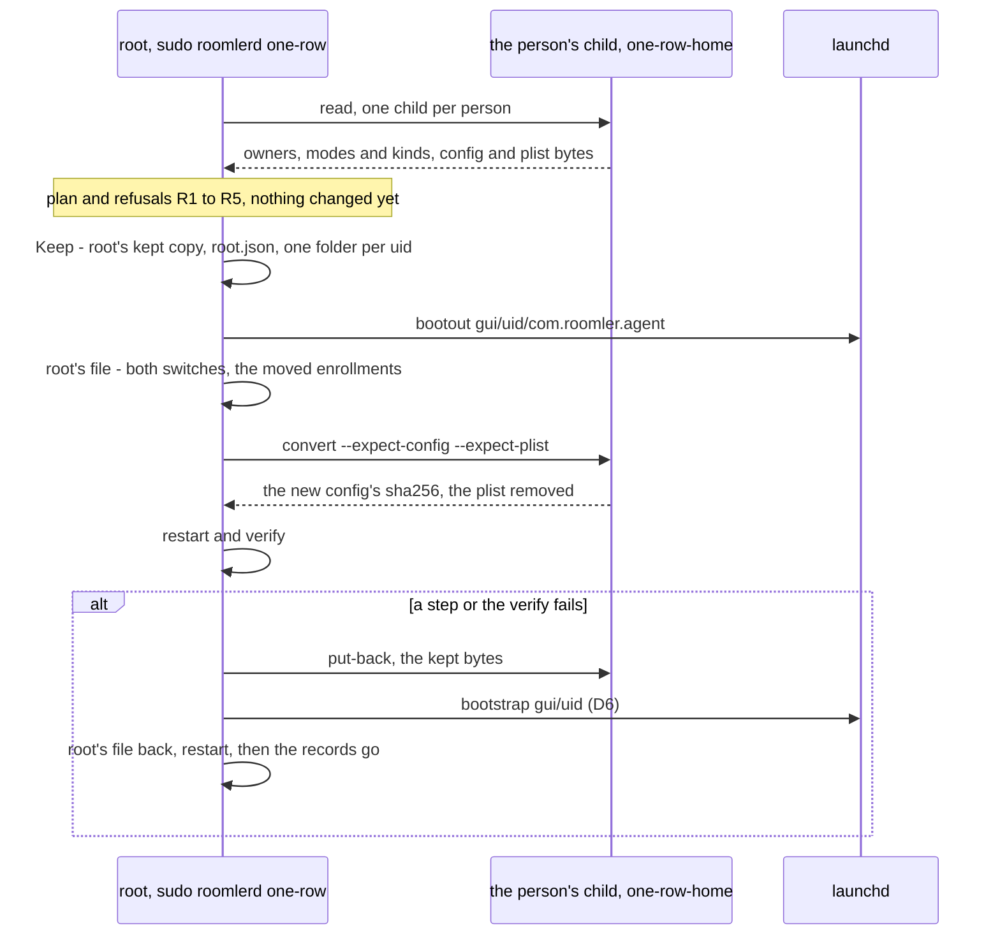

# FR-147: On a Mac, a root step of ours does nothing inside a person's home — what changes there is done by a process of that person

**Issue:** [#3834](https://github.com/gjovanov/roomler-ai/issues/3834) · **Status:** claimed 2026-11-13; spec only, nothing built. D1–D7 carry recommendations and await the operator
**Builds on:** [FR-43](FR-43-macos-single-enrollment.md) P3c (`sudo roomlerd one-row`, released in 0.4.200), #3825 (a root command's folders come from its own account; the screen worker's give-up prints a line the person runs)
**Related:** #3802 (its first criterion), #3763, #3702

## Goal

On a Mac the root daemon serves one row for every person (FR-43). Some steps of ours that run as root still work
inside a person's home: `sudo roomlerd one-row` makes the person's roomler folder, keeps its revert copies in that
folder, saves the person's config as root and then sets the owners back by hand. A folder that root made is what
left a Mac online with no screen in #3802: the person's screen worker could not write its own folder, and it exited
until the supervisor gave up. After this FR:

- **A root step of ours creates, writes, renames, removes, chowns or chmods nothing inside a person's home.** What
  has to change there is done by a process of that person, which root starts for that one job:
  `roomlerd one-row-home <verb>`.
- **That process runs with exactly the person's uid and gid and a group list of that gid alone. It checks that
  itself before it touches anything, and exits otherwise.** What it makes is born the person's, so nothing needs a
  `chown` afterwards.
- **Root keeps its records in its own tree**, `/etc/roomler/one-row/`. A record there survives whatever happens in a
  home, and a revert that stops part-way resumes from it.
- **What root reads about a home is the list of `/Users`, a `stat` of each entry, the account database and one
  question about the console person's administrator rights.** Everything else about a home, the reads that decide a refusal
  included, is read by the person's process and reported to root as bounded, parsed data.
- **`sudo roomlerd one-row --revert` puts back a Mac converted by any release**, including those converted by
  0.4.200 to 0.4.219, whose copies sit in the person's folder.
- **A folder that root made comes back without a pasted command** (P2), and the other root writes under a home are
  each moved to the person's process or removed (P3).

## Evidence

Anchors are master `1cfa02c3d` (2026-11-13), read in the tree.

### #3802: a folder of root's, a Mac online with no screen

Read in the lab on 2026-11-12 with the published 0.4.217 (`install.sh --one-row`, one token), on a Mac whose
`~/Library/LaunchAgents` an older package had left owned by root (#3763):

- The install ended rc=0 with one row, online, and no screen.
- The person's `~/Library/Application Support/live.roomler.roomler`, its `logs` and the day's log file were
  `root:staff` 755/755/644, all born in the second of the root enrollment.
- The screen worker that the root daemon starts as the person ended nine times in three minutes
  (`GUI worker exited uid=501 ran_secs=5 … status=exit status: 1`). The supervisor then gave up after five fast
  exits, and its line sent the reader to a log the worker had not been able to write.
- The device row read `permissions=["no-gui-session"]`. A `chown -R` of the folder to the person and a restart of
  the daemon brought the screen back.

The cause there was the root enrollment's log folder, taken from its caller's `HOME`. #3825 fixed that class: a root
command's folders now come from the account it runs as (`crates/agent-core/src/appdirs.rs:136-162`, `own_home`
`:862`).

### #3825: a line the person has to paste

#3825 also gave the give-up a cause. When the console person's folder is another account's, the root daemon's log
names the folder with its owner and mode (`agents/roomlerd/src/macos_supervisor.rs:531-545`), followed by a shell
line for the person to run in a shell of their own (`move_aside`, `:587-651`; it changes nothing unless `id -u` is
the person's, `:621`). The line builds a new folder beside the old one with the copies a revert needs, then swaps
the two. What it cannot do:

- **Act.** The product has no way to act as the person, so the Mac stays without a screen until someone finds the
  line in the root daemon's log and pastes it into the person's session.
- **Come early.** It is printed after five fast exits (`MAX_FAST_EXITS`, `:73`, noticed at a 5 s poll, `:60`), not
  before the first worker starts.
- **Leave the home to the person.** It is built from root's `lstat` of the person's folder
  (`person_folder_not_theirs`, `:850-857`).

### What #3802's first criterion still lacks

That criterion reads: a roomlerd command run as root on macOS (`enroll`, `one-row`, any other) never creates or
owns a file or folder in a person's home. After #3825 it holds for the folders appdirs gives, not for `one-row`,
which works in homes by design:

| What `sudo roomlerd one-row` does as root today | Anchor (`agents/roomlerd/src/one_row.rs`) |
|---|---|
| Finds people by a `canonicalize` of each `/Users` entry, and keeps a path to each home and roomler folder | `scan_homes` `:1027-1056`, `Person` `:70-101` |
| Keeps each revert copy as `*.pre-one-row` beside its file, in the person's folder, then `chown`s it to the person | `keep` `:1347-1359`, `kept_path` `:61-66` |
| Saves the person's blanked config as root, then `chown`s it and its `.prev` back | `write_config` `:1361-1373` |
| Moves the LaunchAgent plist into the person's folder, and makes that folder with `create_dir_all` and `chown` when it is missing | `plist_aside` `:99-101`, `rename` `:1375-1389` |
| `--revert` looks for the person's copies in the person's folder | `revert_plan` `:905-924` |

Other root steps write under a home too (P3's table). This FR is that criterion's program: P1 for `one-row`, P3 for
the rest, and P2 for the folder a root step made before.

## Design

Notation: `<H>` is a person's home (`pw_dir`); `<F>` their roomler folder,
`<H>/Library/Application Support/live.roomler.roomler` (the pre-rename segment on a Mac that has only that one,
`appdirs.rs:201`); `<L>` is `<H>/Library/LaunchAgents`; `
` is `<L>/com.roomler.agent.plist`.

### The rule

| Rule | How it is met |
|---|---|
| A root process of ours creates, writes, renames, removes, chowns or chmods nothing on a path inside a person's home | root lists `/Users`, `stat`s each entry, reads the account database and asks `dseditgroup` about the console person. Every other read of a home is the person's process's, reported to root |
| What changes inside a home is done by a process running as the home's owner | one child per person, `roomlerd one-row-home <verb>`, started by root with that person's credentials; it checks its own identity before it touches anything |
| Root keeps its records in its own tree | `/etc/roomler/config.toml.pre-one-row` and `/etc/roomler/one-row/`, root:wheel 700/600, each file written as a temporary file, `fsync`, `rename` |
| What the person's process hands back is bounded, parsed data | one bounded JSON object per reply, parsed strictly, its version and identity checked. Root uses no string in it as a path, an argument or a label. Config bytes are parsed; plist bytes are only stored, hashed and handed back to the same account |

Where the rule changes an outcome: a home whose `<L>` or `<F>` a root step made (#3763, #3802), or whose config the
person cannot read, is not converted. Read refuses it before anything changes and says why. Such a Mac keeps
working two-row.

### Who does what

| Step | Root (`sudo roomlerd one-row`, `one_row.rs:1072-1108`) | The person's child (`roomlerd one-row-home <verb>`, one per uid) |
|---|---|---|
| Read | lists `/Users` and `stat`s each entry for owner, device and inode (`scan_homes`, without the `canonicalize`); reads the account, `appdirs::account_entry(uid)` (new beside `account_home`, `appdirs.rs:872`: `pw_name`, `pw_gid`, `pw_dir`), and its UUID; reads its own file and status as today | `read`: its home's identity; the owner, mode and kind of `<H>`, `<H>/Library`, `<L>` and `<F>`; its config and plist bytes; the names of any copies an older release kept |
| Plan, `--dry-run` | `plan` stays pure (`:280-388`), over configs parsed from the child's bytes. `Person` keeps the uid, the name and the home as display text, and loses `dir` and every path method (`:70-101`) | nothing |
| Keep | writes root's records, in root's tree only | nothing: no `.pre-one-row` in a home |
| LaunchAgent | `launchctl bootout gui/<uid>/com.roomler.agent`, by label, as today (`:1395-1407`) | the plist is removed by `convert` |
| Root's file | `config::save` of `/etc/roomler/config.toml`, as today | nothing |
| People's files | nothing | `convert`: removes `
` and writes its config with the enrollments taken out (`without_enrollments`, `:265-277`), each only over the bytes root kept. The new config is made from the bytes it checked (`config::serialise_over`, which keeps the keys this build does not know), and those bytes are kept as the config's `.prev`, 0600, as a save keeps the outgoing file; it reads no file again by path. The files are born the person's |
| Restart, verify, report | as today (`:731-739`, `:797-892`) | nothing |
| Undo | its file back from its kept copy; its records removed after the restart answers | `put-back` of both files from root's records, then the bootstrap (D6) |
| `--revert` | its file back from its kept copy; its records removed after the restart answers | `put-back`, or `put-back-legacy` on a Mac converted by 0.4.200 to 0.4.219 |

### How the child is started, and what it checks about itself

`spawn_person(account, verb, stdin) -> Result<Reply>`, in root:

| Item | Value | Why |
|---|---|---|
| Program | `/Library/Roomler/roomlerd.app/Contents/MacOS/roomlerd`, the package's binary (`scripts/install.sh:134`), never `current_exe()`. Started only when `lstat` reads a regular file of uid 0 that group and others cannot write | the binary of root's own tree, whatever path the command was typed by |
| Arguments | `one-row-home <verb> --uid <uid> --gid <pw_gid> --version <its version> [the verb's]` | the child checks itself against them |
| Dispatch | read from the raw argv as the first statement of both `main`s (`agents/roomlerd/src/app.rs:1283`, `:1365`), before `answer_stall_watch_cost` (`:1285`, `:1372`), any runtime and AppKit (`:1300-1334`). Synchronous: no tokio, no `logging::init` (`:1590`), no legacy-tree migration (`:1551`) | the Mac build's `main` is the AppKit one (`release-agent.yml:2915` builds `viewer-indicator-macos`), and the child starts no daemon, no log file and no window. Its stderr is its log |
| Credentials | set by our own `pre_exec` hook, not by `Command::uid` and `Command::gid` | std empties the group list, and macOS turns an empty list into `[0]`: the child would keep group 0 |
| Environment | `env_clear()` | the child reads no `HOME` and no knob. Its home is `appdirs::own_home()` (`appdirs.rs:862`), the account database's home for its own uid |
| Working directory | `/` | a folder of root's, whatever the caller's was |
| Descriptors | the three pipes only (`tunnel_core::child::inherit_only_stdio`, `crates/tunnel-core/src/child.rs:367-379`) | the child holds none of root's open files |
| Session, umask | `setsid()`, `umask(0o077)` | no controlling terminal; files born private |

The hook allocates nothing and runs, each call checked (a failure is `spawn`'s error, and nothing runs): `setsid()`,
`setgroups(1, [pw_gid])`, `setgid(pw_gid)`, `setuid(uid)`, `umask(0o077)`.

The child's first statements, before it reads its verb's arguments or any file:

1. `umask(0o077)`.
2. It reads its real and effective uid and gid, and the kernel's group list.
3. Exit 2 unless real uid = effective uid = `--uid` ≠ 0, real gid = effective gid = `--gid` ≠ 0, and the group list
   is exactly `[--gid]`.
4. Exit 2 unless `setuid(0)` and `setgid(0)` both fail with `EPERM`.
5. Exit 2 unless `--version` is its own version.
6. Exit 2 when the account database has no home for its uid.
7. It runs the verb. Every reply carries the uid, gid and groups read in step 2, and root refuses a reply that does
   not read the account's uid, its `pw_gid` and `[pw_gid]`.

So the child can do in the home what the person's account can do as its owner, and nothing through another group.

Not through `sudo -u`, the form the worker's start (`macos_supervisor.rs:886-925`) and the package's `as_person`
(`agents/roomlerd/packaging/macos/postinstall:237-239`) use: an enrollment's token and WireGuard key cross these
pipes, `sudo` records a command's input and output where it is set to, and it can pass the caller's `HOME` on.

### Which homes are people

| Case | Today | After P1 |
|---|---|---|
| Several homes | one person per canonical folder (`distinct_homes`, `one_row.rs:1010-1021`) | one child per distinct owner uid, in uid order; Read takes at most 30 s per person |
| An entry in `/Users` | its folder, `canonicalize`d (`:1039`) | converted only when it leads to its owner's own home: root's `stat` of the entry has the device and inode the child reports for its home. A link to a home on another volume converts |
| Two entries of one uid | one person (`:1004-1009`) | one child; the plan shows the account's name, and an entry that does not match is listed as left alone |
| Left alone, and said | uid 0 (`:1252`) | uid 0; no account for the uid; uid < 500 or primary gid 0; an entry that does not lead to its owner's home |
| Not signed in | files planned; bootout if loaded | the same: the file verbs need no session |
| A home that is not mounted | not covered | nothing changes. One that hangs meets the 30 s deadline, and Read stops |

### Refusals at Read

Root stops before anything changes. It names the path with the owner, mode and kind the child reported, and ends
with "nothing has changed" (exit 1).

| # | State, from the child's `read` | What is printed |
|---|---|---|
| R1 | `<L>` is not writable by the person, and the plan removes `
` (#3763) | the administrator's line where it fits (below), else the no-command text |
| R2 | `<F>` is not the person's, and the plan blanks its config (#3802) | #3825's person-run line, built from the child's report (`folder_not_theirs`, `macos_supervisor.rs:724`). P2 replaces it |
| R3 | the config exists and the person cannot read it (a copy of root's, mode 600) | the administrator's line for that file where it fits, else the no-command text |
| R4 | the console person's `<F>` exists and is not theirs, though no blank is planned (the #3802 state) | as R2. Without R4 the worker's first save (`app.rs:3958`) fails after the restart, and the conversion undoes itself |
| R5 | the console person has `com.roomler.agent` loaded but is not a person to convert | no command; it says why that person was left alone (the verify would fail after the restart) |

**A command for an administrator is printed only for the console administrator's own home**, when all of these
hold (the package's `sudo_line_fits`, `postinstall:260-266`, and its owner test, `:301`):

1. The home is the console person's (`console_uid()`, `one_row.rs:1286`).
2. That person is an administrator: `/usr/sbin/dseditgroup -o checkmember -m <name> admin` exits 0
   (`postinstall:261`), a question to the account database.
3. The child reports that the home is an absolute path to a folder, not a link, and that `<H>/Library` is a folder
   of the person's, not a link.
4. The child reports that the target is a folder (R1) or a regular file (R3) of uid 0, not a link.

The line, each word quoted by `sh_quote` (`macos_supervisor.rs:655-657`):

    <name> is an administrator of this Mac and can run this, then run `sudo roomlerd one-row` again:
      sudo chown -h '<name>' '<path>'

The no-command text, for R1 and R3 when a condition fails:

    <path> belongs to <owner> (uid <n>, mode <ooo>), not to <name>, so <name>'s account cannot change it.
      It has to be <name>'s own before `sudo roomlerd one-row` can make this Mac one row;
      see docs/installation.md, section "Which account each step of the package's script writes as".

That section is `docs/installation.md:2366`; P1 adds one-row's row to it.

### Root's records

Each file is written as a temporary file in the same folder, `fsync`, `rename`, then an `fsync` of the folder.
Today root's own kept copy is written in place, at its final name (`one_row.rs:1347-1359`).

| Path | Owner, mode | Holds |
|---|---|---|
| `/etc/roomler/config.toml.pre-one-row` | root:wheel 600 | root's file as it was (`kept_path`, `:61-66`) |
| `/etc/roomler/one-row/` | root:wheel 700 | `root.json` and one folder per uid |
| `/etc/roomler/one-row/root.json` | 600 | the record's version, the sha256 and length of root's kept copy, its `macos_supervise_gui_worker`, the release, the time |
| `/etc/roomler/one-row/<uid>/config.toml` | 600 | the person's config as the child read it |
| `/etc/roomler/one-row/<uid>/com.roomler.agent.plist` | 600 | the plist's bytes |
| `/etc/roomler/one-row/<uid>/record.json` | 600 | the version, the uid, the account's UUID, its name (for display), the segment (`current` or `legacy`), and for each file whether it existed, its sha256, length and mode; the release, the time. Written last: it commits that uid |
| `/etc/roomler/one-row/<uid>/after.json` | 600 | the sha256 that `convert` reported for the new config |

- **Checked before use.** The undo and `--revert` check each stored file's length and sha256 against its record
  before they hand it on. A mismatch fails that uid, whose record is kept and named.
- **An unfinished Keep** is a uid folder without a `record.json` that parses. No live file of that uid has changed
  yet, since `convert` runs after every Keep. `--revert` removes it and says so.
- **Keyed by uid, checked by UUID.** `--revert` compares the account's UUID now with the record's (D7). A mismatch
  leaves the record and says so: a uid given to a new account never receives an old account's enrollment. The name
  is for display; a renamed account keeps its uid and UUID.
- **`leftover_copies`** (`:487-501`) lists root's kept copy, `root.json`, any entry under `/etc/roomler/one-row/`
  and every old copy a child reports. It asks nothing of a path in a home. Any of them refuses a new conversion.
- **`revert_plan`** (`:905-924`) is `Some` when root's kept copy, `root.json`, a committed record or an old copy that
  a child reports exists. Today it is `None` without root's kept copy (`:906-909`).
- **Removed by root only, and only after the restart answered** (`wait_for_new_daemon`, `:797`), in the undo and in
  `--revert`: each uid's folder, then `root.json`, then root's kept copy last, so a stop part-way leaves what the
  next `--revert` needs.
- The records hold tokens and WireGuard keys, the same class as root's own file beside them. The uninstall's
  `remove_paths /etc/roomler` (`scripts/install.sh:1990`) takes them along (D4).

### Root and the person's child

Every reply is one JSON object with `"v":1`, `version`, `uid`, `gid` and `groups`, and the verb's answer under the
verb's own name (`"read": {…}`). It is parsed with unknown fields refused.

| Verb | stdin | Reply | Exit |
|---|---|---|---|
| `read` | none | `home`: kind, uid and mode of `pw_dir`, whether it is an absolute path (it starts with `/` and does not end with one), and its device and inode; `library`, `agents_dir`, `folder`: kind (`dir`, `file`, `link`, `other`, `absent`), uid, mode, and for the last two whether the person can write it; `segment`; `config`, `plist`: absent, or the bytes with uid and mode, or an error (`eacces`, `too_large`, `not_regular`, `other`) with uid and mode, where a link reads as `not_regular`; `legacy`: each name an old copy is kept under, reported as a folder is: kind, uid, mode and whether the person can write it (`other` with no uid and no mode when it could not be looked at) | 0 |
| `convert --expect-config <hex\|none> --expect-plist <hex\|none>` | none | the sha256 of the config it wrote; whether the plist was removed | 0; 3 when either live file is not the expected bytes, or is no longer a regular file (it checks both before it changes either) |
| `put-back` | the kept bytes and modes of both files | the sha256 of each file written | 0; 4 when `<L>` is not writable |
| `put-back-legacy` | none | which old copies it moved | 0; 3 when anything but a file is at an old copy's name, and then nothing is renamed; 4 as in `--revert` below |
| all | | | 2: usage, a failed identity check or another version; 4: not writable (stderr: path, owner, mode); 1: any other error |

- **Bounds.** A config of 256 KiB and a plist of 64 KiB; larger is exit 1. Root sends at most 1 MiB, reads at most
  1 MiB of stdout, and keeps 16 KiB of stderr while draining the rest.
- **Transport.** `tunnel_core::child::output_bounded_fed(cmd, stdin, deadline, cap)`, new beside `output_bounded`
  (`child.rs:86-111`, whose stdin is `/dev/null` and whose cap is 16 MiB, `:48`). stdin is written from its own
  thread, then closed, and a broken pipe fails the step. The deadline is 30 s and the cap 1 MiB; at the deadline the
  child is killed and reaped.
- **The child's reads** open with `O_NONBLOCK`, check that the file is a regular one, and read at most the bound
  plus one byte: a FIFO, a device or a huge file is an error, not a wait. Its writes are a temporary file in the same
  folder, `fsync`, `rename`, as `config::save` does. `put-back` makes the plist with its recorded mode less group
  and other write (0644 when none was recorded), and `<L>` 0755 when it is missing: launchd ignores a plist that
  group or others can write, and the package sets 644 (`postinstall:335-336`). It writes the config with its
  recorded owner bits, 0600 when none was recorded: the file holds a token and a key.
- **Root's side.** Config bytes go through `config::parse_text(raw, origin)`, split out of `try_load`
  (`crates/agent-core/src/config.rs:3882-3921`): the same rules, no path, unknown keys noted from the text
  (`note_unknown_keys` reads by path, `:4292-4295`), and no `.prev` repair, which belongs to the person's own agent
  (`:3505-3517`). A config that does not parse stops Read, as today (`one_row.rs:1240-1242`). Root never parses the
  plist's bytes.
- **Failure.** A non-zero exit, a death by signal, a reply that does not parse, exceeds its bound or carries another
  identity or version, or the deadline: at Read the command stops with nothing changed; during the conversion it is
  that step's error, and the undo runs. Exit 3 reads "this Mac changed after the plan was said". The child's stderr
  is quoted, trimmed and control-escaped into the command's output and `/var/log/roomler/one-row.log`, which also
  records each child's pid, uid, verb, exit and run time.
- **The plan's digest** (`plan_digest`, `:631-647`) also hashes each person's config and plist sha256, so the
  detached copy (`go_ahead`, `:1165-1181`; `hand_over`, `:1206-1213`) applies only the bytes it showed.

### Order, failure and undo

The conversion keeps today's shape: `apply`, then `steps`, then the verify, and any error runs `undo`
(`one_row.rs:659-684`), with `Done` (`:575-584`) recording what to put back.

| # | Step (who) | On disk if it stops there | Undo |
|---|---|---|---|
| R | `read` per person (child) | nothing changed | none: stop |
| K1 | root's kept copy, then `root.json` (root) | a temporary file at most | remove them |
| K2 | `/etc/roomler/one-row/<uid>/` per person, `record.json` last (root) | the uids before it, and one unfinished folder | remove them |
| L | bootout by label of each loaded agent (root, `:1395-1407`) | the job may still drain | bootstrap it back (D6) for every uid booted out |
| W | root's file (root; `config::save` is atomic) | root's file, old or new | root's file back as a copy of its kept copy |
| C | `convert` per person (child) | that person's plist gone or not, the config old or new, each atomically | `put-back` for every person `convert` was started for, answered or not |
| S, V | restart, verify (root) | the new files and the restarted daemon | everything above, then the restart onto it (`:770-791`) |

- A `convert` that the deadline kills after its `rename` has changed the file without answering, so "answered"
  cannot be the test. `put-back` writes the kept bytes whatever is there, so a person never written gets their own
  bytes back. `Done` gains `started`, pushed before each `convert` is spawned. Today's undo already puts back every
  copy made at Keep (`:745-756`, over `done.kept`, filled at `:697-703`).
- The undo's order is today's (`undo`, `:742-793`): the files, then the bootstraps, then the restart. Each failure is
  said, and the rest still run.
- The records and root's kept copy go only after the undo's restart answered. If it does not answer they stay, the
  command says so, and `--revert` finishes the job.
- `--expect-*` makes `convert` act only on the bytes root kept, so the undo puts back exactly what was replaced. The
  put-backs carry no expectation: by then the kept bytes are the truth. A `--revert` days later replaces whatever the
  person changed in their blank file since, as today, and says so when the live file's sha256 differs from
  `after.json`: `<name>'s config changed since the conversion; the kept copy replaces it`.

### `--revert`

1. **Plan**: `revert_plan`, as above. Unfinished uid folders are removed.
2. **The switch** that `bootstrap_after_revert` reads (`one_row.rs:930-931`), today from root's kept copy
   (`:1125`), comes from `root.json` when present, else from root's kept copy, else from root's live file. The last
   case is an older revert that put root's file back and stopped, so the live file holds the kept bytes.
3. **Root's file** goes back as a copy of its kept bytes (temporary file, `fsync`, `rename`), checked against
   `root.json` when present; the kept copy stays. Without a kept copy (a resumed older revert) this step is skipped.
   Root's file goes first, as today (`:938-942`), so a person whose put-back fails is a row nobody serves, never two
   processes on one enrollment.
4. **Per person**, in uid order: the UUID check, the stored-file checks, then `put-back` (or `put-back-legacy`),
   then the console person's bootstrap where `bootstrap_after_revert` says so. A person who fails keeps their record
   and is named; the others go on. Another person who was signed in when L booted them out gets their agent at
   their next login, as today.
5. **Restart** (`:957-968`) and `wait_for_new_daemon`.
6. **Only after the restart answered**: the records of the people who succeeded go, then, if nobody failed,
   `root.json` and root's kept copy. Exit 1 if anyone failed.

A second `--revert` redoes steps 3 to 6: every put-back and copy is idempotent, and the leftover check bars a
conversion in between (D5). Today the first failure stops the revert (`:939-940`).

**Macs converted by 0.4.200 to 0.4.219.** Every release before P1's keeps its copies this way, so the range ends at
the last release before P1's, whichever that is. Their copies are `<F>/config.toml.pre-one-row` (the person's, 600) and
`<F>/com.roomler.agent.plist.pre-one-row`, owned as the plist was. Root's kept copy is already where P1 keeps it.

| Case | `--revert` after P1 |
|---|---|
| `<F>` and `<L>` the person's | `put-back-legacy` renames them back as the person (`config.toml.pre-one-row` to `config.toml`, the plist copy to `
`, making `<L>` 0755 if missing). A rename needs write on the two folders only, whoever owns the file |
| `<L>` root's (#3763, then converted) | the config goes back, the plist copy stays, exit 4, named, with R1's printing rules. The revert goes on, and a second one finishes after the folder is fixed |
| The config copy is root's, mode 600 | renamed back, still root's, so the person's agent cannot read it, as today; the revert says so, with R3's printing rules |
| An older revert that stopped after root's file | `revert_plan` is `Some` on the old copies alone; the switch comes from root's live file, and step 3 is skipped |
| Records and old copies both | no conversion makes both (the leftover check refuses either). Made by hand, both are listed and the revert does both |

Root copies back only its own kept copy, so a revert of an older Mac writes nothing in a home as root either.

### The LaunchAgent file

| Question | Answer |
|---|---|
| Who takes it away | root boots the job out by label; the person's child removes `
` in `convert`, after checking its bytes |
| Where its bytes are kept | `/etc/roomler/one-row/<uid>/com.roomler.agent.plist`, root's, 600, written by root from the child's `read`. It no longer moves into the person's folder (`one_row.rs:99-101`, `:1375-1389`) |
| Who puts it back | the person's child, in `put-back`: a temporary file in `<L>`, `fsync`, `rename`, the mode as above. It makes `<L>` 0755 as the person when missing, and refuses (exit 4) where `<L>` is not writable |
| What `launchctl bootstrap` loads | the file at `
`, which launchd opens by path in every form, the person's own login included. No process of ours running as root opens it: `
` is only an argument, built by one function, `bootstrap_argv`. Who sends it is D6 |
| Precedent | the package's login-item file writes are the person's (`as_person`, `postinstall:237-239`, `:366`); its bootstrap is root's, by path (`replace_launchd_service`, `postinstall:145-163`, called at `:401` and `:486`) |

Not chosen: leaving the plist in place and running `launchctl disable gui/<uid>/com.roomler.agent`. That keeps no
file in the home, but every later `bootstrap` of that label (the package's, a two-row reinstall) fails while the job
is disabled, and nothing else in the product knows that state.

With P1, nothing in the conversion needs `<F>` to exist: the plist no longer goes there, `convert` runs only for a
person whose config exists, and only `put-back` can find the folder gone, which the person's own process then makes.
For `one-row`, the first maker of the person's folder is always the person's own process.

### P2: the folder comes back without a pasted line

The verb `reclaim-folder`, which the root daemon's supervisor runs through `spawn_person` when the console person's
folder is not theirs: before it starts the screen worker, not after five fast exits.

- **Checks first, as the person**: the identity checks above; `<F>` is a folder of another owner, not a link;
  `Application Support` is the person's and writable; no process holds the single-instance lock; the stamped aside
  name is unused; each old copy is readable.
- **Then, staged first**, with `move_aside`'s names and order: make `<F>.new-<stamp>`, copy `config.toml` into it,
  rename `<F>` to `<F>.made-by-root-<stamp>`, rename `<F>.new-<stamp>` to `<F>`. The old copies' bytes go to root as
  records, so nothing of `one-row`'s stays in the home. The root-made folder stays beside it, as a named leftover
  that the person cannot delete.
- The supervisor's own `lstat` of the folder (`person_folder_not_theirs`, `macos_supervisor.rs:850-857`) moves into
  the verb's checks, so root reads nothing in the home.
- P2 replaces the printed line, not the give-up's cause text, and it ships behind a switch whose off state is today's
  give-up with the printed line. It needs supervisor wiring and lab cells of its own.

### P3: the other root writes under a home

The writes, removals and reads under a home that root steps of ours make on macOS today, read on master. Each write
or removal is its own issue and pull request, designed there; P1 does not touch them.

| Where | What | Kind |
|---|---|---|
| `crates/agent-core/src/logging.rs:228-239`, through appdirs | a root command made `<F>/logs` under its caller's `HOME` (#3802) | write; fixed by #3825 (`appdirs.rs:136-162`) |
| `agents/roomlerd/src/instance_lock.rs:253-261` | the lock's path from `BaseDirs`, which reads `$HOME` (`:254-255`); reached by `run` | write |
| `agents/roomlerd/src/service.rs:2253-2285` | `plist_path()` from `BaseDirs`, then `create_dir_all` and `write` (`:2283-2285`): under `sudo`, a root-owned `<L>` and plist, the #3763 state | write |
| `scripts/install.sh:1952-1973` | the uninstall removes every account's `<L>/com.roomler.agent.plist` and `com.roomler.desktop.plist` as root (`remove_paths`, `:1519-1527`) | remove |
| `scripts/install.sh:1986-1993` | the uninstall removes every account's roomler folders (`account_config_paths`, `:1567`) as root | remove |
| `scripts/install.sh:1081` | `as_root grep` of the console person's `config.toml` | read |
| `postinstall:145-163`, `:401`, `:486` | root's `launchctl bootstrap gui/<uid> 
`: launchd opens a path in the home | read by launchd (D6) |
| `postinstall:262-265`, `:301` | root's tests and `stat` of the console home, its `Library` and `<L>` (the writes are the person's) | read |
| `macos_supervisor.rs:850-857` | root's `lstat` of the console person's folder | read; P2 moves it into the child |
| `agents/roomlerd/src/files.rs:235`, `:5236-5240`, `:5317-5321`, `:7484`; `agents/roomlerd/src/recording/folder.rs:161-162` | `BaseDirs` and `UserDirs`, from `$HOME`: whether a root command reaches them is not read yet | not determined |

Not swept: `agents/roomler-setup/src/unix_daemon.rs`, the self-updater, `cleanup-legacy-install`, and fleet exec as
root.

### Tests (P1)

Unit tests in `one_row.rs` and a new `one_row_home.rs` (no file or test binary name with "install", "setup",
"update" or "patch"). Root's side is typed so that it cannot name a path in a home: its person effects take
`(account, verb, stdin)` and no `Path`; its file effects take `enum RootFile { Config, Kept, RootRecord, Person { uid,
part } }`, mapped under `/etc/roomler` and `/var/log/roomler` by one function; `Person`'s home is display text; `
`
exists only as an argument list, built by `bootstrap_argv`.

| Tests | Show |
|---|---|
| `root_path_maps_into_root_trees_only` | every `RootFile` maps under `/etc/roomler` or `/var/log/roomler` |
| `child_refuses_an_identity_it_was_not_given`, `child_refuses_another_version`, `reply_with_unknown_fields_is_refused`, `reply_with_other_credentials_is_refused` | the identity and version checks on both sides: exit 2, nothing read |
| `undo_puts_back_every_person_started` | a child that renames and then dies is still put back |
| `revert_plan_counts_legacy_names_alone`, `resumed_revert_reads_the_bit_without_a_kept_copy`, `a_revert_resumes_from_records_after_roots_file_is_back`, `a_record_whose_account_uuid_changed_is_not_given_back` | `--revert`, of older Macs and resumed |
| `sudo_line_only_where_it_fits` | one case per condition; each failing alone prints the no-command text |
| `an_unfinished_keep_is_dropped`, `a_stored_file_that_does_not_match_fails_its_uid`, `records_go_only_after_the_restart_answers` | root's records, in the undo and the revert |
| `put_back_writes_0644_and_makes_agents_dir_0755` | the modes |
| `a_fed_child_with_a_chatty_stderr_does_not_deadlock`, `an_oversize_reply_is_refused`, `a_child_that_hangs_is_killed_and_the_step_fails` | the transport's bounds and deadline; the undo runs |
| `an_entry_that_is_not_its_owners_home_is_left_alone`, `two_entries_of_one_uid_are_one_person`, `a_home_with_no_account_is_left_alone` | which homes are people |
| `read_reports_bytes_owners_and_legacy_names`, `convert_refuses_bytes_it_was_not_shown`, `a_fifo_or_an_oversize_file_is_an_error_not_a_wait`, `the_child_ignores_the_home_it_was_given` | the child, on a temporary home |

No unit test shows the child's group list: a child started as another uid needs root, and Linux empties the list
where macOS does not. Cell C8 reads it.

### Lab cells (P4: a Mac guest, the candidate build, each a read of behaviour)

| Cell | Pass line |
|---|---|
| C1 two-row, one person at the console, then `one-row --yes` | `<F>`, `config.toml` and `config.toml.prev` are the person's; `find /Users -name '*.pre-one-row'` is empty; `/etc/roomler/one-row/<uid>` is root's 700 with files 600; `gui_worker attached: true` and `screen-capture` |
| C2 then `--revert` | config and plist sha256 as before C1; owners the person's; plist mode 644; `launchctl print gui/<uid>/com.roomler.agent` loaded where the kept root file had supervision off; the records gone; two rows online |
| C3 a second person, enrolled, not signed in | their file blanked and still theirs after C1, restored by C2; no bootstrap for them |
| C4 a failed conversion (no Screen Recording grant) | the undo: `config.toml` and the plist byte-identical and owned as before; no record left |
| C5 a Mac converted by 0.4.219, then the candidate's `--revert` | the old copies back, owners as before |
| C6 a #3763 Mac (`<L>` root's), the console person an administrator; then a standard person | refused, nothing changed; the first prints `sudo chown -h '<name>' '<L>'`, the second the no-command text |
| C7 every run of C1 to C5 | `eslogger` (create, rename, unlink, setowner, setmode, write), or `fs_usage -w -f filesys` joined to `one-row.log`'s pid and uid lines: no event under `/Users` from a roomlerd process with effective uid 0 |
| C8 the child's credentials | (a) `--dry-run` logs each child's `uid=<uid> gid=<pw_gid> groups=[<pw_gid>]`; (b) where `eslogger exec` runs, each child's audit token has euid = ruid = uid and egid = rgid = `pw_gid`; (c) the person's `config.toml` made `root:wheel` 0640, then `root:admin` 0640 for an administrator: `read` reports `eacces` for both, and Read refuses with R3 |
| C9 `kill -9` of the detached copy after L, then again after W | the next `one-row` refuses; `--revert` restores sha256 and owners; the daemon is two-row |
| C10 one person's put-back made to fail (`<L>` made root's) | exit 1, that person named; after the fix a second run finishes them, the daemon restarts again, and the records are gone |
| C11 a refused second person (not at the console) | nothing changed for anyone |
| C12 a #3763 Mac converted by 0.4.219 | exit 4; after the administrator's line, a second revert finishes |
| C13 the bootstrap form (D6) | `launchctl asuser <uid> /usr/bin/sudo -n -u '#<uid>' -- /bin/launchctl bootstrap gui/<uid> 
`, sent by root, loads the job (`launchctl print`); `fs_usage` during it shows which process opens `
` |
| C14 the child and AppKit | each child's run time in `one-row.log` is under 1 s, and `log show --predicate 'process == "roomlerd"'` over the run has no AppKit or WindowServer line of a child's pid |
| C15 what only a Mac shows | `read`'s writable answer for `<L>` against a real write under `~/Library`'s ACLs; whether `put-back`'s new plist raises a "Background Items Added" notice where today's rename did not |
| C16 (P2) a Mac in the #3802 state, P2's candidate | the root daemon reclaims `<F>` before the first worker: `<F>` the person's, `<F>.made-by-root-<stamp>` beside it, `gui_worker attached: true`, the row's permissions not `["no-gui-session"]`, C7's read clean; with P2's switch off, today's give-up and line |

## Phases

| phase | what | kill switch, or back-out | status |
|---|---|---|---|
| P1 | the conversion, its undo and its revert through the person's child: `one_row_home.rs` (the verbs, the identity checks, the dispatch in both `main`s), `output_bounded_fed`, `config::parse_text`, `appdirs::account_entry`, then `spawn_person` with its hook, root's records, the new `Host` types, the refusals and their lines, `put-back-legacy`, and the tests above. Two pull requests (the child, inert until called; then root's side), shipped in ONE release | none: `one-row` is a one-shot command an administrator runs. A conversion that fails undoes itself, and a converted Mac goes back with `--revert`. A back-out is a later release whose `one-row` refuses to convert and keeps P1's `--revert`, never an older binary, which does not read root's records | not started |
| P2 | `reclaim-folder`, run by the root daemon before the screen worker, in place of #3825's printed line | a switch whose off state is today's give-up with the printed line, named in its pull request | not started |
| P3 | the other root writes and removals under a home (P3's table), one issue and pull request each; the rows not determined are read first | each pull request names its own. The uninstall is a one-shot script with no switch: its change is backed out by reverting it | not started |
| P4 | the field read: C1 to C15 with P1's candidate (C13 decides D6), C16 with P2's, each P3 change's own read, then AC8 on a released build | read only | not started |
| Docs | the docs below, each in the pull request of the phase it describes | none | not started |

- **P1 leaves working by itself**: `one-row` and `--revert` on new Macs and on Macs converted by 0.4.200 to 0.4.219,
  with no root write in a home. The #3802 state is refused at Read with #3825's line until P2. The child and root's
  side ship in one release: a release with root's side and no revert of older copies could not revert those Macs.
  Acceptance: AC1 to AC5.
- **P2 leaves working**: a folder root made comes back without a pasted command, on P1's child. Acceptance: AC6.
- **P3 leaves working**: each row on its own. Acceptance: AC7.
- **P4** reads each phase on a Mac, and AC8 on a released build.

The docs:

- `docs/installation.md`, "The migration (FR-43 P3c)" (`docs/installation.md:2147`, its flow at `:2159`): the
  person's child, root's records, the refusals and the revert of older Macs, with the conversion as a mermaid
  sequence.
- `docs/installation.md`, "Which account each step of the package's script writes as" (`:2366`): one-row's row, and
  P2's.
- `docs/installation.md`, where the give-up's line is described (`:2409-2413`): P2's verb in its place.
- `docs/fr/FR-43-macos-single-enrollment.md`: the P3c row (`:76`) points here.
- The module docs: `one_row.rs:1-27` (the step table) and the new `one_row_home.rs`.
- `docs/README.md`: the `installation.md` row names the rule.

## Acceptance criteria

- [ ] **AC1** (P1 tests): the tests above pass in CI; `revert_plan_counts_legacy_names_alone` and
  `resumed_revert_reads_the_bit_without_a_kept_copy` are shown failing on master's `revert_plan` first.
- [ ] **AC2** (P1 code): `one_row.rs` holds no path into a home: `Person` has no `dir` and no path method,
  `MacHost`'s `keep`, `write_config` and `rename` act on no person's file, and `one_row.rs` calls no `chown`. Root's
  records are its kept copy and `/etc/roomler/one-row/`.
- [ ] **AC3** (lab, P1's candidate): C1 to C12, C14 and C15 pass on a Mac guest, and C7 reads no event under `/Users`
  from a roomlerd process with effective uid 0 over C1 to C5.
- [ ] **AC4** (the child's credentials): C8 (a) and (c) pass, and (b) where `eslogger` runs.
- [ ] **AC5** (D6): C13's read is in the field log, and P1 ships the bootstrap form it supports.
- [ ] **AC6** (P2): C16 passes: a Mac in the #3802 state gets its screen back with no pasted command, and with the
  switch off it behaves as today.
- [ ] **AC7** (P3): every write and removal in P3's table is done by the person's process or gone, and every row not
  determined is read and cleared or fixed, each in its own issue with a C7-style read of its own step.
- [ ] **AC8** (field, a released build): C1, C2, C6 and C8 pass again on a Mac guest, and #3802's first criterion is
  ticked for `one-row`.
- [ ] **AC9** — Docs updated in house style (tables, the conversion as a mermaid sequence, `file:line` anchors):
  `docs/installation.md`'s three sections above, FR-43's P3c row and the module docs, linked from `docs/README.md`.

## Open decisions

Each carries its recommendation and awaits the operator.

- **D1. How the child becomes the person.** Recommended: a direct spawn with our own hook (`setsid`,
  `setgroups(1, [pw_gid])`, `setgid`, `setuid`, `umask`), the child's check of itself and root's check of each
  reply; C8 reads it. Fallback: `sudo -n -u '#<uid>'`, the package's form, only if an enrollment's token and key
  passing through `sudo`'s input and output logging were accepted. Not recommended.
- **D2. A home a root step changed before** (#3763, #3802). Recommended: refuse at Read; print an administrator's
  line only under the four conditions; for `<F>`, #3825's person-run line until P2 repairs it; `<L>` is #3763's to
  repair. Until P2 ships: the printed lines and the docs section.
- **D3. A folder whose owner has no account.** Recommended: left alone, and said; the child has no home to find.
  Fallback: migrate it as root, which breaks the rule.
- **D4. Where root's records live.** Recommended: `/etc/roomler/one-row/`, beside root's kept copy; the uninstall
  removes it with `/etc/roomler` (`scripts/install.sh:1990`). Fallback: `/var/db/roomler/one-row/`, which would keep
  tokens after an uninstall.
- **D5. A revert with one failing person.** Recommended: go on, restart, exit 1, and resume on the next run.
  Fallback: stop at the first failure, as today.
- **D6. Who sends the bootstrap.** Recommended: the person's `launchctl`, through
  `launchctl asuser <uid> /usr/bin/sudo -n -u '#<uid>' -- /bin/launchctl bootstrap gui/<uid> 
` (no payload crosses
  `sudo`), once C13 shows it loads the job. Until then P1 sends today's root form, `launchctl bootstrap gui/<uid> 
`
  (`one_row.rs:1409-1421`, the package's form): `
` is only an argument, and launchd opens it in both forms.
  Switching is one function, `bootstrap_argv`.
- **D7. A uid given to a new account.** Recommended: the account's UUID decides, and the name is for display.
  Fallback: the uid alone.

## Out of scope

- Homes outside `/Users` with no `/Users` entry.
- Screen Recording and Accessibility grants (FR-144).
- The running two-row worker saving the person's config during the conversion, as today.
- Repairing a `~/Library/LaunchAgents` that an earlier package made (#3763).
- The person's `config.toml.prev` after a conversion still holds the enrollment that moved to root (a save keeps the
  previous file), and the person's agent's `.prev` repair (`config.rs:3507-3519`) could bring it back: its own issue.
- Linux and Windows: their root steps take their folders from the system already (#3702). The uninstall's Linux arm
  (`scripts/install.sh:1885-1894`) removes people's folders as root the same way, and is not in this FR.

## Field log

| date | what | result |
|---|---|---|
