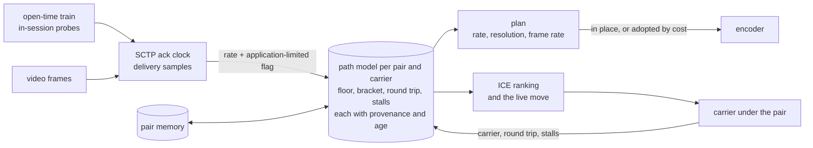

# FR-148: The path is measured, and the plan follows it

**Issue:** [#3953](https://github.com/gjovanov/roomler-ai/issues/3953) · **Status:** claimed 2026-11-16; nothing built. The plan and decisions D1 to D5 are the operator's, taken on 2026-11-16 · **Owner:** the agent's rate path, its path memory and its ICE policy, and the viewer's video channels
**Supersedes:** [FR-63](FR-63-one-delay-based-rate-controller.md) (#1243), [FR-79](FR-79-one-validity-gate.md) (#1524), [FR-35](FR-35-relay-ceiling-learns-the-pair.md) (#922), [FR-59](FR-59-slow-link-latency-priority.md) (#1163), [FR-71](FR-71-transport-stall-classification.md) (#1362), [FR-74](FR-74-text-clarity-on-direct-paths.md) (#1442), [FR-17](FR-17-partial-reliability-video.md) (#799), [FR-18](FR-18-carrier-queue-discipline.md) (#801), [FR-64](FR-64-remote-desktop-never-rides-the-overlay.md) (#1244). §12 says what moved where
**Works beside:** [FR-135](FR-135-one-rc-media-pipeline.md) (#3293), which owns the pipeline's shape (§13)

Anchors are against master `df905bbc1` (2026-11-16).

## 1. Goal

A remote-desktop session runs at what its path carries, on every carrier, from its first second to its last.

Today the agent never measures what a path carries. It keeps a number that stands in for it. When that number is
wrong nothing corrects it, because a session held below its path produces no evidence that the path could carry
more. The code states the limit itself: "you cannot measure capacity you are not using"
(`agents/roomlerd/src/encode/ceiling_learn.rs:27`).

This FR replaces the stand-ins with one measured model of the path. The session's plan (rate, resolution, frame
rate, carrier) follows that model for as long as the session lives.

It is one program under one issue, by the operator's decision of 2026-11-16 (D1).

## 2. Evidence

Two laptops on corporate VPNs, viewed from neo16, 2026-11-10 to 2026-11-16. Everything here was read from
production `agent_logs`, read-only: the pump's heartbeats, the rate-memory lines and the ICE lines of the sessions
the operator reported as sluggish and blurred. Neither relay was the limit: picture age stayed at 55 to 70 ms in
the bad sessions.

### 2.1 CORPLAP-2: a placeholder became the pair's remembered rate

`av1_nvenc`, mesh policy `on`, carried by the mesh relay (DERP).

| What | Value |
|---|---|
| The pair's last measured memory entry | 3,743,114 bit/s. It aged out between 11-10 13:40Z and 11-11 09:57Z: the last session to read it ended with no evidence, and an end without evidence does not renew an entry |
| What replaced it | 179,980 bit/s, written at 11-11 10:42:41Z |
| Where 179,980 came from | a transit hiccup anchored the decaying prior near 100 kbit/s. At the session's end the prior's own placeholder was the only "evidence" left, and a first write is adopted outright |
| The opening rate of the sessions after it | 179,980 → 197,134 → 208,222 → 213,427 → 233,769 → 281,732 bit/s |
| What each of them ran | 1280×800 at 15 fps, 117 to 410 kbit/s median, 292 to 859 kbit/s at the 90th percentile |
| The picture | the average quantiser's 90th percentile was 184 to 240 of 255 in four of five sessions, and its maximum 252 to 253 |
| The same laptop that morning, over TURN/UDP | 1920×1200 at 30 fps, a 3.25 Mbit/s cap, quantiser flat at 14, age 55 / 64 / 90 ms (p50 / p90 / p99). A quieter screen and another network state, so this is a contrast and not an A/B |
| What the path has carried | a 10.0 Mbit/s peak this week; 6 to 9 Mbit/s sustained in FR-35's own P0 |
| How long the operator's sessions lasted | 48 to 144 s |

The chain, in the code:

1. At a session's end the evidence is the learner's stable rate, else `pipe_bps()`
   (`agents/roomlerd/src/peer.rs:9461-9473`).
2. `pipe_bps()` falls back to the prior's stand-in when nothing was measured
   (`agents/roomlerd/src/encode/governor.rs:634-648`, the stand-in at `:648`).
3. `record_session` stores it (`agents/roomlerd/src/encode/rate_memory.rs:147`). Later writes are damped: half the
   way down, a tenth of the way up (`agents/roomlerd/src/encode/rate_memory.rs:79`,
   `agents/roomlerd/src/encode/goodput.rs:94-98`).
4. The next session opens from the entry. An entry at or below 1,000,000 bit/s also engages the slow-link profile,
   1280 on the long edge at 15 fps (`agents/roomlerd/src/encode/rate_profile.rs:416-419`, `:456-470`). The
   profile is resolved once, when the pump starts (`agents/roomlerd/src/peer.rs:6779-6795`), and nothing in the
   session leaves it.
5. In the session the prior grows by a quarter every ten clean windows, and it stops standing in at 1.5 Mbit/s
   (`agents/roomlerd/src/encode/prior.rs:162`, the band at `agents/roomlerd/src/encode/mod.rs:279`). A session
   that ends before that offers the placeholder again, damped: 233,769 raised by a quarter five times is 713,402,
   and it moved the entry a tenth of the way, to 281,732. A session that outlasts the stand-in and measured
   nothing has no evidence, and writes nothing.

So the entry can only creep, and no session it opens can refute it.

### 2.2 CORPLAP-2: why it rode the mesh relay at all

| What | Value |
|---|---|
| When the overlay pair was selected | 17:55:32.364Z |
| When the TURN/UDP relay candidates were gathered | 17:55:32.453Z to .626Z, 90 to 260 ms later |
| The policy | `rc_overlay=on`, morning and evening |
| Stalled windows on the mesh relay | 5.7 % (11-16) and 13.4 % (11-11) |
| Stalled windows on TURN/UDP | 1.0 to 1.2 % |
| Round trip of the relayed mesh link | 130 ms median; 94 to 190 ms in 70 of 71 samples, and one of 369 ms |

With the policy at `on`, the agent's overlay host candidate carries type preference 90
(`crates/vendored/webrtc-ice/src/agent/agent_gather.rs:32`). A relay candidate carries 0. So an overlay pair
outranks every TURN relay, whatever carries the mesh link underneath. Here the mesh link was itself relayed: video
rode a reliable SCTP channel, over WireGuard, over the relay's WebSocket, over TLS and TCP, through the VPN.

### 2.3 CORPLAP-1: the plan moved and the encoder did not

`hevc_qsv`, mesh policy `off`, TURN/UDP, 1920×1200 at 30 fps.

| What | Value |
|---|---|
| One session of 16,719 s | the target climbed 2.55 → 7.45 Mbit/s. Rate moves applied: 0. Rebuilds: 0. Swaps: 0 |
| Every frame of that session | 10,638 bytes, real and keepalive alike |
| Real frames and keepalives | about 8.8 and 10.5 a second |
| What it sent | 1,644 kbit/s median, of which about 0.9 Mbit/s was keepalive filler |
| In motion windows | 2.59 Mbit/s median at 56 to 63 ms age. Skipped 0, dropped 0, `send_wait_max` p99 0.55 ms |
| Other sessions the same day | opened at 5.49 Mbit/s (22,884 B a frame) and 5.96 Mbit/s (24,838 B a frame) |
| What the path has carried | peaks of 11.4 to 13.3 Mbit/s |

Three facts compose:

1. **On this host a QSV rate change is an encoder rebuild.** FR-62 closed with QSV's in-place path broken and its
   flag off.
2. **On a constrained path a rebuild-bound encoder applies a rate only after 1.2 s without motion**, up or down
   (`DEFER_QUIET`, `agents/roomlerd/src/peer.rs:7369`; the two arms at `:9669` and `:9723`). A finished background
   rebuild is adopted under the same wait (`:7731`).
3. **"Motion" is any real frame of 4,096 bytes or more** (`agents/roomlerd/src/peer.rs:9894-9898`). QSV runs
   constant bitrate, so every frame is `maxrate ÷ fps ÷ 8` bytes: 10,638 at 2.55 Mbit/s, 22,884 at 5.49, 24,838 at
   5.96. Measured in all five sessions read. A frame of an unchanged screen is as large as any other.

So while anything on the screen moves, the wait never ends, and the session keeps the rate it opened at.

The opening rate is itself a lottery. The memory is keyed by the far address and the carrier, and for a relayed
pair the far address is the relay worker's. The same pair opened at 2.55, 5.49 and 5.96 Mbit/s on one day,
depending on which worker was nominated. The entry behind the higher openings is a controller target, not a
delivered rate.

### 2.4 The class

Six rules have been added since late August, each after a field failure:

| Rule | The failure it answered |
|---|---|
| FR-35: the ceiling learns the pair | a fleet constant 2 to 3 times too low for some relays (measured 2026-08-29) |
| FR-59 P6: abandon a seed the measurement contradicts | a fast day's entry inherited by a slow link (2026-09-01) |
| FR-70 P1: a prior may open a session but never pin one | a remembered 170 kbit/s held a healthy link at 1280×800 and 15 fps (2026-09-04) |
| FR-79 V2 and V3a: the gate at the write-back, one `pipe_bps` | an opening burst and a stall written back as the pair's rate (2026-09-08) |
| FR-79 V4: an evidence-only write-back, damped | the memory ratcheting to its cap |
| FR-79 V5b (PR #3374, built, parked): only a measurement is evidence | an idle trickle read as the path on jupiter and written back five times (2026-11-02) |

This week's failure is the 2026-09-04 picture again. The number that did it was the placeholder of the rule
written to prevent it. FR-70's criterion "an unmeasured prior cannot hold a session at the floor" is ticked, and
it holds inside a session: on 2026-11-16 one opened at 281,732 bit/s and its target was at 3.0 Mbit/s by 144 s.
What it does not cover is where the week went wrong. The next open reads the remembered number again, and the
size and frame rate are set once at the open.

Each rule decides which stand-in to trust. None of them makes a session find out.

## 3. Why the work in flight does not close it

| Work | What it does | Why the two failures survive it |
|---|---|---|
| FR-63's controller (B1 in shadow) | a delay-based controller in place of eight estimators | It is passive. On a constrained path its measured rate is what the viewer received, which is what the agent chose to send. It opens a remembered pair at 0.85 × the entry (`agents/roomlerd/src/encode/ratectl.rs:99`): 239 kbit/s on CORPLAP-2. Its flip criterion compares it with the live governor in elevated-age windows, and its spec records that the criterion "cannot fail on under-driving" |
| V5b (PR #3374) | no placeholder is written or acted on | Its own notes: a pair remembered slow then stays slow until a session measures it or seven days pass. Nothing makes a session measure |
| FR-135's ledger | reserves a sink for every heuristic | It keeps both mechanisms as policy: "Plan owns opening profile" (`docs/plans/rc-media-debt.tsv:57`) and "Rebuild-bound backends adopt quietly by policy" (`docs/plans/rc-media-debt.tsv:65`) |
| FR-35 | the learner | It decided against an active probe ("Not done, deliberately") |
| FR-128 | `rc_overlay=auto` | Moving a live session off a relayed mesh link is its unbuilt P3, default "no" (`docs/fr/FR-128-rc-overlay-auto.md:127`, `:147`) |

## 4. Design: four invariants

### 4.1 One path model, and every number in it says how it was obtained

`encode::pipe` is "ONE belief about what the path carries" (`agents/roomlerd/src/encode/pipe.rs:3`, the struct at
`:137`). It runs in shadow: nothing reads it. It becomes the only source of path numbers, per pair and carrier.

| Field | Meaning |
|---|---|
| floor | the highest rate the path delivered over a sustained interval. A lower bound on capacity |
| bracket | low edge: the highest rate carried clean. High edge: the lowest rate that pushed back |
| round trip | the carrier's, not the viewer's paint age |
| stall profile | the share of stalled windows and their typical length, per carrier |

Every value carries a provenance and an age:

| Provenance | When | What it may do |
|---|---|---|
| measured, backlogged | the sender had more to send than the path took | set the floor and both edges of the bracket |
| measured, application-limited | the path took everything offered | raise the floor. It never lowers the bracket |
| assumed | a prior, a default, an entry from before this FR | open a session when nothing else exists. It is never stored, and it never holds the plan below a demonstrated value |

A stalled window is evidence about the carrier's stall profile and not about its capacity. That is FR-71's
classifier and FR-79's gate, kept.

The memory stores the model, not one rate. Its key names the pair and the carrier, never a relay's address (O1).
The opener, the ceiling, the slow-link profile and the queue budgets read the model.

### 4.2 Capacity is measured by sending on purpose

- **At the open.** The encoder's own open takes 0.65 to 2.8 s (measured this week). In that time a closed-loop
  packet train steps up on a probe channel and stops at the first push-back.
- **In a session.** A short, bounded probe runs when two things hold: the stream has room to spare, and a better
  answer would change the plan. It carries picture refinement where it can, padding where it cannot.
- **The samples come from the transport.** SCTP's acknowledgement clock in the vendored `webrtc-sctp` yields
  bytes delivered per interval and whether the sender was application-limited in it. The viewer does not change.
  On the RTP sink the same reading comes from transport-wide feedback (O2).

This reverses FR-35's decision (D2). FR-35's objection was that a startup probe measures a burst (18 Mbit/s
instantaneous against about 8 sustained) and costs bytes on exactly the thin links. Two things answer it. The
loop is closed and its steps are proportional, so a thin link stops the train at its first step. And the bracket
keeps a burst reading apart from sustained evidence: a probe moves the bracket's edges, and only sustained
delivery raises the floor.

It also supplies what two open items wait for: a capacity reading for FR-135's D12 ("Plan grant by measured
capacity?", `docs/fr/FR-135-one-rc-media-pipeline.md:1526`) and an under-drive clause for FR-63's flip criterion.

### 4.3 No decision lasts a session, and every plan move has a computed cost

- **One plan.** Rate, resolution and frame rate are one `Plan` (`agents/roomlerd/src/encode/plan.rs:105`, FR-70
  M3a, in shadow), recomputed from the model for as long as the session runs. The slow-link profile becomes a plan
  field that is entered and left on evidence.
- **Frame rate changes by pacing**, not by a rebuild.
- **Rate changes in place** where the backend can.
- **A backend that must rebuild adopts by cost.** The replacement is built in the background, as FR-70's
  make-before-break already does for FFmpeg. It is adopted when its keyframe's bytes, divided by the measured
  capacity, fit a stall budget (O5). That replaces `DEFER_QUIET` and the 4 KiB motion threshold.
- **A decrease never waits.** A decrease that waits is the agent over-driving a path it knows is slower.
- **QSV leaves constant bitrate** (FR-62's A5, QVBR, `docs/fr/FR-62-encoder-rate-changes-without-an-idr.md:397`).
  It ends the filler. FR-62 also records that leaving constant bitrate could change whether QSV accepts an
  in-place reset, and that its untested patch 0004 is the leading candidate for an in-place rate there
  (`:363-370` of the same file). So A5 goes first, and the spike on patch 0004 runs only if A5 leaves QSV
  rebuild-bound (D4).
- **Motion is read from capture damage**, not from encoded bytes.

### 4.4 The carrier is ranked by what it is, and video never rides two reliable layers

- **Ranking.** ICE ranks an overlay pair by the mesh link's actual carrier: a direct mesh link like a host pair,
  TURN over UDP next, the relayed mesh link as the fallback. If the browser does not follow a lowered priority
  (AC4 reads it), the agent holds the relayed-mesh candidate back until relay gathering has ended.
- **The live move.** When the carrier under a session changes class, or a better one appears, the session moves by
  ICE restart. This reopens FR-128's D4 (D3).
- **Two video channels.** The viewer creates both at the offer: the reliable, ordered channel of today and a
  deadline-limited one (`videoDcOptions`, `ui/src/composables/useRemoteControl.ts:5093-5098`, builds the second
  shape already, behind an opt-in). The agent picks per path, at a keyframe. FR-17 found that a channel's ordering
  is fixed when it is created and named a second channel as one way out.
- **On a carrier that is already TCP, video is always deadline-limited.** The carrier retransmits by itself.
  SCTP retransmitting above it adds its own floor of 1 s (`RTO_MIN`,
  `crates/vendored/webrtc-sctp/src/timer/rtx_timer.rs:10`). FR-18 made the relay's writer drop frames older than
  its age bound (`agents/roomlerd/src/derp.rs:354`); on a reliable channel each such drop is repaired by an SCTP
  retransmit. Inferred, read in P0: that is where the mesh relay's stalled windows come from. FR-17 and FR-18 were
  designed as two halves and were never joined.
- **`constrained` becomes the carrier.** One flag covers TURN over UDP, TURN over TLS, the mesh relay and an
  organisation's own relay (`detect_constrained_transport`, `agents/roomlerd/src/peer.rs:2020`). The model is per
  carrier, so its readers stop needing the flag.

### 4.5 Mixed versions

The viewer rolls in seconds and agents over days. Every wire change is additive. The probe channel and the second
video channel are created by the viewer: an old agent ignores them, and against an old viewer the agent has
neither and behaves as today.

## 5. What it deletes

In P5, each on its own evidence, through the switch registry:

- the rate memory's stable-rate values and the prior's write-back
- the ceiling learner (`agents/roomlerd/src/encode/ceiling_learn.rs`)
- FR-59's P5, P6 and P8 arms
- `DEFER_QUIET`, the 4 KiB motion threshold and quiet-gated adoption
- the fixed relay caps (`relay_max_bps`, `agents/roomlerd/src/encode/mod.rs:887-892`; `relay_max_hi_bps`,
  `:945-952`)
- the path-class frame-rate rule (`ffmpeg_target_fps`, `agents/roomlerd/src/peer.rs:10660`)
- everything FR-63's B3 and B4 already named

## 6. Phases

Each phase ships in shadow or behind its switch first. Each field test is shown failing on the current release
before it passes. Switch names are proposed. A switch read in the media path, a line added to a pump and a
viewer storage key each go through FR-135's ratchet, and each arrives with a ledger row that names the phase
retiring it (§13).

| # | Phase | Kill switch | Proof | Status |
|---|---|---|---|---|
| P0 | Measure, in shadow | `ROOMLERD_PATH_MODEL=off` | AC1 to AC5 | running since 2026-11-16; AC1 and AC5 met; steps 1 and 6 done, step 2 merged on 2026-11-17 |
| P1 | The model drives the open and the memory | `ROOMLERD_PATH_MODEL=shadow` | AC6 to AC9 | step 1 (#3374) and the first part of step 2 (#3969) merged on 2026-11-17, not yet read in the field; the rest not started |
| P2 | The plan is live, and its moves have a cost | `ROOMLERD_PLAN_ADOPT=quiet` | AC10 to AC15 | not started |
| P3 | Probes in a session; the bracket replaces the fixed caps | `ROOMLERD_PATH_PROBE=open` | AC16 to AC21 | not started |
| P4 | The carrier | `ROOMLERD_RC_CARRIER_RANK=0`, a viewer flag | AC22 to AC27 | not started |
| P5 | One controller, then the deletions | `ROOMLERD_RATECTL=shadow` | AC28 to AC30 | not started |
| P6 | Docs | none | AC31 | not started |

**P0, measure.**
1. The reference report: a script over `agent_logs` that prints, per session, the opening rate beside what the
   pair has demonstrated, and the encoder's applied rate beside the plan's. The queries behind §2 are its first
   version. Merged on 2026-11-17 as `scripts/rc-path-report.cjs` with its wrapper (#3961,
   `docs/production-mongo-reads.md` §8). Its read of the release then current is AC1 (§15).
2. Delivery samples from SCTP's acknowledgement clock, with the application-limited flag, on a line of their own
   (D9). Merged on 2026-11-17 (#3968, `docs/rate-control.md` § Delivery samples): the line is
   `path delivery (FR-148 P0, shadow, ≈10s)`, and each sample is backlogged, application-limited or stalled.
3. Provenance and age on every input of `Pipe`, on the path model's own line (D9).
4. The open-time train, logged and read by nothing.
5. The standing relay cell: a shaped lab pair at 0.4, 2 and 8 Mbit/s over TURN/UDP, TURN/TLS and the mesh relay,
   with and without injected stalls, and the two laptops as the natural cells.
6. The read of FR-63 B1's shadow over seven days, with an under-drive clause added to the report's verdict. A
   first production read ran on 2026-11-02, over the release's first 3.4 days, and met the criterion: the shadow
   asked for no more than the live law in 1,096 of 1,121 windows of elevated age, on 502 sessions
   ([#1243, the comment of 2026-11-07](https://github.com/gjovanov/roomler-ai/issues/1243#issuecomment-6706580701)).
   Its spend view shows what that criterion cannot fail on. In a pump's first 120 s the encoder spent more than
   the shadow asked in 1,232 of 3,372 clean direct windows and 623 of 1,962 clean constrained ones, against 158
   of 31,743 and 193 of 6,685 later, and every constrained window spending 5 Mbit/s or more was over the shadow
   (313 of 313). The read over seven days ran on 2026-11-16 (AC5, §15). PRs #3307 and #3374 and the fixes for
   #3472 were parked behind it. FR-135's rule on agent-behaviour phases names two conditions, this read's start
   and FR-70 AC10's read (`docs/fr/FR-135-one-rc-media-pipeline.md:1246`). The first is met. D6 stands (§8).
7. The inferred mechanisms of §11, measured or struck.

**P1, the model drives the open and the memory.**
1. V5b (PR #3374), rebased. Merged on 2026-11-17: a session writes a rate to the memory only when it measured
   one. Its switch is `ROOMLERD_MEASURED_EVIDENCE` (D8).
2. The memory stores the model, keyed by the pair and the carrier. An entry from before this phase is read as
   assumed. The second sentence merged on 2026-11-17 (#3969): an entry carries its provenance, one without it
   seeds nothing, and the device's next measured write drops it. The first is not built.
3. The opener reads the model: a known pair opens at its demonstrated floor, and the train's result may raise the
   opening inside the bracket.
4. The slow-link profile engages at the open only on a demonstrated low floor.

**P2, the plan is live.** Cost-budgeted adoption in today's pump (D5), then QSV off constant bitrate, frame rate
by pacing, the profile as a plan field, motion from damage.

**P3, probes in a session.** The probe scheduler. The relay caps become bounds on the probe and then go. The
frame-rate grant reads the model (FR-135 D12). On a direct path the bits-per-pixel constant becomes a bound
(FR-74's P5).

**P4, the carrier.** Ranking or hold-back, the live move, the two channels with bounded loss recovery (O6), the
flag split.

**P5, one controller.** FR-63's B2 flips on the model under the amended criterion. B3 and B4's deletions follow.
FR-135's fallback stands: if the flip is not live four weeks after R7's shadow week ends, R8 proceeds on the governor
(`docs/fr/FR-135-one-rc-media-pipeline.md:1519`).

**P6, docs.** `docs/rate-control.md` rewritten around the model, `docs/remote-control.md`'s carrier section, the
index row.

## 7. Acceptance criteria

- [x] **AC1 (P0, the failure first)** — From telemetry alone, on the current release, the report shows both
      reference failures: a CORPLAP-2 session on the mesh relay opening below 0.3 Mbit/s at 1280×800 and 15 fps on
      a path that carried over 3 Mbit/s the same week, and a CORPLAP-1 QSV session whose target moves while its
      encoder's rate does not. The script and its output are in the field log. **Read on 2026-11-16** on `0.4.223`:
      F1 is raised in 16 of 40 judged sessions, 15 of them CORPLAP-2 on the mesh relay opening at 0.200 to 0.282
      Mbit/s, 1280×800 and 15 fps, and F2 in 2 of 11, both CORPLAP-1 on `hevc_qsv` (0 rate moves in 26 minutes and
      in 4.6 hours). The report's own yardstick is a floor of 0.616 Mbit/s for that pair. That the path carried
      over 3 Mbit/s is in the same rows: seven clean windows at 3 to 7.44 Mbit/s, and a plan held at 3.00 Mbit/s
      for 36 minutes. [The report](https://github.com/gjovanov/roomler-ai/issues/3953#issuecomment-6942393774) is
      on the issue, and the numbers are in §15.
- [ ] **AC2 (P0)** — On the shaped lab pair at 0.4, 2 and 8 Mbit/s, over TURN/UDP, TURN/TLS and the mesh relay,
      the shadow model's bracket contains the true capacity and its low edge is within 20 % of it, in every cell,
      five runs each.
- [ ] **AC3 (P0)** — Every path number in the heartbeat carries how it was obtained and its age. The jupiter chain
      of 2026-11-02 and the CORPLAP-2 chain of 2026-11-11 replay as unit cells: each fails on master's laws and
      passes on the model's. It is read on the path model's own line, which names every path number the heartbeat
      carries (D9), and "master's laws" are those of 2026-11-16, before V5b merged.
- [ ] **AC4 (P0)** — Each mechanism §11 lists as inferred is measured or struck: SCTP's 1 s retransmit floor under
      the mesh relay's age drop, the MTU split of a full SCTP packet into two WireGuard frames, whether the browser
      follows a lowered candidate priority, and what `auto` chooses on the two laptops.
- [x] **AC5 (P0)** — FR-63 B1's shadow is read over at least seven days with an under-drive clause added to the
      report, and the report is attached. This is the read the parked rate-path work waits on (FR-135's agent
      phases, #3374, #3307). FR-135's agent phases also wait on FR-70 AC10's read. **Read on 2026-11-16** over
      seven days: agreement 2,852 of 2,939 (97.0 %), the clause 94.5 % constrained and 97.7 % direct, overall MET.
      [The report](https://github.com/gjovanov/roomler-ai/issues/3953#issuecomment-6932207141) is on the issue,
      and the numbers are in §15.
- [ ] **AC6 (P1)** — A reconnect never opens below what the pair last demonstrated on that carrier: 20 reconnects
      in a row on each laptop, each opening at 0.85 × the demonstrated floor or higher. Fails first on the current
      release.
- [ ] **AC7 (P1)** — Nothing assumed is written to the pair memory, and nothing assumed holds the plan below a
      demonstrated value: V5b's cells and the two replay cells are green, and one field week shows no memory write
      without a measurement behind it. An entry written before this phase is read as assumed.
- [ ] **AC8 (P1)** — The memory is keyed by the pair and the carrier: the same pair through two relay workers on
      one day opens within 20 % of the same rate (today 2.55, 5.49 and 5.96 Mbit/s).
- [ ] **AC9 (P1)** — A transit stall changes neither the bracket nor the rate: on the shaped pair with injected
      stalls of 1 to 8 s the bracket's low edge moves less than 10 %, no cut follows, and the picture recovers
      within the stall's own length.
- [ ] **AC10 (P2)** — On QSV under continuous motion the encoder's rate follows the plan within 2 s, up and down:
      CORPLAP-1, ten minutes of a moving pattern, 95 % of plan moves applied within 2 s. Fails first on the
      current release (0 moves in 16,719 s).
- [ ] **AC11 (P2)** — A decrease never waits: when the shaped pair's capacity steps down, every backend's encoder
      is at the lower rate within 1 s.
- [ ] **AC12 (P2)** — No adoption costs more than its budget: for every adopted rebuild in a field week, keyframe
      bytes ÷ the bracket's low edge is within the stall budget, read from the heartbeat.
- [ ] **AC13 (P2)** — QSV no longer pads: a QSV keepalive is no longer `maxrate ÷ fps ÷ 8` bytes, and a still
      screen on CORPLAP-1 costs under 0.3 Mbit/s (today 0.9 of 1.64).
- [ ] **AC14 (P2)** — The slow-link profile is entered and left inside a session: the shaped pair stepped
      8 → 0.4 → 8 Mbit/s takes resolution and frame rate down within 5 s and back within 10 s, with no reconnect.
      Fails first on the current release.
- [ ] **AC15 (P2, direct)** — CORPLAP-3 on a direct path: text is sharp within 1 s of a scroll stopping, no
      keyframe comes from a rate move, and the operator reads the same scroll.
- [ ] **AC16 (P3)** — The plan matches the path within 3 s of the open and within 5 s of a capacity step: on the
      shaped pair the rate is within 0.7 to 1.0 × the true capacity, and probe bytes stay within their budget.
- [ ] **AC17 (P3, thin link)** — On the 0.4 Mbit/s cell and on a real hotspot-class link: paint age under 600 ms
      sustained, the target within 2 × the measured rate, and the byte gate engaging.
- [ ] **AC18 (P3, mid relay)** — A relay that carries about 2 Mbit/s is never driven above what it carries: age
      p99 no worse than the P0 baseline.
- [ ] **AC19 (P3)** — No fixed relay cap is left: on a relay that carries 8 Mbit/s a session runs above 3 Mbit/s
      and gets 60 fps when the model grants it, on both laptops' TURN/UDP paths.
- [ ] **AC20 (P3)** — The opening: time-to-crisp at most 0.6 s and first-light sharpness at least 70 % of steady,
      cold and remembered, on both laptops' relay paths.
- [ ] **AC21 (P3)** — No regression on direct paths and healthy relays: age p50 and p90, frame rate and skips
      within noise of the P0 baseline, taken with the same instrument.
- [ ] **AC22 (P4)** — CORPLAP-2 on its VPN with the mesh allowed lands on TURN over UDP whenever it allocates, 20
      sessions of 20, and its stalled windows stay under 2 % (today 5.7 to 13.4 % on the mesh relay). Fails first
      on the current release.
- [ ] **AC23 (P4)** — With the far TURN unreachable in the lab, a session is on the mesh relay within 5 s, on the
      deadline-limited channel: `send_wait` p99 under 250 ms with no sample over 1 s, age p99 under 300 ms under
      FR-16's fast-motion profile, and `dropped_stale` above zero under load while the delivered frame rate holds.
- [ ] **AC24 (P4)** — No keyframe storm: under sustained loss on the deadline-limited channel the keyframe rate
      stays inside its bound and the delivered frame rate does not fall below the reliable channel's.
- [ ] **AC25 (P4)** — A live session moves when its carrier changes class, by ICE restart, within 5 s and with no
      gap over 1 s, in both directions.
- [ ] **AC26 (P4)** — A pair on one LAN nominates its native pair: CORPLAP-3, age p50 at most 50 ms, read from
      pages loaded after #3566's fix.
- [ ] **AC27 (P4)** — A field A/B against RustDesk on the same relay pair.
- [ ] **AC28 (P5)** — One release of shadow logs meets FR-63's flip criterion and the under-drive clause: where
      the bracket's low edge is 2 × the live rate or more, the controller's target is at least 0.7 × the low edge
      in 90 % of windows. This clause and the report's (AC5) also hold on a pump's first 120 s taken alone (D7).
- [ ] **AC29 (P5)** — Field A/B on CORPLAP-1 and CORPLAP-2 with the controller live: paint age p90 no worse than
      the baseline, and no window with a standing queue while the encoder tracks.
- [ ] **AC30 (P5)** — The deletions of §5 are in the tree, `ROOMLERD_RATECTL=off` restores the prior behaviour for
      one release, rate-control switches number 4 or fewer, and one accessor answers "how fast is the path".
- [ ] **AC31 — Docs.** `docs/rate-control.md` is rewritten around the path model and `docs/remote-control.md`
      gains the carrier rule, with mermaid diagrams, tables and anchors, linked from `docs/README.md`'s index.

## 8. Decisions taken

D1 to D5 are the operator's, taken on 2026-11-16 with the plan. D6 to D9 are this FR's owner's.

| # | Decision |
|---|---|
| D1 | One FR and one issue for the whole program. The FRs it takes over are closed and referenced from it |
| D2 | FR-35's decision against an active probe is reversed. The probe is closed-loop and bounded |
| D3 | FR-128's D4 is reopened: a live session moves. FR-64's rule, "remote desktop never rides the overlay", becomes the carrier rule |
| D4 | QSV: FR-62's A5 first. One spike on FR-62's patch 0004, and only if A5 leaves QSV rebuild-bound |
| D5 | The adoption rule lands in today's pump, before FR-135's R8 |
| D6 | V5b's two open questions are invariant 1 applied: (a) the write-back records a reading or nothing, (b) a growing queue must be offered. Taken by this FR's owner. The operator, asked about it on 2026-11-16: "you are driving and owning this" |
| D7 | At P5 the under-drive clauses, the report's (AC5) and AC28's, are each also read on a pump's first 120 s alone, per class, at the same thresholds, and the flip needs them to hold there. Taken by this FR's owner on 2026-11-16, from AC5's read and before P5's read exists: over all windows the report's clause is met (94.5 % constrained, 97.7 % direct), while in the first 120 s only 342 of 859 constrained windows and 2,046 of 2,925 direct ones are within ×1.25 of the shadow. A flip judged on all windows would pass and still open low |
| D8 | P1's first two merges (#3374, #3969) ship without the phase's switch. They stop a number that nobody measured from being stored or read, and they make nothing drive a rate; the fallback is the open of a pair with no entry, which is how every pair opened before the memory existed. The phase's switch, `ROOMLERD_PATH_MODEL=shadow`, arrives with step 3, where the opener starts to read the model. Step 1 keeps V5b's own switch, `ROOMLERD_MEASURED_EVIDENCE`. A rollback is safe: the release before them ignores an entry's new field and reads a file it cannot parse as an empty memory. Taken by this FR's owner on 2026-11-17, before the release that carries them was cut |
| D9 | P0's numbers are written on lines of their own, `path delivery` and `path model`, about every 10 s, and not as heartbeat fields. FR-135's ratchet counts the lines of each pump, so every heartbeat field is a line of debt, while a line of its own costs one call per pump, whatever it carries. AC3 is read on the `path model` line, which names every path number the heartbeat carries. Taken by this FR's owner on 2026-11-17, at the merge of step 2 (#3968) and in step 3's brief |

## 9. Open decisions

| # | Question | Recommendation |
|---|---|---|
| O1 | What identifies the viewer's end in the memory key? | The controlling user and the viewer's reflexive network prefix, beside the carrier. P0 reads how often one user's sessions differ by network |
| O2 | The probe on the RTP sink | Transport-wide feedback there, the SCTP clock on the DataChannel sinks. Decide after P0's read of the SCTP samples |
| O3 | Which comes first, TURN over TLS or the relayed mesh link? | TURN over TLS: one reliable layer fewer and an allocation of its own. The standing cell reads both |
| O4 | After P4, are `auto` and `on` one policy, and what do new devices get (#3357)? | One policy, "mesh allowed, ranked by carrier", beside `off`. Decide the default on P4's field read |
| O5 | The stall budget of an adoption and the byte budget of a probe | 200 ms of the bracket's low edge for an adoption; a train of at most 250 ms of the high edge. Both set from P0's cell |
| O6 | Loss recovery on the deadline-limited channel | A keyframe under the existing minimum gap, sized by the same cost rule. Intra-refresh where the backend has it, if P0 reads loss above one frame in ten seconds |

## 10. Not the fix

Each of these was weighed and rejected as the answer by itself. It tunes a stand-in and leaves the session unable
to learn what its path carries.

| Change | What it would leave |
|---|---|
| Raise the 1 Mbit/s slow-link threshold | an entry of 281,732 still opens a 10 Mbit/s path at 0.28 Mbit/s |
| Change the 10 % damping | the write is still the placeholder; it only creeps faster |
| Shorten the 1.2 s quiet gate | constant-bitrate frames never read as quiet at any gate length |
| Lower the 4 KiB motion threshold | the same, and it would misread real motion as quiet on other encoders |
| Exclude the placeholder from evidence | this is V5b's rule (a). It lands in P1. Alone it leaves a low entry standing until it expires |

## 11. Measured and inferred

**Measured:** everything in §2 and every anchor in §2 to §5.

**Inferred, read in P0 (AC4):**

- SCTP's retransmit floor of 1 s turns the mesh relay's age drops into the stalled windows of §2.2.
- The mesh's 1280-byte MTU splits each full SCTP packet into two WireGuard frames, doubling a frame's exposure to
  one drop.
- Chrome follows a lowered candidate priority when it nominates.
- What `auto` chooses on these laptops. **Measured on CORPLAP-2 on 2026-11-16 (§15):** it chose the mesh relay,
  on the hint `far_turn=Some(false)`, while a TURN relay carried a session under `off` half an hour later (TURN
  over TLS on port 443, by elimination). The hint reads UDP reach only. CORPLAP-1 is not read yet.

**A limit of the evidence:** the morning session on CORPLAP-2 had little motion and a different network state, so
it shows what the laptop can look like and not what TURN over UDP carries under motion.

## 12. What this FR supersedes, and where each open criterion went

Each FR below closed as not planned on 2026-11-16. What it shipped stays in the tree until P5 deletes or keeps it.

| FR | Shipped, and stays | Moved here |
|---|---|---|
| FR-63 (#1243) | the opener, the simulator (B0), the shadow controller (B1) | the read (P0), the flip and the deletions (P5) |
| FR-79 (#1524) | V1 to V5a, the gate; V3b's `Pipe` in shadow | V3b's flip is §4.1. V5b (PR #3374) is P1's first step |
| FR-35 (#922) | the learner, the per-pair memory | the opening criteria (P3). The learner goes (P5). D2 reverses its decision against a probe |
| FR-59 (#1163) | P1 to P4: floor relief, the measured queue budget, the viewer's rate clamp, the drain. P7: the viewer's reorder buffer | P5, P6 and P8 go. The profile becomes a plan field (P2) |
| FR-71 (#1362) | the classifier, as FR-79's gate generalised it | the field repeats of a transit stall (P1) |
| FR-74 (#1442) | the direct-path changes that met its AC1, AC3 and AC5 | its P5, the measured path as the operating point (P3) |
| FR-17 (#799) | stages A and B, inert behind an opt-in | the default on constrained paths, as the second video channel (P4) |
| FR-18 (#801) | the age bound, the send-buffer cap, the counters | its field reads, joined to FR-17's channel (P4) |
| FR-64 (#1244) | the own-adapter filter, which is what `off` means; the multi-org route fix | "never" becomes the carrier rule (D3) |

All 29 open criteria, one by one:

| From | Criterion | State at the close | Here |
|---|---|---|---|
| FR-17 | the relay pair under fast motion: `send_wait` p99 under 250 ms, age p99 under 300 ms | open | AC23 |
| FR-17 | no IDR-storm regression | open | AC24 |
| FR-17 | direct transports unchanged | open | AC21 |
| FR-17 | a field A/B against RustDesk | open | AC27 |
| FR-18 | the named relay pair under drag: `send_wait` p99 under 250 ms, none over 1 s | partial | AC23 |
| FR-18 | `dropped_stale` above zero under load while the frame rate holds | open | AC23 |
| FR-18 | direct transports unchanged | partial | AC21 |
| FR-18 | no multi-second age excursions on a relayed pair | partial | AC22, AC23 |
| FR-35 | the opening keyframe and first-light sharpness | partial | AC20 |
| FR-35 | time-to-crisp at most 0.6 s | partial | AC20 |
| FR-35 | a relay of about 2 Mbit/s never exceeds the nominal unless every gate passed | open | AC18, restated: never driven above what it carries |
| FR-35 | `relay_ceiling_learn=false` restores the numbers | partial | dropped. The learner and its switch go in P5; the A/B of 2026-11-02 stands as the record |
| FR-59 | AC2, the queue budget tracks the measured rate at 400 kbit/s | partial | AC17 |
| FR-59 | AC5, no regression on a healthy relay or a direct path | partial | AC21 |
| FR-63 | AC0b, the ramp removes the harm, in the field | open | AC17 |
| FR-63 | AC2, a release of shadow logs meets the flip criterion | open | AC5, AC28 |
| FR-63 | AC3, the field A/B on CORPLAP-1 and CORPLAP-2 | open | AC29 |
| FR-63 | AC4, under 600 ms sustained on the airport-class link | open | AC17 |
| FR-63 | AC5, the eight estimators and six switches deleted | open | AC30 |
| FR-63 | AC7, the IDR-rationing heuristics retired | open | AC30 |
| FR-64 | AC2, the native LAN pair, p50 at most 50 ms | partial | AC26 |
| FR-71 | AC3, a transit stall cuts nothing and recovers within its own length | partial | AC9 |
| FR-71 | AC4, no regression on the LAN, direct and thin-pipe cells | partial | AC21 |
| FR-71 | AC5, the response holds, and the controller consumes the classifier | partial | AC9, AC30 |
| FR-71 | AC6, a blocked send inside a rekey storm is not a cut; a thin pipe still is | partial | AC9, AC17 |
| FR-74 | AC2, sharpness stable within 1 s of a scroll ending | open | AC15 |
| FR-74 | AC4, a before and after per phase, and the operator's read | open | AC15 |
| FR-79 | AC8, the memory holds what the carrier measured | partial | AC6, AC7 |
| FR-79 | AC9, the target converges on the measurement through repeated stalls | partial | AC9, AC16 |

## 13. Beside FR-135, and what stays open

| Item | Relation |
|---|---|
| FR-135 (#3293), one RC media pipeline | It owns the shape: the stages, the one encode loop, the sinks, the plan's fields. This FR owns what the numbers are and where they come from. Touch points: ledger rows S09 and S17, D12, "FR-63 B2, then B3" in its order (P5 here; 48 ledger rows name that phase), the second video channel as a sink property, and its ratchet (below). This FR does not edit FR-135's spec and changes no row of its ledger. It appends rows |
| FR-70 (#1330), the media pipeline leaves the runtime | Its M4 and M5 are P5 here. Its AC6 (rate half) holds inside a session: on 2026-11-16 one opened at 281,732 bit/s and its target was at 3.0 Mbit/s by 144 s. The opening, and the size and frame rate set once at the open, are outside it: AC6 and AC7 here (§2.1) |
| FR-38 (#949), #3472, #3050 | The triage of 2026-11-08 re-specified them into FR-135's encoder surface: an encoder is built at the plan's rate and owns its clock. This FR adds one fact to FR-38: on QSV the idle spend is constant-bitrate filler (§2.3) |
| #3341, #3357 | P4 replaces the far-TURN hint with ranking. The default mesh policy is O4 |
| #3259 | A relayed session can be labelled direct. P0's cell needs the label to be right |
| FR-62 (#1242), FR-128 (#2989), both closed | A5 and patch 0004 (D4) and the live move (D3) are taken up here |

**FR-135's ratchet binds this FR's code.** `scripts/rc-media-ratchet.sh` runs on every PR (FR-135 §7.1). It
fails a PR that raises one of its counts past `scripts/rc-media-ratchet.baseline`, unless the PR raises that
count's baseline line and names on it a row of `docs/plans/rc-media-debt.tsv` and when the row retires. Three
of the counts meet this FR, read on master `1c584fb7e`:

| Count | Now | Baseline | What in this FR raises it |
|---|---|---|---|
| `agent_env_reads`: env-knob reads in the agent's media path | 177 | 178 | Each new switch of §6 that is read there, as `ROOMLERD_RATECTL` is (`agents/roomlerd/src/encode/mod.rs:595`). FR-135's open PR #3912 lowers the baseline to 177 |
| `pump_lines_ffmpeg_dc`: the length of the FFmpeg DC pump | 3,959 | 3,959 | P2's adoption rule, which D5 puts in today's pump, from its first added line |
| `viewer_knobs`: distinct `roomler-rc-*` storage keys in the viewer's media files | 33 | 33 | P4's viewer flag, if it is such a key |

So a PR of this FR that raises a count appends its own row at the end of the ledger, with file-only anchors as
the ledger's later rows have (`r0:FPS-1`, `r0:CLOCK-1`), and its phase column names the phase of this FR that
retires it. Rows that retire with another FR's phase are in the ledger already: 48 read `FR-63 B2, B3`, which
is P5 here. This FR does not route a read around the count, through a shared helper or from a file the ratchet
does not list.

## 14. Out of scope

- The capture contract and the shape of the encode loop (FR-135).
- The encoder's build-time rate and its clock (#3472, #3050, FR-38).
- The relays' own capacity and placement, and peer relays (FR-19).
- Audio, and video conferencing.

## 15. Field log

| Date | Release | What was read | Result |
|---|---|---|---|
| 2026-11-16 | the fleet's current agents | production `agent_logs`, read-only, the sessions of 2026-11-10 to 2026-11-16 on CORPLAP-1 and CORPLAP-2 | §2. This is the failing "before" of AC6, AC10 and AC22, to be reproduced by AC1's script |
| 2026-11-16 | the fleet's agents of 2026-11-09 to 2026-11-16 | production `agent_logs`, read-only, one bounded read: `scripts/rc-shadow-report.sh --mars --yes --rows` over 2026-11-09 21:50Z to 2026-11-16 21:50Z. 112,039 lines, 733 sessions, 103 agents. The database pod: no restart, no out-of-memory event, memory at 78.5 % of its limit before and 82.1 % after | **AC5: read, with the clause in the report (PR #3960), and the report attached.** Its verdict is MET. Agreement: the shadow asked for no more than the live law in 2,852 of 2,939 windows of elevated age (97.0 %), over 272 constrained and 393 direct sessions. The under-drive clause, per class: 12,131 of 12,835 constrained windows (94.5 %) over 163 sessions, and 38,355 of 39,251 direct windows (97.7 %) over 147. In a pump's first 120 s the shadow asks for much less than was spent: 342 of 859 constrained windows and 2,046 of 2,925 direct ones are within ×1.25 (D7). [The report](https://github.com/gjovanov/roomler-ai/issues/3953#issuecomment-6932207141) |
| 2026-11-16 | 0.4.223 | three view-only sessions from neo16 to CORPLAP-2 behind its VPN, 22:08Z to 22:38Z, one per mesh policy, each read back from the laptop's own lines in `agent_logs` | **AC4, what `auto` chooses, for one laptop on one night.** `auto`: the mesh relay, on the hint `far_turn=Some(false)`, `own_far_turn=Some(false)`. `off`: a TURN relay on the laptop's side, connected within two seconds, opened at 2.55 Mbit/s and 1920×1200, quantiser 14, age 65 ms. In all three sessions TURN over UDP failed 4 of 4, TURN over TLS on port 5349 failed 2 of 2 and every STUN query timed out. That leaves TURN over TLS on port 443 as the relay that worked, by elimination: its success writes no line. So the hint reads UDP reach and misses it. **The remembered rate is one entry per viewer address and carrier** (O1): these sessions arrived from another overlay address than the operator's do. That address had no entry and opened at 2.55 Mbit/s and full size on the same mesh relay, where the operator's pair is remembered at 281,732 bit/s and opens at 1280×800 and 15 fps. An idle 4-minute session wrote nothing (`pipe_belief_n=(231, 0)` at its end). A 40-second session wrote 2,005,279 bit/s (`pipe_belief_n=(34, 1)`). The operator's entry does not heal, read from that day's write-backs on his pair: evidence moves the entry up by a tenth of the gap (213,427 to 233,769 bit/s on evidence of 416,847, then to 281,732 on 713,402), a 2.4-minute session whose target reached 3.0 Mbit/s wrote nothing, and a 14-second session re-stamped the entry with the prior as its evidence. The policy was set back to `on` |
| 2026-11-16 | 0.4.223, on both laptops since 2026-11-15 22:06Z | production `agent_logs`, read-only, two bounded reads, one agent each: `scripts/rc-path-report.sh --mars --yes --rows` at 23:35Z and 23:36Z, 7,964 and 9,877 lines, 45 sessions and 30 memory writes of 2026-11-10 to 2026-11-16. A third small read gave the release each laptop ran. The database pod: no restart, no out-of-memory event. The report is master's script (#3961) run offline on the saved rows | **AC1: both reference failures, from telemetry alone.** F1, opened below what the pair demonstrated: 16 of 40 judged sessions. 15 are CORPLAP-2 on the mesh relay, each opening at 0.200 to 0.282 Mbit/s, 1280×800 and 15 fps, five of them on 2026-11-16. F2, the plan moved and the encoder did not: 2 of 11, both CORPLAP-1 on `hevc_qsv`, with the target at 2.55 to 7.01 Mbit/s over 26 minutes and 2.55 to 7.45 over 4.6 hours, the encoder at 2.55 throughout, 0 moves. The memory trail: the entry began on 2026-11-11 as a stand-in of 0.180 Mbit/s written as evidence, by a 45-minute session none of whose 1,348 heartbeats carried a goodput reading. Nine more stand-in writes followed: five moved it a tenth of the gap each, to 0.282, and four re-stamped it at its own value. That session read no entry at its open, although a measured write of the evening before, 1.16 Mbit/s, had left one for the pair (O1). **What the path carried.** The report's yardstick is a floor: 0.616 Mbit/s for that pair, from 30 s of sustained delivery on a mostly still screen. The same rows hold seven clean windows of about 2 s at 3 to 7.44 Mbit/s on the relay, and six flagged sessions had their plan at the relay's 3.00 Mbit/s between 126 and 165 s after the open, one holding it for 36 minutes. Sustained delivery cannot tell a still screen from a full pipe, which is what step 2's samples are for. **Also read.** A session that opened with the slow-link profile kept 1280×800 for all its 63 minutes, 44 of them after its pump stopped treating the path as a relay and its plan ran at 15.36 Mbit/s: AC14's failing "before", in the field. The report reads the carrier once, at the open, so that session stayed in the relay's class. [The report](https://github.com/gjovanov/roomler-ai/issues/3953#issuecomment-6942393774) |
| 2026-11-17 | master `ad66a520f`, the base of release 0.4.224's candidate | merged that day: #3374 (P1 step 1, V5b), #3969 (an entry carries its provenance), #3968 (P0 step 2, the delivery samples), #3961 (P0 step 1, the report) | Not a field result. The release's lab cells read the new lines on the candidate, and the read on the two laptops follows the roll: the line that says an entry was passed over as assumed, an open at the nominal rate and full size, and `path delivery` lines with their classes. **Found in the review of #3968:** the delivery clock counts a chunk abandoned under partial reliability as acknowledged, so on the viewer's unordered opt-in (`maxRetransmits: 0`) a lossy path over-reads delivery. The default channel is reliable and is not affected. The fix is in work, before anything reads a sample |
