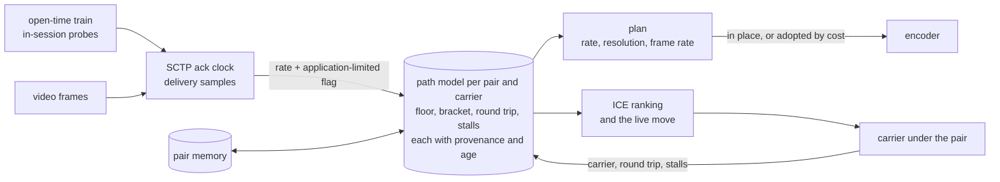

# FR-148: The path is measured, and the plan follows it

**Issue:** [#3953](https://github.com/gjovanov/roomler-ai/issues/3953) · **Status:** P0 runs since 2026-11-16 and its lab cell ran a first slice on 2026-11-17; its open-time train's core is built and run by no session (4a, with one cell red: D43), and its integration is not. P1's memory stores the model in shadow, and its opener is built behind the same switch, whose default is `shadow` and which is `on` on no device; P2's QSV step and P4's rank are merged behind switches that are off by default, and so is D46's in-flight budget: its first two steps (B1, B2) and its stall classifier, computed in shadow; its third (B3, `on` for relay sessions) merged on 2026-11-20 (#4139). Two were read in the field on 2026-11-20 (§15): P2's QSV step meets AC13 on CORPLAP-1, and P4's rank fails AC22 on CORPLAP-2, because it lowers only the agent's own candidates while a pair's route is decided by both ends. On 2026-11-23 the rank by the pair's route (D49), set on CORPLAP-2, meets AC22 there. The others are not read in the field yet (§6). From `0.4.230` P0 names the cause of every move of the live target (#4161). The plan and decisions D1 to D5 are the operator's, taken on 2026-11-16 · **Owner:** the agent's rate path, its path memory and its ICE policy, and the viewer's video channels
**Supersedes:** [FR-63](FR-63-one-delay-based-rate-controller.md) (#1243), [FR-79](FR-79-one-validity-gate.md) (#1524), [FR-35](FR-35-relay-ceiling-learns-the-pair.md) (#922), [FR-59](FR-59-slow-link-latency-priority.md) (#1163), [FR-71](FR-71-transport-stall-classification.md) (#1362), [FR-74](FR-74-text-clarity-on-direct-paths.md) (#1442), [FR-17](FR-17-partial-reliability-video.md) (#799), [FR-18](FR-18-carrier-queue-discipline.md) (#801), [FR-64](FR-64-remote-desktop-never-rides-the-overlay.md) (#1244), and since 2026-11-28 [FR-14](FR-14-direct-link-jitter-episodes.md) (#792). §12 says what moved where
**Works beside:** [FR-135](FR-135-one-rc-media-pipeline.md) (#3293), which owns the pipeline's shape (§13)

§2 is evidence, read on master's `df905bbc1`, and its anchors stay on that commit when the code moves: §2 names the
code that failed, and this FR's own merges change that code. Elsewhere an anchor names the code as it is and moves
with it, unless its own sentence or row pins it to a commit or a date.

## 1. Goal

A remote-desktop session runs at what its path carries, on every carrier, from its first second to its last.

Today the agent never measures what a path carries. It keeps a number that stands in for it. When that number is
wrong nothing corrects it, because a session held below its path produces no evidence that the path could carry
more. The code states the limit itself: "you cannot measure capacity you are not using"
(`agents/roomlerd/src/encode/ceiling_learn.rs:27`).

This FR replaces the stand-ins with one measured model of the path. The session's plan (rate, resolution, frame
rate, carrier) follows that model for as long as the session lives.

It is one program under one issue, by the operator's decision of 2026-11-16 (D1).

## 2. Evidence

Line anchors in §2 are on master `df905bbc1`, the commit this evidence was read on. Two laptops on corporate VPNs, viewed from neo16, 2026-11-10 to 2026-11-16. Everything here was read from
production `agent_logs`, read-only: the pump's heartbeats, the rate-memory lines and the ICE lines of the sessions
the operator reported as sluggish and blurred. Neither relay was the limit: picture age stayed at 55 to 70 ms in
the bad sessions.

### 2.1 CORPLAP-2: a placeholder became the pair's remembered rate

`av1_nvenc`, mesh policy `on`, carried by the mesh relay (DERP).

| What | Value |
|---|---|
| The pair's last measured memory entry | 3,743,114 bit/s. It aged out between 11-10 13:40Z and 11-11 09:57Z: the last session to read it ended with no evidence, and an end without evidence does not renew an entry |
| What replaced it | 179,980 bit/s, written at 11-11 10:42:41Z |
| Where 179,980 came from | a transit hiccup anchored the decaying prior near 100 kbit/s. At the session's end the prior's own placeholder was the only "evidence" left, and a first write is adopted outright |
| The opening rate of the sessions after it | 179,980 → 197,134 → 208,222 → 213,427 → 233,769 → 281,732 bit/s |
| What each of them ran | 1280×800 at 15 fps, 117 to 410 kbit/s median, 292 to 859 kbit/s at the 90th percentile |
| The picture | the average quantiser's 90th percentile was 184 to 240 of 255 in four of five sessions, and its maximum 252 to 253 |
| The same laptop that morning, over TURN/UDP | 1920×1200 at 30 fps, a 3.25 Mbit/s cap, quantiser flat at 14, age 55 / 64 / 90 ms (p50 / p90 / p99). A quieter screen and another network state, so this is a contrast and not an A/B |
| What the path has carried | a 10.0 Mbit/s peak this week; 6 to 9 Mbit/s sustained in FR-35's own P0 |
| How long the operator's sessions lasted | 48 to 144 s |

The chain, in the code:

1. At a session's end the evidence is the learner's stable rate, else `pipe_bps()`
   (`agents/roomlerd/src/peer.rs:9471-9480`).
2. `pipe_bps()` falls back to the prior's stand-in when nothing was measured
   (`agents/roomlerd/src/encode/governor.rs:634-648`, the stand-in at `:648`).
3. `record_session` stores it (`agents/roomlerd/src/encode/rate_memory.rs:147`). Later writes are damped: half the
   way down, a tenth of the way up (`agents/roomlerd/src/encode/rate_memory.rs:79`,
   `agents/roomlerd/src/encode/goodput.rs:94-98`).
4. The next session opens from the entry. An entry at or below 1,000,000 bit/s also engages the slow-link profile,
   1280 on the long edge at 15 fps (`agents/roomlerd/src/encode/rate_profile.rs:416-419`, `:456-470`). The
   profile is resolved once, when the pump starts (`agents/roomlerd/src/peer.rs:6779-6795`), and nothing in the
   session leaves it.
5. In the session the prior grows by a quarter every ten clean windows, and it stops standing in at 1.5 Mbit/s
   (`agents/roomlerd/src/encode/prior.rs:162`, the band at `agents/roomlerd/src/encode/mod.rs:279`). A session
   that ends before that offers the placeholder again, damped: 233,769 raised by a quarter five times is 713,402,
   and it moved the entry a tenth of the way, to 281,732. A session that outlasts the stand-in and measured
   nothing has no evidence, and writes nothing.

So the entry can only creep, and no session it opens can refute it.

### 2.2 CORPLAP-2: why it rode the mesh relay at all

| What | Value |
|---|---|
| When the overlay pair was selected | 17:55:32.364Z |
| When the TURN/UDP relay candidates were gathered | 17:55:32.453Z to .626Z, 90 to 260 ms later |
| The policy | `rc_overlay=on`, morning and evening |
| Stalled windows on the mesh relay | 5.7 % (11-16) and 13.4 % (11-11) |
| Stalled windows on TURN/UDP | 1.0 to 1.2 % |
| Round trip of the relayed mesh link | 130 ms median; 94 to 190 ms in 70 of 71 samples, and one of 369 ms |

With the policy at `on`, the agent's overlay host candidate carries type preference 90
(`crates/vendored/webrtc-ice/src/agent/agent_gather.rs:32`). A relay candidate carries 0. So an overlay pair
outranks every TURN relay, whatever carries the mesh link underneath. Here the mesh link was itself relayed: video
rode a reliable SCTP channel, over WireGuard, over the relay's WebSocket, over TLS and TCP, through the VPN.

### 2.3 CORPLAP-1: the plan moved and the encoder did not

`hevc_qsv`, mesh policy `off`, TURN/UDP, 1920×1200 at 30 fps.

| What | Value |
|---|---|
| One session of 16,719 s | the target climbed 2.55 → 7.45 Mbit/s. Rate moves applied: 0. Rebuilds: 0. Swaps: 0 |
| Every frame of that session | 10,638 bytes, real and keepalive alike |
| Real frames and keepalives | about 8.8 and 10.5 a second |
| What it sent | 1,644 kbit/s median, of which about 0.9 Mbit/s was keepalive filler |
| In motion windows | 2.59 Mbit/s median at 56 to 63 ms age. Skipped 0, dropped 0, `send_wait_max` p99 0.55 ms |
| Other sessions the same day | opened at 5.49 Mbit/s (22,884 B a frame) and 5.96 Mbit/s (24,838 B a frame) |
| What the path has carried | peaks of 11.4 to 13.3 Mbit/s |

Three facts compose:

1. **On this host a QSV rate change is an encoder rebuild.** FR-62 closed with QSV's in-place path broken and its
   flag off.
2. **On a constrained path a rebuild-bound encoder applies a rate only after 1.2 s without motion**, up or down
   (`DEFER_QUIET`, `agents/roomlerd/src/peer.rs:7369`; the two arms at `:9669` and `:9723`). A finished background
   rebuild is adopted under the same wait (`:7731`).
3. **"Motion" is any real frame of 4,096 bytes or more** (`agents/roomlerd/src/peer.rs:9894-9898`). QSV runs
   constant bitrate, so every frame is `maxrate ÷ fps ÷ 8` bytes: 10,638 at 2.55 Mbit/s, 22,884 at 5.49, 24,838 at
   5.96. Measured in all five sessions read. A frame of an unchanged screen is as large as any other.

So while anything on the screen moves, the wait never ends, and the session keeps the rate it opened at.

The opening rate is itself a lottery. The memory is keyed by the far address and the carrier, and for a relayed
pair the far address is the relay worker's. The same pair opened at 2.55, 5.49 and 5.96 Mbit/s on one day,
depending on which worker was nominated. The entry behind the higher openings is a controller target, not a
delivered rate.

### 2.4 The class

Six rules have been added since late August, each after a field failure:

| Rule | The failure it answered |
|---|---|
| FR-35: the ceiling learns the pair | a fleet constant 2 to 3 times too low for some relays (measured 2026-08-29) |
| FR-59 P6: abandon a seed the measurement contradicts | a fast day's entry inherited by a slow link (2026-09-01) |
| FR-70 P1: a prior may open a session but never pin one | a remembered 170 kbit/s held a healthy link at 1280×800 and 15 fps (2026-09-04) |
| FR-79 V2 and V3a: the gate at the write-back, one `pipe_bps` | an opening burst and a stall written back as the pair's rate (2026-09-08) |
| FR-79 V4: an evidence-only write-back, damped | the memory ratcheting to its cap |
| FR-79 V5b (PR #3374, built, parked): only a measurement is evidence | an idle trickle read as the path on jupiter and written back five times (2026-11-02) |

This week's failure is the 2026-09-04 picture again. The number that did it was the placeholder of the rule
written to prevent it. FR-70's criterion "an unmeasured prior cannot hold a session at the floor" is ticked, and
it holds inside a session: on 2026-11-16 one opened at 281,732 bit/s and its target was at 3.0 Mbit/s by 144 s.
What it does not cover is where the week went wrong. The next open reads the remembered number again, and the
size and frame rate are set once at the open.

Each rule decides which stand-in to trust. None of them makes a session find out.

## 3. Why the work in flight does not close it

| Work | What it does | Why the two failures survive it |
|---|---|---|
| FR-63's controller (B1 in shadow) | a delay-based controller in place of eight estimators | It is passive. On a constrained path its measured rate is what the viewer received, which is what the agent chose to send. It opens a remembered pair at 0.85 × the entry (`agents/roomlerd/src/encode/ratectl.rs:99`): 239 kbit/s on CORPLAP-2. Its flip criterion compares it with the live governor in elevated-age windows, and its spec records that the criterion "cannot fail on under-driving" |
| V5b (PR #3374) | no placeholder is written or acted on | Its own notes: a pair remembered slow then stays slow until a session measures it or seven days pass. Nothing makes a session measure |
| FR-135's ledger | reserves a sink for every heuristic | It keeps both mechanisms as policy: "Plan owns opening profile" (`docs/plans/rc-media-debt.tsv:57`) and "Rebuild-bound backends adopt quietly by policy" (`docs/plans/rc-media-debt.tsv:65`) |
| FR-35 | the learner | It decided against an active probe ("Not done, deliberately") |
| FR-128 | `rc_overlay=auto` | Moving a live session off a relayed mesh link is its unbuilt P3, default "no" (`docs/fr/FR-128-rc-overlay-auto.md:127`, `:147`) |

## 4. Design: four invariants

### 4.1 One path model, and every number in it says how it was obtained

`encode::pipe` is "ONE belief about what the path carries" (`agents/roomlerd/src/encode/pipe.rs:3`, the struct at
`:137`). It runs in shadow: nothing reads it. It becomes the only source of path numbers, per pair and carrier.

| Field | Meaning |
|---|---|
| floor | the highest rate the path delivered over a sustained interval. A lower bound on capacity |
| bracket | low edge: the highest rate carried clean. High edge: the lowest rate that pushed back |
| round trip | the carrier's, not the viewer's paint age |
| stall profile | the share of stalled windows and their typical length, per carrier |

Every value carries a provenance and an age:

| Provenance | When | What it may do |
|---|---|---|
| measured, backlogged | the sender had more to send than the path took | set the floor and both edges of the bracket |
| measured, application-limited | the path took everything offered | raise the floor. It never lowers the bracket |
| probe | a train sent on purpose: at the open (P0's step 4), and in a session from P3 | move the bracket's edges. It never sets or raises the floor (D39) |
| assumed | a prior, a default, an entry from before this FR | open a session when nothing else exists. It is never stored, and it never holds the plan below a demonstrated value |

A stalled window is evidence about the carrier's stall profile and not about its capacity. That is FR-71's
classifier and FR-79's gate, kept.

The memory stores the model, not one rate. Its key names the pair and the carrier, never a relay's address (O1).
The opener, the ceiling, the slow-link profile and the queue budgets read the model.

### 4.2 Capacity is measured by sending on purpose

- **At the open.** The encoder's own open takes 0.65 to 2.8 s (measured this week). In that time a closed-loop
  packet train steps up on a probe channel and stops at the first push-back. It reads the SCTP payload delivered
  per whole round and judges the queue by each round's minimum acknowledgement delay against the lowest seen, as
  HyStart++ does (RFC 9406). A reading that did not stop on push-back is flagged floor-only. Before the first
  frame the train restores SCTP's congestion state from a snapshot, or says it could not (D32, D35, D39, D42).
- **In a session.** A short, bounded probe runs when two things hold: the stream has room to spare, and a better
  answer would change the plan. It carries picture refinement where it can, padding where it cannot.
- **The samples come from the transport.** SCTP's acknowledgement clock in the vendored `webrtc-sctp` yields
  bytes delivered per interval and whether the sender was application-limited in it. The viewer does not change.
  On the RTP sink the same reading comes from transport-wide feedback (O2).

This reverses FR-35's decision (D2). FR-35's objection was that a startup probe measures a burst (18 Mbit/s
instantaneous against about 8 sustained) and costs bytes on exactly the thin links. Two things answer it. The
loop is closed and its steps are proportional, so a thin link stops the train early: at 0.4 Mbit/s it writes at
most 64 KB, at each round trip of the grid (D32's P-f). And the bracket
keeps a burst reading apart from sustained evidence: a probe moves the bracket's edges, and only sustained
delivery raises the floor.

It also supplies what two open items wait for: a capacity reading for FR-135's D12 ("Plan grant by measured
capacity?", `docs/fr/FR-135-one-rc-media-pipeline.md:1527`) and an under-drive clause for FR-63's flip criterion.

### 4.3 No decision lasts a session, and every plan move has a computed cost

- **One plan.** Rate, resolution and frame rate are one `Plan` (`agents/roomlerd/src/encode/plan.rs:129`, FR-70
  M3a, in shadow), recomputed from the model for as long as the session runs. The slow-link profile becomes a plan
  field that is entered and left on evidence.
- **Frame rate changes by pacing**, not by a rebuild.
- **Rate changes in place** where the backend can.
- **A backend that must rebuild adopts by cost.** The replacement is built in the background, as FR-70's
  make-before-break already does for FFmpeg. It is adopted when its keyframe's bytes, divided by the measured
  capacity, fit a stall budget (O5). That replaces `DEFER_QUIET` and the 4 KiB motion threshold.
- **A decrease never waits.** A decrease that waits is the agent over-driving a path it knows is slower.
- **QSV leaves constant bitrate** (FR-62's A5, QVBR, `docs/fr/FR-62-encoder-rate-changes-without-an-idr.md:397`).
  It ends the filler. FR-62 also records that leaving constant bitrate could change whether QSV accepts an
  in-place reset, and that its untested patch 0004 is the leading candidate for an in-place rate there
  (`:363-370` of the same file). So A5 goes first, and the spike on patch 0004 runs only if A5 leaves QSV
  rebuild-bound (D4).
- **Motion is read from capture damage**, not from encoded bytes.

### 4.4 The carrier is ranked by what it is, and video never rides two reliable layers

- **Ranking.** ICE ranks an overlay pair by the mesh link's actual carrier: a direct mesh link like a host pair,
  TURN over UDP next, the relayed mesh link as the fallback. If the browser does not follow a lowered priority
  (AC4 reads it), the agent holds the relayed-mesh candidate back until relay gathering has ended. The design
  report of 2026-11-17 changed three things here (D12, D13, D16): the rank is by address and has two levers, the
  agent keeps checking after its first selection, and hold-back is built only if the experiment fails with both.
  The field read of 2026-11-20 changed the unit (D49): a candidate's rank cannot see where a pair goes, so under
  `route` the rank judges the pair's route, and the agent holds its mesh-route pairs silent for at most 2.5 s while
  a relay off the mesh can still come. That hold ends on evidence, which D16's hold-back could not.
- **The live move.** When the carrier under a session changes class, or a better one appears, the session moves by
  ICE restart. This reopens FR-128's D4 (D3).
- **Two video channels.** The viewer creates both at the offer: the reliable, ordered channel of today
  (`videoDcOptions`, `ui/src/composables/useRemoteControl.ts:5114`) and a deadline-limited one
  (`videoDeadlineDcOptions`, `:5121`, since P4b-2). The agent picks per path, at a keyframe. FR-17 found that a channel's ordering
  is fixed when it is created and named a second channel as one way out.
- **On a carrier that is already TCP, video is always deadline-limited.** The carrier retransmits by itself.
  SCTP retransmitting above it adds its own floor of 1 s (`RTO_MIN`,
  `crates/vendored/webrtc-sctp/src/timer/rtx_timer.rs:10`). FR-18 made the relay's writer drop frames older than
  its age bound (`agents/roomlerd/src/derp.rs:354`); on a reliable channel each such drop is repaired by an SCTP
  retransmit. Inferred, read in P0: that is where the mesh relay's stalled windows come from. Read since (§11,
  D54): on CORPLAP-2 the bound did not fire those windows, and in the lab its drops were repaired by fast
  retransmits, with no T3. FR-17 and FR-18 were designed as two halves and were never joined; D55 joins them.
- **`constrained` becomes the carrier.** One flag covers TURN over UDP, TURN over TLS, the mesh relay and an
  organisation's own relay (`detect_constrained_transport`, `agents/roomlerd/src/peer.rs:2056`). The model is per
  carrier, so its readers stop needing the flag. The viewer's toolbar is one of those readers. Its relay or direct
  word is the flag, sent as `rc:video-info`'s `transport` (`agents/roomlerd/src/peer.rs:5711`), so it can disagree
  with the carrier the agent records, as on the host to peer-reflexive pair of #3732. After the split it shows the
  carrier.

### 4.5 Mixed versions

The viewer rolls in seconds and agents over days. Every wire change is additive. The second video channel is
created by the viewer (§4.4): an old agent ignores it, and against an old viewer the agent has no such channel and
behaves as today. The probe channel at the open is the agent's, reliable and ordered (D34): the browser accepts it
without viewer code, so the viewer does not change in P0, and an old agent opens none. A probe channel the viewer
creates is P3's decision.

## 5. What it deletes

In P5, each on its own evidence, through the switch registry:

- the rate memory's stable-rate values and the prior's write-back
- the ceiling learner (`agents/roomlerd/src/encode/ceiling_learn.rs`)
- FR-59's P5, P6 and P8 arms
- `DEFER_QUIET`, the 4 KiB motion threshold and quiet-gated adoption
- the fixed relay caps (`relay_max_bps`, `agents/roomlerd/src/encode/mod.rs:892-897`; `relay_max_hi_bps`,
  `:945-952`)
- the path-class frame-rate rule (`ffmpeg_target_fps`, `agents/roomlerd/src/peer.rs:10625`)
- everything FR-63's B3 and B4 already named

## 6. Phases

Each phase ships in shadow or behind its switch first. Each field test is shown failing on the current release
before it passes. Switch names are proposed. A switch read in the media path, a line added to a pump and a
viewer storage key each go through FR-135's ratchet, and each arrives with a ledger row that names the phase
retiring it (§13).

| # | Phase | Kill switch | Proof | Status |
|---|---|---|---|---|
| P0 | Measure, in shadow | `ROOMLERD_PATH_MODEL=off` | AC1 to AC5 | running since 2026-11-16; AC1, AC3 and AC5 met; steps 1 and 6 done, steps 2 and 3 merged on 2026-11-17 (#3968, #3980, #3995), step 3's line read on real sessions on 2026-11-21 (AC3, §15); step 1's timeline merged on 2026-11-18 (#4031); step 5's cell ran its first slice on 2026-11-17 on `0.4.224` and slice S1 on 2026-11-18 (§15): TURN over UDP and TURN over TCP are proven as carriers, the mesh run failed on a fault of the cell's, no rate run has loaded its path yet, S1's two 2 Mbit/s runs are confounded by the lab agent's capture rebuilds, and the cell's load test is D45's; step 4 designed, reviewed and ruled on 2026-11-18 (D31 to D42), its first half 4a, the train's core with nothing on a session's wire, merged on 2026-11-19 (#4034, D43, D44); conservative slow start, D43's derivation for its red cell, was built and measured on 2026-11-24, does not make the cell green and is not merged, so the next derivation paces the association's sends while the train runs (D64); that pacer was built and measured on 2026-11-24, makes the cell green, breaks P-e in the grid and is not merged, so the next derivation is the paced train's exit (D65); that exit, the cap binding the association's sends and a gain derived from the path's least round trip, was built and merged on 2026-11-24 (#4397, D66): the cell is green and P-e holds. A host stall could still cap the train early, so its cap engages on trial and only what was sent after it judges it, merged on 2026-11-26 (#4472, D68); a first-round stall can still leave a floor, so a pair's lead is put to the test by delivery on every path next (4a-3d, D68); 4b not built; a relay leg over TCP hides its queue from the delivery sample's class (O11); since 2026-11-19 (#4047) P0 measures that queue in shadow, beside each data-channel session's open path (O10) and the relay's own transport on the carrier line, all three read on `0.4.227`'s release candidate in the lab on 2026-11-19, on Linux, Windows and macOS (§15), and not yet in the field; every move of the live target says why since 2026-11-20 (#4161, riding `0.4.230`), and the path report reads both since 2026-11-21 (#4192) |
| P1 | The model drives the open and the memory | `ROOMLERD_PATH_MODEL=shadow` | AC6 to AC9 | step 1 (#3374) and the first part of step 2 (#3969) merged on 2026-11-17, released that day in `0.4.224` and read on both laptops (§15): each pair's entry from an earlier release was passed over, and CORPLAP-2 opened at 2.55 Mbit/s, 1920×1200 and 30 fps; the rest of step 2 merged on 2026-11-17 (#4014), in shadow and not yet read in the field; steps 3 and 4 merged on 2026-11-18 (#4029) behind the switch, its default `shadow`, with one definition of counted evidence and the floor as a maximum (D25 to D30), released in `0.4.226` and on both laptops on 2026-11-19, not yet read in the field: the laptops' day of 2026-11-19 had no relayed session, so the close line's counts (O7) have no reading yet (§15) |
| P2 | The plan is live, and its moves have a cost | `ROOMLERD_PLAN_ADOPT=quiet` | AC10 to AC15, AC32 | the QSV step merged on 2026-11-17 (#3989), behind a switch of its own that is off by default (D10), and read on Intel hardware with the switch set on CORPLAP-1, where it meets AC13 (2026-11-20, §15); the in-flight budget (O11) designed, prototyped and ruled on 2026-11-19 (D46), B1 merged on 2026-11-19 (#4068) and the stall classifier the same day (#4083), both in shadow and riding `0.4.228`; B2 merged on 2026-11-20 (#4115), in shadow, and its first harness numbers did not hold: on the shallow controls, a path that drops, 4 of 24 runs on AC2's bar in #4115's passes, then 8 and 2 of 24, and on the loaded cells 0 of 84 off, then 1 of 140; the reading of a path that drops (D48) merged on 2026-11-21 (#4191) and a fall as an event of the model (D50) on 2026-11-21 (#4231), both in shadow: in the `tcp_shape` harness the shallow controls read 24 of 24 on D48's passes and 28 of 32 under both laws on D50's loaded host and 32 of 32 on a quiet host (O16), the loaded cells 0 of 140 off, and the shallow halving 12 of 12 under D50; B3, `on` for relay sessions with `off` still the default, merged on 2026-11-20 (#4139), its harness bar met, and rides `0.4.230`; AC32's slice on TURN over TCP (B3T, 2026-11-21) meets the latency bar under `on` and misses the delivery bar (§15, O17), and so does its slice on TURN over UDP (B3U, the same day); its two causes were named, AC32's bar is amended, and B4, one owner per plane under `on`, is designed (D51); the same evening the lab's heartbeats named the mechanism, an opening reading above the carrier that anchors the prior and no live reading after it, and B4 was amended to match (D51, O17), with slice B3A's one pair of eight (§15); `on` in the field waits for AC32 (D47; the operator agreed to `on` on the lab's A guest only) and O11's field read; the rest not started |
| P3 | Probes in a session; the bracket replaces the fixed caps | `ROOMLERD_PATH_PROBE=open` | AC16 to AC21 | not started |
| P4 | The carrier | `ROOMLERD_RC_CARRIER_RANK=0`, a viewer flag | AC22 to AC27 | the first half designed and ruled on 2026-11-17 (D12 to D21); step 1, the rank behind its switch, merged on 2026-11-17 (#4013), off by default; read on CORPLAP-2 on 2026-11-20, where it fails AC22 (§15): a pair whose remote end is the viewer's relay on the mesh rides the mesh whatever the agent's end, and the rank lowers only the agent's own candidates. The next step, the rank by the pair's route (D49), was ruled on 2026-11-20; its phase A merged on 2026-11-21 (#4186) and phase B the same day (#4220), behind the switch's new value `route`, and A5 follows. `route` was set on CORPLAP-2 on 2026-11-23 and meets AC22 there: 20 sessions of 20 on TURN over TLS, 1.0 % of heartbeat windows transit-stalled (§15, D62), and TURN over TLS stays before the relayed mesh (D63). `route` was first read in the lab on 2026-11-22: AC23's slice reached the mesh in 2.6 to 2.8 s, inside AC23's 5 s (D54), and AC23 fails on what that read did not have: the deadline-limited channel, and D46's budget, which was `off` in every run (§15). The second half, the two video channels, was designed on 2026-11-22 (D55): steps P4b-0 to P4b-5 behind `ROOMLERD_VIDEO_DEADLINE`, kill value `off`. P4b-1 (#4320), P4b-2 (#4321) and P4b-3 (#4333) merged on 2026-11-23, `off` by default and set on no device yet, and D58 adds P4b-3b, the viewer's report of its relay, before P4b-5; it merged on 2026-11-24 (#4364). P4b-3's transport cells (#4338) read a T3 on `video-deadline` behind the standing queue (D60), and P4b-1b, a restart of the T3-rtx timer at each FORWARD TSN, is built only if one remains with the budget `on`. B0R read the budget `on` on 2026-11-23, on `0.4.233`, which has no step of P4b: on the reliable channel no queue stood, the age bound never fired, and SCTP took no T3 in four runs (§15). B0D read the same on the direct shape that night, in two runs (§15). P4b-4, D59's recovery rule, merged on 2026-11-23 (#4344). P4b-4b, which takes a switch's own key frame out of that rule (D61), merged the same day (#4355), and `on` is set on no device before a release carries it. P4b-5a, the key-frame ledger and the wake lines through which P4b-5 reads O20 and D60, merged on 2026-11-24 (#4405, D67). P4b-5's first `on` runs, on `0.4.238` on 2026-11-26, never switched: the vendored webrtc gave every channel it accepted the id 0, so each mark was refused. The fix merged on 2026-11-27 (#4504, D69) and rides `0.4.240` |
| P5 | One controller, then the deletions | `ROOMLERD_RATECTL=shadow` | AC28 to AC30 | not started |
| P6 | Docs | none | AC31 | not started |

**P0, measure.**
1. The reference report: a script over `agent_logs` that prints, per session, the opening rate beside what the
   pair has demonstrated, and the encoder's applied rate beside the plan's. The queries behind §2 are its first
   version. Merged on 2026-11-17 as `scripts/rc-path-report.cjs` with its wrapper (#3961,
   `docs/production-mongo-reads.md` §8). Its read of the release then current is AC1 (§15). Since #3984 it also
   reads the delivery samples of step 2, a change of path inside a session, the entry an open passed over as
   assumed, and a third flag: a slow-link profile that never left, the field view of what AC14 tests in the lab.
   Since #4031 (2026-11-18) `--timeline` prints one agent's remote-desktop sessions over at most 24 hours in time
   order, each with its carrier, its encoder opens, its rate by the minute and its delivery, model and path-memory
   lines. Since #4192 (2026-11-21) it prints why the live target moved, from the `why` field the agent writes
   since `0.4.230`, and each session's moves by cause beside the heartbeats' count (`target_moves`).
2. Delivery samples from SCTP's acknowledgement clock, with the application-limited flag, on a line of their own
   (D9). Merged on 2026-11-17 (#3968, `docs/rate-control.md` § Delivery samples): the line is
   `path delivery (FR-148 P0, shadow, ≈10s)`, and each sample is backlogged, application-limited or stalled.
   Since #3980 the clock counts what the viewer acknowledged as received: it leaves out a chunk that a FORWARD
   TSN passed after a SACK reported it missing or its retransmission timer expired. On a reliable channel, which
   is the default, the count is exact. On the viewer's unordered opt-in it can still read high by a share of
   what was lost (§15).
3. Provenance and age on every input of `Pipe`, on the path model's own line (D9). Merged on 2026-11-17 (#3995,
   `docs/rate-control.md` § Path numbers and their provenance): the line is
   `path model (FR-148 P0, shadow, ≈10s)`, on both data-channel pumps (D11). It repeats each path number the
   heartbeat carries, and each says how it was obtained (measured while the sender had more to send, measured
   while the path took all that was offered, assumed, or remembered from an earlier session) and how old it is.
   Three more fields show what a model that reads those tags holds: a floor that any measurement raises and only
   a backlogged one lowers, a capacity that only a backlogged push-back moves, and a stand-in that never stands
   below the floor. No decision reads a tag, and the old laws are pinned bit for bit. The line rides `0.4.225`
   and later. Not yet read in the field.
4. The open-time train, logged and read by nothing. It is built in two pull requests (D31): 4a, the reading's core
   with nothing on a session's wire, proven against the real vendored SCTP over a shaped link; 4b, the integration
   behind `ROOMLERD_PATH_PROBE=open` (config key `path_probe`), default `off` (D37), on the FFmpeg data-channel
   pump's leader sessions only (D36, D40). 4a merged on 2026-11-19 (#4034, `docs/rate-control.md` § The
   open-time train): it rides `0.4.227`, and no session runs it. One of its cells is red and ignored (D43), and
   its real-time grid is a measurement, not a CI gate (D44).
5. The standing relay cell: a shaped lab pair at 0.4, 2 and 8 Mbit/s over TURN/UDP, TURN/TLS and the mesh relay,
   with and without injected stalls, and the two laptops as the natural cells. Its first slice: §15, 2026-11-17.
   Slice S1: §15, 2026-11-18. What makes a rate run count, and how AC2 is judged on it: D45.
6. The read of FR-63 B1's shadow over seven days, with an under-drive clause added to the report's verdict. A
   first production read ran on 2026-11-02, over the release's first 3.4 days, and met the criterion: the shadow
   asked for no more than the live law in 1,096 of 1,121 windows of elevated age, on 502 sessions
   ([#1243, the comment of 2026-11-07](https://github.com/gjovanov/roomler-ai/issues/1243#issuecomment-6706580701)).
   Its spend view shows what that criterion cannot fail on. In a pump's first 120 s the encoder spent more than
   the shadow asked in 1,232 of 3,372 clean direct windows and 623 of 1,962 clean constrained ones, against 158
   of 31,743 and 193 of 6,685 later, and every constrained window spending 5 Mbit/s or more was over the shadow
   (313 of 313). The read over seven days ran on 2026-11-16 (AC5, §15). PRs #3307 and #3374 and the fixes for
   #3472 were parked behind it. FR-135's rule on agent-behaviour phases names two conditions, this read's start
   and FR-70 AC10's read (`docs/fr/FR-135-one-rc-media-pipeline.md:1246`). The first is met. D6 stands (§8).
7. The inferred mechanisms of §11, measured or struck.

**P1, the model drives the open and the memory.**
1. V5b (PR #3374), rebased. Merged on 2026-11-17: a session writes a rate to the memory only when it measured
   one. Its switch is `ROOMLERD_MEASURED_EVIDENCE` (D8).
2. The memory stores the model, keyed by the pair and the carrier. An entry from before this phase is read as
   assumed. The second sentence merged on 2026-11-17 (#3969): an entry carries its provenance, one without it
   seeds nothing, and the device's next measured write drops it. Step 1 and that sentence were
   read on the two laptops on `0.4.224` the same day (§15). The first merged on 2026-11-17 too (#4014; D22 to D24):
   the key is the carrier, the controlling user and the viewer's network; the model has a file of its own; and
   it takes a delivery only from a window the validity gate accepts. P1 keeps today's scope, a constrained path
   on the FFmpeg pump: a direct path and the VP9-444 pump have no memory today and get none here. AC7's field
   week is read on the close line this step adds, which says why each write happened; today's write line also
   appears when nothing was measured. Nothing reads the new file to drive a rate before step 3.
3. The opener reads the model: a known pair opens at 0.85 × its demonstrated floor (D25), and the train's result
   may raise the opening inside the bracket. It ships with the switch's default at `shadow` (D28).
4. The slow-link profile engages at the open only on a demonstrated low floor, which is a push-back that is
   trusted (D25, D26). Steps 3 and 4 ship in one release. Both merged on 2026-11-18 (#4029) and rode `0.4.226`,
   on both laptops on 2026-11-19. Not yet read in the field.

**P2, the plan is live.** QSV off constant bitrate, built first, beside P0 and behind a switch of its own (D4,
D10). Merged on 2026-11-17 (#3989, `docs/encoders.md` § QSV off constant bitrate): with `qsv_rate_mode = qvbr`,
which is off by default and set at the device, an HEVC or H.264 QSV encoder opens at QVBR with its target at
0.9 × the cap, and a driver that refuses it opens as before. Its read on Intel hardware is AC13. The in-place
rate arm is unchanged and stays off by default.

The in-flight budget, O11's answer (D46), is built under P2 in three steps behind `ROOMLERD_INFLIGHT_BUDGET`,
default `off`: B1 computes it in shadow on both data-channel pumps, B2 takes its push-backs into the shadow
model, and B3 turns it `on` for relayed sessions (AC32). B1 merged on 2026-11-19 (#4068) and missed D46's bar
on one stall cell: offer 80 % on path I read 0.876, 0.880 and 0.952 of today's writer's fresh delivery, where
the bar is 0.95. So the stall classifier came before B2 and merged the same day, also in shadow (#4083,
`docs/rate-control.md` § Through a stall: the stall classifier). It reads each stall's release from the
acknowledgement clock, writes a frame through after a head-of-line release and holds after a drain, as B1 does.
B2 merged on 2026-11-20 (#4115, `docs/rate-control.md` § The push-backs in the shadow model), in shadow. It
takes D46's two push-backs (P1 and P3 there) into the shadow model: a sample that reads `queued` is a capacity at
its own acknowledged rate, whatever the budget's setting; and with the budget computing, a counted sample is a
capacity at its own rate when it was backlogged, the clock never stood still for `least + S` in it, and it starts
at or after the budget's first measured rate. That last clause is the opening rule: without it the session's first
sample, held while the opening rate stood in for the budget's rate, set the capacity at 0.54 to 0.78 times the link
in 22 runs. On the twelve loaded `tcp_shape` cells 0 of 84 runs are off AC2's bar. On the four shallow controls, a
path that drops, the bracket is on the bar in 4 of 24 runs: that is the next step. B3, `on` for relay sessions
with `off` still the default, merged on 2026-11-20 (#4139). Its harness bar is met: five passes, all 19
`tcp_shape` cells passing in each; on the deep 2 Mbit/s path I shape `on` keeps the median transit at 118 ms where
`off` stands at 3,551 to 3,602 ms, and delivers 98 to 99 % of the link fresh against `off`'s 1 to 2 %; on the 80 %
path I stall shape it delivers 0.963 to 1.072 of `off`'s fresh delivery, where the bar is 0.95. `on` in the field
waits for three things: AC32 in the lab (D47), O11's field read of the sessions that ride a TCP leg, from
2026-11-21, and the operator's OK to set `on` on the lab's A guest, given for AC32. AC32's slices then found `on`
under-filling a relay (O17), and B4 is the design (D51): under `on` the budget is the one owner of its queue. B4
and B4f merged on 2026-11-22 (#4266, `docs/rate-control.md` § B4: one owner per plane under `on`), and B4g (D51)
the same day (#4270). O18 is measured for NVENC and AMF, and none of them spends more after a hold
(`docs/encoders.md` § After a hold). The send wait is measured once for both pumps, the VP9-444 heartbeat prints
it, and under `on` a pass the drain pause held counts as gated (#4277, `docs/rate-control.md`). AC32's slices then
read `on` again in the lab, and AC23 reads the VP9-444 pump's send wait on a release that carries it.
On 2026-11-22 the lab's sanity run before AC23's re-run reached the mesh relay over a direct pair, which the lab's
premise did not count: AC23 is read on both of a viewer's shapes (D53), on the lab's next round.

After it: cost-budgeted adoption in today's pump (D5), frame rate by pacing, the profile as a plan field, motion
from damage.

**P3, probes in a session.** The probe scheduler. The relay caps become bounds on the probe and then go. The
frame-rate grant reads the model (FR-135 D12). On a direct path the bits-per-pixel constant becomes a bound
(FR-74's P5).

**P4, the carrier.** Ranking or hold-back, the live move, the two channels with bounded loss recovery (O6), the
flag split.

1. The rank, in the agent only, behind `ROOMLERD_RC_CARRIER_RANK` with the values `0`, `prio` and `1` (D12, D13,
   D15, D17, D18): merged on 2026-11-17 (#4013). Chrome's first nomination was read on this build on 2026-11-20
   (§11, AC4).
2. The live move, after a design report of its own (D19).
3. The SCTP packet size, after the split is read (D20).
4. The carrier's recorded vocabulary and the viewer's report of its own leg (D21), then the flag split.
5. The two video channels (§4.4, O6).

**P5, one controller.** FR-63's B2 flips on the model under the amended criterion. B3 and B4's deletions follow.
FR-135's fallback stands: if the flip is not live four weeks after R7's shadow week ends, R8 proceeds on the governor
(`docs/fr/FR-135-one-rc-media-pipeline.md:1520`).

**P6, docs.** `docs/rate-control.md` rewritten around the model, `docs/remote-control.md`'s carrier section, the
index row.

## 7. Acceptance criteria

- [x] **AC1 (P0, the failure first)** — From telemetry alone, on the current release, the report shows both
      reference failures: a CORPLAP-2 session on the mesh relay opening below 0.3 Mbit/s at 1280×800 and 15 fps on
      a path that carried over 3 Mbit/s the same week, and a CORPLAP-1 QSV session whose target moves while its
      encoder's rate does not. The script and its output are in the field log. **Read on 2026-11-16** on `0.4.223`:
      F1 is raised in 16 of 40 judged sessions, 15 of them CORPLAP-2 on the mesh relay opening at 0.200 to 0.282
      Mbit/s, 1280×800 and 15 fps, and F2 in 2 of 11, both CORPLAP-1 on `hevc_qsv` (0 rate moves in 26 minutes and
      in 4.6 hours). The report's own yardstick is a floor of 0.616 Mbit/s for that pair. That the path carried
      over 3 Mbit/s is in the same rows: seven clean windows at 3 to 7.44 Mbit/s, and a plan held at 3.00 Mbit/s
      for 36 minutes. [The report](https://github.com/gjovanov/roomler-ai/issues/3953#issuecomment-6942393774) is
      on the issue, and the numbers are in §15.
- [ ] **AC2 (P0)** — On the shaped lab pair at 0.4, 2 and 8 Mbit/s, over TURN/UDP, TURN/TLS and the mesh relay,
      the shadow model's bracket contains the true capacity and its low edge is within 20 % of it, in every cell,
      five runs each. The 20 % is judged in SCTP payload (D42). The open-time train does not run on the mesh
      relay (D40); how that carrier is read is O8.
- [x] **AC3 (P0)** — Every path number in the heartbeat carries how it was obtained and its age. The jupiter chain
      of 2026-11-02 and the CORPLAP-2 chain of 2026-11-11 replay as unit cells: each fails on master's laws and
      passes on the model's. It is read on the path model's own line, which names every path number the heartbeat
      carries (D9), and "master's laws" are those of 2026-11-16, before V5b merged. **Built on 2026-11-17**
      (#3995), on the two data-channel pumps (D11). Both chains are cells. On the laws of 2026-11-16 the floor
      each path had demonstrated falls, from 15,915,240 to 7,962,364 bit/s on jupiter's chain and from 1,399,272
      to 982,068 on CORPLAP-2's, and the model keeps it. The line was read on real sessions on 2026-11-21 (§15):
      on 421 `path model` lines of 20 lab sessions on `0.4.230`, every path number is a value with its basis and
      its age, or None, and so is each element of every belief tuple.
- [ ] **AC4 (P0)** — Each mechanism §11 still lists as inferred is read, true or false, on `0.4.227` or later.
      (a) On the mesh relay, the point that drops or holds the frames behind each T3-rtx expiry is named. The
      field half was read on 2026-11-21 (§11, §15): the rows of 2026-11-20 on CORPLAP-2, re-read with `loss` and
      the shed line, refute the sender's age drop and its full outbound queue. The rest is read on the lab's mesh
      carrier, on a release that carries D52: each T3 line is paired with the drop lines of both nodes and of the
      relay that carried it, and the read names the point whose count moved, or says that none did. (b) A full SCTP packet leaves the
      agent as two IP fragments and the viewer reassembles it, read on both hosts' fragmentation and reassembly
      counters during a run on the lab's mesh carrier, with no refusal. (b) was read true on 2026-11-22, on
      `0.4.232`, in all ten runs of AC23's slice (§11, §15). Chrome's first nomination was measured on
      2026-11-20, and `auto` on CORPLAP-1 is struck (§11). The lab's reads run on the lab pair's current release,
      after the shaped cell's split counter is fixed: it never counted, so every judge on the mesh carrier so far
      took the unsplit efficiency and overstated the capacity by 9.07 %.
- [x] **AC5 (P0)** — FR-63 B1's shadow is read over at least seven days with an under-drive clause added to the
      report, and the report is attached. This is the read the parked rate-path work waits on (FR-135's agent
      phases, #3374, #3307). FR-135's agent phases also wait on FR-70 AC10's read. **Read on 2026-11-16** over
      seven days: agreement 2,852 of 2,939 (97.0 %), the clause 94.5 % constrained and 97.7 % direct, overall MET.
      [The report](https://github.com/gjovanov/roomler-ai/issues/3953#issuecomment-6932207141) is on the issue,
      and the numbers are in §15.
- [ ] **AC6 (P1)** — A reconnect never opens below what the pair last demonstrated on that carrier: 20 reconnects
      in a row on each laptop, each opening at 0.85 × the demonstrated floor or higher, or at the relay cap while
      that cap stands (D25). Fails first on the current release.
- [ ] **AC7 (P1)** — Nothing assumed is written to the pair memory, and nothing assumed holds the plan below a
      demonstrated value: V5b's cells and the two replay cells are green, and one field week shows no memory write
      without a measurement behind it. An entry written before this phase is read as assumed.
- [ ] **AC8 (P1)** — The memory is keyed by the pair and the carrier: the same pair through two relay workers on
      one day opens within 20 % of the same rate (today 2.55, 5.49 and 5.96 Mbit/s).
- [ ] **AC9 (P1)** — A transit stall changes neither the bracket nor the rate: on the shaped pair with injected
      stalls of 1 to 8 s the bracket's low edge moves less than 10 %, no cut follows, and the picture recovers
      within the stall's own length.
- [ ] **AC10 (P2)** — On QSV under continuous motion the encoder's rate follows the plan within 2 s, up and down:
      CORPLAP-1, ten minutes of a moving pattern, 95 % of plan moves applied within 2 s. Fails first on the
      current release (0 moves in 16,719 s).
- [ ] **AC11 (P2)** — A decrease never waits: when the shaped pair's capacity steps down, every backend's encoder
      is at the lower rate within 1 s.
- [ ] **AC12 (P2)** — No adoption costs more than its budget: for every adopted rebuild in a field week, keyframe
      bytes ÷ the bracket's low edge is within the stall budget, read from the heartbeat. And no pump pass that
      adopts one runs over 250 ms on FR-65's stall watch, in a week that holds at least one resolution move on a
      constrained QSV session (FR-65's AC3, moved here on 2026-11-28: before, 0.62 to 0.73 s without an encoder per
      rebuild, read on 2026-09-04).
- [x] **AC13 (P2)** — QSV no longer pads: a QSV keepalive is no longer `maxrate ÷ fps ÷ 8` bytes, and a still
      screen on CORPLAP-1 costs under 0.3 Mbit/s (today 0.9 of 1.64). **Read on 2026-11-20** on `0.4.229`, with
      `qsv_rate_mode = qvbr` set on CORPLAP-1 (the switch is off by default): 479 bytes a keepalive frame against
      the 12,500 of a frame padded to the cap, a still screen at 0.07 to 0.19 Mbit/s, and under motion 0.45 Mbit/s
      at 35 fps with no delivery window stalled, back down when the screen stood still. The still half read the
      same on 2026-11-18 (0.036 to 0.055 Mbit/s, 313 bytes a frame) and on 2026-11-19 (2,776 bytes a frame).
      [The read](https://github.com/gjovanov/roomler-ai/issues/3953#issuecomment-7049060954) is on the issue, and
      the numbers are in §15.
- [ ] **AC14 (P2)** — The slow-link profile is entered and left inside a session: the shaped pair stepped
      8 → 0.4 → 8 Mbit/s takes resolution and frame rate down within 5 s and back within 10 s, with no reconnect.
      Fails first on the current release.
- [ ] **AC15 (P2, direct)** — CORPLAP-3 on a direct path: text is sharp within 1 s of a scroll stopping, no
      keyframe comes from a rate move, and the operator reads the same scroll.
- [ ] **AC32 (P2)** — With `ROOMLERD_INFLIGHT_BUDGET=on` on a relay session, on TURN over TCP and over UDP at
      2 Mbit/s, every `on` run holds the viewer's round trip under 300 ms (its p95; the p50 is reported) and delivers
      at least 0.95 of what the same slice delivers with the switch `off`, and at least 0.90 of the capacity at the
      `off` runs' measured efficiency, and the agent sends a median frame rate of at least 0.8 of the `off` runs'
      median. The capacity the kit models is reported, not judged, until the efficiency read reconciles it. This is
      O11's lab cell plus the UDP controls' bar (D46), amended on 2026-11-21 (D51): the first bar judged the kit's
      model of the carrier, which a saturated link did not reach. The frame-rate guard was added on 2026-11-22 (D51):
      with B4 alone the closed-loop harness filled its carrier to 0.99 at 6.8 to 7.9 frames a second, a slideshow the
      bar caught only through its round trip. The guard leaves room for the holds, which cost a frame now and then:
      with B4f the harness sent 28 a second against `off`'s 29 to 30. The slices are D47's.
- [ ] **AC16 (P3)** — The plan matches the path within 3 s of the open and within 5 s of a capacity step: on the
      shaped pair the rate is within 0.7 to 1.0 × the true capacity, and probe bytes stay within their budget.
- [ ] **AC17 (P3, thin link)** — On the 0.4 Mbit/s cell and on a real hotspot-class link: paint age under 600 ms
      sustained, the target within 2 × the measured rate, and the byte gate engaging.
- [ ] **AC18 (P3, mid relay)** — A relay that carries about 2 Mbit/s is never driven above what it carries: age
      p99 no worse than the P0 baseline.
- [ ] **AC19 (P3)** — No fixed relay cap is left: on a relay that carries 8 Mbit/s a session runs above 3 Mbit/s
      and gets 60 fps when the model grants it, on both laptops' TURN/UDP paths.
- [ ] **AC20 (P3)** — The opening: time-to-crisp at most 0.6 s and first-light sharpness at least 70 % of steady,
      cold and remembered, on both laptops' relay paths.
- [ ] **AC21 (P3)** — No regression on direct paths and healthy relays: age p50 and p90, frame rate and skips
      within noise of the P0 baseline, taken with the same instrument.
- [x] **AC22 (P4)** — CORPLAP-2 on its VPN with the mesh allowed lands on a TURN relay whenever one allocates, over
      whichever transport its own leg reaches (D14; the transport is recorded), 20 sessions of 20, and its stalled
      windows stay under 2 % (today 5.7 to 13.4 % on the mesh relay). Fails first on the current release.
      **Read on 2026-11-23** on `0.4.234`, with `rc_carrier_rank = route` set on CORPLAP-2 (the switch is off by
      default): 20 sessions of 20 on TURN, each over TLS as its carrier line records, and 5 of 509 heartbeat windows
      transit-stalled (1.0 %, D62's measure), with 0 of 112 delivery windows stalled. It failed first on 2026-11-20
      on `0.4.229` under `prio`, when 10 sessions of 31 rode DERP.
      [The read](https://github.com/gjovanov/roomler-ai/issues/3953#issuecomment-7117079873) is on the issue, and
      the numbers are in §15.
- [ ] **AC23 (P4)** — With the far TURN unreachable in the lab, a session is on the mesh relay within 5 s, on the
      deadline-limited channel: `send_wait` p99 under 250 ms with no sample over 1 s, age p99 under 300 ms under
      FR-16's fast-motion profile, and `dropped_stale` above zero under load while the delivered frame rate holds.
      The 5 s is the time to the mesh (D54). AC23 is judged with `inflight_budget = on`, and its drop clause where
      the age bound fires, forced in the lab by a short bound or a stall (D55).
- [ ] **AC24 (P4)** — No keyframe storm: under sustained loss on the deadline-limited channel the rate of recovery
      key frames stays inside its bound (D55's cost rule; a switch's own key frame is not recovery, D61) and the
      delivered frame rate does not fall below the reliable channel's.
- [ ] **AC25 (P4)** — A live session moves when its carrier changes class, by ICE restart, within 5 s and with no
      gap over 1 s, in both directions.
- [ ] **AC26 (P4)** — A pair on one LAN nominates its native pair: CORPLAP-3, age p50 at most 50 ms, read from
      pages loaded after #3566's fix.
- [ ] **AC27 (P4)** — A field A/B against RustDesk on the same relay pair.
- [ ] **AC28 (P5)** — One release of shadow logs meets FR-63's flip criterion and the under-drive clause: where
      the bracket's low edge is 2 × the live rate or more, the controller's target is at least 0.7 × the low edge
      in 90 % of windows. This clause and the report's (AC5) also hold on a pump's first 120 s taken alone (D7).
- [ ] **AC29 (P5)** — Field A/B on CORPLAP-1 and CORPLAP-2 with the controller live: paint age p90 no worse than
      the baseline, and no window with a standing queue while the encoder tracks. Its CORPLAP-1 read includes a
      30-minute drag during VPN churn (FR-14's AC1 and AC3, §12).
- [ ] **AC30 (P5)** — The deletions of §5 are in the tree, `ROOMLERD_RATECTL=off` restores the prior behaviour for
      one release, rate-control switches number 4 or fewer, and one accessor answers "how fast is the path".
- [ ] **AC31 — Docs.** `docs/rate-control.md` is rewritten around the path model and `docs/remote-control.md`
      gains the carrier rule, with mermaid diagrams, tables and anchors, linked from `docs/README.md`'s index.

## 8. Decisions taken

D1 to D5 are the operator's, taken on 2026-11-16 with the plan. D6 to D69 are this FR's owner's.

| # | Decision |
|---|---|
| D1 | One FR and one issue for the whole program. The FRs it takes over are closed and referenced from it |
| D2 | FR-35's decision against an active probe is reversed. The probe is closed-loop and bounded |
| D3 | FR-128's D4 is reopened: a live session moves. FR-64's rule, "remote desktop never rides the overlay", becomes the carrier rule |
| D4 | QSV: FR-62's A5 first. One spike on FR-62's patch 0004, and only if A5 leaves QSV rebuild-bound |
| D5 | The adoption rule lands in today's pump, before FR-135's R8 |
| D6 | V5b's two open questions are invariant 1 applied: (a) the write-back records a reading or nothing, (b) a growing queue must be offered. Taken by this FR's owner. The operator, asked about it on 2026-11-16: "you are driving and owning this" |
| D7 | At P5 the under-drive clauses, the report's (AC5) and AC28's, are each also read on a pump's first 120 s alone, per class, at the same thresholds, and the flip needs them to hold there. Taken by this FR's owner on 2026-11-16, from AC5's read and before P5's read exists: over all windows the report's clause is met (94.5 % constrained, 97.7 % direct), while in the first 120 s only 342 of 859 constrained windows and 2,046 of 2,925 direct ones are within ×1.25 of the shadow. A flip judged on all windows would pass and still open low |
| D8 | P1's first two merges (#3374, #3969) ship without the phase's switch. They stop a number that nobody measured from being stored or read, and they make nothing drive a rate; the fallback is the open of a pair with no entry, which is how every pair opened before the memory existed. The phase's switch, `ROOMLERD_PATH_MODEL=shadow`, arrives with step 3, where the opener starts to read the model. Step 1 keeps V5b's own switch, `ROOMLERD_MEASURED_EVIDENCE`. A rollback is safe: the release before them ignores an entry's new field and reads a file it cannot parse as an empty memory. Taken by this FR's owner on 2026-11-17, before the release that carries them was cut |
| D9 | P0's numbers are written on lines of their own, `path delivery` and `path model`, about every 10 s, and not as heartbeat fields. FR-135's ratchet counts the lines of each pump, so every heartbeat field is a line of debt, while a line of its own costs one call per pump, whatever it carries. AC3 is read on the `path model` line, which names every path number the heartbeat carries. Taken by this FR's owner on 2026-11-17, at the merge of step 2 (#3968) and in step 3's brief |
| D10 | P2's QSV step (D4: FR-62's A5) is built beside P0 and does not wait for P1. It reads nothing from the path model, it sits behind a switch of its own that is off by default, and its failing "before" is read: AC1's second failure, 0 rate moves in 4.6 hours on `hevc_qsv`. What it changes is the encoder's rate-control mode. Under constant bitrate a frame of an unchanged screen is `maxrate ÷ fps ÷ 8` bytes like every other, so on such a host the pump's wait for a moment without motion never ends (§2.3). AC13 is its field read. AC10 stays with the adoption rule, which follows it. Taken by this FR's owner on 2026-11-17 |
| D11 | AC3's scope is the two data-channel pumps, which are the pumps with a rate governor: every path number their heartbeats carry is on the `path model` line. The RTP pump has no governor. Its one path number is the browser's own estimate (REMB), which the pump applies as its rate, and that estimate arrives with nothing that says how it was obtained. P0 gives that pump no line. What measures the path on the RTP sink is O2. Taken by this FR's owner on 2026-11-17, at the merge of step 3 (#3995) |
| D12 | The rank is by address and has two levers. When the mesh link to the viewer's device is not direct, every candidate of the agent that can only be reached over the mesh is signalled with priority 255, the lowest there is, and with `network-cost 999`: a host candidate on a mesh address, a server-reflexive candidate whose mapped address is a mesh address, and a relay candidate whose relayed address or TURN server is on the mesh. Chrome compares a pair's network cost before its priority, and the agent's own follow rule compares priority, so each lever covers what the other cannot. "A mesh address" is one inside the mesh's own blocks, never the whole of 100.64.0.0/10, which is also a carrier's address space. The design report of 2026-11-17 named two of the three kinds. The third is in the field log (§15): on CORPLAP-2 each session gathers two server-reflexive candidates with a mesh address, and today they rank above the mesh host. Taken by this FR's owner on 2026-11-17 |
| D13 | The agent keeps checking after its first selection. As the controlled side it stops checking pairs once it has selected one, and its TURN client asks the server for a permission only when it first sends to a peer. A relay candidate that arrives after the selection therefore never sends, the server discards the browser's checks toward it, and no TURN pair validates: a lowered priority alone moves nothing. With the rank on, the agent keeps checking every pair that ranks above its selection and whose remote is on a real path. That is the test its follow rule already applies, and the two share one predicate, so the agent never validates a pair it would refuse to follow. This is read in the code and not yet measured: AC4's experiment reads it at the switch's `0`. Taken by this FR's owner on 2026-11-17. Amended on 2026-11-21: D49's field read measures it, under `route`, and AC4 no longer does (§11) |
| D14 | AC22 is read as "on a TURN relay, over whichever transport the agent's leg reaches". On 2026-11-16 CORPLAP-2's leg reached the far TURN over TLS on port 443 (by elimination, §11). If TURN over UDP never allocates there, the words "TURN over UDP whenever it allocates" are met without one session moving. The transport is recorded with the session. The same read answers O3: if those sessions' stalled share is not below the mesh relay's, the order of TURN over TLS and the relayed mesh is reversed, and the deadline-limited channel is the fix for both. Taken by this FR's owner on 2026-11-17 |
| D15 | The order of carriers: a native host or server-reflexive pair, then a direct mesh link, then TURN over UDP, then TURN over TLS or TCP, then a relayed mesh link. §4.4's "a direct mesh link like a host pair" means among the direct pairs: it keeps today's rank, below a native pair and above every relay, because the mesh's MTU splits a full SCTP packet (D20) and a native pair does not. A link whose class is unknown, or that is in the middle of an upgrade, reads as relayed: that keeps connectivity and fails toward TURN. Its cost is a session that sits on TURN while the mesh turns direct underneath, until the live move exists. So the agent logs the link's class again 10 s after the open, and that number gates the default (D18). Taken by this FR's owner on 2026-11-17 |
| D16 | No hold-back, unless AC4's experiment fails with both levers. Holding the mesh candidate back until relay gathering ends has no clean end: gathering has no bound over TLS, and a deadline short enough for AC23 loses to a TURN server that answers late, which is CORPLAP-2's case. A candidate that is only not signalled also comes back as a peer-reflexive pair. This replaces §4.4's hold-back as the first answer. Taken by this FR's owner on 2026-11-17. Amended on 2026-11-21: the experiment that decides it is D49's field read, not AC4's (§11) |
| D17 | In the first step the agent learns the viewer's devices from the offer's ICE servers: each relay of the viewer is a TURN URL on that device's mesh address. The server names the devices only under `auto` today, and it names them under every policy in a later step, additively. Taken by this FR's owner on 2026-11-17 |
| D18 | With the rank on, `auto` behaves as `on`: the mesh is allowed whenever the device's policy is not `off`, and the rank decides what the session rides. The far-TURN hint is not read. The switch's default changes only when three things hold: AC4's experiment is green; the lab cells are green (TURN reachable, TURN blocked, one LAN); and over a field week the class read at the open agrees with the class 10 s later in at least 95 of 100 sessions, or the live move exists. O4's question about new devices stays open until then. Taken by this FR's owner on 2026-11-17. Amended on 2026-11-21: the first of the three is D49's field read under `route`, not AC4's experiment (§11) |
| D19 | The live move's shape: the agent asks, the viewer restarts ICE and offers again, the server forwards that offer on an active session, the agent applies it to the live peer, and the agent's ICE restart keeps the old selected pair as the send path until the new generation has selected one. None of it is built before a design report of its own. That report says why the server admits one offer per session today and what bounds a second one, and what the make-before-break restart costs in the vendored ICE agent. Taken by this FR's owner on 2026-11-17 |
| D20 | The agent's SCTP packets shrink from 1,228 to 1,191 bytes, for every association. A full packet today is 1,293 bytes on the mesh's IPv4 and 1,313 on its IPv6, against the mesh's 1,280. 1,191 is the size the browser's own SCTP stack uses, for the same reason: 1,280 less 40 for IPv6, 8 for UDP, 37 for DTLS and 4 for TURN's channel framing. The design report's 1,195 leaves those 4 out, and one of the mesh's carriers, the viewer's own relay, has them. The cost is about 3 % more packets on every path. It is a change of its own, made after the split is read on the viewer's reassembly counters (AC4). Taken by this FR's owner on 2026-11-17. Amended on 2026-11-21: the shrink needs the vendored SCTP's bundling check fixed first. It bundles a chunk while the packet's bytes plus the chunk's user data fit the MTU, leaving out the chunk's own 16-byte header and its padding (`crates/vendored/webrtc-sctp/src/association/association_internal.rs:2187`). Today's full packet is exactly 1,228 bytes, so the split's arithmetic holds; at 1,191 a bundle could reach about 1,210 bytes and still split on the mesh's IPv6 (1,295 against 1,280) |
| D21 | `turn` keeps its meaning in the carrier's recorded vocabulary: a TURN relay. The transport of the agent's leg is an additive field beside it, and the viewer reports the relay protocol of its own selected candidate additively. A new value such as `turn_tls` would silently take sessions out of every count that reads `turn`. Taken by this FR's owner on 2026-11-17 |
| D22 | The memory key is the carrier, the controlling user and the viewer's network, which decides O1. The relay worker's address leaves the key: it is why one pair had three entries in one day (AC8). The viewer's network is the /24 of its server-reflexive candidate, or the /48 on IPv6, a public address before a private one and never an overlay address. Without such a candidate it is the selected remote address when that is the viewer's own, then the viewer's overlay address, which names a device, then unknown. Without the controlling user or a known carrier there is no key, and nothing is read or written. An overlay carrier and any other carrier never share a word. The agent's own network is not in the key: the carrier separates most of its situations, and what is left, a floor learned in the office and read at home, costs one opening that is too high (D27). A log line carries a hash of the key and the kind of its network part, never the key. Taken by this FR's owner on 2026-11-17, on the design report for P1's steps 2 to 4 |
| D23 | The model is stored in a file of its own, `path_memory.json`, beside today's `rate_memory.json`, which is written exactly as before until P5. D8's "a rollback is safe" stands for #3374 and #3969. For the model it would not stand inside today's file: the release before it rewrites that file from its own shape at its first save, which drops every field it does not know and every entry not marked measured; an entry without today's rate field makes it read the whole file as empty; and an entry marked measured would open it at an application-limited floor, which is §2.1 again. A file of its own is never opened by an earlier release and survives a rollback. Each entry is checked on its own when read (a rate from 50 kbit/s to 100 Mbit/s, a time at most 300 s ahead, a known class), and a bad one drops alone. The floor keeps 7 days from the reading that set it, and a close never writes back a floor that is still the remembered one: the model's `offer` is made to do what its doc says. Taken by this FR's owner on 2026-11-17, on the design report for P1's steps 2 to 4 |
| D24 | The model takes a delivery only from a window the validity gate accepts. Today every window's arrival rate reaches it before the gate rules. The opener's burst and the drain after a stall deliver more in one window than the path carries, and a floor stored from one would open later sessions at up to the relay cap. This changes what P0's `path model` line shows, to the floor of valid windows; `Pipe`'s own numbers do not move. Both AC3 cells stay green unchanged. If one turns red, its floor came from a rejected window, and the change stops there. Taken by this FR's owner on 2026-11-17, on the design report for P1's steps 2 to 4 |
| D25 | The opening is 0.85 × the entry's floor, at most the relay cap while that cap stands (P3), and never under the nominal opening unless a push-back is trusted. A push-back is kept as a record of its own, apart from the floor: its rate is the highest sample it counted. It is trusted when its newest sample is at most 24 hours old and it counted at least three valid windows spread over at least 10 s, across sessions while it stands. A sample counts when it is at least half of the highest delivery its session has measured in a valid window, and the record ends when a valid window delivers more than twice its rate. Both are one test: a refusal that carried less than half of what the same session carried elsewhere is a dip, and the factor is the one the in-session seed contradiction uses. A delivery that only raises the floor leaves the record standing. With a trusted push-back the opening is 0.85 × the damped floor, which may sit under the nominal one. The design report proposed that one sample suffices. It does not: the floor the model held on CORPLAP-2 on 2026-11-17 was application-limited and near 2.2 Mbit/s; one sample at or under 0.15 Mbit/s halves that floor to under 1.18 Mbit/s; and the next session would open on the slow-link profile, from a single window. A lifetime of 7 days would open a recovered path small for a week of still screens. Three windows and 10 s are this FR's owner's numbers, to be read again on the shaped cell: a real link of 0.6 and of 1.5 Mbit/s must be trusted within its first minute of motion, and an injected dip of 3 s must not be. What the rule cannot tell apart is a path that turned slow from a session with a still screen throughout on a relay that stalls: both leave a low record under a floor demonstrated earlier. The governor already asks that a refusal be backlogged: the agent's own sends blocked, or two windows in a row in which the sender offered a tenth more than arrived. That narrows the second case and does not exclude it. How often it happens is read on the fleet's shadow lines before the default changes (D28), and in the shaped cell, where a 6 Mbit/s link with injected stalls under a still screen must leave no trusted record. Taken by this FR's owner on 2026-11-17, on the design report for P1's steps 2 to 4, and corrected the same day. The first wording asked that a backlogged push-back had last moved the floor, and ended the record at any delivery above the floor. The governor takes every window's arrival rate as a delivery first and as a push-back second, at the same rate, and the damped floor converges on the push-back from above. So on a link that really is slow, a refused window that arrives a little above the floor raises it as a delivery and then moves nothing as a push-back, and that wording would have ended the record there and opened the next session at the nominal rate |
| D26 | The slow-link profile engages at the open only on a trusted push-back at or below the profile's threshold (1 Mbit/s), and only when the opening it leads to is at or below that threshold too. An application-limited floor never engages it, whatever its value: the entry of 281,732 bit/s in §2.1 was application-limited at best. Steps 3 and 4 ship in one release, so a slow link never loses its profile between them. Until P2 makes the profile a live plan field, a profile engaged at the open lasts the session, which is why the open asks for this much evidence. Taken by this FR's owner on 2026-11-17, on the design report for P1's steps 2 to 4 |
| D27 | The constrained opener's grace stays in P1: FR-35 P3's 2 s, 3 s at most, ended at 1.2 s when nothing drains. "A decrease never waits" is AC11's, about the encoder applying a lower rate, and it holds after the grace. So an opening that is too high, from a key that merged two paths or a path slower than last time, costs the grace plus the time the cut takes: seconds of delay, once, after which the floor is damped. That cost is inferred, not measured; the shaped cell reads it with an entry at the cap and the link at 2 Mbit/s. What bounds it by design is the open-time train (P0 step 4, P3), which measures before the opener commits. Taken by this FR's owner on 2026-11-17, on the design report for P1's steps 2 to 4 |
| D28 | Step 3 ships with the switch's default at `shadow`: today's opener, pinned bit for bit by a twin test, while the model is written and every constrained open logs both openings, the model's and today's. The values are `off` (the release before, exactly), `shadow` and `on`. No device is switched on until O7 is ruled; after that a device is switched on by `path_model = on` in its config (`roomler config set`, then a restart), and taken back by `path_model = shadow` the same way. The default becomes `on` in the following release when two reads hold. On the fleet's shadow lines the model's opening stands more than 30 % above the trusted push-back the session then measured no more often than today's opening does, and under 0.85 × the floor the session then wrote less often. And AC6 and AC8 hold on the two laptops, each switched on by hand only after O7 is ruled and that device's shadow lines were read. After the flip the kill switch is `ROOMLERD_PATH_MODEL=shadow`, per device. The design report proposed `on` from the first release; `shadow` first costs the fleet one release and the two laptops nothing. Taken by this FR's owner on 2026-11-17, on the design report for P1's steps 2 to 4 |
| D29 | The path memory has one kind of evidence that the path pushed back: a counted push-back sample. Everything the memory does that lowers what it believes of a path rests on counted samples and on nothing else: the record, its trust, and the floor (D30). A sample counts when four things hold. The classifier read its window: not `Unknown`, and, where it called the window clear or transit-stalled, with a viewer paint age the code already calls plausible (at least half the round trip); `Overproduced` is always read, from the sender's own counters. The classifier did not blame the window on the viewer: a `ViewerLate` window (the browser's share of the age grew, or the viewer reported `struggling`) is not a reading of the path, because the key names the path (the carrier, the user, the viewer's network), not the viewer's device, and a record from a slow browser would open the same user's other devices on that network low. The first wording of this decision named "late" among the read states; the coordinator ruled it out on 2026-11-18, on the review's finding 4, and a late window whose age is not plausible is counted as unread. The sender pushed against the plan: it wrote at least half the target the window ran with, or the window is `Overproduced`, so what arrived measured the path and not the screen. And D25's test holds: at least half the session's best valid delivery. Inside the session nothing changes: an unread, late-viewer or under-plan window feeds the governor's belief as before, because a wrong cut there is undone in seconds, while a wrong record stands for a day and decides the next opening. The close line counts the samples set aside (`samples_unread`, `samples_viewer_late`, `samples_under_plan`), and the counted ones by the state of their window (`samples_counted_overproduced`, `samples_counted_clear`), which measures O7. Why the read test: on the release before, 24 of 336 swept sessions of a still screen on a 6 Mbit/s relay that stalls, with no viewer age, closed with a trusted record of tens of kbit/s, and their next session under `on` would open at 200 kbit/s on the slow-link profile; with the read test none does. Why the plan test: it was to be added only if one of three further families of sessions stayed red on the read test and D30, and one did. Shallower slowdowns (88 to 98 % delivered: 0 of 240) and a steady offer of 55 or 80 % of the target (0 of 192) are green on the read test, but with the viewer's age flat, or creeping under the stall threshold, while its link report says the queue grows, 84 of 336 sessions left a trusted record or a lowered floor. With the plan test 42 do, every one a screen of 300 kbit/s: the session's own link clamp cuts the target to 0.9 of the slowdown's arrival within the first slowdown, and from then on that screen writes more than half of it. A real slow link has the same shape (the slow-link cell, whose first refusal under the opening's 3 Mbit/s target is now set aside), so no test against the target a window ran with separates the two, and that class stays open under `on` (O7); a steady offer under a flat age stays red the same way (20 of 96). Setting samples aside never creates a trusted record where there was none, but it can lower a record's rate: with a higher sample set aside, `P` is the highest of the samples left, and `P ≤ T` is one of D26's two conditions, so the slow-link profile can engage where the release before left it off (counted samples of 0.8 Mbit/s beside an unread one of 1.2 Mbit/s). How often a true record still forms, on a slow link whose growing queue reads as a transit stall from its second window, is read in AC9's and AC14's shaped cell and on the fleet's shadow lines. Taken by this FR's owner on 2026-11-18, on the screen of P1's steps 3 and 4 |
| D30 | The model's floor is a lower bound on what the path carries, and lower bounds combine by maximum. At the close, while the remembered floor is inside its TTL, the session's floor replaces it when it is higher (`why=raised`) or equal (`refreshed`: the time moves to the later reading); it replaces a higher remembered floor only when the session counted at least one push-back sample (`pushed_back`); otherwise the remembered floor stays, with its own age (`floor_kept`), and still expires on its TTL. Past the TTL the session's floor is written as before (`floor_expired`). Inside the session the same rule holds: only a counted sample damps the floor, so a dip beside a counted sample does not deepen what the close writes. Why: on the release before, a dip that did not count lowered a remembered floor of 2.2 Mbit/s to 120 kbit/s, and a quiet session after that floor wrote 380 kbit/s over it. The floor is what the opening after a trusted push-back is 0.85 × of (D25), so either would have opened a later session of that pair far under what its path carried. Taken by this FR's owner on 2026-11-18, on the screen of P1's steps 3 and 4 |
| D31 | Step 4 is built in two pull requests. 4a is the reading's core, with nothing on any session's wire: the vendored gauges (D33), the train's state machine as a pure function (readings and a clock in; "write n bytes", "stop with a reason" and "the reading" out), and cells that drive it against the real vendored SCTP over `media_delivery.rs`'s `shaped_link`. 4a adds no channel, no task, no switch, no env read and no log line in a session. 4b is the integration, behind the switch and off by default (D37): the channel, the task and its lifetime, the snapshot restore and its gate (D35), the fences, the skips (D40) and the INFO line. Two of the review's changes are 4b's requirements, as the review wrote them. The task watches `session_end`, reads the session's counters with `session_telemetry::peek()` and never `counters()`, puts a bound on every wait and holds no strong peer connection. The line carries the carrier kind, the minimum round trip, ssthresh at the start, the floor-only flag (D39), the fast-retransmit and T3 counts and the time from the train's end to the first frame, and the train stops with `path_changed` when the selected pair at the end is not the one at the start. Why: the design report's numbers came from a model that sends its rounds one after another, and the real stack does not. The vendored slow start adds `min(total_bytes_acked, cwnd)` to the window at each acknowledgement, and only when the sender is not in fast recovery and its pending queue holds data (`crates/vendored/webrtc-sctp/src/association/association_internal.rs:1389-1390`); congestion avoidance needs the pending queue too (`:1424`). So a sender that leaves the queue empty never grows the window, and every acknowledgement of 2 packets releases 4: inside a round the sender writes at twice the rate its acknowledgements arrive. Under the rules as written, the review's packet-level model reads 8 Mbit/s at 80 ms as a low edge of 4.01 Mbit/s and a high edge of 2.16 Mbit/s. The measurement has to be right on the real stack before anything is wired into a session, and 4a can prove that in CI. Taken by this FR's owner on 2026-11-18, on the design report for P0's step 4 and its review |
| D32 | The design report's controller is not adopted as written. 4a derives its rules on the real stack, against seven properties, which are 4a's acceptance cells and are written first. P-a: on the grid of 0.4, 2, 8 and 50 Mbit/s by 20, 80 and 250 ms of round trip, where the train stops on push-back (`delay`, `plateau`, `loss`), the low edge is within 20 % of the shaped rate expressed in SCTP payload (D42). P-b: where it stops on `budget`, `deadline` or `ready`, the low edge is flagged floor-only and is never more than 20 % above that rate. P-c: the high edge is `None` or at least the low edge, and an inverted bracket is never reported. P-d: no `delay` stop while every round's minimum queue is under 10 ms, because the queue that ack-clocked doubling builds inside a round is not push-back. P-e: the standing queue the train causes is at most max(one round trip, 50 ms) in every cell, its bytes at most 512 KiB of payload and its time at most 2.5 s. P-f: at 0.4 Mbit/s the train writes at most 64 KB at each of the three round trips. P-g: a window that ends after 0.3 s gives a reading flagged floor-only, whatever its value. The direction for the rules, which 4a may improve on if it says why: judge the queue in each round by the round's minimum acknowledgement delay against the minimum seen so far, as HyStart++ does (RFC 9406); take the low edge from the best delivery rate over a whole round, and never from a dispersion inside a round; take a high edge only from a round where delivered was below offered with a standing queue; apply the in-flight cap only after the first round that queued. SCTP's own slow start stays the step law. The reason is D31's. Taken by this FR's owner on 2026-11-18, on the design report for P0's step 4 and its review |
| D33 | The vendored gauges are mandatory. They are cwnd, ssthresh, the peer's receive window, the bytes in flight, the bytes in the pending queue, the fast-retransmit count, the T3-expiry count, and the acknowledgement delay of the newest acknowledged chunk as two values: the latest, and the minimum since the reader last took it. They are pure stores: one relaxed atomic store each, written where the code already holds the association lock, with no branch on them, no await and no lock, and read-only from outside, beside `delivery_clock()`. A twin test in the vendored crate proves it: the same scripted packet sequence, with and without a reader, gives byte-identical outbound packets. Why: D32's rules read the queue from the acknowledgement delay, and without the window and loss gauges the train cannot tell the browser's receive window or a loss from push-back. Taken by this FR's owner on 2026-11-18, on the design report for P0's step 4 and its review |
| D34 | The agent opens the probe channel, `rc-probe`, reliable and ordered, and the viewer does not change in P0. A browser's own stack accepts a channel the agent opens, and no viewer listens for one today. §4.5 is amended to say so: the plan's §4.2 said the viewer does not change, and its §4.5 that the viewer creates the probe channel. A channel the viewer creates is P3's decision, taken only if the lab's browser cell (D37) shows an unreferenced channel being closed or buffered harmfully. It is reliable because on a reliable channel the count of what the viewer acknowledged is exact (P0 step 2). Taken by this FR's owner on 2026-11-18, on the design report for P0's step 4 and its review |
| D35 | In shadow the train restores what it changed, from a snapshot, behind a complete gate. The snapshot is cwnd, ssthresh and `partial_bytes_acked` as they stood at the train's first write, and the restore writes those values back, never constants. It runs under the association lock, and only if all three hold: nothing of any stream is pending or in flight; the association is not in fast recovery; the first frame has not been handed to the send task. It is tried again on every tick until the first frame is handed over; after that it is given up, and the line says `reset=skipped_busy`. It never runs from the buffered-amount-low handler, and that handler only notifies. The handler runs inside the association lock: the read loop holds the lock across `handle_inbound` (`crates/vendored/webrtc-sctp/src/association/mod.rs:480-486`), and `on_buffer_released` awaits the handler inline (`crates/vendored/webrtc-sctp/src/stream/mod.rs:512-516`). So a handler that sends can deadlock the association once the pending queue is full. In every session where the train overlapped the first frame, a `ready` stop or `skipped_busy`, the FR-35 opener's write to the rate memory is skipped, with a log field. Why a restore at all: the vendored stack has no idle decay, so without one the first keyframe leaves as one burst into a window the train grew to about twice the path's capacity. On a shallow buffer or a policed path that is a loss, and possibly a retransmission timer of 1 s on the first frame: worse than today, in a step that promised to change nothing. Taken by this FR's owner on 2026-11-18, on the design report for P0's step 4 and its review |
| D36 | Step 4 runs no train on the VP9-444 pump: it has tens of milliseconds between the association and the first frame. AC2's train is read in the lab on the FFmpeg data-channel pump. On a host that advertises `data-channel-h264`, the lab steers the viewer onto that pump by storing it under the viewer's `roomler-rc-video-transport.v2` (`ui/src/composables/useRemoteControl.ts:3042`). The lab's agent today is a software agent on the VP9-444 pump (§15, 2026-11-17), and the probe advertises a data-channel transport of the FFmpeg pump only for an encoder it lists among the hardware ones (`agents/roomlerd/src/encode/caps.rs:4676-4686`), so no lab cell can run the train yet (O9). Taken by this FR's owner on 2026-11-18, on the design report for P0's step 4 and its review, and corrected the same day: the first wording said the lab could run that pump by the stored transport alone |
| D37 | The train has a switch of its own, default off: `ROOMLERD_PATH_PROBE`, with the values `off` and `open`, and the config key `path_probe`, which takes a restart and is never pushed. `off` creates no channel, no task and no line. The switch is not tied to `path_model`, whose fleet default is `shadow`: a train sends real bytes. P3 adds a third value for the probes in a session, and its kill switch is `open` (§6): one variable for the whole probe ladder, never two. The default changes only after the lab has read six things, from the review: Chrome, Edge and Firefox with an unreferenced channel the agent opened, one session each with the switch at `open`, five minutes idle and a forced garbage collection; the browsers' acknowledgement cadence and receive window, from D33's gauges, in those sessions; AC2's accuracy, starting where the design report's model failed, at 8 and 2 Mbit/s with at least 80 ms added, over TURN over UDP, five runs each, then the grid; the noise of the time to the first frame, 20 sessions against 20, all with the train off, before any A/B; a policer cell, 2 Mbit/s with a 32 KB burst and an early first frame, 10 sessions against 10; and the mesh relay in a far region with a second overlay flow, reading `dropped_stale` (O8). Taken by this FR's owner on 2026-11-18, on the design report for P0's step 4 and its review, and amended the same day: the first wording named the value `train`. §6 already names P3's kill switch `ROOMLERD_PATH_PROBE=open`, which reads right only if `open` means the open-time train and nothing more |
| D38 | The open-time train's byte budget is 512 KiB of SCTP payload and 2.5 s, whichever comes first, with the wire bytes reported beside it. It restates O5's byte budget: "a train of at most 250 ms of the high edge" cannot hold under ack clocking. Taken by this FR's owner on 2026-11-18, on the design report for P0's step 4 and its review |
| D39 | The train's reading has a provenance of its own, `probe`, and it never becomes the floor: by §4.1's table a reading taken while the sender had more to send is measured and backlogged, which sets the floor. The reading carries a floor-only flag where the train stopped on `budget`, `deadline` or `ready`, its unit (D42), and no high edge where the bracket would be inverted (D32's P-c). Taken by this FR's owner on 2026-11-18, on the design report for P0's step 4 and its review |
| D40 | The train runs in every FFmpeg leader session where the switch is `open`. It is skipped, each time with a reason on the line, for a follower and for one that spilled into a pump of its own, on the VP9-444 pump (D36), on the legacy stats path, on the mesh relay carrier (O8), and where the first frame came before the train could start. On the stats path `media_window` is `None` (`agents/roomlerd/src/peer.rs:6626-6628`) and the first frame is noted only through it (`:10071-10084`), so the first-frame signal never fires. The switch applies at every entry point: both wrappers, followers, spill and an owner's re-dispatch, by the rule that a gate applies at every entry point or it is a courtesy (`.claude/rules/remote-desktop.md:81`). Taken by this FR's owner on 2026-11-18, on the design report for P0's step 4 and its review |
| D41 | The train's constants live in code, and none of them is a knob. Two are derived: the message size, from the association's maximum payload, because D20 will shrink the packet; and the stall threshold, which must exceed 200 ms plus the minimum round trip, because a lone packet waits for the browser's delayed acknowledgement. Taken by this FR's owner on 2026-11-18, on the design report for P0's step 4 and its review |
| D42 | A reading is SCTP payload, in bit/s. The line states the unit and the carrier kind, never an address. AC2's 20 % is judged against the shaped rate converted to payload, with the factor stated per carrier: 0.925 on TURN over UDP, where a packet of 1,297 bytes on the wire carries 1,200 bytes of payload. Why: a shaper counts the bytes on the wire, and the train counts payload. Taken by this FR's owner on 2026-11-18, on the design report for P0's step 4 and its review |
| D43 | 4a is merged with one of its cells red and ignored: the shallow buffer on path I, 8 Mbit/s at 80 ms behind a 20 ms queue, where the train stops on `loss` with its low edge at 0.14 to 0.52 of the link over twelve runs. P-a stands as D32 wrote it. Why: inside a round, ack-clocked doubling queues the window of the round before (a SACK of two packets releases four), so a queue shorter than half the pipe overflows before any round that closes has carried the link. Such a reading says nothing about the link, and loosening P-a would let a session open at a quarter of its path. The next derivation takes that cell as its fail-first: a growth gentler than doubling once a round's acknowledgement delay rises, as HyStart++'s conservative slow start does (RFC 9406), made by the train writing less than each SACK releases, within P-e. 4b may run the train in shadow (D35); no reading of it leaves shadow before that cell is green. Taken by this FR's owner on 2026-11-18, on 4a's cells |
| D44 | The open-time train's 24 grid cells and its four noise cells are a measurement, not a CI gate. Each runs the train in real time over the vendored SCTP, so a busy runner's scheduling moves what it reads. CI run 44383834538 broke P-f in a quiet grid cell on both its runners. After the write budget made P-f hold for any estimate up to 1.6 times the link, one of six runs of the whole lib suite still broke P-e in another quiet cell, and three of 240 noisy runs broke P-a or P-e, each through the rate estimate. `cargo test` runs what timing cannot flip: the machine tests, which drive the rules on readings made up by hand, and the named cells, which end on a floor. The grid and the noise cells are run alone before a change to the train merges, and their numbers go into `docs/rate-control.md`. Why: a gate that a busy runner can flip turns every agent PR red at random, and the rules belong to the machine, which the machine tests drive exactly. This amends D31's last clause: 4a proves the measurement on the real stack by the grid, run alone, and CI holds the rules. Taken by this FR's owner on 2026-11-19, on the report that fixed PR #4034's CI run, and extended the same day to the TCP-shape cells of #4047: the two path-I stall cells pin a defect, so they are measurements, ignored; the deep cells' delay pin needs half the loaded seconds queued (`queued × 2 ≥ loaded`); the still-screen cells need at least 2 samples; and the in-flight budget's real-time cells follow the same rule (D46) |
| D45 | The shaped cell's rate run counts when at least three of its placed `path delivery` lines show the path loaded; the rule that half of them must is dropped. A line shows it loaded when one of its samples was backlogged, or, from the release that writes it, when one read a standing queue below SCTP (O11). AC2 is judged on both sides of the bracket within 5 %: the low edge from 0.8 to 1.05 times the capacity C, and the high edge absent or at least 0.95 C. A low edge still at the pair memory's seed (`remembered`) does not count, because an earlier session measured it. A rate run in which the agent's capture rebuilt itself is void. Why: a sender that works stays under the path once it has measured it, so most of a good run's lines are application-limited, and a share rule reads such a run as not loaded while it passes a sender that overshoots all the time. Three loaded lines are three windows in which the sender offered more than arrived, and the model's floor rises to what arrived and falls only on a backlogged push-back (`agents/roomlerd/src/encode/pipe.rs:788-843`). Over TCP no sample reads backlogged, so without the queued count no TCP run could count. The bracket must contain C, and until now only the low edge's lower side was checked: in O11's cells the window after a stall's release delivered 1.78 times the link, and only the validity gate keeps such a window out of the model (D24). A push-back measures C with noise, so a strict `>= C` fails a correct model about half the time; the 5 % covers the lab shaper's one-packet burst, about 3.3 % of C at 0.4 Mbit/s over one second, and a window's edges. A rebuild pauses capture and sends a keyframe, which changes both the load and the queue (§15, 2026-11-18). Taken by this FR's owner on 2026-11-19, on slice S1 and the model's code |
| D46 | O11's answer is one in-flight budget in time, built in shadow first. It bounds `out`, the pump's own unsent bytes plus SCTP's pending and in-flight bytes over the whole association, read once a frame before capture by the gauges' `peek` and the delivery clock's `read`, both lock-free. It never `take`s: the delivery sampler's leasts stay its own (O10). A frame is admitted while `out < budget`, where `budget = max(min(rate, window / least) × (least + S), 3 × max_payload)` and `window = min(cwnd, rwnd + inflight)`, and always when nothing is out or SCTP's own window binds with nothing pending (`cwnd > 0 && pending == 0 && inflight >= cwnd`), since the vendored SCTP grows its window only while a chunk waits (`crates/vendored/webrtc-sctp/src/association/association_internal.rs:1439`, `:1474`). `rate` is the most of the acknowledgement clock's 1 s byte counts over the last 2 s, and the plan's opening rate before the first; a 1 s window in which the budget never held neither lowers it nor lets it expire, BBR's rule for application-limited samples, so a still screen that wakes gets the last busy rate. `least` is the least acknowledgement delay any peek has shown on the association, S before the first SACK. It resets on a new clock handle, as the sampler's does, and on a new selected candidate pair, which the vendored ICE transport reports through the getter the carrier line reads (`crates/vendored/webrtc/src/ice_transport/mod.rs:93`) and its change hook (`:164`). S is 150 ms, a constant and not a knob; the shadow fields carry each window's spread of acknowledgement delays over the least, so field lines can lower it toward 75 ms. A hold is before capture, on the capacity gate's arm, asks for no keyframe and calls `on_backpressure_skip`, except while the clock has not moved for `least + S` with bytes out: that is a stall of the carrier, and it calls no AIMD decrease. `ROOMLERD_INFLIGHT_BUDGET` is `off`, `shadow` or `on` (config key `inflight_budget`; a set variable wins), read once per pump; unset or any other value reads `off`, the default. `on` acts on constrained (relay) sessions only and replaces the VP9-444 watermark arm and the FFmpeg relay byte gate; direct sessions compute it in shadow beside their own gate until their shadow lines are read. The send-channel gates, the `try_send` Full arms, the AIMD, the drain, the fps cap, the relay cap and the opener grace stay until P5. It counts the association, so a file transfer holds video while it runs; today video already waits about 4.5 s behind what a transfer has out at 2 Mbit/s on path I. The files writer under the same budget is O12. The budget keeps its own count of the pump's unsent bytes, taken beside the pump's take and released per 16 KiB chunk after each `dc.send` (the remainder on a failure or a drop); on VP9-444 it is taken beside `try_send` Ok and released per chunk in its send task. Today's FFmpeg ledger, taken as a frame enters the send channel and released once per whole frame after its last chunk enters SCTP (`agents/roomlerd/src/peer.rs:7172`, taken at `:10009`; the release `:7496-7500`, after the chunk loop's sends `:7441-7470`), stays untouched with its gates in `off` and `shadow`: a per-chunk release of it, as the design report proposed, would let today's gate admit sooner, and shadow must not act. Two push-backs lower the floor. O11's standing-queue push-back: a delivery sample that reads `queued` is a capacity at its own acknowledged rate, whatever the budget's setting. The budget's push-back, with it `on` or in `shadow`: a counted sample is a capacity at its own rate when it was backlogged (SCTP's own class, or the budget held a frame in each of its seconds) and the clock never stood still for `least + S` in it. SCTP's `Backlogged` class alone feeds nothing while the budget is `off`, so the budget-off model changes by O11's push-back only. Each changes the shadow model, and a device's shadow lines are read again on the release that carries them before `path_model = on` is set there (D28). A third rule, a sample that stood S/2 or more with a hold in it as a capacity, is not adopted: such samples are the ones a stall begins in, and they read 0.60 to 0.90 of the link. On a carrier that stalls, the bar's delivery half (0.9 of the link, beside a queue under 300 ms) is judged on fresh delivery: the bytes that arrive within 300 ms of the fastest a frame can take, as a share of the link, against today's writer's on the same shape, with raw delivery beside it. The shaped cells' harness already keeps each arrival's write and read times (`agents/roomlerd/src/media_delivery.rs:6127`, `Arrival`), which is all fresh delivery needs. Why: a writer that keeps writing through a stall delivers the stall's frames a stall late, and the 0.9 was written for a link that is always there. The prototype read 81 % raw against today's 97 % at 1.5 times the link, and 64 to 67 % against 79 to 80 % at an 80 % offer; its fresh delivery is not yet measured. `on` needs fresh delivery of at least 0.95 of today's writer's on both stall shapes, the UDP controls' bar. Short of it, the next step is a stall classifier: write through a stall whose release shows the carrier kept serializing (head-of-line: the acknowledgements come back as a burst), hold through one whose release drains at the link's rate (an outage, or a TCP RTO), and keep the queue half of the bar. The deep shapes and the controls meet the bar as measured, 12 runs each. The start is the plan's job: the path-I peak of 305 to 348 ms in the first 2 s is the opening rate standing in before the first 1 s reading, not a standing queue, and opening from the pair memory or the train bounds it (P1, P0 step 4). It is built in three steps under P2, with `ROOMLERD_INFLIGHT_BUDGET=off` as their kill switch. B1, in shadow: the core, with machine tests that CI runs; the switch, with `on` read as `shadow` until B3 and one warning line; both pumps' shadow fields in the `path delivery` line of about every 10 s (the frames it would have held, of how many; the budget and `out` at their most; `rate`, `least` and S; the acknowledgement-delay spread over the least; the still spans with bytes out, their count and the longest; today's bounds' firings in the same windows); the budget's own pump count; the least's resets; and the `tcp_shape` harness on the product's core in place of the prototype, with fresh delivery for both writers on every cell. Its real-time cells are `#[ignore]`d under D44, and the machine tests gate. B2: both push-backs into the shadow model. B3: `on` for relay sessions, with the hold and the no-decrease rule in and the watermark arm and the relay byte gate out, gated on the fresh-delivery bar on the stall shapes, on O11's field read of how many sessions ride a TCP leg (`relay_transport` on the carrier line, from `0.4.227`) and on AC32 in the lab. Direct sessions go `on` only after their own shadow read. Taken by this FR's owner on 2026-11-19, on the design report for O11 and its prototype. Amended on 2026-11-20 by B2 (#4115), the opening rule: a sample that starts before the budget's first measured rate is no capacity under the budget's push-back. On a path that drops, neither edge holds yet: on the four shallow controls the bracket was on the bar in 4 of 24 runs, its capacity ended under 0.95 times the link in 17 and its floor over 1.05 in 9; that is the next step: the budget's push-back when SCTP's window and not the rate held the budget, and the windows that read over the link. Amended the same day by B3 as built (#4139): a pass with nothing read (before the association's first read) holds nothing; the no-decrease rule spares only a hold that shut the pass by itself (a full send channel or a congested follower still decreases); `bound_ledger` and `bound_watermark` count firings in every mode, so under `on` they count what no longer acts; FR-35's stuck timer runs on the budget's holds while its reset still reads the ledger, which bounds a too-hot seed's grace at `OPENER_GRACE_MAX` (3 s) instead of 1.2 s: the reset moves to the budget's `out` at P5 |
| D47 | AC32 runs as two slices of the shaped-cell kit (round six), B3T on the TCP carrier and B3U on UDP, each nine runs at 2 Mbit/s that alternate `off` and `on`, starting and ending with `off` (five `off`, four `on`, 112 min a slice). The switch is set per run in the A guest's unit drop-in (`Environment=ROOMLERD_INFLIGHT_BUDGET=<off\|on>`), read back from the daemon's live environment; a run is VOID unless its session said `budget_acts="on"` and its delivery lines carry `budget_acted` (`on`), or said no mode line and its delivery lines carry none of the budget's fields, `budget_held` included (`off`: with the switch off the line has none). T judges each `on` run: the viewer's round trip (the STUN p95 on the selected pair, weighted nearest-rank, over [live + 20 s, the hold's end], at least 20 responses) under 300 ms, the run loaded (an acted hold counts as load, B2's rule), and delivery at least 0.90 of the capacity; every `on` run must pass and there must be at least three. U judges each `on` run against the mean of the `off` runs at the same rate, load and cap: at least 0.95; one void run voids the comparison. Verdict orders: T FAIL > NOT-LOADED > VOID; U VOID > NOT-LOADED > FAIL. A route change that raises the round trip without a pair change counts against the run (O13 stays open). A 0.4 Mbit/s U row is optional, not planned. The slices are planned only once a release carries B3. Taken by this FR's owner on 2026-11-20, on the kit's round six. Amended on 2026-11-21 (D51): slice B3A reads B4's mechanism on TURN over TCP, `on` against `on` with the FR-15 age loop's action off (`ROOMLERD_RELAY_AGE_FEEDBACK=0`), four runs each, alternating; slices B4T and B4U judge B4 under AC32's amended bar on the release that carries it |
| D48 | The shadow path model reads a path that drops by who bound each sample. On a queue that drops at its tail, SCTP's recovery from a loss, the association's ramp while its window regrows, and the viewer waiting behind a hole bound most of what B2 read as the path's. Four rules, acting only while the in-flight budget runs (`shadow` or `on`): a P3 sample with a loss in it is re-read at the greater of its own rate and the budget's rate at its close (rule 1); near a loss, meaning the loss count moved since the close two windows back, a viewer window reaches the model and the memory at no more than the budget's measured rate (rule 2) and makes no link push-back under 0.9 of it (rule 3); a no-loss P3 whose hold SCTP's congestion window sized is kept out (rule 4). B2's `held` counts whole grains only, and a second is held when the verdicts held a frame in a fifth of its whole grains (`HELD_SHARE_PERCENT = 20`): a backlogged writer's least-held second read 0.36 or more (461 samples), an application-limited P3's at most 0.08. The `path model` line names the rule that acted (`model_rule`). With the budget `off`, every window reaches the model byte for byte as before, and nothing a session sends, gates or opens moves. In the `tcp_shape` harness the shallow controls are 24 of 24 on AC2's bar, the loaded cells 0 of 140 off, a 200 ms round trip 10 of 12 on, and the opener's floor ends at most 1.014 of the link. The shallow halving cell misses its bar (2 of 12 runs on, against 4 of 6): every miss is the damped fall's pace after the link halves, where no rule of D48 acts, so the miss is accepted and opened as O14. Taken by this FR's owner on 2026-11-20, on the design for a path that drops and its build (#4191) |
| D49 | Under `rc_carrier_rank = route`, the carrier rank's unit is the pair's route. The read of 2026-11-20 on CORPLAP-2 failed AC22 under `prio`: 11 of 13 sessions selected a pair whose remote was the viewer's relay on its device's mesh address, made by the agent's LAN host (shape A) or by its ranked-last mesh host, which validated first (shape B). Five rules: (1) one predicate: a pair rides the mesh when its local candidate is ranked last or sits on a mesh address, or its remote does, a mesh address being the rank's own blocks (D12), never all of 100.64.0.0/10; the follow gate, the checks above the selection, the opening and the carrier record all read it; (2) no pair from a local candidate off the mesh to a remote on it while a sibling carries that route: a TURN URL on the mesh (from the config) or a host on the mesh, fixed when the agent is made, before any candidate exists, so a refusal never depends on candidate order. With no sibling the pair is formed and treated as a mesh-route pair, so a host whose overlay interface is filtered out keeps AC23's only path; (3) the silent hold: as the controlled side, the agent neither checks nor answers its mesh-route pairs for at most `ROUTE_HOLD` (2.5 s), while no pair off the mesh is selected and a relay off the mesh can still come; (4) the opening reads at once (`OpeningExit::Route`); (5) the path line names the route (`route=`, `hold_ms=`, `hold_exit=`). D16 is amended: the hold holds pairs inside ICE, not candidates, ends on evidence, and its bound caps only the blackholed case; a TURN that answers after the bound is phase B's move. D12 is amended (under `route` the unit is the pair; under `prio` and `1` it stays the candidate), and D13's cadence becomes phase B's. Under `0`, `prio` and `1` every new branch is a no-op. Phase B: while the selection rides the mesh, the check above it runs at the check cadence; the agent answers a USE-CANDIDATE on a pair it has not validated with a triggered check, and never sends on a pair it has not validated; a selection change writes `session carrier moved`. Phase A merged on 2026-11-21 (#4186) and phase B the same day (#4220), behind the same value; A5 (the viewer's end of gathering, read by the hold) follows. Taken by this FR's owner on 2026-11-20, on the design for the pair's route and its prototype |
| D50 | The shadow path model reads a real fall as an event of its own (O14). A run opens at the first backlogged push-back under the floor since a reading last met or raised it. A second one, while the run is no older than `CAPACITY_TTL` (60 s) and the in-flight budget's measured rate (the clock) reads under the floor too, restarts the floor at the more of that push-back and the clock; otherwise the damped law acts as built. A delivery that raises the floor, or a push-back at or over it, closes the run. The pair memory passes no clock, so its law stays the damped law (D30). The event rides the budget's switch: with `inflight_budget = off` there is no clock, and the law is the law as built, byte for byte (pinned over 100,000 readings). It acts only on the shadow model, which only the `path model` line reads (`model_fell=<from>-><to>/<age>ms`). No size gate: the line carries the depth, and AC2's 1.05 stays out of the model's law. In the `tcp_shape` harness, on the same runs as the law before it: the shallow halving 12 of 12 on its bar (4 of 12 before), the floor in AC2's bracket for good 12.5 to 18.5 s after the fall; the deep halving 12 of 12 (5 of 12); the loaded cells 0 of 28 off, with no fall in their 44 runs; the 200 ms round trip, the opener and the slow viewer as before. The four shallow controls read 28 of 32 under both laws, run for run, on a loaded host (O16). Taken by this FR's owner on 2026-11-21, on the design for the pace of a real fall and its build (#4231) |
| D51 | B4: under `inflight_budget = on`, one owner per plane. AC32's slice B3T read two factors of about equal size in `on`'s under-fill on TURN over TCP. The measure: the kit's modeled efficiency of the carrier, 0.887, against about 0.81 measured on a saturated link, so `off` itself reached only 0.87 to 0.93 of the modeled capacity. The mechanism: the governor's frame-rate cap halves or thirds the offer for about half of each cut cycle in both arms (`agents/roomlerd/src/encode/viewer_rate.rs:208-212`), and only `off`'s standing queue of about a second hides the swing. Under `on` the budget holds the queue at S, which drains within each cut, and the budget's own 150 ms over the paint-age floor trips the FR-15 age loop's 70 ms rule (`:474`, `:798`), whose verdict both cuts the frame rate and calls the AIMD's ×0.85 (`agents/roomlerd/src/encode/governor.rs:1912-1916`, `:1937-1947`), so each binding period starts the next cut; and every hold outside a stall is an AIMD decrease too (`agents/roomlerd/src/media_inflight.rs:1558-1560`). B4 gives each plane one owner: (a-1) a hold the budget makes by itself is no AIMD event; it keeps the hold's capacity facts, the opener's `slow_start_congested` and FR-63's shadow sample; (a-2) the transit loops, the age loop, `age_elevated`, the link clamp and the drain, defer to the budget's envelope, S plus the window's largest frame over the budget's rate (its frame term at most 100 ms), and still act on a lag past it; (b) while the budget held in the last second outside a stall, the target is bounded at the budget's measured rate (gain 1.0, `CeilingSource::Budget`), and the additive increase climbs under it. B4a and B4b ship together: B4a alone turns the excess into fewer, bigger frames, and B4b alone leaves the age loop cutting. Under `on` the median round trip moves to about the least plus S while its p95 holds; the lever for the median is S (D46 item 5), never a frame-rate loop. The viewer's decode backlog keeps the frame-rate cap. It rides `inflight_budget`, with no new switch. The closed-loop harness writer (the pump's own loop over `tcp_shape`) must reproduce B3T's under-fill on master before B4's code, and B4 merges only when slice B3A, or the harness with the cut lines, names the mechanism. AC32's bar is amended (§7). Taken by this FR's owner on 2026-11-21, on the design for AC32's under-fill. **Amended the same evening, on the lab's heartbeats (§15).** The frame-rate half of the mechanism above does not hold: in every `on` run the agent sent a median of 30 frames a second and its encoder's output tracked the target (sent over target, a median of 1.03 to 1.05), so the target is what sits low, and the heartbeats name what sets it. (1) At the opening a send blocks, and the blocked-send goodput times the hop into the relay's socket, not the bottleneck: 3.3 to 3.7 Mbit/s on TCP and 2.2 on UDP, on a 2 Mbit/s carrier. It anchors FR-70's prior above the 1.5 Mbit/s band, where the prior stands in for nothing (`agents/roomlerd/src/encode/prior.rs:162`). (2) Under `on` no live reading follows: no send blocks, so the goodput takes no sample; the link's reading needs the sender to offer more than arrives for two windows (`agents/roomlerd/src/encode/governor.rs:1811-1817`, `:1856`), which a held queue never gives; and the VP9-444 pump never reports its sender's window (`:2085`). (3) Every two windows that push back step the prior down ×10/11 (`prior.rs:85`, `:127`), and an elevated age level counts as push-back (`governor.rs:1978-1980`); the budget's own envelope keeps it elevated. (4) The prior crosses the band, and FR-59's relieved floor, 0.85 of the prior, comes into force. In the six runs whose crossing was read it crossed at heartbeat 21 to 32, and the first prior in force equals the opening's reading stepped down six to eleven times, to the kbit. (5) The budget's holds, read as `full`, cut the target to that floor 14 to 24 times a run, and the target's median sat at 1.06 to 1.31 Mbit/s. So B4 keeps (a-1) and (b) and adds (b-2): under `on`, the budget's measured rate while it held is the governor's live reading; it refreshes the measured pipe and re-anchors the prior, which resets its steps on a live reading (`prior.rs:127`), so an opening's over-read never sets a session's floor. (a-2) is one rule with two readers: the envelope bounds the age loop's action and what counts as push-back for the prior, so a window whose age is within it does not step the prior down, and one past it still does. B3A's one pair keeps (a-2): with the age loop's action off, delivery met both bars, but the 95th-percentile round trip rose from 206 to 302 ms, so the loop must still act past the envelope. B4 merges when the harness reproduces this chain and the under-fill on master, and B4 lifts them. **Amended on 2026-11-22, on the closed-loop harness (§15): B4f, C11 and B4g.** The harness reproduced the chain and the under-fill on master, and B4 lifted the fill to 0.990 to 0.994 of the payload, but the agent then sent 6.8 to 7.9 frames a second and the 95th-percentile transit was 382 to 394 ms. The VP9-444 pump gates before it captures (`agents/roomlerd/src/peer.rs:4546-4547`, the capture at `:4593`), and libvpx's one-pass CBR grants each encode its target over the pts gap it is handed, so a frame that waited H ms for the budget was granted its interval plus H. At gain 1.0 every frame period then carries exactly the budget's rate, and nothing brings the period back to the capture's. Measured on libvpx itself: after a 500 ms hold, the next three seconds carried 2.12, 1.28 and 1.06 times a second's target. **B4f:** where the budget acts, the VP9-444 pump charges an encode at most the interval it chose for the frame, one over FR-112's paced rate (else `target_fps`) times the skip divisor; B4g made that interval the floor of a charge, below. The hold is the restoring force, and #3472's keepalive re-encode is bounded the same way. **C11:** a reading belongs to the association and the selected pair that measured it. After a new pair or a new association, the budget's rate is neither the governor's reading nor its cap until a hold on the new one reads again (`agents/roomlerd/src/media_inflight.rs:963`, `:972`, `:994`), and the cap is a cause a target move names, `ceiling(budget)` (`governor.rs:1209-1218`). With B4f three passes of three met the harness's bar, and the gain stays 1.0. Under `off` and `shadow`, and on a direct session, libvpx is handed today's pts byte for byte, pinned over 100,000 random frames. B4 and B4f merged on 2026-11-22 (#4266). **B4g, before `on` reaches any device.** B4f's bound is the interval the pump chose, not the time a capture took, so a capture slower than its target is charged less than it took and underspends: at 20 frames a second on a 30 target, libvpx spends about two thirds of its target. B4g charges `max(gap − gated, min(gap, interval))` (`agents/roomlerd/src/encode/charge.rs:82`, the rule at `:90-91`; the interval at `agents/roomlerd/src/encode/governor.rs:2430`, `charge_interval`), where `gated` is the time the pump's capacity gate kept the frame back since the last encode (a full send channel, congested followers, the budget's hold, and since #4277 a pass FR-59 P4's drain pause held; `GateClock`, `agents/roomlerd/src/encode/charge.rs:115`, with `GateClock::paused` at `:141`, marked by the pump at `agents/roomlerd/src/peer.rs:4549` and `:4568`, a drained pass at `:5023` from the instant the gate let it through, and handed to the encoder with the frame at `:5103-5108`): a hold is never charged, and a slow or uneven capture is charged as it comes. It also names the measured reading's source on the `path model` line, `pipe_measured_by` with the values `goodput`, `budget` and `arrival` (D48's `_by` form; `agents/roomlerd/src/encode/pipe.rs:966`, `MeasuredBy`), since the budget's held rate carries the goodput's basis, `Backlogged`. The pts offset that clipped gaps leave when a session moves from a relay to a direct path is accepted: libvpx reads only the gaps, the wire's frame stamp is untouched, and the offset ends with the encoder. The FFmpeg data-channel pump keeps the capture's pts: B4's rules for the queue act there, and B4f's and B4g's charge does not (O18) |
| D52 | Every drop on the relay path is counted where it happens and reported on a line a read takes. AC4 (a)'s field half (2026-11-21) refuted the sender's age drop and its full outbound queue as the source of the mesh relay's T3-rtx expiries, and found that past the sender's /derp socket no drop reaches `agent_logs`: the central relay writes its drops to the pod's own log, which a restart erases, the regional relay drops in silence, and the receiving agent shows its inbound drops only in its live status (§11). A tuned bound or a deeper queue would act on a cause nobody has read. Three parts: (1) one drop line per /derp socket, written at the keepalive tick when any count moved, carries every drop its mux counts, each a lifetime count of the mux with its `since_last`: the age bound's `dropped_stale`, `dropped_full`, new, counted where the outbound queue refuses a frame (`crates/tunnel-core/src/transport/derp.rs:295-299`), and the inbound queue's `dropped_backpressure` and `dropped_unrouted`, which the mux already counts (`:552-578`); it replaces the shed line (`agents/roomlerd/src/derp.rs:476-485`) and keeps its fields, and the reader takes both; (2) the regional relay counts the drops it makes in silence, an unknown destination and a full destination queue (`crates/derp-relay/src/main.rs:980-991`), and writes them on a paced line per network and destination, as the central relay does (`crates/modules/network/src/derp.rs:725-759`); (3) the path timeline (#4237) takes the new fields and pairs each mesh-relay T3 line with the drop lines of both nodes, and the lab's slice for AC4 (a) adds the lines of the relay that carried it, read in its window. A T3 line across which no count moved on any of them answered a hold, or a loss below the overlay, and the read says so; the relay's wait per destination is designed then, not before. Measurement only: one relaxed atomic add per drop, a line that stays change-gated, no switch, and nothing a session sends, gates or opens moves. Taken by this FR's owner on 2026-11-21, on AC4 (a)'s field read |
| D53 | AC23 is read as "on the mesh relay" in §2.2's sense: the session's pair rides the mesh by D49 (1)'s predicate, the overlay link to that peer is itself relayed, and the session's bytes ride the relay. A viewer reaches it in one of two shapes, and the agent cannot tell them apart: `detect_constrained_transport` (`agents/roomlerd/src/peer.rs:2056-2091`) and `overlay_remote_is_relay_tier` (`:2236-2275`) read only the remote's overlay address and that peer's link, and the per-peer rate memory keys on the remote's address (`nominated_remote_ip`, `:2097-2112`). **Direct**: the viewer's browser runs on a device on the overlay and sends its checks to the agent's mesh address itself; ICE ranks FR-121's relay below that pair, so the relay is handed and not selected (the lab's sanity run of 2026-11-22). **Viewer-relay**: the browser cannot, and takes FR-121's relay on its own device, a relay candidate on that device's mesh address (the remote of 11 of CORPLAP-2's 13 sessions read on 2026-11-20, D49). AC23 is read on both, each run naming its shape. The time to the mesh is judged per shape, since the relay shape waits for the server's hand-over before its relay candidate can exist; the channel's rules are judged over both. The lab forces the relay shape by dropping what the viewer's browser sends out of its own device's mesh interface, never by a change to the UI, the agent or the browser. The lab's earlier premise counted only the relay shape, and read it from the path line's `relay` flag (`peer.rs:2077-2080`), which is false for a relay at a mesh or loopback address (`relay_addr_is_fast_local`, `agents/roomlerd/src/encode/mod.rs:1009-1018`), so no run could pass it. Taken by this FR's owner on 2026-11-22, on that run's read and the agent's code |
| D54 | AC23's first read (§15, 2026-11-22, `0.4.232`) is re-read on the code, and four of its readings change. (1) AC23's 5 s is the time to the mesh, D53's measure: AC23's subject is the carrier, and AC20 starts at first light. Every counted run met it, at 2,568 to 2,815 ms. The kit's rule asked for the first picture within 5 s as well and read to-mesh FAIL; the time to the first picture is reported beside the time to the mesh, per shape, and O19 asks for a criterion of its own. (2) The drops were repaired by fast retransmits, not by §4.4's chain of a T3 above its 1 s floor: there was no T3 expiry in any run. The third miss indication halves the window once per recovery (`crates/vendored/webrtc-sctp/src/association/association_internal.rs:1522-1531`), and the window then grows back by one packet a round trip (`:1474-1476`), about two minutes at the read's 1.2 s round trip. `dropped_stale` counts carrier frames and `fast_rtx` counts chunks, so the two do not pair one for one, and only the relay path's own drop lines (D52) can show that every repair answers an age drop. (3) How the bound costs three quarters of the frame rate is not read: six repairs in a 240 s run cannot hold its median at 6 frames a second. The leading inference is the agent's keyframe asks (§11). (4) The second of queue beyond the shaper is sized by the VP9-444 pump's 256 KiB watermark (`agents/roomlerd/src/peer.rs:4111-4115`, O11) and most likely waits in the agent's /derp socket, past the age check (`agents/roomlerd/src/derp.rs:550-558`), where nothing ages it. No shape of the channel moves it. The read ran with `inflight_budget = off` in every run, and AC23's age and `send_wait` bars are the budget's (D46), so AC23 is judged with it `on`. Taken by this FR's owner on 2026-11-22, on the design read of P4's second half and the agent's code |
| D55 | P4's second half, the two video channels of §4.4. It has two problems with two owners: the standing queue is D46's budget's, and the cost of a drop is the deadline-limited channel's, with a cost rule for recovery. **The channel.** The viewer creates `video-deadline` at the offer, unordered with `maxRetransmits: 0`, whenever chunk framing is negotiated, with no opt-in and no new `roomler-rc-*` key; `roomler-rc-unordered-video` retires with it. The agent matches the label by equality (`agents/roomlerd/src/peer.rs:1369`), and neither label is a prefix of the other. The deadline is the agent's: at the send task, a frame older than `D` since its hand-off (`peer.rs:4298`) is dropped whole before its first send, and a frame once started finishes. `D` starts at 300 ms. `maxPacketLifeTime` is not used: in the vendored stack its clock starts at the first send, and an expired chunk is still sent once (`crates/vendored/webrtc-sctp/src/association/association_internal.rs:2070`, `:523-530`). **The vendored stack first**, for a stream the agent marks and for no other: the pending queue serves ordered and unordered messages in the order they were written, where today unordered goes first (`crates/vendored/webrtc-sctp/src/queue/pending_queue.rs:514-524`), and a `maxRetransmits: 0` chunk is abandoned on loss, at its first miss indication or at a T3 while it is out, where today it is abandoned at its first send (`association_internal.rs:2071-2073`, `:2224-2228`). A loss then never halves the window, and a FORWARD TSN covers only chunks that are missing. A gauge counts FORWARD TSN packets. **The pick.** The agent uses the deadline channel on a TCP carrier (the mesh relay, TURN over TCP or TLS) and today's channel elsewhere. It decides the channel, the constrained flag and the send depth on the selected pair, never by the 3 s default (`peer.rs:2067-2090`), and it switches only at a keyframe, with one frame-sequence space across both channels. **Recovery**, O6's cost rule: a recovery keyframe is granted only when the gap since the last is at least `max(500 ms, kf_bytes / (0.25 × rate))`, and that rate is AC24's bound. **Phases**, behind `ROOMLERD_VIDEO_DEADLINE` / `video_deadline` (`off`, `shadow`, `on`; unset or any other value reads `off`, the kill value), read once per pump: P4b-0 reads only, on the current release, with the budget `on` at the age bound as shipped and at 0; P4b-1 is the vendored change, inert while no stream is marked; P4b-2 the viewer; P4b-3 the agent's pick, deadline and flag, `shadow` first; P4b-4 the cost rule; P4b-5 the field. The age bound's default stays through P4b. The /derp socket's unsent bytes get a bound of their own in a later step, sized by P4b-0's read of that socket. D20's shrink, whose split is now read (AC4 (b)), stays P4's step 3. AC23's drop clause is read where the bound fires, forced in the lab by a short bound or a stall. Taken by this FR's owner on 2026-11-22, on the design read of P4's second half |
| D56 | The lab reads the direct shape with FR-121's relay on, and takes away the browser's own way to that relay instead. On a Linux agent, the agent's side of a direct pair is a server-reflexive candidate on the mesh, and the agent learns it only from a STUN or TURN server it reaches over the mesh. It gathers no host candidate on the overlay's TUN: the interface filter drops it by name (`agents/roomlerd/src/peer.rs:488`, `is_overlay_iface` at `:14231`), and only Windows and macOS gather one (`:469`). The only such server is the viewer device's FR-121 relay, handed for the session. M0 (§15, 2026-11-22) read exactly that pair: the agent's local `Srflx` and its remote `Prflx`, with the relay handed and not selected. A lab that turns the viewer device's relay off therefore leaves the agent no candidate on the mesh. On the lab's carrier, which drops UDP off the mesh, no pair can form at all, and M0D read FAIL-NOCONNECT (§15, 2026-11-23). The lab's direct carrier now keeps the relay on and drops what the viewer's browser sends to it, the mirror of the relay carrier's rule. Taken by this FR's owner on 2026-11-23, on M0D's read and the agent's code |
| D57 | A switch's drain keeps no time bound. Once the pick says switch, nothing more is written on the old channel, and each frame is dropped whole until the old channel's buffered amount reads 0, acknowledged or abandoned and forwarded (`agents/roomlerd/src/media_deadline.rs:1397-1413`). A bound would gain at most about one round trip and the key frame's encode: a marked association serves its messages in written order (D55), so the new channel's first frame would still be sent behind every byte the old channel holds. It would also break the viewer's rule for what the old channel leaves behind. The assembler takes a frame that the old channel delivers after the switch's key frame as a straggler only within 64 frames of the last frame it completed, and reads one further back as a new stream (`ui/src/workers/rc-chunk-framing.ts:59-63`, the window at `:176`). Every frame dropped while a switch holds uses up its `frame_seq`, so at 30 frames a second a held switch leaves that window in about two seconds. The drain's length is the old channel's backlog over the path's rate, and bounding that backlog is the job of D46's budget, not of the switch. P4b-5 reads `held_ms` and `drained_ms` on every switch, and a long drain on a live association is a finding for the budget. Taken by this FR's owner on 2026-11-23, on P4b-3's code and P4b-2's assembler |
| D58 | The pick reads both ends of the pair. The agent can name only its own end's carrier: `class_of` reads its own relay's transport and the overlay's tier for the peer (`agents/roomlerd/src/media_deadline.rs:333-360`). So a pair on the viewer's relay alone reads `unknown`, and a pair on both relays reads the agent's own leg (`turn_udp` when the agent's leg is UDP and the viewer's is TLS). A viewer that reaches TURN only over TCP or TLS, such as a browser behind a proxy that passes only port 443, therefore stays on `video-bytes`. **The report.** The viewer adds `relay` to `rc:decodestat`: the transport of its selected pair's local candidate when that candidate is a relay (`RTCIceCandidateStats.relayProtocol`, one of `udp`, `tcp` or `tls`). The field is absent when the candidate is not a relay, or when the browser does not say. **The pick.** The agent keeps the newest report with its time. TCP somewhere then means its own relay over TCP or TLS, the mesh relayed, or a viewer report of `tcp` or `tls`, and the class line and the switch line name the end that holds the TCP leg. When the pair rides the mesh, the agent's own read decides and the report is ignored: Chromium names its local candidate on the mesh `prflx` (§15, M0R). A viewer that sends no report keeps P4b-3's class. The report changes only the pick, and a switch still waits for a key frame. **Phase.** It is P4b-3b, before P4b-5, whose viewer-side cells need it, and its field read includes a viewer that reaches TURN only over TLS and reports `tls`. Taken by this FR's owner on 2026-11-23, on P4b-3's code |
| D59 | P4b-4 builds D55's **Recovery** rule with these rulings. **Scope.** The rule acts only under `on`, while the session's lane is on `video-deadline` or switching to it. Everywhere else today's 500 ms gap holds exactly, and `shadow` counts what the rule would have refused. **Inputs.** `kf_bytes` is the size of the last key frame written on either channel, whatever asked for it, and the gap runs from that frame, so a periodic or natural key frame counts too. `rate` is the in-flight budget's measured rate when the budget has one (`agents/roomlerd/src/media_inflight.rs:790`, `:906`), and the encoder's target otherwise. With neither, 500 ms applies alone. **Owed asks.** A refused ask is owed, not forgotten: the gate grants it at the first frame after the gap opens, and a key frame written clears it. Today a refused ask after a late frame is retried only if another frame drops (`agents/roomlerd/src/media_deadline.rs:1390`), so under the rule's longer gaps a broken delta chain could wait on the viewer's own resync. **Counts.** FR-135 R0's count of asks (N12) counts the viewer's asks and the agent's apart, and it counts refusals by the 500 ms gap apart from refusals by the rule. It adds no switch and no environment read. Taken by this FR's owner on 2026-11-23, on P4b-3's code and the design report's §3.4 |
| D60 | What P4b-3's transport cells (#4338) read behind a model of the mesh relay's writer, at 2 Mbit/s under the pump's skip over 256 KiB, and what follows from it. **The deadline stream can still take a T3.** A hole holds the cumulative point until its FORWARD TSN lands. The FORWARD TSN is sent when the SACK that abandons the hole is read (`crates/vendored/webrtc-sctp/src/association/association_internal.rs:1174`) and lands a loaded round trip later, while the T3-rtx timer runs from the point's last advance with an RTO of srtt + 4 rttvar (`crates/vendored/webrtc-sctp/src/timer/rtx_timer.rs:56`), barely longer than that round trip while the queue stands. So the timer can expire first: `video-deadline`'s arm took a T3 in 1 of 36 runs with every packet in one frame and in 8 of 36 with a full packet in two, and two T3s in one run left the slow start threshold at 4,912 bytes. A T3 cuts the window to one MTU on either channel (`:2578-2579`), so D55's "a loss then never halves the window" holds only while no T3 fires. **The standing queue is the cause, and D46's budget is its fix.** Every arm that took no cut kept the first hop full, its frames waiting 1,031 to 1,051 ms there: the pump's skip keeps about the hop's whole size in flight, and the age bound and `D` both act before the socket. The vendored stack therefore stays as P4b-1 built it. B0D and B0R read the T3s on `video-deadline` with the budget `on`, and a restart of the T3-rtx timer whenever a FORWARD TSN advances the point is built, as P4b-1b, only if a T3 remains there. RFC 3758 asks only that a T3-rtx timer runs once a FORWARD TSN is sent. **Fast recovery repairs one packet a round trip.** The stack sends one packet of chunks each time it is asked (`association_internal.rs:486-549`), and in recovery it is asked only when the cumulative point advances (`:1550-1552`). Holes past the recovery's exit point then wait for a T3 (`:1520`, `:1527`), as they did in every run of the reliable channel with a full packet in two frames. AC23's no-T3 clause on the reliable channel therefore holds for sparse drops only, and P4b-0 reads when its drops fall. **A drop costs a whole message.** With every packet in one frame, `video-deadline` lost about 1 % of its packets and 6.6 to 10 % of its messages of 12.5 KB. A key frame spans many more packets, so a lost key frame is the channel's likeliest recovery cost: D59's owed ask bounds it, and O20 asks whether key frames should ride `video-bytes`. **A tail loss is found only by a T3.** No later SACK reports a loss among the last packets before a still screen: in one run, before the cells ended on a still screen, a T3 found one and cut the window to one MTU. P4b-5 reads the window at the first key frame after a still screen. Taken by this FR's owner on 2026-11-23, on #4338's cells (`docs/rate-control.md` § The standing queue: what a TCP carrier holds) |
| D61 | P4b-4 as built (#4344), and the rulings on what its worker found. **The clock.** The rule's gap runs from the later of the gate's last grant and the last key frame written (`GateState::verdict`, `agents/roomlerd/src/media_deadline.rs:542`). A grant whose key frame is still on its way is then never granted again, and a steady run of D's drops cannot force a key frame at every frame. This refines D59's "the gap runs from that frame". **The units.** The code divides `8 × kf_bytes` by `0.25 × rate`, with `kf_bytes` the record's length as written (its 13-byte header in, the chunks' 8-byte headers out) and `rate` in bit/s (`kf_gap`, `:407`): 80 KB at 2 Mbit/s gives 1.28 s. D55's, D59's and O20's `kf_bytes / (0.25 × rate)` reads in those units. **An owed ask outlives the scope.** An ask owed while the rule acts stays owed after the lane leaves `video-deadline`, and is granted under the 500 ms gap alone (`GateState::owes`, `:568`). That is at most one grant, and the switch's own key frame usually answers it first. A debt to the viewer is never dropped by a change of channel, so D59's "exactly" holds for a session that never entered the scope. **A switch's own key frame is not recovery.** As built, the Keying phase's ask of a switch toward `video-deadline` is under the rule (`Lane::keying`, `:1423`), and a switch begun soon after a key frame drops every frame until the gap opens, with the link carrying no video: 2.56 s for 80 KB at 1 Mbit/s. D55's rule spaces recovery key frames, which are D's asks on `video-deadline` and the viewer's. P4b-4b puts a switch's asks, its Keying ask and its re-ask after a key frame older than D, under the 500 ms gap toward either channel, as P4b-3 had them. Their refusals are not owed, and the key frame they bring restarts the rule's clock. The viewer's asks during a switch toward `video-deadline` stay under the rule and are answered by that key frame. `video_deadline=on` is set on no device before P4b-4b merges. **The line.** Under `shadow` and `on`, `path delivery` ends with `kf_asks_viewer`, `kf_asks_lane`, `kf_refused_gap`, `kf_refused_rule`, `kf_owed_granted` and `kf_gap_ms`. `kf_gap_ms` is the gap the rule would apply, on `video-bytes` too, so it reads with `video_channel`. A field read counts forced key frames by `keyframe_requests`: `kf_owed_granted` also counts an owed ask that a later passing ask answered, and an owed ask that a key frame cleared is counted by neither. Under `shadow` the lane asks nothing, so `kf_asks_lane` reads 0 and the refusals run below `on`'s for the same traffic. **The rate** is refreshed at each frame that passes the budget's gate, before its encode (`DeliverySampler::on_frame`, `agents/roomlerd/src/media_delivery.rs:1042`), so the grant check at that frame reads it fresh. **The pumps' own forcers** stay out of the gate, as ruled for P4b-4. These are VP9-444's settle, lock, scene change, not-open, watermark and full-channel forces, and FFmpeg's settle, not-open, lock, shared-pipeline flag, backstop and resync. Their key frames restart the rule's clock, and FFmpeg's `idr_causes` `Asked` counts every force from the shared flag, the gate's owed grants and the pump's own requests together (`agents/roomlerd/src/media_window.rs:164`). Taken by this FR's owner on 2026-11-23, on W-90's report and the branch's code |
| D62 | AC22's measure (O15) is the share of heartbeat windows that the pipe classifier calls transit-stalled, summed over every session of the read. The bar then compares like with like: §2.2's 5.7 to 13.4 % on the mesh relay and TURN over UDP's 1.0 to 1.2 % were read in heartbeat windows, and a heartbeat window reads the carrier whatever the video does on it. The delivery windows that carry `stalled_ms` are printed beside it in every read (`scripts/rc-path-timeline.cjs`, per session and per device) and reported, not judged. A read whose delivery share is above its heartbeat share is reported as a finding, because the classifier then missed stalls that the video saw. The first read under `route` (§15, 2026-11-23) put both under 2 %: 5 of 509 heartbeat windows and 0 of 112 delivery windows. So naming the measure after that read decides nothing in it. Taken by this FR's owner on 2026-11-23, on that read |
| D63 | TURN over TLS comes before the relayed mesh link (O3). D14 made AC22's read the judge: if those sessions' stalled share were not below the mesh relay's, the order would be reversed. On 2026-11-23, 20 sessions on TURN over TLS read 5 of 509 heartbeat windows transit-stalled (1.0 %). That is against 5.7 to 13.4 % on the mesh relay (§2.2) and DERP's 29 of 187 (15.5 %) on 2026-11-20, when TURN over TLS read 11 of 497 (2.2 %). The order that `route` keeps stands: a pair that rides the mesh is held while a relay off the mesh can still come (D49). Taken by this FR's owner on 2026-11-23, on that read |
| D64 | D43's derivation is measured, and it does not make its cell green. Conservative slow start that enters once a round's minimum acknowledgement delay has risen never entered before the loss, in 5 runs of 5. Across the grid it entered only in the round that ends the train, in 4 cells of 28, and changed no stop. Entered at the first queued sample instead, the train still lost 5 runs of 5, P-a broke in three grid cells (0.4 Mbit/s at 20 ms on paths C and I, and at 80 ms on path I), and three more stopped on a floor instead of a push-back. The stack's reason is ack compression. The first flight leaves at line rate and the bottleneck compresses it to the link's rate. Its SACKs come back at that rate, and slow start releases twice what each SACK acknowledges, so every later flight arrives at twice the link and the queue holds half of it, whatever the pipe. The first queued sample comes back only after the flight that overflows is out. The code is not merged. The next derivation keeps D43's cell as its fail-first, P-a as D32 wrote it, and SCTP's slow start as the step law: the association paces its own sends while the train runs, so a flight leaves spread over its round, and a queue builds only once a round's window passes the pipe. The pacer sits in the association, not in the train, because the window grows in slow start only while chunks are pending (`crates/vendored/webrtc-sctp/src/association/association_internal.rs:1439`). Its rate law is the derivation's, starting from Linux TCP's slow-start pacing (twice the window per smoothed round trip), and an experiment on the cell and the grid comes before any production code. The dispersion stays out of the reading (D32). Taken by this FR's owner on 2026-11-24, on that derivation's cells |
| D65 | The pacer that D64 asked for is measured. It makes D43's cell green and breaks P-e. Paced at the window over the least round trip, the train read 0.81 to 0.87 of the link on D43's cell, 5 runs of 5. At half that rate it read 0.93 to 0.97, 5 of 5, where master's runs read 0.38 to 0.45. In the grid the standing queue broke P-e in three cells at the full rate: 2 Mbit/s at 20 ms (51.6 ms against 50), 2 Mbit/s at 80 ms (104.1 against 80) and 8 Mbit/s at 80 ms (90.2 against 80). At half the rate it broke one, 2 Mbit/s at 20 ms (54.9 against 50), and the 250 ms cells' push-back readings became floors. The stack's reason: once the pipe is full, slow start still adds each SACK's bytes to the window, because a paced association always has chunks pending. So the paced rate climbs past the link for as long as the train needs to see a queue: the time to build 10 ms of it, a round trip, and 10 ms more. Unpaced, the bursts' own samples stopped the train sooner. The code is not merged. The pacer stays. RFC 4960's own growth condition (grow only while the window is fully used) is not the next step on its own. A pacer at the window's own rate cannot fill a window that grows at every SACK, so that condition starves slow start to about one SACK's bytes a round, and below that rate it stops growth outright. The next derivation is the paced train's exit: how fast the paced rate may rise once the pipe is full, and what still leaves after the cap. The cap engages on one sample 10 ms above the least (`agents/roomlerd/src/media_train.rs:499`). Today it bounds only what the train writes (`agents/roomlerd/src/media_train.rs:455`), so chunks already pending in the association still leave. There are three candidates: the cap binding the association's own sends, a pacing gain derived from the path's least round trip, and growth held on a queue under P-d's 10 ms while the stop keeps that threshold. A model checked against the measured traces ranks them before any is built. P-a, P-d and P-e stand as D32 wrote them. Taken by this FR's owner on 2026-11-24, on the pacer's cells |
| D66 | P0 step 4a-3b as built (#4397): the association paces its sends while the open-time train runs, and the train's cap binds it. D65's three candidates were ranked on a model of the train, the association, the receiver's SACK rule and the shaped link, checked first against the measured traces: its peak queue came within 12 % of the measured one in six cells, and its stop classes matched 28 of 28 at both measured gains. Two of the three were built. K1: the train's cap binds the association's own sends, so what is in flight stops growing when the train stops. K2a: the pacing gain comes from the path's least round trip, with a margin of one quarter derived from the train's detection lag, a round trip and 10 ms (`agents/roomlerd/src/media_train.rs:120`). The third, growth held on a queue under P-d's 10 ms, was not needed. The pacer (`crates/vendored/webrtc-sctp/src/association/pacer.rs`) holds new DATA chunks only while a writer has it on, and never holds a retransmission. Off, it keeps no state and arms no timer, so every other association sends as before. SCTP's slow start stays the step law. **D43's cell is green:** 1.00 of the link in 5 runs of 5 on the production tree, and 0.84 to 1.02 over ten paced runs, where master read 0.38 to 0.45. It stays `#[ignore]` (D44): it ends on push-back, which timing moves, and its lowest run had 0.04 to spare. **P-e holds.** The worst standing queue was 46.5 ms against 50 at 20 ms, 68.2 against 80 at 80 ms and 187.9 against 250 at 250 ms; the burst was 523,200 B and the train 2,477 ms. The grid's high edges went from 14 to none. 0.4 Mbit/s at 250 ms on path I, and its noise cell, lost push-back and read a budget floor at 0.81, as the model predicted. **A host stall can cap the paced train early.** The cap still engages on one sample 10 ms over the least (`agents/roomlerd/src/media_train.rs:649`). In one grid run a stall capped five cells with 4,800 to 19,200 B in flight, and 8 Mbit/s at 20 ms broke P-a at 0.32. Its capping sample sat 31.8 ms over the least, while the shaped link's own queue peaked at 9.2 ms. In 1 of 15 runs of the named cells, both 64 KiB window cells capped the same way with one message in flight. Pacing doubles the rounds a stall can hit: about 8 rounds to the 64 KiB window at 80 ms, not 4. CI's record on master shows no such flip, so the window cells stay in CI; a flip there moves both to the measurements at once. **Next, 4a-3c, before the train runs in any session.** The cap confirms a standing queue before it engages, so one or two stalled samples never cap. There are three candidates: a round's least, as RFC 9406 judges a delay increase and as the stop already judges a round; a later sample that still stands; or the stop's own run of standing samples. The model ranks them first. K2a's margin is re-derived for the lag the chosen rule adds. A cell stalls the host on purpose, and under it the red cell, the window cells and the grid hold P-a and P-e. **For 4b.** D35's restore needs no new member, since the pacer writes no cwnd or ssthresh. After a paced train the window can be four pipes wide (314 to 327 KB at 8 Mbit/s and 80 ms), so 4b turns the pacer off before it hands the first frame over. While the train runs, the pacer gates every stream of the association, so 4b either times a control message beside a paced train or exempts the control stream. Taken by this FR's owner on 2026-11-24, on #4397's cells |
| D67 | P4b-5a as built (#4405): both ends count the key frames whole, by channel, and a wake line reads the window after a still stretch. Both run under `video_deadline` `shadow` and `on` only. Under `off` the lane counts nothing, and the `path delivery` line is master's, byte for byte. **The agent** closes the line's deadline group with three counts. `kf_written=(<bytes>, <deadline>)` counts the key frames whose every chunk was handed to SCTP without error, by channel (`Lane::written`, `agents/roomlerd/src/media_deadline.rs:1619`). `kf_dropped=(<late>, <switching>)` counts the key frames the lane dropped before the socket (`:1978`, `:1964`). `viewer_kf` holds the newest counts the viewer reported. **The viewer** counts the key frames it completes whole on each channel (`ui/src/workers/rc-dc-worker.ts:647`) and sends the pair as `kf` on `rc:decodestat`. That key is additive: every agent-side consumer reads named fields from a JSON value, so older agents ignore it. **O20's count** is `kf_written.1 − viewer_kf.1`, beyond the key frames written in the last report period and one trip, since the viewer reports at most once a second (`ui/src/workers/rc-dc-worker.ts:352`). `video-deadline` is unordered with no retransmits, so a key frame missing one chunk is never completed, and the difference is the key frames lost on the wire, in part or whole. Only the `.1` counts are comparable, because a follower of a shared pipeline writes `video-bytes` outside the lane (`agents/roomlerd/src/media_share.rs:1102`), as at master. **D60's read changes, because a still screen is not a still stream.** `path wake` is written at the first write after a stretch of 1 s or more with no lane write. It carries the association's gauges, read with `peek`, and the T3 and fast-retransmit counts over the stretch. `path wake key` follows at the first key frame within 10 s. But both data-channel pumps re-encode the last frame every 60 ms while capture has nothing new (`agents/roomlerd/src/peer.rs:4086`, `:6962`), and those frames go through the lane. So the later packets that D60 found missing after a still screen do exist in the product. A lost tail is a hole like any other, under D60's limits on fast recovery, and a T3 waits at least 1 s without an acknowledged advance (`crates/vendored/webrtc-sctp/src/timer/rtx_timer.rs:10`). A stretch, and so a wake line, comes only from a pump that holds its frames, or under `on` from the lane's own drops. P4b-5 therefore reads D60's question as the window at the first write after a hold, beside the same window's `late_dropped` and `drain_dropped`, and it counts how often a wake line is written at all. Taken by this FR's owner on 2026-11-24, on #4405's tests |
| D68 | P0 step 4a-3c as built (#4472): the in-flight cap engages on trial, and only what was sent after it judges it, so a host stall no longer caps the train for good. Of D66's three candidates this is the second, a later sample that still stands, with a short path's lead put to the test by delivery. **The principle.** A queue holds what the link cannot carry, so it is still there under the packets sent after it showed; a host stall is over by then. **On trial** (`Hold`, `agents/roomlerd/src/media_train.rs:428`; `judge`, `:818`). The cap engages where 4a-3b's did, at the first sample 10 ms above the least (`QUEUED`, `:45`), with the same bound, pace and write budget. Only the sample of a packet sent at or after the step it engaged at judges it. Two that stand 10 ms above the least confirm it (`TRIAL_STANDING`, `:88`), and eight that do not lift it (`TRIAL_CLEAR`, `:89`). A round held at a cap on trial is no plateau. **A short path's lead is a claim** (`Claim`, `:452`; `test_claim`, `:879`). Under a least round trip of 60 ms the cap leaves a queue of 16.7 ms, less than one message at 0.4 Mbit/s, so no sample of a slow link's own queue stands there. A lead shorter than the least round trip therefore claims a link that serialises a message in the lead, and a delivery more than a quarter above the claim refutes it. While the claim is open the cap lets out what the claimed link serialises in the least round trip and 37.5 ms more (`Claim::probe`, `:470`; `CLAIM_QUEUE`, `:104`). The pair estimate comes only from a first sample whose packet left in the same step as the one ahead of it (`first_paired`, `:692`), and a delivery rate spans its bytes' sends where they took longer than its acknowledgements (`span`, `:943`). **P-f holds by construction.** The train writes at most what had been acknowledged when the cap first applied and what the estimate carries in 700 ms (`write_budget`, `:1034`). That sum is counted once and never moves, so no trial, however it ends, moves P-f's bound: 48,000 B at most alone and 56,400 B under the runner's noise, against 64,000 B. **A lift refunds nothing, by the ranking: property breaks first, then stall breaks, then lag.** A refund trusts an estimate the stall itself inflated. In the model, the forms that counted the budget again from a lift held all twelve stall placements, but added 29 to 34 breaks off the grid that 4a-3b's rule does not have, 8 to 12 of them P-f: an overshoot on a slow link at open, the relay sluggishness this FR exists to remove. This rule adds 10, none of them P-f. Its cost is the floor a first-round stall leaves on a fast link, which the session's own rate control climbs out of: 331 of 1,614 runs of the stall sweep, against 62 with a refund and 486 on 4a-3b's rule (`docs/rate-control.md`, "The cap on trial (4a-3c)"). **K2a's margin stands.** The same sample engages the cap with the same bound, so the trial adds no lag where the cap engages, and `PACE_MARGIN` (`:154`) stays a quarter. **The cells.** The stall cells hold the daemon's SACKs 40 ms at twelve placements: in the first round, mid-climb, and before the cap or the stop. Nine hold in five runs of five, where five held on 4a-3b's rule. The two first-round stalls on path I, behind the viewer's 64 KiB window and behind the shallow buffer, end on floors at 0.00 and 0.03 of the link, the shares 4a-3b's rule read as plateaus. The shallow buffer stalled mid-climb misses its loss stop in one run of five, with P-a and P-e held: D38's 512 KiB was written before SCTP's fast retransmit reported the loss. The red cell and the named cells hold in five runs of five, and the grid alone breaks nothing. **Under the runner's noise, settled.** 4a-3b's rule, this rule and the build with the refund, compiled from one tree with one harness, took turns at `grid_under_noise` in rotating rounds, and a round counted only if no pass of it saw a build on the host. In the two rounds that counted, 240 runs a rule, this rule broke none, the build with the refund three and 4a-3b's rule seven. **Found, and standing** (the doc's list of that name). A first-round stall on a fast link with a long round trip ends on a floor, because the pair is read from the first window the stall held. On a short fast path a stall longer than the probe can refute still confirms a claim. And a short path's probe reads SCTP's pace, not the link's: the receiver acknowledges two packets a SACK, and SCTP's congestion window holds part of the probe, so `CLAIM_QUEUE`'s derivation (`:90-103`) does not hold, and the test refutes a lead only above about 1.25(R + d)/2, 17 to 19 ms at the round trips where it broke. Each is a floor a host stall leaves, and 4a-3b's rule leaves it too. **Next, 4a-3d, before the train runs in any session.** A pair's lead is put to the test by delivery on every path, as a short path's claim is, with a probe sized by what SCTP lets out and acknowledges in the round trip the test reads, not by what the cap allows, and grown until the delivery answers. **For 4b.** The stop's log line carries `written`, because D38's stop and the write budget's both read `budget`: the budget ends 0.4 Mbit/s trains at 38 to 48 KB, and from 8 Mbit/s D38's 512 KiB binds first. It also carries `Train::trials` (`:602`: the trials engaged, confirmed and lifted, and the claims made and refuted), so a floor after lifted trials reads apart from a floor the link set. A cap on trial binds the association, so the control stream's chunks wait until the trial lifts or the train stops: a first-round stall at 50 Mbit/s and 80 ms holds a cap of three messages for about 900 ms, and D66's choice for the control stream must cover that. D35 is unchanged in kind: the write budget's stop leaves at most one message out, and D38's can leave a window in flight. Taken by this FR's owner on 2026-11-26, on #4472's cells |
| D69 | P4b's deadline mark as built (#4504): the mark finds the viewer's own `video-deadline`, a refused mark is tried at every frame that wants it, and a refusal says why. **What the field showed.** P4b-5's first `on` runs on the lab pair (`0.4.238`, 4 of 4) never switched. The mark was refused at the first frame with `stream=0`, and the next try waited for a key frame, which the encoder sends only when asked, so each session stayed on `video-bytes` for its whole 240 s. **The cause, in the vendored webrtc.** Its accept path builds an in-band channel with `negotiated: None`, so `RTCDataChannel::new` gives it the placeholder id 0. Only `open()` stores a real one, and an accepted channel never runs it, so `id()` read 0 for good and the lane asked `mark_deadline_stream(0)`. With the daemon as the DTLS client, as today, the viewer's streams are odd, so no stream 0 existed and every mark was refused. With the viewer as the DTLS client, stream 0 is the browser's first channel, `input`. The mark would have marked it, and the lane would have moved the video onto an unmarked `video-deadline`, where each chunk is abandoned at its first send (FR-17's rule), with no deadline and no arrival order. **The rule.** (1) **The id at its source.** The accept path stores the channel's stream identifier before any handler sees the channel, as Pion does (`crates/vendored/webrtc/src/sctp_transport/mod.rs:335`). Every reader of `id()` now gets the stream: the lane's mark (`agents/roomlerd/src/media_deadline.rs:1311`), the session's stash line, stats and the id generator's taken set. Locally opened channels are unchanged. It is not done in the daemon, where the inner channel and its id are private to the crate. It is not done in `handle_open`, which runs after the handler, or in `DataChannelParameters`, a public serde type. (2) **A refused mark is tried again at every frame that wants `video-deadline`**, key or delta, until one is accepted (`Lane::mark`, `:1926`, called at `:1743`). Then the ordinary switch runs. `video-bytes` drains, and the switch's own key frame comes through the session's gate under rc.130's 500 ms gap (`LaneAsk::Switch`, never owed, so D59 is untouched) and restarts D61's clock. The bound is one frame after the cause clears, plus the drain, the gap's remainder and one encode, and the viewer asks for nothing. A try never waits for the transport's slot: a held slot is a refusal. (3) **A refusal says why.** `mark_deadline_stream` returns `Result<(), DeadlineMarkRefusal>` (`sctp_transport/mod.rs:498`, `:547`): `no_association`, `slot_held` or `no_stream`. The WARN names the reason and the stream, once per reason until a mark is accepted (`media_deadline.rs:1954`), and an INFO line names a mark accepted after refusals (`:1938`). **The cells.** Ten are new, and six fail on master: the mark on each DTLS role, the retry with no key frame unasked, the refusal's reason, and the vendored webrtc's accepted id on each role. **For the field.** No mark reached a stream before this. So the next `on` run is the first field read of the SCTP deadline path itself (abandon on loss, arrival order, FORWARD TSN), not only of the lane's switch. Every `stream=0` and `stream_id` on `0.4.238` was this bug. **Open:** a channel reopened on a live connection (O22). The fork's own cells run in no CI lane (#4503). Taken by this FR's owner on 2026-11-27, on #4504's cells |

## 9. Open decisions

| # | Question | Recommendation |
|---|---|---|
| O1 | What identifies the viewer's end in the memory key? | The controlling user and the viewer's reflexive network prefix, beside the carrier. P0 reads how often one user's sessions differ by network. Decided on 2026-11-17: D22 |
| O2 | The probe on the RTP sink | Transport-wide feedback there, the SCTP clock on the DataChannel sinks. Decide after P0's read of the SCTP samples |
| O3 | Which comes first, TURN over TLS or the relayed mesh link? | TURN over TLS: one reliable layer fewer and an allocation of its own. The standing cell reads both, and AC22's read on CORPLAP-2 decides it (D14). Decided on 2026-11-23: D63 |
| O4 | After P4, are `auto` and `on` one policy, and what do new devices get (#3357)? | One policy, "mesh allowed, ranked by carrier", beside `off`. Decide the default on P4's field read; D18 says what that read must show |
| O5 | The stall budget of an adoption and the byte budget of a probe | 200 ms of the bracket's low edge for an adoption, set from P0's cell. The open-time train's byte budget is decided on 2026-11-18, D38: 512 KiB of SCTP payload and 2.5 s, whichever comes first, with the wire bytes reported beside it |
| O6 | Loss recovery on the deadline-limited channel | A keyframe under the existing minimum gap, sized by the same cost rule. Intra-refresh where the backend has it, if P0 reads loss above one frame in ten seconds. Decided on 2026-11-22, D55: the cost rule is written there, and a backend's lighter repair is built only if loss reads above one frame in ten seconds with the budget `on` |
| O7 | The open class of D29: a `Clear` window whose sender pushed against the plan while only the viewer's link report said the queue grew (a screen of about 300 kbit/s with the viewer's age flat) counts as a push-back, and no test against the target a window ran with separates it from a real slow link. May such a window teach the memory? | No rule until it is read. The close line splits the counted samples by the state of their window (`samples_counted_overproduced`, `samples_counted_clear`); read the split on the fleet's shadow lines and in AC9's and AC14's shaped cell. The laptops' day of 2026-11-19 gave no reading, since no session was relayed (§15). What one occurrence costs under `on`: the false record lowers the floor with it, and every session on that key then opens at about 0.85 × that floor, on the slow-link profile for the whole session, for up to 24 h, renewed by each later counted push-back. Until it is ruled, `on` is set on no device (D28) |
| O8 | A reading on the mesh relay. Step 4 skips that carrier (D40): its outbound queue is one per node, with a 100 ms age drop (`crates/tunnel-core/src/transport/derp.rs:46-77`), so a train's queue there would drop other peers' frames on that node, SSH and tunnels among them. Until the rank was set on CORPLAP-2 on the morning of 2026-11-18, its sessions rode exactly that carrier. How does P3 read that carrier? | P3 needs either a train whose queue stays under the age limit, or another way to read that carrier. Decide with the lab's far-region cell (D37) and the carrier counts of CORPLAP-2's sessions on 2026-11-18, its first day with the rank on |
| O9 | Where the lab reads the open-time train. The train runs on the FFmpeg data-channel pump only (D36, D40), and the lab's agent has no hardware encoder, so D37's first five reads have no cell to run in | An agent with a hardware encoder behind the lab's shaper: a guest with a passed-through GPU, or a lab machine that has one. Decide before 4b's lab reads; 4a's cells run on the shaped link (D44) and do not wait for it |
| O10 | An association that opens on the peer's COOKIE ECHO (path C). The vendored SCTP sets the peer's window and the slow start threshold only when an INIT ACK arrives, so on path C the peer's window stays 0 until the first SACK and the threshold until the first loss. The first write is then one packet, and the association runs congestion avoidance from its first byte, at about one packet more a round trip. 4a's ramp measurement: 80 % of 8 Mbit/s at 80 ms after 5.1 s on path C against 0.63 s on path I, and past 15 s at 250 ms. The session's video rides the same association. How often a real session opens on path C is not known | Count it before changing it: one line per data-channel session at its first write, with the gauges' slow start threshold and peer window (0 and 0 is path C), whatever `path_probe` says, read-only. If a real share of sessions opens on path C, a vendored fix sets both from the peer's INIT as an INIT ACK does, proven by a twin test of the packets it changes. The line is built (#4047, `path open (FR-148 P0, O10)`) and rides `0.4.227`; its field count is unread |
| O11 | What reads a loaded path whose relay leg runs over TCP: TURN over TCP or TLS, and the mesh relay, which is TCP under DERP. SCTP sees no loss there, so it never cuts its window. It writes into the connection at once, and its own queue runs empty 19 to 30 times a second while a queue stands below it. A sample is backlogged only if SCTP's queue never ran empty (`agents/roomlerd/src/media_delivery.rs:214-223`), so in cells shaped that way, running the real vendored SCTP, 0 of 19 loaded seconds read backlogged at 2 and at 0.4 Mbit/s, against 19 of 20 in every dropping control; a third cell read 12 of 19, only after SCTP's 1 MiB window bound, 8 s in. What bounds the bytes in flight there is a 256 KiB watermark on the VP9-444 pump (`agents/roomlerd/src/peer.rs:4111-4114`), 1.05 s of queue at 2 Mbit/s and 5.4 s at 0.4, and on the FFmpeg pump nothing below SCTP's window, because its byte budget is released when a frame enters SCTP (`peer.rs:7468`). How many field sessions ride a TCP leg is not known: the agent's relay candidate names a UDP relayed address whatever carries it, so the count waits for the relay's own transport on the carrier line (#4047), from `0.4.227` | Measure it first, in shadow. SCTP's acknowledgement delay over the session's least, from 4a's gauges, read 69 of 69 loaded seconds at 250 ms or more over the least and 0 of 80 control seconds, whose highest was 65 ms. Each session's delivery line carries the standing queue, and the carrier line names the agent's relay transport. Then one budget in time on what is in flight in SCTP, the same for both pumps, behind a kill switch, in place of the two pumps' own bounds, with a standing queue as push-back on the floor. Its lab cell: the TCP run at 2 Mbit/s with the viewer's round trip under 300 ms while it carries close to the capacity. Decide on the field read of how many sessions ride a TCP leg. Decided on 2026-11-19: D46. The budget is built in shadow first (B1); `on` waits for the field read of the TCP share and D46's fresh-delivery bar. Amended on 2026-11-20: B3 (#4139) meets the fresh-delivery bar in the harness, and `on` in the field also waits for AC32 in the lab (D47) |
| O12 | The files writer under the same budget. Today a transfer stops only at 4 MiB of buffered amount (`agents/roomlerd/src/peer.rs:13685`, `:13975`, `:14029`), as each clipboard send does (`:12720`, `:12792`, `:12905`), far over any budget, so under D46, which counts the whole association, video holds while one runs | One budget for every writer on the association, with video's share taken first. Decide after B3's field read |
| O13 | A route change that raises the round trip without a change of the selected pair, for example a relay's own upstream moving. D46 resets the least on a pair change only, so the least stays the old path's: the budget can no longer fill the pipe, and the rate it measures falls with it | Watch the shadow line's per-window least against the association's least. If the field shows such moves, use a windowed least: BBR's 10 s minimum filter, with a drain to re-read it |
| O14 | The pace of a real fall. After the link halves, the shadow model follows at the damped law's pace, and FR-79's gate rejects about a third of the windows, after which B2 files no push-back: the first push-back lands 6.5 s after the fall, and four leave the floor at 1.05 to 1.09 of the new link (D48's miss). Should a push-back follow a rejected window, should the damped step grow while the delivery stays under the floor, or is a fall an event of its own? | Name the evidence that tells a fall from noise, a ramp or an application-limited writer, then rule; not a constant tuned until the cell passes. Answered by D50 on 2026-11-21 (#4231) |
| O15 | AC22's measure. §2.2's 5.7 to 13.4 % and TURN over UDP's 1.0 to 1.2 % are heartbeat windows that stalled in transit. On 2026-11-20, TURN over TLS read 2.2 % of heartbeat windows (11 of 497) and 0 of 109 delivery windows | Name the measure before AC22's read, from the read under `route`, reading both. Decided on 2026-11-23: D62 |
| O16 | D48's bar on the shallow controls under load. On D50's passes the four shallow controls read 28 of 32 under both laws, run for run, against 24 of 24 on D48's quieter passes. The misses are the 0.4 Mbit/s cells: path C, where FR-79's gate held 10 to 13 of 13 to 15 viewer windows invalid and the floor kept each writer's first window (0.373, 0.734, 0.521 of the link), and path I, rule 1's re-read of a sample with a loss in it (0.946). The host was loaded: free memory fell to 2.7 GB, and two passes failed the harness's own writer check | Re-run the four shallow controls on a quiet host, at least three passes, before `path_model` or the budget is judged on them again, and read FR-79's validity per window at 0.4 Mbit/s on path C. If path C still misses there, the question is FR-79's gate at 0.4 Mbit/s, not D50. Answered on 2026-11-22 on master at `61897906f` (§15): on a quiet host, in four passes, the controls read 32 of 32 under both laws; at 0.4 Mbit/s on path C, FR-79's gate held 1 to 11 of the budget writers' 15 to 17 viewer windows invalid and the floor ended in AC2's bracket on every run, so FR-79's gate is not the question. The writer check's misses recurred there (2 of the 16 runs it asserts, at 0.941 and 0.942), so they are the budget's own spread, not the load's (`docs/rate-control.md` § The pace of a real fall (D50)) |
| O17 | Why `on` under-fills a relay. In AC32's slice B3T, on TURN over TCP, under `on` the viewer's 95th-percentile round trip was 229 to 249 ms (bar under 300 ms) and the path carried 0.729 to 0.778 of its capacity (bar 0.90); under `off`, 988 to 1,129 ms and 0.865 to 0.929. The harness predicted 0.98 to 0.99. In slice B3U, on TURN over UDP, `on` delivered 0.780 to 0.825 of the `off` mean, while `off` kept a median round trip of 90 to 126 ms, not about a second, and its viewer painted fewer frames than `on`'s (13.1 to 16.0 a second against 20.7 to 22.0) | The measure and the mechanism are named and B4 is the design (D51, 2026-11-21). The efficiency read reconciles the kit's model of the carrier within 3 % or names the waste, and slice B3A confirms the mechanism before B4 merges. B3U's reading does not fit the part of the mechanism that says only `off`'s standing queue of about a second hides the frame-rate cap's swing: B4's harness reproduces B3U's signature on a UDP-shaped path too, or names why it does not, before B4 merges. **Answered in part the same evening (§15):** the mechanism is named on both carriers, and it is D51's amended chain: an opening reading above the carrier anchors the prior, no live reading follows under `on`, the prior steps down until FR-59's relief comes into force, and the budget's holds cut the target to that floor. B3U fits it: its opening read 2.2 Mbit/s, its relieved floor was in force on 62 to 82 % of the live heartbeats, and `decrease(full)` cut 19 to 23 times a run. The part of the first mechanism that B3U did not fit, the frame-rate cap's swing, is withdrawn (D51), so a harness shaped as UDP is not needed: slice B4U reads that carrier. Still open: the efficiency read, and the blocked-send goodput's over-read, which reads 2.1 to 3.8 Mbit/s under `off` too |
| O18 | How each FFmpeg encoder spends a budget's hold. Under `on` the budget holds frames on the FFmpeg data-channel pump too, and B4f does not bound that pump's charge (D51): it hands its encoder the capture's time (`agents/roomlerd/src/encode/ffmpeg/encoder.rs:96-97`, `:2357-2362`), and every encoder in its cascade is a hardware one, opened at the session's frame rate with a microsecond time base (`:115-123`, `:135`, `:161-169`, `:184-192`; `:1899-1900`). QSV at constant bitrate is measured to size every frame by its configured frame rate (§2.3); QSV at QVBR (`qsv_rate_mode = qvbr`) is not. NVENC and VAAPI carry the pts through and budget by the configured rate by their APIs, not by a measurement here. AMF and VideoToolbox rescale the pts to their own clocks (`encoder.rs:90-93`), and nothing here reads the D3D12 or Vulkan encoders | Ruled on 2026-11-22: `on` reaches no device whose cascade picks an FFmpeg encoder until that encoder's spend after a hold is measured, on O9's agent with a hardware encoder. An encoder that grants by the pts gap takes B4f's rule in that pump. Measured on 2026-11-22 for NVENC and AMF by a cell that opens each encoder as the session does (`agents/roomlerd/src/encode/ffmpeg/encoder.rs:4919`, `docs/encoders.md` § After a hold): a 500 ms jump in the pts moves no byte of any frame of `h264_nvenc`, `hevc_nvenc` (4:2:0 and 4:4:4), `av1_nvenc`, `h264_amf` or `hevc_amf`, and the same jump makes libvpx spend 1.95 times its on-time second. Ruled the same day that this cell stands in for O9's agent for these encoders, since where a frame comes from does not change how rate control reads its pts. None grants, so the FFmpeg pump keeps the capture's time, and O18 no longer keeps `on` from a device whose cascade picks NVENC, AMF or QSV at constant bitrate. It still keeps `on` from any device whose cascade picks `av1_amf`, QSV at QVBR, VAAPI, VideoToolbox, D3D12 or Vulkan, which are not measured |
| O19 | The opening's time to the first picture under `route`. With the far TURN unreachable, the hold runs to its 2.5 s bound (D49 (3)), so the first picture came at 4,745 to 4,913 ms unshaped against about 2,490 under `0` (§15, uncounted), and at 4,662 to 6,946 ms at 2 Mbit/s. No criterion bounds it: AC23 bounds the time to the mesh (D54), and AC20 starts at first light. The instrument exists: FR-22's part 4 persists the viewer's connect marks to `agent_logs`, `first_frame` among them (#1658), so the criterion can be read on the fleet as well as in the lab | Write its criterion with A5, the viewer's end of gathering, which ends the hold on evidence, from A5's first read |
| O20 | A key frame on `video-deadline`. A drop costs the whole message (D60), and a key frame spans far more packets than a delta: at 1 % packet loss, a key frame of 80 KB, about 65 packets, arrives whole about half the time, and each further try waits D59's gap of `kf_bytes / (0.25 × rate)`. Should key frames ride `video-bytes`, reliable and ordered, while the deltas after them ride `video-deadline`? | Count it before ruling: the key frames written on `video-deadline` against those the viewer completes, in P4b-0's runs where their lines carry both, and in P4b-5's field read. If more than one in ten is lost, key frames move to `video-bytes`, and the viewer's assembler holds the deltas that arrive ahead of their key frame |
| O21 | When the agent first reads the viewer's relay report. The viewer sends its first `rc:decodestat` after its first decoded frame (P4b-3b), so a pump's first pick has no report. Under `on`, a session whose viewer reaches TURN only over TCP or TLS therefore starts on `video-bytes` and switches at the first 5 s re-check after the report: a drain and a key frame, a few seconds into the session. Should the viewer send its report as soon as its selected pair is a relay, before any frame, so that the first pick reads it? | Count it before ruling: in P4b-5's field read, the sessions whose class line reads `tcp_end=viewer` or `both` (never `carrier=` alone, which names the agent's own class), how far into each its first switch came, and that switch's `held_ms` and `drained_ms`. If the first switch costs a visible freeze, the viewer sends `relay` from its first stats read that names a selected pair |
| O22 | A `video-deadline` reopened on a live connection. The lane marks a stream only before its switch onto it, and keeps the stream it marked (D69). If the viewer reopened `video-deadline` while the lane is on it, `Session::stash` (`agents/roomlerd/src/media_deadline.rs:808`) would hand the lane a new, unmarked stream. That stream would be written until the next switch, with each chunk abandoned at its first send. Today the viewer opens it once per connection. Should a re-stash count as a new channel, so that the lane goes back through the mark and the switch, with its key frame, before the first write on it? | Rule it before any viewer change reopens a data channel on a live connection, with a cell that re-stashes `video-deadline` while the lane is on it, red on today's code |

## 10. Not the fix

Each of these was weighed and rejected as the answer by itself. It tunes a stand-in and leaves the session unable
to learn what its path carries.

| Change | What it would leave |
|---|---|
| Raise the 1 Mbit/s slow-link threshold | an entry of 281,732 still opens a 10 Mbit/s path at 0.28 Mbit/s |
| Change the 10 % damping | the write is still the placeholder; it only creeps faster |
| Shorten the 1.2 s quiet gate | constant-bitrate frames never read as quiet at any gate length |
| Lower the 4 KiB motion threshold | the same, and it would misread real motion as quiet on other encoders |
| Exclude the placeholder from evidence | this is V5b's rule (a). It lands in P1. Alone it leaves a low entry standing until it expires |

## 11. Measured and inferred

**Measured:** everything in §2 and every anchor in §2 to §5.

**Measured in P0 (AC4):**

- Every stalled delivery window on the mesh relay is a T3-rtx recovery. In the read of 2026-11-20 on CORPLAP-2
  (§15) all 7 stalled mesh-relay windows, 2.0 to 4.1 s, closed with SCTP's congestion window at one packet, 1,228
  bytes, which only a T3-rtx expiry sets
  (`crates/vendored/webrtc-sctp/src/association/association_internal.rs:2579`; a fast retransmit leaves at least
  4,912, `:1528-1529`). Re-read on 2026-11-21 on the association's own counts (the delivery line's `loss`: fast
  retransmits, T3-rtx expiries): 15 of the 41 mesh-relay lines carried an expiry, 26 in all, in each of the 9
  mesh-relay sessions that wrote a delivery line, and each stalled line carried 1 to 3. On TURN over TLS 2 of 109
  lines carried one, 4 in all, and none of its lines stalled. The timer's floor is 1 s, and it doubles at each
  expiry (`crates/vendored/webrtc-sctp/src/timer/rtx_timer.rs:10`, `:84-95`).
- The sender's age drop (FR-18's 100 ms bound) did not fire them. Over the same 47 minutes CORPLAP-2 wrote no shed
  line (`overlay derp: shed stale carrier frames`, written at each /derp keepalive tick on which the count moved,
  `agents/roomlerd/src/derp.rs:476-485`) and no /derp lifecycle line, so its sockets to the relay stayed up and
  their ticks ran. The default filter keeps that line (`roomlerd=info`, `crates/agent-core/src/logging.rs:496`),
  and the delivery lines read here came through the same upload. A full outbound queue is ruled out with it: the
  queue holds 512 frames (`crates/tunnel-core/src/transport/derp.rs:55`), so at any rate under about 5,000 frames
  a second its head has waited past the bound whenever it is full, and the writer sheds that head when it next
  runs. The viewer's host uploaded no line of any kind in the window, so the viewer's end is not read.
- Chrome does not follow a lowered candidate priority at its first nomination. In the same read, under `prio`, the
  mesh host ranked last (255) was selected first in 5 of the 5 sessions of that shape, and one of them moved to
  TURN over TLS about 6 s in. Under `route` the agent's hold decides the first selection and phase B the later
  move (D49); D49's field read measures both.
- What `auto` chooses on CORPLAP-2, read on 2026-11-16 (§15): the mesh relay, on the hint `far_turn=Some(false)`,
  while a TURN relay carried a session under `off` half an hour later (TURN over TLS on port 443, by
  elimination). The hint reads UDP reach only.
- **The mesh's 1,280-byte MTU splits each full SCTP packet into two IP fragments, and the viewer reassembles it
  (AC4 (b)).** Read in the lab on 2026-11-22 (§15, AC23's slice, `0.4.232`). In each of the ten runs, every mesh
  packet over 1,280 bytes left the agent as two fragments: the agent's `FragOKs` equal the mesh's packets over
  1,280 bytes, `FragCreates` is twice that, and there is no `FragFails`. The viewer reassembled every one of them,
  except 5 of 33,253 packets in one run under load (2 `ReasmFails`). 44 to 67 % of the mesh's packets were split.
  The arithmetic stays D20's: 1,293 bytes on the mesh's IPv4, in fragments of 1,276 and 37.
- **On the lab's mesh relay, the sender's age drop fires under a bottleneck, and on the reliable channel it costs
  frames.** In AC23's slice (2026-11-22, §15), at 2 Mbit/s under fast motion:
  - with the bound as shipped, `dropped_stale` rose by 12 and by 110, while the association fast-retransmitted 6
    and 111 chunks, with no T3-rtx expiry. The viewer's median frame rate was 6 a second.
  - with the bound off, the median was 25 and 23, with no drop and no fast retransmit.

  On CORPLAP-2 the bound did not fire (above). The lab's bottleneck is one that the field read did not have.

**Inferred, read in P0 (AC4):**

- The expiries answer frames lost past the sender's /derp socket, or held on the way past the timer, at a point not
  yet measured, and the timer's doubling from its 1 s floor sets how long a window stalls: the 7 stalled lines read
  2.0 s five times and 4.1 s twice. Past that socket no drop reaches a line a read of `agent_logs` takes. The
  central relay writes its drops (the relay allowance, an unregistered destination, a full destination queue) as
  paced lines to the pod's own log (`crates/modules/network/src/derp.rs:841-909`), and the pods' restart on
  2026-11-21 at 07:10Z erased them for this window. The regional relay drops an unknown destination or a full
  destination queue in silence (`crates/derp-relay/src/main.rs:953-992`). The receiving agent counts a full or
  unrouted inbound queue, but only its live overlay status shows the counts
  (`crates/tunnel-core/src/transport/derp.rs:552-578`, `crates/tunnel-core/src/overlay/runtime.rs:1985-1993`).
  Below the overlay the viewer's host counts nothing. The SACKs pass the same points the other way. D52 has each
  point report itself, and AC4 (a) reads them.
- On the mesh relay the sender's age check judges each fragment by its own wait
  (`agents/roomlerd/src/derp.rs:550-558`): both go when the first is past the bound, and the second goes alone when
  the write of the first held the writer past it, so the packet is lost after its first fragment's bytes were spent.
  On a direct link each fragment is exposed to loss on its own. The split itself is now measured (above, AC4 (b)).
  The IPv6 case, 1,313 bytes in fragments of 1,280 and 89 (D20), was not exercised: the lab's mesh carried IPv4.
- The age bound's cost on the reliable channel (above) runs through the agent's keyframe asks more than through the
  repairs: six fast retransmits in a 240 s run cannot hold its median at 6 frames a second. The VP9-444 pump's
  watermark arm skips a frame and asks for a keyframe (`agents/roomlerd/src/peer.rs:5274-5291`), the agent grants one
  at most every 500 ms (`agents/roomlerd/src/media_deadline.rs:395`), and at the 60 to 100 KB the code puts on a keyframe
  (`agents/roomlerd/src/encode/mod.rs:1325-1326`, a comment, not a measurement), two a second take 0.96 to
  1.6 Mbit/s of the lab's 1.5. Read in P4b-0 (D54, D55).

**Struck (AC4):** what `auto` chooses on CORPLAP-1. Under any carrier rank `auto` behaves as `on` and the hint is
not read (D18); P4 replaces the hint (§13), and O4 is decided on P4's read.

**A limit of the evidence:** the morning session on CORPLAP-2 had little motion and a different network state, so
it shows what the laptop can look like and not what TURN over UDP carries under motion.

## 12. What this FR supersedes, and where each open criterion went

Each FR below closed as not planned on 2026-11-16, except FR-14, which closed as not planned on 2026-11-28. What it shipped stays in the tree until P5 deletes or keeps it.

| FR | Shipped, and stays | Moved here |
|---|---|---|
| FR-63 (#1243) | the opener, the simulator (B0), the shadow controller (B1) | the read (P0), the flip and the deletions (P5) |
| FR-79 (#1524) | V1 to V5a, the gate; V3b's `Pipe` in shadow | V3b's flip is §4.1. V5b (PR #3374) is P1's first step |
| FR-35 (#922) | the learner, the per-pair memory | the opening criteria (P3). The learner goes (P5). D2 reverses its decision against a probe |
| FR-59 (#1163) | P1 to P4: floor relief, the measured queue budget, the viewer's rate clamp, the drain. P7: the viewer's reorder buffer | P5, P6 and P8 go. The profile becomes a plan field (P2) |
| FR-71 (#1362) | the classifier, as FR-79's gate generalised it | the field repeats of a transit stall (P1) |
| FR-74 (#1442) | the direct-path changes that met its AC1, AC3 and AC5 | its P5, the measured path as the operating point (P3) |
| FR-17 (#799) | stages A and B, inert behind an opt-in | the default on constrained paths, as the second video channel (P4) |
| FR-18 (#801) | the age bound, the send-buffer cap, the counters | its field reads, joined to FR-17's channel (P4) |
| FR-64 (#1244) | the own-adapter filter, which is what `off` means; the multi-org route fix | "never" becomes the carrier rule (D3) |
| FR-14 (#792) | nothing: designs A, B and C were not built, and FR-74's P1 and P1b replaced the direct gate they would have tuned | the floor crash under churn (AC9, AC28) and the queue and the drag under churn (AC29) |

All 33 open criteria, one by one:

| From | Criterion | State at the close | Here |
|---|---|---|---|
| FR-14 | AC1, on a VPN-churning direct pair the target never crashes to the area floor in a 30-minute drag | partial | AC9, and AC28's under-drive clause read per class (D7) as its field half |
| FR-14 | AC2, `bytes_inflight` p99 under 80 KB on that pair | open | AC29, restated: no window with a standing queue, the queue bounded in time by D46's budget. The fixed 80 KB bar reads a measure FR-74's P1b dropped on purpose |
| FR-14 | AC3, a drag on CORPLAP-1 during VPN churn shows no lumps of several hundred ms | open | AC29, whose CORPLAP-1 read includes that drag |
| FR-14 | AC4, relay and constrained behaviour byte-identical | open | AC21, restated: healthy relays within noise of the P0 baseline. This FR changes constrained paths on purpose (AC17, AC18, AC32), and FR-14 built nothing to compare |
| FR-17 | the relay pair under fast motion: `send_wait` p99 under 250 ms, age p99 under 300 ms | open | AC23 |
| FR-17 | no IDR-storm regression | open | AC24 |
| FR-17 | direct transports unchanged | open | AC21 |
| FR-17 | a field A/B against RustDesk | open | AC27 |
| FR-18 | the named relay pair under drag: `send_wait` p99 under 250 ms, none over 1 s | partial | AC23 |
| FR-18 | `dropped_stale` above zero under load while the frame rate holds | open | AC23 |
| FR-18 | direct transports unchanged | partial | AC21 |
| FR-18 | no multi-second age excursions on a relayed pair | partial | AC22, AC23 |
| FR-35 | the opening keyframe and first-light sharpness | partial | AC20 |
| FR-35 | time-to-crisp at most 0.6 s | partial | AC20 |
| FR-35 | a relay of about 2 Mbit/s never exceeds the nominal unless every gate passed | open | AC18, restated: never driven above what it carries |
| FR-35 | `relay_ceiling_learn=false` restores the numbers | partial | dropped. The learner and its switch go in P5; the A/B of 2026-11-02 stands as the record |
| FR-59 | AC2, the queue budget tracks the measured rate at 400 kbit/s | partial | AC17 |
| FR-59 | AC5, no regression on a healthy relay or a direct path | partial | AC21 |
| FR-63 | AC0b, the ramp removes the harm, in the field | open | AC17 |
| FR-63 | AC2, a release of shadow logs meets the flip criterion | open | AC5, AC28 |
| FR-63 | AC3, the field A/B on CORPLAP-1 and CORPLAP-2 | open | AC29 |
| FR-63 | AC4, under 600 ms sustained on the airport-class link | open | AC17 |
| FR-63 | AC5, the eight estimators and six switches deleted | open | AC30 |
| FR-63 | AC7, the IDR-rationing heuristics retired | open | AC30 |
| FR-64 | AC2, the native LAN pair, p50 at most 50 ms | partial | AC26 |
| FR-71 | AC3, a transit stall cuts nothing and recovers within its own length | partial | AC9 |
| FR-71 | AC4, no regression on the LAN, direct and thin-pipe cells | partial | AC21 |
| FR-71 | AC5, the response holds, and the controller consumes the classifier | partial | AC9, AC30 |
| FR-71 | AC6, a blocked send inside a rekey storm is not a cut; a thin pipe still is | partial | AC9, AC17 |
| FR-74 | AC2, sharpness stable within 1 s of a scroll ending | open | AC15 |
| FR-74 | AC4, a before and after per phase, and the operator's read | open | AC15 |
| FR-79 | AC8, the memory holds what the carrier measured | partial | AC6, AC7 |
| FR-79 | AC9, the target converges on the measurement through repeated stalls | partial | AC9, AC16 |

## 13. Beside FR-135, and what stays open

| Item | Relation |
|---|---|
| FR-135 (#3293), one RC media pipeline | It owns the shape: the stages, the one encode loop, the sinks, the plan's fields. This FR owns what the numbers are and where they come from. Touch points: ledger rows S09 and S17, D12, "FR-63 B2, then B3" in its order (P5 here; 48 ledger rows name that phase), the second video channel as a sink property, and its ratchet (below). This FR does not edit FR-135's spec and changes no row of its ledger. It appends rows |
| FR-70 (#1330), the media pipeline leaves the runtime | Its M4 and M5 are P5 here. Its AC6 (rate half) holds inside a session: on 2026-11-16 one opened at 281,732 bit/s and its target was at 3.0 Mbit/s by 144 s. The opening, and the size and frame rate set once at the open, are outside it: AC6 and AC7 here (§2.1) |
| FR-38 (#949), #3472, #3050 | The triage of 2026-11-08 re-specified them into FR-135's encoder surface: an encoder is built at the plan's rate and owns its clock. This FR adds one fact to FR-38: on QSV the idle spend is constant-bitrate filler (§2.3) |
| #3341, #3357 | P4 replaces the far-TURN hint with ranking. The default mesh policy is O4 |
| #3259 | A relayed session can be labelled direct. P0's cell needs the label to be right |
| FR-62 (#1242), FR-128 (#2989), both closed | A5 and patch 0004 (D4) and the live move (D3) are taken up here |

**FR-135's ratchet binds this FR's code.** `scripts/rc-media-ratchet.sh` runs on every PR (FR-135 §7.1). It
fails a PR that raises one of its counts past `scripts/rc-media-ratchet.baseline`, unless the PR raises that
count's baseline line and names on it a row of `docs/plans/rc-media-debt.tsv` and when the row retires. Three
of the counts meet this FR, read on master `1c584fb7e`:

| Count | Now | Baseline | What in this FR raises it |
|---|---|---|---|
| `agent_env_reads`: env-knob reads in the agent's media path | 177 | 178 | Each new switch of §6 that is read there, as `ROOMLERD_RATECTL` is (`agents/roomlerd/src/encode/mod.rs:595`). FR-135's open PR #3912 lowers the baseline to 177 |
| `pump_lines_ffmpeg_dc`: the length of the FFmpeg DC pump | 3,959 | 3,959 | P2's adoption rule, which D5 puts in today's pump, from its first added line |
| `viewer_knobs`: distinct `roomler-rc-*` storage keys in the viewer's media files | 33 | 33 | P4's viewer flag, if it is such a key |

On master `1ca52c37e` (2026-11-17), after this FR's first merges, the three read 180 of a baseline of 180,
3,953 of 3,953 and 33 of 33.

So a PR of this FR that raises a count appends its own row at the end of the ledger, with file-only anchors as
the ledger's later rows have (`r0:FPS-1`, `r0:CLOCK-1`), and its phase column names the phase of this FR that
retires it. Rows that retire with another FR's phase are in the ledger already: 48 read `FR-63 B2, B3`, which
is P5 here. This FR does not route a read around the count, through a shared helper or from a file the ratchet
does not list.

## 14. Out of scope

- The capture contract and the shape of the encode loop (FR-135).
- The encoder's build-time rate and its clock (#3472, #3050, FR-38).
- The relays' own capacity and placement, and peer relays (FR-19).
- Audio, and video conferencing.

## 15. Field log

| Date | Release | What was read | Result |
|---|---|---|---|
| 2026-11-16 | the fleet's current agents | production `agent_logs`, read-only, the sessions of 2026-11-10 to 2026-11-16 on CORPLAP-1 and CORPLAP-2 | §2. This is the failing "before" of AC6, AC10 and AC22, to be reproduced by AC1's script |
| 2026-11-16 | the fleet's agents of 2026-11-09 to 2026-11-16 | production `agent_logs`, read-only, one bounded read: `scripts/rc-shadow-report.sh --mars --yes --rows` over 2026-11-09 21:50Z to 2026-11-16 21:50Z. 112,039 lines, 733 sessions, 103 agents. The database pod: no restart, no out-of-memory event, memory at 78.5 % of its limit before and 82.1 % after | **AC5: read, with the clause in the report (PR #3960), and the report attached.** Its verdict is MET. Agreement: the shadow asked for no more than the live law in 2,852 of 2,939 windows of elevated age (97.0 %), over 272 constrained and 393 direct sessions. The under-drive clause, per class: 12,131 of 12,835 constrained windows (94.5 %) over 163 sessions, and 38,355 of 39,251 direct windows (97.7 %) over 147. In a pump's first 120 s the shadow asks for much less than was spent: 342 of 859 constrained windows and 2,046 of 2,925 direct ones are within ×1.25 (D7). [The report](https://github.com/gjovanov/roomler-ai/issues/3953#issuecomment-6932207141) |
| 2026-11-16 | 0.4.223 | three view-only sessions from neo16 to CORPLAP-2 behind its VPN, 22:08Z to 22:38Z, one per mesh policy, each read back from the laptop's own lines in `agent_logs` | **AC4, what `auto` chooses, for one laptop on one night.** `auto`: the mesh relay, on the hint `far_turn=Some(false)`, `own_far_turn=Some(false)`. `off`: a TURN relay on the laptop's side, connected within two seconds, opened at 2.55 Mbit/s and 1920×1200, quantiser 14, age 65 ms. In all three sessions TURN over UDP failed 4 of 4, TURN over TLS on port 5349 failed 2 of 2 and every STUN query timed out. That leaves TURN over TLS on port 443 as the relay that worked, by elimination: its success writes no line. So the hint reads UDP reach and misses it. **The remembered rate is one entry per viewer address and carrier** (O1): these sessions arrived from another overlay address than the operator's do. That address had no entry and opened at 2.55 Mbit/s and full size on the same mesh relay, where the operator's pair is remembered at 281,732 bit/s and opens at 1280×800 and 15 fps. An idle 4-minute session wrote nothing (`pipe_belief_n=(231, 0)` at its end). A 40-second session wrote 2,005,279 bit/s (`pipe_belief_n=(34, 1)`). The operator's entry does not heal, read from that day's write-backs on his pair: evidence moves the entry up by a tenth of the gap (213,427 to 233,769 bit/s on evidence of 416,847, then to 281,732 on 713,402), a 2.4-minute session whose target reached 3.0 Mbit/s wrote nothing, and a 14-second session re-stamped the entry with the prior as its evidence. The policy was set back to `on` |
| 2026-11-16 | 0.4.223, on both laptops since 2026-11-15 22:06Z | production `agent_logs`, read-only, two bounded reads, one agent each: `scripts/rc-path-report.sh --mars --yes --rows` at 23:35Z and 23:36Z, 7,964 and 9,877 lines, 45 sessions and 30 memory writes of 2026-11-10 to 2026-11-16. A third small read gave the release each laptop ran. The database pod: no restart, no out-of-memory event. The report is master's script (#3961) run offline on the saved rows | **AC1: both reference failures, from telemetry alone.** F1, opened below what the pair demonstrated: 16 of 40 judged sessions. 15 are CORPLAP-2 on the mesh relay, each opening at 0.200 to 0.282 Mbit/s, 1280×800 and 15 fps, five of them on 2026-11-16. F2, the plan moved and the encoder did not: 2 of 11, both CORPLAP-1 on `hevc_qsv`, with the target at 2.55 to 7.01 Mbit/s over 26 minutes and 2.55 to 7.45 over 4.6 hours, the encoder at 2.55 throughout, 0 moves. The memory trail: the entry began on 2026-11-11 as a stand-in of 0.180 Mbit/s written as evidence, by a 45-minute session none of whose 1,348 heartbeats carried a goodput reading. Nine more stand-in writes followed: five moved it a tenth of the gap each, to 0.282, and four re-stamped it at its own value. That session read no entry at its open, although a measured write of the evening before, 1.16 Mbit/s, had left one for the pair (O1). **What the path carried.** The report's yardstick is a floor: 0.616 Mbit/s for that pair, from 30 s of sustained delivery on a mostly still screen. The same rows hold seven clean windows of about 2 s at 3 to 7.44 Mbit/s on the relay, and six flagged sessions had their plan at the relay's 3.00 Mbit/s between 126 and 165 s after the open, one holding it for 36 minutes. Sustained delivery cannot tell a still screen from a full pipe, which is what step 2's samples are for. **Also read.** A session that opened with the slow-link profile kept 1280×800 for all its 63 minutes, 44 of them after its pump stopped treating the path as a relay and its plan ran at 15.36 Mbit/s: AC14's failing "before", in the field. The report reads the carrier once, at the open, so that session stayed in the relay's class. [The report](https://github.com/gjovanov/roomler-ai/issues/3953#issuecomment-6942393774) |
| 2026-11-17 | master `ad66a520f`, the base of release 0.4.224's candidate | merged that day: #3374 (P1 step 1, V5b), #3969 (an entry carries its provenance), #3968 (P0 step 2, the delivery samples), #3961 (P0 step 1, the report) | Not a field result. The release's lab cells read the new lines on the candidate, and the read on the two laptops follows the roll: the line that says an entry was passed over as assumed, an open at the nominal rate and full size, and `path delivery` lines with their classes. **Found in the review of #3968:** the delivery clock counts a chunk abandoned under partial reliability as acknowledged, so on the viewer's unordered opt-in (`maxRetransmits: 0`) a lossy path over-reads delivery. The default channel is reliable and is not affected. The fix is in work, before anything reads a sample |
| 2026-11-17 | 0.4.224's candidate `d48065068` | the release lab's cells for this FR, read by the release owner from the log of the process that sends the picture: seven sessions over the VP9-444 data channel, three on macOS and two each on Windows and Linux, every host upgraded from 0.4.223 | Not a field result. The cells read green on all three platforms, and nothing in them held the tag. Every `path delivery` line had `stalled_ms=0`. On macOS and Linux every sample of the still lab screen was application-limited (`delivery_samples=(0, n, 0)`, `backlogged_bps=None`), the healthy reading there. No pair had an entry: each open had none of the memory's lines, no session wrote one at its close, and no open seeded a ceiling or engaged the slow-link profile. No session ran on the FFmpeg pump, which carries nearly every session of the two laptops: their read follows the roll. **Found by the lab, on macOS:** a session that opened on a relay pair logged "constrained (relay-TCP) transport", and about 5 s later it moved to a direct pair and the clamp lifted, as designed. The line says that for every relay pair. The predicate reads the candidate's type only, and a relay candidate's protocol is that of the relayed address, always UDP. So the agent cannot tell a viewer's TURN leg over UDP from one over TLS. The wording is corrected with step 3. P4's ranking needs the difference, so the viewer has to report the protocol of its own relay leg |
| 2026-11-17 | master `0659bbe3e` | merged that day: #3980, the fix for what the review of #3968 found | Not a field result. The delivery clock leaves out a partially reliable chunk that a FORWARD TSN passes after a SACK reported it missing, or after it was outstanding at a retransmission timeout. On a reliable channel the count is unchanged and exact. On an unordered channel with no retransmissions, at 2 Mbit/s with one full packet in ten lost, the clock had counted 2,128,000 bytes against 1,920,000 that arrived, with 216,000 lost. It now counts 11,000 to 21,000 over what arrived on a Windows box and 70,000 to 75,000 on CI's runners, of about 215,000 lost. **What stays:** a lost chunk that nothing follows before the FORWARD TSN reaches the viewer is never reported missing, and SCTP does not tell a sender which skipped chunks arrived. A chunk reported missing that arrives late is left out, which reads low. **What follows for P4:** on the deadline-limited channel the sender's clock is an estimate, and the viewer's own count of what arrived is the measurement |
| 2026-11-17 | 0.4.223 | the saved rows of the read of 2026-11-16, 45 sessions of the two laptops, read again offline with the report as #3984 leaves it. No new production read | **What the report's new columns show on the same week.** F1 and F2 are unchanged: 16 of 40 and 2 of 11. **F3, a slow-link profile that never left:** raised in 3 of 3 judged sessions, of 8, 38 and 63 minutes. Each opened at 1280×800 and 15 fps and never showed a picture both larger and faster, while its plan stood above 1 Mbit/s for 7, 37 and 61 minutes. This is AC14's failing "before". **The plan against the relay's 3 Mbit/s:** of 30 sessions that opened on a relay below it, 16 reached it (seven at 14 s, then at 16, 46 and 57 s, and six at 126 to 165 s), 12 never did and 2 left the relay first. Four sessions changed path while they ran: three left the relay and one entered it. **Opened without the pair's entry:** 7 of 36 judged opens read no entry, although the pair's last write with evidence, at most 7 days old, had left one: 1.16, 0.21, 0.28 and 0.28 Mbit/s on the mesh relay, and 3.54, 7.01 and 7.45 on TURN. The lines cannot say why (O1): the key differed, no key was formed, or the open ran in a process that keeps its memory in another data directory. The laptops ran 0.4.223, so no session had a delivery sample or the line of an entry passed over |
| 2026-11-17 | 0.4.224 | the release lab's switch cell on the released build, read by the release owner from the log of the process that sends the picture: two sessions over the VP9-444 data channel on one guest, 51 s with `ROOMLERD_PATH_MODEL=off` and 52 s with it on again | Not a field result. Off: no `path delivery` line, and the picture decoded at 13 to 14 frames a second. On again: 5 lines, each with `stalled_ms=0` and `delivery_samples=(0, 5, 0)`. So the switch silences the samples and leaves the session alone. The lab could not read the line that passes over an entry as assumed: no pair there had an entry from `0.4.223`. The two laptops read it the same day (the next row) |
| 2026-11-17 | 0.4.224, on both laptops since about 10:50Z | production `agent_logs`, read-only, two bounded reads of the two laptops' lines since 10:45Z: `scripts/rc-path-report.sh --mars --yes --rows` at 11:08Z (no session yet) and at 12:42Z (196 lines, 2 sessions). The database pod: no restart, no out-of-memory event, memory at 76.4 % of its limit before and after the first read and 77.2 % before and after the second | **P1's first steps, read on both laptops (#3374, #3969).** Each open wrote the line that says the pair's entry has no measured provenance and is read as assumed: 281,732 bit/s on CORPLAP-2, written 18.4 hours earlier, and 6,512,314 bit/s on CORPLAP-1, 17.6 hours earlier. Neither open seeded a ceiling, and neither engaged the slow-link profile. **CORPLAP-2**, on the mesh relayed over DERP, `av1_nvenc`, 4 min 53 s: it opened at 2.55 Mbit/s, 1920×1200 and 30 fps, where the same pair opened at 0.200 to 0.282 Mbit/s, 1280×800 and 15 fps on `0.4.223` (AC1's row). The plan stood at the relay's nominal 3 Mbit/s 17 s after the open. The quantiser was 14 at the median and at the 90th percentile, and the viewer's age 73 ms and 98 ms. The screen was still: 8.5 MB in the whole session, 0.24 Mbit/s on average, and 142 of 143 delivery samples application-limited, the highest at 2.17 Mbit/s. So this session shows the open. It does not show what the path carries under motion. **CORPLAP-1**, on a TURN relay, `hevc_qsv`, 20 s: it opened at 2.55 Mbit/s, 1920×1200 and 30 fps. Its entry was a rate from before entries carried provenance, so the pair opens at the nominal rate until a session measures one (D8). Its 8 delivery samples were application-limited, the highest at 4.17 Mbit/s. Neither session wrote the memory at its close: neither had measured a rate, which is V5b's rule. **Found, a stall read as a backlogged sample:** at 12:20:53Z the CORPLAP-2 path stalled for about four seconds. The viewer's age reached 2,276 ms, the classifier called six windows transit-stalled, and the plan held at 3.19 Mbit/s. The delivery sampler read that span as one backlogged sample of 55,859 bit/s with `stalled_ms=0`: a few bytes were acknowledged in it, so it is not the sampler's stalled class. A backlogged sample inside a transit stall is no evidence of capacity, and no floor may fall on it (AC9). The model of #3995 does not read these samples; the step that does must class them by the window's verdict. **Read with it:** the encoder's applied rate read 2.55 Mbit/s for the whole CORPLAP-2 session under a plan of 3.19. That is no missed move: both snap to the 3 Mbit/s rung of the encoder's rate ladder (`coarsen_bitrate`). **Still owed:** AC6's 20 reconnects, a session with motion on either laptop, and AC7's field week |
| 2026-11-17 | master `1ca52c37e` | merged that day: #3995 (P0 step 3), the `path model` line | Not a field result. On both data-channel pumps the line carries every path number of the heartbeat with its provenance and its age, and what a model that reads them would hold. A line is at most 610 bytes, one about every 10 s, and `ROOMLERD_PATH_MODEL=off` silences it together with the delivery samples. The two chains of AC3 are unit cells. Its read follows the next release: on a still screen the viewer's arrival should read application-limited, and the model should hold no capacity |
| 2026-11-17 | 0.4.223 | the saved rows of the read of 2026-11-16, read again offline for three CORPLAP-2 sessions under `on`: the lines `ICE: gathered local candidate`, `per-session ICE path detected` and `session carrier recorded`. No new read of production | Each session gathered one host candidate on a mesh address and two on private addresses, two server-reflexive candidates whose address is a mesh address, two relay candidates whose relayed address is a mesh address (the viewer's own relay) and two relay candidates on the far TURN. The first selection was the mesh host pair, 215 ms after the offer in the first session, and the far TURN's candidates arrived 250 ms after it. In the second session one of them arrived 40 ms before the selection, and the session stayed on the mesh pair all the same. The mesh link read relayed throughout, with an upgrade attempt about every 20 s that never succeeded. So the far TURN allocates on this laptop in under half a second and the session never uses it, and three kinds of the agent's candidates ride the mesh, of which today's rank lowers one (D12, D13) |
| 2026-11-17 | 0.4.224 | production `agent_logs`, read-only, one bounded read at 22:43Z of the two laptops' lines of 12:40Z to 22:43Z: 4,963 lines, 3 sessions, all from neo16. The database pod: no restart, no out-of-memory event, memory at 78.2 % of its limit before and after | **A relayed session of 2.3 hours with almost no motion.** CORPLAP-2 over a TURN relay, `av1_nvenc`: 1920×1200 at 30 fps for all 4,073 heartbeats, plan 3.00 Mbit/s, encoder cap 2.55, 0 rate moves; quantiser 14 at p50, p90 and p99; viewer age 54 ms at the median and 92 ms at p99, with one stall of 7 s; sent 0.21 Mbit/s at the median and 1.02 at most, with 10 of 4,072 heartbeats at 0.5 Mbit/s or more; delivery samples 2 backlogged, 4,070 application-limited, 0 stalled. The picture is sharp at rest and the path never limited the session, so the read says nothing about a dragged window: that starts against the nominal 3.00 Mbit/s, and no measurement stands behind the number in either direction. The same evening: CORPLAP-1 direct on `hevc_qsv` for 73 s, opened at 36.72 Mbit/s and sent 7.15 at the median on a nearly still screen (the padding of §2.2); CORPLAP-2 over a direct mesh link for 24 s, opened at 29.38 Mbit/s |
| 2026-11-17 | master `3d02e0556` | merged that day: #4013 (P4 step 1, the rank behind `rc_carrier_rank`, default `0`) and #4014 (P1 step 2, the path memory, in shadow) | Not a field result. Both ride `0.4.225`. AC22 and AC23 are read on a device set to `prio`. AC6 to AC8 are read from the two path-memory lines on relayed sessions of the FFmpeg pump, and the read of AC3 must allow for this: since #4014 the shadow model behind the `path model` line takes a delivery only from a window the validity gate accepts. Limits known at the merge. The rank: with several viewer devices the best link decides, a move after the 1.5 s wait leaves the opening's constrained flag on the mesh pair, and no viewer device known ranks the mesh last. The memory: a candidate inside the offer's SDP is not read, a move between two relay tiers does not freeze the close's write, two pumps that end at once write the file without a lock, and the switch is an environment variable only. The last two are fixed in the step that lets the model open |
| 2026-11-17 | 0.4.224 | the shaped cell's first slice (P0 step 5): two lab guests, a software agent on the VP9-444 pump and a browser viewer, a shaper on the path, production relays; four runs, 23:09Z to 23:47Z, each judged from the agent's own lines, the viewer's statistics and packet counters | Not a field result. **TURN over UDP is proven as a carrier at 8 and at 2 Mbit/s, and no run tested a rate**: the guest's screen was still, so every `path delivery` line was application-limited and the viewer painted about 4 new frames a second. The gap this FR is about showed twice all the same: the target sat at 3.00 Mbit/s on a path whose true capacity was 1.83, and with the relay ceiling raised to 16,000 kbit/s it read 13.03 Mbit/s from the first heartbeat on a path that carries 7.32. The TURN over TCP run connected, with the agent's line that media was pinned to a TURNS/TCP relay, and failed only the cell's own proof. The mesh-only run never reached a selected pair while the cell's filter dropped 1,271 UDP packets on the viewer guest, which points at the cell's lever and not at the product; that is confirmed on the next boot. Before the next slice the cell gets a motion source, a TCP proof that fits the mode and a mesh lever that lets the session's packets through. The device row the mesh run changed was restored and read back |
| 2026-11-18 | 0.4.225, on the fleet from about 05:44Z | two switches set by hand, each followed by one restart: `rc_carrier_rank = prio` on CORPLAP-2 and `qsv_rate_mode = qvbr` on CORPLAP-1; one short relayed session to each, driven through the browser extension; one bounded read per agent of the two sessions' lines, 225 and 329. The database pod at 83.4 % of its memory limit before and after | **AC13, a first read on a still screen.** With QVBR, CORPLAP-1 sent 0.036 to 0.055 Mbit/s against the bar of 0.3 (0.9 before); one still session, so it is not ticked, and QVBR under motion is owed. **AC22, 1 session of 20**: with the rank on and the mesh link relayed, CORPLAP-2 landed on TURN. **AC7**: each pair's entry from before this phase was read as assumed, and each close wrote one measured floor and nothing else. On CORPLAP-1 the target moved from 2.55 to 1.92 to 3.00 Mbit/s on a still screen, and why is not read. Nothing ticked |
| 2026-11-18 | 0.4.225 | production `agent_logs`, read-only: `scripts/rc-path-report.sh --timeline --mars --yes` at #4031's reviewed commit, one agent a read through the bounded runner, CORPLAP-2 from 07:00Z to 18:15Z and CORPLAP-1 from 00:00Z to 18:15Z. Each plan an index scan on `tenant_id_1_agent_id_1_created_at_-1` with no blocking sort; the database pod's restart count unchanged, its memory 79.4 to 79.5 % of its limit. No row-level output | **One session on each laptop, both on a still screen.** CORPLAP-2: 15 s on the overlay's direct link, AV1 on NVENC; the carrier rank found the link direct and moved nothing; no path-memory line, since the memory keys relayed sessions only. CORPLAP-1, the morning's session read again: 186 s over TURN/UDP, HEVC on QSV at QVBR, 313 bytes a frame and no padding, where CBR pads 12,500 bytes a frame at 3 Mbit/s and 30 fps. The target fell from 2.55 to 1.92 Mbit/s 8 s in and rose in steps to 3.0, and no line gives a reason. The transport's delivery windows read 0 of 18 stalled while the heartbeat's classifier called 5 of 89 windows transit-stalled. AC22, AC13's motion half and AC6 to AC8 were not exercised. Nothing ticked |
| 2026-11-18 | master `52861ab25` | merged that day: #4029 (P1 steps 3 and 4, the model opens a known pair behind `path_model`, default `shadow`), #4031 (P0 step 1, the report's `--timeline`) and #4032 (step 4's rulings, D31 to D42) | Not a field result. #4029 rides `0.4.226`. With `shadow` the opening is still today's, and the close line gains the counts that O7 and AC6 to AC8 are read on |
| 2026-11-18 | 0.4.224 on the lab's agent | the shaped cell's slice S1 (P0 step 5): the two lab guests, the software agent on the VP9-444 pump and a browser viewer, production relays. The first attempt, at 16:22Z, stopped after one run on a false selector check. The second ran all six runs from 19:30Z to 20:31Z on the cell's third round. Then a read of the lab agent's own lines for capture rebuilds | Not a field result. **TURN over UDP and TURN over TCP on port 443 held their carrier proofs, and no rate run loaded its path.** At 8 Mbit/s over UDP the encoder's target sat at 6.9 against 7.3 Mbit/s of capacity, and 0 of 6 lines were backlogged. At 2 Mbit/s, 6 of 14 lines were backlogged over UDP and 0 of 17 over TCP. The mesh run failed on the cell's route check, which read the SSH client's known-hosts warning as the route. **Both 2 Mbit/s runs are confounded**: the agent's capture rebuilt itself 4 times inside the UDP run's hold and 5 times inside the TCP run's (`agents/roomlerd/src/peer.rs:4631`, a race in the guest's DRM capture at `agents/roomlerd/src/capture/drm_backend.rs:1181`), and over the fleet's last 7 days only lab guests logged it. The TCP run's last round trip, 1,262 ms against 154 ms over UDP, agrees with O11's cells and proves nothing alone. The cell's next round voids a rate run with a rebuild in it and takes D45's load test |
| 2026-11-19 | master `9af10f8cc` | merged that day: #4034 (P0 step 4a, the open-time train's core and the vendored SCTP's gauges), #4044 (this spec takes D45 and O11), #4047 (P0's three shadow lines: each data-channel session's open path (O10), the standing queue below SCTP (O11) and the relay's own transport on the carrier line) and #4052 (the vendored SCTP's delayed acknowledgement timer is armed again after it fires, the fix #4033 asked for) | Not a field result. The three code changes ride `0.4.227`, and no session runs the train. CI holds the train's rules through its machine tests and named cells; its real-time grid is a measurement, run alone (D44), and one cell stays red and ignored (D43) |
| 2026-11-19 | 0.4.226, on both laptops by 01:27Z | each laptop's own config, read once at 01:27Z | Neither laptop sets `path_model`, so both run its default, `shadow`, as D28 ships it. The close line's counts are read after a working day on this release (O7, AC6 to AC8) |
| 2026-11-19 | 0.4.227's release candidate, then the published 0.4.227 | the release lab's cells for this FR, read by the release owner: section 1, P0's three shadow lines, one session each on Linux, Windows and macOS; section 2, #4052's functional canary on the published release, a forward pinned to `webrtc-dc-v1` between two lab devices | Not a field result. **P0's three lines, on the candidate:** each session's agent wrote the open line (`vp9-444-dc`, `init_ack`), delivery lines carrying `standing_ms` and `queued` (`Some((0, 0))` and `0`: no standing queue), and `relay_transport` on the carrier line (`none`: all three ran direct). The field's relayed sessions are read after publication. **The canary passed** (13:55Z): one session that never failed or re-upgraded, and five downloads of 20.9 MB, all HTTP 200. After an idle gap the median download ran at 0.555 of the warm one, against a bar of 0.5: the first gap at warm speed, the second and third at about 55 %. That checks the code path, as #4033 says; the benefit shows only on a long round trip |
| 2026-11-19 | master `777e5f3ec` | merged that day: #4056 (this spec takes D46), #4068 (D46's step B1: the in-flight budget, computed in shadow on both data-channel pumps) and #4083 (D46's stall classifier, in shadow) | Not a field result. Both code changes ride `0.4.228`, and `inflight_budget` is off on every device. **B1, in the harness**, three runs each: on the four deep shapes the budget keeps 94 to 99 % of the link fresh where today's writers keep 0 to 3 %, with its standing queue and transit under 300 ms; D46's bar for `on` is met on every stall cell but one, offer 80 % on path I, at 0.876, 0.880 and 0.952 of today's fresh delivery, where the bar is 0.95. **The stall classifier, in the harness**, three runs on the shaped link (2 Mbit/s, a deep queue, 800 ms stalls every 3.3 s): on the 80 % path I stall shape the budget's fresh delivery is 1.072, 1.059 and 0.957 of today's writer's, over 0.95 in each run, where B1's budget beside it read 0.987, 0.987 and 0.873. On the outage cells every release read as a drain (120 of 120) and nothing was written through. Two control runs of twelve read under 0.95 of today's writer's (0.892 and 0.927, both in the third run) with no release in either, so those are B1's verdicts; B2's runs measure them again beside B1. A stall written through lifts the run's floor to 1.02 to 1.72 times the link, against B1's 0.91 to 1.17, which B2 has to answer |
| 2026-11-19 | 0.4.226 on CORPLAP-2 all day, and on CORPLAP-1 until about 12:58Z, then 0.4.227 | production `agent_logs`, read-only: `scripts/rc-path-report.sh --timeline --mars --yes` at `2fb56718c` (#4031's timeline, #4047's fields), one agent a read through the bounded runner, CORPLAP-1 from 00:00Z to 18:15Z and CORPLAP-2 from 07:00Z to 18:15Z. Each plan an index scan on `tenant_id_1_agent_id_1_created_at_-1` with no blocking sort; over the six calls the database pod's restart count read 1 before and after each, unchanged, and its memory stood at 76.3 to 77.7 % of its limit, with no memory events. No row-level output | **No relayed session, so O7 has no reading.** O7's split rides the path-memory close, and the memory keys relayed sessions only. One session on each laptop, both on a still screen and on `0.4.226`, so #4047's fields are not on them. CORPLAP-1: 57 s from 10:54Z, on a direct host-to-host link over UDP, HEVC on QSV at QVBR. CORPLAP-2: 44 s from 10:54Z, on the overlay's direct link, AV1 on NVENC. **AC13's still-screen half reads as wanted again on CORPLAP-1:** 2,776 bytes a keepalive frame and no padding, against 68,850 for a frame padded to the cap; its motion half is not read, since no session had motion. On both still screens the target moved with no reason logged: 7 times on CORPLAP-1, from 33.0 up to the encoder's cap of 43.2 Mbit/s while the screen sent 0.45 Mbit/s, and 3 times on CORPLAP-2, from 29.4 to 34.6 Mbit/s. AC22 was not exercised: no session needed a relay. Nothing ticked ([field read 6](https://github.com/gjovanov/roomler-ai/issues/3953#issuecomment-7018126665)) |
| 2026-11-20 | master `73f341a94` | merged that day: #4115 (D46's step B2: both push-backs into the shadow model, in shadow) | Not a field result. It rides the next release, `0.4.229`, and `inflight_budget` is off on every device. **B2, in the harness**, three runs each: with the opening rule the twelve loaded `tcp_shape` cells read 0 of 84 runs off AC2's bar (without it 22 were off, the session's first sample having set the capacity at 0.54 to 0.78 times the link); on the four shallow controls, a path that drops, the bracket is on the bar in 4 of 24 runs, which is the next step (D46, amended that day). B3, `on` for relay sessions, is #4139 |
| 2026-11-20 | master `ceafc6074` | merged that day: #4139 (D46's step B3: under `inflight_budget = on`, the in-flight budget acts on relay sessions in both data-channel pumps) and #4161 (P0: every move of the live target says why, on the target lines (`why`) and counted on each heartbeat (`target_moves`)) | Not a field result. Both ride `0.4.230`. `inflight_budget` is off on every device; #4161 only logs, and a replay of a scripted session asserts the same targets at the same calls as before it |
| 2026-11-20 | `0.4.229` on both laptops | one session to CORPLAP-1 (`qsv_rate_mode = qvbr`) and 31 to CORPLAP-2 (`rc_carrier_rank = prio`, the mesh allowed), driven through the browser extension: 8 s still, Windows Magnifier on, a 35 s pointer sweep that pans it, Magnifier off, 7 s still; the viewer's own path relayed in every session. Production `agent_logs`, read-only: `scripts/rc-path-report.sh --timeline --mars --yes` at `211ac93b6`, one agent a read through the bounded runner, CORPLAP-1 from 18:30Z to 18:50Z and CORPLAP-2 from 18:44Z to 19:30Z, and one more bounded read of CORPLAP-2's gathered candidates and selected pairs as address classes only. Each plan an index scan on `tenant_id_1_agent_id_1_created_at_-1` with no blocking sort; over the six calls the database pod's restart count unchanged at 1, its memory 72.7 to 77.5 % of its limit, with no memory events. No row-level output | **AC13 is met, and ticked.** CORPLAP-1, 271 s over TURN, HEVC on QSV at QVBR: a still screen at 0.07 to 0.19 Mbit/s; under motion 0.45 to 0.46 Mbit/s at 34.5 to 35.7 fps, back down when the screen stood still; 479 bytes a keepalive frame against 12,500 for one padded to the cap; 0 of 27 delivery windows stalled, no send stalled, no frame dropped. Its target moved 11 times and sat at the encoder's cap 70 % of the time, with no reason on the lines (#4161 adds it). **AC22 fails on the release that carries the rank, which is its required "before".** 21 sessions rode the far TURN over TLS: 11 of 497 heartbeat windows transit-stalled (2.2 %), 0 of 109 delivery windows stalled. 10 rode DERP: 29 of 187 (15.5 %), and 7 of 41, the longest 4.1 s. Every session gathered the far TURN's relay candidates. The 18 sessions whose offer carried no relay of the viewer's on the mesh all landed on TURN. Of the 13 whose offer did, 11 selected a pair whose remote end was the viewer's relay on its device's mesh address: 6 with the agent's LAN host candidate, which the rank does not lower, selected 0.2 to 0.4 s after the offer with no wait (all 6 on DERP), and 5 with the agent's mesh host candidate, ranked last, held through the opening's 1.5 s (4 on DERP, 1 moved to TURN about 6 s in). The rank judges a pair by the agent's end, and the route is decided by both. **O7, a first reading:** the closes counted 5 samples, all in `overproduced` windows and none from a `clear` window; O7 stays open ([field read 7](https://github.com/gjovanov/roomler-ai/issues/3953#issuecomment-7049060954)) |
| 2026-11-21 | master `e1ebabd5e` | merged that day: #4186 (D49's phase A: under `rc_carrier_rank = route` the rank judges the pair's route, and the agent holds its mesh-route pairs silent for at most 2.5 s), #4220 (D49's phase B: a session that rides the mesh moves to a relay pair that validates late), #4191 (D48: the shadow path model reads a path that drops), #4192 (P0: the path report reads why the live target moved) and #4231 (D50: a fall is an event of the shadow path model) | Not a field result. The agent's changes ride `0.4.231`, not yet cut when this row was written. `rc_carrier_rank = route` is set on no device, `inflight_budget` is off on every device, and D48 and D50 act only while the budget computes |
| 2026-11-21 | 0.4.229 and 0.4.230 | production `agent_logs`, read-only: `scripts/rc-path-report.sh --mars --yes` over 7 days, and #4192's timeline, before its merge, over the hours since `0.4.230` | **O11, the sessions that ride a TCP leg:** of 422 sessions on 35 agents in 7 days, the agent's own relay ran over UDP in 3, over TLS in 22 and over TCP in none; 113 rode the browser's relay or none, and 284 came from agents without the field. All 32 sessions on a TCP leg the agent can see (22 TURN over TLS, 10 on the mesh relay) were the read of 2026-11-20 on CORPLAP-2. The browser's own leg to its TURN server never reaches the agent, so this is a lower bound. **AC3:** 151 `path model` lines on 31 of CORPLAP-2's sessions of 2026-11-20: each of the four numbers the report projects carried its basis and age or read `None`, on every line. **#4161 on `0.4.230`:** a session's `target_moves` counter and the target moves the report counts agree (6 and 6) |
| 2026-11-21 | `0.4.230` on both lab guests | AC32's slice B3T (D47): the shaped cell's two lab guests, TURN over TCP shaped to 2 Mbit/s with motion, nine runs from 07:23Z to 09:10Z alternating `inflight_budget` `off` and `on` on the A guest (five `off`, four `on`), through production's relays on the lab's own organization | **AC32 on TURN over TCP: not met.** Under `on` the viewer's 95th-percentile round trip was 229, 237, 241 and 249 ms (bar under 300 ms), and the path carried 0.729, 0.765, 0.775 and 0.778 of its capacity (bar 0.90). Under `off`, on the four runs that loaded the path, 988 to 1,129 ms and 0.865 to 0.929. So `on` removes the standing queue and leaves about 0.15 of the capacity unused, where the harness predicted 0.98 to 0.99 (O17). Under `on` the encoder's output per captured frame was 0.86 (0.94 under `off`) and the viewer's live frame rate 17.3 (22.5). The kit's efficiency model for the carrier, 0.887, read over the 0.768 to 0.820 measured. Under AC32's amended bar (D51) the `on` runs read 0.794 to 0.848 of the capacity at the `off` runs' measured efficiency and 0.827 to 0.882 of the `off` mean: not met either |
| 2026-11-21 | `0.4.230` on both lab guests | AC32's slice B3U (D47): the shaped cell's two lab guests, TURN over UDP shaped to 2 Mbit/s with motion, nine runs from 14:02Z to 15:50Z alternating `inflight_budget` `off` and `on` on the A guest (five `off`, four `on`), through production's relays on the lab's own organization | **AC32 on TURN over UDP: not met.** Under `on` the viewer's 95th-percentile round trip was 125, 127, 142 and 159 ms (bar under 300 ms), its median 13 to 19 ms, and the path carried 0.711 to 0.752 of the kit's modeled capacity. Under `off`, on the four runs that loaded the path, 178 to 189 ms, a median of 90 to 126 ms, and 0.876 to 0.940; the fifth `off` run did not load it. So on UDP `off` keeps about a tenth of a second of queue, not a second, and `on` gives up about a fifth of the delivery: 0.780 to 0.825 of the `off` mean (bar 0.95), and 0.788 to 0.833 of the capacity at the `off` runs' measured efficiency, 0.826 (bar 0.90). `off` filled 0.911 of the modeled capacity, so the amended bar's exception for UDP does not apply. Under `on` the budget held in 13 to 18 of each run's 19 to 20 lines, the viewer's live frame rate was 20.7 to 22.0 (13.1 to 16.0 under `off`), and the encoder's output per captured frame 0.89 to 0.91 (0.67 to 0.77). The kit's efficiency model for the carrier, 0.915, read over the 0.810 to 0.834 measured. A Windows 11 guest of another test may have shared the lab's host from 15:00Z; every run's CPU rule read OK |
| 2026-11-21 | `0.4.229` on CORPLAP-2 (the rows of 2026-11-20) | production `agent_logs`, read-only: #4237's timeline, before its merge, over CORPLAP-2's 47 minutes of the read of 2026-11-20 (18:44 to 19:31Z), and over the viewer's host in the same window; the central relay's pod logs | **AC4 (a), its field half: the sender's age drop is refuted.** 31 sessions, 10 on the mesh relay and 21 on TURN over TLS. On the mesh relay 15 of 41 delivery lines carried a T3-rtx expiry, 26 in all, in each of the 9 sessions that wrote a delivery line, and all 7 stalled lines (2.0 s five times, 4.1 s twice) carried 1 to 3. On TURN over TLS 2 of 109 lines carried one, 4 in all, and none stalled. CORPLAP-2 wrote no shed line and no /derp lifecycle line in the window, so none of the 15 lines had a shed line within 25 s after it or before it in its span. The viewer's host uploaded no line of any kind in the window. The central relay's pods had restarted at 07:10Z that day, so their drop lines for the window are gone. Past the sender's socket no drop reaches a line a read of `agent_logs` takes (§11), so D52 has each drop point report itself. The read used the hinted index with no blocking sort and took 15 s for 1,579 lines; the database pod did not restart, and no relay address or error text left the server |
| 2026-11-21 | `0.4.230` on both lab guests | AC32's slice B3A (D51): `on` as shipped against `on` with the FR-15 age loop's action off, TURN over TCP shaped to 2 Mbit/s with motion, through production's relays on the lab's own organization. One run of each from 19:26Z to 19:53Z, of the eight planned: a hold placed in error at 19:51Z ended the slice at its next run boundary | **One pair, read with the ten `on` runs.** `on`: 0.895 of B3T's `off` mean (bar 0.95) and 0.858 of the capacity at the `off` runs' measured efficiency (bar 0.90), a 95th-percentile round trip of 206 ms. With the age loop's action off: 0.958 and 0.922, and 302 ms (bar under 300). That run re-anchored its prior on a live reading 20 times against 4, so its relief was in force on 57 % of its live heartbeats against 91 %, and one pair cannot tell that apart from the absent age cuts. Ruled with the heartbeats of all ten `on` runs (the next row): B4 builds (a-2), as one rule with two readers (D51) |
| 2026-11-21 | `0.4.230` on both lab guests: the ten `on` runs of B3T, B3U and B3A, and B3T's five `off` runs | the lab's saved copy of the A guest's journal for each run, with every field of the VP9-444 heartbeat and of the `path model` line; read-only, counts only | **O17's mechanism is named (D51, amended).** Under `on` the measured pipe read None on every live heartbeat of every B3T run (116 to 127 a run) and on 72 to 96 % of B3U's. FR-59's relieved floor was in force on 88 to 99 % of B3T's live heartbeats and 62 to 82 % of B3U's, and in every run it was 0.85 of the prior. The opening's blocked-send goodput read 3.3 to 3.7 Mbit/s on TCP and 2.2 on UDP, and in the six runs whose crossing was read, the first prior in force equals that reading stepped down ×10/11 six to eleven times, to the kbit (3,287 to 1,394 in nine steps, 2,253 to 1,272 in six). `decrease(full)` cut the target to the floor 14 to 24 times a run, its median sat at 1.06 to 1.31 Mbit/s, the encoder's output tracked the target, and the agent sent a median of 30 frames a second. Under `off` the goodput read 2.1 to 3.8 Mbit/s on the same carriers. **AC3 is met, and ticked:** on 421 `path model` lines of the 20 sessions every path number was a value with its basis and its age, or None, and so was each of the three elements of every belief tuple (421, 421 and 159 values, the rest None); the two push-back fields carry rule labels, not path numbers |
| 2026-11-21 | master `0c7208e9d` with B4's closed-loop harness, not merged | the harness (the pump's own loop over `tcp_shape`), three passes of 60 s an arm | Not a field result. On master the harness does not reproduce B3T's under-fill. No send blocks at its opening, so the goodput takes no sample and the prior has no anchor; the target sits on the nominal 1.5 Mbit/s floor in 55 to 56 of 57 to 58 windows, and the path fills to 0.997 to 0.999 of its capacity, because the harness's frames, 1.95 Mbit/s at 30 frames a second, exceed the carrier whatever the target. B4's next builder models the opening's over-read, the lumpy age level and an encoder that tracks the target, from the previous row's numbers, before any of B4's code |
| 2026-11-22 | master `0c7208e9d` with B4's closed-loop harness and B4, not merged at the time | the harness with those three models, 2 Mbit/s over `tcp_shape` with motion, three passes, each an `on` arm and an `off` arm; read over the settled stretch after the first 60 s | Not a field result. The harness reproduces the chain on master: under `on` the prior stepped down ten times and crossed its band at 103 to 126 s, and from there the path carried 0.83 to 0.85 of the payload. With B4 it carried 0.990 to 0.994, but the agent sent 6.8 to 7.9 frames a second, with a 95th-percentile transit of 382 to 394 ms and round trip of 348 to 351 ms: a slideshow at gain 1.0, from libvpx granting each hold's wait (D51, amended 2026-11-22) |
| 2026-11-22 | the same with B4f, not merged at the time (#4266 carries both, rebased onto master `0f7e7baae`) | the same harness, three passes | Not a field result. **The harness's bar is met in 3 passes of 3.** Over the settled stretch `on` carried 0.975 to 0.979 of the payload and sent a median of 28 frames a second (p10 24), with a 95th-percentile transit of 214 to 216 ms and round trip of 180 to 181 ms, no drain pause and no link cut. It held about 46 % of the pump's passes, and no hold read as `decrease(full)`. The encoder sent 0.975 of its target in the median window, and 27.1 to 27.2 frames a second were captured, encoded and sent: the time past each interval was the holds', which B4g still does not charge. `off`: 0.997 to 0.998, 29 to 30 frames a second (p10 9 to 10), and a transit p95 of 1,293 to 1,340 ms over a standing queue for 70 to 85 of 85 s |
| 2026-11-22 | `0.4.231` on both lab guests | AC23's slice (P4, rank `route`, carrier M: the far TURN dropped on both guests), ten runs from 04:30Z to 06:25Z through production's relays on the lab's own organization: part 1 six runs at 16 Mbit/s, rank `route` against `0`; part 2 four runs at 2 Mbit/s under fast motion | **VOID: no run connected (10 of 10 `FAIL-NOCONNECT`).** The cause is the lab's viewer, not the path. The page probed the loopback for the viewer's own relay, as it does while the browser names no device of its own, and the headless browser refused that request under its local-network permission. With no relay learned and the far TURN dropped, the session had no path. FR-121 already removes the probe: a browser that names its device is handed its relay by the server and never fetches 127.0.0.1. AC23 runs again once the lab's viewer names its own device (the kit's round nine), after a one-run sanity slice |
| 2026-11-22 | master `61897906f` | the `tcp_shape` harness's four shallow controls (`the_budget_on_the_shallow_*`), four passes on a quiet host: each pass started only when two checks 30 s apart found no build on the box, and none of its 30 s load samples found one | Not a field result. **O16 is answered: the four shallow controls read 32 of 32 on AC2's bar under both laws** (`d48` 32 of 32, `d50` 32 of 32; B2 as built 7 of 32, rules 1 to 3 alone 27 of 32), against 28 of 32 on D50's loaded host. At 0.4 Mbit/s on path C, FR-79's gate held 1 to 11 of the budget writers' 15 to 17 viewer windows invalid (10 to 13 of 13 to 15 under load), and the floor ended in the bracket on every run, so FR-79's gate is not the question. The harness's writer check missed on the quiet host too, on 2 of the 16 budget runs it asserts (read delivery 0.941 of today's writer's on the 0.4 Mbit/s path C control and 0.942 on the 2 Mbit/s path I control, against 0.95), while those two runs delivered 108.7 and 45.9 times today's writer's fresh rate; over all 32 budget-writer runs the read delivery spread from 0.941 to 1.118. Its misses are the budget's own spread, not the load's |
| 2026-11-22 | `0.4.231` on both lab guests | M0, the lab's one-run sanity slice before AC23's re-run (P4, rank `route`, carrier M, 16 Mbit/s unshaped, motion), 08:57Z to 09:12Z, through production's relays on the lab's own organization, on the lab kit's round that names the viewer's device (FR-121's `from` path) | **The session reached the mesh relay, and the lab's premise did not count it (D53).** The viewer named its device, the server handed it the relay, and nothing asked for 127.0.0.1. The agent's path line read `route=mesh-relayed` with the hold at its bound (`hold_ms=2500 hold_exit=bound`): on the mesh at 2,714 ms, live at 4,827 ms. The overlay link under it was relayed (DERP), and the lab's counters put the session's bytes on it. The pair was direct over the overlay: the agent's local `Srflx` and its remote `Prflx`, both on mesh addresses, the viewer's browser sending to the agent's mesh address through its own device's overlay; FR-121's relay was handed and not selected. The lab's premise counted only a relay on the viewer's side, and read it from a flag the agent sets false for a relay on the mesh, so the run read FAIL-CARRIER and AC23 did not start. The pair was shut off at 10:53Z. One run on one shape: it is not AC23's read |
| 2026-11-22 | `0.4.232` on both lab guests | M0R, the viewer-relay shape's one-run sanity slice (P4, rank `route`, carrier MR: carrier M plus a rule on the viewer's guest that drops the UDP its browser sends out of the mesh interface, so the browser reaches the agent only through its own device's relay), 18:22Z to 18:37Z, through production's relays on the lab's own organization, on the lab kit's round ten; and the 08:57Z M0 run, re-read by round ten | **The session reached the mesh relay through FR-121's relay on the viewer's own device, and the lab's premise refused it on the browser's own label.** The agent's path line read its local `Srflx` and its remote `Relay`, both on mesh addresses, with `route=mesh-relayed`: on the mesh at 2,670 ms and live at 4,832 ms. The rule dropped 15 of the browser's packets. Chromium names its own selected local candidate `prflx`, with an empty address and no TURN URL, in both shapes: the M0 run read `prflx` against a remote `srflx` (direct), and M0R read `prflx` against a remote `relay`. A premise read from that label could therefore never hold. The kit's round ten b now takes the shape from the agent's path line alone (D53), and prints the browser's labels without judging them. Re-read by round ten, the M0 run is the direct shape, on the mesh at 2,714 ms and live at 4,827 ms. It reads VOID because the kit took its hold sample after the viewer had left |
| 2026-11-22 | `0.4.232` on both lab guests | AC23's slice (P4, rank `route` against `0`, carrier M: the far TURN dropped on both guests and the shape left to ICE), ten runs from 18:41Z to 20:38Z through production's relays on the lab's own organization, on the lab kit's round ten. Part 1: six runs at 16 Mbit/s unshaped, 60 s each. Part 2: four runs at 2 Mbit/s under fast motion, 240 s each, the mesh relay's age bound as shipped against off | **FAIL-AC23 on the current release: send-wait, age and fps-holds fail, and dropped-stale passes.** The kit also failed to-mesh, on a rule that asked for the first picture within 5 s as well; AC23's clause is the time to the mesh, and it held in every counted run (D54, the same day). Four runs counted, one in the direct shape and three in viewer-relay. **Part 1 is VOID in all six runs, from a defect in the lab kit:** each of its calls to a guest took about 10 s, so a 60 s hold's sample landed after the viewer had left. Its uncounted numbers: rank `route` was on the mesh in 2,667 to 2,776 ms and live in 4,745 to 4,913 ms, and rank `0` in 344 to 441 ms and at about 2,490 ms. With the far TURN unreachable, `route` held its mesh pairs to the 2.5 s bound (D49). Without a bottleneck the session was healthy: `send_wait` p99 0.4 to 2.4 ms, age p99 42 to 45 ms, 30 frames a second. **Part 2 reached the mesh in 2,568 to 2,815 ms in every run, but under the 2 Mbit/s load live came at 4,662 to 6,946 ms, three runs over 5 s.** With the age bound as shipped (two runs), `send_wait` p99 was 562.6 and 666.8 ms, age p99 was 4,099 and 1,349 ms, and the viewer's median was 6 frames a second. `dropped_stale` rose by 12 and by 110, while SCTP fast-retransmitted 6 and 111 chunks, with no T3 expiry. With the bound off (two runs), `send_wait` p99 was 0.6 ms and age p99 1,359 and 1,331 ms, at 25 and 23 frames a second, with no drop and no fast retransmit. The frame rate under the bound was 0.25 of the rate without it, against AC23's 0.95. **On the reliable, ordered channel the age bound costs three quarters of the frame rate, and how is not yet read (D54).** Its drops were repaired by fast retransmits, not by §4.4's T3 chain, and the two counters count different units. The read ran with the in-flight budget `off`, whose bound AC23's age and send-wait bars need, and P4's second half, the deadline-limited channel, is not built (D55): together these are AC23's FAIL on the current release. With the bound off, the viewer's round trip was still about 1.2 s and age p99 about 1.33 s, while the shaper queues at most 200 ms, and the agent believed the path carried about 2.2 times what it did. About a second of queue sits outside the shaper: the VP9-444 pump's watermark sizes it, and it most likely waits in the agent's /derp socket, past the age check (D54). P4b-0 reads it. AC4 (b) is read true in all ten runs (§11). The pair was shut off at 20:47Z |
| 2026-11-23 | `0.4.233` on both lab guests | M0D, the direct shape's one-run sanity slice (P4, rank `route`, carrier MD: carrier M with FR-121's relay off on the viewer's device), 04:12Z to 04:29Z, through production's relays on the lab's own organization, on the lab kit's round eleven | **No session, FAIL-NOCONNECT: the lab's direct carrier cannot give the direct shape on a Linux agent (D56).** The viewer asked six times and never went live within 120 s, and the agent logged no carrier line and no pair. The server handed no relay, as the carrier meant. But on Linux, the agent's side of a direct pair is a server-reflexive candidate on the mesh, which it learns only through that relay, because it gathers no host candidate on the overlay's TUN. With the relay off, the agent had no candidate on the mesh, and the carrier drops UDP off the mesh, so no pair could form. The kit's next round keeps the relay on and drops what the browser sends to it instead. AC23 on the direct shape did not run in this window |
| 2026-11-23 | `0.4.233` on both lab guests | AC23R, AC23's slice on the viewer-relay shape (P4, rank `route` against `0`, carrier MR), ten runs from 04:40Z to 06:33Z through production's relays on the lab's own organization, on the lab kit's round eleven. Part 1: six runs at 16 Mbit/s unshaped, 60 s each. Part 2: four runs at 2 Mbit/s under fast motion, 240 s each, the mesh relay's age bound as shipped against off | **FAIL-AC23 on the current release, with every run counted (10 of 10, all in the viewer-relay shape): send-wait, age and fps-holds fail, and dropped-stale passes.** The kit's to-mesh rule failed only on its clause asking for the first picture within 5 s, in the four runs of part 2. AC23's clause is the time to the mesh, and it held in every run (D54). **Part 1 is read this time:** round eleven took each hold's sample on plan. Rank `route` was on the mesh in 2,669 to 2,813 ms and live in 4,760 to 4,869 ms, and rank `0` in 314 and 341 ms and live at 2,384 and 2,395 ms. Every run read `send_wait` p99 0.6 to 2.4 ms, age p99 41 to 46 ms and 30 frames a second, with no stale drop and no fast retransmit. **Part 2 repeats AC23 on M's read (2026-11-22) in this shape.** Every run was on the mesh in 2,665 to 2,845 ms and live at 6,740 to 6,903 ms. With the age bound as shipped, `send_wait` p99 was 301.1 and 1,166.6 ms (max 734.7 and 1,209.3 ms), age p99 1,326 and 1,747 ms, and the median frame rate 7 and 6. `dropped_stale` rose by 62 and 51, while SCTP fast-retransmitted 57 and 49 chunks, with no T3 expiry. With the bound off, `send_wait` p99 was 0.6 and 3.1 ms and age p99 1,137 and 1,637 ms, at 27 and 24 frames a second, with no drop and 0 and 1 fast retransmits. The frame rate under the bound was 0.25 of the rate without it, against AC23's 0.95, as on 2026-11-22. This is the baseline P4b is read against: the in-flight budget was `off`, and no step of P4b was in the release. The pair was shut off at 06:38Z |
| 2026-11-23 | `0.4.233` on both lab guests | M0D again, the direct shape's one-run sanity slice (P4, rank `route`, carrier MD as D56 rebuilt it: FR-121's relay stays on for the viewer's device, and a rule on the viewer's guest drops what the browser sends to it), 14:24Z to 14:39Z, through production's relays on the lab's own organization, on the lab kit's round twelve | **The direct shape, as D56 asked: connected, and the gate passed.** The agent's path line read `route=mesh-relayed` with the hold at its bound (`hold_ms=2500 hold_exit=bound`): on the mesh at 2,787 ms, live at 4,917 ms. The pair was the agent's local `Srflx` and its remote `Prflx`, both on mesh addresses, and the rule dropped 36 of the browser's packets to its own relay. The overlay link under the pair was relayed (DERP), as in M0 (2026-11-22). Without a bottleneck the session was healthy: `send_wait` p99 0.5 ms, age p99 43 ms, a median of 31 frames a second (p10 29), and no stale drop. One run on one shape, so AC23's judge reads VOID, as it does for any single run |
| 2026-11-23 | `0.4.233` on both lab guests | the lab kit's `sudocost` read inside both guests, 14:52Z to 14:56Z; nothing beyond the guests | **Each `sudo` costs 15 s on both guests, and the time is the lookup of the guest's own name.** `sudo -n true` took 15,023 and 15,019 ms, and `getent ahosts` of the guest's own name 15,017 and 15,013 ms. Neither guest's `/etc/hosts` names the guest, and host lookups go `files`, then `mdns4_minimal`, then `dns`. A lookup of `roomler.ai` took 10.0 s on both guests. This read does not say whose resolver is slow. The lab's next round adds each guest's own name to its `/etc/hosts` and times one lookup on each resolver the guest has |
| 2026-11-23 | `0.4.233` on both lab guests | B0R, P4b-0's slice on the viewer-relay shape (D55): AC23's part 2 with D46's budget `on` on the A guest (carrier MR, rank `route`, 2 Mbit/s under fast motion, 240 s a run), four runs from 16:08Z to 17:07Z alternating the mesh relay's age bound as shipped (100 ms) and off, through production's relays on the lab's own organization, on the lab kit's round twelve. The judge `p4b0` prints AC23's numbers and judges none of them | **With the budget on, no queue stood, and the age bound had nothing to drop.** All four runs passed the gate in the viewer-relay shape, on the mesh in 2,669 to 2,812 ms and live at 6,738 to 6,899 ms. With the bound as shipped, `send_wait` p99 was 0.45 and 0.57 ms (max 0.55 and 2.27 ms), age p99 160 and 204 ms, and the median frame rate 27 in both runs. With the bound off: 0.37 and 0.45 ms (max 0.41 and 0.49 ms), 153 and 183 ms, and 27. `dropped_stale` did not rise in any run, SCTP counted no fast retransmit and no T3 expiry, and neither guest logged a relay drop. SCTP's standing time peaked at 87 to 101 ms. Against AC23R's part 2 on the same release and shape with the budget `off` (above), age p99 fell from 1,137 to 1,747 ms to at most 204 ms, and the frame rate with the bound as shipped rose from 7 and 6 to 27, the rate with the bound off (a ratio of 1.0, against AC23's 0.95). This is D55's first half, the budget's, read in the field. It does not read the second: `0.4.233` has no step of P4b, so the runs rode the reliable channel, and AC23's drop clause cannot be read where nothing goes stale. Two runs an arm. B0D, the same on the direct shape, did not run, because the window ended. The pair was shut off at 17:23Z |
| 2026-11-23 | `0.4.234` on CORPLAP-2 | 20 sessions to CORPLAP-2 (`rc_carrier_rank = route`, set from `prio` at 21:47:56Z and in force after one restart at 21:49:00Z, the mesh allowed), driven from the dev box's browser from 21:55Z to 22:15Z as on 2026-11-20: 8 s still, Windows Magnifier on, a 35 s pointer sweep that pans it, Magnifier off, 7 s still. Production `agent_logs`, read-only: `scripts/rc-path-report.sh --timeline --mars --yes` at `40bb341d9`, CORPLAP-2 from 21:48Z to 22:20Z, and one more bounded read of its rank, candidate and path lines as address classes only. Each plan an index scan with no blocking sort; over the three calls the database pod's restart count unchanged at 1, its memory 81.1 to 81.4 % of its limit, with no memory events. No row-level output | **AC22 is met, and ticked.** 20 sessions of 20 rode TURN, each over TLS (`relay_transport=tls` on its carrier line), and the server's record says `turn` for all 20. Every path line reads `route=turn` and `hold_exit=real-selected`: the silent hold ended on a real selection after 533 to 773 ms (median 680). 5 of 509 heartbeat windows transit-stalled (1.0 %, D62's measure: 1 in each of three sessions, 2 in a fourth) and 0 of 112 delivery windows stalled. Every session gathered the far TURN's relay candidates. Its candidates on mesh addresses (a host in each session, 13 relay and 12 reflexive in all) were ranked last, and the opening selected none of them. The opening's pair was two TURN relays in every session; the carrier line about 3 s in names the agent's relay and a reflexive candidate of the viewer's. Each session sent 1.38 to 1.68 Mbit/s at 31.3 to 33.2 fps, AV1 on NVENC, and its target only rose (141 moves, `app-limited` or `loaded`). The viewer saw each up 3.5 to 6.6 s after connecting. The read decides O3 (D63) and rules O15 (D62). **O7:** the 20 closes counted no sample in any class; O7 stays open ([field read 8](https://github.com/gjovanov/roomler-ai/issues/3953#issuecomment-7117079873)) |
| 2026-11-23 | `0.4.233` on both lab guests | B0D, P4b-0's slice on the direct shape (D55): AC23's part 2 with D46's budget `on` on the A guest (carrier MD as D56 rebuilt it, rank `route`, 2 Mbit/s under fast motion, 240 s a run), the mesh relay's age bound as shipped (100 ms) and off, through production's relays on the lab's own organization, on the lab kit's round twelve. Two of its four runs, from 22:40Z to 23:07Z: the slice was stopped after its second run, because a third would have ended too near the window's end at 23:30Z. The judge `p4b0` prints AC23's numbers and judges none of them | **The same as B0R, on the direct shape.** Both runs passed the gate: the path line read `route=mesh-relayed` with the hold at its bound (`hold_ms=2500 hold_exit=bound`), on the mesh at 2,812 and 2,814 ms, live at 6,920 and 6,877 ms. With the bound as shipped, `send_wait` p99 was 0.59 ms (max 0.62 ms), age p99 163 ms, and the median frame rate 27. With the bound off: 0.68 ms (max 0.75 ms), 160 ms and 27. `dropped_stale` did not rise, no delivery line stalled, and SCTP counted no fast retransmit and no T3 expiry. One run an arm, so it is a reading and not a comparison. The pair read shut off at 23:26Z |
