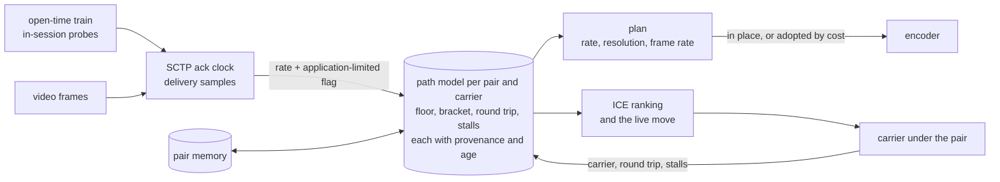

# FR-148: The path is measured, and the plan follows it

**Issue:** [#3953](https://github.com/gjovanov/roomler-ai/issues/3953) · **Status:** P0 runs since 2026-11-16 and its lab cell ran a first slice on 2026-11-17; its open-time train is ruled and not built. P1's memory stores the model in shadow, and its opener is built behind the same switch, whose default is `shadow` and which is `on` on no device; P2's QSV step and P4's rank are merged behind switches that are off by default. None of these is read in the field yet (§6). The plan and decisions D1 to D5 are the operator's, taken on 2026-11-16 · **Owner:** the agent's rate path, its path memory and its ICE policy, and the viewer's video channels
**Supersedes:** [FR-63](FR-63-one-delay-based-rate-controller.md) (#1243), [FR-79](FR-79-one-validity-gate.md) (#1524), [FR-35](FR-35-relay-ceiling-learns-the-pair.md) (#922), [FR-59](FR-59-slow-link-latency-priority.md) (#1163), [FR-71](FR-71-transport-stall-classification.md) (#1362), [FR-74](FR-74-text-clarity-on-direct-paths.md) (#1442), [FR-17](FR-17-partial-reliability-video.md) (#799), [FR-18](FR-18-carrier-queue-discipline.md) (#801), [FR-64](FR-64-remote-desktop-never-rides-the-overlay.md) (#1244). §12 says what moved where
**Works beside:** [FR-135](FR-135-one-rc-media-pipeline.md) (#3293), which owns the pipeline's shape (§13)

Each anchor is at the commit its sentence was written on, and it is not moved when the code moves: the plan's
at master `df905bbc1` (2026-11-16), a later sentence's at the merge that wrote it. §2 names the code that
failed, and this FR's own merges change that code.

## 1. Goal

A remote-desktop session runs at what its path carries, on every carrier, from its first second to its last.

Today the agent never measures what a path carries. It keeps a number that stands in for it. When that number is
wrong nothing corrects it, because a session held below its path produces no evidence that the path could carry
more. The code states the limit itself: "you cannot measure capacity you are not using"
(`agents/roomlerd/src/encode/ceiling_learn.rs:27`).

This FR replaces the stand-ins with one measured model of the path. The session's plan (rate, resolution, frame
rate, carrier) follows that model for as long as the session lives.

It is one program under one issue, by the operator's decision of 2026-11-16 (D1).

## 2. Evidence

Two laptops on corporate VPNs, viewed from neo16, 2026-11-10 to 2026-11-16. Everything here was read from
production `agent_logs`, read-only: the pump's heartbeats, the rate-memory lines and the ICE lines of the sessions
the operator reported as sluggish and blurred. Neither relay was the limit: picture age stayed at 55 to 70 ms in
the bad sessions.

### 2.1 CORPLAP-2: a placeholder became the pair's remembered rate

`av1_nvenc`, mesh policy `on`, carried by the mesh relay (DERP).

| What | Value |
|---|---|
| The pair's last measured memory entry | 3,743,114 bit/s. It aged out between 11-10 13:40Z and 11-11 09:57Z: the last session to read it ended with no evidence, and an end without evidence does not renew an entry |
| What replaced it | 179,980 bit/s, written at 11-11 10:42:41Z |
| Where 179,980 came from | a transit hiccup anchored the decaying prior near 100 kbit/s. At the session's end the prior's own placeholder was the only "evidence" left, and a first write is adopted outright |
| The opening rate of the sessions after it | 179,980 → 197,134 → 208,222 → 213,427 → 233,769 → 281,732 bit/s |
| What each of them ran | 1280×800 at 15 fps, 117 to 410 kbit/s median, 292 to 859 kbit/s at the 90th percentile |
| The picture | the average quantiser's 90th percentile was 184 to 240 of 255 in four of five sessions, and its maximum 252 to 253 |
| The same laptop that morning, over TURN/UDP | 1920×1200 at 30 fps, a 3.25 Mbit/s cap, quantiser flat at 14, age 55 / 64 / 90 ms (p50 / p90 / p99). A quieter screen and another network state, so this is a contrast and not an A/B |
| What the path has carried | a 10.0 Mbit/s peak this week; 6 to 9 Mbit/s sustained in FR-35's own P0 |
| How long the operator's sessions lasted | 48 to 144 s |

The chain, in the code:

1. At a session's end the evidence is the learner's stable rate, else `pipe_bps()`
   (`agents/roomlerd/src/peer.rs:9461-9473`).
2. `pipe_bps()` falls back to the prior's stand-in when nothing was measured
   (`agents/roomlerd/src/encode/governor.rs:679-693`, the stand-in at `:693`).
3. `record_session` stores it (`agents/roomlerd/src/encode/rate_memory.rs:147`). Later writes are damped: half the
   way down, a tenth of the way up (`agents/roomlerd/src/encode/rate_memory.rs:79`,
   `agents/roomlerd/src/encode/goodput.rs:94-98`).
4. The next session opens from the entry. An entry at or below 1,000,000 bit/s also engages the slow-link profile,
   1280 on the long edge at 15 fps (`agents/roomlerd/src/encode/rate_profile.rs:416-419`, `:456-470`). The
   profile is resolved once, when the pump starts (`agents/roomlerd/src/peer.rs:6779-6795`), and nothing in the
   session leaves it.
5. In the session the prior grows by a quarter every ten clean windows, and it stops standing in at 1.5 Mbit/s
   (`agents/roomlerd/src/encode/prior.rs:162`, the band at `agents/roomlerd/src/encode/mod.rs:279`). A session
   that ends before that offers the placeholder again, damped: 233,769 raised by a quarter five times is 713,402,
   and it moved the entry a tenth of the way, to 281,732. A session that outlasts the stand-in and measured
   nothing has no evidence, and writes nothing.

So the entry can only creep, and no session it opens can refute it.

### 2.2 CORPLAP-2: why it rode the mesh relay at all

| What | Value |
|---|---|
| When the overlay pair was selected | 17:55:32.364Z |
| When the TURN/UDP relay candidates were gathered | 17:55:32.453Z to .626Z, 90 to 260 ms later |
| The policy | `rc_overlay=on`, morning and evening |
| Stalled windows on the mesh relay | 5.7 % (11-16) and 13.4 % (11-11) |
| Stalled windows on TURN/UDP | 1.0 to 1.2 % |
| Round trip of the relayed mesh link | 130 ms median; 94 to 190 ms in 70 of 71 samples, and one of 369 ms |

With the policy at `on`, the agent's overlay host candidate carries type preference 90
(`crates/vendored/webrtc-ice/src/agent/agent_gather.rs:32`). A relay candidate carries 0. So an overlay pair
outranks every TURN relay, whatever carries the mesh link underneath. Here the mesh link was itself relayed: video
rode a reliable SCTP channel, over WireGuard, over the relay's WebSocket, over TLS and TCP, through the VPN.

### 2.3 CORPLAP-1: the plan moved and the encoder did not

`hevc_qsv`, mesh policy `off`, TURN/UDP, 1920×1200 at 30 fps.

| What | Value |
|---|---|
| One session of 16,719 s | the target climbed 2.55 → 7.45 Mbit/s. Rate moves applied: 0. Rebuilds: 0. Swaps: 0 |
| Every frame of that session | 10,638 bytes, real and keepalive alike |
| Real frames and keepalives | about 8.8 and 10.5 a second |
| What it sent | 1,644 kbit/s median, of which about 0.9 Mbit/s was keepalive filler |
| In motion windows | 2.59 Mbit/s median at 56 to 63 ms age. Skipped 0, dropped 0, `send_wait_max` p99 0.55 ms |
| Other sessions the same day | opened at 5.49 Mbit/s (22,884 B a frame) and 5.96 Mbit/s (24,838 B a frame) |
| What the path has carried | peaks of 11.4 to 13.3 Mbit/s |

Three facts compose:

1. **On this host a QSV rate change is an encoder rebuild.** FR-62 closed with QSV's in-place path broken and its
   flag off.
2. **On a constrained path a rebuild-bound encoder applies a rate only after 1.2 s without motion**, up or down
   (`DEFER_QUIET`, `agents/roomlerd/src/peer.rs:7369`; the two arms at `:9669` and `:9723`). A finished background
   rebuild is adopted under the same wait (`:7731`).
3. **"Motion" is any real frame of 4,096 bytes or more** (`agents/roomlerd/src/peer.rs:9894-9898`). QSV runs
   constant bitrate, so every frame is `maxrate ÷ fps ÷ 8` bytes: 10,638 at 2.55 Mbit/s, 22,884 at 5.49, 24,838 at
   5.96. Measured in all five sessions read. A frame of an unchanged screen is as large as any other.

So while anything on the screen moves, the wait never ends, and the session keeps the rate it opened at.

The opening rate is itself a lottery. The memory is keyed by the far address and the carrier, and for a relayed
pair the far address is the relay worker's. The same pair opened at 2.55, 5.49 and 5.96 Mbit/s on one day,
depending on which worker was nominated. The entry behind the higher openings is a controller target, not a
delivered rate.

### 2.4 The class

Six rules have been added since late August, each after a field failure:

| Rule | The failure it answered |
|---|---|
| FR-35: the ceiling learns the pair | a fleet constant 2 to 3 times too low for some relays (measured 2026-08-29) |
| FR-59 P6: abandon a seed the measurement contradicts | a fast day's entry inherited by a slow link (2026-09-01) |
| FR-70 P1: a prior may open a session but never pin one | a remembered 170 kbit/s held a healthy link at 1280×800 and 15 fps (2026-09-04) |
| FR-79 V2 and V3a: the gate at the write-back, one `pipe_bps` | an opening burst and a stall written back as the pair's rate (2026-09-08) |
| FR-79 V4: an evidence-only write-back, damped | the memory ratcheting to its cap |
| FR-79 V5b (PR #3374, built, parked): only a measurement is evidence | an idle trickle read as the path on jupiter and written back five times (2026-11-02) |

This week's failure is the 2026-09-04 picture again. The number that did it was the placeholder of the rule
written to prevent it. FR-70's criterion "an unmeasured prior cannot hold a session at the floor" is ticked, and
it holds inside a session: on 2026-11-16 one opened at 281,732 bit/s and its target was at 3.0 Mbit/s by 144 s.
What it does not cover is where the week went wrong. The next open reads the remembered number again, and the
size and frame rate are set once at the open.

Each rule decides which stand-in to trust. None of them makes a session find out.

## 3. Why the work in flight does not close it

| Work | What it does | Why the two failures survive it |
|---|---|---|
| FR-63's controller (B1 in shadow) | a delay-based controller in place of eight estimators | It is passive. On a constrained path its measured rate is what the viewer received, which is what the agent chose to send. It opens a remembered pair at 0.85 × the entry (`agents/roomlerd/src/encode/ratectl.rs:99`): 239 kbit/s on CORPLAP-2. Its flip criterion compares it with the live governor in elevated-age windows, and its spec records that the criterion "cannot fail on under-driving" |
| V5b (PR #3374) | no placeholder is written or acted on | Its own notes: a pair remembered slow then stays slow until a session measures it or seven days pass. Nothing makes a session measure |
| FR-135's ledger | reserves a sink for every heuristic | It keeps both mechanisms as policy: "Plan owns opening profile" (`docs/plans/rc-media-debt.tsv:57`) and "Rebuild-bound backends adopt quietly by policy" (`docs/plans/rc-media-debt.tsv:65`) |
| FR-35 | the learner | It decided against an active probe ("Not done, deliberately") |
| FR-128 | `rc_overlay=auto` | Moving a live session off a relayed mesh link is its unbuilt P3, default "no" (`docs/fr/FR-128-rc-overlay-auto.md:127`, `:147`) |

## 4. Design: four invariants

### 4.1 One path model, and every number in it says how it was obtained

`encode::pipe` is "ONE belief about what the path carries" (`agents/roomlerd/src/encode/pipe.rs:3`, the struct at
`:137`). It runs in shadow: nothing reads it. It becomes the only source of path numbers, per pair and carrier.

| Field | Meaning |
|---|---|
| floor | the highest rate the path delivered over a sustained interval. A lower bound on capacity |
| bracket | low edge: the highest rate carried clean. High edge: the lowest rate that pushed back |
| round trip | the carrier's, not the viewer's paint age |
| stall profile | the share of stalled windows and their typical length, per carrier |

Every value carries a provenance and an age:

| Provenance | When | What it may do |
|---|---|---|
| measured, backlogged | the sender had more to send than the path took | set the floor and both edges of the bracket |
| measured, application-limited | the path took everything offered | raise the floor. It never lowers the bracket |
| probe | a train sent on purpose: at the open (P0's step 4), and in a session from P3 | move the bracket's edges. It never sets or raises the floor (D39) |
| assumed | a prior, a default, an entry from before this FR | open a session when nothing else exists. It is never stored, and it never holds the plan below a demonstrated value |

A stalled window is evidence about the carrier's stall profile and not about its capacity. That is FR-71's
classifier and FR-79's gate, kept.

The memory stores the model, not one rate. Its key names the pair and the carrier, never a relay's address (O1).
The opener, the ceiling, the slow-link profile and the queue budgets read the model.

### 4.2 Capacity is measured by sending on purpose

- **At the open.** The encoder's own open takes 0.65 to 2.8 s (measured this week). In that time a closed-loop
  packet train steps up on a probe channel and stops at the first push-back. It reads the SCTP payload delivered
  per whole round and judges the queue by each round's minimum acknowledgement delay against the lowest seen, as
  HyStart++ does (RFC 9406). A reading that did not stop on push-back is flagged floor-only. Before the first
  frame the train restores SCTP's congestion state from a snapshot, or says it could not (D32, D35, D39, D42).
- **In a session.** A short, bounded probe runs when two things hold: the stream has room to spare, and a better
  answer would change the plan. It carries picture refinement where it can, padding where it cannot.
- **The samples come from the transport.** SCTP's acknowledgement clock in the vendored `webrtc-sctp` yields
  bytes delivered per interval and whether the sender was application-limited in it. The viewer does not change.
  On the RTP sink the same reading comes from transport-wide feedback (O2).

This reverses FR-35's decision (D2). FR-35's objection was that a startup probe measures a burst (18 Mbit/s
instantaneous against about 8 sustained) and costs bytes on exactly the thin links. Two things answer it. The
loop is closed and its steps are proportional, so a thin link stops the train early: at 0.4 Mbit/s it writes at
most 64 KB, at each round trip of the grid (D32's P-f). And the bracket
keeps a burst reading apart from sustained evidence: a probe moves the bracket's edges, and only sustained
delivery raises the floor.

It also supplies what two open items wait for: a capacity reading for FR-135's D12 ("Plan grant by measured
capacity?", `docs/fr/FR-135-one-rc-media-pipeline.md:1526`) and an under-drive clause for FR-63's flip criterion.

### 4.3 No decision lasts a session, and every plan move has a computed cost

- **One plan.** Rate, resolution and frame rate are one `Plan` (`agents/roomlerd/src/encode/plan.rs:105`, FR-70
  M3a, in shadow), recomputed from the model for as long as the session runs. The slow-link profile becomes a plan
  field that is entered and left on evidence.
- **Frame rate changes by pacing**, not by a rebuild.
- **Rate changes in place** where the backend can.
- **A backend that must rebuild adopts by cost.** The replacement is built in the background, as FR-70's
  make-before-break already does for FFmpeg. It is adopted when its keyframe's bytes, divided by the measured
  capacity, fit a stall budget (O5). That replaces `DEFER_QUIET` and the 4 KiB motion threshold.
- **A decrease never waits.** A decrease that waits is the agent over-driving a path it knows is slower.
- **QSV leaves constant bitrate** (FR-62's A5, QVBR, `docs/fr/FR-62-encoder-rate-changes-without-an-idr.md:397`).
  It ends the filler. FR-62 also records that leaving constant bitrate could change whether QSV accepts an
  in-place reset, and that its untested patch 0004 is the leading candidate for an in-place rate there
  (`:363-370` of the same file). So A5 goes first, and the spike on patch 0004 runs only if A5 leaves QSV
  rebuild-bound (D4).
- **Motion is read from capture damage**, not from encoded bytes.

### 4.4 The carrier is ranked by what it is, and video never rides two reliable layers

- **Ranking.** ICE ranks an overlay pair by the mesh link's actual carrier: a direct mesh link like a host pair,
  TURN over UDP next, the relayed mesh link as the fallback. If the browser does not follow a lowered priority
  (AC4 reads it), the agent holds the relayed-mesh candidate back until relay gathering has ended. The design
  report of 2026-11-17 changed three things here (D12, D13, D16): the rank is by address and has two levers, the
  agent keeps checking after its first selection, and hold-back is built only if the experiment fails with both.
- **The live move.** When the carrier under a session changes class, or a better one appears, the session moves by
  ICE restart. This reopens FR-128's D4 (D3).
- **Two video channels.** The viewer creates both at the offer: the reliable, ordered channel of today and a
  deadline-limited one (`videoDcOptions`, `ui/src/composables/useRemoteControl.ts:5093-5098`, builds the second
  shape already, behind an opt-in). The agent picks per path, at a keyframe. FR-17 found that a channel's ordering
  is fixed when it is created and named a second channel as one way out.
- **On a carrier that is already TCP, video is always deadline-limited.** The carrier retransmits by itself.
  SCTP retransmitting above it adds its own floor of 1 s (`RTO_MIN`,
  `crates/vendored/webrtc-sctp/src/timer/rtx_timer.rs:10`). FR-18 made the relay's writer drop frames older than
  its age bound (`agents/roomlerd/src/derp.rs:354`); on a reliable channel each such drop is repaired by an SCTP
  retransmit. Inferred, read in P0: that is where the mesh relay's stalled windows come from. FR-17 and FR-18 were
  designed as two halves and were never joined.
- **`constrained` becomes the carrier.** One flag covers TURN over UDP, TURN over TLS, the mesh relay and an
  organisation's own relay (`detect_constrained_transport`, `agents/roomlerd/src/peer.rs:2020`). The model is per
  carrier, so its readers stop needing the flag.

### 4.5 Mixed versions

The viewer rolls in seconds and agents over days. Every wire change is additive. The second video channel is
created by the viewer (§4.4): an old agent ignores it, and against an old viewer the agent has no such channel and
behaves as today. The probe channel at the open is the agent's, reliable and ordered (D34): the browser accepts it
without viewer code, so the viewer does not change in P0, and an old agent opens none. A probe channel the viewer
creates is P3's decision.

## 5. What it deletes

In P5, each on its own evidence, through the switch registry:

- the rate memory's stable-rate values and the prior's write-back
- the ceiling learner (`agents/roomlerd/src/encode/ceiling_learn.rs`)
- FR-59's P5, P6 and P8 arms
- `DEFER_QUIET`, the 4 KiB motion threshold and quiet-gated adoption
- the fixed relay caps (`relay_max_bps`, `agents/roomlerd/src/encode/mod.rs:887-892`; `relay_max_hi_bps`,
  `:945-952`)
- the path-class frame-rate rule (`ffmpeg_target_fps`, `agents/roomlerd/src/peer.rs:10660`)
- everything FR-63's B3 and B4 already named

## 6. Phases

Each phase ships in shadow or behind its switch first. Each field test is shown failing on the current release
before it passes. Switch names are proposed. A switch read in the media path, a line added to a pump and a
viewer storage key each go through FR-135's ratchet, and each arrives with a ledger row that names the phase
retiring it (§13).

| # | Phase | Kill switch | Proof | Status |
|---|---|---|---|---|
| P0 | Measure, in shadow | `ROOMLERD_PATH_MODEL=off` | AC1 to AC5 | running since 2026-11-16; AC1 and AC5 met; steps 1 and 6 done, steps 2 and 3 merged on 2026-11-17 (#3968, #3980, #3995), step 3's line not yet read in the field; step 5's cell ran its first slice on 2026-11-17 on `0.4.224` (§15): TURN over UDP is proven as a carrier, the TCP proof and the mesh lever are the cell's to fix, and no run loaded the path; step 4 designed, reviewed and ruled on 2026-11-18 (D31 to D42), not built |
| P1 | The model drives the open and the memory | `ROOMLERD_PATH_MODEL=shadow` | AC6 to AC9 | step 1 (#3374) and the first part of step 2 (#3969) merged on 2026-11-17, released that day in `0.4.224` and read on both laptops (§15): each pair's entry from an earlier release was passed over, and CORPLAP-2 opened at 2.55 Mbit/s, 1920×1200 and 30 fps; the rest of step 2 merged on 2026-11-17 (#4014), in shadow and not yet read in the field; steps 3 and 4 built on 2026-11-18 behind the switch, its default `shadow`, with one definition of counted evidence and the floor as a maximum (D25 to D30), not yet read in the field |
| P2 | The plan is live, and its moves have a cost | `ROOMLERD_PLAN_ADOPT=quiet` | AC10 to AC15 | the QSV step merged on 2026-11-17 (#3989), behind a switch of its own that is off by default (D10), and not yet read on Intel hardware; the rest not started |
| P3 | Probes in a session; the bracket replaces the fixed caps | `ROOMLERD_PATH_PROBE=open` | AC16 to AC21 | not started |
| P4 | The carrier | `ROOMLERD_RC_CARRIER_RANK=0`, a viewer flag | AC22 to AC27 | the first half designed and ruled on 2026-11-17 (D12 to D21); step 1, the rank behind its switch, merged on 2026-11-17 (#4013), off by default and not field-verified |
| P5 | One controller, then the deletions | `ROOMLERD_RATECTL=shadow` | AC28 to AC30 | not started |
| P6 | Docs | none | AC31 | not started |

**P0, measure.**
1. The reference report: a script over `agent_logs` that prints, per session, the opening rate beside what the
   pair has demonstrated, and the encoder's applied rate beside the plan's. The queries behind §2 are its first
   version. Merged on 2026-11-17 as `scripts/rc-path-report.cjs` with its wrapper (#3961,
   `docs/production-mongo-reads.md` §8). Its read of the release then current is AC1 (§15). Since #3984 it also
   reads the delivery samples of step 2, a change of path inside a session, the entry an open passed over as
   assumed, and a third flag: a slow-link profile that never left, the field view of what AC14 tests in the lab.
2. Delivery samples from SCTP's acknowledgement clock, with the application-limited flag, on a line of their own
   (D9). Merged on 2026-11-17 (#3968, `docs/rate-control.md` § Delivery samples): the line is
   `path delivery (FR-148 P0, shadow, ≈10s)`, and each sample is backlogged, application-limited or stalled.
   Since #3980 the clock counts what the viewer acknowledged as received: it leaves out a chunk that a FORWARD
   TSN passed after a SACK reported it missing or its retransmission timer expired. On a reliable channel, which
   is the default, the count is exact. On the viewer's unordered opt-in it can still read high by a share of
   what was lost (§15).
3. Provenance and age on every input of `Pipe`, on the path model's own line (D9). Merged on 2026-11-17 (#3995,
   `docs/rate-control.md` § Path numbers and their provenance): the line is
   `path model (FR-148 P0, shadow, ≈10s)`, on both data-channel pumps (D11). It repeats each path number the
   heartbeat carries, and each says how it was obtained (measured while the sender had more to send, measured
   while the path took all that was offered, assumed, or remembered from an earlier session) and how old it is.
   Three more fields show what a model that reads those tags holds: a floor that any measurement raises and only
   a backlogged one lowers, a capacity that only a backlogged push-back moves, and a stand-in that never stands
   below the floor. No decision reads a tag, and the old laws are pinned bit for bit. Not yet read in the field:
   the line rides the release after `0.4.224`.
4. The open-time train, logged and read by nothing. It is built in two pull requests (D31): 4a, the reading's core
   with nothing on a session's wire, proven against the real vendored SCTP over a shaped link; 4b, the integration
   behind `ROOMLERD_PATH_PROBE=open` (config key `path_probe`), default `off` (D37), on the FFmpeg data-channel
   pump's leader sessions only (D36, D40).
5. The standing relay cell: a shaped lab pair at 0.4, 2 and 8 Mbit/s over TURN/UDP, TURN/TLS and the mesh relay,
   with and without injected stalls, and the two laptops as the natural cells. Its first slice: §15, 2026-11-17.
6. The read of FR-63 B1's shadow over seven days, with an under-drive clause added to the report's verdict. A
   first production read ran on 2026-11-02, over the release's first 3.4 days, and met the criterion: the shadow
   asked for no more than the live law in 1,096 of 1,121 windows of elevated age, on 502 sessions
   ([#1243, the comment of 2026-11-07](https://github.com/gjovanov/roomler-ai/issues/1243#issuecomment-6706580701)).
   Its spend view shows what that criterion cannot fail on. In a pump's first 120 s the encoder spent more than
   the shadow asked in 1,232 of 3,372 clean direct windows and 623 of 1,962 clean constrained ones, against 158
   of 31,743 and 193 of 6,685 later, and every constrained window spending 5 Mbit/s or more was over the shadow
   (313 of 313). The read over seven days ran on 2026-11-16 (AC5, §15). PRs #3307 and #3374 and the fixes for
   #3472 were parked behind it. FR-135's rule on agent-behaviour phases names two conditions, this read's start
   and FR-70 AC10's read (`docs/fr/FR-135-one-rc-media-pipeline.md:1246`). The first is met. D6 stands (§8).
7. The inferred mechanisms of §11, measured or struck.

**P1, the model drives the open and the memory.**
1. V5b (PR #3374), rebased. Merged on 2026-11-17: a session writes a rate to the memory only when it measured
   one. Its switch is `ROOMLERD_MEASURED_EVIDENCE` (D8).
2. The memory stores the model, keyed by the pair and the carrier. An entry from before this phase is read as
   assumed. The second sentence merged on 2026-11-17 (#3969): an entry carries its provenance, one without it
   seeds nothing, and the device's next measured write drops it. Step 1 and that sentence were
   read on the two laptops on `0.4.224` the same day (§15). The first merged on 2026-11-17 too (#4014; D22 to D24):
   the key is the carrier, the controlling user and the viewer's network; the model has a file of its own; and
   it takes a delivery only from a window the validity gate accepts. P1 keeps today's scope, a constrained path
   on the FFmpeg pump: a direct path and the VP9-444 pump have no memory today and get none here. AC7's field
   week is read on the close line this step adds, which says why each write happened; today's write line also
   appears when nothing was measured. Nothing reads the new file to drive a rate before step 3.
3. The opener reads the model: a known pair opens at 0.85 × its demonstrated floor (D25), and the train's result
   may raise the opening inside the bracket. It ships with the switch's default at `shadow` (D28).
4. The slow-link profile engages at the open only on a demonstrated low floor, which is a push-back that is
   trusted (D25, D26). Steps 3 and 4 ship in one release.

**P2, the plan is live.** QSV off constant bitrate, built first, beside P0 and behind a switch of its own (D4,
D10). Merged on 2026-11-17 (#3989, `docs/encoders.md` § QSV off constant bitrate): with `qsv_rate_mode = qvbr`,
which is off by default and set at the device, an HEVC or H.264 QSV encoder opens at QVBR with its target at
0.9 × the cap, and a driver that refuses it opens as before. Its read on Intel hardware is AC13. The in-place
rate arm is unchanged and stays off by default.

After it: cost-budgeted adoption in today's pump (D5), frame rate by pacing, the profile as a plan field, motion
from damage.

**P3, probes in a session.** The probe scheduler. The relay caps become bounds on the probe and then go. The
frame-rate grant reads the model (FR-135 D12). On a direct path the bits-per-pixel constant becomes a bound
(FR-74's P5).

**P4, the carrier.** Ranking or hold-back, the live move, the two channels with bounded loss recovery (O6), the
flag split.

1. The rank, in the agent only, behind `ROOMLERD_RC_CARRIER_RANK` with the values `0`, `prio` and `1` (D12, D13,
   D15, D17, D18): merged on 2026-11-17 (#4013). AC4's experiment on the browser runs on this build.
2. The live move, after a design report of its own (D19).
3. The SCTP packet size, after the split is read (D20).
4. The carrier's recorded vocabulary and the viewer's report of its own leg (D21), then the flag split.
5. The two video channels (§4.4, O6).

**P5, one controller.** FR-63's B2 flips on the model under the amended criterion. B3 and B4's deletions follow.
FR-135's fallback stands: if the flip is not live four weeks after R7's shadow week ends, R8 proceeds on the governor
(`docs/fr/FR-135-one-rc-media-pipeline.md:1519`).

**P6, docs.** `docs/rate-control.md` rewritten around the model, `docs/remote-control.md`'s carrier section, the
index row.

## 7. Acceptance criteria

- [x] **AC1 (P0, the failure first)** — From telemetry alone, on the current release, the report shows both
      reference failures: a CORPLAP-2 session on the mesh relay opening below 0.3 Mbit/s at 1280×800 and 15 fps on
      a path that carried over 3 Mbit/s the same week, and a CORPLAP-1 QSV session whose target moves while its
      encoder's rate does not. The script and its output are in the field log. **Read on 2026-11-16** on `0.4.223`:
      F1 is raised in 16 of 40 judged sessions, 15 of them CORPLAP-2 on the mesh relay opening at 0.200 to 0.282
      Mbit/s, 1280×800 and 15 fps, and F2 in 2 of 11, both CORPLAP-1 on `hevc_qsv` (0 rate moves in 26 minutes and
      in 4.6 hours). The report's own yardstick is a floor of 0.616 Mbit/s for that pair. That the path carried
      over 3 Mbit/s is in the same rows: seven clean windows at 3 to 7.44 Mbit/s, and a plan held at 3.00 Mbit/s
      for 36 minutes. [The report](https://github.com/gjovanov/roomler-ai/issues/3953#issuecomment-6942393774) is
      on the issue, and the numbers are in §15.
- [ ] **AC2 (P0)** — On the shaped lab pair at 0.4, 2 and 8 Mbit/s, over TURN/UDP, TURN/TLS and the mesh relay,
      the shadow model's bracket contains the true capacity and its low edge is within 20 % of it, in every cell,
      five runs each. The 20 % is judged in SCTP payload (D42). The open-time train does not run on the mesh
      relay (D40); how that carrier is read is O8.
- [ ] **AC3 (P0)** — Every path number in the heartbeat carries how it was obtained and its age. The jupiter chain
      of 2026-11-02 and the CORPLAP-2 chain of 2026-11-11 replay as unit cells: each fails on master's laws and
      passes on the model's. It is read on the path model's own line, which names every path number the heartbeat
      carries (D9), and "master's laws" are those of 2026-11-16, before V5b merged. **Built on 2026-11-17**
      (#3995), on the two data-channel pumps (D11). Both chains are cells. On the laws of 2026-11-16 the floor
      each path had demonstrated falls, from 15,915,240 to 7,962,364 bit/s on jupiter's chain and from 1,399,272
      to 982,068 on CORPLAP-2's, and the model keeps it. The line's read on a real session is owed.
- [ ] **AC4 (P0)** — Each mechanism §11 lists as inferred is measured or struck: SCTP's 1 s retransmit floor under
      the mesh relay's age drop, the MTU split of a full SCTP packet into two WireGuard frames, whether the browser
      follows a lowered candidate priority, and what `auto` chooses on the two laptops.
- [x] **AC5 (P0)** — FR-63 B1's shadow is read over at least seven days with an under-drive clause added to the
      report, and the report is attached. This is the read the parked rate-path work waits on (FR-135's agent
      phases, #3374, #3307). FR-135's agent phases also wait on FR-70 AC10's read. **Read on 2026-11-16** over
      seven days: agreement 2,852 of 2,939 (97.0 %), the clause 94.5 % constrained and 97.7 % direct, overall MET.
      [The report](https://github.com/gjovanov/roomler-ai/issues/3953#issuecomment-6932207141) is on the issue,
      and the numbers are in §15.
- [ ] **AC6 (P1)** — A reconnect never opens below what the pair last demonstrated on that carrier: 20 reconnects
      in a row on each laptop, each opening at 0.85 × the demonstrated floor or higher, or at the relay cap while
      that cap stands (D25). Fails first on the current release.
- [ ] **AC7 (P1)** — Nothing assumed is written to the pair memory, and nothing assumed holds the plan below a
      demonstrated value: V5b's cells and the two replay cells are green, and one field week shows no memory write
      without a measurement behind it. An entry written before this phase is read as assumed.
- [ ] **AC8 (P1)** — The memory is keyed by the pair and the carrier: the same pair through two relay workers on
      one day opens within 20 % of the same rate (today 2.55, 5.49 and 5.96 Mbit/s).
- [ ] **AC9 (P1)** — A transit stall changes neither the bracket nor the rate: on the shaped pair with injected
      stalls of 1 to 8 s the bracket's low edge moves less than 10 %, no cut follows, and the picture recovers
      within the stall's own length.
- [ ] **AC10 (P2)** — On QSV under continuous motion the encoder's rate follows the plan within 2 s, up and down:
      CORPLAP-1, ten minutes of a moving pattern, 95 % of plan moves applied within 2 s. Fails first on the
      current release (0 moves in 16,719 s).
- [ ] **AC11 (P2)** — A decrease never waits: when the shaped pair's capacity steps down, every backend's encoder
      is at the lower rate within 1 s.
- [ ] **AC12 (P2)** — No adoption costs more than its budget: for every adopted rebuild in a field week, keyframe
      bytes ÷ the bracket's low edge is within the stall budget, read from the heartbeat.
- [ ] **AC13 (P2)** — QSV no longer pads: a QSV keepalive is no longer `maxrate ÷ fps ÷ 8` bytes, and a still
      screen on CORPLAP-1 costs under 0.3 Mbit/s (today 0.9 of 1.64).
- [ ] **AC14 (P2)** — The slow-link profile is entered and left inside a session: the shaped pair stepped
      8 → 0.4 → 8 Mbit/s takes resolution and frame rate down within 5 s and back within 10 s, with no reconnect.
      Fails first on the current release.
- [ ] **AC15 (P2, direct)** — CORPLAP-3 on a direct path: text is sharp within 1 s of a scroll stopping, no
      keyframe comes from a rate move, and the operator reads the same scroll.
- [ ] **AC16 (P3)** — The plan matches the path within 3 s of the open and within 5 s of a capacity step: on the
      shaped pair the rate is within 0.7 to 1.0 × the true capacity, and probe bytes stay within their budget.
- [ ] **AC17 (P3, thin link)** — On the 0.4 Mbit/s cell and on a real hotspot-class link: paint age under 600 ms
      sustained, the target within 2 × the measured rate, and the byte gate engaging.
- [ ] **AC18 (P3, mid relay)** — A relay that carries about 2 Mbit/s is never driven above what it carries: age
      p99 no worse than the P0 baseline.
- [ ] **AC19 (P3)** — No fixed relay cap is left: on a relay that carries 8 Mbit/s a session runs above 3 Mbit/s
      and gets 60 fps when the model grants it, on both laptops' TURN/UDP paths.
- [ ] **AC20 (P3)** — The opening: time-to-crisp at most 0.6 s and first-light sharpness at least 70 % of steady,
      cold and remembered, on both laptops' relay paths.
- [ ] **AC21 (P3)** — No regression on direct paths and healthy relays: age p50 and p90, frame rate and skips
      within noise of the P0 baseline, taken with the same instrument.
- [ ] **AC22 (P4)** — CORPLAP-2 on its VPN with the mesh allowed lands on a TURN relay whenever one allocates, over
      whichever transport its own leg reaches (D14; the transport is recorded), 20 sessions of 20, and its stalled
      windows stay under 2 % (today 5.7 to 13.4 % on the mesh relay). Fails first on the current release.
- [ ] **AC23 (P4)** — With the far TURN unreachable in the lab, a session is on the mesh relay within 5 s, on the
      deadline-limited channel: `send_wait` p99 under 250 ms with no sample over 1 s, age p99 under 300 ms under
      FR-16's fast-motion profile, and `dropped_stale` above zero under load while the delivered frame rate holds.
- [ ] **AC24 (P4)** — No keyframe storm: under sustained loss on the deadline-limited channel the keyframe rate
      stays inside its bound and the delivered frame rate does not fall below the reliable channel's.
- [ ] **AC25 (P4)** — A live session moves when its carrier changes class, by ICE restart, within 5 s and with no
      gap over 1 s, in both directions.
- [ ] **AC26 (P4)** — A pair on one LAN nominates its native pair: CORPLAP-3, age p50 at most 50 ms, read from
      pages loaded after #3566's fix.
- [ ] **AC27 (P4)** — A field A/B against RustDesk on the same relay pair.
- [ ] **AC28 (P5)** — One release of shadow logs meets FR-63's flip criterion and the under-drive clause: where
      the bracket's low edge is 2 × the live rate or more, the controller's target is at least 0.7 × the low edge
      in 90 % of windows. This clause and the report's (AC5) also hold on a pump's first 120 s taken alone (D7).
- [ ] **AC29 (P5)** — Field A/B on CORPLAP-1 and CORPLAP-2 with the controller live: paint age p90 no worse than
      the baseline, and no window with a standing queue while the encoder tracks.
- [ ] **AC30 (P5)** — The deletions of §5 are in the tree, `ROOMLERD_RATECTL=off` restores the prior behaviour for
      one release, rate-control switches number 4 or fewer, and one accessor answers "how fast is the path".
- [ ] **AC31 — Docs.** `docs/rate-control.md` is rewritten around the path model and `docs/remote-control.md`
      gains the carrier rule, with mermaid diagrams, tables and anchors, linked from `docs/README.md`'s index.

## 8. Decisions taken

D1 to D5 are the operator's, taken on 2026-11-16 with the plan. D6 to D42 are this FR's owner's.

| # | Decision |
|---|---|
| D1 | One FR and one issue for the whole program. The FRs it takes over are closed and referenced from it |
| D2 | FR-35's decision against an active probe is reversed. The probe is closed-loop and bounded |
| D3 | FR-128's D4 is reopened: a live session moves. FR-64's rule, "remote desktop never rides the overlay", becomes the carrier rule |
| D4 | QSV: FR-62's A5 first. One spike on FR-62's patch 0004, and only if A5 leaves QSV rebuild-bound |
| D5 | The adoption rule lands in today's pump, before FR-135's R8 |
| D6 | V5b's two open questions are invariant 1 applied: (a) the write-back records a reading or nothing, (b) a growing queue must be offered. Taken by this FR's owner. The operator, asked about it on 2026-11-16: "you are driving and owning this" |
| D7 | At P5 the under-drive clauses, the report's (AC5) and AC28's, are each also read on a pump's first 120 s alone, per class, at the same thresholds, and the flip needs them to hold there. Taken by this FR's owner on 2026-11-16, from AC5's read and before P5's read exists: over all windows the report's clause is met (94.5 % constrained, 97.7 % direct), while in the first 120 s only 342 of 859 constrained windows and 2,046 of 2,925 direct ones are within ×1.25 of the shadow. A flip judged on all windows would pass and still open low |
| D8 | P1's first two merges (#3374, #3969) ship without the phase's switch. They stop a number that nobody measured from being stored or read, and they make nothing drive a rate; the fallback is the open of a pair with no entry, which is how every pair opened before the memory existed. The phase's switch, `ROOMLERD_PATH_MODEL=shadow`, arrives with step 3, where the opener starts to read the model. Step 1 keeps V5b's own switch, `ROOMLERD_MEASURED_EVIDENCE`. A rollback is safe: the release before them ignores an entry's new field and reads a file it cannot parse as an empty memory. Taken by this FR's owner on 2026-11-17, before the release that carries them was cut |
| D9 | P0's numbers are written on lines of their own, `path delivery` and `path model`, about every 10 s, and not as heartbeat fields. FR-135's ratchet counts the lines of each pump, so every heartbeat field is a line of debt, while a line of its own costs one call per pump, whatever it carries. AC3 is read on the `path model` line, which names every path number the heartbeat carries. Taken by this FR's owner on 2026-11-17, at the merge of step 2 (#3968) and in step 3's brief |
| D10 | P2's QSV step (D4: FR-62's A5) is built beside P0 and does not wait for P1. It reads nothing from the path model, it sits behind a switch of its own that is off by default, and its failing "before" is read: AC1's second failure, 0 rate moves in 4.6 hours on `hevc_qsv`. What it changes is the encoder's rate-control mode. Under constant bitrate a frame of an unchanged screen is `maxrate ÷ fps ÷ 8` bytes like every other, so on such a host the pump's wait for a moment without motion never ends (§2.3). AC13 is its field read. AC10 stays with the adoption rule, which follows it. Taken by this FR's owner on 2026-11-17 |
| D11 | AC3's scope is the two data-channel pumps, which are the pumps with a rate governor: every path number their heartbeats carry is on the `path model` line. The RTP pump has no governor. Its one path number is the browser's own estimate (REMB), which the pump applies as its rate, and that estimate arrives with nothing that says how it was obtained. P0 gives that pump no line. What measures the path on the RTP sink is O2. Taken by this FR's owner on 2026-11-17, at the merge of step 3 (#3995) |
| D12 | The rank is by address and has two levers. When the mesh link to the viewer's device is not direct, every candidate of the agent that can only be reached over the mesh is signalled with priority 255, the lowest there is, and with `network-cost 999`: a host candidate on a mesh address, a server-reflexive candidate whose mapped address is a mesh address, and a relay candidate whose relayed address or TURN server is on the mesh. Chrome compares a pair's network cost before its priority, and the agent's own follow rule compares priority, so each lever covers what the other cannot. "A mesh address" is one inside the mesh's own blocks, never the whole of 100.64.0.0/10, which is also a carrier's address space. The design report of 2026-11-17 named two of the three kinds. The third is in the field log (§15): on CORPLAP-2 each session gathers two server-reflexive candidates with a mesh address, and today they rank above the mesh host. Taken by this FR's owner on 2026-11-17 |
| D13 | The agent keeps checking after its first selection. As the controlled side it stops checking pairs once it has selected one, and its TURN client asks the server for a permission only when it first sends to a peer. A relay candidate that arrives after the selection therefore never sends, the server discards the browser's checks toward it, and no TURN pair validates: a lowered priority alone moves nothing. With the rank on, the agent keeps checking every pair that ranks above its selection and whose remote is on a real path. That is the test its follow rule already applies, and the two share one predicate, so the agent never validates a pair it would refuse to follow. This is read in the code and not yet measured: AC4's experiment reads it at the switch's `0`. Taken by this FR's owner on 2026-11-17 |
| D14 | AC22 is read as "on a TURN relay, over whichever transport the agent's leg reaches". On 2026-11-16 CORPLAP-2's leg reached the far TURN over TLS on port 443 (by elimination, §11). If TURN over UDP never allocates there, the words "TURN over UDP whenever it allocates" are met without one session moving. The transport is recorded with the session. The same read answers O3: if those sessions' stalled share is not below the mesh relay's, the order of TURN over TLS and the relayed mesh is reversed, and the deadline-limited channel is the fix for both. Taken by this FR's owner on 2026-11-17 |
| D15 | The order of carriers: a native host or server-reflexive pair, then a direct mesh link, then TURN over UDP, then TURN over TLS or TCP, then a relayed mesh link. §4.4's "a direct mesh link like a host pair" means among the direct pairs: it keeps today's rank, below a native pair and above every relay, because the mesh's MTU splits a full SCTP packet (D20) and a native pair does not. A link whose class is unknown, or that is in the middle of an upgrade, reads as relayed: that keeps connectivity and fails toward TURN. Its cost is a session that sits on TURN while the mesh turns direct underneath, until the live move exists. So the agent logs the link's class again 10 s after the open, and that number gates the default (D18). Taken by this FR's owner on 2026-11-17 |
| D16 | No hold-back, unless AC4's experiment fails with both levers. Holding the mesh candidate back until relay gathering ends has no clean end: gathering has no bound over TLS, and a deadline short enough for AC23 loses to a TURN server that answers late, which is CORPLAP-2's case. A candidate that is only not signalled also comes back as a peer-reflexive pair. This replaces §4.4's hold-back as the first answer. Taken by this FR's owner on 2026-11-17 |
| D17 | In the first step the agent learns the viewer's devices from the offer's ICE servers: each relay of the viewer is a TURN URL on that device's mesh address. The server names the devices only under `auto` today, and it names them under every policy in a later step, additively. Taken by this FR's owner on 2026-11-17 |
| D18 | With the rank on, `auto` behaves as `on`: the mesh is allowed whenever the device's policy is not `off`, and the rank decides what the session rides. The far-TURN hint is not read. The switch's default changes only when three things hold: AC4's experiment is green; the lab cells are green (TURN reachable, TURN blocked, one LAN); and over a field week the class read at the open agrees with the class 10 s later in at least 95 of 100 sessions, or the live move exists. O4's question about new devices stays open until then. Taken by this FR's owner on 2026-11-17 |
| D19 | The live move's shape: the agent asks, the viewer restarts ICE and offers again, the server forwards that offer on an active session, the agent applies it to the live peer, and the agent's ICE restart keeps the old selected pair as the send path until the new generation has selected one. None of it is built before a design report of its own. That report says why the server admits one offer per session today and what bounds a second one, and what the make-before-break restart costs in the vendored ICE agent. Taken by this FR's owner on 2026-11-17 |
| D20 | The agent's SCTP packets shrink from 1,228 to 1,191 bytes, for every association. A full packet today is 1,293 bytes on the mesh's IPv4 and 1,313 on its IPv6, against the mesh's 1,280. 1,191 is the size the browser's own SCTP stack uses, for the same reason: 1,280 less 40 for IPv6, 8 for UDP, 37 for DTLS and 4 for TURN's channel framing. The design report's 1,195 leaves those 4 out, and one of the mesh's carriers, the viewer's own relay, has them. The cost is about 3 % more packets on every path. It is a change of its own, made after the split is read on the viewer's reassembly counters (AC4). Taken by this FR's owner on 2026-11-17 |
| D21 | `turn` keeps its meaning in the carrier's recorded vocabulary: a TURN relay. The transport of the agent's leg is an additive field beside it, and the viewer reports the relay protocol of its own selected candidate additively. A new value such as `turn_tls` would silently take sessions out of every count that reads `turn`. Taken by this FR's owner on 2026-11-17 |
| D22 | The memory key is the carrier, the controlling user and the viewer's network, which decides O1. The relay worker's address leaves the key: it is why one pair had three entries in one day (AC8). The viewer's network is the /24 of its server-reflexive candidate, or the /48 on IPv6, a public address before a private one and never an overlay address. Without such a candidate it is the selected remote address when that is the viewer's own, then the viewer's overlay address, which names a device, then unknown. Without the controlling user or a known carrier there is no key, and nothing is read or written. An overlay carrier and any other carrier never share a word. The agent's own network is not in the key: the carrier separates most of its situations, and what is left, a floor learned in the office and read at home, costs one opening that is too high (D27). A log line carries a hash of the key and the kind of its network part, never the key. Taken by this FR's owner on 2026-11-17, on the design report for P1's steps 2 to 4 |
| D23 | The model is stored in a file of its own, `path_memory.json`, beside today's `rate_memory.json`, which is written exactly as before until P5. D8's "a rollback is safe" stands for #3374 and #3969. For the model it would not stand inside today's file: the release before it rewrites that file from its own shape at its first save, which drops every field it does not know and every entry not marked measured; an entry without today's rate field makes it read the whole file as empty; and an entry marked measured would open it at an application-limited floor, which is §2.1 again. A file of its own is never opened by an earlier release and survives a rollback. Each entry is checked on its own when read (a rate from 50 kbit/s to 100 Mbit/s, a time at most 300 s ahead, a known class), and a bad one drops alone. The floor keeps 7 days from the reading that set it, and a close never writes back a floor that is still the remembered one: the model's `offer` is made to do what its doc says. Taken by this FR's owner on 2026-11-17, on the design report for P1's steps 2 to 4 |
| D24 | The model takes a delivery only from a window the validity gate accepts. Today every window's arrival rate reaches it before the gate rules. The opener's burst and the drain after a stall deliver more in one window than the path carries, and a floor stored from one would open later sessions at up to the relay cap. This changes what P0's `path model` line shows, to the floor of valid windows; `Pipe`'s own numbers do not move. Both AC3 cells stay green unchanged. If one turns red, its floor came from a rejected window, and the change stops there. Taken by this FR's owner on 2026-11-17, on the design report for P1's steps 2 to 4 |
| D25 | The opening is 0.85 × the entry's floor, at most the relay cap while that cap stands (P3), and never under the nominal opening unless a push-back is trusted. A push-back is kept as a record of its own, apart from the floor: its rate is the highest sample it counted. It is trusted when its newest sample is at most 24 hours old and it counted at least three valid windows spread over at least 10 s, across sessions while it stands. A sample counts when it is at least half of the highest delivery its session has measured in a valid window, and the record ends when a valid window delivers more than twice its rate. Both are one test: a refusal that carried less than half of what the same session carried elsewhere is a dip, and the factor is the one the in-session seed contradiction uses. A delivery that only raises the floor leaves the record standing. With a trusted push-back the opening is 0.85 × the damped floor, which may sit under the nominal one. The design report proposed that one sample suffices. It does not: the floor the model held on CORPLAP-2 on 2026-11-17 was application-limited and near 2.2 Mbit/s; one sample at or under 0.15 Mbit/s halves that floor to under 1.18 Mbit/s; and the next session would open on the slow-link profile, from a single window. A lifetime of 7 days would open a recovered path small for a week of still screens. Three windows and 10 s are this FR's owner's numbers, to be read again on the shaped cell: a real link of 0.6 and of 1.5 Mbit/s must be trusted within its first minute of motion, and an injected dip of 3 s must not be. What the rule cannot tell apart is a path that turned slow from a session with a still screen throughout on a relay that stalls: both leave a low record under a floor demonstrated earlier. The governor already asks that a refusal be backlogged: the agent's own sends blocked, or two windows in a row in which the sender offered a tenth more than arrived. That narrows the second case and does not exclude it. How often it happens is read on the fleet's shadow lines before the default changes (D28), and in the shaped cell, where a 6 Mbit/s link with injected stalls under a still screen must leave no trusted record. Taken by this FR's owner on 2026-11-17, on the design report for P1's steps 2 to 4, and corrected the same day. The first wording asked that a backlogged push-back had last moved the floor, and ended the record at any delivery above the floor. The governor takes every window's arrival rate as a delivery first and as a push-back second, at the same rate, and the damped floor converges on the push-back from above. So on a link that really is slow, a refused window that arrives a little above the floor raises it as a delivery and then moves nothing as a push-back, and that wording would have ended the record there and opened the next session at the nominal rate |
| D26 | The slow-link profile engages at the open only on a trusted push-back at or below the profile's threshold (1 Mbit/s), and only when the opening it leads to is at or below that threshold too. An application-limited floor never engages it, whatever its value: the entry of 281,732 bit/s in §2.1 was application-limited at best. Steps 3 and 4 ship in one release, so a slow link never loses its profile between them. Until P2 makes the profile a live plan field, a profile engaged at the open lasts the session, which is why the open asks for this much evidence. Taken by this FR's owner on 2026-11-17, on the design report for P1's steps 2 to 4 |
| D27 | The constrained opener's grace stays in P1: FR-35 P3's 2 s, 3 s at most, ended at 1.2 s when nothing drains. "A decrease never waits" is AC11's, about the encoder applying a lower rate, and it holds after the grace. So an opening that is too high, from a key that merged two paths or a path slower than last time, costs the grace plus the time the cut takes: seconds of delay, once, after which the floor is damped. That cost is inferred, not measured; the shaped cell reads it with an entry at the cap and the link at 2 Mbit/s. What bounds it by design is the open-time train (P0 step 4, P3), which measures before the opener commits. Taken by this FR's owner on 2026-11-17, on the design report for P1's steps 2 to 4 |
| D28 | Step 3 ships with the switch's default at `shadow`: today's opener, pinned bit for bit by a twin test, while the model is written and every constrained open logs both openings, the model's and today's. The values are `off` (the release before, exactly), `shadow` and `on`. No device is switched on until O7 is ruled; after that a device is switched on by `path_model = on` in its config (`roomler config set`, then a restart), and taken back by `path_model = shadow` the same way. The default becomes `on` in the following release when two reads hold. On the fleet's shadow lines the model's opening stands more than 30 % above the trusted push-back the session then measured no more often than today's opening does, and under 0.85 × the floor the session then wrote less often. And AC6 and AC8 hold on the two laptops, each switched on by hand only after O7 is ruled and that device's shadow lines were read. After the flip the kill switch is `ROOMLERD_PATH_MODEL=shadow`, per device. The design report proposed `on` from the first release; `shadow` first costs the fleet one release and the two laptops nothing. Taken by this FR's owner on 2026-11-17, on the design report for P1's steps 2 to 4 |
| D29 | The path memory has one kind of evidence that the path pushed back: a counted push-back sample. Everything the memory does that lowers what it believes of a path rests on counted samples and on nothing else: the record, its trust, and the floor (D30). A sample counts when four things hold. The classifier read its window: not `Unknown`, and, where it called the window clear or transit-stalled, with a viewer paint age the code already calls plausible (at least half the round trip); `Overproduced` is always read, from the sender's own counters. The classifier did not blame the window on the viewer: a `ViewerLate` window (the browser's share of the age grew, or the viewer reported `struggling`) is not a reading of the path, because the key names the path (the carrier, the user, the viewer's network), not the viewer's device, and a record from a slow browser would open the same user's other devices on that network low. The first wording of this decision named "late" among the read states; the coordinator ruled it out on 2026-11-18, on the review's finding 4, and a late window whose age is not plausible is counted as unread. The sender pushed against the plan: it wrote at least half the target the window ran with, or the window is `Overproduced`, so what arrived measured the path and not the screen. And D25's test holds: at least half the session's best valid delivery. Inside the session nothing changes: an unread, late-viewer or under-plan window feeds the governor's belief as before, because a wrong cut there is undone in seconds, while a wrong record stands for a day and decides the next opening. The close line counts the samples set aside (`samples_unread`, `samples_viewer_late`, `samples_under_plan`), and the counted ones by the state of their window (`samples_counted_overproduced`, `samples_counted_clear`), which measures O7. Why the read test: on the release before, 24 of 336 swept sessions of a still screen on a 6 Mbit/s relay that stalls, with no viewer age, closed with a trusted record of tens of kbit/s, and their next session under `on` would open at 200 kbit/s on the slow-link profile; with the read test none does. Why the plan test: it was to be added only if one of three further families of sessions stayed red on the read test and D30, and one did. Shallower slowdowns (88 to 98 % delivered: 0 of 240) and a steady offer of 55 or 80 % of the target (0 of 192) are green on the read test, but with the viewer's age flat, or creeping under the stall threshold, while its link report says the queue grows, 84 of 336 sessions left a trusted record or a lowered floor. With the plan test 42 do, every one a screen of 300 kbit/s: the session's own link clamp cuts the target to 0.9 of the slowdown's arrival within the first slowdown, and from then on that screen writes more than half of it. A real slow link has the same shape (the slow-link cell, whose first refusal under the opening's 3 Mbit/s target is now set aside), so no test against the target a window ran with separates the two, and that class stays open under `on` (O7); a steady offer under a flat age stays red the same way (20 of 96). Setting samples aside never creates a trusted record where there was none, but it can lower a record's rate: with a higher sample set aside, `P` is the highest of the samples left, and `P ≤ T` is one of D26's two conditions, so the slow-link profile can engage where the release before left it off (counted samples of 0.8 Mbit/s beside an unread one of 1.2 Mbit/s). How often a true record still forms, on a slow link whose growing queue reads as a transit stall from its second window, is read in AC9's and AC14's shaped cell and on the fleet's shadow lines. Taken by this FR's owner on 2026-11-18, on the screen of P1's steps 3 and 4 |
| D30 | The model's floor is a lower bound on what the path carries, and lower bounds combine by maximum. At the close, while the remembered floor is inside its TTL, the session's floor replaces it when it is higher (`why=raised`) or equal (`refreshed`: the time moves to the later reading); it replaces a higher remembered floor only when the session counted at least one push-back sample (`pushed_back`); otherwise the remembered floor stays, with its own age (`floor_kept`), and still expires on its TTL. Past the TTL the session's floor is written as before (`floor_expired`). Inside the session the same rule holds: only a counted sample damps the floor, so a dip beside a counted sample does not deepen what the close writes. Why: on the release before, a dip that did not count lowered a remembered floor of 2.2 Mbit/s to 120 kbit/s, and a quiet session after that floor wrote 380 kbit/s over it. The floor is what the opening after a trusted push-back is 0.85 × of (D25), so either would have opened a later session of that pair far under what its path carried. Taken by this FR's owner on 2026-11-18, on the screen of P1's steps 3 and 4 |
| D31 | Step 4 is built in two pull requests. 4a is the reading's core, with nothing on any session's wire: the vendored gauges (D33), the train's state machine as a pure function (readings and a clock in; "write n bytes", "stop with a reason" and "the reading" out), and cells that drive it against the real vendored SCTP over `media_delivery.rs`'s `shaped_link`. 4a adds no channel, no task, no switch, no env read and no log line in a session. 4b is the integration, behind the switch and off by default (D37): the channel, the task and its lifetime, the snapshot restore and its gate (D35), the fences, the skips (D40) and the INFO line. Two of the review's changes are 4b's requirements, as the review wrote them. The task watches `session_end`, reads the session's counters with `session_telemetry::peek()` and never `counters()`, puts a bound on every wait and holds no strong peer connection. The line carries the carrier kind, the minimum round trip, ssthresh at the start, the floor-only flag (D39), the fast-retransmit and T3 counts and the time from the train's end to the first frame, and the train stops with `path_changed` when the selected pair at the end is not the one at the start. Why: the design report's numbers came from a model that sends its rounds one after another, and the real stack does not. The vendored slow start adds `min(total_bytes_acked, cwnd)` to the window at each acknowledgement, and only when the sender is not in fast recovery and its pending queue holds data (`crates/vendored/webrtc-sctp/src/association/association_internal.rs:1308-1309`); congestion avoidance needs the pending queue too (`:1343`). So a sender that leaves the queue empty never grows the window, and every acknowledgement of 2 packets releases 4: inside a round the sender writes at twice the rate its acknowledgements arrive. Under the rules as written, the review's packet-level model reads 8 Mbit/s at 80 ms as a low edge of 4.01 Mbit/s and a high edge of 2.16 Mbit/s. The measurement has to be right on the real stack before anything is wired into a session, and 4a can prove that in CI. Taken by this FR's owner on 2026-11-18, on the design report for P0's step 4 and its review |
| D32 | The design report's controller is not adopted as written. 4a derives its rules on the real stack, against seven properties, which are 4a's acceptance cells and are written first. P-a: on the grid of 0.4, 2, 8 and 50 Mbit/s by 20, 80 and 250 ms of round trip, where the train stops on push-back (`delay`, `plateau`, `loss`), the low edge is within 20 % of the shaped rate expressed in SCTP payload (D42). P-b: where it stops on `budget`, `deadline` or `ready`, the low edge is flagged floor-only and is never more than 20 % above that rate. P-c: the high edge is `None` or at least the low edge, and an inverted bracket is never reported. P-d: no `delay` stop while every round's minimum queue is under 10 ms, because the queue that ack-clocked doubling builds inside a round is not push-back. P-e: the standing queue the train causes is at most max(one round trip, 50 ms) in every cell, its bytes at most 512 KiB of payload and its time at most 2.5 s. P-f: at 0.4 Mbit/s the train writes at most 64 KB at each of the three round trips. P-g: a window that ends after 0.3 s gives a reading flagged floor-only, whatever its value. The direction for the rules, which 4a may improve on if it says why: judge the queue in each round by the round's minimum acknowledgement delay against the minimum seen so far, as HyStart++ does (RFC 9406); take the low edge from the best delivery rate over a whole round, and never from a dispersion inside a round; take a high edge only from a round where delivered was below offered with a standing queue; apply the in-flight cap only after the first round that queued. SCTP's own slow start stays the step law. The reason is D31's. Taken by this FR's owner on 2026-11-18, on the design report for P0's step 4 and its review |
| D33 | The vendored gauges are mandatory. They are cwnd, ssthresh, the peer's receive window, the bytes in flight, the bytes in the pending queue, the fast-retransmit count, the T3-expiry count, and the acknowledgement delay of the newest acknowledged chunk as two values: the latest, and the minimum since the reader last took it. They are pure stores: one relaxed atomic store each, written where the code already holds the association lock, with no branch on them, no await and no lock, and read-only from outside, beside `delivery_clock()`. A twin test in the vendored crate proves it: the same scripted packet sequence, with and without a reader, gives byte-identical outbound packets. Why: D32's rules read the queue from the acknowledgement delay, and without the window and loss gauges the train cannot tell the browser's receive window or a loss from push-back. Taken by this FR's owner on 2026-11-18, on the design report for P0's step 4 and its review |
| D34 | The agent opens the probe channel, `rc-probe`, reliable and ordered, and the viewer does not change in P0. A browser's own stack accepts a channel the agent opens, and no viewer listens for one today. §4.5 is amended to say so: the plan's §4.2 said the viewer does not change, and its §4.5 that the viewer creates the probe channel. A channel the viewer creates is P3's decision, taken only if the lab's browser cell (D37) shows an unreferenced channel being closed or buffered harmfully. It is reliable because on a reliable channel the count of what the viewer acknowledged is exact (P0 step 2). Taken by this FR's owner on 2026-11-18, on the design report for P0's step 4 and its review |
| D35 | In shadow the train restores what it changed, from a snapshot, behind a complete gate. The snapshot is cwnd, ssthresh and `partial_bytes_acked` as they stood at the train's first write, and the restore writes those values back, never constants. It runs under the association lock, and only if all three hold: nothing of any stream is pending or in flight; the association is not in fast recovery; the first frame has not been handed to the send task. It is tried again on every tick until the first frame is handed over; after that it is given up, and the line says `reset=skipped_busy`. It never runs from the buffered-amount-low handler, and that handler only notifies. The handler runs inside the association lock: the read loop holds the lock across `handle_inbound` (`crates/vendored/webrtc-sctp/src/association/mod.rs:480-486`), and `on_buffer_released` awaits the handler inline (`crates/vendored/webrtc-sctp/src/stream/mod.rs:496-500`). So a handler that sends can deadlock the association once the pending queue is full. In every session where the train overlapped the first frame, a `ready` stop or `skipped_busy`, the FR-35 opener's write to the rate memory is skipped, with a log field. Why a restore at all: the vendored stack has no idle decay, so without one the first keyframe leaves as one burst into a window the train grew to about twice the path's capacity. On a shallow buffer or a policed path that is a loss, and possibly a retransmission timer of 1 s on the first frame: worse than today, in a step that promised to change nothing. Taken by this FR's owner on 2026-11-18, on the design report for P0's step 4 and its review |
| D36 | Step 4 runs no train on the VP9-444 pump: it has tens of milliseconds between the association and the first frame. AC2 is read in the lab on the FFmpeg data-channel pump, which the lab can run by storing `data-channel-h264` under the viewer's `roomler-rc-video-transport.v2` (`ui/src/composables/useRemoteControl.ts:3034`). Taken by this FR's owner on 2026-11-18, on the design report for P0's step 4 and its review |
| D37 | The train has a switch of its own, default off: `ROOMLERD_PATH_PROBE`, with the values `off` and `open`, and the config key `path_probe`, which takes a restart and is never pushed. `off` creates no channel, no task and no line. The switch is not tied to `path_model`, whose fleet default is `shadow`: a train sends real bytes. P3 adds a third value for the probes in a session, and its kill switch is `open` (§6): one variable for the whole probe ladder, never two. The default changes only after the lab has read six things, from the review: Chrome, Edge and Firefox with an unreferenced channel the agent opened, one session each with the switch at `open`, five minutes idle and a forced garbage collection; the browsers' acknowledgement cadence and receive window, from D33's gauges, in those sessions; AC2's accuracy, starting where the design report's model failed, at 8 and 2 Mbit/s with at least 80 ms added, over TURN over UDP, five runs each, then the grid; the noise of the time to the first frame, 20 sessions against 20, all with the train off, before any A/B; a policer cell, 2 Mbit/s with a 32 KB burst and an early first frame, 10 sessions against 10; and the mesh relay in a far region with a second overlay flow, reading `dropped_stale` (O8). Taken by this FR's owner on 2026-11-18, on the design report for P0's step 4 and its review, and amended the same day: the first wording named the value `train`. §6 already names P3's kill switch `ROOMLERD_PATH_PROBE=open`, which reads right only if `open` means the open-time train and nothing more |
| D38 | The open-time train's byte budget is 512 KiB of SCTP payload and 2.5 s, whichever comes first, with the wire bytes reported beside it. It restates O5's byte budget: "a train of at most 250 ms of the high edge" cannot hold under ack clocking. Taken by this FR's owner on 2026-11-18, on the design report for P0's step 4 and its review |
| D39 | The train's reading has a provenance of its own, `probe`, and it never becomes the floor: by §4.1's table a reading taken while the sender had more to send is measured and backlogged, which sets the floor. The reading carries a floor-only flag where the train stopped on `budget`, `deadline` or `ready`, its unit (D42), and no high edge where the bracket would be inverted (D32's P-c). Taken by this FR's owner on 2026-11-18, on the design report for P0's step 4 and its review |
| D40 | The train runs in every FFmpeg leader session where the switch is `open`. It is skipped, each time with a reason on the line, for a follower and for one that spilled into a pump of its own, on the VP9-444 pump (D36), on the legacy stats path, on the mesh relay carrier (O8), and where the first frame came before the train could start. On the stats path `media_window` is `None` (`agents/roomlerd/src/peer.rs:6531-6533`) and the first frame is noted only through it (`:9981-9994`), so the first-frame signal never fires. The switch applies at every entry point: both wrappers, followers, spill and an owner's re-dispatch, by the rule that a gate applies at every entry point or it is a courtesy (`.claude/rules/remote-desktop.md:81`). Taken by this FR's owner on 2026-11-18, on the design report for P0's step 4 and its review |
| D41 | The train's constants live in code, and none of them is a knob. Two are derived: the message size, from the association's maximum payload, because D20 will shrink the packet; and the stall threshold, which must exceed 200 ms plus the minimum round trip, because a lone packet waits for the browser's delayed acknowledgement. Taken by this FR's owner on 2026-11-18, on the design report for P0's step 4 and its review |
| D42 | A reading is SCTP payload, in bit/s. The line states the unit and the carrier kind, never an address. AC2's 20 % is judged against the shaped rate converted to payload, with the factor stated per carrier: 0.925 on TURN over UDP, where a packet of 1,297 bytes on the wire carries 1,200 bytes of payload. Why: a shaper counts the bytes on the wire, and the train counts payload. Taken by this FR's owner on 2026-11-18, on the design report for P0's step 4 and its review |

## 9. Open decisions

| # | Question | Recommendation |
|---|---|---|
| O1 | What identifies the viewer's end in the memory key? | The controlling user and the viewer's reflexive network prefix, beside the carrier. P0 reads how often one user's sessions differ by network. Decided on 2026-11-17: D22 |
| O2 | The probe on the RTP sink | Transport-wide feedback there, the SCTP clock on the DataChannel sinks. Decide after P0's read of the SCTP samples |
| O3 | Which comes first, TURN over TLS or the relayed mesh link? | TURN over TLS: one reliable layer fewer and an allocation of its own. The standing cell reads both, and AC22's read on CORPLAP-2 decides it (D14) |
| O4 | After P4, are `auto` and `on` one policy, and what do new devices get (#3357)? | One policy, "mesh allowed, ranked by carrier", beside `off`. Decide the default on P4's field read; D18 says what that read must show |
| O5 | The stall budget of an adoption and the byte budget of a probe | 200 ms of the bracket's low edge for an adoption, set from P0's cell. The open-time train's byte budget is decided on 2026-11-18, D38: 512 KiB of SCTP payload and 2.5 s, whichever comes first, with the wire bytes reported beside it |
| O6 | Loss recovery on the deadline-limited channel | A keyframe under the existing minimum gap, sized by the same cost rule. Intra-refresh where the backend has it, if P0 reads loss above one frame in ten seconds |
| O7 | The open class of D29: a `Clear` window whose sender pushed against the plan while only the viewer's link report said the queue grew (a screen of about 300 kbit/s with the viewer's age flat) counts as a push-back, and no test against the target a window ran with separates it from a real slow link. May such a window teach the memory? | No rule until it is read. The close line splits the counted samples by the state of their window (`samples_counted_overproduced`, `samples_counted_clear`); read the split on the fleet's shadow lines and in AC9's and AC14's shaped cell. What one occurrence costs under `on`: the false record lowers the floor with it, and every session on that key then opens at about 0.85 × that floor, on the slow-link profile for the whole session, for up to 24 h, renewed by each later counted push-back. Until it is ruled, `on` is set on no device (D28) |
| O8 | A reading on the mesh relay. Step 4 skips that carrier (D40): its outbound queue is one per node, with a 100 ms age drop (`crates/tunnel-core/src/transport/derp.rs:46-77`), so a train's queue there would drop other peers' frames on that node, SSH and tunnels among them. Until the rank was set on CORPLAP-2 on the morning of 2026-11-18, its sessions rode exactly that carrier. How does P3 read that carrier? | P3 needs either a train whose queue stays under the age limit, or another way to read that carrier. Decide with the lab's far-region cell (D37) and the carrier counts of CORPLAP-2's sessions on 2026-11-18, its first day with the rank on |

## 10. Not the fix

Each of these was weighed and rejected as the answer by itself. It tunes a stand-in and leaves the session unable
to learn what its path carries.

| Change | What it would leave |
|---|---|
| Raise the 1 Mbit/s slow-link threshold | an entry of 281,732 still opens a 10 Mbit/s path at 0.28 Mbit/s |
| Change the 10 % damping | the write is still the placeholder; it only creeps faster |
| Shorten the 1.2 s quiet gate | constant-bitrate frames never read as quiet at any gate length |
| Lower the 4 KiB motion threshold | the same, and it would misread real motion as quiet on other encoders |
| Exclude the placeholder from evidence | this is V5b's rule (a). It lands in P1. Alone it leaves a low entry standing until it expires |

## 11. Measured and inferred

**Measured:** everything in §2 and every anchor in §2 to §5.

**Inferred, read in P0 (AC4):**

- SCTP's retransmit floor of 1 s turns the mesh relay's age drops into the stalled windows of §2.2.
- The mesh's 1280-byte MTU splits each full SCTP packet into two WireGuard frames, doubling a frame's exposure to
  one drop. By arithmetic a full packet is 1,293 bytes on the mesh's IPv4 and 1,313 on its IPv6 (D20). That the
  operating system splits it, and does not refuse it, is what the read must show.
- Chrome follows a lowered candidate priority when it nominates. Read in the code on 2026-11-17 and not yet
  measured: a lowered priority alone cannot move such a session, because the agent stops checking pairs at its
  first selection (D13).
- What `auto` chooses on these laptops. **Measured on CORPLAP-2 on 2026-11-16 (§15):** it chose the mesh relay,
  on the hint `far_turn=Some(false)`, while a TURN relay carried a session under `off` half an hour later (TURN
  over TLS on port 443, by elimination). The hint reads UDP reach only. CORPLAP-1 is not read yet.

**A limit of the evidence:** the morning session on CORPLAP-2 had little motion and a different network state, so
it shows what the laptop can look like and not what TURN over UDP carries under motion.

## 12. What this FR supersedes, and where each open criterion went

Each FR below closed as not planned on 2026-11-16. What it shipped stays in the tree until P5 deletes or keeps it.

| FR | Shipped, and stays | Moved here |
|---|---|---|
| FR-63 (#1243) | the opener, the simulator (B0), the shadow controller (B1) | the read (P0), the flip and the deletions (P5) |
| FR-79 (#1524) | V1 to V5a, the gate; V3b's `Pipe` in shadow | V3b's flip is §4.1. V5b (PR #3374) is P1's first step |
| FR-35 (#922) | the learner, the per-pair memory | the opening criteria (P3). The learner goes (P5). D2 reverses its decision against a probe |
| FR-59 (#1163) | P1 to P4: floor relief, the measured queue budget, the viewer's rate clamp, the drain. P7: the viewer's reorder buffer | P5, P6 and P8 go. The profile becomes a plan field (P2) |
| FR-71 (#1362) | the classifier, as FR-79's gate generalised it | the field repeats of a transit stall (P1) |
| FR-74 (#1442) | the direct-path changes that met its AC1, AC3 and AC5 | its P5, the measured path as the operating point (P3) |
| FR-17 (#799) | stages A and B, inert behind an opt-in | the default on constrained paths, as the second video channel (P4) |
| FR-18 (#801) | the age bound, the send-buffer cap, the counters | its field reads, joined to FR-17's channel (P4) |
| FR-64 (#1244) | the own-adapter filter, which is what `off` means; the multi-org route fix | "never" becomes the carrier rule (D3) |

All 29 open criteria, one by one:

| From | Criterion | State at the close | Here |
|---|---|---|---|
| FR-17 | the relay pair under fast motion: `send_wait` p99 under 250 ms, age p99 under 300 ms | open | AC23 |
| FR-17 | no IDR-storm regression | open | AC24 |
| FR-17 | direct transports unchanged | open | AC21 |
| FR-17 | a field A/B against RustDesk | open | AC27 |
| FR-18 | the named relay pair under drag: `send_wait` p99 under 250 ms, none over 1 s | partial | AC23 |
| FR-18 | `dropped_stale` above zero under load while the frame rate holds | open | AC23 |
| FR-18 | direct transports unchanged | partial | AC21 |
| FR-18 | no multi-second age excursions on a relayed pair | partial | AC22, AC23 |
| FR-35 | the opening keyframe and first-light sharpness | partial | AC20 |
| FR-35 | time-to-crisp at most 0.6 s | partial | AC20 |
| FR-35 | a relay of about 2 Mbit/s never exceeds the nominal unless every gate passed | open | AC18, restated: never driven above what it carries |
| FR-35 | `relay_ceiling_learn=false` restores the numbers | partial | dropped. The learner and its switch go in P5; the A/B of 2026-11-02 stands as the record |
| FR-59 | AC2, the queue budget tracks the measured rate at 400 kbit/s | partial | AC17 |
| FR-59 | AC5, no regression on a healthy relay or a direct path | partial | AC21 |
| FR-63 | AC0b, the ramp removes the harm, in the field | open | AC17 |
| FR-63 | AC2, a release of shadow logs meets the flip criterion | open | AC5, AC28 |
| FR-63 | AC3, the field A/B on CORPLAP-1 and CORPLAP-2 | open | AC29 |
| FR-63 | AC4, under 600 ms sustained on the airport-class link | open | AC17 |
| FR-63 | AC5, the eight estimators and six switches deleted | open | AC30 |
| FR-63 | AC7, the IDR-rationing heuristics retired | open | AC30 |
| FR-64 | AC2, the native LAN pair, p50 at most 50 ms | partial | AC26 |
| FR-71 | AC3, a transit stall cuts nothing and recovers within its own length | partial | AC9 |
| FR-71 | AC4, no regression on the LAN, direct and thin-pipe cells | partial | AC21 |
| FR-71 | AC5, the response holds, and the controller consumes the classifier | partial | AC9, AC30 |
| FR-71 | AC6, a blocked send inside a rekey storm is not a cut; a thin pipe still is | partial | AC9, AC17 |
| FR-74 | AC2, sharpness stable within 1 s of a scroll ending | open | AC15 |
| FR-74 | AC4, a before and after per phase, and the operator's read | open | AC15 |
| FR-79 | AC8, the memory holds what the carrier measured | partial | AC6, AC7 |
| FR-79 | AC9, the target converges on the measurement through repeated stalls | partial | AC9, AC16 |

## 13. Beside FR-135, and what stays open

| Item | Relation |
|---|---|
| FR-135 (#3293), one RC media pipeline | It owns the shape: the stages, the one encode loop, the sinks, the plan's fields. This FR owns what the numbers are and where they come from. Touch points: ledger rows S09 and S17, D12, "FR-63 B2, then B3" in its order (P5 here; 48 ledger rows name that phase), the second video channel as a sink property, and its ratchet (below). This FR does not edit FR-135's spec and changes no row of its ledger. It appends rows |
| FR-70 (#1330), the media pipeline leaves the runtime | Its M4 and M5 are P5 here. Its AC6 (rate half) holds inside a session: on 2026-11-16 one opened at 281,732 bit/s and its target was at 3.0 Mbit/s by 144 s. The opening, and the size and frame rate set once at the open, are outside it: AC6 and AC7 here (§2.1) |
| FR-38 (#949), #3472, #3050 | The triage of 2026-11-08 re-specified them into FR-135's encoder surface: an encoder is built at the plan's rate and owns its clock. This FR adds one fact to FR-38: on QSV the idle spend is constant-bitrate filler (§2.3) |
| #3341, #3357 | P4 replaces the far-TURN hint with ranking. The default mesh policy is O4 |
| #3259 | A relayed session can be labelled direct. P0's cell needs the label to be right |
| FR-62 (#1242), FR-128 (#2989), both closed | A5 and patch 0004 (D4) and the live move (D3) are taken up here |

**FR-135's ratchet binds this FR's code.** `scripts/rc-media-ratchet.sh` runs on every PR (FR-135 §7.1). It
fails a PR that raises one of its counts past `scripts/rc-media-ratchet.baseline`, unless the PR raises that
count's baseline line and names on it a row of `docs/plans/rc-media-debt.tsv` and when the row retires. Three
of the counts meet this FR, read on master `1c584fb7e`:

| Count | Now | Baseline | What in this FR raises it |
|---|---|---|---|
| `agent_env_reads`: env-knob reads in the agent's media path | 177 | 178 | Each new switch of §6 that is read there, as `ROOMLERD_RATECTL` is (`agents/roomlerd/src/encode/mod.rs:595`). FR-135's open PR #3912 lowers the baseline to 177 |
| `pump_lines_ffmpeg_dc`: the length of the FFmpeg DC pump | 3,959 | 3,959 | P2's adoption rule, which D5 puts in today's pump, from its first added line |
| `viewer_knobs`: distinct `roomler-rc-*` storage keys in the viewer's media files | 33 | 33 | P4's viewer flag, if it is such a key |

On master `1ca52c37e` (2026-11-17), after this FR's first merges, the three read 180 of a baseline of 180,
3,953 of 3,953 and 33 of 33.

So a PR of this FR that raises a count appends its own row at the end of the ledger, with file-only anchors as
the ledger's later rows have (`r0:FPS-1`, `r0:CLOCK-1`), and its phase column names the phase of this FR that
retires it. Rows that retire with another FR's phase are in the ledger already: 48 read `FR-63 B2, B3`, which
is P5 here. This FR does not route a read around the count, through a shared helper or from a file the ratchet
does not list.

## 14. Out of scope

- The capture contract and the shape of the encode loop (FR-135).
- The encoder's build-time rate and its clock (#3472, #3050, FR-38).
- The relays' own capacity and placement, and peer relays (FR-19).
- Audio, and video conferencing.

## 15. Field log

| Date | Release | What was read | Result |
|---|---|---|---|
| 2026-11-16 | the fleet's current agents | production `agent_logs`, read-only, the sessions of 2026-11-10 to 2026-11-16 on CORPLAP-1 and CORPLAP-2 | §2. This is the failing "before" of AC6, AC10 and AC22, to be reproduced by AC1's script |
| 2026-11-16 | the fleet's agents of 2026-11-09 to 2026-11-16 | production `agent_logs`, read-only, one bounded read: `scripts/rc-shadow-report.sh --mars --yes --rows` over 2026-11-09 21:50Z to 2026-11-16 21:50Z. 112,039 lines, 733 sessions, 103 agents. The database pod: no restart, no out-of-memory event, memory at 78.5 % of its limit before and 82.1 % after | **AC5: read, with the clause in the report (PR #3960), and the report attached.** Its verdict is MET. Agreement: the shadow asked for no more than the live law in 2,852 of 2,939 windows of elevated age (97.0 %), over 272 constrained and 393 direct sessions. The under-drive clause, per class: 12,131 of 12,835 constrained windows (94.5 %) over 163 sessions, and 38,355 of 39,251 direct windows (97.7 %) over 147. In a pump's first 120 s the shadow asks for much less than was spent: 342 of 859 constrained windows and 2,046 of 2,925 direct ones are within ×1.25 (D7). [The report](https://github.com/gjovanov/roomler-ai/issues/3953#issuecomment-6932207141) |
| 2026-11-16 | 0.4.223 | three view-only sessions from neo16 to CORPLAP-2 behind its VPN, 22:08Z to 22:38Z, one per mesh policy, each read back from the laptop's own lines in `agent_logs` | **AC4, what `auto` chooses, for one laptop on one night.** `auto`: the mesh relay, on the hint `far_turn=Some(false)`, `own_far_turn=Some(false)`. `off`: a TURN relay on the laptop's side, connected within two seconds, opened at 2.55 Mbit/s and 1920×1200, quantiser 14, age 65 ms. In all three sessions TURN over UDP failed 4 of 4, TURN over TLS on port 5349 failed 2 of 2 and every STUN query timed out. That leaves TURN over TLS on port 443 as the relay that worked, by elimination: its success writes no line. So the hint reads UDP reach and misses it. **The remembered rate is one entry per viewer address and carrier** (O1): these sessions arrived from another overlay address than the operator's do. That address had no entry and opened at 2.55 Mbit/s and full size on the same mesh relay, where the operator's pair is remembered at 281,732 bit/s and opens at 1280×800 and 15 fps. An idle 4-minute session wrote nothing (`pipe_belief_n=(231, 0)` at its end). A 40-second session wrote 2,005,279 bit/s (`pipe_belief_n=(34, 1)`). The operator's entry does not heal, read from that day's write-backs on his pair: evidence moves the entry up by a tenth of the gap (213,427 to 233,769 bit/s on evidence of 416,847, then to 281,732 on 713,402), a 2.4-minute session whose target reached 3.0 Mbit/s wrote nothing, and a 14-second session re-stamped the entry with the prior as its evidence. The policy was set back to `on` |
| 2026-11-16 | 0.4.223, on both laptops since 2026-11-15 22:06Z | production `agent_logs`, read-only, two bounded reads, one agent each: `scripts/rc-path-report.sh --mars --yes --rows` at 23:35Z and 23:36Z, 7,964 and 9,877 lines, 45 sessions and 30 memory writes of 2026-11-10 to 2026-11-16. A third small read gave the release each laptop ran. The database pod: no restart, no out-of-memory event. The report is master's script (#3961) run offline on the saved rows | **AC1: both reference failures, from telemetry alone.** F1, opened below what the pair demonstrated: 16 of 40 judged sessions. 15 are CORPLAP-2 on the mesh relay, each opening at 0.200 to 0.282 Mbit/s, 1280×800 and 15 fps, five of them on 2026-11-16. F2, the plan moved and the encoder did not: 2 of 11, both CORPLAP-1 on `hevc_qsv`, with the target at 2.55 to 7.01 Mbit/s over 26 minutes and 2.55 to 7.45 over 4.6 hours, the encoder at 2.55 throughout, 0 moves. The memory trail: the entry began on 2026-11-11 as a stand-in of 0.180 Mbit/s written as evidence, by a 45-minute session none of whose 1,348 heartbeats carried a goodput reading. Nine more stand-in writes followed: five moved it a tenth of the gap each, to 0.282, and four re-stamped it at its own value. That session read no entry at its open, although a measured write of the evening before, 1.16 Mbit/s, had left one for the pair (O1). **What the path carried.** The report's yardstick is a floor: 0.616 Mbit/s for that pair, from 30 s of sustained delivery on a mostly still screen. The same rows hold seven clean windows of about 2 s at 3 to 7.44 Mbit/s on the relay, and six flagged sessions had their plan at the relay's 3.00 Mbit/s between 126 and 165 s after the open, one holding it for 36 minutes. Sustained delivery cannot tell a still screen from a full pipe, which is what step 2's samples are for. **Also read.** A session that opened with the slow-link profile kept 1280×800 for all its 63 minutes, 44 of them after its pump stopped treating the path as a relay and its plan ran at 15.36 Mbit/s: AC14's failing "before", in the field. The report reads the carrier once, at the open, so that session stayed in the relay's class. [The report](https://github.com/gjovanov/roomler-ai/issues/3953#issuecomment-6942393774) |
| 2026-11-17 | master `ad66a520f`, the base of release 0.4.224's candidate | merged that day: #3374 (P1 step 1, V5b), #3969 (an entry carries its provenance), #3968 (P0 step 2, the delivery samples), #3961 (P0 step 1, the report) | Not a field result. The release's lab cells read the new lines on the candidate, and the read on the two laptops follows the roll: the line that says an entry was passed over as assumed, an open at the nominal rate and full size, and `path delivery` lines with their classes. **Found in the review of #3968:** the delivery clock counts a chunk abandoned under partial reliability as acknowledged, so on the viewer's unordered opt-in (`maxRetransmits: 0`) a lossy path over-reads delivery. The default channel is reliable and is not affected. The fix is in work, before anything reads a sample |
| 2026-11-17 | 0.4.224's candidate `d48065068` | the release lab's cells for this FR, read by the release owner from the log of the process that sends the picture: seven sessions over the VP9-444 data channel, three on macOS and two each on Windows and Linux, every host upgraded from 0.4.223 | Not a field result. The cells read green on all three platforms, and nothing in them held the tag. Every `path delivery` line had `stalled_ms=0`. On macOS and Linux every sample of the still lab screen was application-limited (`delivery_samples=(0, n, 0)`, `backlogged_bps=None`), the healthy reading there. No pair had an entry: each open had none of the memory's lines, no session wrote one at its close, and no open seeded a ceiling or engaged the slow-link profile. No session ran on the FFmpeg pump, which carries nearly every session of the two laptops: their read follows the roll. **Found by the lab, on macOS:** a session that opened on a relay pair logged "constrained (relay-TCP) transport", and about 5 s later it moved to a direct pair and the clamp lifted, as designed. The line says that for every relay pair. The predicate reads the candidate's type only, and a relay candidate's protocol is that of the relayed address, always UDP. So the agent cannot tell a viewer's TURN leg over UDP from one over TLS. The wording is corrected with step 3. P4's ranking needs the difference, so the viewer has to report the protocol of its own relay leg |
| 2026-11-17 | master `0659bbe3e` | merged that day: #3980, the fix for what the review of #3968 found | Not a field result. The delivery clock leaves out a partially reliable chunk that a FORWARD TSN passes after a SACK reported it missing, or after it was outstanding at a retransmission timeout. On a reliable channel the count is unchanged and exact. On an unordered channel with no retransmissions, at 2 Mbit/s with one full packet in ten lost, the clock had counted 2,128,000 bytes against 1,920,000 that arrived, with 216,000 lost. It now counts 11,000 to 21,000 over what arrived on a Windows box and 70,000 to 75,000 on CI's runners, of about 215,000 lost. **What stays:** a lost chunk that nothing follows before the FORWARD TSN reaches the viewer is never reported missing, and SCTP does not tell a sender which skipped chunks arrived. A chunk reported missing that arrives late is left out, which reads low. **What follows for P4:** on the deadline-limited channel the sender's clock is an estimate, and the viewer's own count of what arrived is the measurement |
| 2026-11-17 | 0.4.223 | the saved rows of the read of 2026-11-16, 45 sessions of the two laptops, read again offline with the report as #3984 leaves it. No new production read | **What the report's new columns show on the same week.** F1 and F2 are unchanged: 16 of 40 and 2 of 11. **F3, a slow-link profile that never left:** raised in 3 of 3 judged sessions, of 8, 38 and 63 minutes. Each opened at 1280×800 and 15 fps and never showed a picture both larger and faster, while its plan stood above 1 Mbit/s for 7, 37 and 61 minutes. This is AC14's failing "before". **The plan against the relay's 3 Mbit/s:** of 30 sessions that opened on a relay below it, 16 reached it (seven at 14 s, then at 16, 46 and 57 s, and six at 126 to 165 s), 12 never did and 2 left the relay first. Four sessions changed path while they ran: three left the relay and one entered it. **Opened without the pair's entry:** 7 of 36 judged opens read no entry, although the pair's last write with evidence, at most 7 days old, had left one: 1.16, 0.21, 0.28 and 0.28 Mbit/s on the mesh relay, and 3.54, 7.01 and 7.45 on TURN. The lines cannot say why (O1): the key differed, no key was formed, or the open ran in a process that keeps its memory in another data directory. The laptops ran 0.4.223, so no session had a delivery sample or the line of an entry passed over |
| 2026-11-17 | 0.4.224 | the release lab's switch cell on the released build, read by the release owner from the log of the process that sends the picture: two sessions over the VP9-444 data channel on one guest, 51 s with `ROOMLERD_PATH_MODEL=off` and 52 s with it on again | Not a field result. Off: no `path delivery` line, and the picture decoded at 13 to 14 frames a second. On again: 5 lines, each with `stalled_ms=0` and `delivery_samples=(0, 5, 0)`. So the switch silences the samples and leaves the session alone. The lab could not read the line that passes over an entry as assumed: no pair there had an entry from `0.4.223`. The two laptops read it the same day (the next row) |
| 2026-11-17 | 0.4.224, on both laptops since about 10:50Z | production `agent_logs`, read-only, two bounded reads of the two laptops' lines since 10:45Z: `scripts/rc-path-report.sh --mars --yes --rows` at 11:08Z (no session yet) and at 12:42Z (196 lines, 2 sessions). The database pod: no restart, no out-of-memory event, memory at 76.4 % of its limit before and after the first read and 77.2 % before and after the second | **P1's first steps, read on both laptops (#3374, #3969).** Each open wrote the line that says the pair's entry has no measured provenance and is read as assumed: 281,732 bit/s on CORPLAP-2, written 18.4 hours earlier, and 6,512,314 bit/s on CORPLAP-1, 17.6 hours earlier. Neither open seeded a ceiling, and neither engaged the slow-link profile. **CORPLAP-2**, on the mesh relayed over DERP, `av1_nvenc`, 4 min 53 s: it opened at 2.55 Mbit/s, 1920×1200 and 30 fps, where the same pair opened at 0.200 to 0.282 Mbit/s, 1280×800 and 15 fps on `0.4.223` (AC1's row). The plan stood at the relay's nominal 3 Mbit/s 17 s after the open. The quantiser was 14 at the median and at the 90th percentile, and the viewer's age 73 ms and 98 ms. The screen was still: 8.5 MB in the whole session, 0.24 Mbit/s on average, and 142 of 143 delivery samples application-limited, the highest at 2.17 Mbit/s. So this session shows the open. It does not show what the path carries under motion. **CORPLAP-1**, on a TURN relay, `hevc_qsv`, 20 s: it opened at 2.55 Mbit/s, 1920×1200 and 30 fps. Its entry was a rate from before entries carried provenance, so the pair opens at the nominal rate until a session measures one (D8). Its 8 delivery samples were application-limited, the highest at 4.17 Mbit/s. Neither session wrote the memory at its close: neither had measured a rate, which is V5b's rule. **Found, a stall read as a backlogged sample:** at 12:20:53Z the CORPLAP-2 path stalled for about four seconds. The viewer's age reached 2,276 ms, the classifier called six windows transit-stalled, and the plan held at 3.19 Mbit/s. The delivery sampler read that span as one backlogged sample of 55,859 bit/s with `stalled_ms=0`: a few bytes were acknowledged in it, so it is not the sampler's stalled class. A backlogged sample inside a transit stall is no evidence of capacity, and no floor may fall on it (AC9). The model of #3995 does not read these samples; the step that does must class them by the window's verdict. **Read with it:** the encoder's applied rate read 2.55 Mbit/s for the whole CORPLAP-2 session under a plan of 3.19. That is no missed move: both snap to the 3 Mbit/s rung of the encoder's rate ladder (`coarsen_bitrate`). **Still owed:** AC6's 20 reconnects, a session with motion on either laptop, and AC7's field week |
| 2026-11-17 | master `1ca52c37e` | merged that day: #3995 (P0 step 3), the `path model` line | Not a field result. On both data-channel pumps the line carries every path number of the heartbeat with its provenance and its age, and what a model that reads them would hold. A line is at most 610 bytes, one about every 10 s, and `ROOMLERD_PATH_MODEL=off` silences it together with the delivery samples. The two chains of AC3 are unit cells. Its read follows the next release: on a still screen the viewer's arrival should read application-limited, and the model should hold no capacity |
| 2026-11-17 | 0.4.223 | the saved rows of the read of 2026-11-16, read again offline for three CORPLAP-2 sessions under `on`: the lines `ICE: gathered local candidate`, `per-session ICE path detected` and `session carrier recorded`. No new read of production | Each session gathered one host candidate on a mesh address and two on private addresses, two server-reflexive candidates whose address is a mesh address, two relay candidates whose relayed address is a mesh address (the viewer's own relay) and two relay candidates on the far TURN. The first selection was the mesh host pair, 215 ms after the offer in the first session, and the far TURN's candidates arrived 250 ms after it. In the second session one of them arrived 40 ms before the selection, and the session stayed on the mesh pair all the same. The mesh link read relayed throughout, with an upgrade attempt about every 20 s that never succeeded. So the far TURN allocates on this laptop in under half a second and the session never uses it, and three kinds of the agent's candidates ride the mesh, of which today's rank lowers one (D12, D13) |
| 2026-11-17 | 0.4.224 | production `agent_logs`, read-only, one bounded read at 22:43Z of the two laptops' lines of 12:40Z to 22:43Z: 4,963 lines, 3 sessions, all from neo16. The database pod: no restart, no out-of-memory event, memory at 78.2 % of its limit before and after | **A relayed session of 2.3 hours with almost no motion.** CORPLAP-2 over a TURN relay, `av1_nvenc`: 1920×1200 at 30 fps for all 4,073 heartbeats, plan 3.00 Mbit/s, encoder cap 2.55, 0 rate moves; quantiser 14 at p50, p90 and p99; viewer age 54 ms at the median and 92 ms at p99, with one stall of 7 s; sent 0.21 Mbit/s at the median and 1.02 at most, with 10 of 4,072 heartbeats at 0.5 Mbit/s or more; delivery samples 2 backlogged, 4,070 application-limited, 0 stalled. The picture is sharp at rest and the path never limited the session, so the read says nothing about a dragged window: that starts against the nominal 3.00 Mbit/s, and no measurement stands behind the number in either direction. The same evening: CORPLAP-1 direct on `hevc_qsv` for 73 s, opened at 36.72 Mbit/s and sent 7.15 at the median on a nearly still screen (the padding of §2.2); CORPLAP-2 over a direct mesh link for 24 s, opened at 29.38 Mbit/s |
| 2026-11-17 | master `3d02e0556` | merged that day: #4013 (P4 step 1, the rank behind `rc_carrier_rank`, default `0`) and #4014 (P1 step 2, the path memory, in shadow) | Not a field result. Both ride `0.4.225`. AC22 and AC23 are read on a device set to `prio`. AC6 to AC8 are read from the two path-memory lines on relayed sessions of the FFmpeg pump, and the read of AC3 must allow for this: since #4014 the shadow model behind the `path model` line takes a delivery only from a window the validity gate accepts. Limits known at the merge. The rank: with several viewer devices the best link decides, a move after the 1.5 s wait leaves the opening's constrained flag on the mesh pair, and no viewer device known ranks the mesh last. The memory: a candidate inside the offer's SDP is not read, a move between two relay tiers does not freeze the close's write, two pumps that end at once write the file without a lock, and the switch is an environment variable only. The last two are fixed in the step that lets the model open |
| 2026-11-17 | 0.4.224 | the shaped cell's first slice (P0 step 5): two lab guests, a software agent on the VP9-444 pump and a browser viewer, a shaper on the path, production relays; four runs, 23:09Z to 23:47Z, each judged from the agent's own lines, the viewer's statistics and packet counters | Not a field result. **TURN over UDP is proven as a carrier at 8 and at 2 Mbit/s, and no run tested a rate**: the guest's screen was still, so every `path delivery` line was application-limited and the viewer painted about 4 new frames a second. The gap this FR is about showed twice all the same: the target sat at 3.00 Mbit/s on a path whose true capacity was 1.83, and with the relay ceiling raised to 16,000 kbit/s it read 13.03 Mbit/s from the first heartbeat on a path that carries 7.32. The TURN over TCP run connected, with the agent's line that media was pinned to a TURNS/TCP relay, and failed only the cell's own proof. The mesh-only run never reached a selected pair while the cell's filter dropped 1,271 UDP packets on the viewer guest, which points at the cell's lever and not at the product; that is confirmed on the next boot. Before the next slice the cell gets a motion source, a TCP proof that fits the mode and a mesh lever that lets the session's packets through. The device row the mesh run changed was restored and read back |
