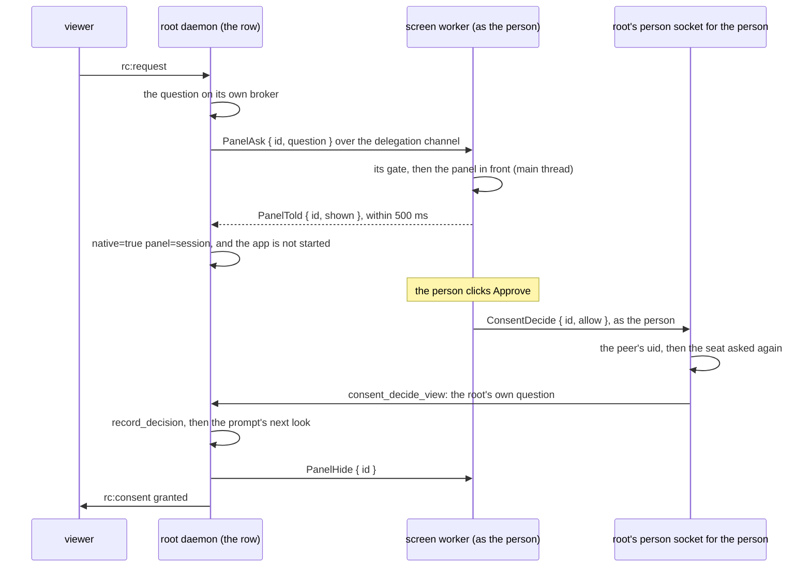

# FR-149: The macOS consent panel drawn from the person's session, so it survives reboots and log-outs

**Issue:** [#4054](https://github.com/gjovanov/roomler-ai/issues/4054) · **Status:** claimed 2026-11-19. Spec only, nothing built. P0 (a read on the first release with #4063) comes first, then P1 (one-row Mac); D1–D4 await the operator
**Builds on:** [FR-27](FR-27-consent-surfaces-and-desktop-companion.md) (the prompt-surface chain), [FR-43](FR-43-macos-single-enrollment.md) (the one-row Mac, its screen worker and the delegation channel), #3864 and #3967 (the app's road over the person socket), #4053 and its fix #4063 (the gate on the root daemon's panel)
**Related:** #3999 (the screen a panel opens on), #3845 (the seat asked again at an answer), #3962 (telling the viewer at once), #4000 (a window runs from the request)

**Anchors:** master `302ca0ca3` (2026-11-19), read in the tree. An anchor marked (#4063) is that pull request's head
`f6e5c6f14`, open when this was written.

## Goal

A Mac's consent panel shows a question on top of everything, with no app needed. Today the root daemon draws it, and
the window server refuses the root daemon at boot and detaches it at a log-out (#4053). With #4063 the root daemon
notices, and sends its questions to the app until it restarts while someone is signed in. After this FR:

- **The panel is drawn by a process that lives in the person's GUI session.** On a one-row Mac that is the screen
  worker the root daemon starts at each login. On a two-row Mac it is the per-user half, or the app (D1). The panel
  works after a reboot and after a log-out and a login, with no restart of the root daemon.
- **The root daemon keeps the question and its broker.** The session process shows the question and carries the
  person's answer back over the road the app's answers take today (#3864, #3967), through the same gates.
- **`native` comes only from the session process saying that its panel shows the question**, within a bound, and
  never from the root daemon's own state. A session process that is not there, says no, or does not answer in time
  sends the question to the app, as #4053 does.
- **No new answerer.** The session process's word routes a question and never decides one. Every answer the panel
  carries is one the root daemon's person socket takes today: from the person at the console, for a question the root
  daemon is asking now, within its window.

## Evidence

### #4053: the root daemon's panel after a boot and after a log-out

Read in the 0.4.226 release lab on a one-row Mac (#4053's body):

| State | What the window server did | What the root daemon did |
|---|---|---|
| after a reboot (the root daemon started 3 s after the login window, before the autologin) | refused it: `This program is not permitted to connect to or launch Window Server before login.`, then `Conn 0x0 is not a valid connection ID.` | logged `native=true … have_surface=true` for a question; no window of it was in the session, and the viewer waited out its 90 s |
| restarted with the person signed in (`launchctl bootout`, then `bootstrap`) | served it | its panel was in the window list at level 1000, 480×240, on screen, read twice |
| the same process, after a log-out and a login | detached it, and after the login `invalid display identifier` | logged `native=true … have_surface=true` again, with no window of it anywhere |

The log-out did not stop the root daemon: AppKit's quit went to the screen worker, and the root daemon started a new
worker at the login. `CGSessionCopyCurrentDictionary` is `NULL` in any daemon, so it cannot tell a root daemon whether
it can draw. The panel itself checks only that its loop pumps and that no other question is up
(`agents/roomlerd/src/indicator/mac.rs:160-173`).

### #4063, and the operator's ruling

#4063 puts a gate in front of the root daemon's panel (`agents/roomlerd/src/indicator/panel_gate.rs:137-215`, #4063).
At each question it reads two things. One is whether the process can put a window on the screen: a 1×1 probe window
made with `defer: false`, whose number is above 0 only with a window device, read through `on_main` within 500 ms.
The other is whether a console session has started since the pump's start: notify(3) on
`com.apple.coregraphics.GUIConsoleSessionChanged` and `GUISessionUserChanged`
(`agents/roomlerd/src/indicator/console_watch.rs:36-41`, #4063). A connection gone, or another session seen, holds
for the rest of the process's life (`panel_gate.rs:128-135`, `:203-209`, #4063). The gate's `false` is the one a busy
panel gives: the question goes to the app, never to a deny.

The operator's ruling on #4053 (2026-11-19): app-only there, with no restart, since a restart at each login would end
every live session on that Mac (remote control, SSH, tunnels) and drop the overlay. The panel itself comes back
through this FR, drawn from a process that lives in the person's session.

### The session processes start where the window server serves them

| Process | How it starts in the person's GUI session | How long it lives | Its panel |
|---|---|---|---|
| a one-row Mac's screen worker | the root daemon's supervisor reads `/dev/console`'s owner every 5 s (`agents/roomlerd/src/macos_supervisor.rs:60`, `:1153-1156`) and starts `run --supervised --unenrolled` (`:472-478`) through `launchctl asuser <uid> sudo -u #<uid>` (`:1324-1335`), its delegation secret on stdin (`:1360-1409`) | until nobody is at the console (`:1849-1857`), the console's person changes (`:1899-1910`) or the root daemon stops (`:1941-1950`). A log-out's quit ends it (`mac.rs:27-35`), and a lifeline on its stdin ends it if the root daemon dies (`:1384-1409`) | the root daemon's own `main`, which hands the main thread to AppKit (`agents/roomlerd/src/app.rs:1292-1343`). Its signalling loop runs on a loopback stand-in (`agents/roomlerd/src/unenrolled.rs:3-33`) and builds its own `ViewerIndicator`, with the macOS panel (`agents/roomlerd/src/signaling.rs:1116-1135`) |
| a two-row Mac's per-user half | a LaunchAgent that launchd starts at the person's login; on a supervised two-row Mac, the supervisor's `run --supervised` | the person's login session | the same. #4063's lab cell L6 expects it to say `macOS consent panel available window_number=<above 0>` after a reboot, where the root half says it was refused |

The worker also captures the person's screen for every session on a one-row Mac. Neither process has drawn the root
daemon's questions so far, so P0 reads their panels on a release with #4063 before anything is built.

### The app's road is field-verified

#3864's result on 0.4.224, a one-row Mac: viewer 2's question, asked while the root daemon's panel showed viewer 1's,
showed in the app. Approve there reached the root daemon (`outcome=Granted` 15 ms later), and Deny reached it as
`outcome=Denied`. #3967 gave a two-row Mac's per-user half the same relay (`ed93ee7f6`, `c254f8ae8`); its lab cell is
read on a release after 0.4.224.

### What there is to build on

| Piece | What it gives | Where |
|---|---|---|
| the delegation channel | a socket only the worker's account can open (0600), in a directory nobody can list (0711), and a 32-byte secret minted for each worker and handed over on its stdin: never on disk, in argv or in the environment. One attached worker at a time; the secret is revoked when the worker stops | `agents/roomlerd/src/delegate.rs:16-53`, `:1175-1231`, `:1644-1673`, `:1682-1732`; the worker's side, `agents/roomlerd/src/delegate_worker.rs:1-30` |
| a bounded question on it | an id, a wait with a bound, a late answer dropped, and every wait ended when the channel ends | `ask_worker_keep_busy`, `delegate.rs:1411-1449`; `channel_ended`, `:1872-1885` |
| additive frames | a frame a reader does not know is skipped, never a reason to close | `delegate.rs:1858-1864`; `delegate_worker.rs:562-565` |
| feature words | words the worker says in its caps frame, kept only when this build knows them, matched by equality (`relay-consent`, #3864) | `delegate.rs:233-258`, `:1955-1962` |
| the person socket | `/var/run/roomler-person/<uid>.sock`, in a directory only root writes; the socket is the person's and 0600. It is served only for `/dev/console`'s owner, and moves within 5 s of a change, aborting every connection of the previous person. A caller whose kernel uid is neither that person's nor root's is dropped before a byte is read; a consent answer is taken only after the seat is asked again. A client takes the socket only from a server whose uid is 0 | `crates/localapi/src/lib.rs:5048-5054`, `:5062-5064`, `:5126-5177`, `:5240-5288`, `:4149-4159`, `:3853-3858`, `:5892-5904`; `agents/roomlerd/src/person_socket.rs:441-454`, `:710-787` |
| the relay in the session process | an answer to a question its own broker is not asking goes to the root half over the person socket, within 5 s | `consent_decide_view`, `agents/roomlerd/src/localapi_state.rs:2241-2251`; `decided`, `agents/roomlerd/src/consent_relay.rs:359-384` |
| the broker | one decision point: it takes an answer only while it asks that id, and the prompt's next look decides it | `record_decision`, `agents/roomlerd/src/consent.rs:925-977`; `look`, `:442-459` |

## Design

### The chain for one question on a Mac's root daemon

Master's chain is the root daemon's panel (`native`), then the app (`companion`), then the floor (`no_prompt_surface`
at the window's end). FR-149 puts the session panel first:

| # | Surface | Asked when | Its answer |
|---|---|---|---|
| 1 | the session panel | the switch is on; a session process holds the panel's road (one row: the attached worker said `consent-panel`; two rows: D1); the root daemon's person socket serves that process's person now | `shown`: `native=true`, `panel=session`. `busy`, `not_up`, or no answer within `PANEL_WITHIN`: the app (3), never the root daemon's own panel |
| 2 | the root daemon's own panel (D2) | the session panel was not asked; #4063's gate reads `Shows`; the panel shows nothing | as on master: `native=true`, `panel=root` |
| 3 | the app | master's road and verdict (#3864, #3967; `reaches_the_tray`, `agents/roomlerd/src/companion.rs:2384`) | `companion` |
| 4 | the floor | none of the above | `no_prompt_surface` at the window's end |

**At most one panel on the screen.** Two overlapping Approve/Deny panels is how someone approves the wrong thing
(`mac.rs:165-166`). One process draws every panel question for the person at the console: the session process shows
its own questions and the root daemon's, one at a time. The root daemon's own panel is a candidate only when no
session process holds the road, so a session panel that is busy or silent never leads to a second panel.

### One-row Mac: the screen worker hosts the panel

**Where it starts and how long it lives**: the Evidence table above. In short, from the supervisor's first poll after
a person signs in at the console until that person leaves the console, logs out, or the root daemon stops.

**How it draws.** The worker already builds the panel the root daemon builds: `Panel::new` (`mac.rs:466-628`), a
borderless window at `NSScreenSaverWindowLevel` on all Spaces (`:481-496`), put in front with `orderFrontRegardless`
(`:616`), from its own main thread's pump (`run_main_loop`, `:357-398`; `pump`, `:401-453`). It runs in the person's
GUI session, where the window server serves the person's apps; P0 reads that it serves the worker's panel too. What
changes is where the question comes from.

**How a question reaches it.** Over the delegation channel, whose attach the worker proved with its secret:

| Frame | Direction | Carries |
|---|---|---|
| `WorkerCaps { features }` | worker → root | the word `consent-panel` beside `relay-consent`, said only by a worker with no enrollment, kept by equality (`delegate.rs:233-258`) |
| `PanelAsk { id, question }` | root → worker | the question's id (a 24-hex ObjectId) and the panel's text: title, lead, detail, permissions, org, and the time left in milliseconds, since an `Instant` (`agents/roomlerd/src/indicator/mod.rs:62-77`) does not cross processes |
| `PanelTold { id, shown }` | worker → root | `shown`, `busy`, or `not_up` with its reason |
| `PanelHide { id }` | root → worker | take that question down |

The root daemon asks as `ask_worker_keep_busy` does (`delegate.rs:1411-1449`): an id, a wait of `PANEL_WITHIN`
(proposed: 500 ms), a late answer dropped, and every wait ended at once when the channel ends (`:1872-1885`). A
`PanelTold` that comes after its wait gets a `PanelHide`, so a panel the root daemon did not count never stays up.

**What the worker checks before it says `shown`.** Its gate reads that it can put a window on the screen and that its
own session is at the console (next section). Its panel shows no other question (`mac.rs:167-169`). The id is a hex
ObjectId, and time is left. Then it queues the question and reads, through `on_main` (`mac.rs:123-138`), that the main
thread has the window in front with a number above 0, as #4063's probe reads its own window. Only then does it answer
`shown`. A healthy worker answers within a few pump ticks (the pump runs about eight times a second,
`mac.rs:630-633`).

**How the answer comes back.** Over the road the app's answers take:

Today a click on the worker's panel goes to the worker's own broker (`signaling.rs:2814-2831`), which is not asking the
root daemon's question and would refuse it. P1 sends it through `consent_decide_view`'s rule
(`localapi_state.rs:2241-2251`): a question the worker's broker asks is decided there, and any other goes to the root
half within 5 s (`DECIDE_WITHIN`, `consent_relay.rs:58`). An answer the root daemon refuses (the window ended, the seat
moved) is logged by the worker, and its panel comes down as today (`signaling.rs:2826-2829`).

**Taking it down.** The root daemon's `hide_prompt` (`mod.rs:334-340`) sends `PanelHide` for a question on the session
panel; whatever ends a question already calls it. The worker also takes a root daemon's question down when its time
is up, so a lost `PanelHide` leaves nothing past the window, and when the channel ends.

**The wait.** All four callers of `show_prompt` (`signaling.rs:4343`, `:5872`, `agents/roomlerd/src/ssh.rs:2471`,
`agents/roomlerd/src/recording/remote.rs:1550`) run on tokio tasks with no lock held across the call (#4063's table),
so `show_prompt` becomes async for the session panel. The bound comes out of the question's window and never extends
it: the remote-control window runs from the request (#4000). An SSH or a recording question waits for the companion's
start (3 s, `COMPANION_START_BUDGET`, `signaling.rs:341`) and the road (1 s) before its window starts, and that wait
must stay under the hub's 5 s grace (`CONSENT_VERDICT_GRACE`, `crates/remote_control/src/consent.rs:149`). With the
session panel in front it is at most 4.5 s, and the compile-time assertion that keeps it under the grace
(`companion.rs:1302-1311`) grows to include `PANEL_WITHIN`.

**Old and new together.** The worker is the root daemon's own binary, started by it, and an update restarts both. A
worker that does not say `consent-panel` is never asked, and the root daemon follows master's chain. A newer worker
beside an older root daemon has its word dropped (`delegate.rs:250-258`) and is never asked.

### The session process's gate

A session process reads #4063's connection probe at each question, as the root daemon does. Its console read is
different: **its own session is at the console now**, read at each question from `/dev/console`'s owner against its
own uid (the read the supervisor and the person socket make, `macos_supervisor.rs:1153-1156`,
`person_socket.rs:441-454`). It is not #4063's "nothing posted since the pump's start", which holds for the rest of
the process's life:

- A worker is replaced at each change of the console's person, but a post that came during the login after its watch
  began would turn its panel off for its whole life.
- A two-row Mac's per-user half lives through a fast user switch. With #4063's read, a switch away and back turns its
  own panel off until it restarts, and its own row's questions go to the app. C3 reads whether it does.

The root daemon keeps #4063's read, which is right for a process outside every session. CoreGraphics' on-console key
(`kCGSessionOnConsoleKey`), which a process started in the session should be able to read, is the alternative; P1's
lab cells decide between the two.

### Two-row Mac: the per-user half, or the app (D1)

On a two-row Mac the person's own row asks on the per-user half's broker, and that row's panel is already the per-user
half's. The root half asks its own row's exec and SSH questions, and on a supervised two-row Mac its remote-control
questions too (`delegable_inbound`, `delegate.rs:881`). Those questions are what D1 is about.

| | The per-user half (recommended) | The app |
|---|---|---|
| draws with | the same `indicator::mac` panel and gate as the one-row worker | the app's prompt window, a webview kept on top (`always_on_top`, `agents/roomler-desktop/src/panels.rs:347`), not at the panel's screen-saver level on every Space |
| reaches the window server | a LaunchAgent started at the login, in the session by construction (#4063's L6) | the same, once it is running |
| the question's road | new: a long-poll on the root half's person socket, on the connection that holds the person's `consent_relaying` (`crates/localapi/src/lib.rs:4061-4079`). The per-user half sends `ConsentPanelWait`; the root half answers it with a question (`ConsentPanelAsk`), a take-down (`ConsentPanelHide`), or nothing after 20 s; the per-user half then says `ConsentPanelTold { id, shown }`. The three are admitted on the person socket for its own person only, never root, as `ConsentRelaying` is (`person_may`, `:3649-3754`), and taken only by a two-row Mac's root half (`localapi_state.rs:2257-2259`). On a supervised two-row Mac the worker's delegation channel can carry the one-row frames instead | the app already lists the root half's questions through the per-user half (#3967). It would add a word that its window shows one: the same new verbs, and one more hop |
| the answer's road | the app's road (#3967): `ConsentDecide` over the person socket, the seat asked again | the same |
| costs | two person-socket verbs and their tests; a process of the person's account can offer the panel too (Authenticity) | a third process in the chain: a start of up to 2.5 s, a person can quit it, and its version is another to keep in step (FR-117). The panel and the companion become one surface, with no fallback between them |
| mixed versions | the offer is a request of its own after `ConsentRelaying`, so an older root half answers it "unknown variant" and keeps the connection, as it does for the announcement (`docs/desktop-companion.md:2160-2169`); a newer root half beside an older per-user half gets no offer and keeps master's chain | an older app says nothing, and the root half's question is marked for it as today |

**Recommended: the per-user half.** It is the same binary as the root half; its panel already works for its own row
(#4063's L6); it already relays and announces over the person socket; and the panel stays one code path on both Macs.
The cost is two person-socket verbs. Leaving the root half's questions with the app, as #4053 does, is the baseline
both options are measured against.

### `native` comes only from the session process's word

- The session panel is `native` only when a `PanelTold { shown }` (one row) or a `ConsentPanelTold { shown }` (two
  rows) for that id arrives within `PANEL_WITHIN`. A worker attached, a word said, a seat read or a socket served never
  makes it `native`: they only decide whether to ask.
- A session process that is not there, never said the word, answers `busy` or `not_up`, or does not answer in time
  leaves the session panel out, and the question goes to the app as #4053 does. A run of silent answers logs one WARN,
  and one INFO when the process answers again.
- The root daemon names the panel on its per-prompt line: `consent prompt surface … native=true panel=session`,
  `… panel=root`, or `… native=false session_panel=<busy|not_up|no_answer|not_asked> why=<…>`. The session process
  logs each change of its panel's state once (up, not up and why), never a line a question.

### Authenticity

A forged approve is the worst failure a consent surface can have. This is how the root daemon knows each part of an
answer the session panel carries.

| What the root daemon must know | How | Where |
|---|---|---|
| that "shown" came from its own session process (one row) | it reads `PanelTold` only on the delegation channel, which only the worker it started can hold: the 32-byte secret on that worker's stdin, one attached worker at a time, the secret revoked when the worker stops. An attach with a wrong secret is closed without a word | `delegate.rs:16-53`, `:1675-1710`, `:1644-1673` |
| that "shown" came from its person's session process (two rows) | it reads `ConsentPanelTold` only on a person-socket connection whose kernel uid is that socket's person, never root, which ends when the seat moves | `crates/localapi/src/lib.rs:4061-4079`, `:5148-5160`, `:5132-5135` |
| that the answer came from the person at the console | the person socket drops a caller whose kernel uid is neither the person's nor root's before a byte is read, and asks the seat again at the answer. It moves within 5 s of a seat change and aborts the previous person's connections, and the supervisor stops the previous person's worker | `crates/localapi/src/lib.rs:5148-5160`, `:4149-4159`, `:5132-5135`; `person_socket.rs:755-767`; `macos_supervisor.rs:1899-1910` |
| that it answers this question | the answer names the question's id. The root daemon takes only a 24-hex id, and takes the answer only while its broker asks that id; the prompt's next look decides, and from then on the question takes no answer | `localapi_state.rs:1186-1202`; `consent.rs:933-941`, `:442-459` |
| that it is not a replay | the roads are local sockets, so a message is seen only by its two ends, and a process able to resend an answer could send one of its own. An answer counts only while its id is asked; a remote-control session asked again under its own id is a new question behind the same gates (`consent.rs:472-479`) | as above |
| that it is in time | the question's window (`DEFAULT_PROMPT_TIMEOUT`, 30 s), the relay's 5 s (`DECIDE_WITHIN`), and the handshake's `PANEL_WITHIN`; an answer after the window is refused | `consent.rs:68`; `consent_relay.rs:58`; `consent.rs:933-941` |

**What another process can and cannot do:**

| A process of | Can | Cannot |
|---|---|---|
| another account, not at the console | nothing on these roads | open the person socket or the delegation socket (each 0600 and the person's), read the worker's stdin (`delegate_worker.rs:22-26`), or answer: the person socket refuses its uid, and the seat check refuses it again |
| the person who was at the console before a fast user switch | nothing once the seat moves | keep a connection to the person socket (aborted), keep a one-row worker (stopped), or answer (the seat is asked again) |
| the person at the console | what it can do on master through the app's road: list the root daemon's questions and answer them over the person socket | claim the panel on a one-row Mac (it has no secret), or make a question count as shown there. On a two-row Mac it can offer the panel as the per-user half does. That sends a question to a panel nobody sees, where it waits out its window (a denial of that question), and it decides nothing it could not decide over the app's road |
| root | anything, as on master | nothing new is given to it |

**The invariant**: a session process's word routes a question and never decides one. FR-149 adds no way to answer.
The session panel's Approve goes through every gate the app's Approve goes through, so its authority is the app's and
no more. Binding a panel's question to the panel alone is D3.

### Screens

The panel opens on `NSScreen::mainScreen` (`mac.rs:471`), and the app's prompt on the primary monitor
(`agents/roomler-desktop/src/panels.rs:402`, `:474`), so with several screens they can open on different ones (#3999).
FR-149 moves `Panel::new` into the session process unchanged, and whichever rule #3999 chooses applies to the session
panel. A process in the session reads the person's screens and the active app directly, which may make that rule
easier to keep. It is not solved here.

### The switch

`ROOMLERD_SESSION_PANEL=0` (or `false`, `off`, `no`) in the root daemon's environment: the session panel is never
asked, and the chain is master's with #4063's gate. The supervisor forwards it to the worker as it forwards the root
daemon's session knobs (`WORKER_ENV_FORWARD`, `macos_supervisor.rs:297-308`), and the worker then does not say
`consent-panel`. A two-row Mac's root half reads the same switch.

### Tests

P1, unit tests with stood-in readers, so they run on every lane:

| Test | Shows |
|---|---|
| `delegate::tests::a_panel_question_is_read_on_the_attached_channel_only` | a `PanelTold` with another id, after its wait, or after the channel ended is dropped; the channel's end ends the wait at once |
| `delegate::tests::the_panel_word_is_kept_by_equality` | `consent-panel` is kept and a near miss dropped; a worker without it is never asked |
| `indicator::session_panel::tests::native_comes_only_from_the_session_processs_word` | `shown` gives `native`; `busy`, `not_up`, silence, no worker, no word, the switch off, and a person socket not served give no `native` from the session panel |
| `indicator::session_panel::tests::a_busy_or_silent_session_panel_never_leads_to_a_second_panel` | the root daemon's own panel is not tried once the session panel was asked |
| `indicator::session_panel::tests::a_late_shown_is_taken_down` | a `PanelTold` after its wait gets a `PanelHide` |
| `localapi_state::tests::a_session_panel_click_on_the_roots_question_takes_the_apps_road` | the worker's click on a root daemon's question goes to the root half; a click on its own question stays local; a click after the window is refused |
| `indicator::panel_gate::tests::a_session_process_shows_again_once_its_session_is_back` | the session process's console read is not sticky, and the root daemon's still is |
| the existing `tests::person_may_is_exactly_the_safety_surface` and `localapi_state::tests::another_accounts_per_user_half_gets_no_root_questions` | unchanged, and passing |

They run in "Agent tests (vp9-444, overlay, kernel TUN)", step "Test agent under vp9-444"; in "Windows agent unit
tests", step "Agent unit tests on Windows (the whole --lib suite)"; and in "macOS overlay compile check", step "cargo
check + test the agent's Mac-only units", whose filter names the new module. The worker's AppKit side compiles in
"cargo check agent (viewer-indicator-macos — the AppKit panel + the main-thread swap)". P2 adds the person-socket
verbs' tests: `person_may` updated, an offer taken only from the socket's own person, and an offer that lives as long
as its connection.

### Lab cells

Each is a read of behaviour on a Mac by the macOS lab. The pass lines use master's log fields and the ones above.

| Cell | Phase | Mac | Steps | Pass |
|---|---|---|---|---|
| C1 | P0 | one row | reboot, sign in | the worker's own log says `macOS consent panel available window_number=<above 0>`; the root daemon's has #4063's WARN for a window refused at the start |
| C2 | P0 | one row | log out and in; then a fast user switch to a second account and back | each new worker says `available window_number=<above 0>` |
| C3 | P0 | two rows | reboot and sign in; log out and in; a fast user switch away and back | the per-user half says `available` after each start. After the switch back, its own row's next question shows on its panel (`native=true`), or goes to the app with #4063's `another console session` WARN |
| C4 | P1 | one row | reboot, sign in, a viewer asks; Approve; then a fresh pair, Deny | the session panel shows it, `native=true panel=session`; `outcome=Granted` and the session connects; then `outcome=Denied`. The root daemon's pid is the one it has had since the boot |
| C5 | P1 | one row | log out, log in, then as C4 | as C4, on the new worker; the root daemon's pid unchanged |
| C6 | P1 | one row | person A at the console; a fast user switch to person B; a viewer asks in the first seconds, then again after B's worker attaches; switch back to A and ask again | the first question shows only in B's session, in the app or not at all (`session_panel=not_asked`); the second on B's panel, answered by B; the third on A's new worker's panel |
| C7 | P1 | one row | lock the screen; a viewer asks; unlock within the window | the question is on the session panel after the unlock (as #4063's L4), and is answered there |
| C8 | P1 | one row | viewer 2 asks while the session panel shows viewer 1's question | viewer 2's shows in the app, `native=false companion=Some(true) session_panel=busy`; never a second panel; both are answered |
| C9 | P1 | one row | end the worker; a viewer asks before the new one attaches, and again after | first the app or the floor (`session_panel=not_asked why=no_worker`), never `native=true`; then the panel |
| C10 | P1 | one row | `ROOMLERD_SESSION_PANEL=0` for the root daemon; reboot; ask. Then `ROOMLERD_PERSON_SOCKET=0` alone; ask | the first follows master's chain with #4063's gate (the app); the second logs `session_panel=not_asked why=person_socket` and follows master's chain from there |
| C11 | P2 | two rows | reboot, sign in; an exec or SSH question for the `-daemon` row; Approve, then Deny | on the per-user half's panel (`native=true panel=session`); both outcomes |
| C12 | P2 | two rows | log out, log in, then as C11 | as C11 |
| C13 | P2 | two rows | A → B → A by fast user switching, a root-half question at each step | each on the panel of the person at the console; A's own row's next question is on A's panel again |
| C14 | P2 | two rows | lock, ask, unlock | as C7 |
| C15 | P2 | two rows | the per-user half's own question on its panel, then a root-half question | the root half's in the app (`session_panel=busy`); never a second panel |
| C16 | P2 | two rows | a newer root half beside an older per-user half, and the other way round | the first: no offer, master's chain; the second: the relay as on 0.4.224, the offer answered "unknown variant" |
| C17 | P3 | one row | by D2: restart the root daemon while signed in (#4063's L3 step); ask with the switch off, then on | kept: the root daemon's panel with the switch off, the session panel with it on, never both. Removed: the session panel, and no `macOS consent panel available` line from the root daemon |

## Phases

| phase | what | kill switch, or back-out | status |
|---|---|---|---|
| P0 | C1–C3 on the first release with #4063 (its lab cells are written for 0.4.228): the session processes' panels, read before anything is built | read only | not started; waits for #4063's release |
| P1 | one row: the frames and the word on the delegation channel; the root daemon's session-panel ask in `show_prompt` (async, `PANEL_WITHIN`); the worker's handling, and its click through the app's road; the take-down; the session process's console read; the logs; the switch; the tests above | `ROOMLERD_SESSION_PANEL=0` on the root daemon: master's chain with #4063's gate | not started; after #4063 merges |
| P2 | two rows, by D1: the per-user half's offer and its verbs on the person socket, or the app's word | the same switch on the root half; the verbs are additive, and an older root half refuses them | not started; waits for D1 |
| P3 | the root daemon's own panel, by D2 | kept: nothing to switch. Removed: `ROOMLERD_ROOT_PANEL=1` restores it for one release | waits for D2, after P4's one-row read |
| P4 | the field read: C4–C10 with P1's candidate, C11–C16 with P2's, C17 with P3's, then C4–C8 and C11–C14 on a released build | read only | not started |
| Docs | the docs below, each in the pull request of the phase it describes | none | not started |

- **P0 leaves** the facts P1 builds on: whether each session process's panel is served after a reboot, a log-out and
  a fast user switch, and how #4063's console read behaves in a per-user half. Acceptance: AC1.
- **P1 leaves working by itself**: a one-row Mac's questions on the person's own panel after a reboot and after a
  log-out, with no restart of the root daemon. A two-row Mac is unchanged. Acceptance: AC2 to AC6.
- **P2 leaves working**: a two-row Mac's root-half questions on the panel too, or what D1 says instead. Acceptance:
  AC7.
- **P3 leaves**: the root daemon's own panel where D2 puts it. Acceptance: AC8.
- **P4** reads each phase on a Mac, and AC9 on a released build.

The docs:

- `docs/desktop-companion.md` §10.8 (`docs/desktop-companion.md:1940`) and §10.8.1 (`:2095`): the panel's road, with
  the one-row flow as a mermaid sequence, its gates and its logs.
- `docs/remote-control.md` §11.2, "Prompt surfaces" (`docs/remote-control.md:2654-2661`): on a Mac `native` is the
  session process's panel, and when the root daemon's own panel is used.
- `.claude/rules/remote-desktop.md`, Host consent (`.claude/rules/remote-desktop.md:96-149`): a session process's
  word routes a question and never decides one; at most one panel on the screen.
- `CLAUDE.md`, Known Issues, the line on the macOS native panel (`CLAUDE.md:459-462`), from P4's read.
- The module docs: `indicator/mac.rs:1-43`, the new frames in `delegate.rs`, and `consent_relay.rs:1-37`.
- `docs/README.md`: the `desktop-companion.md` row (`docs/README.md:153`) names the session panel.

## Acceptance criteria

- [ ] **AC1** (P0): C1 to C3 are read on the first release with #4063, and the field log says what each read.
- [ ] **AC2** (P1 tests): the tests above pass in CI on the lanes named;
  `native_comes_only_from_the_session_processs_word` and
  `a_session_panel_click_on_the_roots_question_takes_the_apps_road` are shown failing on master first.
- [ ] **AC3** (P1, after a reboot and after a log-out): C4 and C5 pass. A question that finds the panel free shows on
  the session panel and is answered there, Approve and Deny, with no restart of the root daemon.
- [ ] **AC4** (P1, a fast user switch and a locked screen): C6 and C7 pass.
- [ ] **AC5** (P1, `native=false`): C8, C9 and C10 pass. A session process that is not up, busy or silent gives no
  session-panel `native=true`, and the question goes to the app as #4053 does.
- [ ] **AC6** (authenticity): the root daemon reads "shown" only from the attached channel (one row) or from the
  socket's own person (two rows); every answer the panel carries passes the person socket's gates; and P1 and P2 add
  no verb that decides a question. The tests above pin each, and each phase's review checks the Authenticity section
  against its code.
- [ ] **AC7** (P2, by D1): C11 to C16 pass.
- [ ] **AC8** (P3, by D2): C17 passes.
- [ ] **AC9** (field, a released build): C4 to C8 and C11 to C14 pass again, and the Known Issues line on the macOS
  native panel says so.
- [ ] **AC10** — Docs updated in house style (tables, the one-row flow as a mermaid sequence, `file:line` anchors):
  the sections above in `docs/desktop-companion.md` and `docs/remote-control.md`, the rule and the module docs,
  linked from `docs/README.md`.

## Open decisions

D1–D4 each carry a recommendation and await the operator.

- **D1. Which process hosts the panel on a two-row Mac.** Recommended: the per-user half, through a long-poll on the
  root half's person socket (Design, the two-row table). Fallback: the app, with its costs. Either is measured against
  the baseline: the root half's questions in the app, as #4053 leaves them.
- **D2. Whether the root daemon's own panel stays.** Recommended: it stays as the second choice while #4063's gate
  reads `Shows` and no session process holds the road (an older worker, the switch off, the person socket off), until
  P4's one-row read; D2 is then asked again with that read. Fallback: remove it in P3, so that the root daemon never
  draws, and a question with no session panel goes to the app.
- **D3. How an answer is bound to the panel.** Recommended: (a) the person socket's gates, the same as for the app's
  answers, so that FR-149 adds no answerer. (b) On one row, the panel's answer could cross the delegation channel
  instead, and the root daemon could refuse a person-socket answer from anyone but root for a question on the session
  panel. That binds the answer to the worker the root daemon started, but a process of the person's account can still
  end the worker, so that the next question goes to the app and is answered there; it buys little for a second answer
  road. (c) The person socket could check its caller's code signature, from the caller's audit token, for the app's
  answers too: its own issue if wanted, not this FR's.
- **D4. A question whose session panel goes away before it is answered** (a log-out, or the worker ended).
  Recommended: it waits out its window, as a question on the root daemon's panel does today when that panel goes.
  Fallback: the root daemon marks it for the app within its window, with the rewrite #4000 uses for a notification
  (`signaling.rs:4395-4426`).

## Out of scope

- #4053's app-only fallback, which #4063 covers.
- Consent panels on Windows and Linux.
- The screen a panel opens on (#3999).
- The panel in the captured stream (`mac.rs:37-43`), which does not change with the process that draws it.
- The "Being viewed by …" banner, which stays with the app (`mac.rs:5-6`).
- Telling the viewer at once that a question has no surface (#3962).
- A caller's code signature on the person socket (D3 (c)).

## Field log

| date | what | result |
|---|---|---|
| 2026-11-19 | claimed, from #4053's 0.4.226 read and the operator's ruling there; #4063 in review | spec only |
