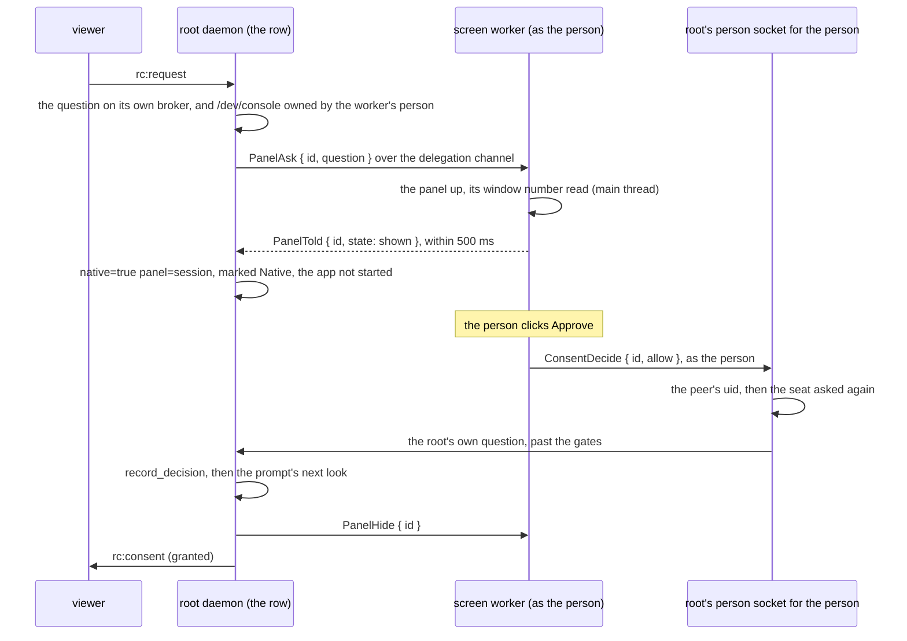

# FR-149: The macOS consent panel drawn from the person's session, so it survives reboots and log-outs

**Issue:** [#4054](https://github.com/gjovanov/roomler-ai/issues/4054) · **Status:** claimed 2026-11-19. P0 is read (0.4.228, 2026-11-20; field log). P1 (one-row Mac) is built (2026-11-20). P4's lab rounds 1–6 read P1's cells on the published 0.4.233 to 0.4.239, from 2026-11-23 to 2026-11-27 (field log): C4, C4b, C5, C7, C8, C9, C9b and C10 pass, and AC3 and AC5 are met. C9's first question logs `why=no_worker`, the reason the cell names, since 0.4.238, the first release with #4421's fix (field log). Still open: C6, partial in round 4, which AC4 waits for, and P2's and P3's cells (C11–C18). The operator decided D1–D4 on 2026-11-20 (Decisions)
**Builds on:** [FR-27](FR-27-consent-surfaces-and-desktop-companion.md) (the prompt-surface chain), [FR-43](FR-43-macos-single-enrollment.md) (the one-row Mac, its screen worker and the delegation channel), #3864 and #3967 (the app's road over the person socket), #4053 and its fix #4063 (the gate on the panel)
**Related:** #3999 (the screen a panel opens on, fixed by #4094), #3845 (the seat asked again at an answer), #3962 (telling the viewer at once), #4000 (a window runs from the request)

**Anchors:** master `8136cf4c2` (2026-11-19), read in the tree, with #4063 merged in it as `eb74c8902`.

## Goal

A Mac's consent panel shows a question on top of everything, with no app needed. Today the root daemon draws it, and
the window server refuses the root daemon at boot and detaches it at a log-out (#4053). With #4063 the root daemon
notices, and sends its questions to the app until it restarts while someone is signed in. After this FR:

- **The panel is drawn by a process that lives in the person's GUI session.** On a one-row Mac that is the screen
  worker the root daemon starts at each login. On a two-row Mac it is the per-user half, or the app (D1). The panel
  works after a reboot and after a log-out and a login, with no restart of the root daemon.
- **The root daemon keeps the question and its broker.** The session process shows the question and carries the
  person's answer back over the road the app's answers take today (#3864, #3967), through the same gates.
- **`native` comes only from the session process saying that its panel shows the question**, within a bound, and
  never from the root daemon's own state. A session process that is not there, says no, or does not answer in time
  sends the question to the app, as #4053 does.
- **No new answerer.** The session process's word routes a question and never decides one. Every answer the panel
  carries is one the root daemon's person socket takes today: from the person at the console, for a question the root
  daemon is asking now, within its window.

## Evidence

### #4053: the root daemon's panel after a boot and after a log-out

Read in the 0.4.226 release lab on a one-row Mac (#4053's body):

| State | What the window server did | What the root daemon did |
|---|---|---|
| after a reboot (the root daemon started 3 s after the login window, before the autologin) | refused it: `This program is not permitted to connect to or launch Window Server before login.`, then `Conn 0x0 is not a valid connection ID.` | logged `native=true … have_surface=true` for a question; no window of it was in the session, and the viewer waited out its 90 s |
| restarted with the person signed in (`launchctl bootout`, then `bootstrap`) | served it | its panel was in the window list at level 1000, 480×240, on screen, read twice |
| the same process, after a log-out and a login | detached it, and after the login `invalid display identifier` | logged `native=true … have_surface=true` again, with no window of it anywhere |

The log-out did not stop the root daemon: AppKit's quit went to the screen worker, and the root daemon started a new
worker at the login. `CGSessionCopyCurrentDictionary` is `NULL` in any daemon, so it cannot tell a root daemon whether
it can draw. The panel itself checks only that its loop pumps and that no other question is up
(`agents/roomlerd/src/indicator/mac.rs:179-181`, `:193-197`).

### #4063, and the operator's ruling

#4063 puts a gate in front of the panel (`agents/roomlerd/src/indicator/panel_gate.rs:156-234`). At each
question it reads whether the process can put a window on the screen: a 1×1 probe window made with `defer: false`,
whose number is above 0 only with a window device, read through `on_main` within 500 ms (`window_device`,
`agents/roomlerd/src/indicator/mac.rs:848-870`; `PROBE_WAIT`, `:791`). A root process also reads
whether a console session has started since the pump's start: notify(3) on
`com.apple.coregraphics.GUIConsoleSessionChanged` and `GUISessionUserChanged`
(`agents/roomlerd/src/indicator/console_watch.rs:38-43`). For the root daemon, a connection gone or another
session seen holds for the rest of the process's life (`panel_gate.rs:147-154`, `:222-228`). A process that
runs as the person (a two-row Mac's per-user half, a one-row Mac's screen worker) reads the window device alone
(`reads_console_session`, `panel_gate.rs:98-100`; `PanelScreen::at_start`, `mac.rs:810-819`), so a
fast user switch away and back does not turn its panel off (#4063's lab cell L9). A one-row Mac's root daemon,
restarted while someone is signed in, sends its questions to the app after such a switch, by design until this FR
(L10). The gate's `false` is the one a busy panel gives: the question goes to the app, never to a deny.

The operator's ruling on #4053 (2026-11-19): app-only there, with no restart, since a restart at each login would end
every live session on that Mac (remote control, SSH, tunnels) and drop the overlay. The panel itself comes back
through this FR, drawn from a process that lives in the person's session.

### Who is at the console, read in the lab

Read in the lab, a two-row Mac, 2026-11-19, on 0.4.227:

| Read | What it gave |
|---|---|
| the owner of `/dev/console` (`stat`) | follows the console's person at every step: unchanged through a lock, a display sleep and the screen saver; root at a log-out, and whenever the login window held the console in a switch; then whoever signed in, the second account after a fast user switch to it |
| the console records in utmpx (`who`) | the person's record kept while the login window held the console, and both accounts' records after a second account signed in by fast user switching |
| notify(3), the two CoreGraphics names #4063 watches | nothing at a lock or an unlock, a display sleep or the screen saver. A log-out posts `GUIConsoleSessionChanged` 3 times and `GUISessionUserChanged` once, and a login `GUISessionUserChanged` once. A fast user switch posts `GUIConsoleSessionChanged` twice each way, and twice more at the password on the way back |

So the owner of `/dev/console`, read when a question is asked, says who is at the console. It is a stat of a device
node: no window server, bootstrap or audit session is involved, so the way a worker is started (`launchctl asuser`,
then `sudo`) cannot change it, and the supervisor and the person socket make the same read as root. utmpx is never
used: it kept the person's record while the login window held the console. The notify(3) names say that something
changed, not who is there now.

### The session processes start where the window server serves them

| Process | How it starts in the person's GUI session | How long it lives | Its panel |
|---|---|---|---|
| a one-row Mac's screen worker | the root daemon's supervisor reads `/dev/console`'s owner every 5 s (`agents/roomlerd/src/macos_supervisor.rs:60`, `:1153-1156`) and starts `run --supervised --unenrolled` (`:472-478`) through `launchctl asuser <uid> sudo -u #<uid>` (`:1324-1335`), its delegation secret on stdin (`:1360-1409`) | until nobody is at the console (`:1849-1857`), the console's person changes (`:1899-1910`) or the root daemon stops (`:1941-1950`). A log-out's quit ends it (`mac.rs:39-47`), and a lifeline on its stdin ends it if the root daemon dies (`macos_supervisor.rs:1384-1409`) | the root daemon's own `main`, which hands the main thread to AppKit (`agents/roomlerd/src/app.rs:1292-1343`). Its signalling loop runs on a loopback stand-in (`agents/roomlerd/src/unenrolled.rs:3-33`) and builds its own `ViewerIndicator`, with the macOS panel (`agents/roomlerd/src/signaling.rs:1116-1135`) |
| a two-row Mac's per-user half | a LaunchAgent that launchd starts at the person's login; on a supervised two-row Mac, the supervisor's `run --supervised` | the person's login session | the same. #4063's lab cell L6 expects it to say `macOS consent panel available window_number=<above 0>` after a reboot, where the root half says it was refused |

The worker also captures the person's screen for every session on a one-row Mac. Neither process has drawn the root
daemon's questions so far, so P0 reads their panels on a release with #4063 before anything is built.

### The app's road is field-verified

#3864's result on 0.4.224, a one-row Mac: viewer 2's question, asked while the root daemon's panel showed viewer 1's,
showed in the app. Approve there reached the root daemon (`outcome=Granted` 15 ms later), and Deny reached it as
`outcome=Denied`. #3967 gave a two-row Mac's per-user half the same relay (`ed93ee7f6`, `c254f8ae8`); its lab cell is
read on a release after 0.4.224.

### What there is to build on

| Piece | What it gives | Where |
|---|---|---|
| the delegation channel | a socket only the worker's account can open (0600), in a directory nobody can list (0711), and a 32-byte secret minted for each worker and handed over on its stdin: never on disk, in argv or in the environment. One attached worker at a time; the secret is revoked when the worker stops | `agents/roomlerd/src/delegate.rs:16-53`, `:1175-1231`, `:1644-1673`, `:1682-1732`; the worker's side, `agents/roomlerd/src/delegate_worker.rs:1-30` |
| a bounded question on it | an id, a wait with a bound, a late answer dropped, and every wait ended when the channel ends | `ask_worker_keep_busy`, `delegate.rs:1411-1449`; `channel_ended`, `:1872-1885` |
| additive frames | a frame a reader does not know is skipped, never a reason to close | `delegate.rs:1858-1864`; `delegate_worker.rs:562-565` |
| feature words | words the worker says in its caps frame, kept only when this build knows them, matched by equality (`relay-consent`, #3864) | `delegate.rs:233-258`, `:1955-1962` |
| the person socket | `/var/run/roomler-person/<uid>.sock`, in a directory only root writes; the socket is the person's and 0600. It is served only for `/dev/console`'s owner, and moves within 5 s of a change, aborting every connection of the previous person. A caller whose kernel uid is neither that person's nor root's is dropped before a byte is read; a consent answer is taken only after the seat is asked again. A client takes the socket only from a server whose uid is 0 | `crates/localapi/src/lib.rs:5048-5054`, `:5062-5064`, `:5126-5177`, `:5240-5288`, `:4149-4159`, `:3853-3858`, `:5892-5904`; `agents/roomlerd/src/person_socket.rs:441-454`, `:710-787` |
| the relay in the session process | an answer to a question its own broker is not asking goes to the root half over the person socket, within 5 s | `consent_decide_view`, `agents/roomlerd/src/localapi_state.rs:2241-2251`; `decided`, `agents/roomlerd/src/consent_relay.rs:359-384` |
| the broker | one decision point: it takes an answer only while it asks that id, and the prompt's next look decides it | `record_decision`, `agents/roomlerd/src/consent.rs:925-977`; `look`, `:442-459` |

### P0's read on 0.4.228

Anchors are master `bdddcd0b2`.

The release lab read C1 to C3 on agent 0.4.228's release candidate, the first release with #4063, on 2026-11-20
between 01:25Z and 02:30Z: C1 and C2 on a one-row Mac, C3 on a two-row Mac.

| Cell | Step | What was read | As the spec expects |
|---|---|---|---|
| C1 | boot with automatic login off, then sign in | the worker, started after the sign-in: `macOS consent panel available window_number=38 console_session=none`; the root daemon at its start: #4063's WARN, `window_number=0` | yes |
| C1 | boot with automatic login on | the worker: `available window_number=35`. The person was signed in about 2 s after the root daemon started, so its start probe was served too (`window_number=6`) | yes for the worker; the root daemon's refusal needs automatic login off |
| C2 | log out and in, twice | each new worker: `available window_number=131`, then `=90`, both `console_session=none`; the old worker exited at each log-out | yes |
| C2 | lock for about a minute, then unlock | `/dev/console`'s owner stayed the person, and the worker's pid was unchanged after the unlock | yes |
| C2 | a fast user switch to a second account, and back | the second account's worker, started on the switch: `no native consent panel on this host — prompts go to the desktop companion`, `error=the AppKit main loop is not running`; that account had no desktop app either. The person's new worker after the switch back: `available window_number=172` | **no**, for the second account's worker |
| C3 | boot and sign in; log out and in | the per-user half: `available window_number=40` after the boot, `=96` from its new process after the log-in | yes |
| C3 | a fast user switch away and back | the person's own row's next question on its panel (`native=true`), approved in 5.0 s | yes |
| C3 | lock, the person's row asks, unlock | `native=true`: on the panel behind the lock screen, on the per-user panel after the unlock, and allowed | yes |

**The finding: a second account's worker had no panel.** C6 (P1) asks a second account at the console on its own
worker's panel. On master a worker decides its panel once, and this one decided before its main loop ran:

- The line is `indicator::mac::Inner::new` refusing because `PUMPING` is not set yet
  (`agents/roomlerd/src/indicator/mac.rs:175-180`). The main thread sets it only after its first AppKit calls return:
  `NSApplication::sharedApplication`, `finishLaunching` and the start probe's window (`mac.rs:404-439`). It makes
  them after it has started the daemon's thread (`agents/roomlerd/src/app.rs:1313-1343`), and nothing makes that
  thread wait for them.
- The daemon's thread asks once for each signalling loop, when the loop builds its `ViewerIndicator`, after the
  encoder probe's first answer (`agents/roomlerd/src/signaling.rs:1034-1049`, `:1117-1135`). A refusal leaves that
  indicator with no panel for the rest of the worker's life (`agents/roomlerd/src/indicator/mod.rs:561-575`), and
  its `prompt` then answers `false` (`:594-596`).
- Nothing on the way reads the account. The supervisor starts the same `run --supervised --unenrolled` for whoever
  owns `/dev/console` (`agents/roomlerd/src/macos_supervisor.rs:137-160`, `:472-478`, `:1911-1936`).

So the cause is timing, not the account. The second account's worker, started in the session the switch had just
opened, was still in its first AppKit calls when its loop built the indicator; each of the person's workers had
finished them. The code does not say why those calls took longer in that session, and the read does not say whether
that worker's main loop ran later. P1 closes the gap (Phases): a worker whose main loop starts late still hosts the
panel.

## Design

### The chain for one question on a Mac's root daemon

Master's chain is the root daemon's panel (`native`), then the app (`companion`), then the floor (`no_prompt_surface`
at the window's end). FR-149 puts the session panel first:

| # | Surface | Asked when | Its answer |
|---|---|---|---|
| 1 | the session panel | the switch is on; a session process holds the panel's road (one row: the attached worker said `consent-panel`; two rows: D1); that process's person owns `/dev/console` when the question is asked; the root daemon's person socket serves that person; the root daemon's own panel shows no other question (P1) | `shown`: `native=true`, `panel=session`. `busy`, `not_up`, or no answer within `PANEL_WITHIN`: the app (3), never the root daemon's own panel |
| 2 | the root daemon's own panel (D2) | the session panel was not asked, and shows no other of the root daemon's questions (P1); #4063's gate reads `Shows`; the panel shows nothing | as on master: `native=true`, `panel=root` |
| 3 | the app | master's road and verdict (#3864, #3967; `reaches_the_tray`, `agents/roomlerd/src/companion.rs:2384`) | `companion` |
| 4 | the floor | none of the above | `no_prompt_surface` at the window's end |

A question the session panel shows is marked `Native`, as one on the root daemon's panel is today, so the app does
not show it a second time (`signaling.rs:4349-4359`).

**At most one panel on the screen.** Two overlapping Approve/Deny panels is how someone approves the wrong thing
(`mac.rs:193-194`). One process draws every panel question for the person at the console: the session process shows
its own questions and the root daemon's, one at a time. The root daemon's own panel is a candidate only when no
session process holds the road, so a session panel that is busy or silent never leads to a second panel. P1 holds the
rule across questions too (`session_panel::chain`): while the root daemon's own panel shows a question, the session
panel is not asked (`session_panel=not_asked why=root_panel_busy`), and while the session panel shows one of the root
daemon's questions, the root daemon's own panel is not tried. Either way the question takes the road of one asked
while the panel is busy: the app. The first can happen when a worker attaches while the root daemon's panel, after a
restart with someone signed in (#4063's L3), shows a question asked before the attach.

### One-row Mac: the screen worker hosts the panel

**Where it starts and how long it lives**: the Evidence table above. In short, from the supervisor's first poll after
a person signs in at the console until that person leaves the console, logs out, or the root daemon stops.

**How it draws.** The worker already builds the panel the root daemon builds: `Panel::new` (`mac.rs:500-667`), a
borderless window at `NSScreenSaverWindowLevel` on all Spaces (`:515-535`), put in front with `orderFrontRegardless`
(`:655`), from its own main thread's pump (`run_main_loop`, `:385-432`; `pump`, `:435-487`). It runs in the person's
GUI session, where the window server serves the person's apps; P0 reads that it serves the worker's panel too. What
changes is where the question comes from.

**How a question reaches it.** Over the delegation channel, whose attach the worker proved with its secret:

| Frame | Direction | Carries |
|---|---|---|
| `WorkerCaps { features }` | worker → root | the word `consent-panel` beside `relay-consent`, said by a worker that hosts the panel for the root daemon (a one-row worker; on a supervised two-row Mac, by D1), kept by equality (`delegate.rs:233-258`) |
| `PanelAsk { id, question }` | root → worker | the question's id (a 24-hex ObjectId) and the panel's text: title, lead, detail, permissions, org, and the time left in milliseconds, since an `Instant` (`agents/roomlerd/src/indicator/mod.rs:62-77`) does not cross processes |
| `PanelTold { id, state }` | worker → root | `shown`, `busy`, or `not_up` with its reason |
| `PanelHide { id }` | root → worker | take that question down |

The root daemon asks as `ask_worker_keep_busy` does (`delegate.rs:1411-1449`): an id, a wait of `PANEL_WITHIN`
(proposed: 500 ms), a late answer dropped, and every wait ended at once when the channel ends (`:1872-1885`). A
`PanelTold` that says `shown` after its wait gets a `PanelHide`, so a panel the root daemon did not count never stays
up.

**What the worker checks before it says `shown`.** Its gate is #4063's for a process that runs as the person: the
window device alone. `/dev/console`'s owner is its own uid: the root daemon's read, made again, so a switch between
the two reads gives `not_up`. Its panel shows no other question (`mac.rs:195-197`). The id is a hex ObjectId, and time
is left. Then one main-thread job (`on_main`, `mac.rs:137-152`) puts the panel up for that id and reads the panel's own
window number. The panel is made with `defer: false` (`mac.rs:515-521`), as #4063's probe is, so a number above 0 says
the window server took it. Only then does the worker answer `shown`; a number of 0 or less takes the panel down and
answers `not_up`. A healthy worker answers within a pump tick or two (the pump runs about eight times a second,
`mac.rs:669-672`).

**How the answer comes back.** Over the road the app's answers take:

Today a click on the worker's panel goes to the worker's own broker (`signaling.rs:2814-2831`), which is not asking the
root daemon's question and would refuse it. P1 sends it through `consent_decide_view`'s rule
(`localapi_state.rs:2241-2251`): a question the worker's broker asks is decided there, and any other goes to the root
half within 5 s (`DECIDE_WITHIN`, `consent_relay.rs:58`). An answer the root daemon refuses (the window ended, the seat
moved) is logged by the worker, and its panel comes down as today (`signaling.rs:2826-2829`).

**Taking it down.** The root daemon's `hide_prompt` (`mod.rs:334-340`), which takes its own panel down when a question
ends, sends `PanelHide` for a question on the session panel. The worker also takes a root daemon's question down when
its time is up, so a lost `PanelHide` leaves nothing past the window, and when the channel ends.

**The wait.** The four callers of `show_prompt` (`signaling.rs:4343`, `:5872`, `agents/roomlerd/src/ssh.rs:2471`,
`agents/roomlerd/src/recording/remote.rs:1550`) are tokio tasks with no lock held across the call; the remote-control
and exec callers are the org's WS loop itself (#4063's table). #4063 already has each wait up to 500 ms for its probe.
The session panel's answer takes the probe's place and never adds to it, since a question whose session panel was
asked does not go on to the root daemon's panel. So `show_prompt` becomes async, bounded by `PANEL_WITHIN`, and the
worst wait stays #4063's. Whether P1 also moves the ask onto the question's own task, so that the WS loop waits for
none of it (#4000), is settled in its review. P1 keeps it in `show_prompt`: each caller writes the question's marker
once `native` is known, so an ask moved off that path would mark the question before the panel's word, either for the
app, which would then show a question the panel shows too, or as `native` with a rewrite, which leaves it on no
surface until the rewrite. The window is not touched: it runs from the request (`expires_at`,
`signaling.rs:4341`), and the panel counts down to that end. An SSH or a recording question waits for the companion's
start (3 s, `COMPANION_START_BUDGET`, `signaling.rs:341`) and the road (1 s) before its window starts, and that wait
must stay under the hub's 5 s grace (`CONSENT_VERDICT_GRACE`, `crates/remote_control/src/consent.rs:149`). With the
session panel in front it is at most 4.5 s, and the compile-time assertion that keeps it under the grace
(`companion.rs:1302-1312`) grows to include `PANEL_WITHIN`.

**A worker that does not answer (review F4).** Ruled 2026-11-21: accepted as built, and documented here. P1's
`PANEL_WITHIN` bounds the wait at 500 ms over all states, the same bound as master's probe (`PROBE_WAIT`,
`agents/roomlerd/src/indicator/mac.rs:791`). The extra wait comes only in a degraded state, a worker that said
`consent-panel` and then does not answer, where master's refused or ended panel answered at once. A consent question
waits on a person, so up to 500 ms before it moves to the app is small beside that. Each question is asked again,
which lets the panel come back by itself
(`indicator::session_panel::tests::after_no_answer_the_next_question_is_asked_again`); a silent state with a way back
would add a state, and its failure modes, for little gain.

**Old and new together.** The worker is the root daemon's own binary, started by it, and an update restarts both. A
worker that does not say `consent-panel` is never asked, and the root daemon follows master's chain. A newer worker
beside an older root daemon has its word dropped (`delegate.rs:250-258`) and is never asked.

### Which session process is asked, and its gate

#4063, as rebased, gives a process that runs as the person a gate on the window device alone, and keeps the
console-session read for a root process (its lab cells L9 and L10; `reads_console_session`, `panel_gate.rs:98-100`;
`verdict`, `:205-234`; `PanelScreen::at_start`, `mac.rs:810-819`; `window_device`, `:848-870`). FR-149 keeps both,
and adds two reads:

- **The root daemon asks only the session process of the person at the console.** At each question it reads
  `/dev/console`'s owner, as the supervisor and the person socket do (`macos_supervisor.rs:1153-1156`,
  `person_socket.rs:441-454`), and asks the session panel only when that owner is the session process's person. The
  read follows the console's person through a lock, a log-out, the login window and a fast user switch, where utmpx
  does not (Evidence). It is the one read used. CoreGraphics' session dictionary is `NULL` in a daemon (#4053) and has
  never been read in a worker started this way, and one measured read is better than two that can disagree. A
  one-row Mac's worker is replaced within 5 s of a change of the console's person (`macos_supervisor.rs:60`,
  `:1899-1910`), and a two-row Mac's per-user half lives on in a session switched away from: in both, a question asked
  in between is not sent to a panel in a session nobody is looking at. After a click to switch user, the person's
  worker lives up to one 5 s poll while the login window holds the console; the read gives root there, so the worker
  is not asked, and its own read answers `not_up` if the console changes between the two.
- **The session process says `shown` only from its panel's own window** (above), so a window device lost after its
  gate's read gives `not_up`, never `native=true`.

**`shown` means in front of the person's session, not seen.** On a locked screen the gate passes and the panel, at
`NSScreenSaverWindowLevel` (`mac.rs:527`), sits under the lock screen, so `shown` and `native=true` come with nothing
seen until an unlock. The root daemon's panel and the app behave the same on master, so this is no regression: the
question waits on the panel for the unlock, within its window (D4), as #4063's L4 reads for the root daemon's panel
today. Full-screen apps and other Spaces are covered: the panel joins every Space, stays put, and is a full-screen
auxiliary (`mac.rs:531-535`); C4b reads it.

The root daemon keeps #4063's read for its own panel: after a fast user switch away and back, a root daemon
restarted while someone was signed in sends its questions to the app (L10). With FR-149 they go to the session panel
of the person back at the console (C6).

C6's second question needs B's worker to host the panel, and P0 read that false on master: a worker decides its panel
once, when its signalling loop builds its indicator, and B's worker decided before its main loop ran (Evidence, P0's
read on 0.4.228), so P1 must close that gap.

**How P1 closes it: the main loop's promise.** The flag that told `Inner::new` whether the main loop runs was set only
after the loop's first AppKit calls, so it answered two questions with one bit: may a panel be built, and may a
question be taken. P1 splits it (`indicator::panel_gate::MainLoop`):

| Step | Who | What it opens |
|---|---|---|
| promised | `main`, on the main thread, before it starts the daemon's thread (`indicator::mac::promise_main_loop`) | building the panel: `Inner::new` keeps a panel built before the loop pumps, where master refused it for the process's life |
| pumping | `run_main_loop`, after `finishLaunching` and the panel's first reads (#4053's start probe, the console session), just before its first pass | taking a question: `prompt` and the worker's `show_root_question` read it at each question, never once; the panel's "available" line or #4053's WARN is said then, once, for a panel built before |

- **The refusal does not outlive the loop's start.** A question before the first pass is answered as a taken panel's
  (`false`, so the app), and each question after it reads the flag again; nothing is decided at build time but the
  build.
- **Nothing new waits on the signalling path.** The promise is a store before the daemon's thread exists, and a read
  is an atomic load. No question, and no `ViewerIndicator`, waits for the loop.
- **No busy loop.** Nothing polls for the flag: the pump's first pass is where the main thread arrives anyway.
- **Only the panel build.** A build without `viewer-indicator-macos` never promises and never builds a panel, and a
  CLI call or a test never runs the loop, so `on_main` still answers `None` there (it reads the pumping flag, as
  before).

The leads P0 named beside it share no such gap: the indicator built by `companion.rs`'s portal-capture test is a
Linux test's, and `privacy.rs`'s `curtain_smoke` builds one on a Mac too, but its `ViewerIndicator::new` never fails
on a Mac and the smoke never asks a question. The pin is
`indicator::panel_gate::tests::a_panel_built_before_the_main_loop_pumps_takes_questions_once_it_does`, a stood-in for
the two flags that runs on every lane. It proves `MainLoop`'s order alone: a panel may be built on the promise, a
question is taken only once the loop pumps, and that is read at each question, never once. It does not drive the real
order (`main`'s promise before the daemon's thread, the signalling loop's `ViewerIndicator::new` while the loop has
not pumped, `run_main_loop`'s first pass), since each needs AppKit's main thread, which no CI lane runs: only the lab
reads it (C5, and C6's second question).

### Two-row Mac: the per-user half, or the app (D1)

On a two-row Mac the person's own row asks on the per-user half's broker, and that row's panel is already the per-user
half's. The root half asks its own row's exec and SSH questions, and on a supervised two-row Mac its remote-control
questions too (`delegable_inbound`, `delegate.rs:881`). Those questions are what D1 is about.

| | The per-user half (recommended) | The app |
|---|---|---|
| draws with | the same `indicator::mac` panel and gate as the one-row worker | the app's prompt window: a webview kept on top with Tauri's `always_on_top` (`agents/roomler-desktop/src/panels.rs:347`). The app sets the screen-saver level and every Space only on its frame strips (`:613-618`), not on its prompt |
| reaches the window server | a LaunchAgent started at the login, in the session by construction (#4063's L6) | the same, once it is running |
| the question's road | new: a long-poll on the root half's person socket, on the connection that holds the person's `consent_relaying` (`crates/localapi/src/lib.rs:4061-4079`). The per-user half sends `ConsentPanelWait`; the root half answers it with a question (`ConsentPanelAsk`), a take-down (`ConsentPanelHide`), or nothing after 20 s; the per-user half then says `ConsentPanelTold { id, state }`. The three are admitted on the person socket for its own person only, never root, as `ConsentRelaying` is (`person_may`, `:3649-3754`), and taken only by a two-row Mac's root half (`localapi_state.rs:2257-2259`), under the rules below. On a supervised two-row Mac the worker's delegation channel can carry the one-row frames instead | the app already lists the root half's questions through the per-user half (#3967). It would add a word that its window shows one: the same new verbs, and one more hop |
| the answer's road | the app's road (#3967): `ConsentDecide` over the person socket, the seat asked again | the same |
| costs | two person-socket verbs and their tests; a process of the person's account can offer the panel too (Authenticity) | a third process in the chain, whose first start takes about 2.5 s on a Mac (`agents/roomlerd/src/companion.rs:1290-1292`); a person can quit it; and its version is another to keep in step (FR-117). The panel and the companion become one surface, with no fallback between them |
| mixed versions | the offer is a request of its own after `ConsentRelaying`, so an older root half answers it "unknown variant" and keeps the connection, as it does for the announcement (`docs/desktop-companion.md:2181-2190`); a newer root half beside an older per-user half gets no offer and keeps master's chain | an older app says nothing, and the root half's question is marked for it as today |

**Recommended: the per-user half.** It is the same binary as the root half; its panel already works for its own row
(#4063's L6); it already relays and announces over the person socket; and the panel stays one code path on both Macs.
The cost is two person-socket verbs. Leaving the root half's questions with the app, as #4053 does, is the baseline
both options are measured against.

**The long-poll's rules.** The person socket's server reads one request at a time on each connection, and what a
connection holds belongs to that connection's loop (`crates/localapi/src/lib.rs:4028-4030`), so a parked
`ConsentPanelWait` blocks only its own connection. On master that connection carries nothing but the announcement:
`tell_and_hold` says `ConsentRelaying` once, then only reads to its end (`consent_relay.rs:765-830`). Lists and answers
each take a connection of their own (`person_socket.rs:388`; `consent_relay.rs:117`), so the panel's Approve never
queues behind a wait. Four rules keep it so:

1. **Nothing else rides the polling connection.** Anything added there would queue behind a wait of up to 20 s.
2. **The road lives and dies with the announcement.** Only the connection that holds the person's `consent_relaying`
   may park a wait, one holder for each person, and the abort at a seat move ends it.
3. **A `ConsentPanelTold` is taken only on the connection whose wait carried that id**, never on another connection of
   the person's. Its test: `tests::a_panel_told_on_a_connection_that_did_not_wait_for_that_id_is_refused`.
4. **An ask that finds no parked wait** (the per-user half is between a 20 s empty reply and its next wait) waits for
   one within the same `PANEL_WITHIN`, or counts as `no_answer`. The per-user half's read of a wait has no bound under
   20 s; `ANNOUNCE_ANSWER_WITHIN` (`consent_relay.rs:626`) stays on the announcement's first answer only (`:779`).

### `native` comes only from the session process's word

- The session panel is `native` only when a `PanelTold` (one row) or a `ConsentPanelTold` (two rows) saying `shown`
  for that id arrives within `PANEL_WITHIN`. A worker attached, a word said, a seat read or a socket served never makes
  it `native`: they only decide whether to ask. `shown` says that the panel is in front of the person's session, not
  that anyone has seen it (above).
- A session process that is not there, never said the word, answers `busy` or `not_up`, or does not answer in time
  leaves the session panel out, and the question goes to the app as #4053 does. A run of silent answers logs one WARN,
  and one INFO when the process answers again.
- The root daemon names the panel on its per-prompt line: `consent prompt surface … native=true panel=session`,
  `… panel=root`, or `… native=false session_panel=<busy|not_up|no_answer|not_asked> why=<…>`. The session process
  logs each change of its panel's state once (up, not up and why), never a line a question.

### Authenticity

A forged approve is the worst failure a consent surface can have. This is how the root daemon knows each part of an
answer the session panel carries.

| What the root daemon must know | How | Where |
|---|---|---|
| that "shown" came from its own session process (one row) | it reads `PanelTold` only on the delegation channel, which only the worker it started can hold: the 32-byte secret on that worker's stdin, one attached worker at a time, the secret revoked when the worker stops. An attach with a wrong secret is closed without a word | `delegate.rs:16-53`, `:1675-1710`, `:1644-1673` |
| that "shown" came from its person's session process (two rows) | it reads `ConsentPanelTold` only on a person-socket connection whose kernel uid is that socket's person, never root, which ends when the seat moves | `crates/localapi/src/lib.rs:4061-4079`, `:5148-5160`, `:5132-5135` |
| that the panel is in front of the person at the console | it asks only the session process whose person owns `/dev/console` when the question is asked | `macos_supervisor.rs:1153-1156`; `person_socket.rs:441-454` |
| that the answer came from the person at the console | the person socket drops a caller whose kernel uid is neither the person's nor root's before a byte is read, and asks the seat again at the answer. It moves within 5 s of a seat change and aborts the previous person's connections, and the supervisor stops the previous person's worker | `crates/localapi/src/lib.rs:5148-5160`, `:4149-4159`, `:5132-5135`; `person_socket.rs:755-767`; `macos_supervisor.rs:1899-1910` |
| that it answers this question | the answer names the question's id. The root daemon takes only a 24-hex id, and takes the answer only while its broker asks that id; the prompt's next look decides, and from then on the question takes no answer | `localapi_state.rs:1186-1202`; `consent.rs:933-941`, `:442-459` |
| that it is not a replay | the roads are local sockets, so a message is seen only by its two ends, and a process able to resend an answer could send one of its own. An answer counts only while its id is asked. An answer sent just as its question ends can meet the same id asked again (a remote-control session asked again under its own id, `consent.rs:472-479`); it is then still an answer from the person at the console, as on the app's road today | as above |
| that it is in time | the question's window: the on-host window the server sends with the request (`host_prompt_timeout_secs`, else its `consent_timeout_secs`), or 30 s (`DEFAULT_PROMPT_TIMEOUT`) from an older server that sends no directive; the relay's 5 s (`DECIDE_WITHIN`); and the handshake's `PANEL_WITHIN`. An answer after the window is refused | `signaling.rs:4064-4073`; `consent.rs:68`, `:122-130`; `consent_relay.rs:58`; `consent.rs:933-941` |

**What another process can and cannot do:**

| A process of | Can | Cannot |
|---|---|---|
| another account, not at the console | nothing on these roads | open the person socket or the delegation socket (each 0600 and the person's), read the worker's stdin (`delegate_worker.rs:23-27`), or answer: the person socket refuses its uid, and the seat check refuses it again |
| the person who was at the console before a fast user switch | nothing once the seat moves | be asked to show a question (only the person who owns `/dev/console` is asked), keep a connection to the person socket (aborted), keep a one-row worker (stopped), or answer (the seat is asked again) |
| the person at the console | what it can do on master through the app's road: list the root daemon's questions and answer them over the person socket | claim the panel on a one-row Mac (it has no secret), or make a question count as shown there. On a two-row Mac it can offer the panel as the per-user half does; a question it then says is shown is on no panel and waits out its window, and it decides nothing it could not decide over the app's road |
| root | anything, as on master | nothing new is given to it |

**The invariant**: a session process's word routes a question and never decides one. FR-149 adds no way to answer.
The session panel's Approve goes through every gate the app's Approve goes through, so its authority is the app's and
no more. Binding a panel's question to the panel alone is D3.

### Screens

At this spec's pin (master `8136cf4c2`) the daemon's panel opened on `NSScreen::mainScreen` (`mac.rs:505`), and the
app's prompt on the primary monitor (`agents/roomler-desktop/src/panels.rs:402`; its banner too, `:474`), so with
several screens they could open on different ones (#3999). #4094 fixed that before this FR.

Since #4094 (this paragraph's anchors at master `a912e3251`), one rule places both: a question opens on the screen
that holds the pointer when it is shown, else on the primary screen, the menu bar's. One pure function decides:
`consent_screen::choose` (`crates/agent-core/src/consent_screen.rs:57`; a screen's edges, `Frame::holds`, `:47`).
Each process reads the pointer and the screens on its own main thread (`NSEvent::mouseLocation`, `NSScreen::screens`)
and passes them in. The daemon's panel asks it from `Panel::new` (`agents/roomlerd/src/indicator/mac.rs:500`) through
`question_screen` (`:876`). The app's prompt asks it from `place_consent` (`agents/roomler-desktop/src/panels.rs:773`)
through `place_on_pointer_screen` (`:797`), and `appkit_origin` (`:837`) puts the prompt on the chosen screen, clear
of the panel. Where no screen can be read, the prompt keeps the primary monitor (`position_consent`, `panels.rs:401`).
`docs/desktop-companion.md` §10.9.3 has the rule's edges, its tests and its field cells.

For this FR the rule needs nothing new. The design moves `Panel::new` into the session process unchanged (One-row Mac,
Two-row Mac), so the session panel keeps the rule: the session process reads the pointer and the screens on its own
main thread, as `question_screen` does in the root daemon today. A question then opens on the screen the person's
pointer is on, whichever process draws it, and the app's prompt, where a question goes when no panel shows it, follows
the same rule. Nothing about the screen is left to solve here.

### The switch

`ROOMLERD_SESSION_PANEL=0` (or `false`, `off`, `no`) in the root daemon's environment: the session panel is never
asked, and the chain is master's with #4063's gate. The supervisor forwards it to the worker as it forwards the root
daemon's session knobs (`WORKER_ENV_FORWARD`, `macos_supervisor.rs:297-308`), and the worker then does not say
`consent-panel`. A two-row Mac's root half reads the same switch.

### Tests

P1, unit tests with stood-in readers, so they run on every lane:

| Test | Shows |
|---|---|
| `delegate::tests::a_panel_question_is_read_on_the_attached_channel_only` | a `PanelTold` with another id, after its wait, or after the channel ended is dropped; the channel's end ends the wait at once |
| `delegate::tests::the_panel_word_is_kept_by_equality` | `consent-panel` is kept and a near miss dropped; a worker without it is never asked |
| `indicator::session_panel::tests::native_comes_only_from_the_session_processs_word` | `shown` gives `native`; `busy`, `not_up`, silence, no worker, no word, the switch off, and a person socket not served give no `native` from the session panel |
| `indicator::session_panel::tests::only_the_person_at_the_console_is_asked` | a session process whose person does not own `/dev/console` at the question is not asked (`session_panel=not_asked why=not_at_the_console`), whatever it said before |
| `indicator::session_panel::tests::a_busy_or_silent_session_panel_never_leads_to_a_second_panel` | the root daemon's own panel is not tried once the session panel was asked; across questions, the session panel is not asked while the root daemon's own panel shows another, and the root daemon's own is not tried while the session panel shows another |
| `indicator::session_panel::tests::a_late_shown_is_taken_down` | a `PanelTold` saying `shown` after its wait gets a `PanelHide` |
| `indicator::session_panel::tests::a_session_processs_word_never_decides_a_question` | the invariant: no `PanelTold` or `ConsentPanelTold`, in any state, decides or ends a question; only an answer past the person socket's gates decides one |
| `indicator::session_panel::tests::a_channel_ended_after_shown_sends_the_question_to_the_app` | by D4: a channel that ends after `shown` marks the question for the app for its remaining time |
| `indicator::session_panel::tests::an_answer_for_a_decided_question_is_refused` | by D4: once the prompt's look has decided a question, a later answer for its id is refused, on the session panel's road as on the app's |
| `localapi_state::tests::a_session_panel_click_on_the_roots_question_takes_the_apps_road` | the worker's click on a root daemon's question goes to the root half; a click on its own question stays local; a click after the window is refused. Since the review: each click takes the road `consent_relay::panel_road` chooses (F6), and a refused one tells the root daemon its panel no longer shows the question (F1) |
| `indicator::panel_gate::tests::a_panel_built_before_the_main_loop_pumps_takes_questions_once_it_does` | P0's C2 gap, closed (P1): a panel built on `main`'s promise, before the loop pumps, takes no question until the loop's first pass and every question from then on; with no promise and no loop (a CLI call, a test) none is built. It pins `MainLoop`'s order, not the order on AppKit's main thread (C2's design above) |
| `indicator::session_panel::tests::a_refused_click_moves_the_question_to_the_app_while_it_is_asked` | review F1: the worker's unasked `not_up` for a question on the panel's books moves it to the app (`companion`, its deadline kept), starts the app once, and decides nothing |
| `indicator::session_panel::tests::a_refused_click_for_an_ended_question_changes_nothing`, `…::a_not_up_for_a_question_off_the_panels_books_changes_nothing` | review F1: the word for a question that ended, or that the panel did not show, moves nothing and starts nothing |
| `indicator::session_panel::tests::a_question_moved_to_the_app_at_the_channels_end_starts_the_app` | review F2: D4's move starts the app once for each question still asked, and never for one that ended |
| `indicator::session_panel::tests::a_channel_that_ends_before_the_marker_is_written_leaves_the_question_with_the_app` | review F3: a channel that ends between `shown` and the caller's marker write still leaves the question with the app |
| `indicator::session_panel::tests::after_no_answer_the_next_question_is_asked_again` | review F4: after a silent worker, the next question is asked again, and shown once the worker answers |
| `indicator::session_panel::tests::a_stalled_panel_does_not_stop_the_frame_loop`, `…::a_show_that_ends_after_its_attach_leaves_nothing_on_the_panel` | review F5: while a show waits for a stalled main thread, a `PanelHide` and a ping pass; a show that ends after its attach leaves nothing on the panel |
| `indicator::session_panel::tests::between_a_workers_end_and_the_next_attach_the_reason_is_no_worker`, `…::an_attached_worker_without_its_word_is_no_word` | #4421: the root daemon's road reads the attached worker (`DelegateHost::panel_worker`). A question asked after a worker's channel ended, whose account the host keeps until a revoke, or after the next spawn and before its worker attached, is not asked for `no_worker`; one asked while an attached worker has not said `consent-panel` is not asked for `no_word`, and once it has, it is asked and shown. Either reason takes the same road: the root daemon's own panel tried, then the app. The first was red on master `06a255693`, `no_word` in both of its cases (C9's first question, field log) |
| the LocalAPI's `tests::person_may_is_exactly_the_safety_surface`, and `localapi_state::tests::another_accounts_per_user_half_gets_no_root_questions` | unchanged, and passing |

The agent's tests run in "Agent tests (vp9-444, overlay, kernel TUN)", step "Test agent under vp9-444"; in "Windows
agent unit tests", step "Agent unit tests on Windows (the whole --lib suite)"; and in "macOS overlay compile check",
step "cargo check + test the agent's Mac-only units", whose list of modules (`.github/workflows/ci.yml:1659-1662`)
gains `indicator::session_panel::`. That module compiles in every build, with no feature of its own, so the step's
features reach it as they are. P1's three cells in other modules join that list by name (the two `delegate::tests::`
and the `localapi_state::tests::` rows above), and the C2 cell is `indicator::panel_gate::`'s, already in it. The worker's AppKit
side compiles in "cargo check agent (viewer-indicator-macos —
the AppKit panel + the main-thread swap)". The LocalAPI's run on a Mac in "cargo test the LocalAPI on a real Mac
(#3736)" (`ci.yml:1718-1719`), where P2 adds the person-socket verbs' tests: `person_may` updated, an offer taken only
from the socket's own person on the connection that holds its `consent_relaying`, an offer that lives as long as its
connection, `tests::a_panel_told_on_a_connection_that_did_not_wait_for_that_id_is_refused` (rule 3), and
`consent_relay::tests::an_ask_with_no_parked_wait_is_no_answer_within_the_bound` (rule 4).

### Lab cells

Each is a read of behaviour on a Mac by the macOS lab. The pass lines use master's log fields and the ones above.

**Where the lines are.** A one-row worker has no `--config` and resolves the person's own folders
(`macos_supervisor.rs:1317-1323`), so it writes its own daily file as the person:
`~/Library/Application Support/live.roomler.roomler/logs/roomlerd.log.<YYYY-MM-DD>` in the person's home
(`crates/agent-core/src/logging.rs:31`, `:129`, `:234-237`). Its standard output is the root daemon's, whose launchd
job names no file for it, so nothing lands there. With no enrollment, it also forwards its lines to the root daemon,
which uploads them on its row (`app.rs:4698-4705`). So C1 and C2 can read the device's logs too, and when the person's
folder is not theirs (#3802) that copy is the only one. A two-row Mac's per-user half writes the same path in its own
home, and uploads on its own row.

| Cell | Phase | Mac | Steps | Pass |
|---|---|---|---|---|
| C1 | P0 | one row | reboot, sign in | the worker's own log says `macOS consent panel available window_number=<above 0>`; the root daemon's has #4063's WARN for a window refused at the start |
| C2 | P0 | one row | log out and in; a fast user switch to a second account and back; lock the screen for a minute, then unlock | each new worker says `available window_number=<above 0>`; while the screen is locked, `/dev/console`'s owner is still the person, and the worker's pid is unchanged after the unlock |
| C3 | P0 | two rows | reboot and sign in; log out and in; a fast user switch away and back (#4063's L9); lock, the person's own row asks, unlock | the per-user half says `available window_number=<above 0>` after each start. After the switch back its own row's next question is on its panel (`native=true`), as L9 reads; the question asked while locked is on its panel after the unlock |
| C4 | P1 | one row | reboot, sign in, a viewer asks; Approve; then a fresh pair, Deny | the session panel shows it, `native=true panel=session`; `outcome=Granted` and the session connects; then `outcome=Denied`. The root daemon's pid is the one it has had since the boot |
| C4b | P1 | one row | an app in full screen, on its own Space, in front; a viewer asks | the session panel over the full-screen app, `native=true panel=session`, answered there |
| C5 | P1 | one row | log out, log in, then as C4 | as C4, on the new worker; the root daemon's pid unchanged |
| C6 | P1 | one row | person A at the console; a fast user switch to person B; a viewer asks in the first seconds, then again after B's worker attaches; switch back to A and ask again. Then the same after #4063's L3 restart of the root daemon. The rig: B has finished macOS's first-login setup before the switch (in round 4 its setup screen covered the panel), and Fast User Switching's menu-bar item is on in A's and B's sessions, for the switch and the way back | the first question is on no session panel (`session_panel=not_asked`), and goes to the app or the floor; the second is on B's panel, answered by B; the third on A's new worker's panel. After the restart the same, where #4063 alone gives the app (L10) |
| C7 | P1 | one row | lock the screen; a viewer asks; unlock within the window | the ask logs `native=true panel=session` while the screen is locked; the question is on the session panel after the unlock, as #4063's L4 reads for the root daemon's panel, and is answered there |
| C8 | P1 | one row | viewer 2 asks while the session panel shows viewer 1's question | viewer 2's shows in the app, `native=false companion=Some(true) session_panel=busy`; never a second panel; both are answered |
| C9 | P1 | one row | after a reboot, end the worker; a viewer asks before the new one attaches, and again after | first the app or the floor (`session_panel=not_asked why=no_worker`), never `native=true`; then the panel |
| C9b | P1 | one row | a viewer asks; while the session panel shows it, stop the root daemon (`kill -STOP`), click Approve, wait 6 s (past `DECIDE_WITHIN`), and let it go on (`kill -CONT`) | the worker's log says the answer was not taken, then `the root daemon is told that this panel no longer shows its question` with `told=true`. The waited click is never read: the worker closed its connection when `DECIDE_WITHIN` ran out, and after the `CONT` the root daemon's person socket drops it before a byte, since a Mac's `peer_cred` answers `ENOTCONN` for a caller that left (#4203's `PersonDrop::Gone`, logged at debug: `a caller closed its connection before it was read`). The panel's word moves the question: `the screen worker's panel no longer shows the question; it goes to the person's app` with `moved=true`, and the app starts. The person answers it again in the app, within its window; it ends there, never on a second panel and never on no surface. The move with no waited click is the unit cells' (`a_refused_click_moves_the_question_to_the_app_while_it_is_asked`) |
| C10 | P1 | one row | `ROOMLERD_SESSION_PANEL=0` for the root daemon; reboot; ask. Then `ROOMLERD_PERSON_SOCKET=0` alone; ask | the first follows master's chain with #4063's gate (the app); the second logs `session_panel=not_asked why=person_socket` and follows master's chain from there |
| C11 | P2 | two rows | reboot, sign in; an exec or SSH question for the `-daemon` row; Approve, then Deny | on the per-user half's panel (`native=true panel=session`); both outcomes |
| C12 | P2 | two rows | log out, log in, then as C11 | as C11 |
| C13 | P2 | two rows | A → B → A by fast user switching, a root-half question at each step | each on the panel of the person at the console, never on the panel of a session switched away from; A's own row's next question is on A's panel again |
| C14 | P2 | two rows | lock; a root-half question; unlock within the window | as C7: `native=true panel=session` at the ask, the question on the per-user half's panel after the unlock |
| C15 | P2 | two rows | the per-user half's own question on its panel, then a root-half question | the root half's in the app (`session_panel=busy`); never a second panel |
| C16 | P2 | two rows | a newer root half beside an older per-user half, and the other way round | the first: no offer, master's chain; the second: the relay as on 0.4.224, the offer answered "unknown variant" |
| C17 | P3 | one row | restart the root daemon while signed in (#4063's L3 step); ask with `ROOMLERD_SESSION_PANEL=0`, then without it | kept (D2): `panel=root` with the switch off, `panel=session` without it, never two panels. Removed: the app with the switch off, with no `panel=root` and no `macOS consent panel available` line from the root daemon; `panel=session` without it |
| C18 | P3 | one row and two rows | with `ROOMLERD_SESSION_PANEL=0`: reboot; log out and in; a fast user switch away and back; lock and unlock; a root-daemon question at each step | kept or removed: never `panel=root` from a root daemon whose #4063 gate reads anything but `Shows`; each question in the app, answered there (the shapes of #4063's L1, L2, L5 and L10) |

## Phases

| phase | what | kill switch, or back-out | status |
|---|---|---|---|
| P0 | C1–C3 on the first release with #4063 (its lab cells are written for 0.4.228): the session processes' panels, read before anything is built | read only | done 2026-11-20 (field log) |
| P1 | one row: the frames and the word on the delegation channel; the root daemon's session-panel ask in `show_prompt` (async, `PANEL_WITHIN`), after its read of `/dev/console`'s owner; the worker's handling, with its click through the app's road; the panel in a worker whose main loop starts after its signalling loop has built its indicator, which master leaves without a panel for its life (P0's C2 read, Evidence); the take-down; the logs; the switch; the tests above. The review's fixes (2026-11-21): a click the root half refused is said to the root daemon, which moves the question to the app (F1); D4's move and that one start the app (F2); the caller's marker write reads the panel's books after it (F3); the worker shows a question off its frame loop, and builds the panel with no lock held (F5) | `ROOMLERD_SESSION_PANEL=0` on the root daemon: master's chain with #4063's gate | built 2026-11-20, with its tests and docs; the review's fixes 2026-11-21; C4–C10 (C9b among them) wait for P4 |
| P2 | two rows, by D1: the per-user half's offer and its verbs on the person socket | the same switch on the root half; the verbs are additive, and an older root half refuses them | not started; D1 decided (the per-user half) |
| P3 | the root daemon's own panel, by D2 | kept: nothing to switch. Removed: `ROOMLERD_ROOT_PANEL=1` restores it for one release | D2 decided (kept); asked again with P4's one-row read |
| P4 | the field read: C4–C10 (C4b among them) with P1's candidate, C11–C16 with P2's, C17 and C18 with P3's, then C4–C8 and C11–C14 on a released build | read only | P1's cells: rounds 1–6 on the published 0.4.233 to 0.4.239, 2026-11-23 to 2026-11-27 (field log). C4, C4b, C5, C7, C8, C9, C9b and C10 pass, C9's first question with `why=no_worker` since round 5, on 0.4.238, the first release with #4421's fix (field log); C6 (partial in round 4) waits for the next round, and AC4 for C6. P2's cells (C11–C16) and P3's (C17, C18) are not read yet |
| Docs | the docs below, each in the pull request of the phase it describes | none | P1's written with P1 |

- **P0 leaves** the facts P1 builds on: whether each session process's panel is served after a reboot, a log-out, a
  fast user switch and a lock, and #4063's L9 on a two-row Mac. Acceptance: AC1.
- **P1 leaves working by itself**: a one-row Mac's questions on the person's own panel after a reboot and after a
  log-out, with no restart of the root daemon. A two-row Mac is unchanged. Acceptance: AC2 to AC6. D4's second case
  holds in either order (review F3, 2026-11-21): a channel that ends between the worker's `shown` and the caller's
  first write of the question's marker found no marker to rewrite, and that write now reads the panel's books after
  it and moves the question to the app itself (`docs/desktop-companion.md` §10.8.3).
- **P2 leaves working**: a two-row Mac's root-half questions on the panel too, or what D1 says instead. Acceptance:
  AC7.
- **P3 leaves**: the root daemon's own panel where D2 puts it. Acceptance: AC8.
- **P4** reads each phase on a Mac, and AC9 on a released build.

The docs:

- `docs/desktop-companion.md` §10.8 (`docs/desktop-companion.md:1961`) and §10.8.1 (`:2116`): the panel's road, with
  the one-row flow as a mermaid sequence, its gates and its logs.
- `docs/remote-control.md` §11.2, "Prompt surfaces" (`docs/remote-control.md:2654-2700`): on a Mac `native` is the
  session process's panel, and when the root daemon's own panel is used.
- `.claude/rules/remote-desktop.md`, Host consent (`.claude/rules/remote-desktop.md:96-161`): a session process's
  word routes a question and never decides one; at most one panel on the screen.
- `CLAUDE.md`, Known Issues, the line on the macOS native panel (`CLAUDE.md:459-463`), from P4's read.
- The module docs: `indicator/mac.rs:1-55`, the new frames in `delegate.rs`, and `consent_relay.rs:1-37`.
- `docs/README.md`: the `desktop-companion.md` row (`docs/README.md:153`) names the session panel.

## Acceptance criteria

- [x] **AC1** (P0): C1 to C3 are read on the first release with #4063, and the field log says what each read.
  Met 2026-11-20 on 0.4.228's release candidate (field log).
- [ ] **AC2** (P1 tests): the tests above pass in CI on the lanes named;
  `native_comes_only_from_the_session_processs_word` and
  `a_session_panel_click_on_the_roots_question_takes_the_apps_road` are shown failing on master first.
- [x] **AC3** (P1, after a reboot and after a log-out): C4, C4b and C5 pass. A question that finds the panel free
  shows on the session panel and is answered there, Approve and Deny, with no restart of the root daemon.
  Met 2026-11-23 on the published 0.4.234, P4's lab round 2 (field log).
- [ ] **AC4** (P1, a fast user switch and a locked screen): C6 and C7 pass.
- [x] **AC5** (P1, `native=false`): C8, C9 and C10 pass. A session process that is not up, busy or silent gives no
  session-panel `native=true`, and the question goes to the app as #4053 does.
  Met 2026-11-27 on the published 0.4.239, P4's lab round 6 (field log).
- [ ] **AC6** (authenticity): the root daemon reads "shown" only from the attached channel (one row) or from the
  socket's own person (two rows), and asks only the person who owns `/dev/console`; every answer the panel carries
  passes the person socket's gates; and P1 and P2 add no verb that decides a question
  (`a_session_processs_word_never_decides_a_question`). The tests above pin each, and each phase's review checks the
  Authenticity section against its code.
- [ ] **AC7** (P2, by D1): C11 to C16 pass.
- [ ] **AC8** (P3, by D2): C17 and C18 pass.
- [ ] **AC9** (field, a released build): C4 to C8 and C11 to C14 pass again, and the Known Issues line on the macOS
  native panel says so.
- [ ] **AC10** — Docs updated in house style (tables, the one-row flow as a mermaid sequence, `file:line` anchors):
  the sections above in `docs/desktop-companion.md` and `docs/remote-control.md`, the rule and the module docs,
  linked from `docs/README.md`.

## Decisions

The operator decided D1–D4 on 2026-11-20, each as recommended
([#4054, the operator's comment](https://github.com/gjovanov/roomler-ai/issues/4054#issuecomment-7045443260)). The
macOS lab's review of this spec had agreed with D1, D2 and D3, and with D4's first case. Each recommendation's text is
kept below as it was decided.

- **D1. Which process hosts the panel on a two-row Mac.** Decided 2026-11-20: the per-user half (P2's work; P1
  leaves a two-row Mac as master has it). Recommended: the per-user half, through a long-poll on the
  root half's person socket (Design, the two-row table). Fallback: the app, with its costs. Either is measured against
  the baseline: the root half's questions in the app, as #4053 leaves them.
- **D2. Whether the root daemon's own panel stays.** Decided 2026-11-20: it stays as the chain's second row, and P1
  removes nothing. Recommended: it stays as the second choice while #4063's gate
  reads `Shows` and no session process holds the road (an older worker, the switch off, the person socket off), until
  P4's one-row read; D2 is then asked again with that read. Fallback: remove it in P3, so that the root daemon never
  draws, and a question with no session panel goes to the app.
- **D3. How an answer is bound to the panel.** Decided 2026-11-20: (a), and P1 adds no verb that decides a question.
  Recommended: (a) the person socket's gates, the same as for the app's
  answers, so that FR-149 adds no answerer. (b) On one row, the panel's answer could cross the delegation channel
  instead, and the root daemon could refuse a person-socket answer from anyone but root for a question on the session
  panel. That binds the answer to the worker the root daemon started, but a process of the person's account can still
  end the worker, so that the next question goes to the app and is answered there; it buys little for a second answer
  road. (c) The person socket could check its caller's code signature, from the caller's audit token, for the app's
  answers too: its own issue if wanted, not this FR's.
- **D4. A question whose session panel is not seen, or goes away, before it is answered.** Decided 2026-11-20: both
  cases, and P1 tests both. Recommended, in two cases:
  - **A panel that is up but not seen** (a locked screen, a display asleep, the screen saver): the question waits on
    the panel for the rest of its window, as one on the root daemon's panel or in the app does today.
  - **A channel that ends after `shown`** (a worker that crashed, its window gone with it; a log-out; a worker stopped
    at a switch): the root daemon marks the question for the app for its remaining time, with the rewrite #4000 uses
    for a notification (`signaling.rs:4395-4426`). Answers stay bound to the question's id, and once the prompt's look
    has decided it, a later answer for that id is refused (`consent.rs:933-941`). P1 tests both halves.

  Fallback: every such question waits out its window, as a question on the root daemon's panel does today when that
  panel goes.

  Built in P1, with the review's fixes (2026-11-21): the move starts the app, by the start a question whose surface
  is the app makes from the outset (`companion::start_for_prompt`), best-effort and once a question (F2). A click the
  root half refused leaves its question on no panel, since the panel clears it at the click: the worker says so with
  a `not_up` the root daemon did not ask for, and the root daemon moves the question as at a channel's end, only
  while its broker asks it and it is on the panel's books, never back onto the panel (F1). A channel that ends before
  the caller writes the question's marker is caught by that write (F3).

## Out of scope

- #4053's app-only fallback, and #4063's gate with its lab cells, which #4063 covers.
- Consent panels on Windows and Linux.
- The screen a panel opens on (#3999), which #4094 solved before this FR; the session panel keeps its rule (Screens).
- The panel in the captured stream (`mac.rs:49-55`), which does not change with the process that draws it.
- The "Being viewed by …" banner, which stays with the app (`mac.rs:5-6`).
- Telling the viewer at once that a question has no surface (#3962).
- A caller's code signature on the person socket (D3 (c)).

## Field log

| date | what | result |
|---|---|---|
| 2026-11-19 | claimed, from #4053's 0.4.226 read and the operator's ruling there; #4063 in review | spec only |
| 2026-11-19 | the lab, a two-row Mac, 0.4.227: who is at the console, read with `stat /dev/console`, utmpx and notify(3) | the owner of `/dev/console` follows the console's person through a lock, a log-out, the login window and a fast user switch; utmpx keeps records of people not at the console; notify(3) posts nothing at a lock (Evidence) |
| 2026-11-19 | the macOS lab's review of this spec: the worker's log, the console read, drawing, the two-row long-poll | folded in: where the lines are (Lab cells), the read and why not utmpx, `shown` is not seen, C4b, the long-poll's four rules, D4's two cases |
| 2026-11-19 | the anchors re-pinned on master `8136cf4c2`, which holds #4063 (`eb74c8902`) | each read again by content there: the ones marked (#4063), and those into `mac.rs` and the docs, moved to the lines that hold what they name now; the `delegate_worker.rs` table, one line off at the old pin too, takes in its stdin row; the lifeline anchor in the Evidence table names `macos_supervisor.rs`; #4063's gate is anchored where Evidence and Design describe it. No text or decision changed |
| 2026-11-20 | #3999's rule merged as #4094 (`a912e3251`) | Screens and Out of scope now say the session panel keeps it, and Related names the fix. No decision, phase or criterion changed |
| 2026-11-20 | P0, C1, on 0.4.228's release candidate, a one-row Mac: a boot with automatic login off, then a sign-in; a boot with it on | the worker said `available` both times (`window_number=38`, then `=35`); with automatic login off the root daemon logged #4063's WARN at its start (`window_number=0`); with it on, the person was signed in about 2 s after the root daemon started, so its start probe was served too (`=6`). As the spec expects; the root daemon's refusal needs automatic login off |
| 2026-11-20 | P0, C2, the same Mac: log out and in twice; lock for about a minute; a fast user switch to a second account and back | each new worker `available` (`=131`, `=90`); while locked, `/dev/console` stayed the person's and the worker's pid did not change; after the switch back, the person's new worker `available` (`=172`). The second account's worker, started on the switch, had no panel (`error=the AppKit main loop is not running`), and that account had no app: not as expected. The cause, a worker that decides its panel before its main loop runs, is in Evidence, and P1 closes it |
| 2026-11-20 | P0, C3, a two-row Mac: boot and sign in, then log out and in; a fast user switch away and back; lock, the person's row asks, unlock | the per-user half `available` (`=40`, then `=96`); after the switch back its row's next question on its panel (`native=true`), approved in 5.0 s; the question asked while locked on the panel behind the lock screen, then on the per-user panel after the unlock, and allowed. As the spec expects |
| 2026-11-20 | P0's read folded in | P0 done, AC1 ticked. Evidence has the read and C2's cause, read in the code at master `bdddcd0b2`; Design names the gap C6 meets, and P1's row the item that closes it. No decision, criterion or cell changed |
| 2026-11-20 | the operator decided D1–D4, each as recommended (#4054) | Open decisions became Decisions, each recommendation's text kept; P2's and P3's rows follow D1 and D2. No criterion or cell changed |
| 2026-11-20 | P1 built, with its tests and docs, in one pull request | Design gains the main loop's promise (how P1 closes C2), one panel across questions (`why=root_panel_busy`), and the reason P1 keeps the ask in `show_prompt`; the Tests table gains the C2 cell. C4–C10 wait for a release (P4) |
| 2026-11-21 | the review of P1's pull request, F1–F7, fixed in that pull request | D4's built note gains the refused click's move (F1), the app's start (F2) and the marker write that reads the panel's books (F3), so D4's second case holds in either order; the P1 row and "P1 leaves" say so; the Tests table gains eight cells (F1–F5), and its C2 cell says what it pins and what only the lab reads (F6); Lab cells gain C9b. No decision or criterion changed |
| 2026-11-23 | P4, lab round 1, on the published 0.4.233: a fresh one-row Mac in a throwaway organization, its consent set to `prompt` on the server; a reboot (the root daemon logged #4063's WARN at its start, `window_number=0`, and the worker `available`, `window_number=32`); then C4 and C4b | C4 passed. Approve: the root daemon's `consent prompt surface … native=true panel=session` at 14:23:13Z, the worker's `native consent panel decision … allow=true recorded=true road="root_half"`, `outcome=Granted`, and the viewer connected. Then a fresh pair, Deny: `native=true panel=session` at 14:24:45Z, `allow=false`, `outcome=Denied`, and the viewer never connected. The root daemon kept the pid it had since the boot (287, `runs=1`). C4b was not run: a slip in the lab's kit refused its full-screen step, so no app went full screen and nothing answered; its question stood on the session panel (`native=true panel=session`, 14:33:47Z) until the viewer gave up (`outcome=Cancelled`). C5–C10 were not run in the round's time |
| 2026-11-23 to 2026-11-24 | P4, lab round 2, on the published 0.4.234: a new one-row Mac and organization, set up as in round 1; a reboot (#4063's WARN at the root daemon's start, `window_number=0`; the worker `available`, `=35`); then C4, C4b, C5, C7, C8 and C9 | C4 passed: Approve, `native=true panel=session` at 22:50:24Z, `allow=true`, `outcome=Granted`, the viewer connected; a fresh pair, Deny, `native=true panel=session` at 22:59:07Z, `allow=false`, `outcome=Denied`, never connected. C4b passed on its second try: Terminal in full screen on its own Space, and the panel (level 1000, 480×240) over its full-screen window, with no menu bar and no Dock in the frame; `native=true panel=session` at 23:17:55Z, Approve, `outcome=Granted`, connected (on the first try a key chord left Terminal a normal window, so that try was not a C4b read). C5 passed: a log-out, the login window, a log-in; the root daemon logged `delegation channel closed`, `GUI worker exited`, `spawned GUI worker` and `delegation channel attached` (23:25:58Z), and the new worker (pid 10857) `available`, `=123`; Approve, `native=true panel=session` on its panel at 23:27:42Z, `outcome=Granted`, connected; a fresh pair, Deny, at 23:28:50Z, `outcome=Denied`, never connected. C7 passed on its second try: the screen locked at 23:45:03Z, the question asked while it was locked (`native=true panel=session` at 23:47:42Z) with its panel in the window list behind the lock; after the unlock the panel still showed it, Approve, `outcome=Granted`, connected (on the first try the question came after the unlock, so that try was not a C7 read). C8 was not run (the rig): viewer 1's question was on the panel (`native=true panel=session` at 23:58:06Z), but the server refused viewer 2 before any question, since the organization's plan runs one remote session at a time. C9's first half was not reached: the worker ended at 00:05:55Z and a new one attached 5.6 s later, and the viewer asked only 18.6 s after that (a timing slip in the lab's viewer); the question was on the new worker's panel (that worker `available`, `=163`; `native=true panel=session`), Approve, `outcome=Granted`, so the second half held. C9b, C10 and C6 were not run in the round's time. The root daemon kept the pid it had since the boot (303, `runs=1`) through every cell. After C4's first session macOS asked its own two questions, whether `roomlerd` may find devices on local networks and whether it may record the screen past the private window picker; the lab allowed both, so that neither could sit over a later question |
| 2026-11-24 | P4, lab round 3, on the published 0.4.235: a new one-row Mac and organization, set up as before; a reboot (#4063's WARN at the root daemon's start, `window_number=0`; the worker `available`, `=32`); then C4 and C9 | C4 passed: Approve, `native=true panel=session` at 05:44:50Z, `allow=true`, `outcome=Granted`, connected; a fresh pair, Deny, at 05:49:19Z, `allow=false`, `outcome=Denied`, never connected. C9, both questions: the lab ended the worker (pid 615) at 05:55:43Z, and the root daemon logged `delegation channel closed`; the first question came 0.6 s later, `consent prompt surface … native=false session_panel=not_asked why=no_word companion=Some(false) notified=false have_surface=false`. The root daemon reaped the worker (`GUI worker exited … status=exit status: 0`), spawned a new one and logged `delegation channel attached` at 05:55:48Z, 5.1 s after the old one's end; the app showed the question 0.07 s after that attach, and its Approve gave `outcome=Granted` and a connected viewer. The second question, after the new worker (pid 7297, `available`, `=51`) attached, was on its panel (`native=true panel=session` at 05:59:48Z), Approve, `outcome=Granted`, connected. Both went where the cell says (the first to the app, never `native=true`; the second to the panel), but the first logged `why=no_word` where the cell's pass line names `why=no_worker` (the next row). The root daemon kept the pid it had since the boot (294, `runs=1`). The other cells were not run: the lab stopped at about 06:00Z. As in round 2, macOS asked its own two questions after the first session, and the lab allowed both |
| 2026-11-24 | C9's pass line against the code, from round 3's first question | The cell names `session_panel=not_asked why=no_worker`; the code logs `why=no_word` for a question asked after the old worker's channel ended and before the new worker said its word. Read at master `96c27b1b6`, which 0.4.235 was cut from (the same lines at `40d46d44e`): `session_panel::ask` gives `no_worker` when the road holds no worker uid, and `no_word` when it holds one that has not said `consent-panel` (`agents/roomlerd/src/indicator/session_panel.rs:352-361`; the road's `worker()`, `:249-252`). The uid is set at each spawn (`DelegateHost::open_for`, `agents/roomlerd/src/delegate.rs:1269-1276`) and cleared only by `revoke()` (`delegate.rs:2043-2046`), which, outside the tests, only the supervisor's `stop_worker` calls (`agents/roomlerd/src/macos_supervisor.rs:1524-1534`). A worker that ends by itself, as C9's does, is reaped with no `revoke()` (`macos_supervisor.rs:1771-1818`), and its channel's end clears only its word (`delegate.rs:2320-2327`). So `no_worker` is logged only before the first spawn, or between a `stop_worker` and the next spawn, and C9's first question logs `no_word`. Logged as a difference between the cell's text and the code: no cell, decision or criterion changed, and C9's first half stays open by the cell's text |
| 2026-11-24 | AC3, from round 2 | Ticked. C4, C4b and C5 passed on the published 0.4.234 (round 2's row): after a reboot and after a log-out, each question found the panel free, showed on the session panel (`native=true panel=session`) and was answered there, Approve in C4, C4b and C5 (`outcome=Granted`, the viewer connected) and Deny in C4 and C5 (`outcome=Denied`, the viewer never connected), and the root daemon kept the pid it had since the boot through all three (303, `runs=1`). Rounds 1 and 3 read C4 the same way on 0.4.233 and 0.4.235. No other box changed: AC4 waits for C6, and AC5 for C8, C10 and C9's first half |
| 2026-11-24 | P4, lab round 4, on the published 0.4.236: a new one-row Mac (macOS 15.7) and organization, set up as before; a reboot (#4063's WARN at the root daemon's start, `window_number=0`; the worker `available`, `=32`); then C4, C9, C9b, C10 and C6 | C4 passed, Approve only, as the rig's check: `native=true panel=session` at 21:05:00Z, `allow=true recorded=true road="root_half"`, `outcome=Granted`, connected. C9 passed, both questions. The lab ended the worker (pid 620) at 21:15:13Z, and the root daemon logged `delegation channel closed`, then `GUI worker exited … status=exit status: 0`. The first question came 0.8 s after the channel's end, before a new worker attached: `consent prompt surface … native=false session_panel=not_asked why=no_word companion=Some(false) notified=false have_surface=false` (21:15:13.86Z). The root daemon spawned a new worker and logged `delegation channel attached` at 21:15:14.59Z, 1.5 s after the old one's end (round 3: 5.1 s); the new worker (pid 7057) said `available`, `=46`, the app showed the question 0.47 s after that attach, and its Approve gave `outcome=Granted` and a connected viewer. The second question was on the new worker's panel (`native=true panel=session` at 21:22:13Z), Approve, `outcome=Granted`, connected. The first logged `why=no_word` where the cell names `why=no_worker`, as in round 3 (the next row). C9b passed: a question on the session panel (`native=true panel=session` at 21:27:34Z); the lab stopped the root daemon for 9 s from 21:27:38Z and clicked Approve on the panel while it was stopped. At 21:27:44.48Z the worker logged `consent panel: the answer on this panel was not taken`, then `the root daemon is told that this panel no longer shows its question` with `told=true`, and `native consent panel decision … allow=true recorded=false road="root_half"`. After the `CONT` the root daemon logged `the screen worker's panel no longer shows the question; it goes to the person's app … why=the_answer_was_not_taken moved=true` (21:27:47.26Z); the app showed the question, and its Approve gave `outcome=Granted` (21:27:57Z) and a connected viewer. The waited click was never taken, and there was never a second panel; `PersonDrop::Gone`'s line is at debug and was not read. C10 passed, both halves, each switch set in the root daemon's environment before a reboot. `ROOMLERD_SESSION_PANEL=0`, which the worker inherited: `native=false session_panel=not_asked why=switch_off companion=Some(true)` at 21:38:50Z, the question in the app, Approve there, `outcome=Granted`, connected, and no `panel=root` (#4063's WARN at that boot's start). `ROOMLERD_PERSON_SOCKET=0` alone: `why=person_socket` at 21:47:33Z, beside #3864's line that a one-row Mac's question cannot reach the menu-bar app (`companion=Some(false) … have_surface=false`), so no surface, as master's chain has it with that socket off; the viewer gave up after its 120 s wait (`outcome=Cancelled`). The switches were cleared and read back before C6's boot. C6, partial: person B was a second account made for the round, and Fast User Switching's menu-bar item was turned on in A's session. At C6's boot the person was signed in early enough that the root daemon's start probe was served (`available`, `=6`), so its own panel was up until the switch turned it off (#4119's WARN at 22:32:08Z). At the switch the supervisor stopped A's worker (`stopping our GUI worker group … why="GUI session ended"`, then `delegation channel closed`, 22:32:07Z). The first question came 3.4 s before B's worker attached: `native=false session_panel=not_asked why=no_worker companion=Some(false) notified=false have_surface=false` (22:32:54.06Z), the floor, since B's session has no app; the viewer withdrew it at its 25 s wait (`outcome=Cancelled`). B's worker attached at 22:32:57.55Z and said `available`, `=79`. The second question was on B's worker's panel (`native=true panel=session` at 22:34:14Z; the worker: `this worker's panel shows the root daemon's questions`), but macOS's first-login setup screen, full screen in B's session, covered the panel: a click at the panel's place landed on that screen, nothing was decided, and the viewer withdrew the question at its 60 s wait (`outcome=Cancelled`). The switch back to A and the half after #4063's L3 restart were not run (time). Also seen in A's session: the desktop app 0.4.236 quit once, about 10 s after Fast User Switching's menu-bar item was turned on (#4419). C8 was not run: it needs an organization whose plan allows two sessions. The root daemon kept each boot's pid through that boot's cells (`runs=1`). As in rounds 2 and 3, macOS asked its own two questions after the first session, and the lab allowed both. No box changed: AC4 waits for C6 (C7 passed in round 2), and AC5 for C8 |
| 2026-11-24 | C9's reason, read again against the code, from rounds 3 and 4 | The cell's `why=no_worker` is the reason the code means, and the cell stays as it is: the logged `no_word` comes from what a worker's end leaves behind. `NotAsked::NoWorker` is "No worker is attached", and `NoWord` "The attached worker did not say" the word (`agents/roomlerd/src/indicator/session_panel.rs:162-165`); the road's `worker()` gives the attached worker, and whether it said the word "on the channel it holds now" (`:212-214`). The daemon's road answers it from `worker_uid()` (`TheRoad::worker`, `:249-252`), "the account the worker was started for, until it is revoked" (`agents/roomlerd/src/delegate.rs:2388-2391`), not from whether a worker is attached. In the order the calls run: the channel's end clears the queue toward the worker, its caps and its panel's questions (`channel_ended`, `delegate.rs:2278-2309`), then its word (`records_channel_ended`, `:2320-2327`), then `attached` (`:2126`), and logs `delegation channel closed` (`:2128`); the uid stays. The supervisor reaps a worker that ended by itself with no `revoke()` (`agents/roomlerd/src/macos_supervisor.rs:1774-1822`); only `stop_worker` revokes (`:1537`), and that clears the uid (`delegate.rs:2043-2046`). So a question asked before the next spawn's `open_for` (`macos_supervisor.rs:1942`; `delegate.rs:1269-1276`) and its attach finds the old uid with no word, and `ask` answers `no_word` (`session_panel.rs:356-361`). In round 4 the same question's line for the app's road (#3864), 23 µs earlier, named the state the cell means: `why=no worker is attached that relays consent questions` (`reach_from`, `agents/roomlerd/src/consent_relay.rs:428-432`). Round 4's C6 read the other case: its first question, after the supervisor's `stop_worker` at the switch, logged `why=no_worker`. The outcome the cell asks for held in both rounds (`native=false`, the question in the app, `outcome=Granted`), so C9 passes; the reason is left to a fix of its own, and this row changes no code. Read at master `5fe091434`; 0.4.236's cut (`79e4fa3f8`) has the same code on this path, with `macos_supervisor.rs`'s lines 3 fewer there (#4379's words) |
| 2026-11-25 | C9's reason, fixed in the code (#4421), red first | The road's `worker()` (`TheRoad::worker`, `agents/roomlerd/src/indicator/session_panel.rs:249-252`) reads `DelegateHost::panel_worker` (`agents/roomlerd/src/delegate.rs:2393-2411`): no worker while `attached` is false, and otherwise the account and its word as the road read them before. `worker_uid()` is unchanged, so the app's road (#3864) reads what it read. A question asked from a worker's channel end to the next attach, as C9's first is, is now not asked for `no_worker`, the reason the cell names. Only the logged reason changes: `NoWorker` and `NoWord` are both `NotAsked`, `chain` takes one branch for every `NotAsked` (`session_panel.rs:527-543`), and no caller reads the reason but its log line. With a worker attached the read is the one before, since the word is said only on an attached channel and is cleared before `attached` is (`delegate.rs:2125-2126`). `between_a_workers_end_and_the_next_attach_the_reason_is_no_worker` failed on master `06a255693` with `no_word` in both of its cases (after the channel's end, and after the next spawn before its attach) and passes with the fix; `an_attached_worker_without_its_word_is_no_word` passes on both (the Tests table). Read on master `06a255693` with the fix. No cell, decision or criterion changed; C9's first question is read again on the first release that carries the fix |
| 2026-11-26 | P4, lab round 5, on the published 0.4.238: a one-row Mac whose root daemon started before sign-in (#4063's WARN at its start); then C9 and C8 | C9 passed. The screen worker was ended, and a viewer asked about 1 s later, before the new worker started: the root daemon logged `native=false session_panel=not_asked why=no_worker`, and once the new worker had started, the question showed in the menu-bar app's request window, never on a panel. A second question, asked after the new worker attached, showed on the session panel (`native=true panel=session`) and was approved there. Neither `why=no_word` nor an early `native=true` appeared (C9's reason, below). C8, partial, on an organization whose plan has no session cap: viewer 2's question showed in the app's request window (`native=false companion=Some(true) session_panel=busy`) while the session panel showed viewer 1's, and no second panel appeared. Neither question was answered, since both viewers' waits ran out first, so the cell's "both are answered" was still to be read, and C8 did not pass yet. Not read in this round: an answer given in the app's window to C9's first question (the root daemon had logged `companion=Some(false)` when it asked it), and C10 |
| 2026-11-27 | P4, lab round 6, on the published 0.4.239: a one-row Mac whose root daemon started before sign-in at every boot (#4063's WARN at each start); then C9, C8 and C10 | C9 passed. The screen worker was ended, and a viewer asked before the new worker attached: that first question logged `native=false session_panel=not_asked why=no_worker`, the reason the cell names, now read on a release (#4421; C9's reason, below). It showed in the menu-bar app's request window once the new worker attached, and was approved there (`outcome=Granted`). A second question, asked after the attach, showed on the session panel (`native=true panel=session`) and was approved there. C8 passed: viewer 2's question showed in the app (`native=false companion=Some(true) session_panel=busy`) while the panel showed viewer 1's question, no second panel appeared, and both questions were approved, viewer 1's on the panel and viewer 2's in the app (`outcome=Granted` for each). C10 passed: with `ROOMLERD_SESSION_PANEL=0` the question logged `why=switch_off` and was approved in the app; with `ROOMLERD_PERSON_SOCKET=0` alone it logged `why=person_socket` beside #3864's line and found no surface, which is what master's chain does in that case. Both switches were then removed, and their removal was read back. The session approved for C9's first question carried no picture, and every other session in the round showed the screen: a finding outside this FR, filed as #4543 (below) |
| 2026-11-27 | C9's reason, read on a release, from rounds 5 and 6 | The published 0.4.238 is the first release that carries #4421's fix (#4438, `6cdb7097e`): `agent-v0.4.238` is the first `agent-v*` tag that holds that commit, and `agent-v0.4.237` does not. So round 5 is the first round on a release with the fix. Its first question, asked after the screen worker was ended and before the new worker started, logged `native=false session_panel=not_asked why=no_worker`, the reason the cell names, where rounds 3 and 4 logged `why=no_word` (their rows), and round 6's first question logged it too, on 0.4.239. So C9's first half now passes by the cell's own text. No cell, decision or criterion changed |
| 2026-11-27 | the sessions of C9's first question, with no picture (#4543) | In rounds 3, 4 and 6, the rounds #4543 names, the question asked while no worker was attached went where C9 says, to the app and never `native=true`, was approved in the app, and its session connected with no picture. Round 6, on the published 0.4.239: the request came at 21:26:08.13Z with no worker attached (`session_panel=not_asked why=no_worker`); the new worker attached at 21:26:09.51Z, and at 21:26:09.67Z it said that it serves screen capture; the session was approved in the menu-bar app at 21:26:13.43Z (`outcome=Granted`); the root daemon handled the session's offer itself at 21:26:13.60Z, and logged `capture unavailable — this session will produce no pixels; telling the controller … code="no_display"` at 21:26:13.62Z and `files DC declined: on a Mac, file transfer runs in the GUI worker, and none serves this session` at 21:26:14.35Z. The viewer showed a `connected` chip over the no-capture card. The round's other sessions were each asked with a worker attached, and all of them showed the screen. The viewer pages of the same cell in rounds 3 and 4, on the published 0.4.235 and 0.4.236, show the same card; their rows recorded those two as "a connected viewer". The missing picture is #4543's: a finding outside this FR, and outside C9's pass line, which reads where the question goes. No cell, decision or criterion changed |
| 2026-11-27 | AC5, from round 6 | Ticked. C8, C9 and C10 passed on the published 0.4.239 (round 6's row): a question asked while no worker was attached (C9) or while the session panel showed another (C8) gave no session-panel `native=true`, went to the app and was approved there (`native=false session_panel=not_asked why=no_worker`; `native=false companion=Some(true) session_panel=busy`, with no second panel; `outcome=Granted`), while C9's second question and viewer 1's question in C8 were on the session panel and approved there; with `ROOMLERD_SESSION_PANEL=0` the question was approved in the app (`why=switch_off`), and with `ROOMLERD_PERSON_SOCKET=0` alone it logged `why=person_socket` beside #3864's line and found no surface, as master's chain does there (C10). Round 5 read C9 the same way on 0.4.238, with no answer read for its first question, and round 4 read C10 on 0.4.236 (their rows). No other box changed: AC4 waits for C6 |
