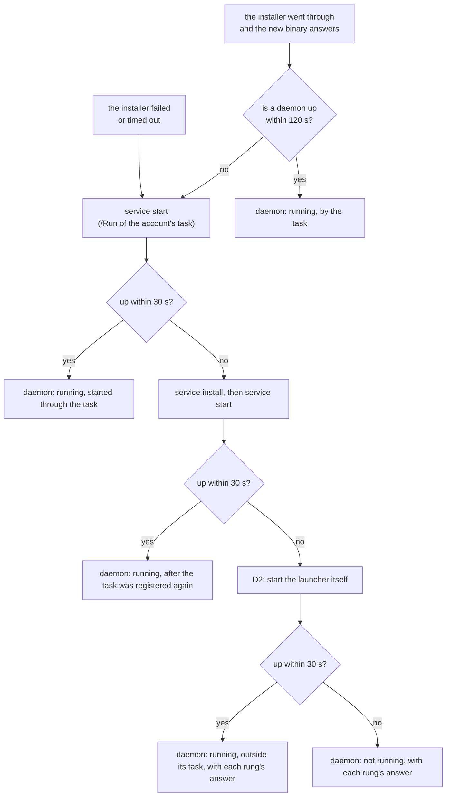

# FR-150: A per-user daemon is never left down by its own update or by a crash

**Issue:** [#4128](https://github.com/gjovanov/roomler-ai/issues/4128) · **Status:** claimed 2026-11-20; P0 read on a lab guest the same day; P1a in review (#4135), its cells read on candidates the same day; P1b in review (#4159), its cells read on candidates the same day. P2 follows, its own pull request
**Absorbs:** [#3507](https://github.com/gjovanov/roomler-ai/issues/3507) (the update path) and [#3295](https://github.com/gjovanov/roomler-ai/issues/3295) (the crash path), with the 2026-11-08 triage's re-spec of both
**Builds on:** #3292 and #3296 (the launcher `roomlerdw.exe` and the one-shot time triggers), #3801 and #3852 (each account's own task, `Roomler-<SID>`), #3230 (the per-Machine MSI's steps write a record), #3289 and #3323 (a Windows crash loop raises `rollback_failed` and stays up), #3302 and #3345 (the install record), [FR-67](FR-67-update-outcome-observability.md) (#1267, the install verdict)
**Related:** #3535 (two daemons on one host: closed as not planned, out of scope), #3509, #3340

**Anchors:** master `73f341a94` (2026-11-20), read in the tree.

## Goal

A per-user Windows daemon comes back after its own self-update and after a crash, with no sign-in, whatever token
registered its task. After this FR:

- **The task stays replaceable by its own account, whoever registered it.** The registration writes the task's
  security descriptor, so a task registered from an elevated token can be replaced, run and deleted by the person's
  own medium-integrity update, as a task registered at medium can today. A task an earlier elevated registration left
  is registered again by the next elevated `service install`, and until then each self-update over it still brings
  the daemon back.
- **One owner checks that the daemon came back after an update.** The post-install watcher waits for the new daemon.
  When none appears, it starts the daemon through the task, then registers the task again, then (D2) starts the
  launcher itself. The install record says whether the daemon runs and how it came back, not only whether the binary
  is right.
- **A failure reaches a log a person can read.** The per-user MSI's steps write a start line and an end line, with the
  error, into the person's own log, as the per-Machine steps have since #3230. The daemon names, at its start, a task
  its account cannot replace.
- **The launcher is the per-user supervisor.** It restarts a daemon that crashed or could not be started, with the
  service supervisor's backoff. It stays down after a clean stop, an update, a removal, a second daemon, a machine
  with no enrollment, an install in flight and a session that is ending.

The other per-user modes already have a supervisor for both cases (Evidence), so this FR changes Windows only.

## Evidence

### #3507: a task registered elevated strands every self-update

Measured 2026-11-05 on a throwaway Windows 11 guest. Per-user 0.4.199 was installed with `msiexec /i … /qn` from an
elevated session, enrolled, and started through its task. Three seconds later the updater found 0.4.200, spawned the
per-user MSI and exited. The MSI exited 0 at +6 s. No daemon ran at +45 s, +120 s, +240 s, +420 s or +15 min, and the
task kept its logon and OS-start triggers with no time trigger. `last-install.json` read `SucceededVerified`. The MSI's
verbose log held `CustomAction RegisterAutostart returned actual error code 1 but will be translated to success due to
continue marking`.

- The task's owner was Administrators. Administrators and SYSTEM had full access, and the account had read access only.
- `schtasks /Create /TN Roomler /XML <the kept XML> /F`, run at medium in the console session, answered `ERROR: Access
  is denied.` The same XML registered under another name from an elevated session, so the document was valid.
- **Control**, 13:00Z: a task registered at medium (owner: the account) came back after the same update at the first
  one-shot, 60 s after the registration.

The mechanism holds on master for the per-account task of #3801 (0.4.221 and later). From the code:

| Step of a per-user upgrade, at medium | On a task registered elevated | Anchor |
|---|---|---|
| The old product's `UnregisterAutostart` (`service uninstall`) deletes `Roomler-<SID>` | refused: the account may read the task but not delete it. `Return="ignore"` | `agents/roomlerd/wix/main.wxs:418-424`, `:573-575`; `agents/roomlerd/src/service/user_task.rs:178-190` |
| `RegisterAutostart` (`service install`) replaces `Roomler-<SID>` with `/Create /XML /F` | refused, `Access is denied`, and the XML is kept in `%TEMP%`. `Return="ignore"` | `main.wxs:403-409`, `:542-544`; `agents/roomlerd/src/service.rs:802-831` |
| The task that stays | the old definition: a logon trigger and the OS-start event, its one-shots long past | `service.rs:1300-1309` |
| The watcher, which is the OLD release's | `SucceededVerified`; after a success it starts nothing | `agents/roomlerd/src/post_install.rs:699-735` |
| `service start`, `stop` and `uninstall` | all act on the same task. `/Run` and `/End` succeed at medium (C2); `uninstall`'s delete is refused | `service.rs:844-864`, `:947-978` |

`main.wxs:46-50` states the assumption that breaks: "schtasks /Create /XML /F against a non-elevated task succeeds for
the user who owns it". The account does not own a task registered elevated.

An install from before 0.4.221 whose legacy `Roomler` was registered elevated came back at its 0.4.221 hop (from the
code): the new name was free, so the update's medium `/Create` registered `Roomler-<SID>` with the one-shots. The
legacy `Roomler` cannot be deleted at medium and stays. `register` warns about it (`user_task.rs:159-174`), and each
sign-in starts a second launcher, whose daemon exits 8 on the lock. **A task registered elevated on 0.4.221 or later
is stranded at every update.**

### Which installs register the task elevated

From the code on master (the wizard's manifest read from a shipped `roomler-setup.exe` too). A double-click of the
wizard and every self-update run at medium. An elevated registration comes from an administrator's own choice:

| Path | Registers the task elevated | When | Anchor |
|---|---|---|---|
| The wizard, double-clicked | no | its manifest declares no elevation level, and a limited wizard starts `msiexec` as a plain child | `agents/roomler-setup/src/package_step.rs:612-614` |
| The wizard started **Run as administrator** on the administrator's own account, role "this user only" | **yes** | the per-user card stays offered, and an elevated wizard runs `msiexec` itself, with no de-elevation. The docs endorse that start | `package_step.rs:498-529`; `agents/roomler-setup/src/role.rs:209-230`; `docs/installation.md:343-345` |
| The wizard's "Restart as administrator", then "this user only" | **yes** | the elevated copy preselects the system role but offers every card | `agents/roomler-setup/src/commands.rs:366-419` |
| The wizard elevated with another account's password | no | the per-user card is removed | `role.rs:226`; `commands.rs:316-337` |
| `install.ps1 -Role daemon-user` in an elevated shell | no, it refuses | `Test-Elevated` | `scripts/install.ps1:112-115`, `:204-214` |
| The same with `-AllowElevated` | **yes** | `Start-Process msiexec` inherits the token. Documented for UAC-disabled machines | `install.ps1:60-67` |
| `msiexec /i` of the per-user MSI, `roomlerd self-update` or `roomlerd service install`, by hand in an elevated shell | **yes** | nothing on those paths checks elevation | `app.rs:5849-5852`; `service.rs:769-831` |
| The tray's "Install auto-start" | only if the tray runs elevated | it runs `service install` with its own token | `agents/roomler-desktop/src/commands.rs:2409-2424` |
| A self-update and its watcher | no | the task runs at `LeastPrivilege` | `service.rs:1314`; `post_install.rs:699-735` |
| An MSI rollback's `AutostartBackOnRollback` | the install's token | `Impersonate='yes'` | `main.wxs:474-480` |

So the population is small and real: administrators who start anything named Setup as administrator and pick "this
user only", and hand installs. Three more things bear on the fix:

- `packaging/windows/README.txt:76-97` already calls the symptom "the rare Win11 ACL-locked-task scenario", with the
  manual fix (delete the task elevated, then `service install` from a normal shell), and `main.wxs:31-35` dates it to
  2026-04-29. It was this.
- `win_token::restricted_medium_copy` (`agents/roomlerd/src/win_token.rs:218-222`) makes a medium copy of an elevated
  token whose owner and default DACL are the user's. It was P1a's fallback in case a descriptor in the XML was not
  applied. C3 read that it is, so P1a's access check uses the copy instead (Design).
- The tests' task library treats every task whose principal is the caller as one the caller may change
  (`service/user_task.rs:442-444`), so it cannot model #3507. P1a gives it a task the caller may read and run but not
  replace, whose descriptor a replace keeps (C2, C5).

### #3295: a crash stays down until the next sign-in

Measured 2026-11-02 on released 0.4.196, a Windows 11 guest, a standard user: after `taskkill /F` (exit 1), and after
the console was closed (`0xC000013A`), the task read `Ready`, no process ran and the row was offline at +3 and +5
minutes. `<RestartOnFailure>` was registered with `Count` 10 and `PT1M` both times and restarted nothing
(`docs/installation.md:1012-1016`). Still true on master:

- The launcher waits for the daemon once and leaves with its code (`agents/roomlerdw/src/main.rs:98-101`). When it
  cannot start the daemon at all, for example because an EDR holds the replaced file at sign-in, it exits 127 at once
  (`main.rs:85-87`), and `LastTaskResult 127` is the only trace (`docs/installation.md:1022`).
- The watchdog's stall exit (`STALL_EXIT_CODE`, 2, `agents/roomlerd/src/watchdog.rs:103`) relies on a supervisor to
  bring a healthy copy back. This flavour has none, so a detected stall takes the device offline.
- A per-user daemon with no config exits 1. Only the Windows service's worker exits 78 for it
  (`agents/roomlerd/src/daemon_error.rs:106-137`, #4028), so a restarting launcher would loop on a machine not yet
  enrolled.

What changed since #3295 was filed: a tripped crash ladder on Windows raises `rollback_failed` and stays up, with no
download and no exit (`agents/roomlerd/src/app.rs:4440-4451`, #3289 and #3323). A restart loop can let `crash_count`
reach three without downgrading anything or taking the device down. #3295's second comment, a rollback that ended
offline, cannot happen on master for the same reason.

### What restarts a daemon today, per mode

| Mode | After a crash | After a self-update | Anchor |
|---|---|---|---|
| Linux user unit `roomler.service` | `Restart=always`, `RestartSec=5`, `RestartPreventExitStatus=7 8` | the package's steps (out of scope; #2154) | `agents/roomlerd/packaging/linux/roomler.service:27-29` |
| macOS LaunchAgent | `KeepAlive` with `SuccessfulExit` false | the package's steps (out of scope) | `agents/roomlerd/packaging/macos/com.roomler.agent.plist:34-37` |
| Windows service | its supervisor, 2 s doubling to 60 s | the watcher settles the service: started, then held at RUNNING | `agents/roomlerd/src/win_service/supervisor.rs:1103-1124`; `post_install.rs:668-697` |
| **Windows per-user task** | **nothing** (#3295) | the one-shots of a registration that worked; nothing checks | `service.rs:1254-1280`; `post_install.rs:699-735` |

## Design

### P1a: the task names its own security descriptor

`render_task_xml` (`service.rs:1285-1349`) writes a `<SecurityDescriptor>` into `<RegistrationInfo>`, after `<URI>`.
Its SDDL is built from the SID of the account the process runs as (`own_account`, `service.rs:713-715`), the account
the task runs as:

```text
O:<the account's SID>D:(A;;FA;;;SY)(A;;FA;;;BA)(A;;FA;;;<the account's SID>)
```

P0 read what Task Scheduler does with it (the field log has each cell):

- **A descriptor in the XML is applied when the task is created, and only then.** An elevated registration takes the
  owner and the three entries (C3), and so do a new task registered at medium (C3b) and a standard account's own
  registration (C3c). The account's access check over its task's file then grants the write and the delete a replace
  needs (C3c), which is what the start check below reads.
  A `/Create /F` over a task that is there leaves that task's descriptor as it was, whoever asks and whatever the XML
  says (C1b, C5).
- The scheduler keeps its own entries after ours: the ones the Tasks folder passes down, and read for the principal.
  The account ends with full access and the owner a medium registration gives it (C1), and the entries Administrators
  and SYSTEM hold are unchanged.

| Who registers | Owner | The account's access | Its own update can replace the task |
|---|---|---|---|
| medium, master | the account | full (C1) | yes |
| elevated, master | Administrators | read (C2) | **no** (#3507) |
| medium, P1a | the account | full (C3b; a standard account's own, C3c) | yes |
| elevated, P1a, a new task | the account (C3) | full | yes |
| elevated, P1a, over a task an elevated master registered | Administrators: the replace keeps it (C5) | read | not until the repair below |

**Why full access is safe.** The task runs as the account itself, at `LeastPrivilege` (`service.rs:1310-1316`). At
medium, Task Scheduler refuses a document at `HighestAvailable` (C4), and one whose principal is SYSTEM or another
account, as a new task and over a task the account has full access to (C4b). So full access gives the account nothing
beyond what every medium registration gives it today.

**The repair of a task an earlier elevated registration left.** An elevated run of `service install` from P1a's release
(the wizard started as an administrator, `install.ps1 -AllowElevated`, or `roomlerd service install` in an elevated
shell) replaces the task, and the task keeps its descriptor (C5). So when the access check below says the account still
cannot replace it, `register` deletes the task and registers it again, and the descriptor applies (C5c).
`IRegisteredTask::SetSecurityDescriptor` repairs it in place too (C5b), but needs Task Scheduler's COM bindings, which
the agent does not carry; the delete and the create go through the `Library` seam `register` already uses
(`user_task.rs:91-113`). A daemon running under the deleted task keeps running (C5d), and a one-shot of the new task
finds the instance lock held (`instance_lock.rs`) and exits. `register` then deletes the account's legacy `Roomler`
too (`user_task.rs:159-174`), which no medium process can.

**A self-update over a task its account cannot replace still comes back.** The update's `RegisterAutostart` runs the
new package's launcher (`main.wxs:403-409`), so the first hop onto P1a already runs P1a's `service install`. At medium
its replace is refused, but a medium process may still run that task (C2) and register a task of its own. So
`service install` then registers `Roomler start-<SID>`, a task of the account's own:

- the same three one-shots as the task's own (`service.rs:1266`), each with an end boundary an hour after the
  registration, so a sleep inside that hour keeps them (`StartWhenAvailable`);
- one action, the launcher with `service start` (`service.rs:844-864`): a `/Run` of the account's task, so the daemon
  runs under its own task, and its `IgnoreNew` drops the later starts (C6b);
- `DeleteExpiredTaskAfter`, so it deletes itself once it has expired (C6b, C6c).

It adds no custom action and no relaunch owner: the one-shots stay `service install`'s, in a task the account may
write. The step still fails, so the person's log says why (below), and the next elevated `service install` repairs the
task and deletes this one. Any refused replace of a task that is there leaves it, on an enrolled device only (a config
exists); the step names the repair only where the account cannot replace its task.

**The daemon names such a task at its start.** A per-user daemon reads its own task's descriptor from the task's file
under `%SystemRoot%\System32\Tasks` (the scheduler's copy in the registry is not readable at medium, C6) and checks it
with a medium copy of its own token (`win_token::restricted_medium_copy`, `AccessCheck`). When its account cannot
replace the task, it logs one WARN at start with the repair, and `service status` says so. Nothing is sent to the
server (D5). `register` asks the same check.

**Kill switch:** `ROOMLERD_TASK_SD=0` in the environment of `service install`. It registers master's task: no
descriptor in the XML, no repair and no `Roomler start-<SID>`.

### P1a: the per-user MSI's steps write their record

#3230 gave the per-Machine MSI's steps a start line and an end line (`crates/agent-core/src/logging.rs:602-660`, begun
at `app.rs:1608-1622`, ended at `app.rs:1405-1409`), because Windows Installer throws a custom action's stdout and
stderr away. The per-user steps keep the profile's log (`app.rs:1430-1436`) and write no record. So a refused
registration leaves nothing but the MSI log's `returned actual error code 1`.

P1a gives the per-user steps the same record, in the person's own log, the dated file the daemon writes:
`service install`, `service uninstall`, `service start` (what `Roomler start-<SID>` runs), `service stop` with and
without `--for-upgrade`, and `cleanup-legacy-install --target-flavour perUser`. They get it through a predicate of
their own, so that `is_installer_step` and #3702's migration rule (`app.rs:1560-1571`) are unchanged. A person who
runs the same verb by hand gets the same two lines.

### P1b: the watcher owns the per-user relaunch

`ensure_service_running` (`post_install.rs:668-697`) settles the per-Machine service after every verdict. For per-user
it asks the task for a start only after a failed install (`:707-735`), because "exit 0 means the new task is
registered … and its one-shots do this". #3507 is a successful install that registered nothing. P1b gives the per-user
arm the service's contract: after every verdict, the daemon runs, or the record says why not.



- **Up** is the daemon's stop event held for this config (`user_stop_event_held`, `service.rs:877-881`, FR-97 P4d). The
  daemon creates it at start, in the person's session, where the watcher runs too.
- **120 s** is past the first one-shot, which fires 60 s after `RegisterAutostart` (`service.rs:1266`), with room for
  a slow guest.
- **The first update onto P1b runs the old release's watcher.** `post_install.rs:703-705` says the same of #3292. So
  P1b protects the hops after it, and P1a protects the first one: through the task's own one-shots where the account
  can replace it, and through `Roomler start-<SID>` where it cannot (D1).
- **The record.** `last-install.json` (`post_install.rs:125-137`) gets a field `daemon`: running or not running, how it
  came back, and each rung's answer. It is additive in the file and on the wire (`NodeStatus.last_install`, FR-67 P3),
  and the verdict words stay what they are.

**Kill switch:** `ROOMLERD_WATCHER_RELAUNCH=0` in the daemon's environment, which the watcher inherits. The per-user
arm is then master's: a start only after a failure.

### P2: the launcher supervises the daemon

`roomlerdw.exe` (`agents/roomlerdw/src/main.rs:65-102`) waits for the daemon once and leaves with its code. P2 makes it a
loop. The launcher's choices become one more row of `Install`'s table (`service.rs:29-43`), on purpose:

| The daemon's end | The launcher | Why |
|---|---|---|
| 0 | leaves | a clean stop, `service stop`, the MSI's `StopOldDaemon`, an update's exit (`agents/roomlerd/src/updater.rs:3207-3224`) |
| 7 | leaves (D3) | the server removed the device, as the Linux units do |
| 8 | leaves | another daemon holds the lock |
| 9 | leaves | a requested restart, whose caller starts the task again (`service.rs:293-308`) |
| 78 | leaves | no enrollment: P2 makes the task's `run` exit 78 for it too (`daemon_error.rs:106-137`) |
| the install-in-flight code (new) | leaves | the daemon found an install in flight at its start (below) |
| any code while the session ends (`SM_SHUTTINGDOWN`) | leaves | never start into a closing session |
| anything else: 1, 2 (a stall), a panic's 101, an exception code | restarts after the service supervisor's backoff, 2 s doubling to 60 s (`supervisor.rs:1103-1124`), reset after a run of 5 minutes | a crash. The watchdog's stall exit relies on this |
| a spawn that fails (127 on master) | tries again with the same backoff | an EDR that holds the replaced file only delays the start |

- **The crash ladder.** A launcher restart counts as a crash, because it is one. Three inside ten minutes on a version
  not yet promoted trip `should_rollback` (`crates/agent-core/src/config.rs:2705`), and on Windows the daemon raises
  `rollback_failed` and stays up, with no download (`app.rs:4440-4451`).
- **An install in flight.** The launcher must not touch the data tree (`.claude/rules/installers.md`), so the daemon
  decides. A `run --supervisor task` that starts while the update-attempt marker is fresh (`updater.rs:230-256`; the
  MSI's `service stop --for-upgrade` touches it too) and Windows Installer's execution mutex is held exits with a new
  stay-down code before it takes the lock. The new task's one-shots start it after the install.
- **Sign-out.** The launcher is shut down after the daemon (`main.rs:138-149`). After the daemon's exit it reads
  `GetSystemMetrics(SM_SHUTTINGDOWN)` and leaves while the session ends.
- **`schtasks /End` stays a hard stop.** It ends the launcher, and the launcher's kill-on-close job takes the daemon
  (`main.rs:104-136`). Nothing restarts it, because the launcher has gone.

**Kill switch:** `ROOMLERDW_SUPERVISE=0` in the person's environment, which the task's process inherits (D4). The
launcher then waits once and leaves with the daemon's code, as on master.

### Tests

| Phase | Test | Pins |
|---|---|---|
| P1a | `the_task_names_its_own_descriptor` | the SDDL in the rendered XML, built from the account's SID, in `<RegistrationInfo>` after `<URI>` |
| P1a | `the_switch_registers_masters_task` | `ROOMLERD_TASK_SD=0`: master's XML, no repair, no `Roomler start-<SID>` |
| P1a | `an_elevated_install_registers_a_locked_task_again` | over the fake library, where a replace keeps a task's descriptor (C5): elevated, the task deleted and registered again; at medium, the replace refused and the task left |
| P1a | `a_refused_replace_leaves_a_start_of_the_accounts_own` | `Roomler start-<SID>` registered when a replace of the account's task, which is there, was refused on an enrolled device (a config exists), the repair named only where the account cannot replace the task; none without a config, for a task that is not there, or with `ROOMLERD_TASK_SD=0`; a later refused update replaces it; deleted by a later `register` that succeeds and by `unregister`, even where the task itself cannot be deleted |
| P1a | `the_start_task_runs_the_launchers_start_and_goes_by_itself` | its XML: the one-shots with their end boundaries, `DeleteExpiredTaskAfter`, the launcher with `service start`, no logon or boot trigger |
| P1a | `every_per_user_msi_step_writes_its_record` | every per-user custom action of `main.wxs` is a step that writes the record, as `the_installer_role_is_what_each_msi_runs_as_local_system` holds the per-Machine ones |
| P1a | `a_task_the_account_cannot_replace_is_named_at_start` | the access check's answer, with a medium copy of the test's own token, over C2's descriptor (no), C1's and P1a's (yes) |
| P1b | the relaunch ladder over a seam (look, start, register, launch, clock), as `settle_service` is over `ServiceHandle` (`post_install.rs:902-904`) | each rung; a daemon that comes up at each rung; none; the failed-install entry |
| P1b | the record's `daemon` field | round-trips, and a record without it still parses |
| P2 | `the_launchers_ends_agree_with_the_install_table` | every code in the table above, against `Install`'s doc table and `worker_end_is_no_crash` (`supervisor.rs:1078-1090`) |
| P2 | the loop over a seam (spawn, wait, session ending, sleep) | the backoff and its reset, a failed spawn retried, an ending session leaves |
| P2 | `a_task_run_with_no_config_exits_78`, `a_start_inside_an_install_stays_down` | the daemon's two new stay-down ends |

A test over behaviour master already has is shown failing on master first.

### Lab cells

The lab is a throwaway Windows 11 guest on the vmtest host, one at a time, with two accounts: an administrator with UAC
on, and a standard user. It reaches per-user installs from an elevated and from a medium token, an account with no
admin rights, a local policy (`ConsentPromptBehaviorUser=0`, AppLocker), and self-updates between released builds and
between candidates. It does not reach a domain GPO, an EDR or a TLS-inspecting middlebox. Those are the operator's
corporate laptops, and this FR makes no per-user install on them.

| Cell | Phase | What | On master or the current release | With the phase |
|---|---|---|---|---|
| C1 | P0 | the descriptor of a task registered at medium: owner and DACL | **read**: owner the account; full access for it, passed down from the Tasks folder's entry for the creator, and read beside it; Administrators and SYSTEM all but execute and delete-child | |
| C1b | P0 | a medium `/Create /F` whose XML carries the descriptor, over C1's task | **read**: accepted, and the task's descriptor left as it was | |
| C2 | P0 | the same, registered elevated; then from medium on it: `/Run`, `/End`, `/Delete`, `/Create /F` | **read**: owner Administrators, read for the account; `/Run` and `/End` succeed, `/Delete` and `/Create /F` are refused (`Access is denied`, #3507) | |
| C3 | P0 | an elevated registration whose XML carries the descriptor: is it applied, the owner too? | **read**: applied, the owner too, our three entries ahead of the scheduler's | |
| C3b | P0 | a new task registered at medium (an administrator's filtered token) whose XML carries the descriptor | **read**: applied, the owner too; a medium replace with no descriptor and a medium delete then succeed | |
| C3c | P0 | the same from a standard account, in `render_task_xml`'s shape; then its replaces with and without the descriptor, its access check over the task's file, its own delete | **read**: master's registration gives C1's descriptor; P1a's is applied, the owner too; the access check grants write and delete; both replaces succeed and leave the descriptor as it was; its own delete succeeds | |
| C4 | P0 | a medium `/Create` with `HighestAvailable` over a task the account has full access to | **read**: refused, as a new task and over that task | |
| C4b | P0 | a medium registration whose principal is SYSTEM or another account, as a new task and over a task the account has full access to | **read**: refused each time, and the task's principal left as it was | |
| C5 | P0 | an elevated `/Create /F` with the descriptor, over C2's task: is the descriptor replaced? | **read**: no. The replace succeeds and the descriptor stays: owner Administrators, read for the account | |
| C5b | P0 | the repair by `IRegisteredTask::SetSecurityDescriptor`, elevated, over C2's task | **read**: applied in place, the owner too, and a medium replace then succeeds | |
| C5c | P0 | the repair by a delete and a new registration with the descriptor, elevated | **read**: applied, and a medium replace and a medium delete then succeed | |
| C5d | P0 | an elevated delete of a task while its instance runs | **read**: the instance's process runs on | |
| C6 | P0 | the task's file descriptor, read and checked by the account at medium | **read**: at medium the task's descriptor (COM) and its file's are readable, the registry copy is not; the access check with the medium token says what the replace then does | |
| C6b | P0 | a medium task whose one-shots `/Run` a task the account cannot replace, with end boundaries and `DeleteExpiredTaskAfter` | **read**: the first one-shot started the task; the second was dropped by its `IgnoreNew` (`0x800710E0`); the medium task was gone after its last end boundary | |
| C6c | P0 | how such a task goes, read by its query, COM, its file and its registry key | **read**: query, COM and file gone within seconds of its end boundary; the registry key stays until a `/Delete` of the name, which succeeds | |
| C6d | P0 | the same name registered again at medium after it went | **read**: accepted over the key it left; it ran its one-shot and went again | |
| C7 | P1a | per-user installed from an elevated token, then a self-update | **RED**, read: 0.4.227 → 0.4.228, no daemon at +16 min, the record `SucceededVerified` | candidate A → B: back within the one-shots; the task's descriptor gives the account full access |
| C7b | P1a | the first hop: a task 0.4.228 registered elevated, updated to candidate A | the same RED | **GREEN**, read on A and on A2: back at the first one-shot (61 s and 60 s), through `Roomler start-<SID>`, which is gone after its end; on A2's hop it was gone 4 min after it was registered (field log) |
| C8 | P1a | the same from a medium token (control): an administrator's filtered token, and a standard account signed in at the console | back at the first one-shot | the same |
| C9 | P1a | a refused registration | **RED**, read: no line in any log of ours | **GREEN**, read: `installer step failed` in the person's log, its error naming the task the account cannot replace, the elevated registration that owns it and the repair; the daemon's start WARN |
| C10 | P1a | the repair: an elevated `service install` from A over a task a release before P1a registered elevated | | **GREEN**, read: the task registered again with the descriptor, the legacy task gone, the running daemon left running, and the next update (A → B) came back at the first one-shot |
| C11 | P1b | the second hop on a task the account cannot replace, with `ROOMLERD_TASK_SD=0` so no `Roomler start-<SID>` is left: registered elevated by 0.4.228, updated to A, then to B | **RED**, read on A → B: offline at +15 min, and no log line after the install | **GREEN**, read on A2 → B2: back 122 s after the install, through the account's task; the record `"how": "started through the task"` |
| C12 | P1b | the task deleted after a successful install | **RED**, read on A → B: no daemon and no task at +10 min, the row offline, the record silent on the daemon (the next sign-in not tried) | **GREEN**, read on A2 → B2: back 153 s after the install; the record `"how": "after the task was registered again"` |
| C13 | P2 | `taskkill /F` of the daemon | **RED**: no daemon at +5 min | the row back online within a minute, with no window and no sign-in |
| C14 | P2 | `service stop`, a removal (exit 7), an update | stays down | stays down; after the update the new task's one-shot starts it |
| C15 | P2 | three forced kills inside 10 min on a version not yet promoted | | `rollback_failed` raised, the daemon runs, nothing downloaded |
| C16 | P2 | a sign-out and a sign-in; a restart | | `crash_count` stays 0, and no daemon starts into a closing session |
| C17 | P2 | the daemon's file held at sign-in, so the launcher cannot start it | **RED**: `LastTaskResult 127`, offline until the next sign-in | the daemon starts once the file is free |
| C18 | P2 | a fresh per-user MSI with no enrollment, at sign-in | the daemon exits 1 once | it exits 78, the launcher leaves, no loop |
| C19 | all | a real self-update from released 0.4.228 to candidate A and on to B, per-Machine and per-user | | both flavours on B and online; each record right |

Candidates are built with `release-agent.yml` and `publish_release=false`, from a throwaway branch, with versions
the release owner names.

C11's RED is read before C10, because C10 unlocks the task. The repair runs from an elevated prompt in the person's
own session: from an elevated Windows OpenSSH session on a workgroup machine, `USERDOMAIN` reads `WORKGROUP`, the
task's principal becomes `WORKGROUP\<user>`, which maps to no SID, and the registration fails (master's
`current_user_qualified`, field log).

## Phases

| phase | what | kill switch, or back-out | status |
|---|---|---|---|
| P0 | C1–C6 on a lab guest, read before P1a is built | read only | **read** on 2026-11-20, with C1b–C6d and the standard account's C3c (field log) |
| P1a | the task's own descriptor, its repair and `Roomler start-<SID>`; the per-user steps' record; the start WARN and `service status`; their tests | `ROOMLERD_TASK_SD=0` | in review (#4135); C7 RED on the release, C7b, C9 and C10 GREEN on candidates (field log); C7 and C8 on candidates from its head next |
| P1b | the watcher's relaunch ladder; the record's `daemon` field; their tests | `ROOMLERD_WATCHER_RELAUNCH=0` | in review (#4159); C11 and C12 GREEN on candidates (field log) |
| P2 | the launcher's loop and its ends; exit 78 for the task's `run` with no config; the install-in-flight end; their tests | `ROOMLERDW_SUPERVISE=0` | not started; after P1a, independent of P1b |
| Field | each phase's cells on its candidates, then C19 on the release | read only | P1a's and P1b's cells being read (field log) |
| Docs | each phase's docs in its own pull request | none | not started |

- **P1a leaves working by itself**: no new task is registered that its account cannot replace, a self-update over
  one that was still brings the daemon back, a registration that is refused says so in the person's log, and an
  elevated run repairs the task. Acceptance: AC2–AC5.
- **P1b leaves**: a daemon that did not come back after an update brought back, from the hop after P1b, and the record
  says so. Acceptance: AC6.
- **P2 leaves**: a crash restarted, the deliberate ends kept down. Acceptance: AC7, AC8.

The docs:

- `docs/installation.md`, "What the per-user Scheduled Task runs (#3292)" (`docs/installation.md:939-1031`): the
  descriptor and the repair; the watcher's ladder as a mermaid flow; the launcher's ends as a table; "The task is not
  a supervisor" (`:1012-1016`) and the known gap of the held file (`:1022`) rewritten. "A self-update whose install
  succeeds brings the device back by itself" (`:969-978`) says what it takes. The wizard's "Run as administrator"
  (`:343-345`) says what it does to a per-user task until P1a, and that P1a's release repairs it.
- `agents/roomlerd/packaging/windows/README.txt:76-97`: "the rare Win11 ACL-locked-task scenario" is named for what it
  is, with P1a's repair.
- `.claude/rules/installers.md`: the per-user task and `<RestartOnFailure>` bullets.
- The module docs: `main.wxs:24-50` (`Return="ignore"` and "Why this works without UAC"), `service.rs:29-43` (the
  launcher's row), `agents/roomlerdw/src/main.rs:1-44`.
- `docs/README.md`: the `installation.md` row names the per-user lifecycle.

## Acceptance criteria

- [x] **AC1** (P0): C1–C6 are read, the field log says what each read, and P1a's descriptor gives the account the
  owner and the full access C1 reads a medium registration gives it. Read 2026-11-20, with C1b–C6d and C3c:
  [#4128's P0 comment](https://github.com/gjovanov/roomler-ai/issues/4128#issuecomment-7035472044) and the field log.
- [x] **AC2** (#3507 RED): C7 fails on the current release: a self-update of a per-user install registered from an
  elevated token leaves no daemon at +10 min while the record reads success. Read 2026-11-20 on 0.4.227 → 0.4.228:
  no daemon at +16 min, the record `SucceededVerified`
  ([P1a's cells](https://github.com/gjovanov/roomler-ai/issues/4128#issuecomment-7047442304)).
- [ ] **AC3** (#3507 GREEN, P1a): C7 and C8 pass on candidates: a self-update brings the daemon back within the
  one-shots, with the task registered elevated and at medium.
- [x] **AC4** (P1a, the log): C9 passes: a refused registration reaches the person's log with its error, instead of
  being discarded, and the daemon names at its start a task its account cannot replace. Read 2026-11-20 on
  candidate A ([P1a's cells](https://github.com/gjovanov/roomler-ai/issues/4128#issuecomment-7047442304)).
- [x] **AC5** (P1a, the repair): C10 passes. Read 2026-11-20 on candidates A and B
  ([P1a's cells](https://github.com/gjovanov/roomler-ai/issues/4128#issuecomment-7047442304)).
- [x] **AC6** (P1b): C11 and C12 pass, and the record says whether the daemon runs and how it came back, not only
  whether the binary is right. Read 2026-11-20 on candidates A2 → B2 (P1b at `faca24a26`): C11 back 122 s after the
  install, `"how": "started through the task"`; C12 back 153 s after it, `"how": "after the task was registered
  again"`, after its RED on A → B
  ([P1b's cells](https://github.com/gjovanov/roomler-ai/issues/4128#issuecomment-7048905691)).
- [ ] **AC7** (#3295 RED then GREEN, P2): C13 fails on the current release and passes on the candidate: a per-user
  daemon that crashes is back online within a minute, with no window and no sign-in.
- [ ] **AC8** (P2): C14–C18 pass, and a real crash loop still ends in #3289's handling.
- [ ] **AC9** (tests): the tests above pass in CI on the lanes that build them, and those over master's behaviour are
  shown failing on master first.
- [ ] **AC10** (the update path stays whole): C19 passes.
- [ ] **AC11** — Docs updated in house style (tables, the watcher's ladder as a mermaid flow, `file:line` anchors):
  the sections above in `docs/installation.md`, the rule and the module docs, linked from `docs/README.md`.

## Decisions (operator, 2026-11-20)

The operator answered all five as recommended ("All A", through the hub). The text below is what was asked, and each
recommendation is now the decision.

- **D1. The first hop onto P1b, for a task its account cannot replace.** That hop runs the old release's watcher,
  which starts nothing after a success, and P1a's medium registration is refused on that task. Recommended: accept one
  stay-down until the next sign-in on that hop, named in the person's log (P1a) and at the daemon's next start; the
  hops after it come back through P1b. Fallback: a post-commit action in the new package (after `InstallFinalize`,
  `asyncNoWait`) that waits for the installer to end and then brings the daemon back. It covers the first hop and an
  upgrade by hand, at the price of one more custom action and a second relaunch owner.
  **Since P0:** the stay-down does not happen where `service install` can register a task of the account's own. A
  medium process may run a task it cannot replace (C2), so P1a's `service install` leaves `Roomler start-<SID>`, whose
  one-shots run it (C6b, the Design). That covers the first hop and an upgrade by hand with no new custom action and
  no second relaunch owner, so the fallback is not built. The stay-down D1 accepted is left for an account that cannot
  register even that task.
- **D2. The watcher's last rung.** Recommended: when the task cannot start the daemon, the watcher starts the launcher
  itself, and the record says the daemon runs outside its task, and why. Fallback: stop at the task, and record
  "not running" with each rung's answer.
- **D3. The launcher on exit 7.** Recommended: stay down, as the Linux units and the task do today. A removed device
  that restarts only hears the server's goodbye again. Fallback: restart it, as the Windows service's supervisor does.
- **D4. The launcher's kill switch.** Recommended: `ROOMLERDW_SUPERVISE=0` in the person's environment, which needs no
  file and nothing in the data tree. Fallback: a value under `HKCU\Software\Roomler`.
- **D5. Where a task its account cannot replace is reported.** Recommended: the daemon's start WARN and `service
  status`, nothing on the wire. Fallback: also a field on `NodeStatus`, so the device page can say it.

## Out of scope

- Two daemons on one host (#3535, closed as not planned).
- The Windows service flavour, which its supervisor restarts and the watcher settles.
- Linux and macOS, whose per-user modes systemd and launchd restart (Evidence). Their update relaunch is the package's
  (#2154 for Linux).
- The verdict's words: "installed" and "running" as two statuses belong to FR-67 (#1267). This FR adds a field.
- #3509 (GitHub's cached 504), the #3289 and #3340 hop reads, and the updater's download path.
- The manifest's signing.
- A per-user install into another account's profile under over-the-shoulder credentials: the wizard already leaves only
  the system role for it (`role::RoleLimit`).

## Field log

| date | what | result |
|---|---|---|
| 2026-11-20 | claimed from #3507 and #3295, after the operator's ruling of 2026-11-19 ("planned and implemented") | spec only |
| 2026-11-20 | which installs register the task elevated, read in the code and in a shipped wizard's manifest | a double-click and every self-update run at medium; the elevated wizard on an administrator's own account, `install.ps1 -AllowElevated` and hand installs in an elevated shell register it elevated (Evidence) |
| 2026-11-20 | P0, C1–C6, on a throwaway Windows 11 guest (build 26200): an administrator with UAC on, from an elevated shell and from the person's console session at medium. The probe tasks ran a sleeper, never the daemon | each cell as the cells table says. What changes P1a: a descriptor in the XML is applied only when a task is created (C3, C1b, C5), so an elevated replace repairs nothing, and a medium process may run and end a task it cannot replace (C2). The registry copy of a task's descriptor is not readable at medium, its file's is (C6). A first try at C4 with a SYSTEM principal was refused by the schema (`LogonType` `ServiceAccount`), not by the scheduler; C4b redid it |
| 2026-11-20 | P0's follow-ups, the same guest: C1b, C3b, C4b, C5b–C5d, C6b–C6d | as the cells table says. The repair works by a delete and a create (C5c) and by `SetSecurityDescriptor` (C5b); a medium task of the account's own brings back a daemon whose task the account cannot replace, and goes by itself (C6b–C6d). So P1a gains the repair and `Roomler start-<SID>` (Design), and D1's stay-down is avoided |
| 2026-11-20 | C3c, a standard account (a throwaway local user in Users only) | **not read**: its process never started. From a task with a stored password it did not run within 120 s (no batch logon right), and `Start-Process -Credential` from the person's session answered `Access is denied`. Owed before P1a ships: the standard account's own registration with the descriptor |
| 2026-11-20 | C3c, read: the same throwaway standard account, given the batch logon right for this cell only, its process started by a task with its stored password (medium, no Administrators in its token, a batch logon in session 0). The right, the account and the tasks were removed after it | as the cells table says: P1a's descriptor goes into a standard account's own registration and is applied, owner included, and every later replace and delete of its own succeeds. The caller's logon was a batch one, not an interactive one: C3b read an interactive caller (an administrator's filtered token), and C8 reads a standard account signed in at the console |
| 2026-11-20 | C7 RED and C9 RED: on a second throwaway guest (Windows 11, build 26200), the released 0.4.227 installed per-user from an elevated prompt, then self-updated to the released 0.4.228 from the production feed | the MSI completed, and its `UnregisterAutostart` and `RegisterAutostart` returned 1, which it translated to success. The record read `SucceededVerified`. The task stayed 0.4.227's, owned by Administrators and readable only by the person. There was no daemon from +30 s to +16 min, the row stayed offline, and no log of ours said the registration was refused ([P1a's cells](https://github.com/gjovanov/roomler-ai/issues/4128#issuecomment-7047442304)) |
| 2026-11-20 | C7b and C9 GREEN: candidate A (P1a at `2408d7948`) updated over that task, and later B → A2 (P1b at `faca24a26`) over the same task | A's `service install` was refused, logged `installer step failed` with the task and the repair, and registered `Roomler start-<SID>`, owned by the account. Its first one-shot started the daemon 61 s after the old one stopped, and its `IgnoreNew` dropped the later two. The daemon's start WARN named the elevated owner. B → A2 came back the same way, at the first one-shot |
| 2026-11-20 | C11 RED: A → B with `ROOMLERD_TASK_SD=0`, over the same task | the record read `SucceededVerified` for B. B's `service install` failed with `Access is denied`, which is now in the person's log. No start task was registered. At +15 min there was no daemon and no log line after the install, and the row was offline |
| 2026-11-20 | C10 GREEN: the repair, A's `service install` from an elevated prompt in the person's session, over the same task, with a legacy `Roomler` task registered elevated beside it | it exited 0 and registered the task again with the descriptor. The account owns the task with full access, the start task and the legacy task are gone, and the running daemon ran on. The next update (A → B, at medium) registered the task with exit 0, and the daemon was back at the first one-shot. A first try from an elevated Windows OpenSSH session failed: there the account read `WORKGROUP\<user>`, which maps to no SID (Lab cells) |
| 2026-11-20 | C10's A → B: on a healthy per-user update, the person's log read `ERROR installer step failed: roomlerd service stop --for-upgrade exit_code=1` | the old release's `UnregisterAutostart` had already ended and deleted the task, so `StopOldDaemon` found nothing to stop, and its hard stop failed. The MSI ignores that exit code, but P1a's step record made it an ERROR. Fixed on #4135 (`618b0c2a3`): with nothing left to stop, the step is done. Over a task the account cannot replace, that step exited 0 (C7b, C11), since the old daemon was up |
| 2026-11-20 | P1b's cells, the same guest: 0.4.228 installed per-user elevated over B, so its task is locked again, then C7b on A2 (P1b at `faca24a26`) | A2's `service install` was refused and registered `Roomler start-<SID>`, and the daemon was back by its +1 one-shot, 60 s after the install. The start task's file, `TaskCache\Tasks` key and COM entry were gone 4 min after it was registered, a minute after its +3 one-shot, while its `TaskCache\Tree` key stayed and its +10 one-shot still ran `service start`. The cause is not known; no code of ours deletes a task by its prefix. An hour later it was still gone, elevated and as the person ([P1b's cells](https://github.com/gjovanov/roomler-ai/issues/4128#issuecomment-7048905691)) |
| 2026-11-20 | C7c: A2's `service install` at medium over the same locked task, an hour later | refused (exit 1) as in C7b, and it registered `Roomler start-<SID>` again over the `Tree` key the first one left. Its one-shots ran `service start` at +1, +3 and +10 min, each `0x0`. It was still there at +12 min, and the next update's `service uninstall` deleted it |
| 2026-11-20 | C11 GREEN: A2 → B2 with `ROOMLERD_TASK_SD=0`, over the same task | B2's `service install` was refused with `Access is denied`, and no start task was registered. P1b's watcher found no daemon 120 s after the install and ran `service start`. The daemon 0.4.253 was up 122 s after the install, as the person, under the account's task, and the row came online. The record read `SucceededVerified` with `"daemon": {"running": true, "how": "started through the task"}` |
| 2026-11-20 | C12 RED: A, installed at medium so the account owns its task, updated to B; a lab task running as SYSTEM deleted `Roomler-<SID>` as soon as the record's verdict was written | B's install succeeded and the record read `SucceededVerified`, with no word on the daemon. The task was deleted 0.06 s after the verdict, before its first one-shot. There was no daemon and no task to +10 min, and the row stayed offline on A. The next sign-in was not tried |
| 2026-11-20 | C12 GREEN: A2 → B2, with the same deletion | P1b's watcher: not up 120 s after the install; `service start` refused, since no auto-start task is registered; not up 30 s later; `service install`, which registered the task again, owned by the account; `service start`. The daemon 0.4.253 was up 153 s after the MSI ended, as the person, and the row came online. The record read `"daemon": {"running": true, "how": "after the task was registered again"}`. Both of C12's hops logged the false `service stop --for-upgrade` ERROR above: they start from a task the account owns, and their candidates predate `618b0c2a3` |
