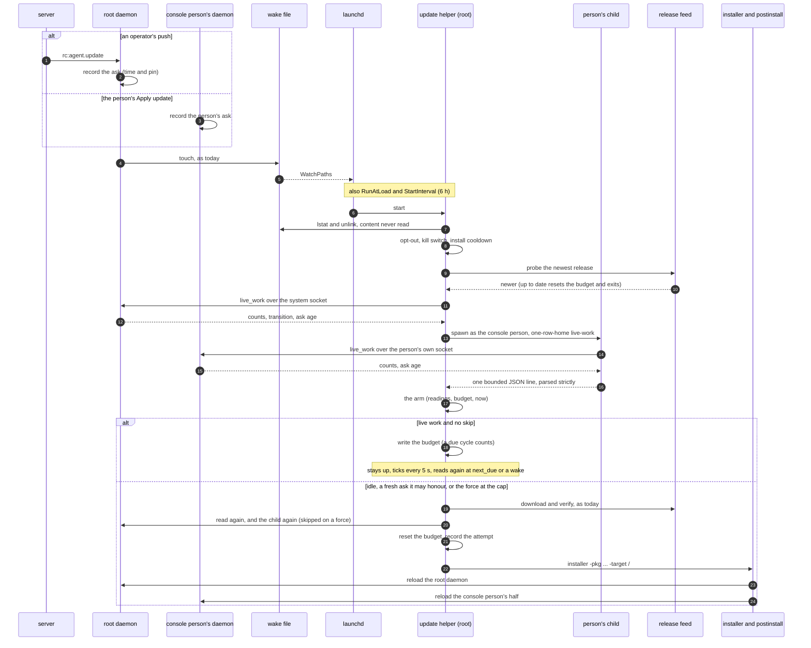

# FR-151: On a Mac, an update waits for live work

**Issue:** [#4288](https://github.com/gjovanov/roomler-ai/issues/4288) · **Status:** closed 2026-11-25, every criterion ticked. Claimed 2026-11-22; P0 done (#4243's design, its ruling and the operator's answers); P2 merged 2026-11-22 (#4299, `04ea2d1bf`) and served from 2026-11-23; P1 merged 2026-11-24 (#4297, `93a9ec85f`), released in 0.4.235 and field-read on twelve lab Macs the same day; P3 not built, by D1; the docs merged 2026-11-25 (#4422, `de523a98f`, AC11)
**From:** [#4243](https://github.com/gjovanov/roomler-ai/issues/4243): its [design](https://github.com/gjovanov/roomler-ai/issues/4243#issuecomment-7078923220), the coordinator's [ruling](https://github.com/gjovanov/roomler-ai/issues/4243#issuecomment-7079182419) and the operator's [answers](https://github.com/gjovanov/roomler-ai/issues/4243#issuecomment-7079545326). Where they differ, the latest wins.
**Builds on:** #3429's slice 1 (#4225: `busy.rs`, `updater::periodic_gate`, `decide_defer`), #4245 and #4253 (`UpdateAsk`, `cycle_arm`, `CycleArm::defers_after`), [FR-147](FR-147-root-out-of-homes-macos.md) (the person's child and its envelope), [FR-5](FR-5-macos-unattended-update-chain.md) (the macOS update half)
**Related:** #4244 (the Windows gap, FR-94), FR-43 and FR-141 (the Mac's shapes)

**Anchors:** master `11c2308b0` (2026-11-22), read in the tree.

## Goal

On Windows and Linux an automatic update waits for live work: a remote-control session, an SSH connection, a Fleet
RPC run, a transfer or a recording defers it by the hour, seven times at most, and then it installs with a warning that
names what it cuts (#3429's slice 1, and #4253 for the check after a long outage). A Mac does not wait. Its root update
helper (`com.roomler.update`) installs as soon as it runs, and the package's postinstall then restarts both halves,
whatever they serve. So an update cuts a session on a Mac as it did on every OS before #4225.

After this FR a Mac follows the same rule. The helper reads both halves that the install restarts before it installs,
defers on the same budget, and only an operator's push or the console person's own ask skips the wait, each within
what it may cut.

## Evidence

The helper reads no busy state, and nothing that reaches it carries any:

- **The agents install nothing on a Mac.** `run_periodic` forwards each ask to the wake file and returns into
  `forward_triggers` (`agents/roomlerd/src/updater.rs:3323-3325`, `:3954`, `:3968`). It never forwards its own 4 h timer.
- **The helper goes straight from the wake to `installer(8)`.** `run_update_helper` (`updater.rs:4118`) unlinks the
  wake file unread (`:4135-4141`), honours the opt-out (`:4214-4217`) and the install cooldown (`:4228-4234`), runs
  `check_once` (`:4236-4251`), and runs `installer -pkg … -target /` (`install_from_helper`, `:4256-4295`). Nothing in
  between reads live work, and `agents/roomlerd/src/busy.rs:20-22` says so.
- **It also runs on its own schedule:** `RunAtLoad`, `StartInterval` 21600 s, and `WatchPaths` on the wake file with
  `ThrottleInterval` 60 (`agents/roomlerd/packaging/macos/com.roomler.update.plist:53-67`).
- **The restart is the cut.** postinstall restarts the root daemon when it is enabled
  (`agents/roomlerd/packaging/macos/postinstall:617-666`), and the console person's agent and menu-bar app
  (`:29`, `:248-552`), which it skips when nobody is at the console (`:576-587`).
- **The docs say it.** `docs/installation.md:3821`: "macOS, both halves | the root update helper … which asks nothing
  | ⚠️ nothing: the package's post-install reloads both halves, whatever they serve".
- **The menu bar's "Apply update"** runs a non-root `roomlerd self-update`, which only touches the wake file
  (`agents/roomlerd/src/app.rs:6403-6425`), so it installs over everything too.

A per-user Linux install is not this gap: there the helper only replaces the binary, and the daemon restarts onto it
when `Busy` reads idle, or at its 24 h ceiling (`busy.rs:13-14`).

## Design

### What the helper reads

A new read-only LocalAPI verb, `live_work` (`{"t":"live_work"}`), answers `LiveWorkInfo`: the counts `rc_sessions`,
`ssh_connections`, `exec_runs` and `work`, the bool `net_transition`, and `ask_age_secs`, the age of the newest ask for
an update the daemon recorded, if any. The daemon answers from `busy::now` (`busy.rs:109`) and its record of asks.
`Request` and `Response` are at `crates/localapi/src/lib.rs:1500` and `:1958`, the trait `LocalApiState` at `:3071`,
whose new method answers "not served" by default, and `DaemonState` at `agents/roomlerd/src/localapi_state.rs:822`.
`person_may` (`crates/localapi/src/lib.rs:3722`) is exhaustive with no `_` arm, and the verb goes on its refused side
by hand.

The helper asks each half that the install restarts:

| Half | How the helper reaches it | Within |
|---|---|---|
| the root daemon | its root-only socket, `/var/run/roomler/roomler.sock` (`system_socket_path`, `lib.rs:4836`), through `connect_unix_served_by_root` (`:6057`), which refuses a server that is not uid 0 | 5 s |
| the console person's daemon | that person's own child, `roomlerd one-row-home live-work`, started as the person by FR-147's `spawn_person` (`agents/roomlerd/src/one_row.rs:3357`): the account's uid and primary group alone, its own session, umask 077, an empty environment, `/` as its folder, root's own program checked by `PERSON_PROGRAM` and `program_refusal` (`:1164`, `:1200`), fed and read within `CHILD_DEADLINE` 30 s and `CHILD_CAP` 1 MiB (`:1166`, `:1169`) | 30 s for the child, 5 s for its ask |

The console person is the owner of `/dev/console`, read as `one_row`'s Mac host reads it (`one_row.rs:3601-3603`).
Uid 0 is the login window, where nobody is asked. Only the console person is asked, because postinstall restarts only
that person's half (`postinstall:29`, `:248`).

**The child** stays inside FR-147's envelope:
- its check of itself runs first, unchanged (`agents/roomlerd/src/one_row_home.rs:28-40`);
- it reads no file and writes nothing;
- it resolves its own socket as the daemon binds it, `per_user_socket_path_for` (`crates/localapi/src/lib.rs:4897`,
  the Mac arm `:4909-4913`) in the folder `confstr(_CS_DARWIN_USER_TEMP_DIR)` names, since it reads no environment;
- it connects only to a server of its own uid or root (`connect_unix_at`, `:5825`, `server_uid_trusted`, `:4923`);
- its one async call runs on a current-thread runtime it builds for that call, and it starts nothing else;
- it prints one `Reply` line (`one_row_home.rs:430`), which root reads with `Reply::parse` (`:451`): one object with
  nothing unknown in it, this format and version, from this uid, gid and group, answering this verb alone, with every
  number inside its bound (a count at most 65535, an age at most a day). No string of a reply becomes a path, an
  argument or a log field: root keeps integers, a bool and an enum.

The module's verb table (`one_row_home.rs:15-21`) gets the verb's row.

### Readings, and what each counts as

| Reading | When | The gate counts it as |
|---|---|---|
| `answered` | the daemon answered `live_work` | its counts |
| `not_running` | its socket is absent (`ENOENT`) or refuses (`ECONNREFUSED`), or nobody is at the console | nothing: a stopped daemon serves nothing an install could cut |
| `older` | the daemon answered "unknown variant" (`is_unknown_verb`, `crates/localapi/src/lib.rs:6664`) | one unit of live work |
| `no_answer` | no answer within the bound; an error reply; a reply that is malformed, out of bounds or of another version; a child that is refused, stopped or exits non-zero; an account or a console that cannot be read | one unit of live work |

**Unread fails closed, stopped fails open.** A wrong "idle" cuts a session. A wrong "busy" costs one defer, and the
defers are capped, so an unread half can delay an update but never hold it off. The defer line names each half's
reading.

On a one-row Mac the person's own socket is served by the root daemon's GUI worker, a process of the person's on
`Scope::Full` (`agents/roomlerd/src/consent_relay.rs:6-15`), so the worker answers `live_work` too.

### The budget, the due cycle and the arm

Slice 1's rule decides: `decide_defer` (`updater.rs:185`), `MAX_CONSECUTIVE_DEFERS` 7 (`:84`),
`TRANSFER_DEFER_RECHECK` 1 h (`:77`), and R5b's `NET_DEFER_RECHECK` 2 min (`:98`) on `periodic_gate`'s recheck rule
(`:3580-3594`).

- **Where.** Root keeps the budget in `update-defers.json` in its own log folder, beside `update-attempt`
  (`update_attempt_marker_path`, `updater.rs:230`), under `/var/root`: `{"v":1,"defers":3,"next_due":1795900000}`,
  `next_due` in unix seconds on the wall clock, since tokio's clock stops while a Mac sleeps. Root writes it 0600 (a
  temporary file, `fsync`, `rename`) and reads it with `O_NOFOLLOW`, a regular-file check, a 4 KiB bound and a strict
  parse. Anything else reads as no chain pending, and the helper says so.
- **The lock.** The helper holds an exclusive `flock` on `update-helper.lock` beside the budget while it runs. A second
  helper says so and exits.
- **A due cycle** is one where no chain is pending, `now ≥ next_due`, or `next_due` is further away than one recheck
  (the clock went back). Inside a chain only root's own `next_due` counts, so a wake can neither hold an update off nor
  bring the force closer.
- **The arm, a pure function of the two readings, the budget and the time.** `active` is both halves' cuttable counts
  plus one for each unread half; `transition` is the root half's `net_transition` alone, since the root half owns the
  overlay and its netstate (`updater.rs:213`).

| The cycle | What it does |
|---|---|
| a root-half ask no older than `ASK_FRESH` (10 min) | forced over both halves, with `forced_update_warning` (`updater.rs:3599`), as `CycleArm::Forced` (`:3612`). Only root serves the system socket, so nobody else can make that record |
| a console person's ask no older than `ASK_FRESH`, and the root half answered with no SSH connection, no exec run, no transfer or recording, and no network transition | forced over that person's half and the root half's remote-control sessions, with the warning |
| a due cycle | `decide_defer(active, transition, defers)`: `Proceed` installs, `DeferOnce` sets `defers + 1` and `next_due = now + recheck`, `ForceAfterDefers` installs and warns what it cuts |
| a cycle that is not due (a wake inside a chain) | installs only when both halves read idle; otherwise defers and changes nothing |

- **When it resets:** just before `installer(8)` is spawned, on any install, and when the feed says the Mac is up to
  date. A failed probe or download, the opt-out, the kill switch and the cooldown leave it as it was. Within a run the
  budget in memory is the one that counts: a failed write is logged, and the count and `next_due` still advance, so a
  full disk cannot keep a chain from the force.
- **Across a reboot** the file keeps the count; `RunAtLoad` reads it, and a `next_due` that has passed makes the cycle
  due.

### Who may skip the wait

- **An operator's push.** The daemon that takes it records `OperatorAsk { at, pin }` (`at` on the wall clock) before it
  writes the wake file (`forward_triggers_to`, `updater.rs:3968`); the pin warning (`:3981-3999`) stays, and the helper
  still installs the latest release. Only the primary enrollment's push reaches the forwarder
  (`agents/roomlerd/src/signaling.rs:5607`, `:5622`). The outage recheck (`signaling.rs:778-779`,
  `UpdateAsk::OutageRecheck`) records nothing: on a Mac it is an uncounted wake.
- **The console person's own ask.** The menu bar's "Apply update" runs a non-root `roomlerd self-update`. On a Mac it
  records the ask in the daemon behind the person's own socket with a second new verb, then touches the wake file
  (`self_update_cmd`, `app.rs:6395`). That daemon is the per-user daemon on a per-user or two-row Mac, and the root
  daemon's GUI worker on a one-row Mac. With nobody serving that socket the click is a plain wake. The verb is on
  `person_may`'s refused side, and a daemon that runs as root records no person's ask, so a person can never make the
  root half record one: a root-half ask installs over everything.
- **What the person's ask may cut.** Everything their own half counts, and the root half's remote-control sessions,
  which on a Mac are sessions on the console desktop that the person can already end with Disconnect (`RcDisconnect`
  is on the person socket). Never the root half's SSH connections, exec runs, transfers or recordings, an unread root
  half, or a network transition: then it falls to the gate.
- **The install-storm cooldown stays.** An install attempt younger than 5 min (`STARTUP_UPDATE_COOLDOWN`,
  `updater.rs:71`) suppresses every cycle, forced or not. `sudo roomlerd self-update` keeps its direct path.

### The waiting helper

After a defer the helper stays up and ticks every 5 s on the wall clock. It runs a cycle when `next_due` comes, or
when the wake file comes back (a new inode or mtime under `lstat`, consumed by unlinking it, content never read), with
wake cycles at least 60 s apart (`UPDATE_HELPER_MIN_GAP`, `updater.rs:292-293`, today Linux-only). It exits when the
opt-out marker appears; when the kill switch appears, and then it installs; when its own program changes device or
inode (a manual install); on SIGTERM (launchd's bootout, a shutdown), at once and without installing; after 8 h of its
own awake time (`Instant`, which stops while a Mac sleeps), leaving the budget for the next run; and when a cycle
installs, finds the Mac up to date, or fails to probe or download. A chain needs about 7 h, so the ceiling never ends a
healthy one.

### Where the gate sits

`check_once` (`updater.rs:1859-1900`) splits at `is_newer` (`:1877`) into a probe and a download. Each cycle runs: the
cooldown; the probe ("up to date" resets the budget and exits); the readings and the arm; on a pass, the download; a
second reading, which a forced arm skips and which runs the arm again on the same budget (a defer drops the download);
`installer(8)`. Gating before the probe would keep a busy Mac with nothing to install waiting; gating after the whole
`check_once` would download the package at every recheck, since `download_asset` keeps no cache (`:1408`).

### Kill switch

The root-only marker `/etc/roomler/install-over-live-work`, beside `disable-auto-update`, gives back today's behaviour:
the helper installs with no reading. The opt-out and the cooldown still apply.

### Security

The helper runs as root, and a person controls three inputs: the wake file (`/private/var/tmp` is world-writable),
their own daemon (they can stop it and serve their own socket in its place) and their own child. Root reads nothing a
person controls by path: the root half over a root-only socket checked to be served by root, the person's half only
through the person's own child, whose pipe root reads bounded and parses strictly. The wake file stays a pure wake
(`updater.rs:3694-3702`).

| A local user tries to | They get |
|---|---|
| hold updates off: fake live work in their own half, answer garbage, kill their child | at most seven counted defers, then the force: the bound slice 1 gives any busy device |
| hold updates off with wakes | nothing: a wake never counts, never forces and never resets the budget |
| hurry the force | nothing beyond a check now: inside a chain only root's `next_due` counts, an hour apart, and R5b reads the root half's transition alone |
| cut the root half's SSH connection, exec run, transfer or recording | nothing: the person's ask never installs over them |
| choose what is installed | nothing: the pin is still ignored, and the trust chain is unchanged (`docs/code-signing.md` §7b) |
| make root follow a link, or read or write their path | nothing: root only unlinks the wake path, and its other paths are its own |
| load root | a wake costs at most one cycle a minute: one feed probe and one 30 s-bounded child |

### The flow

## The shapes

| Install shape | An install restarts | The helper asks | What it does |
|---|---|---|---|
| per-user only (the default) | the console person's agent and menu-bar app | the root socket (absent: `not_running`) and the person's half, through the child | defers on that person's work. A push to that row, or the person's click, forces, since the root half is not running |
| per-user only, nobody at the console | nothing that runs (#3783's road, `postinstall:576-587`) | nothing | installs, as today |
| system daemon only (headless, or nobody signed in) | the root daemon | the root half | defers on its sessions, SSH, exec runs, transfers and recording, and R5b on its netstate. Its push forces |
| two rows | both halves | both | defers on either. The root half's push forces over both. The person's push or click forces over their half and the root half's remote-control sessions only |
| two rows, supervised (FR-43 P2) | both, and the root daemon's GUI worker with it | both. The root daemon's registry holds its own row's sessions (`agents/roomlerd/src/rc_sessions.rs:10-13`) | as two rows. A worker's own transfer or recording outside a session is not read |
| one row (FR-43 P3, FR-141) | the root daemon, and its GUI worker with it | the root half, and the worker, which serves the person's own socket | defers on either. Only the root half takes pushes. The person's click forces over their own desktop's sessions, never over the root half's SSH, exec runs, transfers or recordings |
| auto-update off for the Mac (`/etc/roomler/disable-auto-update`) | nothing | nothing | unchanged: postinstall removes the helper, and a waiting one exits on the marker within 5 s |
| a daemon's `auto_update = false` | as its shape | that daemon, still | its pushes are dropped as today (`install_update_trigger`, `updater.rs:3148`). The helper's own schedule still installs, now gated |
| the kill switch (`/etc/roomler/install-over-live-work`) | as its shape | nothing | installs as before this FR. The opt-out and the cooldown still apply |

## Tests

The decision logic is pure and runs in every `cargo test -p roomlerd --lib` lane: the new
`agents/roomlerd/src/helper_gate.rs` (the arm, the budget's parse and write, the loop's next step, the merge of the
two readings), the child's logic behind a connector seam in `one_row_home.rs`, and the daemon's answer in
`localapi_state.rs`. The macOS effects stay thin, and only CI's macOS lane (`macos-overlay-check`,
`.github/workflows/ci.yml:1517`) compiles them. Its filtered `cargo test` (`:1662`) gains `helper_gate::`.

P1 lands its cells seam first: a first commit adds the types and functions with today's behaviour (the arm always
installs and leaves the budget, the handlers answer `Busy::IDLE` and record nothing, the child answers zeros, the
forwarder records nothing), every behaviour cell is shown RED there, and the behaviour commits turn them GREEN. The
wire pins (L1, L2) arrive with the types, and C17 is green on the seam by design: the kill switch is today's behaviour.

| # | Cell | Asserts |
|---|---|---|
| C1 | `helper_gate::a_persons_session_defers_by_the_hour` | the person's half has a session, the root half is not running, no chain: defer, `defers` 1, `next_due` now + 3600 |
| C2 | `helper_gate::the_root_halfs_ssh_or_exec_defers` | the root half has an SSH connection, then an exec run: defer |
| C3 | `helper_gate::nothing_live_installs_and_resets` | both halves idle or not running, `defers` 3: install, budget reset |
| C4 | `helper_gate::seven_due_defers_then_the_force` | eight due cycles with live work, the budget through the file each time: seven defers, then the force, whose warning names the work |
| C5 | `helper_gate::a_hundred_wakes_never_reach_the_force` | chain pending, 100 wake cycles with live work: defer, `defers` unchanged |
| C6 | `helper_gate::a_wake_when_idle_installs_and_resets` | chain pending, a wake, both halves idle: install, budget reset |
| C7 | `helper_gate::the_root_halfs_push_forces_over_a_persons_session` | a root-half ask 5 s old, a person's session: forced, with the warning |
| C8 | `helper_gate::a_persons_push_cannot_cut_the_root_half` | a person's ask 5 s old, the root half has an SSH connection: defer |
| C9 | `helper_gate::a_persons_push_waives_only_its_own_work` | a person's ask, a person's session, the root half not running: forced, with the warning |
| C10 | `helper_gate::an_unread_half_defers_a_stopped_one_does_not` | the person's half `older`: defer. `not_running`: install |
| C11 | `helper_gate::r5b_reads_the_root_half_alone` | a root-half transition alone: defer, recheck 120 s; with a person's session: 3600 s; a transition in the person's half alone: install |
| C12 | `helper_gate::a_stale_ask_is_a_wake` | a root-half ask older than `ASK_FRESH`, a person's session: defer |
| C13 | `helper_gate::up_to_date_resets_and_a_failed_probe_keeps` | the budget after each probe outcome |
| C14 | `helper_gate::a_clock_set_back_makes_the_cycle_due` | `next_due` is now + 5 h: due, counted |
| C15 | `helper_gate::the_budget_file_parses_strictly` | an unknown field, `v` 2, 4 KiB + 1 bytes, a `defers` over the cap: rejected, so no chain |
| C16 | `helper_gate::next_wake_spaces_wakes_and_exits_on_markers` | a wake 30 s after a wake cycle waits 30 s; the opt-out exits; a replaced program exits; the kill switch installs |
| C17 | `helper_gate::the_kill_switch_installs_over_live_work` | the kill switch with a person's session: install, with no reading |
| R1 | `helper_gate::the_waiting_helper_ends_at_its_ceiling` | 8 h of awake time: exit without installing, the budget kept |
| R2 | `helper_gate::a_failed_budget_write_still_reaches_the_force` | every write fails: the count still reaches the force within the run |
| R3 | `helper_gate::sigterm_ends_a_waiting_helper_without_installing` | SIGTERM at any step: exit, never an install |
| R4 | `helper_gate::an_error_reply_counts_as_unread` | an error reply: `no_answer`, one unit of live work |
| A1 | `helper_gate::the_persons_click_installs_over_their_own_desktop` | a person's ask with a session on their desktop: forced, on a per-user Mac (the person's half) and on a one-row Mac (the root half's session) |
| A2 | `helper_gate::the_persons_click_never_cuts_the_root_halfs_work` | a person's ask with the root half's SSH connection, exec run, transfer or recording, or a transition: defer |
| H1 | `one_row_home::live_work_reads_an_unknown_verb_as_older` | a connector answering "unknown variant": `older` |
| H2 | `one_row_home::live_work_reads_a_missing_or_refused_socket_as_not_running` | `ENOENT` or `ECONNREFUSED`: `not_running` |
| H3 | `one_row_home::live_work_reads_silence_as_no_answer` | a connector that never answers: `no_answer` within the bound (paused clock) |
| H4 | `one_row_home::live_work_carries_the_counts_and_the_ask` | the counts and the age are carried |
| H5 | `one_row_home::a_reply_answers_live_work_alone_within_bounds` | `Reply::parse` refuses `live_work` beside another answer, a count over 65535, an age over a day |
| H6 | `one_row_home::mac_the_childs_socket_is_the_daemons` (macOS) | the child's path is `roomler/roomler.sock` in the folder `confstr(_CS_DARWIN_USER_TEMP_DIR)` names, whatever `TMPDIR` says |
| L1 | `crates/localapi`: `live_work_round_trips` | `{"t":"live_work"}` and its answer round-trip, and so does the ask verb |
| L2 | `crates/localapi`: `live_work_and_the_ask_are_not_on_the_person_socket` | `person_may` refuses both verbs |
| D1 | `localapi_state`: `live_work_counts_the_registry_and_the_ask` | a registry with one session and a recorded push: `rc_sessions` 1, the age there; the one-row worker answers it |
| D2 | `localapi_state`: `a_root_daemon_records_no_persons_ask` | the ask verb on a daemon that runs as root: refused, nothing recorded; on a person's daemon: recorded |
| D3 | extends `updater::a_forwarded_push_or_recheck_writes_the_wake_file_and_nothing_else` | a push records its ask, pin included, before the wake file appears; a recheck records none |

The field reads only a Mac can give are the real child, started from a helper that launchd started, against a real
per-user daemon, and whether `confstr` answers in that child. If it does not, the reading is `no_answer`, and the gate
fails closed.

### Lab cells

On a lab Mac (a vmtest guest, never a device someone is using) that runs the candidate with a newer release on its
feed. Watch `/var/log/roomler/update.log` (`com.roomler.update.plist:69-72`) and `sudo launchctl print
system/com.roomler.update`.

| # | Steps | Expected |
|---|---|---|
| F0 (RED) | the release before P1: a live session from a browser, then `sudo touch /private/var/tmp/roomler-update-check` | the install cuts the session, and the log has no defer line |
| F1 | per-user only: a live session, then a wake | a defer line with `busy=1 remote-control session(s) consecutive_defers=1 next_check_secs=3600 cycle=due root=not_running person=answered`. The session stays up, and the job reads `state = running` |
| F1b | F1 on a one-row Mac | the same, with both halves `answered` |
| F2 | end the session, then wait | `update-helper: installing (installer -pkg … -target /)` at the next recheck, within 1 h, or at the next wake, and the new version runs |
| F3 | with a session live, touch the wake file every 10 s for 10 min | `consecutive_defers` stays 1, and at most one cycle a minute appears in the log |
| F4 | two rows: an SSH connection to the root half over the mesh | a defer with `busy=1 SSH connection(s)` |
| F5 | a push to the root half's row with a person's session live; then a push to the person's row, and the person's click, with the root half's SSH connection live | the first: `forced update proceeding despite: 1 remote-control session(s)`. The others: a defer line, no force |
| F6 | the person's "Apply update" with a session on their own desktop, on a per-user Mac and on a one-row Mac | installs at once, with the warning |
| F7 | reboot in the middle of a chain | after boot the count continues (`consecutive_defers=2`) |
| F8 | as root, write the budget with `defers` 7 and a `next_due` in the past, with a session live | the force, with its warning naming the work |
| F9 | `sudo touch /etc/roomler/install-over-live-work` with a session live | installs over it, as before |
| F10 | nobody at the console and no root half | installs as today (#3783's road) |

F0, F1 and F1b are the coordinator's field gate before P1 asks for its merge. F2–F10 are the read after publication,
each box ticked only with its log line.

## Phases

| Phase | What | Kill switch, or back-out | Status |
|---|---|---|---|
| P0 | the design and its ruling (#4243), the operator's answers | none | done 2026-11-22 |
| P1 | the gate: `live_work` and the person's ask in the LocalAPI; the daemon's answer and record; the forwarder's record; the helper's readings, budget, waiting loop and second reading; the child's verb; `self-update`'s ask; the cells; the docs | `/etc/roomler/install-over-live-work` | done: merged 2026-11-24 (#4297, `93a9ec85f`) and released in 0.4.235. F0 RED on 0.4.231, and F1, F1b and F2 GREEN on a candidate, before the merge (2026-11-23); the rest field-verified on 0.4.235 by two lab lanes on 2026-11-24 (field log) |
| P2 | `install.sh`'s uninstall stops a waiting helper at once and waits only for one that has an `installer` child (`scripts/install.sh:1997-2011`). A promote serves the script, so it is served before the agent release that carries P1 | the previous script, served again | done: merged 2026-11-22 (#4299, `04ea2d1bf`), carried by setup-v0.4.233 and served from 2026-11-23, before 0.4.235; U1 and U1b GREEN with 0.4.235 (field log) |
| P3 | postinstall, for a manual install during a chain (D1) | none | not built, and not needed: D1 (Decisions, 2026-11-24) |
| Docs | each phase's docs in its own pull request | none | done: P1's merged in #4297; the Mac's gate in `installation.md`, the helper plist's header, FR-5's note, the LocalAPI verbs, this field log and `docs/README.md`'s row, merged 2026-11-25 (#4422, `de523a98f`, AC11) |

## Acceptance criteria

- [x] **AC1** (RED first): on the release before P1, a lab Mac's helper install cuts a live remote-control session (F0).
  Read 2026-11-23 on the published 0.4.231: a wake with a session live, and the helper installed at once with no
  defer line; the viewer lost the session
  ([step log](https://github.com/gjovanov/roomler-ai/issues/4288#issuecomment-7085357140),
  [lane 1](https://github.com/gjovanov/roomler-ai/issues/4288#issuecomment-7137389192)).
- [x] **AC2** (per-user Mac): a live session makes the helper defer, with `person=answered` in its log line. The
  session holds, and the install comes within the hour after it ends (F1, F2).
  Read 2026-11-24 on 0.4.235: F1 on four per-user Macs, each `… cycle=due root=not_running person=answered` with the
  session held ([lane 1](https://github.com/gjovanov/roomler-ai/issues/4288#issuecomment-7137389192)); after the
  session ended, the helper's own recheck installed 3606 s after the defer, with no wake
  ([lane 2](https://github.com/gjovanov/roomler-ai/issues/4288#issuecomment-7144609181)).
- [x] **AC3** (one-row Mac): the same, with both halves answered (F1b).
  Read 2026-11-24 on 0.4.235: the defer with `root=answered person=answered`, the session held
  ([lane 1](https://github.com/gjovanov/roomler-ai/issues/4288#issuecomment-7137389192)), and the helper's own
  recheck installed 3603 s after the defer, with no wake
  ([lane 2](https://github.com/gjovanov/roomler-ai/issues/4288#issuecomment-7144609181)).
- [x] **AC4** (wakes never count): ten minutes of wakes leave the defer count unchanged, with at most one cycle a
  minute (F3).
  Read 2026-11-24 on 0.4.235: 11 wake cycles 60 to 62 s apart, each `consecutive_defers=1 … cycle=wake`, and the due
  time did not move ([lane 1](https://github.com/gjovanov/roomler-ai/issues/4288#issuecomment-7137389192)).
- [x] **AC5** (two halves): an SSH connection to the root half defers; a push recorded by the root half installs over a
  person's session; neither a person's push nor their click cuts the root half's SSH connection (F4, F5).
  Read 2026-11-24 on 0.4.235, on two-row Macs: `busy=1 SSH connection(s)` deferred; a push to the root half's row
  installed over a person's session with `forced update proceeding despite: 1 remote-control session(s)`; a push to
  the person's row and the person's click each deferred with no force, and the SSH connection ran until its client
  ended it ([lane 2](https://github.com/gjovanov/roomler-ai/issues/4288#issuecomment-7144609181)).
- [x] **AC6** ("Apply update"): the person's click installs at once over a session on their own desktop, on a
  per-user Mac and on a one-row Mac (F6).
  Read 2026-11-24 on 0.4.235, by the command the button runs: `forced update proceeding despite: 1 remote-control
  session(s)`, then the install, on a per-user Mac and on a one-row Mac
  ([lane 1](https://github.com/gjovanov/roomler-ai/issues/4288#issuecomment-7137389192)).
- [x] **AC7** (reboot and cap): a reboot in the middle of a chain keeps the count, and the cap forces the install, with
  the warning naming the work (F7, F8).
  Read 2026-11-24 on 0.4.235: the budget came through a reboot with `defers` 1, and the next due cycle read
  `consecutive_defers=2`; a budget written with `defers` 7 and a past due time forced the install with the warning
  ([lane 1](https://github.com/gjovanov/roomler-ai/issues/4288#issuecomment-7137389192)).
- [x] **AC8** (kill switch and the empty Mac): the kill switch installs over live work. With nobody at the console and
  no root half, the install goes ahead as today (F9, F10).
  Read 2026-11-24 on 0.4.235: the switch, touched with no wake, installed over a live session; with nobody at the
  console and no root half, `the install goes ahead root="not_running" person="not_running"`
  ([lane 1](https://github.com/gjovanov/roomler-ai/issues/4288#issuecomment-7137389192)).
- [x] **AC9** (`install.sh`): its uninstall stops a waiting helper at once, and waits only for one that is installing.
  The server serves this before the agent release that carries P1.
  Read 2026-11-24 with the served script and 0.4.235: a waiting helper stopped at once (`why=Stopped`), and an
  installing one was waited for until `installer(8)` exited. The script has carried #4299 since 2026-11-23, a day
  before 0.4.235 ([lane 1](https://github.com/gjovanov/roomler-ai/issues/4288#issuecomment-7137389192)).
- [x] **AC10** (tests): the cells above pass in CI on the lanes that build them, the behaviour cells shown RED on P1's
  seam first.
  Read 2026-11-25: on #4297's last head (`e20cc8bfb`) every cell passes in CI, across four lanes with no failure.
  #4297's description records its seam (`49dc7086d`), where 31 of the 33 FR-151 tests failed, and lists them. H6
  (`mac_the_childs_socket_is_the_daemons`), the macOS-only behaviour cell that list leaves out, was shown RED in CI's
  macOS lane by the draft #4426, closed unmerged, whose one change gives `child_socket_path()` the seam's body: it
  returns `None`. H6 panicked at its `expect` ("this account has a private temp folder"), the only failure among the
  447 tests that step ran ([job](https://github.com/gjovanov/roomler-ai/actions/runs/45523465939/job/138901655609)).
- [x] **AC11** — Docs updated in house style (tables, the helper's cycle as a mermaid flow, `file:line` anchors):
  `docs/installation.md`'s "An update waits for live work (#3429)" with the macOS rows and the helper's log lines; the
  helper plist's header; FR-5's note; wherever the docs list the LocalAPI verbs; this spec's field log; and a row in
  `docs/README.md`'s index that names the Mac's gate.
  Done 2026-11-24: `installation.md`'s "macOS: the root update helper's gate (FR-151)", with the cycle, the Macs, the
  log lines and the fixes in #3783's section; the plist's header; FR-5's note of 2026-11-24; `tunnels.md`'s LocalAPI
  table; this spec's phases, boxes, D1 and field log; `docs/README.md`'s `installation.md` row.

## Decisions

Taken in the ruling and the operator's answers on #4243 (2026-11-22):

- **How the helper learns the halves' live work:** (b), the read-only verb, the person's half through FR-147's child.
- **The root half's pin:** out of scope. A pin on a Mac stays a manual install (`updater.rs:3981-3999`).
- **An unread half** counts as live work. **`ASK_FRESH`** is 10 min.
- **The child's verb** is `one-row-home live-work`, inside FR-147's envelope as it stands.
- **The outage recheck on a Mac** is an uncounted wake.
- **`install.sh` and postinstall** come after P1 (P2, P3).
- **The kill switch** is `/etc/roomler/install-over-live-work`.
- **"Apply update"** is the person's own ask, in P1, with the rule above.
- **An FR**, not one PR under #3429.
- **Added by the ruling:** the 8 h ceiling; the budget in memory counts within a run; SIGTERM ends a waiting helper
  without installing; an error reply is unread; the child stays inside FR-147's envelope; F0, F1 and F1b before P1's
  merge.

Decided by the coordinator after P1's field read (2026-11-24; anchors on master `d651fa94e`, where `postinstall` is as
it was at `11c2308b0`):

- **D1, P3's shape: no P3.** It was open as: "A manual install during a chain leaves a waiting helper running, and
  postinstall reads it as `running` and leaves it alone (`postinstall:751-753`); it exits when it sees its program
  replaced, so the cost is bounded. postinstall could instead boot out a waiting helper that is not its own ancestor."
  postinstall stays as it is (`agents/roomlerd/packaging/macos/postinstall:750-753`). The waiting helper takes its
  program's device and inode when it starts (`program_id`, `agents/roomlerd/src/updater.rs:4855-4858`, taken at
  `:4512-4513`) and compares them at every look (`program_replaced`, `:4527-4528`). Once an install has replaced the
  program, `next_step` returns `Step::Exit(ExitWhy::Replaced)` (`agents/roomlerd/src/helper_gate.rs:430-431`), and the
  helper exits without installing, the budget kept for the next run (`updater.rs:4534-4542`). A look comes every 5 s
  (`TICK`, `helper_gate.rs:52`; `updater.rs:4553`), so leaving a waiting helper alone costs a few seconds, and the
  next run is the new program's. Booting it out instead would have postinstall tell a waiting helper from one whose
  `installer` child runs the script, to save those seconds. The unit cell C16
  (`next_wake_spaces_wakes_and_exits_on_markers`, `helper_gate.rs:737`) holds the exit. No field cell ran a manual
  install during a chain: the decision rests on the code.

## Open decisions

None: D1 was decided on 2026-11-24 (Decisions).

## Out of scope

- A pinned push on a Mac: it stays a manual install.
- A supervised worker's own transfers or recordings outside a session (the delegate channel).
- People signed in behind the console: the install leaves their halves on the image they run.
- A root-only wake for the root half's push, which a planted wake path cannot delay.
- A console switch during `installer(8)` itself, which remains after the second reading.
- The menu bar saying why an update waits.
- Windows (#4244, FR-94).

## Field log

| date | what | result |
|---|---|---|
| 2026-11-23 | P1's field gate before its merge, on lab Macs, 08:06Z to 08:40Z: F0 on the published 0.4.231, the release before P1; F1, F1b and F2 on a candidate build of the branch (`d4e665301`) with 0.4.233 on its feed ([step log](https://github.com/gjovanov/roomler-ai/issues/4288#issuecomment-7085357140)) | **F0 RED** (AC1): a wake with a session live, and the helper installed at once with no defer line; the viewer lost the session, and its redial came back on 0.4.233. **F1 GREEN** on a per-user Mac: `deferring the install: busy=1 remote-control session(s) … root=not_running person=answered`, and the session held. **F1b GREEN** on a one-row Mac: the same line with `root=answered person=answered`. **F2 GREEN**: once the session ended, a wake reached the waiting helper, which logged `the install goes ahead` 4 s later and installed |
| 2026-11-24 | lane 1, after publication: eight lab Macs (seven per-user, one one-row; macOS 15.7.7, Apple Silicon), each a fresh clone that installed the published 0.4.235 and had 0.4.236 on its feed, 12:46Z to 15:41Z ([lane 1](https://github.com/gjovanov/roomler-ai/issues/4288#issuecomment-7137389192)) | AC1 (F0 above), AC4 and AC6 to AC9 GREEN. F1 on four per-user Macs and F1b deferred, and the sessions held; F2 installed at a wake 87 s after the session ended. F3: 11 wake cycles 60 to 62 s apart, the count at 1 and the due time unmoved. F6: the person's `roomlerd self-update` installed at once over a session on their own desktop, on a per-user and on a one-row Mac. F7: the count came through a reboot (the boot's run held by the opt-out marker), and the next due cycle read `consecutive_defers=2`. F8: a budget at 7 forced the install, with the warning. F9: the kill switch, touched with no wake, installed over a live session. F10: nobody at the console and no root half, `root="not_running" person="not_running"`, installed. `install.sh --uninstall`: a waiting helper stopped at once (`why=Stopped`), and an installing one was waited for until `installer(8)` exited. Owed after it: the install at the helper's own recheck (AC2, AC3) and F4, F5 (AC5) |
| 2026-11-24 | lane 2, after publication: four lab Macs (one one-row, one per-user, two two-row), each a fresh clone that installed the published 0.4.235 and had 0.4.236 on its feed, 17:30Z to 20:11Z ([lane 2](https://github.com/gjovanov/roomler-ai/issues/4288#issuecomment-7144609181)) | AC2, AC3 and AC5 GREEN. With no wake, the helper's own recheck installed 3606 s after the defer on the per-user Mac and 3603 s after it on the one-row Mac, and the run that deferred is the run that installed. F4: an SSH connection to the root half deferred (`busy=1 SSH connection(s)`). F5: a push to the person's row and the person's click each deferred with no force, `consecutive_defers` stayed 1 while `next_check_secs` counted down, and the SSH connection ran until its client ended it. On a second two-row Mac, a push to the root half's row installed over a person's session with `forced update proceeding despite: 1 remote-control session(s)`, and the viewer's redial restored the session on 0.4.236 |
| 2026-11-24 | lane 2's reading of the code, not a cell: a failed feed probe at a waiting helper's due minute (anchors at `agent-v0.4.235`, the same lines on master `d651fa94e`) | the helper logs `update-helper: check skipped`, and the run ends with the budget kept (`agents/roomlerd/src/updater.rs:4601-4603`). The next run is the plist's `StartInterval` of 21600 s (`agents/roomlerd/packaging/macos/com.roomler.update.plist:64-65`), unless a push, the person's ask, a boot or a daemon's outage recheck wakes it first: a daemon on a Mac forwards only pushes and the outage recheck (`updater.rs:3513-3514`, `forward_triggers`). So a server roll or a network drop at that minute can move the next counted cycle from an hour to as much as 6 h. The count is kept, and nothing installs over live work. The lane kept server rolls away from its due minutes. `installation.md`'s log-line table says what the line means |
