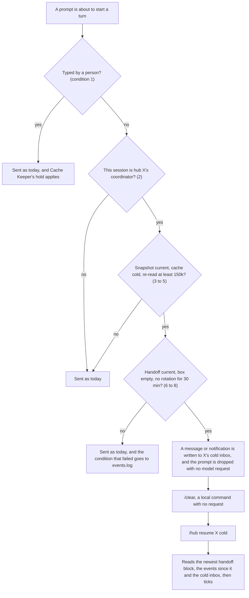

# FR-152: A cold hub continues from its handoff — a prompt nobody typed starts a fresh context, not a full re-read

**Issue:** [#4290](https://github.com/gjovanov/roomler-ai/issues/4290) · **Status:** spec, claimed 2026-11-22; no phase
started. Builds on [FR-131](FR-131-hub-coordinator.md) (the hub) and [FR-136](FR-136-hub-process-hygiene.md) (hub-guard,
the idle handoff and its gate). The engineering reference is
[`agent-hub.md` §12.4](../agent-hub.md#124-the-idle-handoff). Like FR-136, it changes the operator's tooling under
`~/.claude/` and no product code, so the design names files and functions there rather than repository lines.

## Goal

A hub coordinator (FR-131) is one long Claude Code session per hub. Few of its prompts are typed by a person. The rest
arrive on their own:

- the cron tick `/hub tick <id>`, every 20 minutes unless the hub sets another schedule;
- workers' messages (`STARTED`, `HANDOFF READY`, questions);
- background-task notifications.

Its context grows to several hundred thousand tokens. The prompt cache keeps that context for an hour, counted from the
start of the last request that read or wrote it. A prompt that arrives later re-reads the whole context at the
cache-write price. On Opus 5.5 that is $8 per million tokens, 40 times the $0.20 a read from the cache costs.

Nothing stops that re-read today. Cache Keeper holds a cold prompt only when a person typed it. hub-guard 0.5.0 writes
the idle handoff while the cache is still warm, but the next prompt still goes to the old context.

**Goal.** When a prompt that nobody typed reaches a hub coordinator whose cache is cold and whose re-read would be
large, the old context is not re-read. The hub continues in a fresh context, from its handoff and its state on disk,
through `/hub resume <id>`. A worker's message or a task notification that arrived is kept on disk, and the fresh
context reads it. A person's prompt is never touched.

## Evidence

### Every measured cold re-read was started by a prompt nobody typed

The bl1 hub's coordinator transcript of 2026-11-04 → 11-19 (1,308 API responses) holds 90 cold re-reads. A cold re-read
here is a response that came more than an hour after the previous one, with a prompt of at least 150k tokens, less than
a fifth of it read from the cache.

| What started it | Cold re-reads | Tokens written to the cache |
|---|---:|---:|
| the cron tick | 79 | 37.2M |
| a worker's message | 11 | 6.3M |
| a person's prompt | 0 | — |
| a task notification | 0 | — |
| **all** | **90** | **43.5M**, about $348 at $8 per million |

The median re-read was 454k tokens and the largest 857k. 87 of the 90 had exactly one prompt in the gap before them, the
one that started them, so no tick in between had been refused. The gaps came from the tick's schedule: from 11-08 the
hub mostly ticked on `37 */3 * * *`, once every three hours. A tick that far apart always finds the cache cold, so from
11-09 to 11-18 the hub re-read its whole context about eight times a day.

### The case that opened it: bl1 on 2026-11-22

Today's coordinator keeps no transcript. This is read from Cache Keeper's snapshot, hub-guard's record and the hub's
`events.log`.

| Time (UTC) | What happened |
|---|---|
| 09:11:59 | The last model request. From 09:12 a usage limit refused the requests that followed. |
| 09:31:43 | A cron tick's turn ended after 0 s without a model request. |
| 10:11:59 | The cache went cold. |
| 10:16:43 | The third-party idle-handoff plugin came due on the cold cache. hub-guard's gate skipped it, at no cost. |
| 10:53 | The first tick that went through again re-read about 325k tokens cold. Cache Keeper priced it at $2.60; from a warm cache it would have cost about 7 cents. |

hub-guard 0.5.0, which replaced the plugin the same day (#4284), times the idle handoff from the last request. Here its
handoff would have been refused too, and the next tick would still have re-read everything.

### What a fresh context costs

A session that starts with `/hub resume` reads far less. In the 28 sessions of 2026-11-04 → 11-19 that did:

| API response | Prompt size |
|---|---:|
| 1st | 70k–87k, median 74k |
| 5th | median 107k |
| 20th, a median 6.8 minutes in (22 sessions) | median 149k |

So a rotation writes about 150k tokens over the resume's first twenty requests, a third of the median cold re-read, and
each later tick reads a context about a third the size.

### The paths, before and after

| Prompt on a cold cache | Today | With FR-152 |
|---|---|---|
| a person's | Cache Keeper holds it and offers a handoff, a pack and clear, or sending it anyway | unchanged |
| a cron tick | re-reads the whole context | dropped; the hub resumes in a fresh context, and the resume ends with a tick |
| a worker's message | re-reads the whole context | kept in the hub's cold inbox, dropped, and read by the fresh context |
| a task notification | re-reads the whole context | as a worker's message |

## Key design

### The rotation

hub-guard gets a sixth part, `cold`. It acts at one moment: a prompt is about to start a turn in a hub coordinator. It
does what the operator does by hand after a hub's soft handoff, `/clear` and then `/hub resume <id>`, and adds two
things: the prompt that arrived is kept, and the fresh context is told why it started.

### When it runs

Every condition must hold. A condition that fails, or that cannot be read, sends the prompt as today: a wrong "no"
costs what today costs, and a wrong "yes" clears someone's session.

| # | Condition | Read from | Why |
|---|---|---|---|
| 1 | The prompt starts a turn and nobody typed it: a cron tick, a worker's message or a task notification | the prompt's origin; P0 records each kind's live shape | A person's prompt is Cache Keeper's to hold. Any other origin counts as a person. |
| 2 | The session is hub X's coordinator and not a hub worker: it has run X's tick or resume, and X's `state.json` names it (`hub.sessionId` or `hub.name`, the keys `hub.mjs` already matches a coordinator by) | hub-guard's record of the session's prompts; `~/.claude/hub/<X>/state.json`; `HUB_WORKER` | Two independent signals, because a wrong yes clears a session. Workers rotate on their own at about 250k. |
| 3 | Cache Keeper's snapshot is current: written after the session's last turn ended, or less than a minute before | the snapshot's `at` | The rule hub-guard 0.5.0 already applies. |
| 4 | The cache is cold: now ≥ `cache.lastAt` + `cache.ttl` | the snapshot | `lastAt` is the start of the last request, where the hour counts from (the comment on `lastAt` in Cache Keeper's `core.mjs`). |
| 5 | The re-read would write at least 150k tokens | `cache.recacheTokens`, the number Cache Keeper's own hold uses | Below that a fresh resume costs about as much (D2). |
| 6 | `hub-handoff.md` was written after the last turn a person started had ended; an unknown time counts as just now | the file's mtime; hub-guard's record of person turns | Ticks and workers leave `events.log` and `state.json` behind; what a person said may be on no other disk (D3). |
| 7 | The prompt box is empty | `$.prompt.read` | A draft, or a prompt Cache Keeper held and put back, means a person is deciding. |
| 8 | No rotation of this hub in the last 30 minutes, and the part is on | hub-guard's state; the kill switches | No loops. |

### What is kept

Before a prompt is dropped, hub-guard writes it to `~/.claude/hub/<X>/cold-inbox/`, one file per prompt, atomically:

- `<UTC time>-peer.md` or `<UTC time>-notification.md`: the prompt's text, verbatim, with its origin;
- `tasks.md`: the background tasks that hub-guard's registry (FR-136) still knows as running in the old session. Their
  notifications reach the fresh context, which did not start them.

A cron tick is not kept, because the resume ends with a tick. The resume moves each file it has read to
`cold-inbox/read/`, and a later tick reads any file the resume missed.

From the drop until the resume's turn starts, every further prompt nobody typed is kept and dropped the same way, so a
queued worker message cannot reach the fresh context before the resume does.

### What the fresh context reads

`/hub resume <id> cold` runs the skill's resume as today (orient, `CronList`, `hub.mjs status`) and adds three reads
before its tick:

1. the newest block of `hub-handoff.md` only. The file is a running log today (bl1's is 2,837 lines, 467 KB), so the
   resume finds its last block by heading, and blocks older than the newest three move to `hub-handoff.archive.md`;
2. the `events.log` lines written since that block, or its last 200 if there are more;
3. the cold inbox.

A tick in a context that has not run a resume yet runs one first. That covers a resume refused at a usage limit: the
first tick to go through afterwards does the resume.

### The hub's protocol (P1)

- A turn a person started ends with a dated line added to the newest block of `hub-handoff.md`: what was asked, and any
  hold or promise that follows from it. A turn that leaves nothing lasting says so in that line. Condition 6 rests on
  it.
- The schedule: a tick cadence longer than the cache's hour makes every tick cold. With FR-152 such a tick rotates
  instead of re-reading; without it, it is the most expensive schedule a hub can choose. The skill says so (D4).

### hub-guard (P2)

Pure functions in `hub-guard/hooks/core.ts`, beside 0.5.0's `idleDue()`:

- `promptKind(event)`: `person`, `tick`, `peer`, `notification` or `other`. `other` counts as a person.
- `coldDue(input)`: `{ due, why }` for conditions 3 to 8, each `why` naming the condition that failed, as `idleDue()`
  does.
- `hubOf(session)`: condition 2.

`register.ts`:

- the `prompt.submit` hook, or an earlier hook where P0 finds one for a kind (`session.receive` answered with
  `{ consumed }` for a worker's message);
- the keep, drop, clear and resume steps on timers, because `$.command.run` rejects inside a hook that a turn waits on;
- the new session id read by polling `$.session.id()`, because `session.start` does not fire after `/clear`. hub-guard
  already re-keys on a new session id this way;
- a toast, and an `events.log` line for each rotation and for each cold prompt it let through, with the condition that
  failed.

Its seams follow 0.5.0's: `HUB_GUARD_COLD_MIN_K` (the threshold in thousands of tokens; 0 turns the part off),
`HUB_GUARD_COLD_INBOX` and `HUB_GUARD_CACHE_LIVE`.

### What the engine must allow: P0's questions

From the engine's type definitions (Claude Code 2.1.322) and the plugins that already use them:

| Question | What is known | What P0 proves |
|---|---|---|
| Does a `prompt.submit` hook see a cron tick, a worker's message and a task notification, and with which origin? | The types list `scheduled-trigger`, `peer` and `task-notification`. In transcripts a cron tick is a meta prompt with `turnOrigin: scheduled` and no `origin` object. | the live event of each kind |
| Does answering without `next` stop the model request for each kind? | "Answering without `next` enters nothing." What becomes of a dropped cron tick or worker message is not documented, and a rewrite is ignored for a meta prompt that starts a turn. | no request; the cron's next fire still comes; a dropped prompt is not sent again. If not, whether aborting at `turn.start` stops the request first. |
| Can a timer run `/clear` and then `/hub resume <id> cold`? | Cache Keeper and the auto-handoff plugin clear and then submit this way, and hub-guard 0.5.0 runs `/hub-handoff` through `$.command.run`. | the same with a skill and its arguments |
| Does the cron survive `/clear`, and does the session keep its name? | `CronList` right after a `/clear` still listed the hub's tick in three sessions. A `/clear` can change the session's name, which workers address. | the next fire reaches the fresh context; how long a worker's message can miss the hub |
| Does Cache Keeper leave a clear it did not start alone? | Its `cleared()` pastes only after a clear it started itself. | no paste and no hold after ours |
| Does `/clear` empty the prompt box? | not known | what condition 7 can rely on |

If no hook can stop a cron tick before its request, the fallback rotates as soon as the cache goes cold while the hub is
idle, before any prompt arrives (D5).

### Kill switches

The word `cold` in `~/.claude/hub-guard/off` turns this part off, as `idle` does for the idle handoff. An empty `off`
file, or `HUB_GUARD=off`, turns off the whole guard. `HUB_GUARD_COLD_MIN_K=0` also turns the part off, and the flag
`cold_rotate=off` in a hub's `state.json` turns it off for that hub alone.

## Phases

| Phase | Scope | Status | Kill switch |
|---|---|---|---|
| P0 | Prove the engine points (P0's questions) on throwaway sessions in the pty harness, at no model cost where a question allows | not started | — (nothing changes) |
| P1 | The hub skill: the person-turn line, the handoff's newest block and its archive, `/hub resume <id> cold` with its three reads, a tick that resumes first, the note on schedules | not started | the skill's previous commit |
| P2 | hub-guard 0.6.0, the `cold` part: the pure functions with their unit tests, the hook, the steps, the inbox, the toast and the `events.log` lines. **Starts only after the operator rules on D1.** | not started | the part `cold`; `HUB_GUARD_COLD_MIN_K=0`; the hub flag |
| P3 | Field: a lab hub through each condition, with a seam that judges the cache cold sooner so that no cell waits an hour; then a live hub's next real cold prompt, and seven days of its `events.log` | not started | as P2 |
| P4 | Docs: a §12 section of `agent-hub.md` with the flowchart, the conditions, the inbox and the kill switches; the FR-131 and FR-136 cross-links | not started | — |

## Acceptance criteria

- [ ] **AC1** A cron tick that reaches a hub coordinator whose cache is cold, whose re-read is at least 150k and whose
  handoff is current makes no model request in the old context. The hub continues through `/hub resume <id> cold`, and
  the fresh context's first request is under 120k tokens. Evidence: the old session's snapshot (`lastAt` unchanged after
  the tick), the new session's first request, and the `events.log` line.
- [ ] **AC2** A worker's message that arrives on a cold cache reaches the fresh context word for word, and the hub
  answers it there.
- [ ] **AC3** A task notification that arrives on a cold cache reaches the fresh context, and a task started before the
  rotation that reports after it is named in `tasks.md`.
- [ ] **AC4** The cron, the hub's background tasks and its workers carry on: `CronList` shows the tick once, and
  `hub.mjs status` shows the same workers.
- [ ] **AC5** Each condition failing on its own sends the prompt as today and clears nothing: a session that is not a
  hub's coordinator, a hub worker, a stale snapshot, a warm cache, a re-read under 150k, a handoff older than the last
  person turn, a draft in the box, a rotation ten minutes earlier, the part off. One lab cell each.
- [ ] **AC6** hub-guard never drops, holds or rotates a person's prompt, on a cold cache or a warm one.
- [ ] **AC7** No loop: a fresh context under the threshold is never rotated, and a resume refused at a usage limit leads
  to one resume when requests go through again, not to another rotation.
- [ ] **AC8** Over seven days on a live hub, every prompt nobody typed that met a cold cache with a re-read of 150k or
  more has an `events.log` line: a rotation, or the condition that let it through. The baseline is the 90 cold
  re-reads of bl1's 11-04 → 11-19 transcript, none of them stopped.
- [ ] **AC9** Docs: the `agent-hub.md` section with its flowchart, written before the close.

## Open decisions

| # | Decision | Recommendation |
|---|---|---|
| **D1** | hub-guard would `/clear` a hub coordinator by itself. Today `/clear` is the operator's own action, and the hub skill says the hub never clears itself. | Allow it in this one case: every condition above, a toast, an `events.log` line and the kill switches. The other way is hold only: drop a cold tick, keep a message in the inbox, tell the operator, and wait for the operator's `/clear` and `/hub resume`. That costs nothing, but the hub stops until the operator acts. |
| D2 | The threshold for the re-read. | 150k, the same as Cache Keeper's hold. A fresh resume reaches about 150k after twenty requests. |
| D3 | When is the handoff current enough? | When it was written after the last turn a person started had ended (condition 6). |
| D4 | A tick schedule longer than an hour. | Keep it allowed, and say what it costs: with FR-152 each slow tick is a fresh resume; without it, each one re-reads the whole context. |
| D5 | Only if P0 finds that no hook can stop a cron tick before its request: rotate as soon as the cache goes cold while the hub is idle. | It needs the operator's word, because it also decides for a person who comes back to a cold hub, whom Cache Keeper would otherwise ask. |

## Out of scope

- A person's own prompt on a cold cache: Cache Keeper's hold covers it.
- Hub workers, which rotate on their own at about 250k.
- Sessions that are not hubs.
- Rotating a warm hub at its soft limit (200k). A large warm context costs too, but that is another trade and another
  decision, for a later FR if wanted.
- `/compact` in place of `/clear`: compacting reads the whole cold context, the cost this FR avoids.
- Keeping the cache warm through a usage limit or while the host sleeps: no request can run then.
- Product code: nothing in roomler changes.

## Docs

P4 writes the `agent-hub.md` section before the close: the flowchart, the conditions, the inbox and the kill switches,
with links to FR-131 and FR-136. `agent-hub.md` already has its `docs/README.md` row.

## Field log

| Date | Read | Result |
|---|---|---|
| 2026-11-22 | bl1's coordinator transcript, 2026-11-04 → 11-19 (1,308 responses) | 90 cold re-reads, all started by prompts nobody typed: 79 ticks and 11 worker messages, 43.5M tokens written. The three-hour tick schedule caused them. |
| 2026-11-22 | the 28 sessions of the same weeks that began with `/hub resume` | first request median 74k; the 20th about 150k, about 7 minutes in |
| 2026-11-22 | bl1's cold tick at 10:53 | about 325k re-read after a usage limit; $2.60 at $8 per million |

## Related

FR-131 (#3127, the hub) · FR-136 (#3457, hub-guard; #4284 moved the idle handoff into hub-guard 0.5.0) · Cache Keeper,
the hold for a person's cold prompt.
