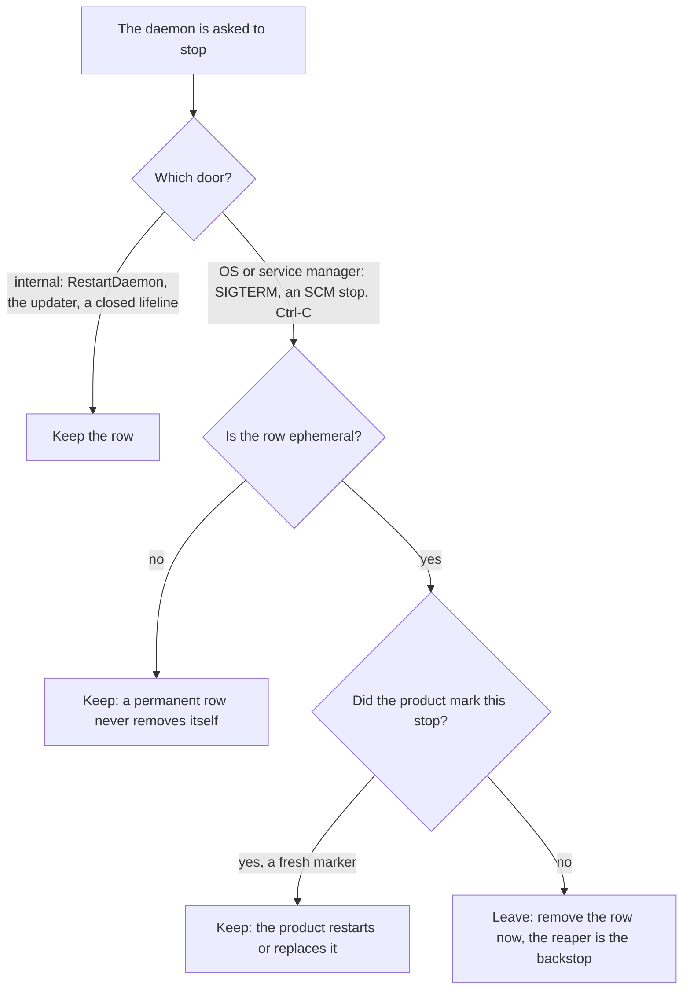

# FR-153: The product's own stops never delete an ephemeral row; only a leave does

**Issue:** [#4337](https://github.com/gjovanov/roomler-ai/issues/4337) · **Status:** spec, claimed 2026-11-23; nothing
built. D1 to D8 were ruled by the operator on 2026-11-23, on #4337; D9 is open, for P1a.
**From:** [#4322](https://github.com/gjovanov/roomler-ai/issues/4322) (every product stop that deletes an ephemeral row,
read at `d590ab5a2`) and [#4328](https://github.com/gjovanov/roomler-ai/pull/4328) (`docs/ephemeral-nodes.md`
corrected, `36469d61d`)
**Builds on:** [FR-51](FR-51-ephemeral-nodes.md) P3 (a clean exit removes the row at once), #1683 (the `update-attempt`
marker), #3292 (the per-user MSI's `service stop --for-upgrade`), [FR-84](FR-84-companion-and-installer-polish.md) D3
(`RestartDaemon`, the internal door), #3116 (the setup wizard restarts through it), [FR-43](FR-43-macos-single-enrollment.md)
(the Mac's shapes), [FR-147](FR-147-root-out-of-homes-macos.md) (a root step does nothing inside a person's home)
**Related:** #4312 and #4326 (one-row), #4331 and #4339 (a re-enrollment kept the old file's `ephemeral`)

**Anchors:** master `7d19b893a` (2026-11-23). Each was read in the tree at `eb96522a3` or at `7d19b893a`; the one
commit between them (#4339) changes no line cited here. Where one of #4322's anchors moved since `d590ab5a2`, this
spec gives the line at this base. The rulings and the review's corrections, written in on 2026-11-24, read every
anchor they add at `96c27b1b6`: each block of them carries its own pin to that commit, and an anchor they add or
correct outside such a block names the same lines at both commits.

## Goal

An ephemeral device (FR-51) removes its own row when it leaves: an uninstall, `docker stop`, a VM or pod teardown, an
OS shutdown. That is the feature, and it stays.

It must not remove its row when the product itself stops the daemon only to restart or replace it. Today it does, for
a reinstall, a hand upgrade, an MSI repair, `restart-service`, an install script's re-run, a pkg install and, most
likely, the auto-update of a two-row Mac. Each of those reaches the daemon as an OS stop with no marker. The daemon
removes its row, comes back on a dead token (exit 7) and stays down until someone enrolls it again.

With FR-153 every stop the product makes keeps the row, on every OS and in every install shape. A leave still removes
it.

## Evidence

### The rule today

- **The gate** is `ephemeral && os_initiated_stop && !update_in_flight`
  (`agents/roomlerd/src/updater.rs:444-450`), read on the way out (`agents/roomlerd/src/app.rs:5849-5854`).
- **`os_initiated_stop`** is set by the two signal arms: Ctrl-C (`agents/roomlerd/src/app.rs:5765-5772`) and
  `terminate_signal` (`agents/roomlerd/src/app.rs:5776-5782`), which hears SIGTERM on Unix and the SCM host's stop event
  on Windows (`agents/roomlerd/src/app.rs:3711`). The internal arm (`agents/roomlerd/src/app.rs:5730-5764`) leaves it at
  its `false` (`agents/roomlerd/src/app.rs:5728`). That arm is the updater's exit, FR-84 D3's requested restart, and a
  macOS worker whose lifeline closed (`agents/roomlerd/src/delegate_worker.rs:736-758`).
- **`update_in_flight`** is a fresh `update-attempt` marker: 600 s (`agents/roomlerd/src/updater.rs:428`, `:435-437`), in
  the stopped process's own log folder (`agents/roomlerd/src/updater.rs:230-232`). That folder is per account. On
  Windows a process with a service log role (the SCM host, netd, the SystemContext worker, the perMachine MSI's own
  steps) logs in the machine's `service-logs`. Every other process, on every OS, logs in its own profile
  (`crates/agent-core/src/logging.rs:1045-1054`; the roles are set at `agents/roomlerd/src/app.rs:1420-1429` and
  `:1615-1633`).
- **Its writers** are the updater's installer spawn (`agents/roomlerd/src/updater.rs:1955`), which the crash-loop
  rollback also takes (`agents/roomlerd/src/app.rs:4421-4422`); the macOS and Linux update helpers, as root
  (`agents/roomlerd/src/updater.rs:4262`, `:4311`); and the per-user MSI's `service stop --for-upgrade`
  (`agents/roomlerd/src/app.rs:5953-5966`, #3292). Nothing else writes it.
- **The marker does more than keep the row.** A daemon that starts within 300 s of it skips its update check at start
  and checks first a full interval later, 4 h by default (`agents/roomlerd/src/updater.rs:3411`, `:71`, `:53`). For
  600 s it reports an install in flight, which the replaced-binary watch never forces a restart over
  (`agents/roomlerd/src/busy.rs:73-75`, `:96-98`). D2 lists every reader, and what each does while the marker is fresh.
- **The stop reads the file.** On the way out the daemon reloads its config from disk
  (`agents/roomlerd/src/app.rs:5831`). If that file says ephemeral, it removes the row the FILE names, with the file's
  token (`agents/roomlerd/src/app.rs:5852-5854`), and not the row this run started as. A re-enrollment written while a
  daemon runs, followed by any OS stop of that daemon, removes the NEW row before it ever runs. Found on 2026-11-23 by
  #4339's worker; D5.
- **A kept row meets a create-only enroll.** An ephemeral key's enrollment never refreshes a row: a machine id that
  already has one is a final 409, and the key's use is claimed before the create that answers it
  (`crates/modules/fleet/src/agent.rs:680`, the 409 at `:716-722`). A re-enrollment reuses the config's machine id
  (`agents/roomlerd/src/app.rs:2914-2921`). A re-run that enrolls again works today only where its own stop comes first
  and has already removed the row (Windows perMachine, the macOS person half): the enroll finds no row and makes a new
  one, which the next stop then removes (D5). Where the enroll comes first (Linux, Windows per-user), it gets the 409
  today. Once FR-153 keeps the row, every such re-run meets a live row. D7 gives each shape, and the ruling.

### Every stop the product makes, re-read at `eb96522a3`

"Through the daemon" asks whether `RestartDaemon` (FR-84 D3) could do the stop's job. That is the internal arm, which
never unenrolls. "Marker" names the folder the STOPPED process reads.

**Windows, perMachine**

| # | The stop | Who stops whom | Through the daemon? | Marker |
|---|---|---|---|---|
| W1 | An MSI run that is not a full removal: `KeepSystemContext`, `EnableSystemContext` or `DisableSystemContext` (`agents/roomlerd/wix-perMachine/main.wxs:689-697`) reaches `restart_service` (`agents/roomlerd/src/app.rs:6163`, `:6217`, through `:6276` and `:6278`; `agents/roomlerd/src/win_service/environment.rs:396-411`). The SCM stop reaches `on_control` (`agents/roomlerd/src/win_service/mod.rs:776-787`), the host signals its worker's stop event (`agents/roomlerd/src/win_service/supervisor.rs:1536-1555`) and the worker takes `terminate_signal`. It runs on `install.ps1`'s MSI step, the setup wizard's, msiexec by hand and an RMM push. | The MSI's deferred action, as LocalSystem, stops the SCM host (LocalSystem). The host stops its worker: LocalSystem in the console session when SystemContext is on, otherwise the console person, spawned with that person's token (`agents/roomlerd/src/win_service/supervisor.rs:3-8`). | Only in part. `RestartDaemon` restarts the WORKER, and the host's supervisor respawns it. That serves a run whose switch is unchanged. It cannot apply a changed switch: the host reads `ROOMLERD_ENABLE_SYSTEM_SWAP` from its own environment (`agents/roomlerd/src/win_service/supervisor.rs:933-945`), which the SCM sets when it starts the service. With no service running, `restart_service` skips the stop (`agents/roomlerd/src/win_service/environment.rs:401-406`). In a major upgrade these actions find the service that `RegisterService` has just made, which it does not start (`agents/roomlerd/src/win_service/mod.rs:238-243`), so they stop nothing. | SystemContext worker: `service-logs`, the folder the MSI's actions already log in (`agents/roomlerd/src/app.rs:1450-1452` holds them to the installer role). Person worker: that person's profile. |
| W2 | A major upgrade's removal of the old product: `UnregisterService` on `REMOVE="ALL"` (`agents/roomlerd/wix-perMachine/main.wxs:698-700`, the action at `:378-384`) runs `service uninstall --as-service` (`agents/roomlerd/src/app.rs:6066-6067`). That retires the service (`agents/roomlerd/src/win_service/mod.rs:316-336`) and stops it (`agents/roomlerd/src/win_service/lifecycle.rs:399`, then `:293`). | The OLD product's action, as LocalSystem, stops the old host and its worker. Both run the release being replaced. | No: the service is stopped so that it can be deleted. | As W1, for the OLD release. `MajorUpgrade` is `afterInstallInitialize` (`agents/roomlerd/wix-perMachine/main.wxs:90-92`), so the removal runs before `InstallFiles` and the new `roomlerd.exe` is not on disk yet. An immediate Binary-table DLL action of the new product can run there, as #3375's `CaptureServiceEnvironment` does (`agents/roomlerd/wix-perMachine/main.wxs:560-569`, scheduled at `:640-642`). A deferred one cannot: spooled ahead of the removal, it fails every upgrade (`docs/installation.md:1269-1272`). D8. |
| W3 | `roomlerd restart-service` (`agents/roomlerd/src/app.rs:6338-6345`), and `enable-system-context` or `disable-system-context` without `--no-restart`. The product's own messages tell operators to run it (`agents/roomlerd/src/app.rs:6157`, `:6167`, `:6212`, `:6220`, `:6317`, `:6325`). | An administrator stops the SCM host, which stops its worker as in W1. | As W1. Each of these exists to apply a change to the service's environment, and only a service restart applies that. | As W1. The three system-context verbs log in `service-logs` (installer role). `restart-service` logs in the administrator's profile. |
| W4 | `scripts/install.ps1:370`: `Restart-Service -Name Roomler -Force` right after the enroll, for machine roles. | An elevated administrator's PowerShell stops the SCM host and its worker. The MSI step before it (W1) has already restarted them once. | Yes. The restart is there so that the worker loads the new config (`scripts/install.ps1:360-361`), and a worker restart does that. The setup wizard already restarts this way and skips when the daemon refuses (`agents/roomler-setup/src/orchestrator_agent.rs:726-755`, `:996-1097`). With no daemon answering, a plain service start. | As W1. Because the stop reads the file, the row it removes is the new enrollment's (D5). |
| W5 | A hand `roomlerd self-update` (`agents/roomlerd/src/app.rs:6395`, spawning at `:6480`). | An administrator's process launches the MSI, whose stops are W1 and W2. It writes the marker first (`agents/roomlerd/src/updater.rs:1955`), but in its own folder: the command has no log role (`agents/roomlerd/src/app.rs:1420-1429`), so the marker lands in the administrator's profile, while a SystemContext worker reads `service-logs`. | Not its own stop: the MSI's. | Covered once the MSI marks its own stops (W1, W2), whoever launched it. |

**Linux**

| # | The stop | Who stops whom | Through the daemon? | Marker |
|---|---|---|---|---|
| L1 | `scripts/install.sh:746-761`, `--system --config-from` on an active unit: the config is placed (`scripts/install.sh:747`), then `systemctl restart roomlerd.service` (`:758`). A reinstall, or the setup wizard's privileged half. | root stops the root daemon: one account. | Yes: `sudo roomler restart` (`agents/roomler-cli/src/cli.rs:350-370`), on the root daemon's own socket, which only root may open (`crates/localapi/src/lib.rs:5154-5156`). The daemon then checks the unit's restart policy (`agents/roomlerd/src/supervision.rs:366`). With the unit not active: `enable --now` (`scripts/install.sh:760`), which stops nothing. | root's own folder, one account: today's marker works. Because the stop reads the file, the row it removes is the placed config's (D5). |
| L2 | `restart_old_user_daemon` (`scripts/install.sh:631-655`, called at `:789`): a per-user re-run restarts the running daemon with `systemctl --user restart roomler.service` (`:654`). It does so when the helper was just turned on, or when the daemon predates restarting onto a new binary by itself. Not in #4322's table. | The person stops the person's daemon: one account. | Yes: `roomler restart` as the person. A daemon older than FR-84 D3 answers `Unsupported` (`crates/localapi/src/lib.rs:1814-1817`). | The person's folder, one account. |
| L3 | The advice after `enroll` and `re-enroll` on a system install says "`sudo systemctl restart roomlerd`" (`after_enroll`, `agents/roomlerd/src/service.rs:152`, the lines at `:157` and `:165`; `after_re_enroll`, `:102`, at `:107` and `:120`), and so does the hand self-update's (`agents/roomlerd/src/app.rs:6536-6537`). The operator types it. Not in #4322's table. | root stops the root daemon. | Yes: the same advice for every other shape already names `roomler restart` (`agents/roomlerd/src/service.rs:112`, `:160`, `:172`). | As L1. Right after an enroll, the stop removes the new row (D5). |

**macOS**

| # | The stop | Who stops whom | Through the daemon? | Marker |
|---|---|---|---|---|
| M1 | The pkg's postinstall, on every install the update helper did not start (`install.sh`, a double-click, MDM). `replace_launchd_service` boots each job out before it bootstraps it (`agents/roomlerd/packaging/macos/postinstall:145-147`): the root daemon (`:635`) and the console person's LaunchAgent (`:445`). | root stops the root daemon, and has launchd stop the console person's agent. | Not for the bootout: postinstall reloads the job's definition, and only a bootout and a bootstrap do that. | The root daemon reads root's own folder. The person's agent reads the person's folder, inside the person's home, where no root step of ours may write (`docs/fr/FR-147-root-out-of-homes-macos.md:15`). |
| M2 | An auto-update of a two-row Mac. The helper writes the marker as root (`agents/roomlerd/src/updater.rs:4256-4262`), then the same postinstall boots out the person's agent. | As M1. | As M1. | The person's agent reads the person's folder, not root's, so the marker misses. Inferred from the code, not traced (#4322). |
| M3 | `install.sh`'s kickstarts after an enroll: `kickstart_user_agent` (`scripts/install.sh:966-970`) and the root daemon's (`:1014-1016`). A race on a fresh install (is a worker already up on the new config?), certain on a re-run whose job is up. | root, under sudo, or the console person (`--user-steps`) stops the person's agent; root stops the root daemon. | Yes: `roomler restart` as the person reaches the person's agent under launchd, and `sudo roomler restart` reaches the root daemon. | As M1. Right after an enroll, the stop removes the new row (D5). |
| M4 | A supervised two-row worker (`macos_supervise_gui_worker = true` without one-row, so `run --supervised`, `agents/roomlerd/src/macos_supervisor.rs:481-487`). Every stop of the root daemon, its own internal restarts included, ends the worker with SIGTERM: `stop_worker` (`agents/roomlerd/src/macos_supervisor.rs:1524`, SIGTERM at `:1547`, SIGKILL at `:1557`) on "daemon shutting down" (`:1965-1971`). The hand-over to launchd (`:1913`) does the same. This is #4322's fifth deliberate action, and it is wider than deliberate: any stop of the root daemon. | The root daemon stops the person's worker. | Yes, and the door exists: a worker whose lifeline closes leaves through the internal arm (`agents/roomlerd/src/delegate_worker.rs:736-758`), in every release since #2987. | The person's folder, as M1, or the root daemon decides for its worker. |

A one-row worker holds no enrollment (`--unenrolled`, `agents/roomlerd/src/app.rs:250-256`), so the gate never removes
a row for it (`agents/roomlerd/src/app.rs:5852`). One-row's own stops are #4326's.

### Beyond #4322's table

- **L2 and L3** are product stops #4322 did not list: the Linux per-user re-run's restart, and the product's own advice
  to restart through systemd.
- **M4 is wider than a deliberate action.** It also runs on the root daemon's own restarts.
- **D5**, the stop that removes the file's row, and **D7**, the create-only enroll a kept row meets.
- **The wizard already restarts through the daemon** after a reinstall's enroll
  (`agents/roomler-setup/src/orchestrator_agent.rs:726-755`). That is the prior art for rule 1 below. Its comment says
  that `install.sh` restarts the Linux unit the same way. At `eb96522a3` it does not: L1 and L2 restart through
  systemd. P2a corrects that comment along with the code.

### Checked, not a path

- A Windows session change ends the worker with `TerminateProcess`
  (`agents/roomlerd/src/win_service/supervisor.rs:626-635`), which never reaches the gate.
- The .deb never stops the daemon, and the Linux helper does not restart it either
  (`agents/roomlerd/src/updater.rs:4301-4303`).
- The per-user MSI marks its upgrade stop (`agents/roomlerd/wix/main.wxs:453-459`, scheduled at `:565-567`), and its
  plain stop skips the old product's removal by `UPGRADINGPRODUCTCODE` (`agents/roomlerd/wix/main.wxs:583-585`).
- These are leaves, and remove the row as they should: `install.ps1 -Uninstall`'s pre-stop
  (`scripts/install.ps1:529-530`), `install.sh`'s uninstalls (`uninstall_stop_linux`, `scripts/install.sh:1848`; the
  macOS bootouts at `:2022-2041`), `roomlerd service stop --as-service` (`agents/roomlerd/src/app.rs:6005-6009`), and
  postinstall's removal of a root daemon whose `enable-daemon` marker is gone
  (`agents/roomlerd/packaging/macos/postinstall:655`).

### The five deliberate actions #4322 had not re-read

| # | The action | What it does to an ephemeral row | Proposal (D4) |
|---|---|---|---|
| A1 | The companion's "Remove auto-start" on Linux and macOS runs `roomlerd service uninstall` (`agents/roomler-desktop/src/commands.rs:2426-2442`, `agents/roomlerd/src/app.rs:5923-5934`). That is `systemctl --user disable --now` (`agents/roomlerd/src/service.rs:2031-2036`) or `launchctl unload -w` (`agents/roomlerd/src/service.rs:2531-2540`). | The daemon stops and does not come back, so the row is removed. | Out: a leave in effect. The doc says so. |
| A2 | macOS `service install --as-service` with a changed plist. An unchanged plist is left alone, and the comment there names this very trap (`agents/roomlerd/src/service.rs:2624-2633`). A changed one is booted out (`:2641`) and bootstrapped. Only an operator runs it (`scripts/install.sh:951` prints it). | root stops the root daemon to reload its job, so the row is removed. | In: mark the stop. Root's own folder, one account. |
| A3 | `cleanup-legacy-install` ends the other flavour's daemon with `schtasks /End`, whose launcher's kill-on-close job ends the daemon, and with `terminate_checked` (`agents/roomlerd/src/install_cleanup.rs:65-67`, `:776`). | A hard kill: the gate never runs, and the row stays for the reaper. | Out: it removes no row. |
| A4 | A legacy Linux user unit. `service install` enables the current unit and then runs `disable --now` on the pre-rename one (`agents/roomlerd/src/service.rs:2014-2029`, at `:2026`). | A daemon still under the unit FR-46 retired is stopped, so its row is removed and the current unit's daemon starts on a dead token. | Out, with a line in the doc: it needs an ephemeral row on a daemon still under a retired unit. |
| A5 | The macOS supervisor's SIGTERM to a two-row worker. | M4. | In (M4). |

## Design

The rulings of 2026-11-23 stand under each open decision, and where one differs from what this section proposes, the
ruling holds: a Windows person worker also reads its marker in `service-logs` (D3), and D7's skip is a phase of its
own (P7).

### The decision

Which row "the row" is depends on D5: today the row the file names, with D5's guard the row this run started as.

### Three rules

1. **A restart goes through the daemon's own door.** Where the product only wants the daemon to run a new config or a
   new binary, it asks the running daemon to restart (`RestartDaemon`), and the daemon leaves through the internal
   arm, which never unenrolls.
2. **A stop the product must make through the service manager is marked where the stopped process reads it.** That
   covers deleting or reloading a service or a job, a change to what the SCM host runs with, and every refusal of rule
   1. The stopper writes the marker before it stops, in the folder of the account the STOPPED process runs as.
3. **A leave stays a leave.** No marker and no door is added to an uninstall, to a stop from outside the product, or
   to an OS shutdown. They keep removing the row.

### Which release reads it

The stopped process is the one already running. In an upgrade that is the release being replaced, and in a reinstall
it is the release being reinstalled. So:

- a marker in the folder the running release already reads works from the first release that writes it, because every
  release since #1683 reads `update-attempt` there;
- a new door, a new marker or a new place works only for a stop of a release that ships it.

The first hop of every upgrade therefore uses the old contract: the new installer writes the marker that the old daemon
reads. #3292's `StopOldDaemon` does exactly that, from the new per-user product
(`agents/roomlerd/wix/main.wxs:445-459`). A condition in the old product's own table, such as W2's
`UPGRADINGPRODUCTCODE` split, binds only when the product being removed is one that ships it.

### R: restart through the daemon

- The caller sends `RestartDaemon` (`crates/localapi/src/lib.rs:1804-1822`), as `roomler restart` does
  (`agents/roomler-cli/src/cli.rs:350-370`) and as the wizard does
  (`agents/roomler-setup/src/orchestrator_agent.rs:996-1097`). The daemon answers `DaemonRestarting` and exits through
  the internal arm. Its supervisor relaunches it, except under the Windows Scheduled Task, where the caller starts it
  (`crates/localapi/src/lib.rs:2118-2130`).
- The daemon refuses when a restart is already under way, when it can prove no supervisor, when
  `local_restart_enabled` is off, during a recording, within 30 s of its last restart, and when it is a supervised macOS
  worker younger than 30 s (`agents/roomlerd/src/supervision.rs:300-354`). Under systemd it also refuses when the unit
  would not relaunch the exit (`agents/roomlerd/src/supervision.rs:366`). A daemon older than FR-84 D3 answers
  `Unsupported`. What the caller does then is D6.
- With no daemon answering, no process holds the row. The caller starts the service and stops nothing.
- On Windows, R restarts the worker and not the SCM host. It serves a new config or a new binary. It cannot serve a
  change to the service's environment block (W1, W3).
- R also takes D5's trigger off these paths: the internal arm never unenrolls, so a restart right after an enroll keeps
  the new row.

### M: mark the stop

- The stopper writes the marker right before it stops, as `stop_for_upgrade_or_not` does: no marker on disk, no stop
  (`agents/roomlerd/src/app.rs:5979-5988`). Which marker is D2, and where is D3.
- **Windows.** For a SystemContext worker the marker goes in `service-logs`, the folder the MSI's actions already write
  (W1, W3). For a person worker it goes in that person's folder (D3). For W2, a new action of the NEW product writes it
  before the old product's removal. Only an immediate action runs there. With `afterInstallInitialize` the removal
  comes right after `InstallInitialize`, and a deferred action spooled ahead of it fails every upgrade, healthy ones
  included (`Error 2613`, measured on the per-user MSI, `docs/installation.md:1269-1272`). So the action comes from the
  Binary table and runs before `InstallInitialize`, as `CaptureServiceEnvironment` does
  (`agents/roomlerd/wix-perMachine/main.wxs:564-569`, scheduled at `:640-642`), and it is `Return='ignore'` as both
  carry actions are (`:564-569`, `:575-582`): a mark that fails leaves today's stop and never fails an upgrade. An
  immediate action runs as the account that started msiexec, not as LocalSystem: an elevated administrator for
  `install.ps1` and the wizard, LocalSystem for an RMM push. A double-click asks for consent after the UI, and its
  immediate actions most likely run without the rights to write `service-logs`, which a person cannot write
  (`agents/roomlerd/src/app.rs:1436`). That token is P1b's first measurement, and D8 is what covers that case.
  `UnregisterService` then also gets a marking twin on `REMOVE="ALL" AND UPGRADINGPRODUCTCODE`, the per-user model
  (`agents/roomlerd/wix/main.wxs:583-585`), and stays the plain leave on `REMOVE="ALL" AND NOT UPGRADINGPRODUCTCODE`.
  The twin is deferred and not impersonated, as `UnregisterService` is
  (`agents/roomlerd/wix-perMachine/main.wxs:378-384`), so it is an installer step and marks in `service-logs`
  (`agents/roomlerd/src/app.rs:1441-1455`, held by the test at `:7841`). It binds from the removal of the first
  release that ships it.
- **Write only into a folder that exists.** The stopped process already logs in its folder, so the folder exists
  whenever there is a process to keep. A writer outside the daemon creates no folder: a new folder can decide which
  tree a legacy host uses, the per-user tree by its local data folder when no config folder exists
  (`crates/agent-core/src/appdirs.rs:179-182`), the machine tree by the folders themselves (`:604-609`). Where both
  trees hold a log folder, it writes both.
- **macOS.** postinstall writes root's marker in root's own folder before it boots out the root daemon. Before it boots
  out the person's agent, or the root daemon whose worker that person runs, a process of that person writes the
  person's marker in the person's folder. That is FR-147's route for every change inside a home
  (`docs/fr/FR-147-root-out-of-homes-macos.md:15`). M4 also needs the root daemon's own side, because a root daemon
  restart that no installer started (`sudo roomler restart`, the daemon's own internal restarts) marks nothing in the
  person's folder. When the root daemon's own stop is not a leave, it ends a two-row worker by closing the lifeline, the
  internal arm (`agents/roomlerd/src/delegate_worker.rs:736-758`), instead of `stop_worker`'s SIGTERM. When its stop is
  a leave, it sends SIGTERM as today, and the worker leaves too.
- **Linux.** Every path is one account (L1, L2), so a marker in the stopper's own folder is the stopped daemon's.

### Security

- A marker keeps an ephemeral row past a stop, so who can write it decides who can do that. Today that is the account
  itself, in its own folder, and root or LocalSystem. FR-153 adds writes by the Windows stoppers, which are LocalSystem,
  an administrator, or the account that starts a perMachine MSI (in `service-logs`, and in a person's folder only for
  D8's first-hop action, as D3 is ruled), and by a process of the person on a Mac (D3's P-a). Each writes only where
  its token can write today, so no account gains a write it lacks.
- A forged marker keeps an ephemeral row past every OS stop for as long as it reads fresh, and the reaper then removes
  the row at its TTL. A marker never removes a row, and never keeps a permanent one. Corrected on 2026-11-24 from the
  review: fresh is the file's modification time alone, and a time in the future reads as fresh: `duration_since` fails
  for it, and `unwrap_or_default` reads that as no time elapsed (`agents/roomlerd/src/updater.rs:268-279`, `:275-278`).
  A marker stamped in the future therefore keeps rows past every stop, and holds off the update checks that read it,
  until that time and one window past it. Bounding that is D9, for P1a.
- R adds no trust. `RestartDaemon`'s endpoint ACL is the boundary (`crates/localapi/src/lib.rs:1807-1812`). A Linux
  system daemon's own socket is root-only (`crates/localapi/src/lib.rs:5154-5156`), and the person socket refuses the
  verb (`crates/localapi/src/lib.rs:3825`).
- One daemon per machine: no second service, no new privileged helper. The MSI's new action is a step of the MSI, like
  `CaptureServiceEnvironment`.

## Phases

Each phase ships on its own, behind one switch its PR names. Off restores today's stop byte for byte. The scripts
(P1c, P2a, P3b) are served by a promote, before or after the agent release that carries a phase's verbs. Each script
reads what the installed binary offers, and keeps today's restart for a binary that offers nothing new.

P7, D7's skip, ships no later than the first phase that keeps a row (P1a, P1b or P3a): until it does, a re-run that
meets a kept row gets the 409 and spends a use of the key. D6's distinct exit codes for `roomler restart` land in the
first of P1c, P2a and P3b to ship, the first phase whose script reads them.

| Phase | What | Kill switch, or back-out | Status |
|---|---|---|---|
| P0 | This spec, and the operator's rulings on D1 to D8 | none | spec 2026-11-23, ruled 2026-11-23; D9 open |
| P1a | Windows verbs: `restart_service`'s callers mark first (W1, W3) in `service-logs`, and a person worker also reads its marker there (D3). D9's bound is decided here | an environment variable the verbs read | not built |
| P1b | Windows MSI: an immediate action of the new product marks the old product's removal before it runs (W2, D8), and `UnregisterService` gets its marking twin on `UPGRADINGPRODUCTCODE`. Both `Return='ignore'`, and both write `update-attempt`. The action is conditioned like `CaptureServiceEnvironment`, so that a fresh install or an uninstall marks nothing (D8). First measurement: the token a double-click's immediate action runs with | a public MSI property that skips both actions | not built |
| P1c | `install.ps1:370`: R, with D6's fallback; a re-run's enroll is P7's skip (D7) | a switch the script reads, or a promote of the previous image | not built |
| P2a | `install.sh`'s Linux restarts (L1, L2), and a terminal `install.sh --system --token` re-run, whose `enable --now` leaves the running unit on the old config (D1): R, with D6's fallback; a re-run's enroll is P7's skip (D7) | P1c's | not built |
| P2b | The advice after `enroll` and `re-enroll` on a Linux system install, and the self-update's, names `roomler restart` (L3). So does the advice the macOS postinstall prints after an enroll, in place of its `sudo launchctl kickstart -k system/com.roomler.daemon` (D1) | text only: a revert | not built |
| P3a | macOS postinstall marks its bootouts (M1, M2): root's marker as root, the console person's by a process of that person | a file under `/etc/roomler` that postinstall reads, as it reads `enable-daemon` | not built |
| P3b | `install.sh`'s macOS kickstarts after an enroll (M3): R, with D6's fallback. The root half, which a re-run never enrolls again, is not kickstarted when nothing changed (D1). A re-run's enroll is P7's skip (D7) | P1c's | not built |
| P3c | The root daemon ends a two-row worker through the lifeline when its own stop is not a leave (M4) | a key in the root config | not built |
| P3d | `service install --as-service` marks its bootout of a changed plist (A2, if D4 rules it in) | P3a's | not built |
| P4 | Docs: `docs/ephemeral-nodes.md` says which stops keep the row and which remove it, per OS, with a mermaid diagram of the keep-or-leave decision and `file:line` anchors; the CI recipe's bullets of #4328 say what holds after P1 to P3; its `docs/README.md` row says so. It rewords "A restart is a NEW device" (the notes below) | none | not built |
| P5 | The field cells below: RED on the current release, then GREEN on each phase's release | none | not built |
| P6 | D5's guard, ruled in: a stop removes only the row its run started as. #4352 builds it | an environment variable | in progress, #4352 |
| P7 | D7's skip: the shared enroll code, which both `enroll` and the setup wizard's `enroll_step` use, skips the request for an ephemeral key whose server and organization match an enrollment in the config (the primary or any `[[orgs]]` entry) and whose row is proven live. A standard token always reaches the server. Ships no later than the first of P1a, P1b and P3a | an environment variable the shared enroll code reads: off sends every enroll to the server, as today | not built |

### Notes for later phases

From the review, with anchors at `96c27b1b6`:

- P4 rewords "A restart is a NEW device" (`docs/ephemeral-nodes.md:42-44`): the product's own restarts keep the row.
- P1a fixes the comment on `UPDATE_STOP_WINDOW` that has `RegisterService` delete the service
  (`agents/roomlerd/src/updater.rs:415-416`), stale since #3115 (`agents/roomlerd/src/win_service/mod.rs:217-236`).

### Field cells (P5)

Each cell runs on a throwaway lab guest (vmtest) in an org with an ephemeral key. None has been run.

| Cell | Guest | Shape | Action | AC |
|---|---|---|---|---|
| F1 | Win11 | perMachine, served script (`install.ps1`) | re-run `install.ps1` with a new ephemeral token | AC1 |
| F2 | Win11 | perMachine, the setup wizard | re-run the wizard | AC1 |
| F3 | Win11 | perMachine, installer | msiexec `/i` of the same MSI by hand | AC1 |
| F4 | Win11 | perMachine, installer | msiexec `/i` of a newer MSI by hand, from an elevated prompt and by a double-click that asks for consent: from the release before FR-153, and from the first release with it | AC1 |
| F5 | Win11 | perMachine | `roomlerd self-update` run by a second administrator account | AC1 |
| F6 | Win11 | perMachine | `restart-service`, `enable-system-context`, `disable-system-context` | AC1 |
| F7 | Win11 | perMachine and per-user | msiexec `/x`, `install.ps1 -Uninstall`, `sc stop`, a shutdown | AC4 |
| F8 | Ubuntu GNOME-Wayland | system, served script | `install.sh --system --config-from` with the unit active, the wizard's privileged half, and a terminal `install.sh --system --token` re-run | AC2 |
| F9 | Ubuntu GNOME-Wayland | per-user, served script | an `install.sh` re-run that restarts the daemon | AC2 |
| F10 | Ubuntu GNOME-Wayland | system | `enroll` again while the daemon runs, then the printed advice, as printed | AC2 |
| F11 | Ubuntu GNOME-Wayland | system and per-user | `install.sh --uninstall`, `systemctl stop`, a VM teardown | AC4 |
| F12 | macOS | two-row: the root daemon and the person's LaunchAgent | a pkg install by `install.sh`, and `installer -pkg` by hand; on a root half not enrolled yet, the enroll and the restart that postinstall prints, as printed | AC3 |
| F13 | macOS | two-row | an `install.sh` re-run (the kickstarts) | AC3 |
| F14 | macOS | two-row, and supervised two-row | an auto-update by the helper | AC3, AC6 |
| F15 | macOS | supervised two-row (`macos_supervise_gui_worker = true`) | F12, F13, and `sudo roomler restart` of the root daemon | AC3 |
| F16 | macOS | two-row | `install.sh --uninstall`, `launchctl bootout` by hand, a VM teardown | AC4 |
| F17 | a container (FR-51's recipe) | ephemeral | `docker stop` | AC4 |
| F18 | as F1 to F16 | a standard key | each action of F1 to F16 | AC5 |
| F19 | each OS's lab row | as F1, F8, F9, F12 | one update by the updater | AC6 |
| F20 | each OS's lab row | Windows perMachine (`install.ps1`, the setup wizard), Windows per-user, Linux system (`--token`, `--config-from`) and per-user, macOS two-row | a re-run with an ephemeral key of the same organization while the row lives; then the row removed on the Devices page, and a re-run | AC8 |

F1 to F6 each run twice: with SystemContext on, and with it off, because the worker then runs as the console person.

## Acceptance criteria

Each cell is read on a throwaway lab guest in an org with an ephemeral key, RED on the current release first and then
GREEN on the fix. AC4 to AC6 hold today: their cells are read on the current release as the baseline, and again on
the fix. A re-run with an ephemeral key while the device's row lives ends as D7 is ruled, on each OS: no enroll, and
no use of the key spent (AC8). The cells of AC1 to AC3 read both a re-run with no new enrollment and one with it.

- [ ] **AC1** **Windows perMachine**, with SystemContext on and off: an ephemeral row survives an MSI re-run (from
  `install.ps1`, from the setup wizard, and msiexec by hand), a hand major upgrade (from the release before FR-153, and
  from the first release with it), a hand `roomlerd self-update` run by an administrator who is not the console person,
  and `restart-service`, `enable-system-context` and `disable-system-context` (F1 to F6). The setup wizard's perMachine
  re-run with an ephemeral key keeps the row, the same device id, and spends no use of the key (F2).
- [ ] **AC2** **Linux system and per-user installs**: an ephemeral row survives `install.sh --system --config-from` on
  an active unit (a reinstall, and the wizard's privileged half), a terminal `install.sh --system --token` re-run, a
  per-user `install.sh` re-run that restarts the daemon, and the advice printed after `enroll`, followed as printed
  (F8 to F10).
- [ ] **AC3** **macOS**: an ephemeral root row and an ephemeral person row, in both two-row shapes (the LaunchAgent, and
  the supervised worker), survive a pkg install that the update helper did not start (`install.sh`, and `installer -pkg`
  by hand), the enroll and restart that postinstall prints, followed as printed, an `install.sh` re-run, an
  auto-update, and `sudo roomler restart` of the root daemon (F12 to F15).
- [ ] **AC4** **A leave still leaves**, on each OS: an uninstall (msiexec `/x`, `install.ps1 -Uninstall`, `install.sh
  --uninstall` on Linux and macOS) and a stop from outside the product (`sc stop`, `systemctl stop`, `launchctl
  bootout`, `docker stop`, a VM teardown, an OS shutdown) remove the ephemeral row at the stop, when no product stop was
  marked within the window (F7, F11, F16, F17).
- [ ] **AC5** **A permanent row is untouched** by every path above: the same device id before and after, and online
  again after each restart (F18).
- [ ] **AC6** **The fleet's updates are unchanged**: the updater's own stops keep the row as today (#1683, #3292),
  proven on one update of each OS's lab row: Windows perMachine and per-user, Linux system and per-user, macOS root and
  person (F14, F19).
- [ ] **AC7** **Docs**: `docs/ephemeral-nodes.md` says which stops keep the row and which remove it, with a mermaid
  diagram of the keep-or-leave decision and `file:line` anchors, and its `docs/README.md` index row says so. A new doc,
  if one is added, gets its own `docs/README.md` row.
- [ ] **AC8** **A re-run keeps its row and the key's uses** (D7, P7), on each OS: a re-run with an ephemeral key of the
  same server and organization while the device's row lives sends no enrollment, spends no use of the key (its count
  read before and after), and leaves the device id as it was. A standard token still reaches the server. Once the row
  is removed on the Devices page, a re-run enrolls a new row (F20).

## Open decisions

### D1: per path, restart through the daemon or mark the stop

| Path | Recommended | Why |
|---|---|---|
| W1, W3 | M | R restarts only the worker and cannot apply a changed switch. The stopper (an MSI action as LocalSystem, or an administrator's verb) marks in one call, in the folder a SystemContext worker of every release since `service-logs` existed already reads. |
| W2 | M: an immediate action of the new product before the removal, plus the old product's `UPGRADINGPRODUCTCODE` twin (D8) | The service is deleted, so there is nothing to restart through. |
| W4 | R, with D6's fallback | A worker restart loads the new config. The wizard already does this. |
| W5 | none of its own | Covered by W1 and W2. |
| L1, L2 | R, with D6's fallback | One account and a restart policy the daemon can read. |
| L3 | R, in the words: `sudo roomler restart` | The advice for every other shape already says so. |
| M1, M2 | M: root's marker as root, the person's by a process of that person | postinstall must reload the job's definition. |
| M3 | R, with D6's fallback | The kickstart is there only to run the new config. |
| M4 | the lifeline, from the root daemon | The door is in every worker since #2987, and no installer runs on a root daemon's own restart. |

The cost of R is the refusal list and its fallback. The cost of M is the marker's window, D2. The operator rules the
table, path by path.

**Ruled 2026-11-23:** The per-path table as proposed: restart through the daemon where it can, and mark the stop
otherwise. Three paths it missed are added. (1) A Linux terminal `install.sh --system --token` re-run enrolls in
place, and `enable --now` then leaves the running unit on the old config, so that re-run also restarts through the
daemon. (2) The `sudo launchctl kickstart -k system/com.roomler.daemon` that the macOS postinstall prints after an
enroll joins P2b, beside L3. (3) The macOS root half, which a re-run never re-enrolls, is not kickstarted when nothing
changed.

The three, with anchors at `96c27b1b6`:

1. P2a: the enroll at `scripts/install.sh:744`, then `enable --now` at `scripts/install.sh:760`.
2. P2b: the advice at `agents/roomlerd/packaging/macos/postinstall:641-646`.
3. P3b: the root half is left alone at `scripts/install.sh:998-999`, and kickstarted at `scripts/install.sh:1014-1016`.

### D2: which marker

- **A, `update-attempt` itself.** Every release since #1683 honours it, so the first release that writes it keeps the
  row of any release that runs. Its cost: the daemon that starts next skips its first update check for 300 s and
  reports an install in flight for 600 s (`agents/roomlerd/src/updater.rs:3411`, `agents/roomlerd/src/busy.rs:73-75`).
  And a stop from outside within 600 s is kept and left to the reaper, which the doc already says of an update's window
  (`docs/ephemeral-nodes.md:145-154`).
- **B, a marker of its own,** read only by the gate, removed by the gate once it has kept one stop, with a short
  window. It has no side effects, and a second stop inside the window is a leave again. But only releases that ship it
  read it, so the first hop of every upgrade still needs A's marker.
- **Recommendation: A.** Its side effects are an update's, and a reinstall is an install as far as the daemon can
  tell. The window's cost is documented and bounded by the reaper's TTL. B is the follow-on if "an install in flight"
  must stay true to its name.

**Ruled 2026-11-23:** Reuse the `update-attempt` marker on every path, with its costs restated in the spec. (1) After a
marked stop, the next start skips its update check and waits a full interval, 4 h by default. (2) An operator's update
push is dropped for 300 s, with only a device log line. (3) The root update helper (macOS, per-user Linux) skips its
run for 300 s. (4) A Windows per-user task daemon refuses to start while any MSI runs. (5) The 600 s window keeps every
outside stop that falls inside it, not just one.

The costs, restated from the review: every reader of the marker, and what it does while the marker is fresh. The
marker is fresh by its file time alone, and no reader removes it. With anchors at `96c27b1b6`:

| # | Reader | Where | While the marker is fresh |
|---|---|---|---|
| R1 | The ephemeral gate, on every OS | `agents/roomlerd/src/app.rs:5851-5868`, `agents/roomlerd/src/updater.rs:430-452` | Every OS stop within 600 s keeps the row. The gate reads the marker and never removes it, so one stop does not use up the window. |
| R2 | The update check at start (Windows, Linux system) | `agents/roomlerd/src/updater.rs:3601`, the sleep at `:3619-3621` | A start within 300 s skips its check, and the next check comes a full interval later: `CHECK_INTERVAL`, 4 h by default (`:53`). |
| R3 | An ask: an operator's update push, or the recheck after an outage | `agents/roomlerd/src/updater.rs:3641-3659`; the push's handler, `agents/roomlerd/src/signaling.rs:5601-5631` | Dropped within 300 s, with only a line in the device's log. The server is not told. |
| R4 | The root update helper (macOS, per-user Linux) | `agents/roomlerd/src/updater.rs:4432-4438`, and a Mac's waiting helper on each cycle at `:4573-4579` | Within 300 s of a marker in root's folder, it ends its run at once. |
| R5 | `install_in_flight` | `agents/roomlerd/src/busy.rs:118`, `:75-77`; `agents/roomlerd/src/replaced_binary.rs:128`; `agents/roomlerd/src/updater.rs:3789-3792` | For 600 s the replaced-binary watch never restarts onto a new binary (per-user Linux), and a forced update's warning names the install. |
| R6 | FR-150 P2's start refusal (Windows per-user) | `agents/roomlerd/src/daemon_error.rs:244-273`, called at `agents/roomlerd/src/app.rs:3963` | The task's daemon exits 75 at start while any MSI holds Windows Installer's mutex. |
| R7 | FR-150's backstop test | `agents/roomlerd/src/service.rs:3277-3301`; the one-shots at `agents/roomlerd/src/service.rs:1439` | It pins the window at 600 s: `UPDATE_STOP_WINDOW` may not outlast the task's last one-shot start, 600 s after the task is registered, or a daemon that R6 sent away stays down until the next sign-in. |
| R8 | The per-user data-folder move | `crates/agent-core/src/appdirs.rs:2930`, `:2988`, `:3001` (its tests) | It carries `logs/update-attempt` across by a rename, which keeps the file time. |

### D3: where a marker lives across accounts

Linux has no case: every path is one account. Windows and macOS have one each.

- **Windows, a person worker** (W1 to W3 with SystemContext off):
  - **W-a:** the stopper also writes the marker in the console person's folder, as whichever account it runs as:
    LocalSystem for the MSI's deferred actions (W1), an administrator for the verbs (W3), and the account that started
    msiexec for W2's immediate action (D8). The machine can resolve that person (the SCM host does, to spawn the worker
    with the person's token, `agents/roomlerd/src/win_service/supervisor.rs:3-8`). It works for every running release.
    Its cost is a write by another account inside a person's profile.
  - **W-b:** the SCM host decides for its worker. It reads the marker in `service-logs`, and ends the worker through an
    internal door (a second event) instead of the stop event. There is no write in a profile, but it works only for a
    host that ships it, so never for W2's first hop.
  - **W-c:** one machine-global place that every daemon of the machine reads, under the machine's
    `%PROGRAMDATA%\roomler`. It has the same release lag as W-b.
  - **Recommendation: W-a,** for the first hop and for W2. W-b can replace it later.
- **macOS, the person's agent and the supervised worker** (M1, M2, M4):
  - **P-a:** a process of that person writes the person's marker, FR-147's route. It works for every running release.
  - **P-b:** a machine place outside every home, which root writes and every daemon reads. It needs no child, but only
    releases that ship it read it.
  - **Recommendation: P-a,** plus M4's lifeline for the root daemon's own restarts.

**Ruled 2026-11-23:** On Windows, the person worker also reads the marker in `service-logs`, which only administrators
and SYSTEM can write. That covers W1, W3 and W2's later hops. Only D8's first-hop action writes into the person's
profile. macOS as proposed: the person's own process writes their marker, plus M4's lifeline.

### D4: the five deliberate actions

Each in or out of FR-153, as the table above proposes: A1 out (a leave), A2 in, A3 out (no row removed), A4 out with a
line in the doc, A5 in (M4).

**Ruled 2026-11-23:** As proposed: A2 and A5 in; A1, A3 and A4 out. `RegisterService` retiring the service's pre-rename
name is out too, for A4's reason.

Where it retires that name, with anchors at `96c27b1b6`: `agents/roomlerd/src/win_service/mod.rs:254`, which retires
a pre-rename `RoomlerAgentService` before `Roomler` is registered.

### D5: a stop removes the file's row, not the run's (found on 2026-11-23 by #4339's worker)

In FR-153's scope or not. The case: a re-enrollment written while a daemon runs, then an OS stop of that daemon, for
example the `sudo systemctl restart roomlerd` that `enroll` prints on a Linux system install (L3). The stop removes the
NEW row, which never ran.

- **Guard the stop:** the gate removes only the row this run started as, with this run's own token, and never a row
  the file names that this run did not start as. The cost is a small change in the gate's input: the run keeps its
  identity from its start. It closes the trap for every stop, an operator's included.
- **Refuse the fold at enroll:** FR-51 P3's rule for `--ephemeral`, refuse if a config exists
  (`docs/fr/FR-51-ephemeral-nodes.md:249`), applied to the server's answer, so that an enroll whose answer is ephemeral
  does not write over a config. The cost: an ephemeral key could no longer re-enroll a configured machine, which is the
  reinstall that AC1 and AC2 keep.
- **Document it:** the doc says that a stop right after a re-enrollment removes the new row. The cost: the trap stays
  for operators.
- **Recommendation: in scope, guard the stop (P6).** Rule 1 takes this trigger off every product path. What remains is
  an operator's or an outside stop right after a re-enrollment, and the gate is the layer that owns which row a stop
  removes.

**Ruled 2026-11-23:** Guard the stop: a stop removes only the row its run started as. #4352 builds it, as this spec's
P6.

### D6: what a path does when the daemon refuses R

- **M:** a marked restart through the service manager, so the new config runs now.
- **Skip,** as the wizard does (`agents/roomler-setup/src/orchestrator_agent.rs:1089-1094`): the daemon keeps its old
  config until its next start, and nothing is removed.
- **Recommendation: M for the scripts,** which exist to run the new config now. The wizard keeps its skip, which
  removes nothing.

**Ruled 2026-11-23:** The scripts fall back to a marked stop with `update-attempt`, the only marker an older daemon
reads. After the daemon's two time-based refusals they retry once, and they wait a bounded time before taking "no
answer" as "not running". The CLI gets distinct exit codes for refused, unsupported and unreachable.

Where these stand today, with anchors at `96c27b1b6`:

- the two time-based refusals, a restart within 30 s of the last one and a supervised macOS worker younger than 30 s:
  `agents/roomlerd/src/supervision.rs:322-348`;
- the wizard's bounded wait for an answer: `agents/roomler-setup/src/orchestrator_agent.rs:1012-1030`;
- `roomler restart` fails the same way whether the daemon refused, predates the verb or did not answer:
  `agents/roomler-cli/src/localclient.rs:1661-1676`. The distinct codes land in the first of P1c, P2a and P3b to ship.

### D7: what a re-run that enrolls again does when the device's ephemeral row lives

~~Today the reinstall's own stop removes the row first, so this never comes up.~~ The review corrected this premise:
it holds only where the stop comes before the enroll (the table after the options). With FR-153 the row lives, and an
ephemeral key's enroll of the same machine id gets a final 409 that burns a use (Evidence, "A kept row meets a
create-only enroll").

- **Keep the row and skip the enroll:** the script, or `enroll`, sees that the config already holds a live enrollment
  for this server and organization, says so, and goes on. The cost: the new token goes unused, and a re-run meant to
  move the device elsewhere must say so (`--replace`).
- **Make the re-run a new device on purpose:** remove the old row first, with its own token, as a deliberate leave,
  then enroll. The cost: the device's identity changes on every reinstall, and FR-153 then keeps only the restarts
  that bring no new enrollment.
- **Refresh on the server:** an ephemeral re-enrollment that proves it holds the row (that row's own agent token)
  refreshes it instead of a 409. The cost: a new branch on the path FR-51 made create-only so that a key holder cannot
  take over a device's row. The proof keeps that closed, but it is a change on a security boundary.
- **Recommendation: keep the row and skip the enroll,** with `--replace` as the way to a new row. It keeps the
  device's identity, needs no server change, and leaves FR-51's create-only rule as it is.

**The premise, as the review read it**, with anchors at `96c27b1b6`. A re-run with an ephemeral key, today:

| Shape | What the re-run does today |
|---|---|
| Windows perMachine, `install.ps1` | The MSI's stop removes the row (W1), the enroll makes a new one, and `Restart-Service` removes that one (W4, D5). |
| Windows perMachine, the setup wizard | The MSI's stop removes the row, the enroll makes one, and the restart through the daemon keeps it (`agents/roomler-setup/src/orchestrator_agent.rs:742-755`): it works. Once P1a or P1b keeps the row, this re-run gets the 409. |
| Windows per-user | The MSI leaves the daemon running (`agents/roomlerd/wix/main.wxs:558-567`), so the enroll gets the 409 and spends a use, and `install.ps1` throws (`scripts/install.ps1:351-358`). |
| Linux, system or per-user | The enroll comes before every stop (`scripts/install.sh:744`, before `:758` and `:788-789`), so it gets the 409 and spends a use, and `set -eu` ends the script (`:95`). |
| macOS, the person half | postinstall's bootout removes the row (M1), the enroll makes one, and the kickstart removes it (M3, D5) if `kickstart -k` sends SIGTERM. |
| macOS, the root half | A re-run does not enroll it again (`scripts/install.sh:998-999`): the bootout removes the row, and the daemon comes back on a dead token. |

**Ruled 2026-11-23:** Keep the row and skip the enroll. The shared enroll code that both `enroll` and the setup wizard
use decides this before the request, so no key use is spent. It skips only for an ephemeral key whose server and
organization match an enrollment in the config (the primary or any `[[orgs]]` entry) and whose row is proven live. A
standard token always reaches the server, where #4352 answers it with 409. This ships no later than the first phase
that keeps a row (P1a, P1b or P3a). `--replace` is not a way to a new row: it reuses the machine id, so the same
organization still answers 409. To get a new row, remove the old one on the Devices page, then re-run.

Where it is decided, with anchors at `96c27b1b6`:

- the shared enroll code is `enroll_issued_with` (`crates/agent-core/src/enrollment.rs:269`), whose request goes out
  at `crates/agent-core/src/enrollment.rs:292`;
- the `enroll` command reaches it at `agents/roomlerd/src/app.rs:2940`, and the wizard's `enroll_step` at
  `agents/roomler-setup/src/enroll_step.rs:144`;
- both reuse the config's machine id before it, whatever `--replace` says (`agents/roomlerd/src/app.rs:2916-2923`,
  `agents/roomler-setup/src/enroll_step.rs:137-143`);
- the Devices page's removal hard-deletes an ephemeral row (`crates/modules/fleet/src/removal.rs:61-65`).

The skip is P7.

### D8: how the new perMachine product marks the old product's removal (W2's first hop)

The old product's table is fixed, so on the first hop only the new product can mark, and only before
`InstallInitialize` (Design, "M: mark the stop").

- **a, an immediate action, plus the twin:** it marks on every first hop that msiexec starts with full rights
  (`install.ps1`, the wizard, an RMM push, an elevated prompt). A double-click most likely cannot write
  `service-logs`, so its first hop still removes the row, and the twin covers it from the second hop. The cost: that
  one case, documented. The sequence of the install does not change.
- **b, a deferred LocalSystem action, flushed by an `InstallExecute` right before the removal:** the per-user MSI's
  shape (`agents/roomlerd/wix/main.wxs:528`). It marks on every first hop, a double-click's included. The cost: it
  changes the perMachine sequence of every install, and from then on anything else spooled ahead of the removal fails
  every upgrade, which only a real upgrade shows (`docs/installation.md:1269-1272`).
- **c, the twin alone:** nothing new in the new product. The cost: every first hop of a hand, script or RMM upgrade
  still removes the row, and those are the paths #4322 reports. Only the updater's own first hop is marked, as it is
  today (#1683).
- **Recommendation: a.** It covers the paths #4322 names from the first release that ships it, and leaves the
  transaction's shape alone. b is the follow-on if F4's double-click cell shows that case matters in the field.

**Ruled 2026-11-23:** An immediate MSI action, conditioned like `CaptureServiceEnvironment` so that a fresh install or
an uninstall marks nothing, plus the old product's twin; both write `update-attempt`. The fallback is the deferred
actions behind an `InstallExecute` flush, the shape the per-user MSI already runs.

Where these are, with anchors at `96c27b1b6`:

- `CaptureServiceEnvironment` runs on `WIX_UPGRADE_DETECTED AND NOT (REMOVE="ALL")`:
  `agents/roomlerd/wix-perMachine/main.wxs:640-642`;
- the per-user MSI's deferred actions behind its flush: `agents/roomlerd/wix/main.wxs:510-528`, an order that
  `installer-smoke` holds against the built MSI (`docs/installation.md:1265-1276`).

### D9: how far ahead of now a marker's time may be (P1a)

Opened on 2026-11-24 by the review's correction to Security, with anchors at `96c27b1b6`. The marker is fresh by its
file's modification time alone, and a time ahead of now reads as fresh: `duration_since` fails for it, and
`unwrap_or_default` reads that as no time elapsed (`agents/roomlerd/src/updater.rs:268-279`, the read at `:275-278`).
So a marker stamped in the future keeps rows past every OS stop, and holds off the update checks that read it (D2's R2
to R6), until that time and one window past it. Security had bounded it by one window.

P1a decides the bound, and the design is P1a's. Whatever bound it takes must tolerate a clock corrected backwards right
after an installer wrote the marker: that marker then reads as ahead of now, and the stop of the update it marks must
still keep the row.

## Out of scope

- One-row's own stops: #4312 refuses an ephemeral row at Plan (#4326).
- `preserve_operator_config` carrying an old config's `ephemeral` flag: #4331 (PR #4339).
- What FR-51's reaper does with a retired row.
- An OS shutdown or reboot, a logout and a console switch, including the macOS supervisor's `stop_worker` on "GUI
  session ended" and "console user changed" (`agents/roomlerd/src/macos_supervisor.rs:1877`, `:1929`). These are stops
  from outside, which FR-51 counts as a leave: a restart is a new device (`docs/ephemeral-nodes.md:42-44`).
- The wizard's skip when the daemon refuses a restart (D6): it removes nothing.
- Tunnel clients, which FR-51 left out.

## Field-verification log

| date | what | result |
|---|---|---|
