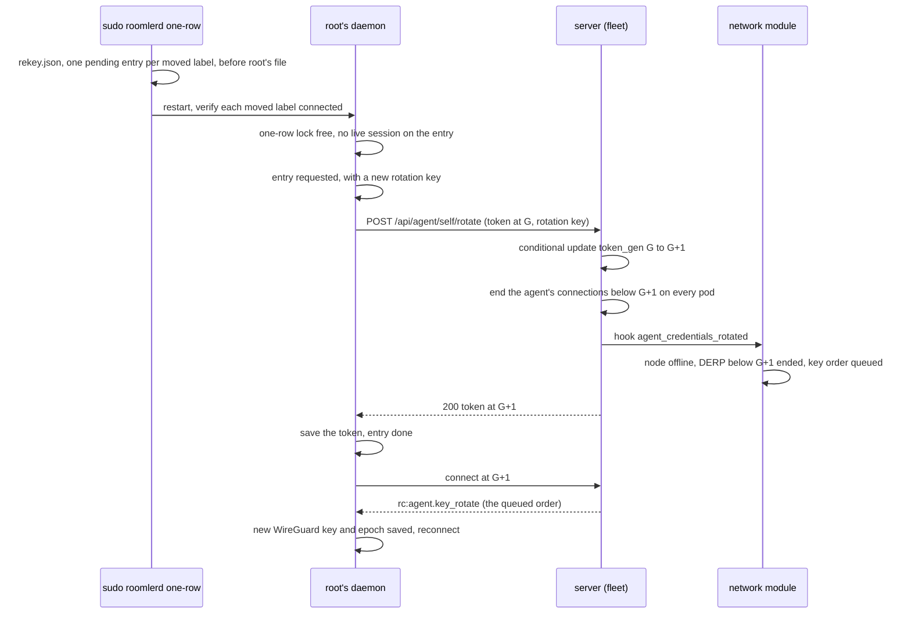

# FR-155: A one-row conversion gives each enrollment it moves new credentials

**Issue:** [#4467](https://github.com/gjovanov/roomler-ai/issues/4467) · **Status:** claimed 2026-11-25; P1a merged
(#4470), P1b merged (#4517), P1c in review (#4530). D1–D3, D5 and D6 were decided on 2026-11-25, with two requirements added (Q1, Q2); D4 is open, for P4.
**Builds on:** [FR-43](FR-43-macos-single-enrollment.md) P3c (`sudo roomlerd one-row`),
[FR-147](FR-147-root-out-of-homes-macos.md) (root's records, the person's child),
[FR-103](FR-103-device-credentials-renew-themselves.md) (the token generation),
[FR-40](FR-40-overlay-key-rotation.md) (the overlay key order)
**Related:** [FR-141](FR-141-one-run-one-row.md) (the wizard's one-row road, which enrolls root with its own token),
[FR-138](FR-138-the-session-outlives-its-control-socket.md) (a session kept across a dropped control socket)

**Anchors:** read on master `079a171a0` (2026-11-25), in the tree.

## Goal

`sudo roomlerd one-row` makes a Mac's root daemon the Mac's one row. It moves each person's enrollments into root's
file (FR-43 P3c), and since FR-147 it changes a person's files only through that person's own process. After this FR:

- **A one-row conversion gives each enrollment it moves new credentials:** an agent token of the row's next
  generation (FR-103), issued by the server for the same row, and a new WireGuard key through FR-40's order. The
  row, its overlay node and its overlay address stay the same.
- **The row keeps a working credential at every step:** with the server unreachable, in a conversion that stops
  part-way, in a re-run, in the undo and in `--revert`.
- **`--revert` and the undo give the restored half root's current credentials.**
- **A Mac converted by an earlier release gets the same, once,** at its root daemon's first clean start on a release
  that carries this FR.
- **A re-key never ends a live remote-control session or SSH connection** (Q1).
- **Each side says where a moved enrollment stands:** the device in `Status` and in the conversion's report, the
  server in a refusal reason of its own for a generation a rotation retired (Q2).

## What there is to build on

| Piece | What it gives | Where |
|---|---|---|
| the conversion | builds root's `[[orgs]]` entry for each moved enrollment, with its overlay off; then restarts root's daemon and checks that each moved label connects within `VERIFY_WITHIN` (60 s), or undoes the whole conversion | `moved_primary` `agents/roomlerd/src/one_row.rs:530-547`, `moved_org` `:551-559`; the steps `:1981-2143`, root's file `:2084-2088`, verify `:2141-2142`; `VERIFY_WITHIN` `:83`; `missing` `:878-918` |
| root's records | `/etc/roomler/one-row/`: root's kept file and `root.json`, and per person the kept config and `record.json`. One `RootFile` variant per file, one function that names its path | `RootFile` `one_row.rs:114-125`, `root_path` `:156-164`, `converted_root` `:1473` |
| the undo and `--revert` | the undo puts back each started person's kept bytes. `--revert` writes root's kept file first, then gives each person their half back through their own child: `put-back`, or `put-back-legacy` for a conversion made before root kept the bytes | `undo` `one_row.rs:2308-2467`; `revert` `:3098-3231`, root's kept file `:3113-3125`; `give_back` `:2978-3089`; `rekeep` `:2249`; the child's verbs `agents/roomlerd/src/one_row_home.rs:15-23`, `put_back` `:1442`, `put_back_legacy` `:1496` |
| a start hook after a clean run | the root daemon's sweep at start, after `CLEAN_RUN_THRESHOLD_SECS`, on a converted Mac only | `sweep_at_start` `one_row.rs:3711-3731` |
| the token generation (FR-103) | a token is admitted only while its `gen` claim equals the row's `token_gen`. A removal advances it; enrollment and renewal mint at the current value | `generation_refusal` `crates/modules/fleet/src/auth_agent.rs:96-99`, called for HTTP and renewal at `:306-314`, for the agent socket at `crates/modules/fleet/src/socket.rs:1501-1514`, for DERP at `crates/modules/network/src/derp.rs:404-415`; `soft_delete` `crates/services/src/dao/agent.rs:1321-1337`; the field `crates/remote_control/src/models.rs:2377-2385`; the claim `crates/services/src/auth/mod.rs:112-113` |
| renewal (FR-103) | `POST /api/agent/self/renew` mints at the row's generation and is idempotent. The device saves a token by compare-and-swap and uses it everywhere through one slot per enrollment | `self_renew` `crates/modules/fleet/src/agent.rs:841-881`, its answer `:820-826`, its route `crates/modules/fleet/src/lib.rs:562`; FR-103 §3c (`FR-103-device-credentials-renew-themselves.md:75-82`) and §6.1 (`:143`); the device's request `agents/roomlerd/src/token_renewal.rs:175-206`; `persist_agent_token` `agents/roomlerd/src/remote_config.rs:690-743` |
| FR-40's key order | the server writes the desired state on the row, then pushes `rc:agent.key_rotate`, or queues it for the connect-time reconcile. Its trigger is a string. The device mints, saves the key and its epoch first, reports and reconnects, with no overlay-mode gate. The join under the new key writes the old one to the network's ledger | `place_order` `crates/modules/network/src/routes/overlay_key.rs:156-249`, `OrderedBy` `:112-138`, the trigger `crates/remote_control/src/models.rs:3345`; the reconcile `crates/modules/fleet/src/socket.rs:317-334`, `:394-410`; the device `agents/roomlerd/src/signaling.rs:6337-6479`, `rotate_overlay_key` `remote_config.rs:647-688`; the ledger at the join `crates/modules/network/src/overlay.rs:439-454`, its reason `:834-866` |
| one node per machine | the overlay node is the tenant and the row's `machine_id`, so a join under a new key keeps the node and its address | `crates/modules/network/src/overlay.rs:302-311`, `:425-485` |
| the Hub's ends | each trigger names why it cancelled a connection; a removal's kick and its cross-pod `kick` envelope | `CancelReason` `crates/modules/fleet/src/hub.rs:163-203`; `kick_removed_agent` `:1275-1298`; `crates/modules/fleet/src/ctrl.rs:75-91` |
| core hooks | the inverse edges: fleet tells the modules that hold state about an agent, in `HOOK_ORDER` | `crates/core/src/hooks.rs:37`, `agent_removed` `:98` |

## Design

### The server: `POST /api/agent/self/rotate` (P1a)

Beside `self_renew` (`crates/modules/fleet/src/agent.rs:841`, route `crates/modules/fleet/src/lib.rs:562`).

- **The body** is `{"rotation_key": "<base64 of 32 random bytes>"}`. The server keeps only its sha256.
- **Admission** is its own path, `authenticate_for_rotation`, beside `authenticate_for_renewal`
  (`auth_agent.rs:166`): the agent audience and the signature; `exp` with no extension (an expired token renews
  first); a live row that is not quarantined (`refusal_reason`, `auth_agent.rs:60`); and one of
  - the token's generation equals the row's `token_gen`: a first call;
  - the token's generation is one below the row's, the row's last rotation made the row's generation, and
    `sha256(rotation_key)` equals that rotation's: a replay of an answer that was lost.

  Nothing else is admitted.
- **The commit** is one conditional update. Filter: `{_id, tenant_id, token_gen: G, deleted_at: null,
  status: {$ne: "quarantined"}}`, and `token_rotation.at` absent or more than an hour old. `deleted_at: null` is the
  repository's live predicate, which matches a live row with or without the field (`.claude/rules/security.md`);
  `$type` is for partial unique indexes. At G = 0 the filter's generation is `{$in: [0, null]}`: a row enrolled
  before FR-103 has no `token_gen` field, and reads as 0 (`crates/remote_control/src/models.rs:2384-2385`). Update:
  `{$inc: {token_gen: 1}, $set: {token_rotation: {gen: G+1, key_sha256, at}, token_exp}}`. One rotation per
  generation: a request the update does not match is read again against the replay rule. One that fails it is
  answered 429 when the row read again meets every condition of the filter but the hour, and is refused otherwise.
- **A device rotates at most once an hour.** A first call while the row's last rotation is less than an hour old is
  answered 429, and the row stays as it is. The ceiling is the filter's last condition, so it needs no state of its
  own. A replay is exempt.
- **After a first commit, and only then:** the connections of earlier generations end (P1b, P1c), the hook runs (P1d),
  and the server mints at G+1 as renewal mints (`renew_agent_token`, `crates/services/src/auth/mod.rs:543-574`) and
  answers 200 in the renewal's shape, `{agent_token, expires_at}` (`agent.rs:820-826`).
- **A replay** mints at the row's generation and changes nothing else.
- **404** for a first call while `rc.agent_token_rotation` is off, and for every call while
  `rc.token_generation_check` is off: a rotation that retires nothing must never let a device record it as done.
  The device reads 404 as "unsupported", as renewal does (`agents/roomlerd/src/token_renewal.rs:202`). A replay is
  answered while `rc.agent_token_rotation` is off, so switching it off never leaves a device without the answer to
  a rotation the server has already made.
- **The audit:** one row per decision (`first`, `replay`, `refused` with its reason, `rate_limited`,
  `unsupported`), each with the caller's IP and the generation from and to, in a new collection
  `token_rotation_audit`. Its index set goes in fleet's plan (`crates/modules/fleet/src/lib.rs:678`), beside
  `config_audit` (`:858-867`), with the same 90-day TTL.
- **The switch** `rc.agent_token_rotation` (`ROOMLER__RC__AGENT_TOKEN_ROTATION`) sits beside
  `token_generation_check` (`crates/config/src/settings.rs:1062-1068`). It is off by default until P1d, which turns
  it on (D5).
- **The composition baseline** gains the route beside `/api/agent/self/renew`
  (`crates/tests/fixtures/composition.baseline.json:236`) and the index set, re-recorded with `COMPOSITION_UPDATE=1`
  and a commit message that says why.
- **Docs in the same PR:** the route in `docs/api.md`.

### A refusal names its cause (Q2, P1a)

`generation_refusal` has one text, the removal's (`auth_agent.rs:96-99`). A token below the row's generation is
refused with a text of its own when the row's current generation came from a rotation (`token_rotation.gen ==
token_gen`), and with the removal's text otherwise. The function gains that one input. The agent callers
(`auth_agent.rs:306-314`, `socket.rs:1501-1514`, `derp.rs:404-415`) pass it from the row. The tunnel-client callers
(`crates/modules/network/src/tunnel.rs:2164-2175`, `crates/modules/network/src/routes/tunnel.rs:442-448`) pass "no
rotation", since a tunnel client does not rotate. The server's log lines carry the reason, so a field read does not
look for a removal that never happened.

### What the commit ends (P1b, P1c, P1d)

Each live connection records the generation it was admitted under:

- the Hub entry, from the claim the agent socket checks before the upgrade (`socket.rs:1501-1514`), passed into
  `register_agent_resuming` (`hub.rs:966`);
- the DERP registration, from the check at `derp.rs:404-415`, passed into `handle_derp_socket` (`:476`) and kept
  beside its cancel handle (`:564-566`).

The commit then ends the agent's connections admitted below G+1:

- **The control socket (P1b, fleet).** On this pod the entry leaves the Hub and its cancel fires, with a new
  `CancelReason::Rotated` (`hub.rs:163-203`), so the disconnect line reads `by=rotated`. There is no goodbye:
  `AgentDeleted` would stop the daemon. Every other pod does the same on a ctrl envelope `end_below_generation`,
  which carries the agent and G+1 (beside `kick`, `ctrl.rs:75-91`). The generation in the envelope keeps a late
  envelope from ending a connection already admitted at G+1. Ending the socket ends what it carried, as any
  disconnect does (`crates/modules/network/src/agent_socket.rs:246-267`).
- **A floor on every pod (P1b).** A connection whose upgrade was checked before the commit can reach the Hub after
  the sweep. So each pod keeps, per agent and for a bounded time, the generation the sweep named, and the Hub
  refuses a registration below it. The sweep stores the floor before it scans the entries, and a registration
  stores its entry before it reads the floor, so one of the two always sees the other.
- **Only the device's current generation holds its Hub entry (P1c).** Three parts, described below: the
  registration reads the row, the entry of a higher generation stays, and every pod checks its own entries.
- **DERP (P1d, network, through the hook):** the agent's registrations admitted below G+1 end, on this pod by their
  cancel (`derp.rs:564-565`, as `local_rehome_close` does, `crates/modules/network/src/derp_cluster.rs:213-229`)
  and on every other pod by an envelope that carries the generation, with the same floor at registration.

The commit takes the agent's entry out of this pod's Hub before the hook runs. FR-40's order then reads the device
as offline (`overlay_key.rs:165`) and is queued for the next connection (`:217-221`): it is never pushed to a
connection that is ending.

### Only the device's current generation holds its Hub entry (P1c)

P1c makes two properties hold whatever the timing, while the switch is on:

- **A. A registration admits only the device's current generation.**
- **B. Every pod ends a registered entry below its row's current `token_gen` within N**, also a pod that the
  commit's control event does not reach. N is one period of `rc.presence_sweep_secs` (30 s by default, never
  under 5 s) plus the time of one read.

| Part | Where | What it does |
|---|---|---|
| **The registration's read** (A) | the agent socket, after the hello and before anything is written (`registration_generation` in `crates/modules/fleet/src/socket.rs`) | reads the row on the primary (`AgentDao::find_any_in_tenant_on_the_primary`) and judges the connection's generation with FR-103's rule, in the upgrade's order: `refusal_reason` first, then `generation_refusal`. A row of another generation is refused with the upgrade's line, `refusing agent WS: token of another generation`, and `at=registration`; a row gone is refused as the upgrade refuses it; a removed or quarantined row is the removal's to answer; a failed read admits, as the upgrade's pre-read does |
| **The entry of a higher generation stays** (A) | `Hub::admit_agent` (`crates/modules/fleet/src/hub/rotation.rs`), in the entry's lock | a registration below the generation of the entry it would replace is refused as one below the floor is (`BelowFloor`), and the entry and its socket stay as they were |
| **Every pod checks its own entries** (B) | `crates/modules/fleet/src/generation_check.rs`, a loop on every pod, as the resume scope's reconciler runs (`resume_scope::spawn_reconciler`) | each period it collects the pod's entries (`Hub::agent_generations`), reads the live rows' `token_gen` on the primary in one query with a projection (`AgentDao::live_generations_on_the_primary`), and ends each entry below its row's generation through `Hub::end_below_generation`, so the disconnect line (`by=rotated`), the floor and the sessions are as at P1b's sweep. It reads Mongo only. It is not the presence sweep, which runs on one pod a cycle, through a Redis claim |

**Why the read and the floor together admit no registration below a commit.** Take a connection that the upgrade
admitted at G, and a commit to G+1. A commit before the registration's read is seen by the read, which refuses.
After the read, the pod's sweep runs after the commit too: on the pod that commits before the route answers, on
another when the control event arrives. A sweep before the admit has stored the floor, which the admit reads under
the entry's lock and refuses; a sweep after the admit finds the entry and ends it. The floor stands at the admit,
since `ROTATION_FLOOR_SECS` (600 s) covers the time from the read to the admit: the hello's write and at most one
read of the resume scope. Every pod's check then makes B hold whatever the order of events.

A refused registration registers nothing and writes nothing, so it writes no Offline (P1b's decision). The three
parts run only while `rc.agent_token_rotation` and `rc.token_generation_check` are both on, since a rotation
commits only then (`Hub::set_token_rotation`, set once at startup). With either off, nothing of P1c runs: no read at
the registration, no check, and a registration replaces the entry as it always has
(`replaced_by_newer_connection`). T18 shows it.

### The hook `agent_credentials_rotated` (P1d)

A new `FleetLifecycle` hook in `crates/core/src/hooks.rs`, beside `agent_removed` (`:98`), with a default no-op:
fleet cannot call network, and a hook is the inverse edge. It carries the tenant, the agent and the new generation.
The network module implements it:

1. **The node goes offline.** `handle_overlay_leave` (`crates/modules/network/src/overlay.rs:1078-1106`) marks it
   Offline, and peers drop it. A connection the sweep took out of the Hub runs no leave in its own teardown
   (`agent_socket.rs:269-278`), so the hook runs it.
2. **Its DERP registrations admitted below the new generation end** (above).
3. **An FR-40 order** with the trigger `credential_rotation`, a new constant beside `key_retired`
   (`crates/remote_control/src/models.rs:3345`): `place_order(.., OrderedBy::Server(..), public_key_before = the
   node's key)` (`overlay_key.rs:156-249`). It is queued, and the connect-time reconcile delivers it when the device
   connects at G+1 (`crates/modules/fleet/src/socket.rs:317-334`, `:394-410`). The device's handler mints, saves the
   key and its epoch first, reports and reconnects (`agents/roomlerd/src/signaling.rs:6337-6479`,
   `agents/roomlerd/src/remote_config.rs:647-688`). The node keeps its id and address (`overlay.rs:302-311`,
   `:425-485`), and the join under the new key writes the old one to the ledger with the reason `rotate`
   (`:439-454`, `:834-866`). A moved entry's overlay starts off (`one_row.rs:539`, `:554`), so that join waits
   until root's owner turns the overlay on. A device whose `overlay_key_rotation` is off refuses the order and says
   so (`signaling.rs:6340-6355`); its token rotates all the same.

A hook failure is logged, counted (`credential_rotation_hook_failed`) and audited. It never withholds the new token:
the answer carries the row's only working credential. An order the per-device rate limit refuses
(`overlay_key.rs:94-110`) is placed again once, after the limiter's window. A second refusal is audited, and the
dashboard shows the order as refused, for an operator to place.

### The device: root's daemon carries the re-key (P3)

**Root's daemon, after the conversion has committed.** The conversion process talks to the daemon only through the
LocalAPI's `Status` (`one_row.rs:3959`) and has no HTTP client of its own. The daemon has the server's HTTP path,
the token slot and the compare-and-swap save (`token_renewal.rs:238`, `remote_config.rs:690-743`). And because the
re-key runs after the conversion commits, the undo never meets a credential the server has stopped admitting.

**The record** `/etc/roomler/one-row/rekey.json` is a new `RootFile` variant (`one_row.rs:114-125`, its path in
`root_path` `:156-164`), so the records' stray check knows it. It has `deny_unknown_fields` and `v: 1`, mode 0600,
and is written atomically, as the other records are. One entry per moved enrollment: `label`, `server_url`,
`tenant_id`, `agent_id`, `from_gen` (the generation the conversion moved), `state` (`pending` | `requested` |
`done` | `refused` | `moot`), `rotation_key` (only while `requested`), `release` and `at`.

**The one-row lock** is `flock(LOCK_EX)` on `/etc/roomler/one-row.lock`, outside the records folder, with
`instance_lock.rs`'s hardening (`agents/roomlerd/src/instance_lock.rs:26`): a FIFO or a folder at the path is
refused. The conversion and `--revert` hold it for their whole run. The daemon's re-key takes it with `LOCK_NB`. The
kernel releases it when a process dies.

**Each moved enrollment, in root's daemon:**

1. **Before a connect attempt**, while its entry is `pending` and a look is due, or `requested`, and the lock is
   free:
   1. Take the lock. Check that root's file holds the entry (its label and identity). If it does not, the record
      says `moot`.
   2. Read the generation of the token root's file holds for it: the `gen` claim, read without verifying, as
      `jwt_introspect` reads `exp` (`agents/roomlerd/src/jwt_introspect.rs:26-42`, `:63`). Above `from_gen`, the
      record says `done`. **Never by the token's bytes:** a renewal, and a re-enrollment of a live row, change them
      at the same generation (`agent.rs:838-840`, `crates/services/src/dao/agent.rs:1321-1325`).
   3. `pending`: generate the rotation key, write `requested` with it and fsync, before asking.
   4. Call `POST /api/agent/self/rotate` with the token and the key. A `requested` entry always sends the same key,
      so an answer that was lost is recovered by the replay.
   5. 200: save the token, write `done` and drop the key, put the token in the slot and register it with the
      redactor, release the lock, and connect with it. The save compares generations, not bytes:
      `persist_agent_token` (`agents/roomlerd/src/remote_config.rs:705-743`) compares bytes, and a renewal saved
      in the meantime changes them at the moved generation.
   6. 401 or 403: write `refused`, log it, show it in `Status`. The loop goes on as FR-103's refusal path does.
   7. 404, 429, or no answer: leave the state, release the lock, and connect with the current token. The entry's
      next look is due after the renewal's retry period (`token_renewal.rs:58-60`, 1 h), so step 2 plans no
      reconnect before then. A `requested` entry is also asked again, with the same key, before its next connect
      attempt, so an answer that was lost costs one reconnect.
2. **While connected**, with an entry `pending` or `requested`: once the lock is free and a look is due (at once
   after a conversion, otherwise after each connect and every 12 h, the renewal's schedule), the loop ends its own
   connection on purpose and runs step 1, the way the key order's reconnect does. Root's own socket is closed
   before the commit.
3. After the reconnect at G+1, the reconcile delivers the FR-40 order, and the existing handler changes the key.

**Q1: a re-key never ends a live session.** The re-key runs only while the entry holds no live remote-control
session and no SSH connection, as the daemon counts them (`agents/roomlerd/src/busy.rs:111-120`): per enrollment
where a session names its org (`agents/roomlerd/src/rc_sessions.rs:87-106`), and the process's count where it does
not (SSH, `agents/roomlerd/src/ssh.rs:3135-3146`). A session kept across a dropped socket (FR-138) counts. So:

- the planned reconnect (step 2) waits while the entry holds one;
- a natural reconnect (a daemon start, a dropped socket) re-keys before it connects when the entry holds none, and
  otherwise connects with its current token and leaves the re-key to step 2;
- a conversion restarts the daemon, so there the re-key runs at once.

An entry whose answer was lost (`requested`) and that holds a session connects with its current token first. If the
server refuses that token, the daemon asks again with the same key before its next attempt, which recovers the
answer when the rotation was made.

The key order counts as part of the re-key. Its reconnect closes every session the connection holds, kept ones
included (`ConnExit::KeyRotated` is terminal, `agents/roomlerd/src/session_table.rs:216-222`). It is delivered as the
first connection at the new generation opens. If it finds the entry holding a live session, root's daemon carries it
out, while its overlay is off, when that session ends; with the overlay on, at once.

**`Status`** gains one field per enrollment, `credentials`: `current`, `rekey_pending` or `rekey_refused`. It is an
additive default in `OrgStatus` (`crates/localapi/src/lib.rs:735-774`), and absent means "not reported". It feeds
the conversion's report, `roomler status` and the companion.

**The conversion**, holding the lock from Read to the end:

1. K1, K2, the bootout and the second read run as they do now.
2. `rekey.json` is written, one `pending` entry per moved label, before root's file (`one_row.rs:2084-2088`).
3. Root's file, the convert, the restart and the verify run as they do now.
4. The report is written, and the lock released.
5. It waits, bounded at 90 s (D6), on `Status` until each moved label reads `current`.
6. The last line names each label: "new credentials", or "new credentials pending: root's daemon finishes them when
   the server answers; the row keeps working meanwhile". The description before the confirm and the report say the
   same (`describe` `one_row.rs:760`, `report` `:2628`).

A pending re-key never undoes a conversion, and the exit code is success either way.

**The row keeps a working credential at every step:**

| Where it stops | What the row has | What finishes it |
|---|---|---|
| before root's file | the person's own file, which the undo puts back | nothing to do |
| after root's file, before the verify succeeds | root's entry at G; the lock is held, so nothing rotates | the undo puts the person's file back |
| the conversion process dies after root's file | root's entry at G; the kernel has released the lock | the daemon re-keys from `rekey.json` |
| the server unreachable after the verify | root's entry at G | a look at each connect and after each retry period; `requested` replays with its key |
| the commit happened, and the answer was lost | the server at G+1; root holds G and the saved rotation key | the replay answers with G+1, asked before the next connect attempt |
| the token saved, `done` not yet written | root's file at G+1 | the next look reads the generation and writes `done` |
| a `--revert` while an answer is awaited | root's entry at G, and the saved rotation key | the revert stops before it changes anything; root's daemon finishes the request, and the revert runs again |

A refusal (401 or 403) is recorded as `refused` and shown in `Status`, in the report and in the log. Its remedy is an
administrator's: remove the row and enroll root's half again.

**A re-run** is refused while root's records of a conversion remain (`one_row.rs:1843-1856`). After a revert, a
conversion moves the spliced credentials, and the daemon re-keys them to the next generation.

**The kill switch** `ROOMLERD_CREDENTIAL_ROTATION=0` is read as `ROOMLERD_TOKEN_RENEWAL` is
(`token_renewal.rs:40`, `:95-108`): no first request, and the entries stay recorded and visible. An entry already
`requested` is asked again with its key, since only that ask fetches the answer to a rotation the server may have
made.

**P3's release notes** say that a `--revert` after a re-key needs a release that carries P2.

### `--revert` and the undo (P2)

`splice_current(kept, root_now)` is a pure function. For each enrollment of `kept` (its primary when it is not
blank, and each `[[orgs]]` entry) whose identity matches one of `root_now`'s `[[orgs]]` (the server host as
`host_of` compares it, `one_row.rs:516-523`, the tenant and the agent id), it takes `agent_token`,
`overlay_wg_secret_key` and `overlay_wg_key_epoch` from root's entry. Everything else in `kept` stays as it is.

**`--revert`**, holding the lock for its whole run:

1. It reads root's current config (`load_root`, `one_row.rs:3848`) before anything changes.
2. For each person, it makes the spliced half durable:
   - a conversion with root's records: when the splice differs, `rekeep` (`one_row.rs:2249`) removes `record.json`,
     writes the spliced config, and writes `record.json` last with its new sha, so the check in `give_back` holds
     for the spliced bytes;
   - a conversion by an earlier release (`config.toml.pre-one-row` in the person's folder): a new child verb,
     `refresh-legacy`, in the verb table (`one_row_home.rs:15-23`), takes the identity-to-credentials map on stdin,
     never in argv, and writes the credential fields of the matching enrollments into that file as the person
     (FR-147: a root step writes nothing in a home).
3. Then the order it has now: root's kept file over root's config (`one_row.rs:3113-3125`), `give_back` for each
   person (`:2978-3089`), the restart, the bootstrap, and the records removed (from P3 on, `rekey.json` with them).

Step 2 is durable before step 3, so a revert that stops between them resumes with the spliced records.

**A re-key in flight (P3).** A revert that finds an entry `requested` stops before step 1, names the label, and asks
to be run again once `Status` reads `current` for it: the splice must carry credentials the server admits, and only
root's daemon can finish that request. The revert holds the one-row lock, so no request starts while it runs.

**The undo** applies the same splice, from root's config as the undo reads it before root's file goes back. A
conversion retires nothing before it commits, so the splice changes nothing there; it is there so that the undo's
correctness never rests on the order of steps.

**Why not re-key again at a revert:** a revert works offline, and a second rotation would make it depend on the
server. Root's current credentials are, by construction, the working ones.

**The kill switch** `ROOMLERD_ONE_ROW_SPLICE=0` **fails closed.** When a person's kept credentials differ from
root's current ones, the revert refuses that person with a line that names the label and the administrator's
remedy, and writes nothing for them. A switch that put the kept credentials back would undo what P2 builds.

### Macs converted by an earlier release (P4)

At the root daemon's start, after `CLEAN_RUN_THRESHOLD_SECS` as `sweep_at_start` waits (`one_row.rs:3711-3731`), on
a converted Mac (`converted_root`, `:1473`) that has **no** `rekey.json`, the daemon records a `pending` entry for
each moved enrollment that root's own records identify, by the first rule that applies:

1. the identities in each person's kept config (`/etc/roomler/one-row/<uid>/config.toml`) that root's current
   `[[orgs]]` holds;
2. root's `[[orgs]]` entries that root's kept file does not hold;
3. every `[[orgs]]` entry.

Never root's primary: a conversion always moves into `[[orgs]]` (`moved_primary`, `:530-547`). From there, P3's
path takes over. A `rekey.json` that exists, in any state, means the decision was made, so this runs once. It is a
start hook rather than a verb because a verb holds only where someone runs it, and the clean-run gate keeps it off a
daemon that is crash-looping.

**The kill switch** `ROOMLERD_ONE_ROW_REKEY_EXISTING=0`: nothing is recorded at start.

A Mac whose root records are all gone does not read as converted (`converted_root` is false): D4.

### Kill switches

| Phase | Switch | Off means |
|---|---|---|
| P1 | `rc.agent_token_rotation` (`ROOMLER__RC__AGENT_TOKEN_ROTATION`); the route also answers 404 while `rc.token_generation_check` is off | 404 for a first call: devices keep their credentials, keep working and show `rekey_pending`; a replay is answered. Nothing of P1c runs: no read at the registration, no check. The fleet-wide switch (D5) |
| P2 | `ROOMLERD_ONE_ROW_SPLICE=0` | a revert refuses a person whose credentials differ, and never puts the kept ones back (fails closed) |
| P3 | `ROOMLERD_CREDENTIAL_ROTATION=0` | no first request; the entries stay recorded and visible, and a `requested` one is asked again with its key |
| P4 | `ROOMLERD_ONE_ROW_REKEY_EXISTING=0` | nothing recorded at start |

### Tests

Each cell fails on master before its PR and passes on it, except M6 and M16, which pass on master too: they pin
what the design rests on. T1's P1b half, T14 and T18 pass on master too. FR-103's check already answers 401 to a
token of G once the row is at G+1 (run [46001191285](https://github.com/gjovanov/roomler-ai/actions/runs/46001191285),
at P1b's cells), and T14 and T18 pin that with the switch off nothing changes. T15, T16 and T17 fail on P1b's code,
before P1c's change (runs [46069840160](https://github.com/gjovanov/roomler-ai/actions/runs/46069840160) and
[46069840296](https://github.com/gjovanov/roomler-ai/actions/runs/46069840296), at P1c's cells). The names state the
property.

**Server (P1).** The integration cells run in `.github/workflows/integration-tests.yml`, job `integration`, step
"Run the suite" (`:288`). A PR fires that lane only through its path filter (`:44-59`), which lists
`crates/tests/**` and neither `crates/modules/**` nor `crates/core/**`, so each P1 PR carries its cells in
`crates/tests`. Each cell starts its servers with the switch on, except a server that shows the switch off (T6,
T14, T18).

| # | Cell | Phase | Asserts |
|---|---|---|---|
| T1 | `a_rotation_issues_the_next_generation` | P1a, P1b | rotate: the new token's `gen` claim and the row are at G+1, and an HTTP route answers 401 to a token of G (P1a). The agent socket's upgrade and a DERP dial admit the new token and answer 401 to one of G, and a renewal with the token of G after the commit is refused (P1b; FR-103's assertions, `crates/tests/src/token_renewal_tests.rs:239-250`) |
| T2 | `a_lost_answer_is_recovered_with_the_rotation_key` | P1a | rotate, then ask again with the same token and key: 200 at G+1, and nothing else changes. With another key: 401 |
| T3 | `one_rotation_per_generation` | P1a | one rotation per generation: the conditional update commits once at G, and the row ends at G+1 |
| T4 | `a_rotation_ends_the_connections_of_earlier_generations` | P1b, P1d | an agent socket and a DERP registration open at G, then rotate: both end within 5 s. With two servers, a socket on B ends when A rotates. A socket opened at G+1 survives a late envelope |
| T5 | `a_rotation_takes_the_node_offline_and_orders_a_key` | P1d | a joined node, then rotate: the node is Offline, a peer's netmap marks it unreachable, and the row carries a `credential_rotation` order, queued and delivered at the next connect at G+1 |
| T6 | `rotation_is_unsupported_while_switched_off` | P1a | `rc.agent_token_rotation=false`: a first call is answered 404 and the audit row says `unsupported`, while a replay of a rotation made before is answered 200; `rc.token_generation_check=false`: 404 |
| T7 | `a_removed_or_quarantined_row_does_not_rotate` | P1a | a tombstoned row: 401; a quarantined row: 401; the generation unchanged |
| T8 | `the_composition_includes_the_rotate_route` | P1a | the composition gate (`crates/tests/fixtures/composition.baseline.json`) |
| T13 | `a_second_rotation_within_the_hour_waits` | P1a | rotate, then a first call with the new token within the hour: 429, the audit row says `rate_limited`, and the generation is unchanged; a replay of the first rotation is answered 200; with the row's `token_rotation.at` set back by more than an hour, the second rotation commits |
| T14 | `a_rotation_switched_off_ends_no_connection` | P1b | `rc.agent_token_rotation=false`: a first call's 404 ends nothing, on the pod it reached or on another, and keeps no floor (a second socket of the same generation registers) |
| T15 | `a_registration_admits_only_the_current_generation` | P1c | two sockets upgraded at G, then a rotation to G+1 on a pod without Redis, and a floor of 1 s on the sockets' pod (`Hub::end_below_generation_for`) that ends before their hellos. A socket of G+1 registers. The first G socket's hello is then refused: it closes with no goodbye, and the socket of G+1 stays served and hears nothing. With the G+1 socket closed, the second G socket's hello is refused too, and no entry is left |
| T17 | `every_pod_ends_an_entry_below_its_rows_generation` | P1c | a socket registered at G on a pod whose check runs every 5 s, then a rotation to G+1 on a pod without Redis, so the control event reaches no other pod: the socket closes with no goodbye within 10 s. A socket of G+1 then stays served through two periods |
| T18 | `a_pod_switched_off_ends_and_refuses_nothing_new` | P1c | T14's extension: on a pod with `rc.agent_token_rotation=false`, beside a rotation committed on a pod with it on, nothing of P1c runs. In T15's and T17's setups the pod refuses nothing new and ends nothing new through two periods, and a registration replaces the entry as it always has (`replaced_by_newer_connection`) |

| # | Cell | Phase | Asserts | Lane, step |
|---|---|---|---|---|
| T9 | `rotation_admission` | P1a | the admission's truth table: the claim's generation against the row's, the last rotation's generation and key hash, and `exp` | `ci.yml` job `rust-unit`, "Run fleet module unit tests" (`:542-543`) |
| T10 | `credential_rotation_hook_runs_leave_then_order` | P1d | the hook's effects in order, against a stand-in state | `rust-unit`, "Run the remaining crates' unit tests" (`:568-577`, `-p roomler-ai-mod-network`) |
| T11 | `a_rotated_generation_is_refused_with_its_own_reason` | P1a | `generation_refusal`: below a generation a rotation made, the rotation's text; below one a removal made, the removal's; equal, none; the switch off, none | "Run fleet module unit tests" |
| T12 | `the_hub_admits_no_connection_below_a_rotated_generation` | P1b | a registration below the pod's floor is refused, and the sweep ends the entries below the floor and keeps one at it, in either order of sweep and registration | "Run fleet module unit tests" |
| T16 | `the_hub_keeps_the_entry_of_the_higher_generation` | P1c | with the rotation on, a registration below the entry it would replace is refused (`BelowFloor`) and the entry stays, its cancel unfired; a higher generation replaces a lower one; a registration of each of two generations at once leaves the higher one's entry, 500 times; with the rotation off, a registration is admitted as before P1c | "Run fleet module unit tests" |

**Device (P2 to P4).** These cells use the conversion's `Host` trait and its fake (`one_row.rs:1695-1756`, the fake
at `:4465`) and record the order of the effects. They compile on every platform, and they hand in keys rather than
depend on the key mint, which a build without an overlay feature does not have
(`agents/roomlerd/src/key_rotation.rs:19-29`).

The lanes: `one_row::` and `one_row_home::` run on macOS in `macos-overlay-check`, step "cargo check + test the
agent's Mac-only units" (`ci.yml:1661-1664`, whose filter lists both), on Linux in `rust-agent`, step "Test agent
under vp9-444" (`:673`), and on Windows in `windows-agent-sessions`, step "Agent unit tests on Windows (the whole
--lib suite)" (`:2135-2139`). A new module (`credential_rotation::`) runs in the whole-`--lib` steps on Linux and
Windows, and joins the macOS step's filter (`:1664`) in the same PR.

| # | Cell | Phase | Asserts |
|---|---|---|---|
| M1 | `splice_gives_the_restored_half_roots_current_credentials` | P2 | a primary and two `[[orgs]]` entries, one of them not root's (left alone); every other field byte-identical |
| M2 | `a_revert_gives_each_person_roots_current_credentials` | P2 | root's moved entry differs from the kept one: after the revert, the person's file holds root's credentials, and `rekeep` (`record.json` last) comes before root's kept file is written |
| M3 | `a_revert_that_stops_after_the_splice_resumes_with_it` | P2 | a failure after `rekeep`, then a second revert: the person gets the spliced credentials |
| M4 | `a_legacy_revert_refreshes_the_kept_file_before_roots_kept_goes_back` | P2 | a conversion by an earlier release: `refresh-legacy`, with its map on stdin, comes before root's kept file; the child changes only the credential fields of matching identities |
| M5 | `the_splice_switch_off_refuses_rather_than_restores_other_credentials` | P2 | the switch off with differing credentials: that person is refused with the line, and nothing is written for them |
| M6 | `the_undo_restores_the_credentials_root_holds` | P2 | the verify fails and the undo runs: the person gets the splice of root's file as the undo read it, which is the kept bytes (green on master; it pins the order) |
| M7 | `a_conversion_records_each_moved_enrollment_before_roots_file` | P3 | two people, each with a primary and an `[[orgs]]` entry: `rekey.json` lists every moved label as `pending`, written before `save_root` |
| M8 | `an_undone_conversion_leaves_nothing_to_rekey` | P3 | the verify fails and the undo runs: no `rekey.json` remains |
| M9 | `the_rekey_waits_for_the_one_row_lock` | P3 | the lock held: no request; free: one request (a stand-in for the HTTP client, as `token_renewal.rs`'s tests make one) |
| M10 | `the_rotation_key_is_kept_before_the_request` | P3 | `requested` with its key, then the request, then the save, then `done` with the key dropped, then the slot |
| M11 | `a_lost_answer_is_asked_again_with_the_same_key` | P3 | the first request fails after the commit; the next look sends the same key, gets G+1 and saves it |
| M12 | `a_refused_rotation_is_recorded_and_the_enrollment_keeps_running` | P3 | 401: `refused`, `Status` reads `rekey_refused`, and the loop goes on |
| M13 | `a_server_that_does_not_rotate_now_leaves_the_rekey_pending` | P3 | 404 or 429 to the first ask: the entry stays `requested` with its key, and `Status` reads `rekey_pending`; no reconnect is planned before the retry period, and a connect attempt before then asks again with the same key |
| M14 | `the_report_names_new_credentials` | P3 | the description and the report name new credentials, or new credentials pending, for each moved label |
| M15 | `status_carries_each_enrollments_credentials_state` | P3 | `crates/localapi`: the field round-trips, and an older peer's answer reads "not reported" (lanes: `rust-unit` "Run the remaining crates' unit tests", `-p roomler-localapi`; macOS "cargo test the LocalAPI on a real Mac (#3736)", `ci.yml:1720-1721`) |
| M16 | `a_key_order_changes_an_overlay_off_orgs_entry` | P3 | `rotate_overlay_key` on an `[[orgs]]` entry whose overlay is off, the secret handed in: the epoch +1, saved. It pins what P3 rests on |
| M17 | `a_renewed_token_of_the_same_generation_leaves_the_rekey_pending` | P3 | root's file holds a renewed token at `from_gen`: the entry stays `pending`. A token above `from_gen`: `done`. A renewal saved between the request and the save does not keep the new generation's token out of the file |
| M18 | `a_rekey_waits_while_the_entry_holds_a_session` | P3 | a live remote-control session or SSH connection on the entry: no planned reconnect and no request. A natural reconnect with one kept connects with the current token. With none, the re-key runs. A `requested` entry with a session asks again only after its token is refused. A key order that finds a live session is carried out, while the entry's overlay is off, when that session ends; with the overlay on, at once |
| M19 | `a_revert_waits_for_a_rekey_in_flight` | P3 | an entry `requested`: the revert writes nothing, names the label and exits with an error. `pending`, `done`, `refused` or `moot`: the revert runs |
| M20 | `a_mac_converted_earlier_records_its_moved_enrollments_once` | P4 | records exist and `rekey.json` does not: after the clean-run gate, `pending` entries for the moved labels by each identification rule, never the primary. A second start changes nothing |
| M21 | `the_existing_mac_switch_off_records_nothing` | P4 | the switch off: no `rekey.json` |

### Lab cells

On a lab Mac guest (FR-147's lab), with the candidate build and a dedicated lab tenant. Each cell is read first on
the release before the phase it proves, where it does not meet its expectation, and then on the candidate. The cells
read state and digests only.

Every read on the host goes through one root script. It parses root's file and root's kept records, hashes the named
fields in memory, and prints only `equal`, `different`, `higher` or `lower`, never a value. The server's side is read
through the admin API or a bounded database read: the row's generation, the FR-40 order, the node's status and the
ledger's key digests.

| # | Steps | Expect |
|---|---|---|
| F1 | two people, one with a primary and an `[[orgs]]` entry; `sudo roomlerd one-row` | each moved row online. On the host, for each moved identity, root's token against the kept record's: `different`; the key epoch: `higher`; the WireGuard secret: `different`. On the server, the generation one above its value before the conversion, the `credential_rotation` order reported, and the node Offline with the same id and address |
| F2 | after F1, the lab operator turns the moved org's overlay on | the same node id and address; the ledger holds the digest of the key the kept record names, with the reason `rotate`; a peer pings the address |
| F3 | the server unreachable from the guest right after the verify (a firewall rule on the guest), then reachable again | the row online throughout; `Status` reads `rekey_pending`, then `current`; the generation moves only after the server is back |
| F4 | `sudo roomlerd one-row --revert` after F1 | the person's half online on the same row; the restored token against root's token before the revert: `equal`, against the kept record: `different`; the revert changes no generation |
| F5 | a guest converted by the release before P4, then updated to the candidate | after the clean-run threshold, the generation +1 for each moved row, and root's token against the kept record `different`; a second restart leaves the generation as it is |
| F6 | F1 with `ROOMLERD_CREDENTIAL_ROTATION=0` in root's daemon's environment; then the variable removed and the daemon restarted | with it: the conversion reports pending, the row is online, the generation unchanged. Without it: +1 at the restart |
| F7 | a conversion where one of the person's orgs is already root's (the "retired" fate), beside a moved one | root's own row in that org keeps its generation; the moved row's is +1 |
| F8 | F5, with a remote-control session and an SSH connection on a moved row opened within the clean-run threshold and held past it | `Status` reads `rekey_pending` while either is live, neither is cut, and the re-key completes after both end |

P1 changes nothing on a device: no release calls the route before P3. Its cells are T1 to T18, and its effects are
read in the field with P3's cells.

## Phases

Ship order: P1a, P1b, P1c, P1d, then P2, P3, P3b, P4 and P5. P2 lands before P3 because a revert must splice before
any rotation exists; without P3 the splice changes nothing, so P2 is safe alone.

P1c was added on 2026-11-27, between P1b and the hook's phase, which is now P1d. D5, the issue's body and P1a's PR
call the hook's phase P1c.

| Phase | What | Kill switch, or back-out | Status |
|---|---|---|---|
| P1a | Server: the route, its admission and replay, the conditional update with its once-an-hour ceiling (429, T13), `token_rotation` on the row, the audit with the caller's IP and its index set, the refusal reason for a generation a rotation retired (Q2), the composition baseline; the route in `docs/api.md` | `rc.agent_token_rotation`, off by default | MERGED (#4470) |
| P1b | Server: each control socket records its generation; the commit ends the agent's sockets below the new generation on every pod (`end_below_generation`), and each pod keeps a floor at registration; T1's second half (the agent socket's upgrade and a DERP dial admit G+1 and refuse G, and a renewal with the token of G after the commit is refused) | the same switch, off by default | MERGED (#4517) |
| P1c | Server: only the device's current generation holds its Hub entry, on every pod. The registration reads the row after the hello and judges the generation by FR-103's rule; the entry of a higher generation stays; every pod's check ends an entry below its row's generation within N, one period of `rc.presence_sweep_secs`; T15 to T18 | the same switch, off by default: with it off, nothing of P1c runs | in progress (#4530) |
| P1d | Server: the core hook `agent_credentials_rotated`; the network module takes the node offline, ends its DERP registrations below the new generation (with the floor) and queues an FR-40 order (`credential_rotation`); **the switch on by default** (D5) | `rc.agent_token_rotation`: 404, fleet-wide | — |
| P2 | Device: `splice_current` in the undo and `--revert`; the child verb `refresh-legacy` | `ROOMLERD_ONE_ROW_SPLICE=0`, which fails closed | — |
| P3 | Device: `rekey.json`, the one-row lock, the re-key in each moved enrollment's loop (Q1), `Status`'s `credentials`, the conversion's bounded wait and its report; the release notes' line on `--revert` | `ROOMLERD_CREDENTIAL_ROTATION=0` | — |
| P3b | Device: every root-daemon config write takes the one-row lock (D2) | its own PR names it | — |
| P4 | Device: Macs converted by an earlier release, at start; D4's count | `ROOMLERD_ONE_ROW_REKEY_EXISTING=0` | — |
| P5 | Docs: `docs/device-credentials.md` (a rotation section, the commit's sequence as a mermaid diagram), `docs/installation.md` (the one-row Mac: what a conversion does to credentials, and `--revert`), `docs/README.md`'s rows | none | — |

## Acceptance criteria

- [ ] **AC1** (P3, F1): after a conversion, each moved row is online at the next token generation, and root's file
  holds for it a token, a key epoch and a WireGuard secret that differ from root's kept record of the person's
  file, compared as digests on the host.
- [ ] **AC2** (P1d, P3, F1, F2): each moved row keeps its overlay node id and address, and its `credential_rotation`
  order reads reported. After the first join with the overlay on, the network's ledger holds the key root's kept
  record names, with the reason `rotate`.
- [ ] **AC3** (P3, F3): with the server unreachable after a conversion, the row stays online and reaches the next
  generation within one retry period of the server's return.
- [ ] **AC4** (P2, F4): `--revert` after a re-key brings the person's half online on the same row with root's current
  credentials, and changes no generation.
- [ ] **AC5** (P4, F5): a Mac converted by an earlier release reaches the next generation once for each moved row,
  after its first clean run. A second start changes no generation.
- [ ] **AC6** (P3, F1, F7): every moved row of every person gets its own next generation, and root's own rows keep
  theirs.
- [ ] **AC7** (Q1, P3, F8): a re-key never ends a live remote-control session or SSH connection. It waits while the
  moved row holds one, and completes after it ends.
- [ ] **AC8** (P1, T1 to T8, T12, T13): one rotation per generation, and at most one first rotation an hour per
  device (429 above it, a replay exempt); a lost answer is recovered with its rotation key; the connections of
  earlier generations end on every pod, and none registers after the rotation; the node goes offline, and a
  `credential_rotation` order is queued and delivered at the next connect; every decision is audited with the
  caller's IP.
- [ ] **AC9** (Q2, P1a, T11): a token of a generation a rotation retired is refused with its own reason, distinct
  from a removal's.
- [ ] **AC10**: each phase's switch is proven both ways: P1's by T6 (P1c's parts by T15 to T17 on, and T18 off),
  P2's by M5, P3's by F6, P4's by M21.
- [ ] **AC11**: the test cells above, M6, M16, T14, T18 and T1's P1b half aside, fail on master before their PR, and
  every cell passes in the lane named.
- [ ] **AC12** — Docs updated in house style (tables, the commit's sequence as a mermaid diagram, `file:line`
  anchors): `docs/device-credentials.md`'s rotation section, `docs/installation.md`'s one-row Mac (what a
  conversion does to credentials, and `--revert`), `docs/api.md`'s route, this spec's field log, and a row in
  `docs/README.md`'s index.
- [ ] **AC13** (P1c, A, T15, T16, T18): while the switch is on, a registration admits only the device's current
  generation, whatever the timing: a socket of an earlier generation is refused at its hello and writes nothing,
  no Offline included, and when a registration below the entry it would replace is refused, the entry stays and
  hears nothing. With the switch off, a registration is admitted as before.
- [ ] **AC14** (P1c, B, T17, T18): while the switch is on, every pod ends a registered entry below its row's current
  `token_gen` within N, one period of `rc.presence_sweep_secs` (30 s by default) plus one read, also a pod that the
  commit's control event does not reach. With the switch off, no check runs.

## Decisions

Decided by the coordinator on 2026-11-25, before this spec was written:

- **D1, the route and its body:** `POST /api/agent/self/rotate` with a 32-byte rotation key, as described above.
- **D2, every root-daemon config write under the one-row lock:** yes, in its own PR after P3 (P3b).
- **D3, FR-40's ledger at a `credential_rotation` report:** no. The ledger is written at the join, as FR-40 writes
  it: the join is the proof.
- **D5, the server switch's default:** `rc.agent_token_rotation` is off until the PR that completes P1 (P1c), which
  turns it on. From then on it is the fleet-wide kill switch. A per-tenant first step would need a per-tenant scope
  that this setting does not have. The agent release lane stages the device side: the lab's cells read P3 and P4
  before the fleet's push.
- **D6, the conversion's bounded wait:** 90 s.
- **Q1, added:** a re-key's planned reconnect never ends a live remote-control or SSH session; it waits while the
  entry holds one. A natural reconnect re-keys before it connects. A conversion restarts the daemon, so there the
  re-key runs at once. The design above adds what keeps this true for a session kept across a dropped socket, and
  for the key order's own reconnect.
- **Q2, added:** if it stays small, a generation that a rotation retired gets a refusal text of its own, distinct
  from a removal's. It does stay small: one input to `generation_refusal` (P1a).

## Open decisions

- **D4, Macs whose root records cannot show a conversion by an earlier release:** P4's PR counts them, and the
  decision follows the count. Until then, P4 covers only the Macs that root's records identify.
- **For P3, a replay near the token's expiry:** a rotation's answer can be lost close to the expiry of the token that
  asked for it, and a replay needs that token unexpired. Before P3, the device either rotates only with ample life
  left on its token, or the route admits a replay within `RENEWAL_GRACE_SECS`.

## Out of scope

- Periodic rotation of agent tokens (FR-103 §6.1).
- Enrollments a conversion does not move (the "retired" fate, kept for `--revert`).
- Proof of possession beyond the bearer token (FR-103 §7).
- Linux and Windows, which have no one-row conversion.

## Field log

| date | what | result |
|---|---|---|
