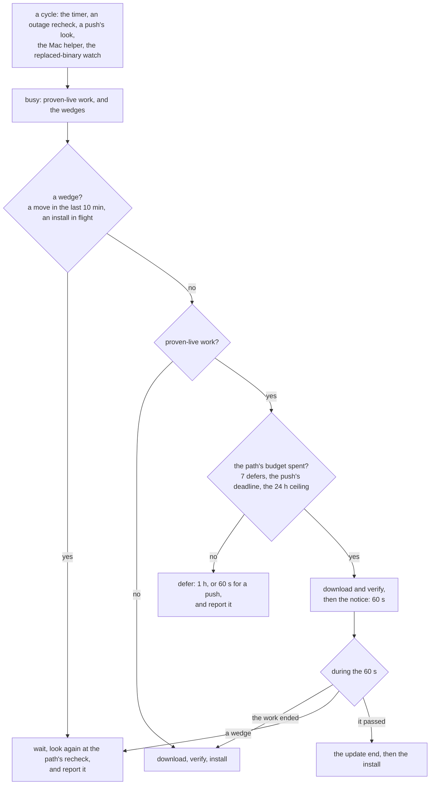
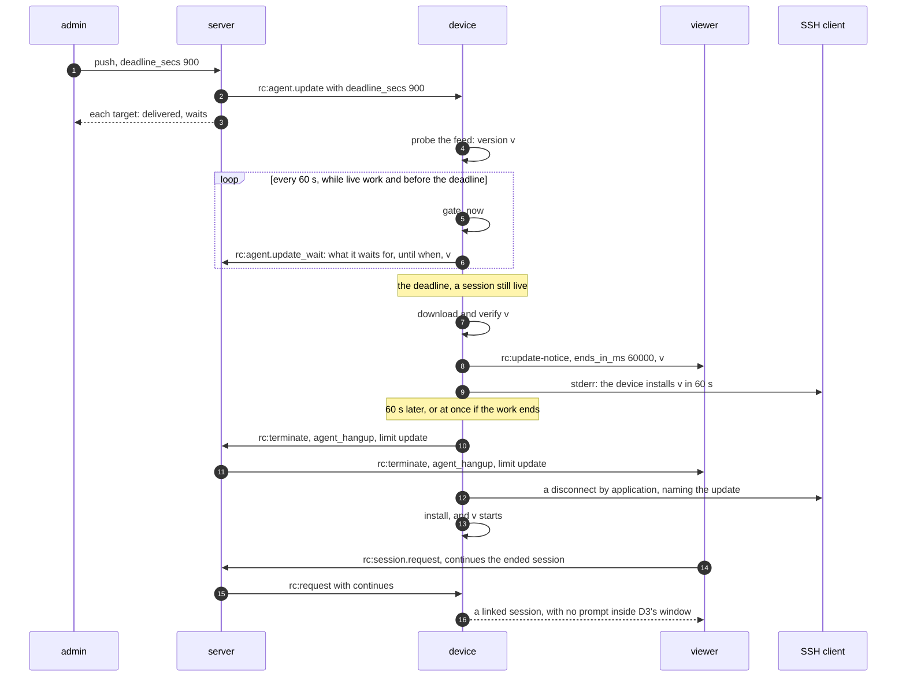

# FR-156: An update never cuts live work by surprise

**Issue:** [#4491](https://github.com/gjovanov/roomler-ai/issues/4491) · **Status:** spec, claimed 2026-11-27; nothing
built. D1–D9 are open, each with a proposal.
**From:** the issue's design, and the operator's rulings of 2026-11-27 on
[#3429](https://github.com/gjovanov/roomler-ai/issues/3429#issuecomment-7214879318) (the push, the notice, the rejoin)
and [#4469](https://github.com/gjovanov/roomler-ai/issues/4469#issuecomment-7214882225) (fix the count, in P1). Where
the issue and a ruling differ, the ruling wins, and Decisions names each place.
**Builds on:** #3429's slice 1 (#4225: `busy.rs`, `periodic_gate`, `decide_defer`), #4245 and #4253 (`UpdateAsk`,
`cycle_arm`), #4457 (`OUTAGE_RECHECK_HOLD`), [FR-151](FR-151-mac-update-waits-for-live-work.md) (the Mac's root
update helper and its gate), [FR-96](FR-96-per-user-linux-installs-update-themselves.md) P2b (the replaced-binary
watch), [FR-101](FR-101-rc-session-hygiene.md) P4b-2 (`rc:idle`),
[FR-138](FR-138-the-session-outlives-its-control-socket.md) (the held session and `rc:agent.resume_window`)
**Related:** #4407 and #4469 (a dead SSH connection counted), [FR-2](FR-2-pin-update-downgrade-guard.md) and
[FR-67](FR-67-update-outcome-observability.md) (the push's pin guard and its refusals),
[FR-27](FR-27-consent-surfaces-and-desktop-companion.md) (the host's surfaces),
[FR-105](FR-105-roomler-ssh-as-system.md) (SSH through the Windows service),
[FR-147](FR-147-root-out-of-homes-macos.md) (the person's child on a Mac)

**Anchors:** master `500b556e4` (2026-11-27), read in the tree. The russh anchors are in the sources of russh 0.62.7,
the version `Cargo.lock` pins.

## Goal

An agent update never cuts someone's live work by surprise, and never waits for work that is not there.

Today four things fall short of that. The busy model that #3429's slice 1 made the periodic check read counts an SSH
connection that a network move already ended, and it counts no tunnel flow at all. An admin's push installs at once
over everything. A restart that cuts a session tells nobody first, and the session's end reads as `agent_disconnect`.
The viewer then comes back as a new session, which a device that asks for consent asks about again.

After this FR one busy model answers "what would a restart cut?" for every restart the daemon makes, and it counts
only work it can prove is live. The restart paths differ only in their budgets: the periodic check keeps its hour and
its seven defers, and an admin's push becomes a deadline (15 minutes by default, 0 for now). Every path waits out a
state a restart could wedge. A restart that has to cut live work is announced 60 s ahead, to the viewer, on the host's
own surface and to each SSH session. Its end is recorded as an update, and the viewer rejoins by itself, so the update
reads as a pause.

## Evidence

- **Updates cut live sessions (#3429).** On 2026-11-03, during the 0.4.199 roll, a bulk push reached a device while a
  person worked through it (more than 1,000 input events). The session ended `agent_disconnect` 4 s after the update
  started, and the same controller was back 12 s later. On 2026-11-20 a periodic install on 0.4.229 cut a session of
  almost four hours: the installer spawned at 22:55:53, 0.4.230 ran at 22:55:58, and the viewer was back, as a new
  session, at 22:56:06 ([slice 1's comment](https://github.com/gjovanov/roomler-ai/issues/3429#issuecomment-7060976168)).
- **Slice 1 made the periodic check wait; a push still does not.** #4225's gate defers the periodic check on live
  work, and its field cell is GREEN on 0.4.237: a session and an SSH shell each deferred it by the hour, and the first
  check after each installed ([AC7](https://github.com/gjovanov/roomler-ai/issues/3429#issuecomment-7180986064)). A
  push takes another arm: `cycle_arm` sends an operator's ask to `CycleArm::Forced`, live work or not
  (`agents/roomlerd/src/updater.rs:3895-3899`), and the loop installs with a warning (`:3675-3696`). On a Mac the
  helper forces over both halves, a network move included, for a push the root half recorded
  (`agents/roomlerd/src/helper_gate.rs:210-214`). A push inside the 5-minute install cooldown is dropped
  (`updater.rs:3658-3670`). The server sends the push to every target that will act on it
  (`crates/modules/fleet/src/agent.rs:2332-2338`, `:2478-2486`), and the result says only whether a socket took it
  (`TriggerUpdateResult`, `:2248-2267`). The dashboard then promises a restart "shortly"
  (`ui/src/components/admin/AgentsSection.vue:2180-2192`).
- **A dead SSH connection counts (#4407, #4469).** `LIVE_CONNECTIONS` counts every open connection
  (`agents/roomlerd/src/ssh.rs:3131-3161`). Both server configs send no keepalive and end a connection after 600 s of
  silence (`:661-670`, `:748-756`), so the server learns that a network move ended a quiet connection only at that
  timeout. In #4407's lab on 0.4.235 the outage recheck read `busy=1 SSH connection(s), the network moved in the last
  10 min … next_check_secs=3600`, and the session ended 19 s later. #4457 holds that recheck once on Windows and Linux
  (`OUTAGE_RECHECK_HOLD`, `updater.rs:3831`; the hold, `:3910-3921`). The Mac has no hold: #4469, a reading of the code,
  not yet seen in the field.
- **A live tunnel flow does not count at all.** `Busy` has no field for one (`agents/roomlerd/src/busy.rs:32-48`). The
  exit side's four handlers (`agents/roomlerd/src/tunnel/acceptor.rs:106-208`, `:223`, `:354`, `:452`) and the
  daemon-hosted forwards (`agents/roomlerd/src/tunnel/client_mgr.rs:151-187`) keep byte counters per flow
  (`FlowStats`, `crates/tunnel-core/src/forward.rs:105-157`), but nothing lists the flows across the process, and the
  netstack's SOCKS front counts nothing (`copy_bidirectional`, `crates/tunnel-core/src/overlay/netstack_socks.rs:182`).
  So an update cuts a forward that carries an RDP or a database connection without a word.
- **Nobody is told, and the end reads as a disconnect.** The daemon spawns the installer and exits
  (`act_on_outcome_with`, `updater.rs:3460-3471`). The server sees its socket go: `end_agent_sessions` ends each
  session `AgentDisconnect` (`crates/modules/fleet/src/hub.rs:1234-1259`), or, with FR-138's window, the hub holds
  each for a claim (`detach_agent_sessions`, `crates/modules/fleet/src/hub/resume.rs:264-294`) that the restarted
  process, which holds no peer, never makes. The viewer redials an `agent_disconnect` (`isRetryableTerminateReason`,
  `ui/src/composables/useRemoteControl.ts:351-354`; `:9584-9596`). A redial is a new request, so a device that asks
  for consent asks again, as after a pod roll's cut (`docs/remote-control.md:5272`). An SSH client is not told: it
  waits for its carrier to give up (`docs/roomler-ssh.md:658-660`).

## Design

### One busy model, proven live (P1)

`busy::now` (`busy.rs:111-120`) stays the one answer, which every restart path reads, through `gate_now`
(`:125-128`) or directly. What it counts changes:

| Work | Counts while | The evidence of life |
|---|---|---|
| a remote-control session | it is in the session registry | unchanged: ICE keeps checking the pair, and a peer that fails ends its session (`agents/roomlerd/src/peer.rs:988-995`) |
| an SSH connection | its client sent a packet within D1's window (90 s) | the server sends a keepalive every 30 s, and any packet back stamps the connection |
| a tunnel flow | it moved bytes, either way, within the same window | a stamp beside every byte count its pumps add |
| a Fleet RPC run, a transfer, a recording | it runs | unchanged: local work |
| a network move in the last 10 min, an install in flight | its window lasts | unchanged; P2 makes both a wedge on every path |

#### SSH: the keepalive and its answer

What russh 0.62.7's server does, read from its loop:

- **`keepalive_interval`** (default `None`) sends `keepalive@openssh.com` with want-reply once that long has passed
  since the client's last packet or the last keepalive (russh `src/server/session.rs:749-757`; the timer is reset at
  `:805-812`).
- **`keepalive_max`** (default 3) **closes the connection.** Each time the timer fires it adds one to a count that
  any packet from the client zeroes (`:797-804`), and a fire that takes the count past the maximum returns
  `KeepaliveTimeout` instead of sending (`:751-754`). At a 30 s interval the default ends a silent client after
  120 s. `keepalive_max = 0` never closes on keepalives (`:751`).
- **The answer reaches no handler.** A REQUEST_SUCCESS or REQUEST_FAILURE that answers a keepalive is dropped
  (russh `src/server/encrypted.rs:1697-1703`, `:1742-1748`). russh's own test of life is "any packet from the client"
  (`session.rs:797-804`), whose comment records OpenSSH 9.6p1 answering with REQUEST_FAILURE. The `Handle` cannot
  ping, since none of the messages it sends is a keepalive (`session.rs:34-90`); `send_ping`, which does report the
  answer, is a method of `Session` only (`:1172-1185`).
- **`inactivity_timeout`** (600 s here) is reset at the end of every pass of the loop that did not send a keepalive
  (`session.rs:813-820`). A keepalive's own pass leaves it, and the pass that reads the answer resets it.

So P1:

1. Sets `keepalive_interval: Some(30 s)` and `keepalive_max: 0` in both configs (`ssh.rs:661-670`, `:748-756`), and
   keeps `inactivity_timeout` at 600 s. Keepalives never close a connection.
2. Stamps the transport, since nothing above it hears an answer. A wrapper around the stream that `run_stream` reads
   (`serve_conn`, `ssh.rs:3086`) records the monotonic time of each read that returns bytes, and every packet from
   the client is such a read: a keepalive's answer, a keystroke, a window adjustment. On Windows the SYSTEM service's
   russh reads the carry's pipe (`ssh.rs:3122`), so there the stamp is the worker's, on the client's side of
   `splice_framed` (`agents/roomlerd/src/ssh_service.rs:916-920`), where the worker already holds the connection's
   `LiveConnection` (`:914`).
3. Turns `LIVE_CONNECTIONS` (`ssh.rs:3135`) into a registry of the open connections, each with its stamp, and
   `live_connections()` (`:3139-3141`) into a count of those heard within D1's window. A connection is stamped when it
   opens.

The gate stops waiting for a connection that stops answering, and the connection's own timeouts still decide when it
ends. A dead carrier ends as it does today, 600 s after the last pass that was not a keepalive's: the client's last
packet, or the session's last output. Two side effects follow:

- **An idle session whose client answers no longer ends after 600 s of silence** (D5), since its answers reset the
  timer. The 600 s was written as a reaper for a dropped carrier (`ssh.rs:662-663`), and that reaper stays. A client
  that sets `ServerAliveInterval` keeps an idle session open today already, a key-list session is unbounded by design
  (`docs/roomler-ssh.md:381`), and a grant's session ends at its `session_secs` (`:378`).
- **A connection whose client's host has closed its end ends sooner.** Once the path is back, the first keepalive the
  mesh carries draws a reset, as output in flight does (#4457). On a carrier that never comes back, russh keeps a
  record for each unanswered keepalive (`open_global_requests`, `session.rs:1158-1170`), one every 30 s until the
  connection ends: 20 for a quiet one, by the 600 s timeout.

Both clients answer. `roomler ssh` runs the system OpenSSH client (`agents/roomler-cli/src/sshcmd.rs:94-113`), which
answers a global request it does not know with REQUEST_FAILURE (RFC 4254 §4), as russh's comment records. russh's own
client answers `keepalive@openssh.com` with REQUEST_SUCCESS (russh `src/client/encrypted.rs:702-707`), and so do the
cells' test clients (`ssh.rs:3688`). Either answer is a packet, so either stamps.

#### Tunnel flows

- `FlowStats` (`forward.rs:105-157`) gains the time its counters last moved, stamped beside each add by the pumps of
  all four runners: `run_flow` (`:581-589`), `run_flow_quic` (`:748`), `run_flow_udp_dc` (`:954`) and
  `run_flow_udp_quic` (`:1008`).
- tunnel-core gains a process-wide list of the flows that run, each held in it for its runner's life by a guard, as
  `FlowGauge` holds a session's gauge (`:241-262`). The one list covers the exit side's handlers and the daemon's own
  forwards and SOCKS5 listeners, which run the same runners.
- The netstack's SOCKS front (`netstack_socks.rs:182`) copies through a counting copy that joins the list.
- `Busy` gains `tunnel_flows`, the flows that moved bytes within D1's window, counted in `cuttable_count`
  (`busy.rs:62-64`) and named `N tunnel flow(s)` by `Display` (`:80-107`).

Traffic over the kernel TUN (`overlay-l3`) has no pump of the daemon's to count, and whether a restart ends a
connection over it is the OS's to decide. It is out of scope.

#### The Mac

The root helper reads each half's `live_work` (`crates/localapi/src/lib.rs:1885-1907`, answered at
`agents/roomlerd/src/localapi_state.rs:1161-1179`), which counts from `busy::now`. So the SSH count is true there
with no change to the helper, as the ruling says. A tunnel flow is a new kind of work, so it needs a field:
`LiveWorkInfo` gains `tunnel_flows` (`#[serde(default)]`, so an older daemon reads as none). The helper maps it in
three places: where it builds a `Busy` from an answer (`Reading::counts`, `helper_gate.rs:98-110`), in `what_it_cuts`
(`:292-317`; both are full literals, which a new field breaks until they map it), and among the root half's work that
a person's ask may not cut (`root_beyond_sessions`, `:220-226`). FR-151's ruling stands: the outage recheck on a Mac
is an uncounted wake.

### One gate, a budget for each path (P2)

| Path | Today | After this FR |
|---|---|---|
| the periodic check (`run_periodic`, `updater.rs:3500`) | defers 1 h on live work and 2 min on a network move alone, and forces after 7 defers, over a move too (`decide_defer`, `:185-193`) | the same budget, on proven-live work. At the cap it forces over live work only, with the notice first (P3); a wedge is waited out |
| the outage recheck (`agents/roomlerd/src/signaling.rs:785-789`) | the periodic cycle run early, held once beside a move (#4457) | unchanged; the hold as D4 decides |
| an admin's push, single or bulk (`rc:agent.update`) | installs at once over everything, and is dropped inside the install cooldown | a deadline. Nothing live: it installs at once. Live work: a look every 60 s until the work ends or the deadline passes, then the notice and the install. A wedge is waited out, by `0` too. Reported for each target |
| the Mac's root helper (FR-151) | the periodic gate on both halves. A push the root half recorded forces over both, a move included | the same budgets, and a recorded push is a deadline, never over the root half's move |
| the replaced-binary restart (FR-96 P2b, a per-user Linux daemon) | waits for idle, never over a wedge, and cuts at 24 h (`agents/roomlerd/src/replaced_binary.rs:113-139`) | the same, on proven-live work. The notice comes before a cut at the ceiling, and a push's deadline bounds it (D7) |
| a person's own update (`roomlerd self-update`, "Apply update") | installs at once | unchanged: out of scope |

#### The push's deadline

- **The wire.** `ServerMsg::UpdateNow` (`crates/remote_control/src/signaling.rs:2750-2764`) gains
  `deadline_secs: Option<u32>`, and so do both request bodies (`TriggerUpdateRequest`, `agent.rs:2168-2183`;
  `BulkTriggerUpdateRequest`, `:2351-2365`). Absent is the default, 900 s (D2), and `0` is now. The server clamps it
  to the periodic budget, 7 × 3600 s, and so does the device. A device that waits advertises the verb `update-wait`
  (`RpcCap`, `crates/remote_control/src/models.rs:975`, matched by equality in `has_rpc`, `:1391-1393`). An older
  device reads the frame as today's push, since `ServerMsg` has no `deny_unknown_fields` (`signaling.rs:2336-2338`),
  and installs at once. `TriggerUpdateResult` gains `waits`, so each row says which of the two it was.
- **The daemon.** `UpdateAsk::Operator` (`updater.rs:3244-3255`) carries the deadline, and the loop keeps one pending
  push; a later push replaces it, deadline and pin. Its first look probes the feed (`probe_once`, `:1882-1927`). A
  device already on the release answers so and waits for nothing, and a newer release's version is what the report
  and the notice name. A pinned push names its pin, and runs `pin_version` (`:1830`) when it installs. Each look then
  reads `gate_now`:
  - a wedge (a move in the last 10 min, an install in flight): wait, and look again in 60 s, deadline or not;
  - nothing cuttable: download, verify and install now;
  - live work before the deadline: wait, and look again in 60 s;
  - live work at the deadline: download and verify, then the notice (P3), then the install.
- **The budgets stay apart.** A push neither resets the periodic budget nor counts toward it: the timer's cycles keep
  their own count (`defers_after`, `updater.rs:3862-3873`), and whichever of the two reaches its end first installs.
  An install ends both.
- **The cooldown.** A push inside the install cooldown (`STARTUP_UPDATE_COOLDOWN`, `:71`) is no longer dropped
  (`:3658-3670`). The install the cooldown guards is in flight, which is a wedge (`update_in_flight`, `:437-439`,
  for 10 min after the marker, `:430`), so the push waits it out and then runs. The marker is never cleared
  (`recent_update_attempt`, `:261`), so a push in the 10 minutes after an install waits for the rest of them.
- **The cap never forces over a wedge.** `decide_defer` (`:185-193`) forces at the cap over a move too, and two cells
  pin that (`:8094-8104`, `:8106-8118`). Under the ruling the periodic cap forces over cuttable work only, and a move
  at the cap defers again by 2 min. Those two cells change in P2.
- **The Mac.** The forwarder records the push with its deadline (`forward_triggers_to`, `updater.rs:4243-4245`;
  `AskedBy::Operator`, `:3268-3277`), and `live_work` answers it in a new defaulted field beside `ask_age_secs`
  (`lib.rs:1902-1906`). The helper's rule for the root half's fresh ask (`helper_gate.rs:210-214`) becomes the
  deadline rule over both halves, looked at every 60 s by the waiting helper (its `TICK` is 5 s, `:52`), and never
  over the root half's move. A push the person's half recorded keeps FR-151's reach under the same deadline: their own
  work and the root half's remote-control sessions (`:215-229`). An ask with no deadline is today's: an older
  daemon's, and the person's own click.
- **The report.** The device sends `rc:agent.update_wait` whenever its state changes: waiting (for what, in `Busy`'s
  words, and until when), noticed (the cut's time and the version), installing, or done. The server keeps the newest
  on the device's row, written only by the connection that holds the row, as the sleep notice is
  (`crates/modules/fleet/src/socket.rs:709-735`), and the next hello clears it. The dashboard shows it for each device,
  and the bulk push's result lists each target's (`AgentsSection.vue:2209-2233`). An older server ignores the tag
  (`socket.rs:983-985`). The release lane pushes through the same routes, so it needs no session check of its own.

### The notice (P3)

- **When.** A restart that cuts live work is decided at least 60 s ahead, and the notice goes out then: at the push's
  deadline, at the periodic cap, at the replaced-binary watch's ceiling (`replaced_binary.rs:132-133`) and at the Mac
  helper's force. The package is downloaded and verified before the notice starts, so the restart follows the
  countdown and not a download's length later. If the work ends during the notice, the install runs at once. If a
  wedge appears, the notice is withdrawn and the path waits, as `rc:idle` withdraws with `ends_in_ms: null`. A restart
  that cuts nothing sends no notice.
- **The viewer.** `rc:update-notice {ends_in_ms, version}` on the session's control channel, in `rc:idle`'s shape
  (`agents/roomlerd/src/session_idle.rs:377-383`, sent at `:461-467`, parsed at `useRemoteControl.ts:1781-1788`). The
  viewer counts down: the device installs the version in 60 s, and the session reconnects by itself. An older viewer
  drops an unknown message.
- **The host.** The same countdown on the surfaces that show the session there (FR-27): the daemon's badge on Windows
  (`agents/roomlerd/src/indicator/mod.rs:167-180`), the companion's banner elsewhere. A host with no surface shows
  nothing, and the viewer and SSH still get theirs.
- **SSH.** One line on the stderr of each session channel (`Handle::extended_data`, russh
  `src/server/session.rs:135`), as `shutdown`'s broadcast does, and at the cut a disconnect by application whose text
  names the update (`Handle::disconnect`, `:456`). That needs a registry of the connections' handles beside P1's
  stamps. On Windows the SYSTEM service holds them, so the worker sends the notice to the service as a frame on the
  carry.
- **The Mac.** The helper asks each half to send it, through a new LocalAPI verb: the root half over the root socket,
  the person's half through FR-147's child (D8).
- **The end.** At the cut the device ends each session itself before it exits, with
  `Terminate {reason: AgentHangup, limit: "update"}` (`ClientMsg::Terminate`, `signaling.rs:1274-1289`). The hub
  takes `update` from the agent only, as it takes `idle` and `no_common_codec` (`device_end_limit`, `hub.rs:691-701`),
  and records it in `SessionEnded.limit` (`models.rs:6929-6937`), a field, so a pod on an older build still reads the
  row. The viewer gets `rc:terminate {reason, limit: "update"}` (`signaling.rs:2642-2658`), and the dashboards show
  "ended for an update". An end of its own also keeps FR-138's hold out of it: the hub would hold the session for a
  claim the new process cannot make.
- **The order of the roll.** A viewer that predates P3 does not redial an `agent_hangup`
  (`useRemoteControl.ts:351-354`). So the device ends sessions this way only once the server it last spoke to has
  announced it, in FR-138's pattern: a frame sent only to a device that advertises the verb
  (`rc:agent.resume_window`, `hub/resume.rs:346-362`). The server announces it only from the build that serves the
  viewer's rule, under which `limit: "update"` is retryable. Until then, and with the switch off, the device ends as
  today. A tab loaded before that build still reads the end as the device's own hang-up and stops there; that is
  bounded to tabs left open across that one promote.
- **Not covered.** A tunnel flow and a Fleet RPC run have no channel for a notice. They are cut on the same schedule,
  and the warning line counts them.

### The rejoin (P4)

- **The viewer.** On an `update` end the stage stays up as a pause, and the viewer redials through its ladder
  (`scheduleReconnect`, `useRemoteControl.ts:9777`; `RC_RECONNECT_LADDER_MS`, `:184`) with `continues`, the ended
  session's id, on its `rc:session.request`. It sits beside `replaces` (`signaling.rs:1215-1227`), which ends a held
  session; `continues` names one that has already ended. The restart took about 5 s on Windows and 9 s on Linux in
  #3429's reads, so the ladder's first steps fall inside it, and `agent_offline` is retried.
- **A new session, linked (D9).** The same session id cannot survive the restart: FR-138 keeps a row only while the
  device keeps its peer (`docs/remote-control.md` §11.16, `:4552`), and the process that held it is gone. The rejoin
  is a new session that names the one it continues. The audit links the two, and the org's maximum length (FR-101 P4b)
  counts from the first one's start.
- **Consent (D3).** The server admits `continues` only for a session that ended with `limit: "update"`, on the same
  device, for the same controller, within D3's window, and passes it to the device on `rc:request`. Where the device
  asks (`prompt`, and the host's half of `prompt_then_email`, `docs/remote-control.md:2698`), it skips the prompt only
  when its own record holds that session. The record lists the sessions the device ended for an update: written before
  it exits (0600, beside the `update-attempt` marker, `updater.rs:230-231`), read once at start, and expired after the
  window. The device never skips a prompt on the server's word alone. Where the server resolves consent (`email`,
  `push`), the server's check is the gate. The host's surface says the session reconnected after the update.

### The flow

### Wire compatibility

| Change | From → to | An older reader | Gate |
|---|---|---|---|
| `deadline_secs` on `rc:agent.update` | server → device | ignores it and installs at once (`signaling.rs:2336-2338`) | none needed: the result's `waits` is true only for `update-wait` |
| the verbs `update-wait`, `update-notice` | device → server, in the hello | ignored (`models.rs:1384-1393`) | none needed |
| `rc:agent.update_wait` | device → server | ignored, logged at debug (`socket.rs:983-985`) | none needed |
| `deadline_secs` on both push routes, `waits` on the result | dashboard → server | none: the dashboard ships with its server | — |
| `rc:update-notice` | device → viewer, on the control channel | dropped | none needed |
| the update end, `limit: "update"` | device → server → viewer | a viewer that predates P3 does not redial `agent_hangup` | sent only after the server announces it |
| `continues` | viewer → server → device | an older server or device decides it as a new request | none needed: a prompt is the safe answer |
| `tunnel_flows` and the push's deadline in `LiveWorkInfo` | daemon → the Mac's helper, over the LocalAPI | `#[serde(default)]`: no flows, and today's push | none needed |

### Kill switches

| Phase | Switch | Off means |
|---|---|---|
| P1 | `ROOMLERD_LIVE_WORK_PROOF=0` | no keepalives (both configs as today), every open SSH connection counts, and no tunnel flow counts |
| P2 | `ROOMLERD_UPDATE_DEADLINE=0`; on the server, `rc.update_wait` (`ROOMLER__RC__UPDATE_WAIT`) | on the device: a push installs at once, and the cap forces over a move, both as today. On the server: every push goes out with `deadline_secs: 0`, and the dashboard offers no deadline |
| P3 | `ROOMLERD_UPDATE_NOTICE=0`; on the server, `rc.update_end` (`ROOMLER__RC__UPDATE_END`) | on the device: no notice and no update end, so the restart cuts as today. On the server: no announcement, so devices end their sessions as today |
| P4 | `ROOMLERD_UPDATE_REJOIN=0`; on the server, `rc.update_rejoin` (`ROOMLER__RC__UPDATE_REJOIN`) | `continues` is ignored, so the rejoin is P3's redial, decided as a new request |
| P5 | none | — |

The device's switches read through `tunnel_core::env::flag` (`crates/tunnel-core/src/env.rs:272`, with the prefixes
`ROOMLERD_` and `ROOMLER_NODE_`, `:197`); the server's are fields of `RcSettings` (`crates/config/src/settings.rs:967`).

### Security

| A local user or a party tries to | They get |
|---|---|
| hold updates off with fake live work: a busy forward, an SSH connection kept answering | at most the path's budget, as today: seven defers then the force, or the push's deadline |
| hold updates off by moving the network every few minutes | a wait for as long as it lasts, since a wedge is never forced (D6). The device's report names it, and the dashboard shows the device waiting |
| hurry an update past someone's work | nothing new: only an admin's push sets a deadline, and the device clamps it |
| write another device's report | nothing: the row takes it only from the connection that holds it (`socket.rs:709-735`) |
| claim an update end for a session | nothing: the hub takes `update` from the agent only (`hub.rs:691-701`) |
| skip consent with `continues` | nothing where the device asks: it skips a prompt only for a session its own record holds, for the same controller, inside D3's window |

## Tests

Each phase lands its cells seam first, as FR-151's P1 did. A first commit adds the types and the functions with
today's behaviour: every open SSH connection counts, `tunnel_flows` is 0, a push takes the forced arm, no notice, no
update end, and `continues` ignored. Every behaviour cell is shown RED there, and the behaviour commits turn them
GREEN. The wire pins arrive with the types, and each kill-switch cell is green on the seam by design.

| # | Cell | Asserts |
|---|---|---|
| S1 | `ssh::a_client_that_stops_answering_stops_counting` | a test client over a duplex stream goes silent: counted until 90 s after its last packet, then not; still open at 120 s, since keepalives never close it, and ended by the 600 s timeout (paused clock) |
| S2 | `ssh::an_idle_client_that_answers_keeps_counting` | a client that answers keepalives and sends nothing else: counted for 11 min, and still open (D5) |
| S3 | `ssh::both_configs_keep_alive_and_never_close_on_it` | the worker's config and the service's: interval 30 s, maximum 0, inactivity 600 s |
| S4 | `ssh_service::the_carry_stamps_the_clients_bytes` (Windows) | bytes from the client stamp the carry's entry, and bytes from the service alone do not |
| T1 | tunnel-core `forward::a_flow_that_moved_bytes_in_the_window_counts` | a stamp 30 s old counts and one 91 s old does not; a finished or an aborted runner leaves the list |
| T2 | tunnel-core `forward::every_runner_joins_the_list` | each of the four runners, on the exit side and as the daemon's own forward |
| T3 | tunnel-core `netstack_socks::the_socks_front_counts_its_connections` | a CONNECT that moves bytes is listed for its life |
| B1 | `busy::tunnel_flows_are_cut_work` | `cuttable_count` includes them and `Display` names them; with the switch off, none count |
| U1 | `updater::an_outage_recheck_beside_a_move_with_a_silent_connection_never_holds` | #4407's input with the connection unheard for 90 s: `Gated { DeferOnce, 120 s }`, not `Held` |
| H1 | `helper_gate::a_tunnel_flow_in_either_half_defers` | either half's flow defers, and a person's ask never cuts the root half's |
| L1 | `crates/localapi`: `live_work_without_tunnel_flows_reads_none` | an older answer parses with 0, and the new fields round-trip |
| W1 | `updater::a_push_with_nothing_live_installs_at_once` | `Busy::IDLE`: install, no notice |
| W2 | `updater::a_push_waits_for_live_work_and_installs_when_it_ends` | a session: wait, a look in 60 s; the next look idle: install |
| W3 | `updater::a_push_at_its_deadline_notices_then_installs` | a session at the deadline: the notice arm, then the install 60 s later, with the warning |
| W4 | `updater::every_push_waits_out_a_wedge_now_included` | `deadline_secs` 0 beside a move, and a passed deadline beside an install in flight: wait |
| W5 | `updater::a_later_push_replaces_the_pending_one` | its deadline and its pin |
| W6 | `updater::a_push_leaves_the_periodic_budget_alone` | a push's looks leave `consecutive_defers` as it was; the cap installs first when it comes first |
| W7 | `updater::the_cap_never_forces_over_a_wedge` | `decide_defer(0, true, 7)` defers; the cells at `updater.rs:8094-8118` change to say so |
| W8 | `updater::a_push_in_the_cooldown_waits_it_out` | a marker 3 min old: wait, then the push runs |
| W9 | `helper_gate::a_recorded_push_is_a_deadline` | a root ask 5 s old with 900 s and a person's session: an uncounted defer and a look in 60 s; at 900 s: forced, with the warning; beside the root half's move: a defer |
| W10 | `helper_gate::an_ask_with_no_deadline_is_todays` | an older daemon's ask, and the person's click: forced, as today |
| W11 | fleet `agent::a_push_carries_its_deadline_and_says_who_waits` | the default 900, `0`, the clamp; `waits` true only for `update-wait` |
| W12 | fleet `socket::the_update_wait_report_stays_until_the_next_hello` | written only for the connection that holds the row, cleared by a hello |
| W13 | `remote_control`: `update_now_round_trips_its_deadline` | and today's shape still parses it |
| W14 | UI: the bulk result lists each target's wait | `AgentsSection` |
| N1 | `updater::every_cut_is_noticed_60_s_ahead` | the push's deadline, the cap and the replaced-binary ceiling: the notice, then the cut; a restart that cuts nothing: no notice |
| N2 | `updater::work_that_ends_in_the_notice_installs_at_once` | the next look idle: install before the 60 s |
| N3 | `updater::a_wedge_in_the_notice_withdraws_it` | `ends_in_ms: null`, then the wait |
| N4 | `session_idle`'s shape: `the_update_notice_is_rc_idles_with_a_version` | the JSON |
| N5 | `ssh::the_notice_reaches_stderr_and_the_disconnect_names_the_update` | a test client reads the line as extended data 1, then a disconnect by application |
| N6 | fleet `hub::an_update_end_is_the_agents_word_only` | `device_end_limit(Agent, AgentHangup, "update")` names it; a controller's claim, or another reason, names nothing |
| N7 | fleet `hub::the_update_end_is_announced_only_to_a_device_that_advertises_it` | as `announce_resume_window` |
| N8 | UI: `rc:update-notice` parses, and `isRetryableTerminateReason('agent_hangup', 'update')` is true | `useRemoteControl`'s unit tests |
| R1 | UI: an update end keeps the stage and redials with `continues` | the pause |
| R2 | fleet: `continues` admitted only for an `update` end on the same device, for the same controller, inside the window | each other case is a new request |
| R3 | `roomlerd`: the record of the sessions ended for an update | 0600, read once, expired; a prompt skipped only for a recorded session and controller |
| R4 | fleet: the continued session's maximum length runs from the first one's start | |

The lanes: `cargo test -p roomlerd --lib` in rust-agent (`.github/workflows/ci.yml:673`, with `ssh-server`, `:731`),
in windows-agent-sessions (`:2135-2139`, where S4 runs) and in macos-overlay-check (`:1661`, whose filter has
`helper_gate::`); tunnel-core with `--features overlay-l3,overlay-netstack` (`:733-742`); `roomler-ai-remote-control`
and `roomler-localapi` (`:568-578`); the fleet module (`:542-543`); the UI's unit tests (`:3002-3003`). The server's
routes, the report and the announcement also get integration cells in `crates/tests`.

### Lab cells

On lab guests only (vmtest guests, never a device someone is using), each with the candidate and a newer release on
its feed. Each cell is read first on the release before its phase, where it shows its RED, and then on the candidate.
The periodic check runs at a 1-hour interval, as #3429's AC7 read set it.

| # | Phase | Steps | RED, on the release before the phase | GREEN, on the candidate |
|---|---|---|---|---|
| F1 | P1 | #4407's cell, on a Linux system install and on a Windows guest: `top` over SSH from a second guest on a direct mesh path; the control socket cut for 61 min or more (nftables on the server's address); the guest's network card replaced 4 min before the lift | `auto-updater: deferring once, uncounted — … consecutive_defers=0 next_check_secs=600 cycle=outage_recheck`: #4457's hold, taken for the dead connection | the recheck reads the move alone (`busy=the network moved in the last 10 min … next_check_secs=120`), no hold, and the install at the first look after the move's window |
| F1b | P1 | F1's control: an SSH session opened after the lift and kept live | — | `busy=1 SSH connection(s) … next_check_secs=3600`, and nothing installs over it |
| F2 | P1 | #4469's cell, on a lab Mac: a live SSH session to the root half over the mesh; the control socket cut for 61 min or more; the network moved before the lift; no defer chain pending | the helper defers by the hour and counts it: `busy=1 SSH connection(s), the network moved in the last 10 min … consecutive_defers=1 next_check_secs=3600 cycle=due` | the defer for the move alone, `next_check_secs=120`, then the install after the window; with F1b's live session, the hour |
| F3 | P1 | a forward through the guest that carries a TCP connection moving bytes every few seconds, at a periodic check | the install, no defer line, and the forwarded connection cut | `busy=1 tunnel flow(s) … next_check_secs=3600`, and the connection holds. The same forward idle for 2 min: the install |
| F4 | P2 | a bulk push to two guests, one with a remote-control session open | both install at once. The busy one logs `forced update proceeding despite: 1 remote-control session(s)` and its session is cut; the result shows only `delivered` | the idle guest installs at once. The busy one's row reads waiting, for 1 remote-control session, until the deadline, and it installs within a minute of the session's end |
| F5 | P2 | a push with "now" right after a network move on the guest | the install at once, beside the move | the row reads waiting for the move, and the install comes after its window |
| F6 | P3 | F4 with the session held past a 5-minute deadline, beside an SSH session | no countdown; the session ends `agent_disconnect`; the SSH client is told nothing and waits on its carrier | the viewer counts down 60 s with the version; the session ends `agent_hangup` with `limit: update`, shown as an update; the SSH client prints the line, then `Received disconnect … 11:` with the reason |
| F7 | P4 | F6 on a device whose consent mode is `prompt` | the viewer comes back as a new session about 12 s later, and the host is asked again | the viewer pauses and rejoins by itself, linked, with no prompt inside D3's window, and the host's surface says it reconnected |

Each lab cell's RED is read before its phase asks for its merge, and the GREEN after publication; each box below is
ticked only with its log lines in the field log.

## Phases

Ship order: P1 first, since it is #4469's fix and the input every other phase reads; then P2, P3, P4 and P5. Each
phase ships behind its switch and is field-proven before the next one starts. The server's half of P2, P3 and P4 is
served before the agent release that uses it, and P3's announcement only from the build that carries the viewer's
rule.

| Phase | What | Kill switch, or back-out | Status |
|---|---|---|---|
| P0 | this spec and its row in `docs/fr/README.md` | none | this pull request |
| P1 | proven liveness: the keepalives and the read stamp, the connections' registry and its window; the flows' stamps, the process-wide list and the SOCKS front's counting copy; `Busy.tunnel_flows`, `LiveWorkInfo.tunnel_flows` and the helper's mapping; S1–S4, T1–T3, B1, U1, H1, L1 | `ROOMLERD_LIVE_WORK_PROOF=0` | — |
| P1b | D4: #4457's hold retired or kept, once F1 is GREEN on Windows and Linux | the hold's own code, kept until then | — |
| P2 | the push's deadline: the wire, the daemon's push arm, the wedge rule on every path and the cap, the Mac helper's deadline rule, the server's routes and the row's report, the dashboard; W1–W14 | `ROOMLERD_UPDATE_DEADLINE=0`; `rc.update_wait` | — |
| P3 | the notice and the update end: the arm, the viewer's countdown and its retry rule, the host's surfaces, SSH's line and disconnect with the Windows carry's frame, the Mac's verb, the hub's `update` limit and its announcement; N1–N8 | `ROOMLERD_UPDATE_NOTICE=0`; `rc.update_end` | — |
| P4 | the rejoin: the viewer's pause and `continues`, the server's admission, the device's record and consent as D3 decides, the audit's link, the maximum length; R1–R4 | `ROOMLERD_UPDATE_REJOIN=0`; `rc.update_rejoin` | — |
| P5 | the docs (AC12) | none | — |

## Acceptance criteria

- [ ] **AC1** (P1 unit cells, each RED on master first): S1, S2 and T1, with B1, H1 and U1, are RED on the seam and
  GREEN after it. An SSH connection whose client stops answering keepalives stops counting within the window; an idle
  SSH connection whose client answers keeps counting; a tunnel flow with bytes in the window counts, and an idle one
  does not.
- [ ] **AC2** (P1 field, Windows and Linux): F1 and F1b. F1's RED, the hold taken, is read on the release before P1.
  On the candidate the update installs at the first look after the move's window, and #4457's hold is never taken;
  with a session that is still live, the update keeps waiting.
- [ ] **AC3** (P1 field, Mac): F2, #4469's cell, with the same two outcomes. #4469 closes with it.
- [ ] **AC4** (P1 field, tunnels): F3. A forward that carries bytes holds the update, and an idle one does not.
- [ ] **AC5** (#4457's hold): after AC2, D4 is decided and recorded here, and the hold is retired or kept by a pull
  request of its own.
- [ ] **AC6** (P2 unit cells, each RED on master first): W1–W10 cover the push's arm on the daemon and on the Mac
  helper. With nothing live it installs at once; with live work it waits, and installs when the work ends; when the
  deadline passes it installs, with the notice first; a wedge is waited out, even by "now".
- [ ] **AC7** (P2 field): F4 and F5. In a bulk push to two lab guests, one with a session open, the idle guest installs
  at once, the other waits and the admin sees it waiting, for each target, and it installs when its session ends. A
  push with "now" waits out a network move.
- [ ] **AC8** (P3 field): F6. With a session open past the deadline, the viewer shows the countdown, the session ends
  as an update and is recorded and shown so, and an SSH client prints the notice, then the reason.
- [ ] **AC9** (P3 unit cells, each RED on master first): N1–N8, with the notice on every path that cuts, the
  replaced-binary ceiling included.
- [ ] **AC10** (P4 field): F7. The viewer rejoins by itself after the update, with consent as D3 decides.
- [ ] **AC11** (P4 unit cells, each RED on master first): R1–R4.
- [ ] **AC12** Docs: what shipped is described in the house style, with diagrams and `file:line` anchors: the update
  section of `docs/installation.md` ("An update waits for live work", `:3859`, and FR-151's helper notes, `:3984`),
  the viewer's countdown, the update end and the rejoin in `docs/remote-control.md`, the SSH lifetime and the notice
  in `docs/roomler-ssh.md` (`:381`, `:658-660`), the counted flows in `docs/tunnels.md`, FR-96 P2b's watch in
  `docs/linux-self-update.md` (`:412`), and the `docs/README.md` rows of those docs.

## Decisions

The operator's rulings of 2026-11-27, which bind this spec:

1. **One busy model, proven live.** Every restart the daemon makes reads it, it counts only work it can prove is
   live, and the restart paths differ only in their budgets (#3429).
2. **An admin's push is a deadline, not a trigger**: 15 minutes by default, and "now" is 0. A device with nothing live
   installs at once; one with live work rechecks every minute (#3429, answer 1).
3. **Every path waits out a state a restart could wedge, a push with "now" included** (#3429, answer 1). This refines
   the issue, whose design calls the periodic check "unchanged": at the cap the periodic check and the Mac helper force
   over a move today (`updater.rs:185-193`, `helper_gate.rs:270`), and after P2 they do not. D6 asks whether that wait
   needs a ceiling.
4. **The device reports what it waits for and until when, and the bulk push shows it for each target.** The release
   lane's fleet push then needs no session check of its own (#3429, answer 1). The push is fire-and-forget today, so
   this needs the report and a verb (P2).
5. **A 60 s notice before any restart that cuts live work**, modelled on `rc:idle`: the viewer's countdown, the host's
   own surface, one stderr line for SSH, and the reason on the disconnect (#3429, answer 2).
6. **The end is an update**, recorded and shown so, never as `agent_disconnect` (#3429, answer 2). It ships with the
   viewer's rule that makes it retryable, and the device sends it only once the server announces it (P3, "The order
   of the roll"): sent sooner, it would stop the redial that viewers make today.
7. **The viewer rejoins by itself, into the same session where it can** (#3429, answer 2). A restart ends the process
   that holds the peer, so where it cannot, the rejoin is a linked session (D9).
8. **#4469: neither of its options; fix the count, in P1** (#4469's ruling), with no interim fix. SSH proof of life
   makes the count true on every OS at once, so the Mac helper reads a true SSH count with no change of its own. A
   tunnel flow is a new kind of work, which the helper does map (Design, "The Mac"). FR-151's ruling stands: the
   outage recheck on a Mac is an uncounted wake. #4469's lab cell is P1's Mac cell (F2), and #4469 closes with it.
   #4457's hold stays until P1 is field-verified on Windows and Linux, and D4 then decides whether it retires.

## Open decisions

| # | Question | Proposal |
|---|---|---|
| D1 | the liveness window | 90 s, with a keepalive every 30 s: three keepalives unanswered, which rides out a relay's reconnect (within 10 s) and a path change. The cost: a client silent for longer, such as a laptop lid shut for two minutes, is not waited for |
| D2 | the push's deadline | 900 s by default. The longest an admin may choose is the periodic budget, 7 h |
| D3 | consent on the rejoin | no prompt for the same controller within 2 minutes of the cut, and the host's surface says it reconnected |
| D4 | #4457's hold, once F1 is GREEN | retire it. After P1 a connection counted at the recheck answered within the last 90 s, so the hold only delays a live session's hour by 10 minutes |
| D5 | the SSH idle lifetime: an answering client keeps an idle session past 600 s | accept it. The 600 s is a reaper for a dead carrier, which stays. The alternative keeps the idle limit: no russh timeout, and the daemon ends a connection after 600 s with no channel data. That would also end the idle sessions of `ServerAliveInterval` clients, which it does not do today |
| D6 | a ceiling on waiting out a wedge | none: a restart beside a move can lock a machine out. The device's report shows the wait, and the dashboard marks a device that has waited a day |
| D7 | a per-user Linux daemon that a root helper updates, under a push's deadline | the deadline bounds the replaced-binary watch: it cuts at the deadline, with the notice, never over a wedge |
| D8 | how the Mac helper asks the person's half to send the notice | a second verb of FR-147's child, beside `live_work` |
| D9 | the same session id, or a linked new session | a linked new session. FR-138 keeps a row only while the device keeps its peer, and the same id would need a new peer inside a held row, with its slot, its consent and its audit |

## Out of scope

- A shell that survives the daemon's restart: it needs a session host of its own.
- The server's pod roll (FR-138, FR-28).
- A per-user Windows daemon that does not come back after an update (#3507's class).
- A person's own update (`roomlerd self-update`, "Apply update"), and a restart a person or an operator asks for by
  name.
- Traffic over the kernel TUN (`overlay-l3`).
- A notice for a tunnel flow or a Fleet RPC run, which have no channel for one.
- A pin on a Mac: the helper still installs the latest release (`updater.rs:4246-4265`).

## Field log

Empty. Each lab cell's RED (Lab cells) is read on the release before its phase and logged here first, then its GREEN
on the candidate.

| date | what | result |
|---|---|---|
