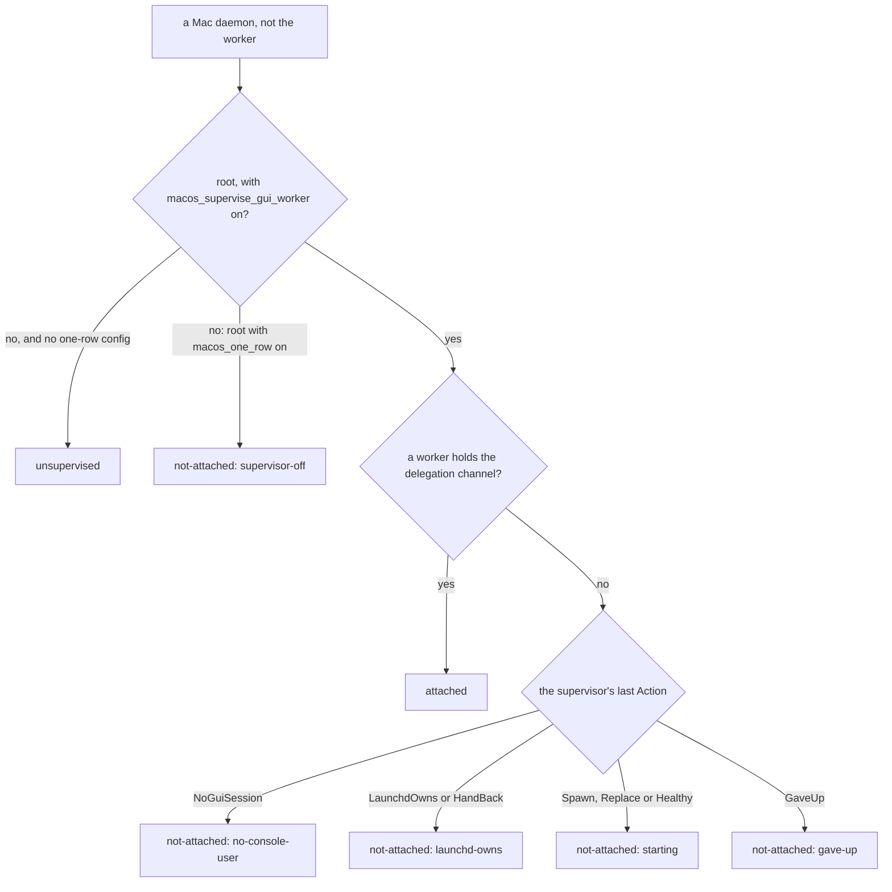

# FR-157: A Mac's device row says whether its screen worker is attached, and why not

**Issue:** [#4494](https://github.com/gjovanov/roomler-ai/issues/4494) · **Status:** claimed 2026-11-27, from
[#3882](https://github.com/gjovanov/roomler-ai/issues/3882). P0, the lab's RED read, is done. P2, the server read, is
built behind its switch, which is off, and P1, the agent's word, is built in
[#4552](https://github.com/gjovanov/roomler-ai/pull/4552); nothing else is. D1–D5 were ruled on #4494 on 2026-11-27,
as recommended; D6 is open, and is P3's.
**Builds on:** [FR-43](FR-43-macos-single-enrollment.md) (the one-row Mac: the supervisor, the delegation channel,
`Status.gui_worker`), [FR-93](FR-93-wayland-out-of-the-box.md) P2b (the `desktop` brief: a claim on the row that the
server counts)
**Related:** [#3802](https://github.com/gjovanov/roomler-ai/issues/3802) (the field case),
[FR-67](FR-67-update-outcome-observability.md) (update outcome observability: the server says it, with no command on
the host), [FR-149](FR-149-macos-consent-panel-from-the-session.md) (the session panel on a one-row Mac), #3992, #4043
and #4059 (the worker's words reach the row at once)

**Anchors:** read on master `ef4cd1ff9` (2026-11-27), in the tree. The ones P2 moved or added were read again on its
pull request, [#4516](https://github.com/gjovanov/roomler-ai/pull/4516). P1's pull request,
[#4552](https://github.com/gjovanov/roomler-ai/pull/4552), read again every anchor into a file it changes
(`delegate.rs`, `signaling.rs`, `macos_supervisor.rs` and `app.rs` in `agents/roomlerd/src`, and
`crates/localapi/src/lib.rs`), the ones into `models.rs` that it moved, and its own.

## Goal

After a roll, the server alone answers three questions about every online Mac:

1. Is its screen worker attached?
2. If not, is it healthy anyway, because it runs two rows or because nobody is signed in?
3. Or is it in #3802's state: one row, a person signed in, and no worker attached?

The devices list shows the third state as exactly that, and not as a plain online device. No command runs on any
host to learn it.

## Evidence

- **#3802.** On a one-row install, no root step made the person's app folder, so the worker never came up. The root
  daemon ran, stayed connected and logged why. That the worker was missing was read on the host, not on the server.
- **The release labs of 0.4.220 and 0.4.221** read `gui_worker attached: true` from `roomler status` on every guest,
  because the row cannot say it.
- **A healthy two-row Mac reports `"gui_worker": { "attached": false, "one_row": false }`** (#3882's comment of
  2026-11-14, read on 0.4.221 and on the 0.4.222 candidate), from the root daemon and from the person's daemon alike.
  `Status` fills it on every Mac daemon that is not itself the worker
  ([`localapi_state.rs:1144-1148`](../../agents/roomlerd/src/localapi_state.rs#L1144-L1148),
  [`app.rs:5257-5265`](../../agents/roomlerd/src/app.rs#L5257-L5265)), and the supervisor is off by default
  ([`macos_supervisor.rs:34-36`](../../agents/roomlerd/src/macos_supervisor.rs#L34-L36)). So `attached` alone does not
  answer the question: a field that copied it would list every healthy two-row Mac as missing its worker.
- **What the row says today.** A Mac daemon with no GUI session advertises `permissions: ["no-gui-session"]`
  ([`encode/caps.rs:4453-4459`](../../agents/roomlerd/src/encode/caps.rs#L4453-L4459)). Once an attached worker has
  sent its caps, the row advertises the worker's permission pair instead
  ([`delegate.rs:2015-2018`](../../agents/roomlerd/src/delegate.rs#L2015-L2018), announced at
  [`signaling.rs:7177`](../../agents/roomlerd/src/signaling.rs#L7177)). No word says one row. The four Macs of the lab
  cells below therefore collapse into two readings:

  | Mac | what its row carries today |
  |---|---|
  | one row, a person signed in, no worker (#3802) | `no-gui-session` |
  | two rows, healthy: the root row | `no-gui-session` |
  | one row, at the login window | `no-gui-session` |
  | one row, healthy | the worker's pair, e.g. `screen-capture`, `input` |
  | two rows, healthy: the person's row | the same pair |

- **The devices list flags none of them.** `permissionWarnings` returns nothing for `no-gui-session`
  ([`agentCodecChips.ts:98`](../../ui/src/components/admin/agentCodecChips.ts#L98)), which is right for a two-row root
  row and wrong for #3802's.
- **The lag.** In #3802's read the row lagged the attach by up to 2 min 20 s, longer than the 30 s heartbeat
  ([`signaling.rs:2263`](../../agents/roomlerd/src/signaling.rs#L2263)). Why is not established. Two fixes reached
  agents after that read, both in 0.4.228: #4043 (the hello and the heartbeat announce one snapshot) and #4059 (a word
  the worker says after the hello wakes the heartbeat,
  [`signaling.rs:2666-2678`](../../agents/roomlerd/src/signaling.rs#L2666-L2678)). One more fact bounds it: the row's
  permissions follow the worker's caps frame
  ([`delegate.rs:2331-2342`](../../agents/roomlerd/src/delegate.rs#L2331-L2342)), not the attach
  ([`delegate.rs:2169-2178`](../../agents/roomlerd/src/delegate.rs#L2169-L2178)), so a worker that sends its caps late
  moves the row late however fast the beat is. Whether any lag remains on the current release is P0's question (D2).

## Design

### The word: `AgentCaps.gui_worker`

One optional field on `AgentCaps` ([`models.rs:310-311`](../../crates/remote_control/src/models.rs#L310-L311)),
beside `desktop` ([`models.rs:635-641`](../../crates/remote_control/src/models.rs#L635-L641)). P2 built it, the field
at [`models.rs:642-649`](../../crates/remote_control/src/models.rs#L642-L649) and `GuiWorkerBrief` at
[`models.rs:2043-2102`](../../crates/remote_control/src/models.rs#L2043-L2102), the way `DesktopBrief` is built
([`models.rs:2015-2041`](../../crates/remote_control/src/models.rs#L2015-L2041)): a CLAIM by the device, counted by the
server, never enforced on. Strings, not enums, for the additive-wire reason: a newer agent's state or reason must reach
an older reader as a word it can show, not as a parse failure.

```rust
/// FR-157 — the screen worker this Mac's daemon supervises, as its delegation
/// channel and its supervisor see it. `None` = not reported: an agent older
/// than P1, the worker itself, and every platform but macOS (D1).
#[serde(default, skip_serializing_if = "Option::is_none")]
pub gui_worker: Option<GuiWorkerBrief>,

pub struct GuiWorkerBrief {
    /// `unsupervised` · `attached` · `not-attached`
    pub state: String,
    /// With `not-attached` only: `no-console-user` · `launchd-owns` ·
    /// `starting` · `gave-up` · `supervisor-off`
    #[serde(default, skip_serializing_if = "Option::is_none")]
    pub reason: Option<String>,
    /// `macos_one_row` is set in the daemon's config.
    #[serde(default, skip_serializing_if = "std::ops::Not::not")]
    pub one_row: bool,
}
```

The names are D4. `permissions` keeps its meaning: `no-gui-session` and the worker's pair still say what a session
would get, and the new word says why. No existing word changes. The wire spellings are a compatibility surface
(`.claude/rules/remote-desktop.md`). By D4's ruling they are fixed when P2 merges, because P2 adds the type the server
stores, and they are only ever added to: `GuiWorkerBrief::STATES` and `::REASONS`, locked by
`gui_worker_spellings_are_locked`. `GuiWorkerBrief::UNKNOWN` is the readers' word for a row with no word; no daemon
sends it.

### How a Mac's daemon fills it

The state comes from two facts the daemon already holds: whether a worker holds the delegation channel (the `attached`
flag, set at [`delegate.rs:2169-2178`](../../agents/roomlerd/src/delegate.rs#L2169-L2178) and cleared at
[`delegate.rs:2198`](../../agents/roomlerd/src/delegate.rs#L2198)), and the supervisor's last decision
([`decide`, `macos_supervisor.rs:138-161`](../../agents/roomlerd/src/macos_supervisor.rs#L138-L161), over the `Action`s
at [`macos_supervisor.rs:111-135`](../../agents/roomlerd/src/macos_supervisor.rs#L111-L135)).



| the daemon | `state` | `reason` | where the daemon knows it |
|---|---|---|---|
| not root, or the supervisor off with `macos_one_row` off (`Action::Disabled`) | `unsupervised` | | [`macos_supervisor.rs:1820-1833`](../../agents/roomlerd/src/macos_supervisor.rs#L1820-L1833), [`:139-140`](../../agents/roomlerd/src/macos_supervisor.rs#L139-L140) |
| root, `macos_one_row` on and the supervisor off: nothing runs a worker, so the row has no screen | `not-attached` | `supervisor-off` | the warning at [`macos_supervisor.rs:1826-1831`](../../agents/roomlerd/src/macos_supervisor.rs#L1826-L1831) |
| a worker holds the delegation channel | `attached` | | [`delegate.rs:2169-2178`](../../agents/roomlerd/src/delegate.rs#L2169-L2178) |
| nobody at the console | `not-attached` | `no-console-user` | [`macos_supervisor.rs:142-143`](../../agents/roomlerd/src/macos_supervisor.rs#L142-L143) |
| the LaunchAgent is loaded, so launchd owns the worker | `not-attached` | `launchd-owns` | [`macos_supervisor.rs:149-153`](../../agents/roomlerd/src/macos_supervisor.rs#L149-L153) |
| a worker spawned or running, and not attached yet | `not-attached` | `starting` | [`macos_supervisor.rs:156-159`](../../agents/roomlerd/src/macos_supervisor.rs#L156-L159) |
| the supervisor stopped respawning after `MAX_FAST_EXITS` fast exits, or its run ended early (`current_exe` failed) | `not-attached` | `gave-up` | [`macos_supervisor.rs:158`](../../agents/roomlerd/src/macos_supervisor.rs#L158), [`:74`](../../agents/roomlerd/src/macos_supervisor.rs#L74), [`:1834-1846`](../../agents/roomlerd/src/macos_supervisor.rs#L1834-L1846) |

`attached` wins over the supervisor's decision, because it is the truth about who would serve a session now. The
mapping from `Action` is one `match` with no catch-all arm, so a new `Action` cannot compile without a word, the same
way `RpcCap::wire()` forces one for a new verb.

⚠️ A worker that runs and never attaches reads `starting` for as long as that lasts. The word carries no clock: the
supervisor does not count a worker that stays up and never attaches, so neither can the word. P2's read reports how
many Macs are `starting`, and P4's cells say whether that state outlives a spawn in practice (D6).

**P1 built it** as one pure function, `gui_worker_word`
([`macos_supervisor.rs:197-233`](../../agents/roomlerd/src/macos_supervisor.rs#L197-L233)), over `WordInputs`
([`:177-188`](../../agents/roomlerd/src/macos_supervisor.rs#L177-L188)). Those are the switches (`WordConfig`,
[`:163-175`](../../agents/roomlerd/src/macos_supervisor.rs#L163-L175), set once at start at
[`app.rs:5045-5052`](../../agents/roomlerd/src/app.rs#L5045-L5052)), `attached`, and the supervisor's last `Action`,
which the supervisor gives the delegate host at its transition
([`note_supervisor`, `delegate.rs:2063-2080`](../../agents/roomlerd/src/delegate.rs#L2063-L2080)). Two cells the
flowchart leaves out are worded so. With the supervisor on and no decision yet, the word is `not-attached` with
`starting`, since its first tick decides at once. `Action::Disabled` reads as the switches' own word. The `current_exe`
failure is noted as `GaveUp`
([`macos_supervisor.rs:1841-1843`](../../agents/roomlerd/src/macos_supervisor.rs#L1841-L1843)). Every spelling is a
`GuiWorkerBrief` constant read out of `STATES` and `REASONS`
([`models.rs:2081-2101`](../../crates/remote_control/src/models.rs#L2081-L2101)), never a literal of the agent's.

### Who sends it

- **A Mac's daemon, on every loop.** On a loop that holds the delegate host (the primary, and every org on a one-row
  Mac, [`signaling.rs:7166-7171`](../../agents/roomlerd/src/signaling.rs#L7166-L7171)) the word is the host's. On a
  loop that holds none, it is `unsupervised`, because that loop never hands a session to the worker.
- **Never the worker** (`--supervised`). It is the screen side itself, as `Status` already says of it
  ([`crates/localapi/src/lib.rs:491-496`](../../crates/localapi/src/lib.rs#L491-L496)).
- **No other platform** (D1). Only macOS has a supervised worker: the delegate host exists on macOS alone
  ([`app.rs:5039-5044`](../../agents/roomlerd/src/app.rs#L5039-L5044)), and so does the supervisor
  ([`app.rs:5348-5362`](../../agents/roomlerd/src/app.rs#L5348-L5362)).

P1 built it as `says_word` and `word_without_host`
([`macos_supervisor.rs:235-260`](../../agents/roomlerd/src/macos_supervisor.rs#L235-L260)). Each connection reads
them once ([`connect_once`, `signaling.rs:1969-1975`](../../agents/roomlerd/src/signaling.rs#L1969-L1975)). The worker
is told apart by the supervision its process recorded at its start, `Supervision::MacosSupervisor`, as the recorder
tells it apart ([`recording/launch.rs:523`](../../agents/roomlerd/src/recording/launch.rs#L523)). Its loop cannot
tell: any loop of the worker but its primary holds no host, as a daemon's secondary org does.

### When it moves

The word is read with the others in `Announcer::now`
([`signaling.rs:7171`](../../agents/roomlerd/src/signaling.rs#L7171)) and compared as part of `Announced`
([`signaling.rs:7082`](../../agents/roomlerd/src/signaling.rs#L7082)). So the hello carries it
([`hello_with`, `signaling.rs:7285-7303`](../../agents/roomlerd/src/signaling.rs#L7285-L7303)), and so does every beat
on which it changed ([`beat`, `signaling.rs:7308-7320`](../../agents/roomlerd/src/signaling.rs#L7308-L7320); the
caps go out at [`signaling.rs:2729-2744`](../../agents/roomlerd/src/signaling.rs#L2729-L2744)).

What P1 adds is the news. Before P1 the host woke the heartbeat for three things only: the worker's caps held, the
person's floor kept, and the caps cleared with the channel
([`news`, `delegate.rs:1679-1690`](../../agents/roomlerd/src/delegate.rs#L1679-L1690);
[`words_moved`, `delegate.rs:1698-1702`](../../agents/roomlerd/src/delegate.rs#L1698-L1702)). The attach tells nothing,
because nothing the row says changes until the worker's caps frame arrives. P1 makes two more things tell the news:

- **the attach and the detach** of the delegation channel;
- **each change of the supervisor's state**, at the transition it already logs once
  ([`macos_supervisor.rs:1940-1973`](../../agents/roomlerd/src/macos_supervisor.rs#L1940-L1973)), never on every
  5 s tick.

The heartbeat then announces the word at once (#4059's arm,
[`signaling.rs:2666-2678`](../../agents/roomlerd/src/signaling.rs#L2666-L2678)). The word rides only a changed beat,
as caps always have ([`crates/remote_control/src/signaling.rs:646-650`](../../crates/remote_control/src/signaling.rs#L646-L650)),
so the steady state costs nothing. It must also come back down when the worker leaves, for the reason the caps do
([`crates/remote_control/src/signaling.rs:652-654`](../../crates/remote_control/src/signaling.rs#L652-L654)).

P1 built it so. `Announcer::now` reads the word
([`signaling.rs:7210-7215`](../../agents/roomlerd/src/signaling.rs#L7210-L7215)) into `Announced`
([`:7135-7140`](../../agents/roomlerd/src/signaling.rs#L7135-L7140)), and `stub_caps` writes it into the caps
([`:7400`](../../agents/roomlerd/src/signaling.rs#L7400)). The attach wakes the news as soon as the channel is held
([`delegate.rs:2178-2182`](../../agents/roomlerd/src/delegate.rs#L2178-L2182)). The end wakes it once, after both the
caps are cleared and the flag is down ([`delegate.rs:2197-2203`](../../agents/roomlerd/src/delegate.rs#L2197-L2203)),
so no beat reads the caps gone with the word still `attached`. That one wake replaces the end's old one, which came only
with caps held ([`channel_ended`, `delegate.rs:2382-2390`](../../agents/roomlerd/src/delegate.rs#L2382-L2390)). The
supervisor tells the host at its transition
([`macos_supervisor.rs:1940-1944`](../../agents/roomlerd/src/macos_supervisor.rs#L1940-L1944)), and the host wakes the
news only when the decision differs from the last one. The beat's caps line logs the word
([`signaling.rs:2739`](../../agents/roomlerd/src/signaling.rs#L2739)).

### Old and new together

| agent | server | what the row reads |
|---|---|---|
| older than P1 | any | no `gui_worker` key. Every reader reads its absence as **`unknown`**, never as `attached` or `not-attached`, and the devices list shows nothing, as it does today for an absent `permissions` ([`agentCodecChips.ts:87-94`](../../ui/src/components/admin/agentCodecChips.ts#L87-L94)) |
| P1 | older than P1 | the older server's `AgentCaps` has no field for the word and accepts unknown fields (no `deny_unknown_fields`, [`models.rs:310-311`](../../crates/remote_control/src/models.rs#L310-L311)), so it drops the word and stores the rest as it does today |
| P1 | P1, the switch off | stored with the caps ([`dao/agent.rs:607-616`](../../crates/services/src/dao/agent.rs#L607-L616), [`fleet/src/socket.rs:794-799`](../../crates/modules/fleet/src/socket.rs#L794-L799)); no read uses it |
| P1 | P1, the switch on | read, counted and shown |

⚠️ A stored word outlives its connection: an offline row keeps the last word it announced. Every read pairs the word
with presence (`last_presence`, [`models.rs:2476`](../../crates/remote_control/src/models.rs#L2476)), as the desktop
counts already do ([`stats.rs:353-382`](../../crates/api/src/routes/stats.rs#L353-L382)), so a stale word is never
read as current.

The word is a claim by a host that may be compromised, like `desktop`: no session decision, consent check, permission
or ACL reads it. P2's reads count it and name the rows that carry it, and nothing else.

### `Status` on the host (D5)

`roomler status` on a healthy two-row Mac shows `attached: false`, which reads as a fault where there is none
(#3882's comment). By D5's recommendation, `GuiWorkerStatus`
([`crates/localapi/src/lib.rs:536-561`](../../crates/localapi/src/lib.rs#L536-L561), filled by
[`worker_status`, `delegate.rs:2041-2053`](../../agents/roomlerd/src/delegate.rs#L2041-L2053)) takes the same `state`
and `reason` as additive fields, from the same function that builds the row's word, so the host and the server never
disagree. `attached`, `permissions` and `one_row` stay, because FR-43's verify reads them
([`FR-43-macos-single-enrollment.md:610`](FR-43-macos-single-enrollment.md)). An older CLI ignores the new fields.

P1 built it so: `state` and `reason` are left out when empty
([`crates/localapi/src/lib.rs:549-560`](../../crates/localapi/src/lib.rs#L549-L560)), and `worker_status` reads the
channel once for `attached` and for the word, so one `Status` never pairs two reads. It shows in `roomler status
--json`, as `attached` did. The plain `roomler status` prints no worker line, before P1 or after it. `one_row` stays
the host's own flag, both switches on, while the word's `one_row` is `macos_one_row` alone. The two differ only on a
root daemon with `macos_one_row` on and the supervisor off, whose word is `supervisor-off`.

### The server read (P2, built)

- **The counts.** `gui_worker_breakdown_pipeline`
  ([`stats.rs:384-426`](../../crates/api/src/routes/stats.rs#L384-L426)) sits beside `desktop_breakdown_pipeline`
  ([`stats.rs:353-382`](../../crates/api/src/routes/stats.rs#L353-L382)) and groups the live Mac rows (`os: "macos"`,
  [`models.rs:12-18`](../../crates/remote_control/src/models.rs#L12-L18)) by `capabilities.gui_worker.state`, `reason`
  and `one_row`, each group `{state, reason, one_row, total, online}`. A Mac row with no word is counted as `unknown`,
  with `reason` and `one_row` null, because the row did not say. So the counts add up to every Mac, and the denominator
  after a roll comes from the server. `online` is `last_presence`, as the desktop counts read it. They are served as
  `gui_workers` in the org overview (`GET /api/tenant/{tenant_id}/stats/overview`,
  [`stats.rs:542-556`](../../crates/api/src/routes/stats.rs#L542-L556),
  [`crates/api/src/lib.rs:326`](../../crates/api/src/lib.rs#L326)) and in the platform overview
  ([`stats.rs:1607-1621`](../../crates/api/src/routes/stats.rs#L1607-L1621)), beside `desktops`, through
  `gui_workers_if_read` ([`stats.rs:428-440`](../../crates/api/src/routes/stats.rs#L428-L440)).
- **The names.** The device list (`list_agents`,
  [`fleet/src/agent.rs:1914-1963`](../../crates/modules/fleet/src/agent.rs#L1914-L1963)) takes `?gui_worker=<state>`
  (`DeviceListFilter`, [`fleet/src/agent.rs:1897-1912`](../../crates/modules/fleet/src/agent.rs#L1897-L1912)) and
  returns the org's online Macs in that state, paged like the list, through `AgentDao::list_online_macs_by_gui_worker`
  ([`dao/agent.rs:422-456`](../../crates/services/src/dao/agent.rs#L422-L456)). `unknown` names the online Macs with
  no word, a word this build has never heard of is matched as the word it is, and an empty one is a 400. The filter is
  read after the list's tenant guard, so a caller outside the org is refused before it. That is the one read that
  answers "which online Macs have no attached worker", with their reasons.
- **The switch off.** The overviews carry no `gui_workers`. `caps_as_served`
  ([`fleet/src/agent.rs:2696-2711`](../../crates/modules/fleet/src/agent.rs#L2696-L2711)) leaves the word out of every
  device response: the list's rows, a device's own read and an update's answer. The filter is answered 400
  `bad_request` with a message that names `ROOMLER__RC__GUI_WORKER_READ`, so that an unfiltered list is never read as a
  filtered one. The word is still stored with the caps.

### The devices list (P3)

A chip from the word, beside the permission warnings in `AgentsSection`'s table and cards
([`AgentsSection.vue:448-450`](../../ui/src/components/admin/AgentsSection.vue#L448-L450),
[`:738-739`](../../ui/src/components/admin/AgentsSection.vue#L738-L739)), made by a function next to
`permissionWarnings` ([`agentCodecChips.ts:92-115`](../../ui/src/components/admin/agentCodecChips.ts#L92-L115)). It
follows the list's rule for "needs a person" chips (`docs/ui.md`, the devices list's chips): it appears only when the
word is there, and stays silent when it is not. Which reasons warn and which only inform is D6.

### Kill switches

| switch | what it stops | default |
|---|---|---|
| `ROOMLER__RC__GUI_WORKER_READ`, a new field of `RcSettings` ([`settings.rs:967`](../../crates/config/src/settings.rs#L967), [`:1128`](../../crates/config/src/settings.rs#L1128)) | every read of the word: P2's counts and filter, and the word in the device list's response, so P3's chip has nothing to show | off, until P4's cells read green |
| none on the agent | P1's word is inert while the server switch is off, and an older server drops it | |

### The composition baseline

It does not move in any phase. The baseline records routes with their methods, the index plan and the wire tags
([`composition.baseline.json`](../../crates/tests/fixtures/composition.baseline.json), checked by
[`composition_tests.rs`](../../crates/tests/src/composition_tests.rs); `.claude/rules/modular-monolith.md` rule 2), and
no phase adds one of those. P1 adds a field inside `rc:agent.hello` and `rc:agent.heartbeat`, which are already
listed. P2 adds a key to two responses and a query parameter to `GET …/agent`. No phase adds an index: the org read
matches one tenant's rows, and the platform read scans `agents` as the desktop counts already do. If review turns P2's
filter into a route of its own, or adds an index, P2's PR re-records the baseline with `COMPOSITION_UPDATE=1` and its
commit message says why.

### Tests, RED first

| phase | test | RED on master because |
|---|---|---|
| P1, built | the attach and the detach wake the host's news (`the_attach_and_the_detach_wake_the_news`; #3992's `a_channel_that_ends_with_the_caps_held_is_news` now asks it of an end with nothing held too; in `agents/roomlerd/src/delegate.rs`) | the attach told nothing ([`delegate.rs:1679-1690`](../../agents/roomlerd/src/delegate.rs#L1679-L1690)), and neither did an end with no caps held; the stub kept both so |
| P1, built | a change of the supervisor's state wakes it once, and a repeated tick of the same state does not (`a_change_of_the_supervisors_state_is_news_once` in `delegate.rs`; `a_supervisor_move_wakes_the_loop_and_its_beat_carries_the_word` in `signaling.rs`) | the supervisor told the host nothing |
| P1, built | every `Action` maps to one `(state, reason)`, and `attached` wins over it; the switches speak first; every word is a locked spelling (`every_action_maps_to_one_word_and_attached_wins`, `the_switches_speak_before_the_supervisor`, `every_word_is_a_locked_spelling`, in `agents/roomlerd/src/macos_supervisor.rs`) | no mapping existed: the stub said `unsupervised` for every daemon |
| P1, built | a beat on which only the word changed announces caps that carry it, and the hello carries the word (`a_beat_on_which_only_the_word_changed_announces_caps_that_carry_it`, `a_macs_hello_carries_the_screen_worker_word`, in `agents/roomlerd/src/signaling.rs`) | no word in `Announced` |
| P1, built | the `--supervised` worker, and a build for any other OS, announce no word, and a Mac's daemon does (`the_worker_and_other_platforms_announce_no_word` in `signaling.rs`; `a_macs_daemon_says_the_word_and_its_worker_and_other_platforms_do_not` in `macos_supervisor.rs`) | no word: the stub's Mac daemon said none either |
| P1, built | `permissions` is unchanged in every cell (`the_word_leaves_the_permissions_as_they_were_in_every_cell` in `signaling.rs`), and `Status` says the row's word with FR-43's three fields as they were (`the_status_says_the_word_the_row_says` in `delegate.rs`; `gui_worker_state_and_reason_are_additive_both_ways` in `crates/localapi/src/lib.rs`) | the stub said no word, and its two `Status` fields had no serde attributes, so a status without them came back with `null`s |
| P2, built (the type is P2's) | caps without the word serialise without the key and parse to `None`; a word with an unknown key inside it parses; an older reader parses caps that carry it; the spellings are locked (`gui_worker_wire_shape_is_locked_and_additive`, `an_older_reader_parses_caps_that_carry_the_gui_worker_word`, `gui_worker_spellings_are_locked`, in `crates/remote_control/src/models.rs`) | no field: the stub without its serde attributes put `"gui_worker": null` on every hello |
| P2, built | a device response leaves the word out while the switch is off, and keeps the rest of its caps (`gui_worker_read_tests`, `crates/modules/fleet/src/agent.rs`) | the stub served the stored caps as they are |
| P2, built | the integration test, `crates/tests/src/gui_worker_tests.rs` (AC6): with the switch on, each state and an absent word counted in both overviews, online and in total, and the filter's rows; with it off, no `gui_workers`, no word in a row and the filter refused | no read |
| P3 | Vitest beside `permissionWarnings`' tests ([`agentCodecChips.spec.ts:109`](../../ui/src/__tests__/components/agentCodecChips.spec.ts#L109)): no chip for no word, `unsupervised` or `attached`, and D6's chip for each reason | no chip |

### Lab cells

vmtest macOS cells, read from the vmtest org's device list (`GET /api/tenant/{tenant_id}/agent`, `docs/api.md`) and
its org overview, never from a command on the guest. P0 reads each one RED on the current release first.

| cell | the Mac | how | RED today | GREEN after P4 |
|---|---|---|---|---|
| C1 | one row, a person signed in, the worker cannot start | the person's roomler folder given to root, which is #3802's cause (`person_folder_not_theirs`, read in the give-up branch at [`macos_supervisor.rs:1945-1950`](../../agents/roomlerd/src/macos_supervisor.rs#L1945-L1950)), so the worker exits on arrival until the supervisor gives up | `no-gui-session`, the same as C3's root row and C4 | `not-attached`, `gave-up`, `one_row` |
| C2 | one row, healthy | a converted Mac, as FR-43's verify reads it | the worker's pair, the same as C3's person row | `attached`, `one_row` |
| C3 | two rows, healthy | the default install, both switches off | root: `no-gui-session`; person: their pair | both rows `unsupervised` |
| C4 | one row, at the login window | C2 restarted with nobody signed in, then a sign-in, then a log-out | `no-gui-session` | `not-attached` with `no-console-user`, then `attached`, then `not-attached` again |
| C5 | C2's Mac, for the lag | five sign-ins, each stamped at four points: the attach line (`delegation channel attached`, [`delegate.rs:2178`](../../agents/roomlerd/src/delegate.rs#L2178)), the worker's caps line ([`delegate.rs:2336-2341`](../../agents/roomlerd/src/delegate.rs#L2336-L2341)), the beat's caps line ([`signaling.rs:2729-2744`](../../agents/roomlerd/src/signaling.rs#L2729-L2744)) and the row's change, polled from the device list every 2 s | the lag, split by layer | each within one beat (30 s) of the host's line |

## Phases

Ship order: P0, then P2 and P1 (P2 first is safe: a server that reads an absent word as `unknown` can go before any
agent sends one, and P1's release is then read the day it ships), then P3, P4 and P5. Each code PR carries its own
docs; P5 checks that they are whole.

| phase | what | kill switch | status |
|---|---|---|---|
| P0 | the RED read of C1–C4 and the lag's split (C5), on the current release and the current server; no code | none: it reads and changes nothing | done: C1–C4 read RED (AC1) and C5's split (AC2) on 2026-11-27 (the field log); no layer comes near one beat, so P1 goes ahead (D2) |
| P1 | the agent: `AgentCaps.gui_worker` in `crates/remote_control`, filled by a Mac's daemon, in the hello and at once on each attach, detach and change of the supervisor's state; `Status.gui_worker` takes the same `state` and `reason` (D5) | inert while `ROOMLER__RC__GUI_WORKER_READ` is off, and dropped by an older server | built, [#4552](https://github.com/gjovanov/roomler-ai/pull/4552): its tests read RED on a stub, then GREEN, in CI; it reaches the field with the next agent release, and P4 reads it there |
| P2 | the server: the counts in both overviews, the device list's filter, and the word left out of every device response while the switch is off | `ROOMLER__RC__GUI_WORKER_READ`, default off | built, [#4516](https://github.com/gjovanov/roomler-ai/pull/4516); in production since 2026-11-27 with its switch off (the field log) |
| P3 | the devices list: the chip, in the table and the cards (D6) | the same switch: off, the rows carry no word, so there is no chip | not started |
| P4 | the field read of C1–C5 on the release with P1 and the server with P2 and P3, with the switch turned on in production (the operator's step); a wrong reading turns it off again, and the default turns on once every cell reads green | the switch | not started |
| P5 | the docs: the field and its wire name, the chip and its page, the macOS row table, the server read, and the `docs/README.md` rows | none: docs | not started |

## Acceptance criteria

- [x] **AC1** (P0, RED): on the current release and server, from the vmtest org's device list, C1's row, C3's root row
  and C4's row carry the same `permissions: ["no-gui-session"]`, and C2's row carries the same pair as C3's person row.
  No row carries a word for one row or for the worker, so the server cannot tell the cells apart.
- [x] **AC2** (P0, C5): the lag on the current release, five sign-ins stamped at the attach line, the worker's caps
  line, the beat's caps line and the row's change. The split names the layer that holds anything over one beat (D2).
- [ ] **AC3** (P1): the unit tests above, each shown RED on master first: the attach, the detach and each change of
  the supervisor's state wake the host's news; a beat that changes only the word announces caps; every `Action` maps
  to one `(state, reason)` through a `match` with no catch-all arm; the worker and other platforms announce no word.
- [ ] **AC4** (P1, old and new together): caps without the word serialise without the key and parse to `None`, so an
  older agent's row reads `unknown`; a word with an unknown key inside it parses; `permissions` is unchanged in every
  cell.
- [ ] **AC5** (P1, by D5): `roomler status` on a Mac shows the same `state` and `reason` as its row, so a healthy
  two-row Mac no longer shows only `attached: false`.
- [ ] **AC6** (P2): an integration test: with the switch on, both overviews count Mac rows by `state`, `reason` and
  `one_row`, online and in total, with the rows that sent no word as `unknown`, and the device list's filter returns
  exactly the org's online rows in the state asked for. With the switch off, the overviews carry no `gui_workers`, the
  list's rows carry no word, and the filter is refused.
- [ ] **AC7** (P3): Vitest: no chip for no word, `unsupervised` or `attached`; for `not-attached`, the chip D6 rules,
  with its reason in words.
- [ ] **AC8** (P4, field, read RED first): C1, a one-row Mac with a person signed in and the worker unable to start,
  reads `not-attached` with `gave-up` on the server's device list and in the org overview's counts.
- [ ] **AC9** (P4, field, read RED first): C2, a healthy one-row Mac, reads `attached` with `one_row`.
- [ ] **AC10** (P4, field, read RED first): C3, a healthy two-row Mac: both of its rows read `unsupervised`.
- [ ] **AC11** (P4, field, read RED first): C4, a one-row Mac at the login window, reads `not-attached` with
  `no-console-user`, then `attached` after a sign-in and `not-attached` after a log-out, each within one beat (30 s) of
  the host's line.
- [ ] **AC12** — Docs updated with diagrams, linked from `docs/README.md` (P5): the field and its wire name in
  `docs/remote-control.md`, beside what the hello promises (§5.1b); the chip and the page that shows it in
  `docs/ui.md`, the devices list's "needs a person" chips; the macOS row table in `docs/installation.md`'s macOS
  section ("What `<name>-daemon` reports"); the overview key and the filter in `docs/api.md`; and their rows in
  `docs/README.md`.

## Open decisions

The operator ruled D1 to D5 on #4494 on 2026-11-27
([comment](https://github.com/gjovanov/roomler-ai/issues/4494#issuecomment-7216994923)), each as recommended. D6 stays
open.

| decision | ruling (2026-11-27) |
|---|---|
| D1 | as recommended: one field, `gui_worker`, whose name names no OS. In this FR only a Mac's daemon produces it, and every reader treats an absent word as `unknown` on every OS |
| D2 | as recommended for P1, which waits for P0's reads. P2 does not wait: it reads an absent word as `unknown`, ships with `ROOMLER__RC__GUI_WORKER_READ` off, and while the switch is off it changes nothing a row says, so P0's RED read stays valid after P2 rolls |
| D3 | as recommended: out of this FR |
| D4 | as recommended: `gui_worker` on the wire, "screen worker" on screen, the three states and five reasons above. P2 adds the type the server stores, so the spellings are fixed when P2 merges, and after that they are only ever added to |
| D5 | as recommended; it is P1's |
| D6 | **open**: P3 rules it with P0's reads in hand |

- **D1, one field for all platforms, or macOS only?** Recommended: one field whose name says no OS, produced only by a
  Mac's daemon in this FR. Only macOS has a supervised worker
  ([`app.rs:5039-5044`](../../agents/roomlerd/src/app.rs#L5039-L5044)). Linux's root daemon captures with no worker,
  and already tells the server its desktop and the arm that would capture it (`capabilities.desktop`, FR-93 P2b). On
  Windows, see D3. A later platform adds a producer, not a wire change, and every reader treats an absent word as
  `unknown` on every OS.
- **D2, what causes the lag, and does a P0 measurement come before P1?** Recommended: P0 first. It is cheap, because
  the RED read is owed anyway, and the lag was read before #4043 and #4059 reached agents (0.4.228). C5 splits it into
  four points. If the time sits between the attach and the worker's caps frame, the new word removes it, because it
  reads the channel and not the caps, and P1 goes ahead. If it sits in a beat or on the server, that layer is fixed
  first, in its own issue, since a word that arrives minutes late misleads as much as no word.
- **D3, is a Windows service with no console worker the same state?** Recommended: no, and not in this FR. On Windows
  the console-session worker holds the row's control socket (`.claude/rules/networking.md`, Fleet RPC), so a missing
  worker reads offline: there is no connected row without a worker to describe. Whether the service could report one is
  a separate question, for its own issue if a field case asks for it.
- **D4, the names.** Recommended: `gui_worker` on the wire, the code's name since FR-43 (`GuiWorkerStatus`,
  `macos_supervise_gui_worker`); "screen worker" on screen, as #3882 and FR-149 say it; the three states and five
  reasons above.
- **D5, `Status.gui_worker` on a healthy two-row Mac.** Recommended: keep the field, because FR-43's verify reads it,
  and add the same `state` and `reason` from the same function, as additive fields. Leaving `gui_worker` out when the
  supervisor is off would hide the one-row-without-supervisor fault (`supervisor-off`) on the host.
- **D6, which reasons the devices list flags.** Recommended: a warning for `gave-up`, for `supervisor-off`, and for
  `launchd-owns` on a one-row row (on a two-row row launchd owning the worker is the healthy default); a neutral chip
  for `no-console-user` ("nobody signed in: a session shows no screen until someone does") and for `starting`. If P4
  finds `starting` outliving a spawn, the chip for it becomes a warning after a time the field read measures, decided
  then.

## Out of scope

- What a controller sees inside a session when no worker is attached.
- Consent: FR-27, and FR-149's session panel.
- FR-43's one-row conversion itself (`docs/fr/FR-43-macos-single-enrollment.md`).
- Windows' service and its console worker (D3).
- Linux, which FR-93's `desktop` brief covers (D1).
- A list of device names across organizations: the platform overview counts, and the names are read per org.
- Alerts or notifications about the state.

## Field log

| date | what | result |
|---|---|---|
| 2026-11-27 19:49Z | P2 in production: the server image `hosted-20261127-0c3d452` (master `0c3d45211`, which holds #4516) on both app pods. | `ROOMLER__RC__GUI_WORKER_READ` is off by default, so P2 changes nothing a row says (D2). P0's reads below were taken on this server. P2 itself is read in the field in P4. |
| 2026-11-27 22:59Z | P0: C3, then C2, on one fresh macOS lab guest in a throwaway organization, with agent 0.4.239 from the served `install.sh` and auto-update off, on the server above. Every row in this log was read from the organization's device list and its overview, polled from outside the guest. | C3, the default install's two rows (22:56Z): root `["no-gui-session"]`, person `["screen-capture","input"]`. C2, after FR-43's `roomlerd one-row` (22:59Z): the row carries `["screen-capture","input"]`, C3's person pair. The person's old row stays listed, offline, with its last pair, as FR-43 retires it. On every read the overview had no `gui_workers`. 🔴 RED, as the spec says. |
| 2026-11-27 23:08Z | P0: C5 on C2's Mac, five sign-ins and five log-outs, with the row polled every 2 s (251 polls, each answered 200, the row online in all). The guest's stamps are put on the poller's clock with a mid-point offset, good to about 0.35 s. | Return → row took 4.8–7.0 s. The split: Return → spawn 0.4–4.5 s, which fits the supervisor's 5 s tick (`POLL`); spawn → attach 0.0–0.3 s; attach → worker caps 0.3–2.6 s, the layer the word removes; worker caps → beat caps within 2 ms; beat caps → row within the poll's 2 s step. Log-outs: click → beat 0.1–0.2 s, beat → row 0.4–2.2 s. No layer comes near one beat, so none is fixed first, and P1 goes ahead (D2). |
| 2026-11-27 23:15Z | P0: C4, C2's Mac restarted with nobody signed in. | At the login window `["no-gui-session"]`; after a sign-in, the pair; after a log-out, `["no-gui-session"]` again. 🔴 RED. |
| 2026-11-27 23:19Z | P0: C1 on C2's Mac, with the person's roomler folder handed to root. | Each new worker exited with code 1 after 5 s. After five such exits the supervisor gave up, at 23:17:40Z, with a host log line that names the cause. The row reads `["no-gui-session"]`, the same as C3's root row and C4. 🔴 RED. One text on these rows names the worker: the reason of `capabilities.unavailable.audio` (code `no-session`). It is fixed, byte-identical on C3's, C4's and C1's rows, and carries no state, so it was ruled on #4494 not to be a word for one row or for the worker, and AC1 holds. After the reads the guest was deleted, its two rows removed and its organization archived. |
