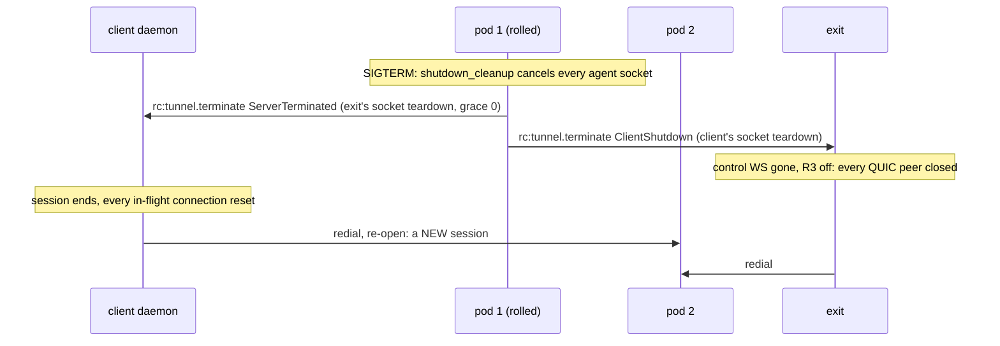
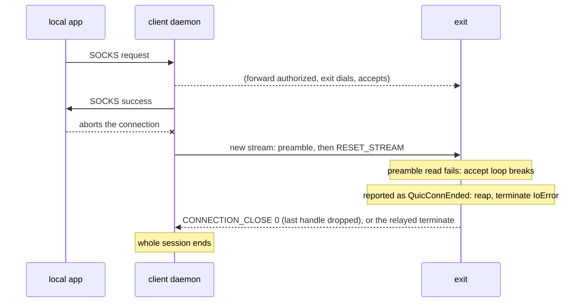

# FR-158: A tunnel session outlives its control sockets — a roll, an exit's redial or one bad stream never cuts the connections it carries

**Issue:** [#4509](https://github.com/gjovanov/roomler-ai/issues/4509) · **Status:** claimed 2026-11-27. P0 (the root-cause map, the RED cells, this spec) is #4518. P1 and P1b are built (§4); their field reads (AC1, AC1b) are open. D1–D7 (§7) were ruled on 2026-11-27, each as recommended · **Owner:** the agent's tunnel plane (exit and client), the network module · **Anchors:** master `21f0923b0`, a doc-level pin: every `file:line` below is at that commit, and a later PR does not shift them · **Opened by:** [#4501](https://github.com/gjovanov/roomler-ai/issues/4501) · **Builds on:** [FR-138](FR-138-the-session-outlives-its-control-socket.md) (the same shape for remote-control sessions), R3 (PR #715: `tunnel_peers_survive_reattach` and `rc.tunnel_grace_secs`), #1754 (the tunnel reap), [FR-86](FR-86-tunnel-transport-reupgrade.md) (the flow owns its listener; make-before-break re-upgrade) · **Related:** #4492 (one writer owns the route-to-flow map), #2944 (FR-123 P1, the tunnel plane into its own crate)

## Summary, for the operator

**Today** three things end a live tunnel session, and after each one every new connection waits until a new session
opens. After a roll it can fail outright instead: a client that does not hear its session end keeps a session that
can open no new flow (F1, §2.5):

1. **A server roll.** The rolled pod's teardown of each exit's control socket terminates every session aimed at that
   exit at once. Production configures no grace, and a grace would not help: its timer runs on the pod that is going
   away, and the replacement pod has no record of the session.
2. **An exit's control socket dropping while the exit stays up**, as a full-tunnel VPN that moves the default route
   does. The exit closes its QUIC peers on the disconnect (peer survival is off) and the server terminates the
   sessions aimed at it: the same mechanism as the roll, triggered by the exit's network.
3. **One bad stream.** The exit's QUIC accept loop reads each new stream's 4-byte preamble inline. A stream the
   client resets before that read ends the loop, the loop's end is reported as the connection's end, and the session
   is reaped. A local app that aborts a connection right after the SOCKS reply is all it takes. On 2026-11-27 this
   ended whole sessions 12 times in 35 minutes, with no control-socket event at all (§2.1).

**This FR** fixes the third first, in one agent-only phase (P1), because it is the most frequent and the smallest
change. Then it gives tunnel sessions what FR-138 gave remote-control sessions: both agents keep the session through
a bounded window, the server keeps a durable record of it, both ends claim it again on whichever pod they reach, and
the server decides at that claim whether it may go on (P2–P5). Two switches stage it, the server's window (0 = today)
and the agent's (off), and either one alone is inert.

**What it costs:** P1 is a few dozen lines in two files. P2–P5 change three sides (exit, client, server), add a
durable record and an additive wire, and need a field roll and a lab VPN read to close.

## 1. Goal

A daemon-supervised tunnel session (a SOCKS route or a forward, on quic-v1, direct or over TURN) keeps every
connection it carries when the control plane under it moves: a server roll, the exit's or the client's control
socket dropping while the device stays up, or one stream failing on the data plane. A connection opened during or
after the move is served as soon as the session is claimed again. Every guarantee stays: the server still authorizes
every new flow, a revoke or a removal still ends the session, and every peer that really ends is still closed.

## 2. Evidence

### 2.1 What ended tunnel sessions on 2026-11-27 [M]

One client daemon (Windows) with three SOCKS routes and three forwards through two exits: exit A (Windows, behind an
enterprise full-tunnel VPN; its UDP to TURN is blocked, so its sessions ride TURN over TLS on TCP) and exit B. Both
exits run with `tunnel_peers_survive_reattach` absent; production sets no `ROOMLER__RC__TUNNEL_GRACE_SECS`.

| When (UTC) | Class | What the logs show |
|---|---|---|
| 09:18:41–09:19:01 | 2a, the exit's control socket | Exit A's VPN moved the default route. Its QUIC flows stalled and the client's P7 backstop ended the SOCKS session; at 09:19:00.134 exit A's control-socket read failed and, in the same millisecond, it tore down its three QUIC peers on the disconnect; the server then sent `ServerTerminated` for the three forwards, and the client re-opened all of them |
| 09:28–09:48 | 2b, one bad stream | 12 session ends, 8 on exit A and 4 on exit B, with no control-socket event on either side. Each: the exit's reap with `signal=quic_conn_ended` first, sometimes a forward for the gone session refused, then the terminate; the client reads `closed by peer: 0` or `peer torn down by server reason=IoError`. Every one sits within 0–35 ms of a client flow that ended `IoError` having moved zero bytes |
| 10:37:13.122 | 1, a roll (the 10:35Z promote) | All six of the client's sessions ended `ServerTerminated` in the same millisecond; an exit closed its QUIC connection 46 ms later. The re-opened SOCKS session waited the full 30 s for `rc:tunnel.quic.ready`, fell back to webrtc-dc-v1, and re-upgraded to quic-v1 60 s after that |

After each end, every new connection waited until a new session opened: after the roll that took 35 s, 30 of them
waiting for a QUIC setup that never came.

### 2.2 The mechanism, in the code [R]

**Class 1, a roll.** maxSurge 0, so the pod serving both agents (tenant affinity pins the client and its exits to
one pod) is shut down while the other serves.

| Step | Where |
|---|---|
| SIGTERM runs `shutdown_cleanup`: fleet cancels every local agent socket, each runs its own teardown; network releases its tunnel-session directory records, whose comment says it outright: "their sessions die with this pod" | `crates/api/src/state.rs:512`; `crates/modules/network/src/lib.rs:964-978` |
| An agent socket's teardown runs both halves: the sessions it originated, and the sessions aimed at it | `crates/modules/network/src/agent_socket.rs:246-267` (`:263`, `:266`) |
| Aimed at it: `terminate_sessions_targeting_agent` reads the grace, 0 in production, and terminates at once with `ServerTerminated` | `crates/modules/network/src/tunnel.rs:1990-2001`, `:2033-2061` (`:2052-2055`); `crates/config/src/settings.rs:1017`, `:1137`, `:1645` |
| Originated by it: `ClientShutdown` to each exit | `tunnel.rs:1932-1962` (`:1953-1959`) |
| The exit's control WS ends: a transient exit parks its QUIC peers only with R3 on, else closes them all; a `rc:tunnel.terminate` closes one | `agents/roomlerd/src/signaling.rs:6751`, `:6667-6676`, `:6700`; `:5606-5621` |
| A grace would not help: its timer is a task on the pod that saw the drop | `tunnel.rs:2003-2027` |
| The session's state is pod memory: the client connection's session map and the hub's indexes, built at open | `agent_socket.rs:46-48`; `tunnel.rs:788-824` |
| So on pod 2 a forward for the old session id has no session: refused `NO_SESSION`, and the client ends the session on a session-gone refusal | `tunnel.rs:1045-1059`; `crates/tunnel-core/src/driver.rs:204-217` |
| The re-open: the client waits up to 30 s for `rc:tunnel.quic.ready`, then falls back | `driver.rs:285`, `:1636-1670` |

Why the re-open's setup went unanswered for 30 s is not pinned (§2.5, F4).

**Class 2a, the exit's control socket.** The same two rows as the roll's exit half: the exit closes its peers on the
disconnect (`signaling.rs:6751` → `:6667-6676`), and the server's teardown of its socket terminates the sessions
aimed at it (`tunnel.rs:1990-2001`). It differs from a roll in two ways: the exit redials the same pod, so R3 plus a
grace would cover its control-plane half; and on 2026-11-27 the route move also stalled the data plane (the P7
backstop fired before the socket dropped), which no control-plane fix revives (D5).

**Class 2b, one bad stream.**

| Step | Where |
|---|---|
| A SOCKS flow is told success before its stream opens | `driver.rs:2195`, then `:2212` |
| The client resets a flow's stream when its local TCP read fails, including on the first read | `crates/tunnel-core/src/forward.rs:788-792` |
| quinn-proto discards a reset stream's unread data, so a preamble the exit had not read yet is gone | quinn-proto 0.11.16 `src/connection/streams/recv.rs:191-199` |
| The exit's accept loop reads each preamble inline; any error from it, a per-stream one included, `break`s the loop | `crates/tunnel-core/src/transport/quic.rs:591-600`; `agents/roomlerd/src/tunnel/quic_peer.rs:155-174` (`:169-172`) |
| The loop's end is reported as `QuicConnEnded`, although the connection is healthy | `quic_peer.rs:103-125` (`:111-123`) |
| The reap closes the peer and sends `rc:tunnel.terminate IoError`, which the server relays to the client | `signaling.rs:3061-3108` (`:3085`, `:3100-3106`); `crates/modules/network/src/agent_arms.rs:502-510` |
| The application code 0: quinn closes a connection with code 0 and no reason when its last handle drops, and every stream holds one; the reap drops the loop's handle and the peer's stashed streams | quinn 0.11.9 `src/connection.rs:927-941`, `:1241-1243`; `src/send_stream.rs:35`, `src/recv_stream.rs:53` |
| A later forward for the reaped session is refused | `signaling.rs:5290` |
| The trigger flow logs only when both of its pumps end, so its zero-byte line can land at the loss itself | `forward.rs:832-833` |

### 2.3 The RED cells [M]

| Cell | Where | On master |
|---|---|---|
| A stream reset before its preamble costs only that stream (real quinn, in process) | `agents/roomlerd/src/tunnel/quic_peer.rs`, `a_stream_reset_before_its_preamble_costs_only_that_stream` | RED, 2026-11-27 11:37Z: `flow 3 = Err("agent quic: flow 3 stream not opened within 5s"), reaped = Some(QuicConnEnded), accept loop ended = true`. The four other `quic_peer` tests pass |
| A roll keeps the forward on the same session, an in-flight connection moving and a new one served (two pods, both agents' real loops, quic-v1) | `crates/tests/src/tunnel_survival_tests.rs`, `an_in_flight_tunnel_connection_survives_a_rolled_pod` | RED on CI, 2026-11-27 12:26Z (§9): the connection opened before the roll echoed for 12 s and the forward kept its session id, but a new connection was closed at once (`read: early eof`). This is F1 |
| An exit's control socket cycling does the same | the same file, `an_in_flight_tunnel_connection_survives_its_exits_control_socket_cycling` | RED on CI, 12:40Z (§9): the connection opened before the cut echoed for 12 s and a new connection was served, but by a new session: the forward's session was ended and replaced |

Each lands `#[ignore]`d with its reason, and the phase that fixes it removes the attribute. The integration cells
read which session the forward runs through `TunnelClientHub::live_session_id`, a read-only accessor this PR adds.

### 2.4 What the code already has [R]

| Precedent | What it does | Where |
|---|---|---|
| R3, the exit's peer stash | On a transient exit the agent parks its QUIC peers per tenant (cap 32) and the next connection reclaims them; a peer whose client left while parked is dropped. Off by default | `signaling.rs:2223-2225`, `:6700`, `:6706`, `:6751` |
| R3, the server's grace | Waits `rc.tunnel_grace_secs` before terminating; keeps the session if the exit is back on this pod or present on another. 0 by default and in production | `tunnel.rs:1990-2027` |
| The tunnel reap (#1754) | A peer whose client is gone reports it, and the loop drops it | `quic_peer.rs:103-125`; `signaling.rs:3061-3108` |
| The tunnel-session directory record | Which pod owns a session, claimed at open, released at shutdown: an owner, no session state | `tunnel.rs:798-815`; `lib.rs:964-978` |
| FR-138's keep and claim | The agent keeps a live peer through a window the server announces, the server keeps a durable row with a fencing number, both ends claim on any pod, the checks re-run at the claim, a sweep ends what nobody claims, a resume scope stages the fleet | [FR-138](FR-138-the-session-outlives-its-control-socket.md) §4 |
| The flow owns its listener (FR-86 P1) | A connection that arrives while the session re-establishes is held, not refused | `agents/roomlerd/src/tunnel/client_mgr.rs:1403-1406`, `:1466-1468` |
| The two-pod harness | `TestApp::spawn_pair`; this PR adds a front that re-points and cuts agent sockets | `crates/tests/src/fixtures/test_app.rs:179-201` |

### 2.5 Found, not changed

- **F1. A session that outlives its client's control socket keeps a dead egress.** The session's sink is the
  connection's sender captured when the attempt began (`client_mgr.rs:1403-1406`, `:667-698`), never re-pointed.
  Nothing removes a session's demux entry when the client's socket drops (`client_mgr.rs:118`; the only removals are
  `:513`, `:632`, `:1063`, `:1605`), and the serving phase waits only for the carrier to die (`:1478-1512`;
  `driver.rs:770-800`). So when the server's terminate does not reach the client first, the session keeps its old
  connections but every new flow's request fails to send, and it ends only when its QUIC connection does. The roll
  cell reads exactly this on master (§9). The comment on `ChannelSource`
  (`client_mgr.rs:703`) says a WS drop removes the entry; the code does not. P3 re-points the egress.
- **F2. The accept loop's end is a `debug!`** (`quic_peer.rs:170`), so a field log cannot tell a stream fault from
  a connection end. P1 makes it an `info!` that says which.
- **F3. `QuicConnEnded` conflates the two** (`quic_peer.rs:111-123`). P1 reports it only for the connection's end.
- **F4. The re-open's 30 s wait** after the roll (§2.1) is a `rc:tunnel.quic.ready` that never came. The setup is
  relayed to the exit (`tunnel.rs:878-898`) when the open passes; the read that pins it is pod 2's log for that open
  around 10:37:16Z. P2 settles it either way, since a claimed session needs no new setup.

## 3. Design

### 3.1 P1: a stream's failure costs that stream

- **Exit.** The accept loop awaits only `accept_bi`. Each accepted stream's preamble is read on its own task, bounded
  by the rendezvous wait (10 s, `acceptor.rs:45`); a failed or late read drops that stream with one `info!` naming the
  error and the session. The loop ends only on `accept_bi`'s connection error, so `QuicConnEnded` means what it says,
  and the reap is unchanged.
- **Client.** A flow whose local side fails before its first byte finishes its stream instead of resetting it, so the
  preamble always arrives. An exit on an older release then never sees a stream fault from a newer client.
- The two halves are independent: either alone closes the class for the pairs it covers.

### 3.2 What survives, and for how long (P2–P5)

| | Kept | For how long |
|---|---|---|
| The exit's QUIC peer: endpoint, connection, accept loop, rendezvous, flows mid-copy, a TURN allocation | yes, with a window announced | until claimed, or the window from the detach |
| The client's session: carrier, dispatcher, flows, the flow's listener | yes, with a window announced | the same |
| The session's record on the server | stays, with `detached_at`, `resume_by` and a fencing number | until claimed, ended, or swept past `resume_by` |
| A session still in setup (no `rc:tunnel.quic.ready` yet) | no, as today | — |
| A webrtc-dc-v1 or quic-derp-v1 session | no, as today (§8) | — |
| Anything in the dying pod's memory | no | — |

The window is the server's (`ROOMLER__RC__TUNNEL_RESUME_SECS`, 0 = off; D2 recommends 60), announced per device
through FR-138's resume scope; the agent caps it at 120 s whatever the server says. A peer is kept only when the
agent's switch is on, the server it last spoke to announced a window, and the session was live.

### 3.3 The server (P2)

- **The record.** One durable record per tunnel session (D3 recommends a MongoDB row), written at open, detach,
  attach and end only, never per flow: tenant, client agent, target agent, transport, the opener's principal, the
  fencing number `attach_seq`, `detached_at`, `resume_by`. The directory record stays the owner.
- **Detach, not terminate.** With a window, an agent socket's teardown marks its sessions detached
  (`resume_by = now + window`) instead of sending `ServerTerminated` or `ClientShutdown`, and the grace timer goes.
- **Claim.** Each agent's hello names the sessions it kept. The pod it reaches loads each record, checks it is the
  same tenant and the same agent in the same role, not ended, before `resume_by`, re-runs the authorization the open
  ran (the policy still admits the principal toward the target; neither device removed), bumps `attach_seq`, and
  rebuilds the session map and the indexes. A session waits for both halves: until the second claims, a forward
  request for it is held (bounded by `resume_by`), not refused `NO_SESSION`. A refused claim answers
  `rc:tunnel.terminate`, today's end.
- **Fencing.** A late detach from the old pod carries the old `attach_seq` and loses.
- **Sweep.** Any pod ends a record past `resume_by`, telling whichever half is attached.
- **Wire.** All additive: the window in the hello's answer, the kept session ids in the agent hello, a claim answer.
  An agent that does not say it can keep gets today's path.

### 3.4 The agents (P3)

- **Exit.** R3's stash becomes the kept table when a window was announced: parked on a transient exit, claimed in the
  next hello, closed at the window's end or on a refused claim. The corpse check (#1754) stays.
- **Client.** The session survives its own socket's loss: its egress becomes one re-pointable handle set on each
  connect (F1), its demux entry stays, new flows are held while detached, and it claims in the next hello. At the
  window's end it ends as today, and the flow's listener re-opens.
- **Either half alone is inert**: an agent keeps nothing unless the server announced a window, and a window keeps
  nothing on an agent whose switch is off.

### 3.5 The commitments

- The server keeps deciding every flow, and decides again at the claim.
- A session that really ends closes every peer and every allocation it held; a kept peer closes by its window.
- The server never carries a byte of the session: the claim is control-plane only.

## 4. Phases

| Phase | What | Where | Kill switch | RED first | GREEN | After |
|---|---|---|---|---|---|---|
| **P0** | The root-cause map, the RED cells landed `#[ignore]`d with reasons, this spec and its registry row | `quic_peer.rs` tests, `crates/tests/src/tunnel_survival_tests.rs`, `docs/fr/` | none: tests and docs | §2.3 | — | — |
| **P1** | §3.1: the exit's per-stream preamble and the client's finish. **As built, the exit:** the accept loop (`serve_one_connection`) awaits only `accept_bi` and gives each stream a task of its own (`hand_over`), which reads the preamble (`quic::read_flow_id`, split out of `accept_flow`) within the forward's 10 s wait for its stream (`PREAMBLE_WAIT`, which is `FLOW_RENDEZVOUS_WAIT`). A failed or late read drops that stream with one `info!` naming the session, the stream and the error; the loop ends only on `accept_bi`'s error, and the reads still running end with it. **As built, the client:** a flow whose local side fails before its first byte finishes its stream instead of resetting it (`run_flow_quic`, through `BeforeFirstByte::Finish`); the exit's flows (`run_flow_quic_until`) reset as before | `quic_peer.rs`, `quic.rs`, `forward.rs` | none at runtime (D6): the old behaviour is the bug; a revert is the switch | the P0 unit cell, with `a_stream_finished_before_its_preamble_costs_only_that_stream` and `a_stream_stalled_before_its_preamble_costs_only_that_stream` (exit) and `a_flow_whose_local_side_fails_before_its_first_byte_finishes_its_stream` (client) beside it: each fails on the base | the four cells pass un-ignored; in the field, a working day of the client's log on the new release shows no session ending at a zero-byte flow (AC1) | — |
| **P1b** | D7 (a), F1 for the client's own socket: a quic-v1 session whose client's control socket drops ends at once, and its flow opens the next session on the new socket. **As built:** the control socket's guard (`SinkGuard`), as it clears the hub's sink, removes the demux entry of every flow's quic-v1 session (`end_quic_v1_sessions`), so the session's Source ends, its carrier reads dead and the flow's next cycle opens its session on the new socket; new connections wait in the flow's listener meanwhile. One that becomes the flow's only as the socket drops (an open finishing then, or a re-upgrade candidate promoted after it) ends there (`end_if_its_socket_dropped`): an open before it serves, a promotion at once. A session on another transport (§8) is left as it was | `client_mgr.rs` | none at runtime: the old behaviour is F1; a revert is the switch | `a_quic_session_ends_when_its_control_socket_drops` (client unit cell): fails on the base | it passes, with `a_session_outside_fr_158_is_left_as_it_was_when_its_control_socket_drops` and `a_quic_session_opened_over_a_socket_that_dropped_ends_when_it_becomes_the_flows` beside it; on CI, `after_a_rolled_pod_the_forward_serves_a_new_connection` (cell A's fresh half); in the field, AC1b | — |
| **P2** | §3.3: the record, detach, claim, fencing, sweep, the wire | network module, `crates/remote_control` wire, the composition baseline if a route or index changes | `ROOMLER__RC__TUNNEL_RESUME_SECS` **0**: no window announced, teardowns terminate as today, any claim answered `rc:tunnel.terminate` | integration cells for claim, refusal, fencing and sweep, failing on the pin | they pass with a window; with 0 the P0 cells still read RED as at the pin | stays: 0 is off |
| **P3** | §3.4: the exit's kept table, the client's kept session and re-pointable egress | `signaling.rs`, `client_mgr.rs`, `driver.rs`, the config | `tunnel_sessions_survive_reattach` (agent, **off**; device-side, not pushable, as R3's) | a unit cell per detaching arm, failing on the pin | the P0 integration cells pass with both switches on | stays as the device's off switch |
| **P4** | The field flip: production's window, the scope naming lab devices of each OS class | config, the scope | the scope, at once; the window to 0 | the §6 reads on the current deploy | AC2 and AC3 | — |
| **P5** | The fleet: the agent's default on, the scope widened class by class | an agent release, the scope | the scope; the switch per device | the scope's hosts against the rest in one roll | AC2 across a week of promotes | — |
| **P6** | Docs: `docs/tunnels.md` gains "What ends a tunnel session" (this map, current) and `docs/README.md` its row | docs | — | — | AC6 | — |

## 5. Acceptance criteria

- [ ] **AC1.** A stream reset or finished before its preamble costs only that stream: the P0 unit cell passes, and a
  working day of the client's log, with its exits on the P1 release, shows no session ending within 50 ms of a flow
  that moved zero bytes (12 in 35 minutes on 2026-11-27).
- [ ] **AC1b.** After a roll, a forward serves a new connection through a session opened on the client's new control
  socket (P1b): the P1b unit cell and cell A's fresh half pass, and in the field a promote with a live forward
  through an exit on the P1b release shows a new connection through it served once the session re-opens, not refused.
- [ ] **AC2.** A roll keeps the forward on the same session, an in-flight tunnel connection moving, and serves a new
  one: the integration cell passes,
  and in the field a promote with a live SOCKS route and a live forward through two exits shows no terminate at the
  client, no reset of an in-flight connection, and no webrtc-dc-v1 fallback.
- [ ] **AC3.** An exit's control socket cycling while its data path holds does the same: the integration cell
  passes, and a lab read that drops an exit's control socket on purpose shows no terminate at the client and no
  re-open, with its in-flight connection kept.
- [ ] **AC4.** Every guarantee holds: a policy change, a revoke or a device removal during the gap ends the session at
  the claim and never later than `resume_by`; a claim for another tenant's, another agent's or an ended session is
  refused; with the window at 0 every P0 cell reads as at the pin.
- [ ] **AC5.** Nothing leaks: a kept peer whose client never returns closes by the window's end, with its socket and
  any TURN allocation (an exit-side socket count before and after, in the lab).
- [ ] **AC6.** Docs (P6): `docs/tunnels.md` gains "What ends a tunnel session", the map with its diagram as it stands
  after P5, and `docs/README.md` carries its row.

## 6. The field reads

- **P1 (AC1).** The client's daemon log over a working day, read as on 2026-11-27: each session end
  (`QUIC connection lost`, `peer torn down by server reason=IoError`) against the flows that ended `IoError` with zero
  bytes in the 200 ms before it; on the exits, `reaping the session (#1754)` lines with `signal=quic_conn_ended`
  while the client stayed up.
- **P4 (AC2).** A promote with a live SOCKS route and forward through two exits, a long transfer and an SSH session
  in flight: the client's terminates, its `tunnel established` lines, and the transfer's own result.
- **P4 (AC3).** A lab exit whose control socket is dropped on purpose (a firewall rule on the lab device for its
  control connection only), the data path left alone.

## 7. Decisions for the operator

**Ruled on 2026-11-27 by the operator: every decision as recommended.** D1 (a): one FR, with P1 first and on its own
PR. D2: 60 s. D3 (a): a MongoDB row. D4: no stopgap. D5: out of this FR. D6: no runtime switch for P1. D7 (a): a phase
beside P1, whose row and cells come with its PR.

| | Decision | Options | Recommendation |
|---|---|---|---|
| **D1** | The shape | (a) one FR; (b) P1 as a separate bug fix, the rest as an FR | **(a), with P1 first and on its own PR.** One map, one set of REDs and one docs phase; P1 does not wait for the rest |
| **D2** | The window | 30, 60 or 120 s | **60 s**, FR-138's: a roll's reattach takes seconds, a VPN reconnect tens of seconds |
| **D3** | Where the record lives | (a) a MongoDB row; (b) Redis beside the directory record | **(a)**: written only at open, detach, attach and end, it survives a Redis flush and matches FR-138's row; (b) would tie a session's survival to a TTL refresh |
| **D4** | A stopgap now: production's grace plus R3 on the exits | yes / no | **No.** It covers only Class 2a's control-plane half. At a roll the grace timer dies with its pod, so the client is never told, and its session keeps a dead egress (F1): its old connections may live while no new one is ever served |
| **D5** | The data plane a network change kills (2a's stalled relay leg) | in this FR / out | **Out**: it needs a path move under the QUIC connection (a new relay leg, the client re-targeted), its own FR if the field asks |
| **D6** | P1 without a runtime switch | a switch / none | **None**: the switch would only bring the bug back; a revert is the switch |
| **D7** | F1 before P3: the roll cell shows a client that missed its session's end serving no new connection | (a) a phase beside P1: a session whose client's control socket drops ends at once, as the comment at `client_mgr.rs:703` already says it does, and re-opens on the new socket; (b) leave it to P3's re-pointed egress | **(a).** It turns the roll's worst case (new connections refused while any old one lives) into today's ordinary one (new connections wait for the re-open), it is small and agent-only, and it is what P3 should fall back to with its switch off |

## 8. Out of scope

- webrtc-dc-v1 sessions: their peers are welded to the control socket (`signaling.rs:6609-6622`), and the fleet falls
  back to them rarely.
- quic-derp-v1 sessions: their data plane is the `/derp` WS, which the roll itself moves (FR-28's drain).
- A relay leg the network change kills (D5).
- The CLI's own tunnels (`roomler forward` without `--daemon`) on the client side; the server half of P2 serves
  their sessions too once their client keeps them.

## 9. Field log

- **2026-11-27.** The reads in §2.1: the client's daemon log 09:15–09:50Z and around the 10:35Z promote (read-only,
  on the client), the two exits' logs 09:15–09:50Z (read by the coordinator with the operator's go). P0's unit cell
  RED at 11:37Z (§2.3). The integration cells, un-ignored at `3f02fb890`, RED on CI in
  [run 45998021067](https://github.com/gjovanov/roomler-ai/actions/runs/45998021067): the roll at 12:26Z read
  `in_flight: Ok, fresh: Err("read: early eof")`, the session id the same before and after; the exit's cycle at
  12:40Z read `in_flight: Ok, fresh: Ok`, the session id different after. Each cell's half that reads Ok on master
  stays in the cell: it is what the fix must keep.
