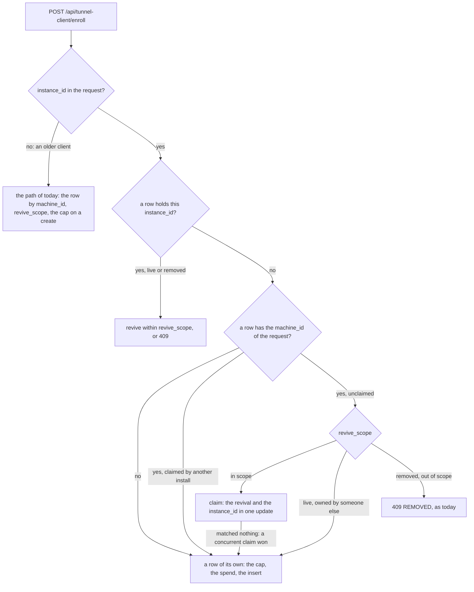
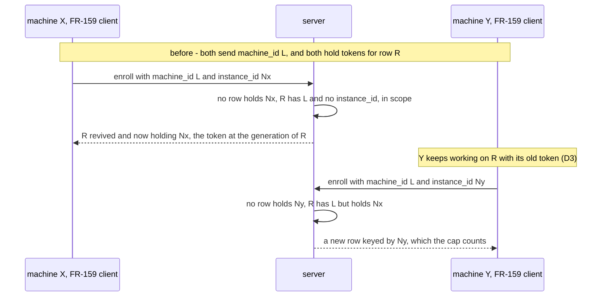

# FR-159: A tunnel client's identity comes from the machine it runs on, not from `$HOSTNAME`

**Issue:** [#4511](https://github.com/gjovanov/roomler-ai/issues/4511) · **Status:** spec, claimed 2026-11-27, from
[#4479](https://github.com/gjovanov/roomler-ai/issues/4479); nothing built. D1–D6 are open, each with a recommendation.
**Builds on:** [#3328](https://github.com/gjovanov/roomler-ai/issues/3328) (a known machine id re-enrolls only for its
owner or for a device manager), [FR-103](FR-103-device-credentials-renew-themselves.md) (the token generation a
removal advances)
**Related:** [#3934](https://github.com/gjovanov/roomler-ai/issues/3934) (the sibling: a host name read from the
environment, fixed in #4480), [FR-129](FR-129-guided-cross-platform-installer.md) B2 (the macOS root half's machine id,
from the hardware)

**Anchors:** read on master `21f0923b0` (2026-11-27), in the tree.

## Goal

1. Two machines never share a tunnel client unless someone means them to.
2. A machine that enrolls again gets its own client back: no second row, and no row lost.
3. Every client enrolled before this FR keeps its row. Its first enrollment with an FR-159 client revives that row.
4. Old and new mix. An older client against a newer server, and a newer client against an older server, behave as
   they do today.

The owner scope of #3328 stands throughout: nothing here lets anyone revive a row they cannot revive today. Nor does
anything here put the server in a data path: it reads one more field at enrollment, and a tunnel's bytes travel as
they do today.

## Evidence

From #4479, every anchor read again on master `21f0923b0`.

- **What the client sends.** `roomler enroll` sends `derive_machine_id(&machine_name)`
  ([`agents/roomler-cli/src/cli.rs:1189`](../../agents/roomler-cli/src/cli.rs#L1189)). The derivation hashes the
  typed name, `hostname_lossy()`, the OS and the architecture (`cli.rs:1228-1243`). `hostname_lossy` reads the
  `HOSTNAME` variable on Unix and `COMPUTERNAME` on Windows, and falls back to `unknown` (`cli.rs:1245-1258`).
  `--name` is required (`cli.rs:84-93`), so the name is whatever the person typed.
- **The wizard's copy.** `crates/roomler-setup-core/src/tunnel_enroll.rs:106` sends the same derivation, copied byte
  for byte (`tunnel_enroll.rs:151-165`, the variable at `:167-180`). The wizard fills the name with the OS host name
  (`agents/roomler-setup/src/commands.rs:539-547`), so on that road a collision needs two machines with one host name.
- **Why the variable is often `unknown`.** bash sets `HOSTNAME` as a shell variable and exports it only when a startup
  file does; zsh, the macOS shell, does not set it; `sudo` resets the environment; an app started from a desktop
  session does not get it.
- **What the server does with the id.** It looks the row up by `(tenant_id, machine_id)`
  (`crates/modules/network/src/routes/tunnel.rs:177-180`), live or removed, because the unique index covers removed
  rows (`crates/modules/network/src/lib.rs:727`, `crates/services/src/dao/tunnel_client.rs:70-73`). A row it finds is
  revived (`routes/tunnel.rs:215-229`) within `revive_scope` (`routes/tunnel.rs:313-343`), and the token is minted at
  the row's `token_gen` (`routes/tunnel.rs:283-288`), which `rehydrate` leaves alone (`tunnel_client.rs:94-95`). Only
  a removal advances it (`tunnel_client.rs:369-379`).
- **The three cases of #4479,** when a second machine sends an id the organization already has:
  1. the same person, the first client live: one row and two valid tokens; the list shows one client, the cap counts
     one, and removing the row ends both;
  2. another person: 409 `SOMEONE_ELSES_TUNNEL_CLIENT` (`routes/tunnel.rs:101-104`), although it is another machine;
  3. a holder of `MANAGE_AGENTS`: as case 1, and the row keeps its owner.
- **One more consequence, from the code.** The hub keeps one socket entry per row for the overlay broker
  (`crates/modules/network/src/tunnel.rs:96-102`). Of two machines on one row, the one that connected last holds it.
- **The client keeps no id today.** `TunnelConfig` holds the server, the token, the name and the plaintext flag
  (`agents/roomler-cli/src/config.rs:15-40`). Both writers build it fresh and replace the file
  (`cli.rs:1214-1220`, `agents/roomler-setup/src/orchestrator_tunnel.rs:378-388`), and the renewal parses the file and
  saves it again (`config.rs:208-228`), which drops any key the binary does not know.
- **The comparison.** The daemon's own id hashes `gethostname(3)`, the OS, the architecture and the config path
  (`crates/agent-core/src/machine.rs:33-44`, the host name at `:49-70`; on Windows that is the variable again,
  `:64-69`). The macOS root half takes its id from the hardware (`machine.rs:100-156`), and states the rule this FR
  follows (`machine.rs:169-174`): two machines on one row is the failure that must not happen; a fresh row after a
  reinstall is the one that may.
- **What is not known** (#4479): how many rows were derived from `unknown`, and whether any organization has two
  machines on one row today. The id does not say it, but the server can compute the `unknown` derivation from a row's
  own name and OS and compare: that is P0's read R3.

## Design

### Where the id comes from (D1)

| case | (a) derived from the machine, as the daemon's | (b) kept: random, made once | (c) kept, seeded from the machine |
|---|---|---|---|
| two machines, one name, no variable (#4479) | holds, unless they share a host name | holds | holds, unless they share every fact |
| clones of one template, not renamed, enrolled after the clone | **one row** | holds | **one row**: they share the facts |
| a clone of an enrolled machine, renamed, enrolls again | holds | holds, through the binding below | holds |
| the same machine, its config folder lost | holds | **a new row**; the old one stays, offline | holds |
| a Mac on another network | **a new id**: the host name follows the network (`machine.rs:20-23`) | holds | holds, with the hardware UUID |
| two people on one machine | holds (the config path) | holds | holds |
| a container created again | a new id each time, as today | a new id, unless a volume keeps the file | a new id each time |

**Recommended: (b), with (c)'s read of the machine used as a binding, not as the seed.** At its first enrollment a
client makes a random 128-bit `instance_id` (32 lowercase hex, the shape today's id has) from the OS's random source,
and keeps it. (a) and (c) both put clones on one row, the failure that must not happen, and (a) also makes a new id
when a Mac changes networks. (b) fails only where a new row may happen: after the folder was lost, which the person
sees and removes.

**The binding.** Beside the id the file keeps a hash of facts about the machine it was made on. An enrollment that
finds a file whose hash names another machine (a copied or restored profile, a renamed clone) makes a new id. The
facts, read from the OS and never from the environment:

| OS | the facts |
|---|---|
| Linux | `gethostname(3)`, and `/etc/machine-id` (else `/var/lib/dbus/machine-id`) when it can be read |
| macOS | the `IOPlatformUUID`, and on a virtual Mac the permanent `en0` address: the root half's facts (`read_mac_hardware`, `machine.rs:100-156`). Never the host name, which follows the network |
| Windows | the computer name the OS gives (`gethostname`, as the wizard reads it at `commands.rs:543-547`), and the `MachineGuid` |

The facts are hashed with a fixed tag, as `machine-id(5)` asks of any use of the machine id, and the hash stays on the
machine: the server never sees it. A fact that cannot be read hashes as empty, so a host that never had one keeps its
id. Both roads, `roomler enroll` and the wizard, run the same code on all three OSes (below).

### Cloned VMs

- **Cloned before enrollment** (a template). Each clone makes its own id at its first enrollment, so two clones are two
  rows whatever they share. That includes the computer name two Windows clones share today, which with the wizard's
  default name gives them one row on master.
- **Cloned after enrollment.** The clone carries the original's config folder: its token and its id file. Until the
  clone enrolls again the two are one client, because they hold one credential, and no id changes that (out of
  scope). When the clone enrolls again, its binding no longer matches if it was renamed or got its own machine id, so
  it makes a new id and gets its own row.
- **A clone that keeps every fact** is the same machine from inside, as `machine.rs:122-125` says of a Mac. Renaming
  it, or deleting its id file, makes it a machine of its own.

### Where the id is kept (D6)

In a file of its own beside `config.toml` (beside the given path for `--config <path>`), owner-only and replaced
atomically, as the config is (`config.rs:232`). Not inside `config.toml`: every released writer of that file either
replaces it whole (`cli.rs:1214-1220`, `orchestrator_tunnel.rs:378-388`) or parses and saves it again
(`config.rs:208-228`), so an older binary's next token renewal would drop the id, and the next enrollment would make a
new one and a new row. A file none of them knows survives all of them.

- Two config files on one machine are two clients, with two ids.
- A client configured from the environment (`ROOMLER_TUNNEL_SERVER` and `ROOMLER_TUNNEL_TOKEN`, `config.rs:137-150`)
  never enrolls, so it keeps no id.
- When a client makes a new id while its config already holds a token, it says so and names the client that token was
  for, so the person can remove the row it leaves.

### One function, both roads (P2)

`roomler-cli` owns the identity: one function returns the request's two ids, today's `machine_id` and the
`instance_id`. `roomler enroll` (`cli.rs:1176`) calls it. The wizard's orchestrator (`orchestrator_tunnel.rs:317-325`)
calls it too and passes both ids to `tunnel_enroll::enroll`, so `roomler-setup-core` stays free of the tunnel crate
(`tunnel_enroll.rs:11-13`). The wizard's copy of the derivation (`tunnel_enroll.rs:145-180`) goes, and the file's
pointers to code that moved (`:21`, `:57`, `:147`) are corrected. Its two environment reads go with the copy, and the
wizard's test that lists every variable the wizard reads (`agents/roomler-setup/src/launch.rs:773-790`) loses its
exemption for them (`:782`).

Today's derivation stays, byte for byte, as the legacy value: the lowercase hex of the first 16 bytes of
SHA-256(name, 0, the variable or `unknown`, 0, OS, 0, architecture). It is how a row enrolled before this FR is found.
No new binary or library target comes with it, and the new module's name carries none of the substrings Windows
elevates (`.claude/rules/installers.md`).

### One organization per config

A tunnel config holds one server and one token (`config.rs:15-40`), so it is one organization's client. A person in
two organizations keeps two configs (`--config <path>`), and so two ids. A config enrolled into a second organization
carries its id there, as it carries today's hash. The daemon's own organizations (`[[orgs]]`, `docs/multi-org.md`)
are device rows, out of scope.

### The request and the answer

| field | today | an FR-159 client |
|---|---|---|
| `machine_id` | today's hash | today's hash, unchanged: every server keys by it |
| `instance_id` | absent | the kept id, 32 lowercase hex |

- An older server ignores `instance_id`: `TunnelEnrollRequest` (`routes/tunnel.rs:83-90`) does not refuse unknown
  fields, so it keys the row by today's hash, as it always has.
- A newer server refuses an `instance_id` that is not 32 lowercase hex characters: 400, before the spend.
- The answer to a request that carries an `instance_id` gains `keyed_by`: `instance_id`, or `machine_id` while the P1
  switch is off. A request without one is answered exactly as today. The clients' answer types ignore fields they do
  not know (`cli.rs:1209-1211`, `tunnel_enroll.rs:58-63`), and an older server never sends it, which tells a newer
  client it was keyed the old way.

### What the server stores (P1)

- `TunnelClient` (`crates/remote_control/src/models.rs:3545-3577`) gains `instance_id: Option<String>`, skipped when
  `None` and read as `None` when absent. Absent on a row means no FR-159 client has claimed it.
- `machine_id` keeps its meaning and is never written after the insert. A row enrolled before this FR keeps today's
  hash. A row an FR-159 client creates takes its `instance_id` as its `machine_id` too: unique under the existing index
  (`lib.rs:727`), and a value no older client can send.
- A new index in network's `index_plan` (`lib.rs:719-731`), never in `crates/db/src/indexes.rs`:
  `{tenant_id: 1, instance_id: 1}`, unique, partial on `{instance_id: {$type: "string"}}`. Like the `machine_id` index
  it covers removed rows (`tunnel_client.rs:70-73`): a removed client is revived in place, never inserted again, so
  the `deleted_at` partial of the overlay indexes does not apply here.

### How the server reads an enrollment (P1)



| request | the row found | outcome |
|---|---|---|
| no `instance_id` | by `machine_id`, or none | exactly today's path, and no `instance_id` is written |
| `instance_id` | a row holds it, live or removed | revived within `revive_scope`, or its 409 |
| `instance_id` | none holds it; a row has the request's `machine_id` and no `instance_id`, in scope | **claimed**: today's revival, and the row gets the `instance_id` in the same update, which matches only while the row has none |
| `instance_id` | that row is live and someone else's | a row of its own (D4) |
| `instance_id` | that row is removed, and outside scope | 409 `REMOVED_TUNNEL_CLIENT` (`routes/tunnel.rs:109-111`), as today (D4) |
| `instance_id` | that row holds another `instance_id` | a row of its own |
| `instance_id` | no row at all | a row of its own |

- **A row of its own** is a create: the cap (`routes/tunnel.rs:186-204`), then the spend, then the insert.
- **#3328's order holds:** every refusal comes before the spend (`routes/tunnel.rs:210-213`), and the token is spent
  once on every path.
- **A claim that loses a race** (its update matches nothing because another claim won) becomes a create. The cap for
  it is read before the spend, so a claim path reads the cap too. The DAO tells a lost claim from a lost scope by
  reading the row again; a lost scope is refused 409 as today. A row read again that holds this request's own
  `instance_id` (one config enrolling twice at once, with two tokens) is a revival of it, not a create: the unique index
  on `instance_id` would refuse that insert.
- **The decision is one pure function** of the request, the row found by each id, the scope's answer and the cap's
  answer, so the table above is its test.

A row two machines share today splits over two enrollments:



### The migration: the two roads of #4479 (D2)

| | road 1: the client sends again the id it enrolled with | road 2: the client sends the old id beside the new, and the server revives by either |
|---|---|---|
| what a client enrolled today sends | today's hash, computed again and then kept, because its config holds no id (`config.rs:15-40`) | today's hash in `machine_id`, and its own `instance_id` |
| a row two machines share today | stays shared for good: both machines compute one hash and keep it | splits over two enrollments: the first to enroll claims it, the second gets a row of its own (the diagram above) |
| the plan's cap | unchanged: no row is added | a claim takes no slot; a split takes one, and at the cap it is refused 403 before the spend |
| the owner scope | unchanged: today's lookup | every revival, by either id, goes through `revive_scope`; D4 for a legacy row of someone else |
| `token_gen` | unchanged | unchanged: a claim mints no new generation (D3) |
| the server | no change | P1 |
| an older server | works | works: it reads only `machine_id` |

Recommended: road 2, without an end date (D5). Road 1 alone keeps every collision that exists today, because the id it
keeps is the colliding one.

### The owner scope (#3328)

Every revival, by either id, runs `revive_scope` on the row found, and the write holds the same scope
(`ReviveScope`, `tunnel_client.rs:18-27`). A new id never revives another person's row.

What D4 changes: a client that brings its own `instance_id` and meets someone else's live legacy row is no longer
refused. The legacy match is only a guess that the row is the client's own, and refusing it is case 2 of #4479. A row
of its own grants nothing a new name does not grant today: any member may mint a tunnel enrollment token
(`routes/tunnel.rs:58-81`, the gate at `:66`), and a new name makes a new row. A row's restrictions, its removal and its
quarantine, bind the row, as they do today. A machine with a new identity is a new client.

The 409 sentences: `SOMEONE_ELSES_TUNNEL_CLIENT` (`routes/tunnel.rs:101-104`) advises enrolling under a different
name. For a row found by its `instance_id` another name changes nothing, so that path gets its own sentence: enroll
from another config, or ask the client's owner or an administrator. A legacy match keeps today's sentences, and there a
different name still works, because the name is in the hash. The doc comment that a client-side rename enrolls a new
row (`routes/tunnel.rs:602-604`) is true only of an older client: for an FR-159 client, enrolling again under another
name renames its row, unless an administrator set the name.

### The plan's cap

A claim revives a row and takes no slot. A split, the second machine of a shared row getting its own, is a create and
takes one (`routes/tunnel.rs:186-204`): an organization at its cap is answered 403 before the spend, with today's
sentence. That is the honest count, because two machines are two clients. The plan compliance report counts live rows
the same way (`crates/modules/saas/src/plan_compliance.rs:126`).

### `token_gen` (D3)

A claim mints no new generation. Its token is minted at the row's generation (`routes/tunnel.rs:283-288`), as on every
re-enrollment today (`tunnel_client.rs:94-95`).

**What the other machine on a shared row sees: nothing.** Its token keeps working on the row, its sessions stay up,
and it moves to a row of its own at its own next enrollment with an FR-159 client. Until then it shares the row as it
does today: the list shows the row with whichever machine enrolled last, and removing the row ends both.

The alternative, a claim that advances the generation, refuses the other machine at its next connect
(`rc:tunnel.revoked`, close 4003, `crates/modules/network/src/tunnel.rs:2161-2176`) or its next renewal
(`routes/tunnel.rs:442-449`). It is not cut mid-session, because the 60 s re-check reads only `deleted_at` and the
status (`tunnel.rs:1640-1645`). It must then enroll again, and if it runs an older client it finds the row by
today's hash and lands on it again. That is an outage that fixes nothing, so it is not recommended.

### Old and new together

| | an older server | a newer server |
|---|---|---|
| **an older client** | today | today: the row by `machine_id`, and no `instance_id` written. It can revive a claimed row, as the same machine with an older binary or a machine still sharing the row would today |
| **a newer client** | today: `instance_id` ignored, the row keyed by today's hash. The client keeps its id file, and its first enrollment after the server is updated claims the row | this FR |

The server is the arbiter. An absent `instance_id` in a request is an older client. An absent `instance_id` on a row
is a row nobody has claimed. A newer server answers `keyed_by` to every request that carries an `instance_id`, and an
older one never does. Self-hosters run older servers, so a newer client must work against one: it does, as today's
client.

### The overlay node and the row's `machine_id`

A tunnel client's overlay node is keyed by its row's `machine_id`. The join reads it from the row
(`crates/modules/network/src/overlay.rs:302-307`), names the node from it (`overlay.rs:335`), checks the WireGuard key
against it (`overlay.rs:362`, `crates/services/src/dao/overlay_node.rs:121-137`), and a removal releases the node by it
(`overlay.rs:1917-1943`, through `end_tunnel_client` at `routes/tunnel.rs:708-733`). Writing a new `machine_id` on a
row would leave its node under the old one: no removal would release it, and the client's next join would be refused
`wg_key_taken_by_other`. So a claim writes `instance_id` and never touches `machine_id`. On master no `WgKeypair` is
made under `agents/roomler-cli/src`, so the CLI built from master joins no overlay of its own; the rule holds for any
row that has a node.

### The composition baseline

P1 adds an index to `tunnel_clients`, so the index plan for both `multi_block` values moves
(`crates/tests/fixtures/composition.baseline.json:2912` and `:4915`). P1 re-records the baseline with
`COMPOSITION_UPDATE=1` and a commit message that names the index. No route, method or wire name moves: `instance_id`
is a field of an HTTP body and `keyed_by` a field of its answer. P2 does not move the baseline.

### Kill switches

| phase | switch | off means |
|---|---|---|
| P1 | `ROOMLER__RC__TUNNEL_INSTANCE_ID` (`RcSettings`, `crates/config/src/settings.rs:967`), default on | the server looks every request up as an older client's, by `machine_id` alone, writes no `instance_id`, and answers `keyed_by: machine_id` to a request that carried one. A row keyed by an instance id is then not found by today's hash, so its client gets a new row at its next enrollment: the switch is for a P1 fault, not a setting to leave off. On by default is safe, because nothing sends the field before P2 |
| P2 | `ROOMLER_TUNNEL_INSTANCE_ID=0` on the client | no id file is read or made, and the request carries no `instance_id`. The wizard takes it only when not elevated: it is one more variable `distrusted_variable` refuses, and `launch.rs:773-790` fails until it is listed |
| P2 | fail-open, always | a client that cannot read or write its id file enrolls as an older client does, and says why |

P0 and P3 read and change nothing. P4 is docs.

### Tests, RED first

**P1, integration**, in `crates/tests/src/tunnel_enroll_tests.rs` beside #3328's tests (its `enroll` helper at `:64`
gains the instance id):

| test | RED on master because |
|---|---|
| two installs with one legacy hash get two rows | master revives the first one's row: one row |
| an install revives its own row, whatever its legacy hash says | master keys by the hash: two rows |
| an unclaimed legacy row is claimed once, by the first install that brings it | master writes no `instance_id` |
| someone else's live legacy row: a new install gets a row of its own, and that row is left as it was | master answers 409 (D4) |
| a split meets the cap, 403 before the spend | master revives, so there is no 403 |
| two concurrent claims leave one claim and one new row, and no row with two ids | master: one row |
| an `instance_id` that is not 32 lowercase hex: 400, and the token unspent | master ignores the field: 200 |

Guards, green on master and after: a request without `instance_id` is answered as today (#3328's tests, unchanged); a
removed legacy row stays 409 `REMOVED_TUNNEL_CLIENT` for its owner without the permission; the switch off answers as
today. The decision function gets a table test in the network module, one case per row of the outcome table.

**P2, unit**, in `roomler-cli`. The seam's first commit returns today's request, so each test is RED on master's
derivation:

- the id does not follow `HOSTNAME` or `COMPUTERNAME`: one config folder, the variable set and then not set, one id
  (master's changes);
- two config folders on one machine, one name and one environment, two ids (master's are equal);
- the typed name does not enter the id (master's changes with it);
- a file whose binding names another machine is replaced, and one whose binding matches is kept;
- a folder that cannot be read or written: the request carries no `instance_id`, and the enrollment goes on;
- the legacy hash is master's, byte for byte, pinned by values computed from `cli.rs:1228-1243`: the claim depends on
  it;
- the file is owner-only and replaced atomically.

**The wizard's test** (`launch.rs:773-790`): with its exemption (`:782`) deleted it is RED on master, because
`tunnel_enroll.rs:170` and `:174` read `HOSTNAME` and `COMPUTERNAME`, and GREEN on P2.

### Field cells (vmtest)

On the vmtest org. Each cell marked RED is read on the current release and the current server first (P0), and GREEN on
P1's server with P2's clients (P3). Rows are counted from the org's tunnel-client list (`GET
/api/tenant/{tenant_id}/tunnel-client`, as the org's admin), never from the database.

| cell | what | RED, current release | GREEN |
|---|---|---|---|
| F1 | two Linux guests in one org, one person's tokens, the same `--name`, `HOSTNAME` not set (`env -u HOSTNAME`) | one row, and the tunnels of both guests work on it | two rows |
| F2 | one Linux guest, enrolled with `HOSTNAME` set, then again with it not set | two rows | one row |
| F3 | a client enrolled on the current release, updated, then enrolled again in the same environment: Linux, macOS (zsh never sets the variable) and Windows (through the wizard) | a guard, not RED | the same row id, `keyed_by: instance_id`, no new row |
| F4 | F1's pair, carried over the update, both enrolling again | F1's one row | two rows, and the first to enroll keeps the original row id |
| F5 | Windows unchanged: two guests under distinct names, then one enrolled again | two rows, then two | the same |

### P0: the coordinator's read

Workers never read production, so this read is the coordinator's. It is bounded, counts only, run from outside the
database pod, and nothing it reads by name leaves the reading process.

- **R0.** `db.tunnel_clients.estimatedDocumentCount()`, first.
- **R1, rows per OS, live and removed:**
  `db.tunnel_clients.aggregate([{ $group: { _id: { os: "$os", removed: { $ne: [{ $ifNull: ["$deleted_at", null] }, null] } }, n: { $sum: 1 } } }])`,
  six groups at most.
- **R2, names on more than one live row of an organization,** counted per OS:
  `db.tunnel_clients.aggregate([{ $match: { deleted_at: null } }, { $group: { _id: { t: "$tenant_id", name: "$name", os: "$os" }, n: { $sum: 1 } } }, { $match: { n: { $gt: 1 } } }, { $group: { _id: "$_id.os", names: { $sum: 1 }, rows: { $sum: "$n" } } }])`.
  The row stores no architecture (`models.rs:3545-3577`), so the group is `(tenant, name, os)`. This is not a count of
  collisions. Rows that share a name are machines, or environments, that got different ids; a collision leaves one
  row, and no count of rows shows it. R2 counts name reuse: the machines a missing variable would have put on one row.
- **R3, rows derived from `unknown`,** counted per OS. For each live row, the `unknown` derivation of its own name and
  OS is computed for each architecture the CLI ships for and compared with its `machine_id`. A row whose name an
  administrator set (`name_admin_set`) cannot be tested and is counted apart. In mongosh:

  ```js
  const c = require('crypto');
  const id = (n, os, a) => c.createHash('sha256')
    .update(Buffer.concat([Buffer.from(n), Buffer.from([0]), Buffer.from('unknown'), Buffer.from([0]),
      Buffer.from(os), Buffer.from([0]), Buffer.from(a)]))
    .digest('hex').slice(0, 32);
  const out = {};
  db.tunnel_clients.find({ deleted_at: null }, { name: 1, os: 1, machine_id: 1, name_admin_set: 1 })
    .limit(R0_COUNT + 100) // R0_COUNT: the count R0 read
    .forEach(r => {
      const k = r.os + (r.name_admin_set ? ' renamed'
        : ['x86_64', 'aarch64'].some(a => id(r.name, r.os, a) === r.machine_id) ? ' unknown' : ' other');
      out[k] = (out[k] || 0) + 1;
    });
  printjson(out);
  ```

R3 is the size of the problem: each `unknown` row is one that any second machine of its organization under its name,
OS and architecture would have joined. R1 and R3 together say how many rows the claim will meet, and R3 read again
later decides D5.

## Phases

Ship order: P0, then P1 (a server that reads an absent field as today can go before any client sends one), then P2 in
the agent, tunnel and setup lanes, then P3 and P4. Each code PR carries its own docs; P4 checks that they are whole.

| phase | what | kill switch | status |
|---|---|---|---|
| P0 | the RED reads of F1 and F2 on the current release and server, F4's pair left enrolled; the coordinator's R0–R3 | none: it reads and changes nothing | not started |
| P1 | the server: `instance_id` on the request and the row, the order of the lookups, the claim, the index, `keyed_by`, the 400, the 409 sentence for an instance match; the baseline re-recorded | `ROOMLER__RC__TUNNEL_INSTANCE_ID`, default on | not started |
| P2 | the clients: the identity function in `roomler-cli`, the id file and its binding, `roomler enroll` and the wizard on that one function, the wizard's copy gone | `ROOMLER_TUNNEL_INSTANCE_ID=0`, and fail-open | not started |
| P3 | the field reads F1–F5 on P1's server and P2's clients | P1's switch | not started |
| P4 | the docs: tunnel-client enrollment in `docs/tunnels.md` (the id, its file, the claim and the split, the 409s, with a diagram), the field and the index in `docs/data-model.md`, and the `docs/README.md` rows | none: docs | not started |

## Acceptance criteria

- [ ] **AC1** (P0): R0–R3 read by the coordinator, counts only, and recorded in the field log.
- [ ] **AC2** (P0, RED): F1 and F2 read RED on the current release and server, and F4's pair is left enrolled for P3.
- [ ] **AC3** (P1): the integration tests above, each shown RED on master first, and #3328's tests unchanged and green.
- [ ] **AC4** (P1): the decision function's table test covers every row of the outcome table, and the owner scope, the
  cap before the spend and the token's single use hold on every path.
- [ ] **AC5** (P1, old and new together): a request without `instance_id` is answered exactly as today; a newer client
  reads an answer without `keyed_by` as keyed the old way (a client unit test).
- [ ] **AC6** (P1): the index is in network's `index_plan`; the composition baseline is re-recorded in P1's PR with a
  message that names the index; no route, method or wire name moves.
- [ ] **AC7** (P2): the unit tests above, each RED first; the legacy hash matches the values pinned from master; the
  wizard's test holds with its exemption gone, after reading RED on master with the exemption deleted.
- [ ] **AC8** (field, read RED first): F1, two rows.
- [ ] **AC9** (field, read RED first): F2, one row.
- [ ] **AC10** (field): F3 on Linux, macOS and Windows (through the wizard), the same row id and no new row; and F4,
  two rows, the first to enroll keeping the original.
- [ ] **AC11** (field): F5, Windows unchanged.
- [ ] **AC12** (docs): Docs updated with diagrams, linked from `docs/README.md`: tunnel-client enrollment in
  `docs/tunnels.md`, and the `tunnel_clients` collection with its new field and index in `docs/data-model.md`.

## Open decisions

- **D1, where does the id come from: derived from the machine, kept by the client, or both?** Recommended: kept, made
  once at random, and bound to the machine it was made on (§ Where the id comes from). A derived or seeded id collides
  wherever two machines share what it is derived from: two Windows clones that nobody renamed share their computer
  name, and the wizard gives both the same default name. A random id never does. Its one failure, a new row after the
  folder is lost, is the one the root half's rule allows (`machine.rs:169-174`).
- **D2, the migration: does the client send again the id it enrolled with, or send the old one beside the new?**
  Recommended: the old beside the new, with the row's `machine_id` never rewritten. A client enrolled today keeps no id
  it could send again (`config.rs:15-40`), so sending today's hash again is the only way such a client can be found,
  and it must be today's hash, computed as today. The claim then moves each legacy row to its install once.
- **D3, does a claim mint a new token generation?** Recommended: no, as no re-enrollment does today
  (`tunnel_client.rs:94-95`). With one, the other machine on a shared row is refused at its next connect
  (`crates/modules/network/src/tunnel.rs:2161-2176`) and must enroll again, and an older client there finds the same
  row again.
- **D4, a legacy row outside the enroller's scope?** Recommended: a live row of someone else gets the enroller a row of
  their own, which is case 2 of #4479 fixed; a removed row stays 409 `REMOVED_TUNNEL_CLIENT`, as today, so a removal is
  still undone only by a device manager. The alternative, 409 for both, keeps case 2 for every client whose legacy hash
  collides.
- **D5, how long does the server read the legacy hash?** Recommended: no end date in this FR. Enrolling again is done
  by hand and rarely, so a window of one release would miss most clients, and each one it missed would get a second
  row. The P1 switch turns the reading off, and R3, read again later, decides whether a later FR ends it.
- **D6, where is the id kept?** Recommended: in a file of its own beside `config.toml` (§ Where the id is kept). The
  alternative, a key in `config.toml` that writers keep from now on, is lost to the first older binary that renews the
  token.

## Out of scope

- The daemon's own machine id (`crates/agent-core/src/machine.rs:33-44`) and device rows (`agents`).
- #3934, the crash recorder's host name, fixed in #4480.
- The tunnel transport.
- Where the tunnel config lives on Windows: under `%APPDATA%` (`config.rs:80-86`), which a roaming profile carries to
  other machines, token included.
- Telling, on a live socket, which install holds a row's token: the second machine of a shared row is found only when
  it enrolls again.
- Merging the rows a split or a lost folder leaves: an administrator removes a stale row, as today.
- The id in the organization's list: its members see `machine_id` today (`routes/tunnel.rs:537`, the gate at `:574`),
  and a row an FR-159 client creates shows its `instance_id` there. It is no secret: the owner scope, not the id,
  decides who may revive a row. One config enrolled into two organizations shows one id in both lists, as today's
  hash does; only someone who can read both lists can compare them.

## Field log

| date | what | result |
|---|---|---|
