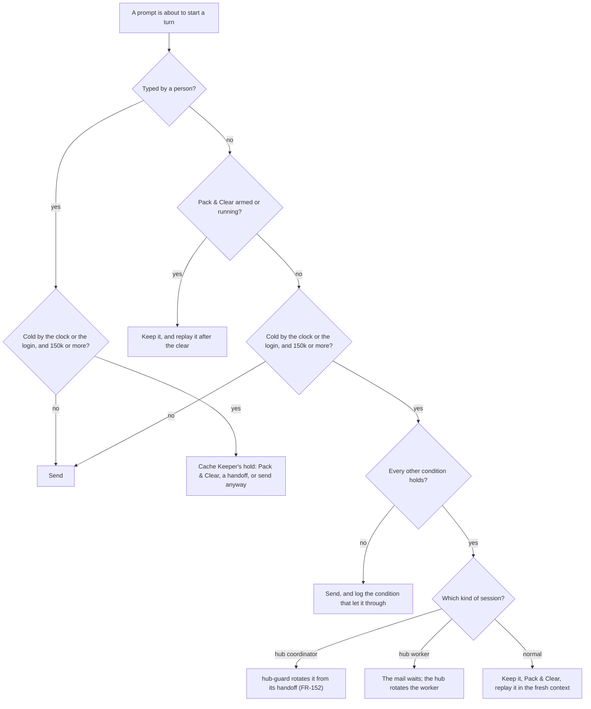

# FR-161: A cold resume or a login change never re-reads a context that a pack would replace

**Issue:** [#4573](https://github.com/gjovanov/roomler-ai/issues/4573) · **Status:** claimed 2026-11-28 on the
operator's word of that morning, which also decided D1. D2 and D3 are taken as recommended. P0 to P4 are being built,
from 2026-11-28, in the tools' dev and staging copies. Cache Keeper's part installs when it is ready, and hub-guard's
after FR-152's AC8 window ends on 2026-11-30 18:17Z.

Builds on:
- [FR-152](FR-152-cold-hub-continues-from-handoff.md): the cold rotation of a hub, the one path covered today;
- [FR-154](FR-154-session-tools-journal.md): the journal, and its fix list, whose rows on cold re-reads this FR takes
  over;
- [FR-8](FR-8-claude-session-restore.md): crestore;
- [FR-136](FR-136-hub-process-hygiene.md): hub-guard.

Like those FRs, it changes the operator's tooling under `~/.claude/` and no product code, so the design names files and
functions there rather than repository lines.

## Goal

Cost. A Claude Code session that goes cold re-sends its whole context at the cache-write price on its next request,
40 times the price of a warm read. A session goes cold when its prompt cache expires or when the login changes. The
operator's word of 2026-11-28: prevent every unnecessary cold re-read while sessions resume cold or move across
accounts, in hubs, workers, agents, subagents and normal sessions, with an architecture built to last.

A re-read is unnecessary when a pack would do instead. acct-sync builds a pack from the transcript without a model call,
and a fresh context continues from it at about 75k-95k tokens instead of re-reading 150k-350k.

## Evidence

### Outside FR-152's path (read-only, 2026-11-24 to 11-27)

FR-152's AC8 audit reads every transcript, and its buckets outside FR-152's scope show where cold re-reads of 150k or
more still happen:

- hub mail woke 11 cold workers, at 165k-247k each;
- prompts nobody typed made normal sessions re-read cold contexts 23 times: 6 cron ticks and 17 task notifications;
- hub-guard's idle handoff, meant to run while the cache is still warm, ran on a cold cache 3 times, 2.7 to 9.3 h late.

### A login change (2026-11-28)

The prompt cache belongs to the login. A login change therefore voids every cache, but every cache clock kept counting
the old login's hour:

- A hub tick came 58 min after its last request and re-read 249k, with 11 % from the cache (about the shared tools
  prefix).
- Cache Keeper's warning still gave the old hour, and hub-guard's condition 4 (`hooks/core.ts`, `coldDue`) said warm.
  So did its quiet path for a person's prompt under 60 s old (`hooks/register.ts`, `coldGate`). The tick went through
  with no line.

The Pack & Clear sweep after the change raced the queued prompts:
- one clear was armed 44 ms before a queued tick started its turn; it waited for idle, gave up after a minute, and the
  tick paid the re-read the clear was meant to save;
- another cleared a fresh resume, already warm under the new login, 14 s after hub-guard had made it.

## Key design

One warmth rule, one gate for each prompt, acting lazily in each session, and no sweeps.

### P1: warmth knows the login

Cache Keeper's per-session snapshot, which hub-guard already reads for `cache.lastAt`, `cache.ttl` and
`cache.recacheTokens`, gains the login that the session's last successful request ran under. The login is the same
owner fingerprint that acct-sync's journal `login` lines carry, and a token refresh does not change it.

A context is cold when `now ≥ lastAt + ttl`, or when the current login differs from the snapshot's. An unknown login
counts as the same, so a wrong answer can only cost a re-read and never a wrong clear. `lastAt` keeps its meaning, so
hub-guard 0.6.0 behaves as today until it is replaced. One rule feeds Cache Keeper's strip, its five-minute warning,
its hold for a person's cold prompt, and Pack & Clear.

### P2: the gate for normal sessions, and Pack & Clear's queue

In Cache Keeper's `prompt.submit`, a prompt nobody typed meets a cold context of 150k or more in a session that is
neither a hub's coordinator nor a hub worker. The origins are FR-152's: `scheduled-trigger`, `task-notification`,
`peer`, and a plugin's prompt that is not some tool's own run. The prompt is kept and dropped from the turn, the session
is packed and cleared, and the kept prompt is replayed into the fresh context.

The conditions are FR-152's:
- an empty prompt box;
- no person's prompt in the last 60 s;
- a re-read of 150k or more;
- no Pack & Clear of the session in the last 30 min;
- the part on.

A kept prompt is never lost. If the clear fails, the kept prompts go back in their order.

While a Pack & Clear is armed or running, in any session, prompts nobody typed are kept and replayed after it. A Pack &
Clear, typed or the gate's own, refuses a context that is warm under the current login and was made in the last hour,
unless a person forces it.

crestore starts a restored session of 150k or more whose cache is cold, by the clock or by the login, fresh from a pack
by default, never by a full resume.

### P3: hub-guard 0.7.0

0.7.0 is 0.6.1 plus FR-161:
- condition 4 is cold by the clock or by the login;
- the idle handoff checks warmth again at the moment its own prompt would start, and cancels on a cold cache;
- the quiet path for a person's recent prompt logs a let-through line when the cache is cold at 150k or more;
- mail to a worker that is cold at 150k or more waits in its inbox, and the hub rotates that worker from its handoff
  before the mail reaches the new generation.

### P4: a cold subagent or agent

A PreToolUse hook on SendMessage refuses a message that would wake an Agent-tool agent whose cache is cold and whose
context is 150k or more, with the advice to start a fresh agent from its notes. A message to a warm agent goes through.

### P0: the ledger

A read-only scan of every transcript, subagents' included, lists each cold re-read of 150k or more, and the
100k-150k band beside it. Each is classified by:
- session kind;
- origin;
- cause: the clock, a login change, or unknown (warm by both but cold in fact);
- what it wrote, and what a pack would have cost.

It is the baseline and the acceptance measure.

### Kill switches

Each part has a word in its tool's off file, as FR-152's `cold` does, and each install keeps the previous commit or a
dated backup for a rollback.

## Phases

| Phase | Scope | Status | Kill switch |
|---|---|---|---|
| P0 | The ledger, and its baseline from 2026-11-21 | being built (2026-11-28) | it only reads |
| P1 | Warmth knows the login: Cache Keeper's snapshot, strip, warning and hold | being built (2026-11-28) | Cache Keeper's off file |
| P2 | The gate for normal sessions and its replay, Pack & Clear's queue, crestore's cold restores | being built (2026-11-28) | Cache Keeper's off file |
| P3 | hub-guard 0.7.0, on top of 0.6.1: the rotation aware of the login, no idle handoff on a cold cache, the logged quiet path, a cold worker's mail through the hub | being built; installs after 2026-11-30 18:17Z | hub-guard's off file |
| P4 | A message that would wake a cold subagent or agent is refused | being built | hub-guard's off file |
| P5 | Field: a real login change, the cold prompts of each kind of session, and seven days of the ledger | after the installs | - |
| P6 | Docs: the session-tools section of `agent-hub.md` §12, and links from FR-152 and FR-154 | not started | - |

## Acceptance criteria

- [ ] **AC1** After a real login change with hubs, workers and normal sessions open, no session's next prompt re-reads
  150k or more, unless a person chose to send it.
- [ ] **AC2** A prompt nobody typed that meets a cold context of 150k or more in a normal session continues from a pack,
  and the prompt reaches the fresh context.
- [ ] **AC3** The same in a hub worker: the hub rotates it, and the mail reaches the new generation.
- [ ] **AC4** A Pack & Clear armed while a prompt nobody typed waits never loses to it, and a context that is warm
  under the current login is never cleared without a person's word.
- [ ] **AC5** The idle handoff never starts on a cold cache.
- [ ] **AC6** A message that would wake a cold subagent or agent of 150k or more is refused with advice, and one to a
  warm agent goes through.
- [ ] **AC7** None of this ever drops a person's prompt, holds it without offering a choice, or clears it.
- [ ] **AC8** Seven days on the live machine: every cold re-read of 150k or more in the ledger is either a person's
  choice or carries its logged reason. None is unexplained.
- [ ] **AC9** Docs: the session-tools section, with the warmth rule, the gate for each kind of session and a flowchart,
  written before the close.

## Open decisions

| # | Decision | Recommendation |
|---|---|---|
| D1 | The tools clear a normal session by themselves when a prompt nobody typed meets a cold context of 150k or more | **Decided 2026-11-28** by the operator's word "do whatever it takes to prevent unnecessary cold rereads in hubs, workers, agents, subagents and normal sessions". Allowed under FR-152's conditions: an empty prompt box, no person's prompt pending, a current pack, and the kill switches |
| D2 | The threshold | **Taken as recommended:** 150k, the same as Cache Keeper's hold and FR-152. A fresh context costs about 75k-95k |
| D3 | A cold worker's mail | **Taken as recommended:** hold the mail, and rotate the worker when the hub next needs it |

## Out of scope

- Claude Code itself, and the 5-minute TTL in overage.
- A person who chooses to send on a cold cache: Cache Keeper's hold offers that choice.
- roomler's product code.

## Docs

P6 writes a section of [`agent-hub.md`](../agent-hub.md) §12 before the close. It covers the warmth rule, the gate for
each kind of session with the flowchart above, Pack & Clear's queue, the ledger, and the kill switches, with links from
FR-152 and FR-154. `agent-hub.md` already has its `docs/README.md` row.

## Field log

| Date | Read | Result |
|---|---|---|
| 2026-11-24 to 11-27 | FR-152's AC8 audit, read-only, and its buckets outside FR-152's scope | Outside FR-152's path: 11 cold workers woken by mail (165k-247k each); 6 ticks and 17 task notifications that re-read cold contexts in normal sessions; 3 idle handoffs on a cold cache. |
| 2026-11-28 | A login change at about 09:44Z, read from the journals and the transcripts | A hub tick 58 min after its last request re-read 249k at 11 % from the cache, while Cache Keeper's warning and hub-guard's condition 4 both said warm. The sweep after the change lost one clear to a queued tick, and cleared a fresh, warm resume 14 s after it was made. |
| 2026-11-28 | The issue; work started on P0 to P4 | - |

## Related

FR-8 (#780, crestore) · FR-131 (#3127, the hub) · FR-136 (#3457, hub-guard) · FR-152 (#4290, the cold rotation) ·
FR-154 (#4443, the journal and its fix list) · Cache Keeper, the hold for a person's cold prompt.
