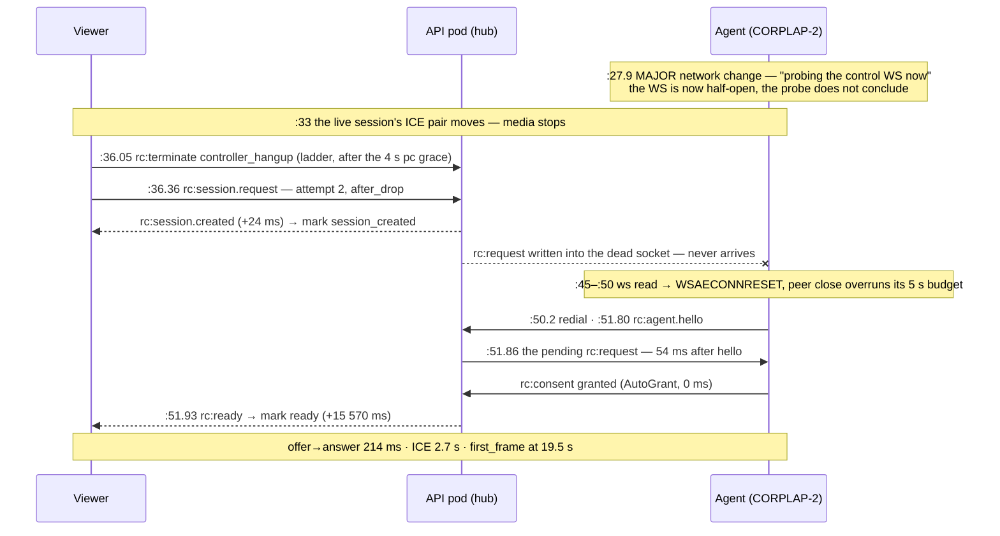
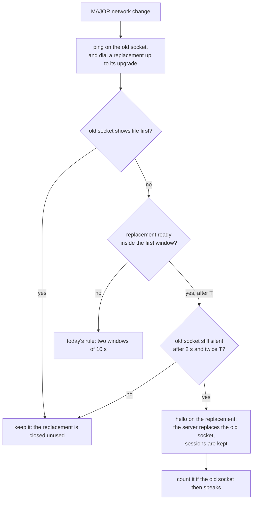

# FR-22: Time-to-first-frame — connecting sometimes takes 10–15 s

Status: **parts 1 + 3 + 3b + 4 shipped (part 4 live since `hosted-20260925-d5a7a3d`); ROOT CAUSE
TRACED 2026-10-06 (prod `0.4.116`) — the 10–15 s connect is the agent's control WebSocket going
half-open after a host network-path change, so the ladder's retry request sits undelivered until
the far end resets the socket 11–16 s later (AC5 `[x]`, two instances traced browser ↔ server ↔
agent). AC4 is met as re-worded on 2026-11-28 by the operator's ruling, option (b): the foreground
first-attempt paint-inclusive p50 sits inside the healthy band (1.45 s, n 232; AC4 `[x]`). Part 5
(after a network change a replacement control socket takes over, so a half-open one is not waited
for) is DECIDED the same day: it gets built, in phases, shadow first (§ Part 5). Its first phase,
P5-0, is built and unit-locked (a connection's end no longer waits for its tunnel peers'
closes), and its host read is owed. The hand-over is not built, and the FR stays open for
it.** Tracking issue: `FR-22` (#819). Reader-facing doc:
`docs/remote-control.md` §12.1.
UX rather than picture quality — but it is the first thing every session is judged on,
and the quality work is invisible to someone still looking at a blank stage.

## Report

Operator, 2026-08-28: *"In some occasions it can take up to over 10 or even 15 secs to
see the remote screen."* Usually much faster.

## Measured — the agent is not the cause

Ten consecutive CORPLAP-3 sessions, from the agent's own log timestamps:

| stage | span |
|---|---|
| session request → first ICE candidate | **127–253 ms** |
| session request → `video-bytes` DC open | **0.95–2.25 s** |
| session request → first pump heartbeat | **2.5–4.7 s** |

Consistent across all ten, no outliers. Capture bind (`DXGI-direct: bound Desktop
Duplication`) and encoder open together account for ~500 ms of that.

**ICE is already trickled correctly**, so the usual suspect is ruled out before we
start: `useRemoteControl.ts` sends the offer immediately after `setLocalDescription`
and streams candidates from `onicecandidate` as they arrive. It never waits for
`iceGatheringState === 'complete'`.

## The cost mechanism

`RC_SIGNALING_TIMEOUT_MS = 15000`.

An attempt that stalls in `requesting` or `negotiating` is not noticed for **15
seconds**. The ladder then retries after 250 ms (`RC_RECONNECT_LADDER_MS[0]`) and the
retry completes on the normal ~3 s path. **≈18 s total**, which matches the report.

So the 10–15 s case is not a slow connection — it is *one silently lost attempt plus a
timer that is three times longer than the path it is guarding*.

## ⚠️ What we have NOT proven

**Why the first attempt stalls.** The 15 s is the cost, not the trigger.

Circumstantial evidence in the same sample: session `…ff8c23` (07:53:00.923Z) reached
the agent, gathered candidates at +160 ms, and then produced no `video-bytes` DC and no
heartbeat; a fresh request arrived 2.4 s later and succeeded. So an attempt CAN die
after the agent has already accepted it.

Candidate causes worth testing, none confirmed:
- a **half-open agent control WS** — the server pushes into a socket that still ACKs
  but whose upstream leg is dead (the documented class that made agents look GREEN
  while `agent_offline`);
- a **pod split** — the RC hub is pod-local, so a browser and an agent hashed to
  different pods during a roll cannot meet;
- a lost `rc:sdp.offer`/`answer` on a WS that reconnected mid-negotiation.

We cannot currently distinguish these, because **there is no browser-side timing at
all**: "sometimes 10–15 s" cannot be turned into a distribution, and a fix cannot be
shown to work.

## Proposed direction — three parts, cheapest first

**1. Phase-aware signalling timeout.** ✅ **SHIPPED** (PR #821). 15 s is far beyond the
measured healthy path (worst observed end-to-end: 4.7 s agent-side). A short bound on
`requesting` — *has the server answered at all?* — with the existing longer bound kept
for `negotiating`, where ICE legitimately varies by network. Cuts the bad case from
~18 s to ~7 s and does not touch the good case. `awaiting_consent` stays exempt: the
SERVER owns that timeout, and a human approving a prompt may legitimately take longer
than any client-side number.

`signalingTimeoutFor(phase)`: `requesting` **4 s**, `negotiating` 15 s (unchanged),
everything else `null` = never arm. Exported and total over `RcPhase`, so a new phase
must declare its own bound instead of silently inheriting the ICE-sized one.

⚠️ **Mitigation, not diagnosis.** This shortens the cost of the stall; it does not
explain it. Criterion 5 stays open on purpose.

**2. Make the server answer instead of the client guessing.** ✅ **ALREADY IMPLEMENTED**
— checked against the tree rather than assumed, and deliberately NOT rebuilt (PR #821).
`Hub::create_session` returns `AgentOffline` when the request cannot reach a live agent;
`ws/remote_control.rs` runs a 250 ms cross-pod rehome probe and then sends
`ServerMsg::Error` with an attributable code (`agent_offline` / `agent_on_other_pod`);
the client surfaces it via `rcErrorMessage` and advances the ladder via
`isRetryableRcErrorCode`. So the undeliverable case already fails in well under a second.

⚠️ **This is the wrong-turn worth recording**: the proposal was written from the
assumption that the fast-fail was missing, and it is not. What the server genuinely
CANNOT see is the case actually observed — session `…ff8c23` **reached** the agent,
gathered candidates at +160 ms, and then went silent. A live agent that stops answering
is not detectable by another server-side check; it needs part 3.

**3. Instrument time-to-first-frame.** ✅ **SHIPPED** (PR #821). Request → first painted
frame, reported the way FR-1 P7 instrumented paint age. Without it every future claim
here is an anecdote. Feeds FR-16 (#798) L3.

`ui/src/composables/rcConnectTiming.ts` records eight marks — `request_sent`,
`session_created`, `ready`, `offer_sent`, `answer`, `pc_connected`, `dc_open`,
`first_frame` — and logs per-STEP deltas. (#824 added three pre-flight marks —
`ws_ready`, `turn_ready`, `probes_ready` — after a field repro showed the clock
started at the request while the operator waits from the click; **eleven** in all.)

⚠️ **Marks are per ATTEMPT, not per connect.** A recorder shared across the ladder would
let a fast retry overwrite the lost attempt's marks and report an 18 s connect as a 3 s
one — hiding the exact defect being hunted.
⚠️ **An unreached step prints as `<name>:—`, not omitted**, and the abandoned/cancelled
paths log too. A MISSING mark is the finding: it names the step that never completed,
which is what separates a half-open agent WS from a cross-pod split from a lost SDP
frame. The three fail in different phases; a single total cannot tell them apart.
⚠️ Deltas rather than absolute offsets — the actionable quantity is *which wait was
long*, and with offsets every step after a 9 s stall looks equally late.

**3b. Say it to the OPERATOR, not the console** (PR #822). The console line is invisible
during exactly the sessions this exists to explain — nobody has devtools open when a
connect takes 15 s, so the report that comes back is still *"it was slow again"*.
`describeConnectTiming()` turns the marks into one sentence in the existing app
snackbar, naming which wait dominated in plain words, with the short mark name in the
tail so a reported snackbar is traceable without devtools.

⚠️ **Consent is never named as "what was slow".** `ready` is human-paced BY DESIGN — the
server owns its timeout for that exact reason — so it is excluded from the verdict while
still advancing the clock for the steps after it. Reporting "most of the wait was
someone approving the prompt" is true, useless, and points the operator at themselves
instead of at the slow step. Locked by a test, because getting this wrong yields a
CONFIDENTLY WRONG message rather than a missing one.
⚠️ **A normal connect says nothing** (`CONNECT_SLOW_MS` 7 s — above the measured healthy
band, below the reported 10–15 s). A message on every success is noise, and a threshold
inside the healthy band would train people to dismiss it.
⚠️ **A retry is always notable even when the total looks fine** — that is the FR-22
signature, and the operator waited through it either way.
⚠️ **Stall warnings throttle (20 s), resolutions never.** A flapping path would otherwise
bury its own message; but showing "it is failing" and suppressing "it finally connected"
leaves a warning with no ending.

## Acceptance criteria

- [x] Instrumented TTFF exists and a normal connect reports it. **Built** (#821);
      the p50 number itself is a FIELD reading and lands in the log below once a build
      carrying this has run — the criterion is not "we assumed 3–5 s".
- [x] An attempt that cannot reach the agent fails in **< 2 s** with an attributable
      reason, rather than after the signalling timeout. **Already true** — see part 2:
      `AgentOffline` → 250 ms cross-pod probe → `rc:error` with a code the UI shows.
      Verified by reading the path, not by rebuilding it.
- [x] A deliberately stalled attempt recovers in **< 8 s** end-to-end, down from ~18 s.
      Arithmetic locked by a unit test: 4 s bound + 250 ms ladder + ~3 s normal connect.
      ⚠️ Holds for a stall in `requesting`; a stall in `negotiating` still costs 15 s by
      design, because that bound is guarding ICE.
- [x] The healthy path is not slowed: **the foreground, first-attempt, paint-inclusive p50 sits
      inside the healthy band the agent-side measurement predicts (≤ ~5 s).** ⚠️ **Re-worded
      2026-11-28 by the operator's ruling, option (b) of § Open decisions.** As first written
      ("p50 TTFF unchanged within noise") the paint half had no possible baseline, because
      browser timing did not exist before #821. Ticked from part 4's read of 2026-10-06 on prod
      `0.4.116`: **n = 232, p50 1 453 ms, p90 2 505 ms** (§ Field-verification 2026-10-06). Part
      5's reads take the number again on the build of their day, and a p50 outside the band
      reopens this box. The record under the first wording follows. **Signalling half
      met; paint-inclusive half unproven.** Field-verified 2026-09-25 on prod `0.4.101`
      (§ Field-verification): the server-observed signalling band — consent EXCLUDED,
      `consent_prompted`→`session_started`, mined from `remote_audit` (90 d) — shows **no
      slowdown attributable to #821**. The numbers are not "unchanged": p50 **116 ms → 143 ms**,
      p90 216 → 293 (n 6503 before / 1809 after), a shift that sample sizes this large do not
      put down to chance. But the aggregate is confounded by fleet composition (corporate and
      WSL hosts carry the later tail), the last 7 d read p50 118 (n 49), and #821 only arms a
      *client-side* timeout that never fires on a healthy connect, so it has no mechanism to
      slow one. A per-host before/after would settle it. ⚠️ MISSING: a **paint-inclusive** TTFF
      (through `first_frame`) p50 baseline. TTFF is browser-only and **not persisted** —
      `agent_logs` holds **zero** browser rows because the `/api/log/browser` route was
      never wired — so no pre-#821 TTFF distribution exists and none can be reconstructed;
      a current self-measurement was blocked by the automation tab being a hidden background
      tab (no `requestAnimationFrame` ⇒ viewer-paint timing invalid, standing rule).
      **2026-09-25, part 4 built (§ Part 4):** the marks are now persisted per attempt, so a
      paint-inclusive p50 becomes mineable once a build carrying it is deployed and used from a
      foreground tab; the fail-first read on the current deploy (`hosted-20260925-3f17571`,
      19:04 Z) is `agent_logs` browser = **0**, `rc.connect` = **0**. ⚠️ **The "unchanged" half is
      structurally unmeasurable as written**: a *before* would have to predate #821, and
      browser timing did not exist before #821 — no build ever recorded it. Part 4 can produce
      the *current* distribution, never the comparison. What to accept as AC4's paint-inclusive
      evidence (the signalling-band read on its mechanism argument, a re-worded "sits inside the
      healthy band" criterion, or striking the paint half) is an **operator decision**, recorded
      under Open decisions. **2026-10-06, the number exists** (§ Field-verification 2026-10-06):
      foreground (`hidden:false`), first-attempt, no-drop `first_frame` records in the 7 d window —
      **n = 232, p50 1 453 ms, p90 2 505 ms, max 12 820 ms** — deep inside option (b)'s "≤ ~5 s".
      Still `[~]` on that day: measuring it was agent work; which number the criterion means was
      not. **2026-11-28: the operator ruled (b), and the box is ticked as re-worded above.**
- [x] The stall's ROOT CAUSE is identified from the new instrumentation and recorded here.
      **Identified from the part-4 records and traced end to end on two instances, 2026-10-06
      (§ Field-verification 2026-10-06):** the persisted browser marks named the phase
      (`session_created → ready`, +15 570 / +11 399 ms on sessions `…1d7a` / `…0758`), the
      server's `remote_audit` matched it to the millisecond (`consent_prompted → consent_granted`
      +15 571 / +11 400 ms), and the agent's own log named the mechanism: a **`MAJOR network
      change`** on the host (default route moved — CORPLAP-2, the Check Point laptop) killed the
      live session's media path AND left the agent's **control WebSocket half-open**; the ladder
      retried 0.3 s after its hangup, the hub wrote `rc:request` into the dead socket, and the
      agent noticed only when a `ws read` returned `WSAECONNRESET` **18.9–22.3 s after its own
      probe**, redialled, and received the pending request **54–70 ms after `rc:agent.hello`**;
      consent (AutoGrant) then took 0 ms and offer→answer ~60 ms. NOT the session slot (no
      `agent_busy`; the consent broker ran the instant the request arrived), NOT consent, NOT the
      carrier. The fix is agent-side and proposed as **Part 5**. The earlier reading below stands
      as the path that led here. — Field-verified 2026-09-25 on prod `0.4.101`
      (§ Field-verification): the server-visible stall is the **negotiating** band
      (offer→answer, i.e. `consent_granted`→`session_started`), consent EXCLUDED (consent
      was tiny on every outlier), **34 of 8312 started sessions ≥ 3 s (0.41 %)**, ~17 ≥ 8 s,
      clustered on the flap-prone control-WS hosts (CORPLAP-1/2/3, NEO16, NEO16-WSL) while
      direct/LAN hosts stay p99 < 630 ms — which points at a **half-open / flapping agent
      control WS delaying offer delivery**, NOT the media carrier (which sits AFTER the
      answer) and NOT consent. ⚠️ MISSING: (a) no single stall could be traced through BOTH
      ends' logs — every recorded outlier predates the pod-log (~21 h) and `agent_logs`
      (7 d) windows while `remote_audit` persists 90 d, and the browser marks that name the
      phase per-attempt are not persisted at all; (b) the **requesting**-phase stall is
      unquantifiable from records (a request that never reaches a hub leaves no row).
      Closing it needs the marks persisted (wire `/api/log/browser`) or a live catch —
      proposed as **part 4** below — which is what produced the trace above. **2026-09-25, part 4 built**: each
      attempt's marks, outcome, `stalled_at`, `error_code` and `hidden` flag now persist to
      `agent_logs` within the agent-log window, so the next stall can be traced through both
      ends (join on the session hex) and the `requesting`-phase class becomes countable (a
      browser row with no `session_id`). Fail-first on the current deploy: **0** such rows.
      The pass read — a stall with its phase named, and the agent's log for the same session —
      was produced 2026-10-06 from real foreground use (two instances, above).
- [x] **Docs updated/created with diagrams, linked from `docs/README.md`** —
      [`docs/remote-control.md`](../remote-control.md) §12.1 *Time-to-first-frame — the connect
      timeline*: the eleven marks and who can see each (flowchart), the phase-aware signalling
      bound, the `agent_offline` fast-fail (sequence diagram), the operator's verdict rules, the
      persisted per-attempt record with its collection, filter, 7 d retention, the `hidden`
      validity flag and the mining recipes, and what the 2026-09-25 field read found; `file:line`
      anchors verified against master; `docs/README.md`'s remote-control row names the section.
      ⚠️ **Added retroactively (2026-09-25)**: FR-22 opened on 2026-08-28, before the
      docs-before-close rule (#1401, 2026-09-05), and a close after that date binds it. Marked
      rather than backdated, so the spec does not claim it always complied. Ticked when the PR
      carrying the docs has merged, not before. **Merged 2026-09-25 as `53dd3be24` (#1658)** and
      checked on master: §12.1 is at `docs/remote-control.md:748` with 2 mermaid diagrams, and
      the `docs/README.md` remote-control row names it.
- [ ] **Part 5, a connection's end is not held by a peer's close (P5-0).** A control connection
      that ends does not wait for its tunnel peers' closes before the next one starts. The closes
      run on, all at once. A shutdown and a goodbye still wait, for all of them together, because
      the process may end next. On a host whose tunnel peer takes its whole close budget, the next
      `connecting` line follows the end by the ladder's own wait and no more. Unit-locked
      (2026-11-28, `docs/tunnels.md`), and read once on a host with a webrtc-dc tunnel up: that
      read is owed, and the box waits for it.
- [ ] **Part 5, shadow (P5a).** On a MAJOR network change an agent dials the replacement, closes
      it unused, and records `T`, what the old socket then did, and whether the rule of § Part 5
      would have handed over. Over at least 7 days of fleet records, on every host class that
      produced a MAJOR change: of the changes where it would have handed over, **at most 1 in 20**
      had an old socket that answered later, and no device would have handed over more than 3
      times in any 10 minutes.
- [ ] **Part 5, the hand-over (P5b).** RED first, on a corporate laptop whose default route moves,
      with the key at `shadow`: the after-drop reconnect's `session_created → ready` from the
      part-4 records (`hidden:false`) reads 11–16 s. Then, with the key at `act`, the same read is
      **< 3 s**, a live session whose own connection survived the change is still live after it,
      and over a working week that host's wrong hand-overs never reach the hold.
- [ ] **Part 5, docs.** `docs/remote-control.md` says how a control socket is replaced after a
      network change: the race, its diagram, the config key, the shadow record's fields and the
      hold, in house style with `file:line` anchors, and `docs/README.md`'s row names it.

## Open decisions

- **AC4's paint-inclusive half: DECIDED 2026-11-28 by the operator, option (b).** The box is
  ticked as re-worded. The question as it stood: "p50 TTFF unchanged within noise" needs a
  pre-#821 TTFF distribution, and none can exist: the browser marks *are* #821, and until part 4
  nothing persisted them. Part 4 yields the current distribution only. Options: (a) accept the
  server-side signalling-band before/after (§ Field-verification) as AC4's evidence, on the
  mechanism argument that a client-side timer which never fires on a healthy connect cannot slow
  one; (b) re-word the paint half to *"the foreground, first-attempt, paint-inclusive p50 sits
  inside the healthy band the agent-side measurement predicts (≤ ~5 s)"* and tick it from part
  4's data; (c) strike the paint half. Measuring the number is agent work; deciding which
  number the criterion means is not. **2026-10-06: the number for (b) exists** — foreground,
  first-attempt, no-drop p50 **1 453 ms**, p90 2 505 ms (n 232), § Field-verification 2026-10-06.
- **Part 5: DECIDED 2026-11-28 by the operator, build it.** The question as it stood: build the
  control-WS probe-with-deadline, or accept the 11–16 s after-drop reconnect on hosts whose
  default route moves as the cost of not churning the control plane. § Part 5 now holds the design
  the code of that day allows: not a shorter deadline but a replacement socket that takes over,
  and what it could break.
- **P5b and P5c, who turns the hand-over on (operator).** The hand-over moves a device's control
  plane to a new socket on the agent's own decision. P5a's shadow records decide whether it is
  offered at all. Turning it on for a device beyond the lab and the canary class is the
  operator's word, and so is P5c's default.

## Out of scope

- Picture quality after the first frame — that is FR-1 and its children.
- The base connect latency imposed by a relayed carrier (FR-9 / FR-18 territory).

## Field log

| date | build | result |
|---|---|---|
| 2026-08-28 | 0.4.12 | Investigated. Agent-side spans measured across 10 sessions (above); ICE trickle ruled out; 15 s signalling timeout identified as the cost mechanism. Trigger not yet proven. |
| 2026-08-28 | — | Parts 1 + 3 merged (#821): phase-aware bound (`requesting` 4 s) and eight-mark connect timing. Part 2 measured against the tree and found ALREADY PRESENT — recorded rather than rebuilt. **No field reading yet**; the p50 and the root cause both need a deployed build, so nothing here is a result. |
| 2026-08-28 | `v20260828-afeb977584f0` | Parts 1 + 3 DEPLOYED. Verified in the SERVED bundle, not just the rollout: `/assets/RemoteControl-*.js` carries the markers. Awaiting a field connect. |
| 2026-08-28 | — | 3b merged (#822): the verdict reaches the operator through the snackbar. Console-only reporting could not produce a root cause, because the console is closed during the sessions that stall. |
| 2026-09-25 | prod `0.4.101` | **AC4 field read.** Server-observed signalling band (consent excluded) shows no slowdown attributable to #821, though the aggregate moved: p50 116 → 143 ms, p90 216 → 293 (n 6503/1809). Last 30 d p50 142, last 7 d p50 118 / p99 204 / max 252 (n 49) — no stalls in the recent window at all. AC4 → `[~]`: signalling half met; paint-inclusive TTFF has no recorded baseline (browser marks unpersisted) and could not be self-measured (hidden automation tab). |
| 2026-09-25 | prod `0.4.101` | **AC5 field read.** The server-visible stall is the **negotiating** band; 34/8312 started sessions ≥ 3 s (0.41 %), ~17 ≥ 8 s, clustered on flap-prone control-WS hosts, consent excluded. Leading mechanism: a half-open agent control WS delaying offer delivery — not the carrier, not consent. AC5 → `[~]`: phase + mechanism localized; single-attempt end-to-end trace and requesting-phase quantification still owed (explanatory logs aged out; marks unpersisted). |
| 2026-09-25 | `hosted-20260925-3f17571` (current deploy) | **Part 4 built; fail-first read.** Read-only count in prod `agent_logs` at 19:04 Z: **total 220 969 batches, `source: browser` = 0, `lines.target: rc.connect` = 0**; by source `agent` only; oldest row 2026-09-18 (the 7 d TTL, `expireAfterSeconds` 604 800); both pods on `hosted-20260925-3f17571` (started 18:33 Z, 0 restarts). This is the run the change must be shown to change: today no attempt leaves a record. The pass read is owed after the deploy, from foreground use. ⚠️ The build alone ticks nothing. |
| 2026-10-06 | prod `0.4.116`; part 4 live since `hosted-20260925-d5a7a3d` (#1658, `53dd3be24`) | **Part 4 PASS — records now persist (server-confirmed via the write path).** Beside the 09-25 fail-first (**0** browser rows): RC connects driven from the automation Chrome — a **hidden** background tab (`visibilityState=hidden`, **0** rAF frames in 400 ms) — to NEO16 (auto-consent) produced `rc.connect` records, and **every `POST /api/log/browser` returned `201`**. That route returns `201` only *after* `record_batch` → `insert_one` succeeds (`crates/modules/fleet/src/agent_log.rs`), so each `201` is the server confirming a stored row. One record captured at the wire carried `source: browser`, `target: rc.connect`, `v=1`, `outcome=first_frame`, `attempt=1`, `after_drop=false`, **`hidden=true`**, `stalled_at=null`, `ttff_ms=2005`, **all 11 marks** (`ws_ready … first_frame`), `error_code=null`, and **no URL / JWT / Bearer** (748 B); earlier frameless attempts produced `abandoned`/`retried` stall records. ⚠️ `hidden=true` ⇒ `ttff_ms` is NOT a valid paint number (2026-09-07 rule) — persistence and shape are proven, paint timing is not. ⚠️ OWED (operator): the independent `agent_logs` count, the fleet-wide **`hidden:false`** census (real foreground use — the data AC5 needs) and the stall screen could not be run — all fleet SSH (mars/deploy tmux) had dropped and a worker never re-authenticates (passphrase + IP-whitelist). Records persist 7 d. **Ticks nothing**: AC4 is the operator's decision, AC5 needs a traced foreground stall. |
| 2026-10-06 | prod `0.4.116` | **Part 4 census, fleet-wide, read-only** (`agent_logs`, the 7 d TTL window since 2026-09-29 22:29 Z; run by the operator over Fleet RPC): **1 654** browser batches. Foreground (`hidden:false`): `first_frame` **254**, `retried` 29, `closed` 9, `abandoned` 3. Hidden (automation noise): `retried` 1 329, `first_frame` 29, `abandoned` 1. Foreground stalls: 12 at `session_created` (mostly `agent_offline` — the designed fast-fail), 2 at `first_frame`, 1 at `dc_open`; the `requesting`-phase class that left no server row is now countable, and small. **The FR-22 symptom, in the record: 14 foreground `first_frame` attempts ≥ 5 s, 7 of them `attempt=2, after_drop=true`, 14–19.5 s, and in every one of the 7 the dominant wait is `session_created → ready` at +11.4…+16.3 s.** The other slow ones: 5 first attempts on 09-30 ~14:14 Z with every phase inflated (one bad path that day), one `ready` +8.3 s (a prompt), one `probes_ready` +8.1 s (the loopback relay probe). |
| 2026-10-06 | prod `0.4.116` | **AC4 — the paint-inclusive number.** Foreground, first-attempt, no-drop `first_frame` records: **n = 232, p50 1 453 ms, p90 2 505 ms, max 12 820 ms.** Inside option (b)'s "≤ ~5 s" band with room to spare. No pre-#821 comparison exists or can; AC4 stays `[~]` for the operator's (a)/(b)/(c) call. |
| 2026-10-06 | prod `0.4.116`; agent `0.4.116` | **AC5 — the stall traced end to end, twice** (§ Field-verification 2026-10-06). `…1d7a` (10-06 12:47:36 Z, TTFF 19.5 s) and `…0758` (10-05 20:43:34 Z, 14.1 s), both `attempt=2, after_drop=true`, both CORPLAP-2 (consent `auto`). Browser `session_created→ready` **15 570 / 11 399 ms** = `remote_audit` `consent_prompted→consent_granted` **15 571 / 11 400 ms**. Agent log: `MAJOR network change — probing the control WS now` at 12:47:27.9 / 20:43:24.5 → the live session's ICE path moves, the ladder hangs it up 8–9 s later and re-requests 0.3 s after that → the hub's `rc:request` goes into a **half-open control WS** → the agent notices only on `ws read … WSAECONNRESET (10054)` at 12:47:50.2 / 20:43:43.4 (**22.3 / 18.9 s after its own probe**) → redial, `rc:agent.hello` +1.6 s → the pending request delivered **54 / 70 ms after hello** → AutoGrant 0 ms → offer→answer ~60 ms. In `…1d7a` a `peer close overran its budget (5000 ms, why: ws_disconnect)` sat between detection and redial — the ~4 s between 15.5 and 11.4. Not the slot (no `agent_busy`), not consent, not the carrier. **AC5 → `[x]`.** Pod logs had rotated (oldest line 14:14 Z / 21:37 Z) and were not needed: `remote_audit` is the hub's own timestamped record. |
| 2026-11-28 | master `272d54282` (a code read, no build) | **Both open decisions ruled by the operator: AC4 takes option (b) and is ticked as re-worded, and Part 5 gets built.** A read of the code before the design found what the 10-06 proposal could not know. (1) The probe with a deadline exists: one ping at the change and two windows of 10 s, and its comment records that 5 s and one strike cycled working sockets on an in-VPN host (2026-08-16). In both traces the read failed 17–19 s after the probe, before the rule's 20 s: the rule did not end those sockets, and the timing fits the Windows kernel's own retransmission limit. (2) A cycle after the probe no longer ends a session: FR-138 keeps it. (3) The second lever is half built: #3716 lets a peer's close finish in the background, but the loop still waits for each tunnel peer in turn before it redials. (4) The server registers a device at its hello and replaces an older socket then, and `/ws` is outside the request limiter, so a second connection can be opened up to its upgrade and take over with nothing new on the server. § Part 5 is rewritten on that. **No field read: this row is a ruling and a code read.** |
| 2026-11-28 | a build of master `ba0baf34f` with P5-0; Linux lib tests, no host | **P5-0 is built and unit-locked. No host has run it.** Red first, on the code before: three tunnel peers whose close outlasts its budget held the caller for 15 s, and a shutdown waited 3 s for three closes of 1 s. With P5-0 an exit a dial follows waits 0 s, every close still ends, and a shutdown waits 1 s for all three together. Writing it found two things the design's row had not said. A shutdown and a goodbye must still wait: the process may end next, and a close left to a task would be cut with the runtime. And a remote-control session that cannot be kept still closes inside the loop, by FR-138's order, which P5-0 leaves alone. Reader-facing: `docs/tunnels.md`. **Owed: the read on a host with a webrtc-dc tunnel up.** |

## Field-verification — 2026-10-06 (prod `0.4.116`) — the stall traced end to end

Run by the FR-backlog worker from the dev box, read-only, over Fleet RPC (`roomler exec mars`,
then `kubectl exec mongodb-0 -- mongosh` with credentials read from the cluster secret and never
printed): the part-4 browser records, the hub's `remote_audit`, and the agent's own `agent_logs`
lines for the same seconds. The census itself was run by the operator the same way. Two of the
seven after-drop stalls were traced — the freshest, then one more to confirm the pattern.

### The two timelines (all times UTC; ids are session tails)

| | `…1d7a` — 2026-10-06 | `…0758` — 2026-10-05 |
|---|---|---|
| host / consent | CORPLAP-2 (windows, `0.4.116`), `auto` | same |
| agent: `MAJOR network change — probing the control WS now` (default route moved) | **12:47:27.854** | **20:43:24.527** |
| live session's ICE `selected pair changed` / falls to relay | 12:47:33.079 | 20:43:25.1 → relay 20:43:28.8 |
| browser: ladder hangs up the dropped session (`controller_hangup`, audit) | 12:47:36.049 | 20:43:33.686 |
| agent: sees that session's DTLS close-notify (the hangup DID arrive, over the media path) | 12:47:36.082 | 20:43:33.761 |
| browser → hub: `rc:session.request` (attempt 2, `after_drop`) → audit `session_requested` + `consent_prompted`; browser mark `session_created` | **12:47:36.359** (+24 ms) | **20:43:33.991** (+21 ms) |
| hub → agent: `rc:request`, written into the control WS | 12:47:36.36 — **never arrives** | 20:43:33.99 — **never arrives** |
| agent: `ws read … connection reset by remote host (os error 10054)` → `torn down peers … on ws disconnect` → `network changed during reconnect backoff — retrying immediately` → `connecting` | **12:47:50.199–.202** (after `peer close overran its budget 5000 ms`) | **20:43:43.433–.781** |
| agent: `rc:agent.hello sent` | 12:47:51.802 | 20:43:45.268 |
| agent: `incoming session request — running consent broker` (the pending request, delivered on re-registration) | **12:47:51.856** (+54 ms after hello) | **20:43:45.338** (+70 ms) |
| agent: `consent decision → Granted (AutoGrant)` → audit `consent_granted`; browser mark `ready` | 12:47:51.930 — **+15 571 ms** (browser **+15 570**) | 20:43:45.391 — **+11 400 ms** (browser **+11 399**) |
| offer → answer (`session_started`) | +214 ms | +178 ms |
| `pc_connected` / `dc_open` / `first_frame` | +2 751 / +320 / +574 ms → **TTFF 19 505 ms** | +1 715 / +267 / +436 ms → **TTFF 14 064 ms** |
| dead-socket survival: agent's own probe → teardown | **22.3 s** | **18.9 s** |

### What the three records agree on

The browser's `session_created → ready` and the hub's `consent_prompted → consent_granted` are
the **same interval to the millisecond**, so the wait is between the hub pushing `rc:request` and
the agent's `rc:consent` coming back — not in the browser, not in consent (AutoGrant answered in
0 ms once the request arrived), not in the carrier (ICE came after). The agent log puts all of it
in one place: the **control WebSocket was half-open** from the host's network-path change until
the far end's TCP reset reached it. The agent had *detected* the change (`MAJOR network change —
probing the control WS now`) but the probe did not conclude; the socket stayed believed-alive for
19–22 s. Once re-registered, the hub delivered the pending request within 54–70 ms — the server
side needs no change.

### Why it reads as "~15 s", and why only after a drop

The wait is (how long the dead socket survives after the network change) minus (how long the
first session takes to die and be retried): 19–22 s of half-open socket, minus the 4 s
`RC_PC_DISCONNECTED_GRACE_MS` plus detection and the 250 ms ladder step. Both ends of that
subtraction are timers, which is why seven independent instances land in 11–16 s. It is **only**
visible on attempt 2 because the network change that kills the first session is the same event
that kills the control WS: a first connect over a healthy socket never meets it. And it is the
corporate-laptop class because that is where default routes move (VPN, docking, Wi-Fi ↔ wired)
and where a TLS-inspecting middlebox keeps a dead TCP session looking alive.

⚠️ **The slot hypothesis is refuted**: no `agent_busy`, no wait in the consent broker, and the
dropped session's teardown reached the agent at +33 ms over the media path. The coordinator's
guess was reasonable and wrong, which is exactly what the end-to-end trace was for.

⚠️ **The 09-25 reading was right about the class and wrong about the band.** It said "half-open
agent control WS delaying *offer* delivery" from the server's `negotiating` band; the persisted
marks show the delayed frame is the **request** (`session_created → ready`). The server-side
band looked like negotiating because `consent_prompted` is stamped when the hub *sends* the
request, not when the agent receives it — a server-only read cannot tell the two apart. That is
the whole reason part 4 exists.

### What this does not establish

- The *other* 7 slow first attempts (5 on 09-30 with every phase inflated; one `ready` +8.3 s;
  one `probes_ready` +8.1 s) are different stories and were not traced.
- How often a MAJOR network change leaves the control WS half-open on hosts *without* a
  middlebox — the two traced instances are one host. The census says the pattern is 7 of 7
  after-drop ≥ 5 s connects in the window, all on CORPLAP-2; that is where to measure Part 5.

## Field-verification — 2026-09-25 (prod `0.4.101`)

Run by the FR-backlog worker from the dev box: `remote_audit` / `remote_sessions` /
`agent_logs` mined via the prod MongoDB (through the mars deploy session), the live carrier
roster read from the local daemon (`roomler peers`). **No fix was under test** — parts 1/3/3b
already shipped — so this is a *measurement + root-cause* pass, not a fix A/B. The AC4 "before"
is the genuine pre-#821 distribution from the 90 d audit window (#821 merged
2026-08-28 10:46 Z; the split is at 12:00 Z that day).

### What the server can and cannot see

The eight browser marks (#821) and where each one is observable:

Only three marks have a server record, via `remote_audit` (`event.kind`, 90 d TTL):
`session_created` ≈ `consent_prompted`, `ready` ≈ `consent_granted`, `answer` ≈
`session_started` (stamped when the hub forwards the SDP answer — `crates/modules/fleet/src/hub.rs:1756`,
`crates/remote_control/src/audit.rs:201`). Everything blue is server-visible; everything grey
is **browser-only and unpersisted**:

- ⚠️ **The `/api/log/browser` ingest route exists but is unwired** — no UI uploader ships to
  it (`crates/modules/fleet/src/agent_log.rs:196` as of that read; part 4 rewrites the comment, and the route's own `// punted to rc.59`
  comment), and `agent_logs` holds **0** browser-source rows. So the TTFF number and the
  `stalled waiting for <mark>` verdict live only in the live browser (console + snackbar)
  and are gone the moment the tab closes.
- ⚠️ The **carrier** phases (`pc_connected`, `dc_open`, `first_frame`) sit *after* the
  server's `session_started` and dominate a relayed connect (the 2026-08-29 read on a
  relayed pair: `answer` +214 ms but `pc_connected` +1.2 s, `dc_open` +0.3–0.8 s,
  `first_frame` +0.4 s of a 2.7 s TTFF). The server is blind to all of it.

### AC4 — no slowdown attributable to #821 in the healthy signalling band

Negotiate band = consent EXCLUDED (`consent_granted`→`session_started`), the only part of
the wait #821 shares a code path with. Consent (`consent_prompted`→`consent_granted`) is
reported separately and excluded, exactly as the snackbar excludes it.

| window | n | p50 | p90 | p99 | max |
|---|---|---|---|---|---|
| **before #821** (< 08-28 12:00 Z) | 6503 | **116 ms** | 216 | 439 | 17 604 |
| **after #821** | 1809 | **143 ms** | 293 | 2 777 | 21 625 |
| last 30 d | 2141 | 142 ms | 283 | 2 777 | 21 625 |
| last 7 d | 49 | 118 ms | 177 | 204 | 252 |
| consent band, before | 6503 | 43 ms | 84 | 12 846 | 29 276 |
| consent band, after | 1809 | 46 ms | 215 | 25 232 | 202 386 |

p50/p90 are **not** flat across the boundary: 116 → 143 / 216 → 293, and with n 6503 and 1809
that shift is real, not chance. What it is not is evidence against #821. The last 7 d (n 49)
read 118 / 177, back at the "before" level, so the aggregate moves with which hosts happened
to connect in a window. A per-host before/after, not this aggregate, is what would show a
change in the healthy path. The p99 rose (439 → 2 777) but that is the negotiating stalls #821 deliberately did **not**
touch (AC3's caveat) plus sample composition, not a slowdown of the healthy path — and #821
only arms a client-side `setTimeout` that never fires on a healthy connect. The consent band's
huge p99/max (up to 202 s) is a human taking their time on a Prompt-mode device — correctly
excluded from the connect verdict.

Per host (negotiate band, last 30 d) — the p50/p90 are small **regardless of carrier**
(the offer→answer exchange rides the signalling WS, not the media path); the multi-second
tails land only on the flap-prone hosts:

| host (display name) | current carrier | n | p50 | p90 | p99 | max |
|---|---|---|---|---|---|---|
| CORPLAP-3 | relay (derp/tcp) | 482 | 157 | 287 | **6 065** | **21 625** |
| CORPLAP-2 | relay (Check Point) | 338 | 217 | 325 | 1 101 | 9 138 |
| CORPLAP-1 | direct (was VPN) | 315 | 202 | 409 | **5 351** | **18 784** |
| NEO16-WSL | relay (derp/tcp) | 56 | 171 | **1 191** | **8 215** | 12 667 |
| NEO16 | direct | 107 | 118 | 201 | 1 407 | 3 951 |
| MacBook-1 | direct | 190 | 108 | 160 | 305 | 627 |
| Apple-Asahi | direct | 116 | 79 | 112 | 187 | 276 |
| mars / zeus / jupiter | direct / relay | 9 / 5 / 3 | 66 / 59 / 56 | — | — | 105 / 60 / 67 |

⚠️ **What AC4 still lacks is a paint-inclusive TTFF baseline.** Browser timing did not exist
before #821 and is not persisted after it, so a pre/post TTFF-through-`first_frame`
distribution cannot be built from records; and the current self-measurement was blocked —
the Claude-in-Chrome automation tab was a **hidden background tab** (`document.hidden = true`,
`hasFocus() = false`), where `requestAnimationFrame` does not run and viewer-paint timing is
invalid (the 2026-09-07 standing rule). Hence AC4 is `[~]`, not `[x]`.

### AC5 — the stall is in the negotiating phase, on flap-prone control-WS hosts

Decomposing every started session (n 8312) into consent vs negotiate bands, then taking the
consent-excluded outliers:

- **34 sessions (0.41 %) have a negotiate band ≥ 3 s; ~17 (0.2 %) ≥ 8 s; range 6–21 s.**
  Consent on those outliers was tiny (26–800 ms) — the delay is **not** someone approving a
  prompt.
- They cluster on **CORPLAP-1, CORPLAP-2, CORPLAP-3, NEO16, NEO16-WSL** (and one
  home device) — every one a host whose control WS runs through a TLS-inspecting corporate
  middlebox or a WSL NAT that is documented to keep half-open sockets ACKing after the
  upstream leg dies. Direct/LAN hosts (MacBook-1, Apple-Asahi, mars/zeus/jupiter, the vmtest
  VMs) stay p99 < 630 ms.
- A dense **2026-09-02** burst spans several agents at once (a signature more consistent with
  a server-side event — a pod roll / cross-pod split — than an independent per-host fault;
  though 09-02 was also a heavy self-driven RC-testing day, so some is reconnect churn).

**Reading:** the dominant server-observable FR-22 stall is in the **negotiating** phase —
the agent is slow to *receive the offer or return the answer*. Because this sits **before**
`pc_connected`, it is **not** the media carrier (a relayed carrier only costs time after the
answer, and the carrier does not touch the signalling WS the offer travels on). Consent is
excluded. The remaining explanation that fits the host clustering is a **half-open / flapping
agent control WS**: the hub pushes the offer into a socket that still ACKs but whose upstream
leg is dead, and it is not delivered until the agent's receive-liveness deadline forces a
reconnect (the same class as the "GREEN but `agent_offline`" note in `CLAUDE.md`; agents
≥ rc.293 self-heal in ≤ ~2 min). That is a **candidate localized by phase + host**, not a
mechanism observed end-to-end — see the gap below.

⚠️ **Why this is `[~]` and not `[x]`:**

1. **No single stall could be traced through both ends' logs.** The `remote_audit` rows live
   90 d, but the pod log is ~21 h (a pod restart 6 h ago; `Exit Code 137` = OOM/limit) and
   `agent_logs` (agent source) is 7 d (oldest 2026-09-18). Every recorded outlier is older
   than 7 d — and there are **zero** negotiate stalls in the last 7 d — so the logs that would
   name the mechanism have aged out. A stall's phase is in the browser marks, which are not
   persisted at all. To trace one you must first make the evidence outlive the event.
2. **The requesting-phase stall is invisible to records.** A request that never reaches a hub
   (lost frame, dead WS, cross-pod before the row is written) creates no `remote_audit` row,
   so the requesting-vs-negotiating split the spec describes can only be quantified from the
   browser marks — again, unpersisted.

### Part 4 — persist the connect marks ✅ BUILT (2026-09-25; awaiting deploy + field read)

The RC viewer now POSTs **one record per finished attempt** to the existing
`/api/log/browser` route (`crates/modules/fleet/src/agent_log.rs:170`), so a stall's phase — the
missing mark — is mineable server-side **within the same 7 d window as the agent's own logs**.
The marks already existed; only the uploader was missing
(`ui/src/composables/rcConnectTimingUpload.ts`, wired from `logConnectTiming` in
`useRemoteControl.ts`). Reader-facing detail, the record shape and the mining recipes:
`docs/remote-control.md` §12.1.5.

What one record carries: the attempt number, `after_drop`, the outcome (`first_frame` ·
`abandoned` · `closed` · `retried`), `stalled_at` (the first mark never reached), `ttff_ms`,
every mark reached (absolute ms; an unreached mark is *absent*, never zero), `agent_id`,
`session_id` **when known**, the `rc:error` code when one ended the attempt, and `hidden`.
It lands in `agent_logs` as `source: "browser"`, `lines.target: "rc.connect"`.

Decisions worth recording, each of which a cheaper build would have got wrong:

- **`retried` is a new outcome, and it closes a hole the console never had a line for.** An
  attempt the ladder advanced past for a reason other than a phase bound — a transient
  `rc:error` it rides (`agent_offline`, `agent_busy`, `agent_on_other_pod`), an ICE failure, dead
  air before the first frame — had its recorder replaced by the next `beginAttempt()` with no
  trace. "One record per attempt" was false for exactly the attempts the server *refused*, and a
  refusal and a silence stop at the same missing mark. The record now carries `error_code`, and
  `scheduleReconnect` reports the live recorder before it clears the session id.
- **`hidden` is a validity flag.** Standing rule (2026-09-07): paint timing from a hidden tab is
  invalid (no `requestAnimationFrame`; the watchdog tears the session down ~30 s in). The
  recorder starts from the tab's visibility at `beginAttempt` and a `visibilitychange` listener
  makes the flag sticky for the attempt. **Every paint-inclusive distribution filters
  `hidden: false` first** — this run's own self-measurement was invalid for exactly this reason.
- **Best effort, by construction.** A raw `fetch` with `keepalive`, deliberately *not*
  `api/client.ts` (its 401 path would refresh-then-logout, its 429/5xx paths raise a snackbar);
  every settlement swallowed; no retry; capped at 12 records/min per page under the 60 req/min
  per-IP governor. A diagnostic must never become the incident.
- **Timing metadata only, by shape, not by trust.** Ids must be ObjectId hex or are dropped;
  `error_code` must match the server's snake_case code vocabulary or is recorded as `other` (the
  Vitest that asserts "no URL, no token" found the pass-through — the server sends short codes,
  but the record's promise cannot rest on that); `msg` is the console's mark/delta line. The row
  is filed under the **page's** org (membership is what let the operator open the page; the
  route refuses any other), with the device's org alongside when it differs (FR-52).
- **The exact JSON is locked to parse on the route** (`browser_connect_timing_record_parses`,
  `agent_log.rs:445`), including the canonical extended-JSON `ts` that `bson::DateTime`
  accepts — because a 422 is swallowed like every other failure, and a shape drift would look
  exactly like nobody connecting.

**Fail-first read (2026-09-25 19:04 Z, prod, read-only):** `agent_logs` total 220 969,
`source: browser` **0**, `rc.connect` **0**; oldest row 2026-09-18 (TTL 604 800 s); pods on
`hosted-20260925-3f17571`. ⚠️ **Not field-verified**: the payoff is a *future* stall, the
build carrying this is not deployed, and the automation browser is a hidden tab whose records
would be `hidden: true` by design. The pass read — records from the operator's own foreground
use, then one stall traced through both ends by its session hex — is owed after the deploy.

**What it can and cannot give AC4/AC5.** AC5's trace becomes a query instead of a live catch,
and the `requesting`-phase class (a browser row with no `session_id`) becomes countable. AC4
gains a *current* paint-inclusive distribution, foreground and first-attempt filtered — but
never the pre-#821 comparison the criterion's wording asks for (§ Open decisions).

### Part 5 — DECIDED 2026-11-28 (build it): after a network change a replacement control socket takes over, and a half-open one is not waited for

Nothing here is built. The operator ruled on 2026-11-28 that Part 5 gets built. This section is its
design, written against master `272d54282`. It replaces the proposal of 2026-10-06, whose two levers
the code of this day has partly overtaken, and it takes the direction that the triage note of
2026-11-08 on the tracking issue proposed.

#### What the agent does today

| | Today | Where |
|---|---|---|
| On a MAJOR network change | one ping on the control WS, and the keepalive tick pulled forward to the probe's deadline | `agents/roomlerd/src/signaling.rs:2590`, `:2601` |
| The verdict | answered (its pong, or any frame since the probe): nothing happens. Unanswered for one window of 10 s: a second ping. Unanswered for two: the socket is cycled | `agents/roomlerd/src/signaling.rs:2482`, `WS_NETCHANGE_PROBE_DEADLINE` (`:526`), `WS_NETCHANGE_PROBE_STRIKES` (`:529`) |
| What a cycle costs | the control plane's gap. A remote-control session is kept across it, and closed only if its own connection leaves `Connected` (FR-138) | `agents/roomlerd/src/session_table.rs:182`, `:216` |
| After the cycle | every webrtc-dc tunnel peer is closed in turn, each within 5 s, before the redial starts | `agents/roomlerd/src/signaling.rs:6633`, `PEER_CLOSE_BUDGET` (`:207`), `close_within_budget` (`:314`) |

So the rule convicts a dead socket 20 s after the change. In the two traces of 2026-10-06 it never
got that far. The read failed with os error 10054 some 17 to 19 s after the probe in both (the
22.3 s of the first includes a peer close that overran its budget), which is before the second
window ends. That timing fits the Windows kernel's own limit: five retransmissions of the probe's
ping from a 300 ms floor end 18.9 s after it was written (0.3 s × 63), and the second trace reads
18.9 s. The 2026-10-06 section reads the same error as the far end's reset. On either reading the
rule did not end those sockets, and on Windows it buys almost nothing, because the kernel's limit
sits a second below it. On Linux and macOS the kernel keeps retransmitting for many minutes, so
there the rule's 20 s is the bound.

⚠️ **A shorter deadline is not the fix, and it has been tried.** The comment above
`WS_NETCHANGE_PROBE_DEADLINE` records it. The first cut was 5 s and one strike. On an in-VPN host
it cycled working sockets, because under the VPN's throttle a healthy socket answers in 6–15 s, and
every route flap fired the probe again (field 2026-08-16: reattach loops, starved netmaps and
grants, every pair blocked). Two windows of 10 s is what that cost bought. The 2026-10-06 proposal
("require a pong within a short deadline") would have walked back into it.

Of that proposal's second lever, half is built. #3716 lets a peer's close finish in the background
once its budget runs out. But the control loop still waits for each tunnel peer in turn, up to the
budget each, before it redials (`close_all_tunnel_peers`). A remote-control peer is no longer in
that wait at all, since FR-138 keeps it.

#### Why a timer cannot tell the cases apart

A pong that has not come says one of three things, and no deadline can tell which:

| Case | The old socket | A connection dialled now | Right action |
|---|---|---|---|
| Half-open (the 2026-10-06 traces) | its packets go nowhere: nothing arrives, and nothing it sends is acknowledged | works at once | replace it now |
| Throttled but alive (2026-08-16), the whole path slow | answers in 6–15 s | as slow as the old one, and it needs three round trips where a pong needs one | keep it |
| Throttled but alive, this flow queued | its bytes drain through a queue | may be fast, because its queue is empty | keep it if that can be told, and lose little if it cannot |

A verdict on the old socket has to be right, because acting on it tears the control plane down
before anything replaces it. So the design stops asking for a verdict. It builds the replacement
first, and the old socket only has to lose a race it starts with a head start.

#### The design: dial the replacement at once, let the two race, hand over

1. **Dial.** At the probe the agent also opens a second control connection through the real dial
   path (`ws_connect::dial`, called at `agents/roomlerd/src/signaling.rs:1874`), up to the
   WebSocket upgrade's answer, and sends no hello on it. The server registers a device at its hello
   and not before (`crates/modules/fleet/src/socket.rs:63`, `:94`), so the device still has one
   registered socket. `T` is the time from the probe to the upgrade's answer.
2. **The old socket shows life first** (its pong, or any frame since the probe, as today): the
   replacement is closed unused. The server saw an upgrade and a close.
3. **The replacement is ready and the old socket is still silent** after at least 2 s and at least
   twice `T`: the agent says hello on the replacement. The server's registration replaces the old
   socket with the new one (`crates/modules/fleet/src/hub.rs:1103`), which is what it does at
   every reconnect that follows a half-open socket today. The old connection ends through the exit
   kind that keeps sessions (`ExitKind::NetChange`), and the next connection starts on the socket
   that is already open: no backoff (`agents/roomlerd/src/signaling.rs:1605`) and no dial.
4. **Neither inside the first window:** today's two windows of 10 s decide, unchanged.

Twice `T` is what makes the race fair. The replacement needed about three round trips of this path
to get its answer, and the old socket needs one for a pong. Waiting twice `T` gives the old socket
about six round trips, measured on this path at this moment, whatever its speed. A path throttled
as a whole makes `T` long, and then today's rule decides first.

What changes against a verdict is the cost of being wrong:

| | The device is unreachable for | A wrong decision costs |
|---|---|---|
| Today | 19–20 s after the change (the kernel's limit or the rule), then the ladder's wait and a dial | nothing: the rule is slow enough to be right |
| A faster verdict, then a redial | the verdict, then the ladder's wait and a dial | the whole control plane until the redial lands (2026-08-16) |
| **A replacement that takes over** | `max(2 s, 2T)` and one round trip | one registration: the server sends the device its state again, on a socket that already works |

**A wrong hand-over is counted, and the count stops it.** After a hand-over the agent keeps the
old socket's read half for 15 s and takes one fact from it: whether a frame arrived. The server's
goodbye to the replaced connection (`crates/modules/fleet/src/hub.rs:1119`) is such a frame. If it
arrives, the old socket worked. Three of those in ten minutes, and the device hands over no more
for an hour: today's rule decides, as `slowness_treadmill_holds`
(`agents/roomlerd/src/signaling.rs:508`) already does for a slow socket that cycling did not help.
The three numbers are first values, and P5b sets them from P5a's records.

#### Considered and not chosen

- **A shorter deadline.** Tried on 2026-08-16, see above.
- **A verdict from the kernel's transport counters** (acknowledged bytes and retransmissions on the
  old socket, read beside a throwaway dial). It tells a dead flow from a queued one exactly, where
  it can see. It needs a reader per operating system inside a daemon that runs as SYSTEM or root.
  It sees nothing behind a middlebox that terminates TCP, which is the corporate class this part
  exists for. And it still tears down before it rebuilds. The counters may come back as one field
  of the shadow record, where they would settle what ended the socket in the 2026-10-06 traces.

#### Phases, each with its switch

| Phase | What ships | Switch | Done when |
|---|---|---|---|
| P5-0 | a connection that ends no longer waits for its tunnel peers' closes: they start together and go on in the background, which #3716 made safe. A shutdown and a goodbye still wait, together, because the process may end next | none: it removes a wait, and every close still completes | **unit-locked 2026-11-28**; the read on a host with a webrtc-dc tunnel up is owed |
| P5a, **shadow** | Server first: an upgrade that closes before its hello and names the probe as its reason logs at debug (today it is a WARN, `crates/modules/fleet/src/socket.rs:94`). Agent: the replacement dial on every MAJOR change, **always closed unused**. One log line per change, which reaches `agent_logs` like any other: `T`, when the old socket answered or how it ended, and whether the rule would have handed over | `control_ws_handover` = `off`, `shadow` (the default) or `act` | 7 days of fleet records, read against the bar in the criteria above |
| P5b, the hand-over | the hello on the replacement, the kept sessions' resume on it, the count of wrong hand-overs and its hold | the same key = `act`, per device, pushed by remote config | RED, then GREEN, on the corporate-laptop class (the criteria above) |
| P5c | `act` becomes the default | the key stays as the way back | a clean week on the fleet |

P5a is the reason for the order. No test reaches this surface: the hosts that matter are the
corporate laptop, the full-tunnel VPN and the middlebox. Shadow mode runs the race on all of them
and counts what it would have done before it can move anything.

#### What it could still break, and what bounds it

- **A storm of dials.** It is one upgrade per MAJOR change per device, and netstate already damps
  MAJORs to one per cooldown window. `/ws` is outside the per-address request limiter
  (`crates/api/src/lib.rs:414`, `:427`), so an office whose route moves at once cannot spend the
  budget its real reconnects need. Each upgrade costs the server one token check.
- **An answer that is not the origin's.** Only the upgrade's own answer makes the replacement
  ready. A front's 502 (`agents/roomlerd/src/ws_connect.rs:148`) or a proxy's page does not, and
  then nothing is handed over.
- **Churn under a throttle.** The race needs six round trips of silence, a path slow as a whole
  lengthens `T` past the first window, and wrong hand-overs are counted and stop themselves.
  Whether that is enough on the VPN hosts is what P5a's records show before anything acts. Nobody
  has read the 2026-08-16 throttle at the packet level.
- **The duplicate-install alarm.** A device told `ReplacedByNewerConnection` climbs a ladder and
  writes a needs-attention note (`agents/roomlerd/src/signaling.rs:1675`), because that goodbye
  normally means a second daemon. After a hand-over the main loop no longer reads the old socket,
  so its goodbye reaches only the counter.
- **Sessions.** FR-138 keeps them across the hand-over, as across any network-change exit. There
  is no hand-over on a connection that keeps none (`keeps_sessions()`,
  `agents/roomlerd/src/session_table.rs:1356`).
- **The server.** Nothing new is asked of it. A hello on a second socket while the first is still
  registered is what every reconnect after a half-open socket is today.
