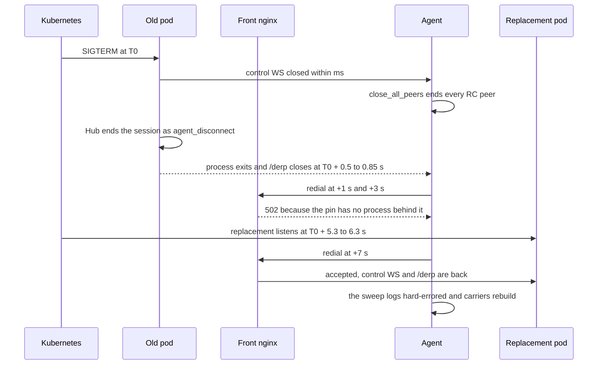
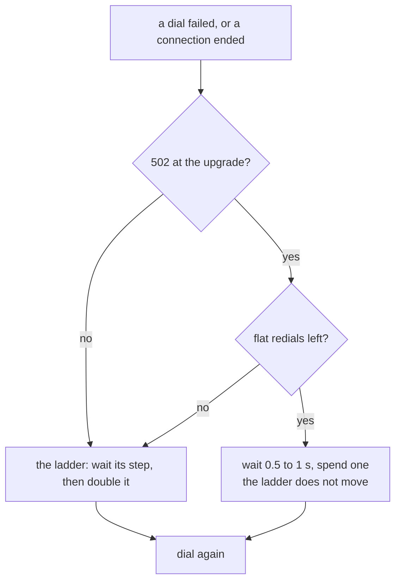

# FR-28: A pod roll freezes every relay-carried session

Status: **FR-28 closes on AC3 to AC6, and all four are met. P2 (a flat redial, default OFF) is in every agent
since 0.4.200, and P3 (the image pre-pull) is in force since 2026-11-07. With P3 alone a reattach takes p50 3.5 s
and p90 4.0 s, against 7.8 s and 8.8 s before it. With the switch on as well, two hosts were back 1.9 to 2.9 s
after the cut on two rolls, against 3.1 s for the same hosts on the ladder. D1 is decided: AC1 stays out** ("Where
it stands (2026-11-22)"). Tracking issue: `FR-28` (#865). Child of the RC-quality program; sibling of FR-18
(carrier queue discipline).

## Where it stands (2026-11-22)

This section is the status. "Where it stands (2026-10-31)" below is the read behind the decision of
2026-11-02, and it stays as that record.

| | State | Evidence |
|---|---|---|
| P2, the flat redial | In every agent since 0.4.200 (2026-11-04), default OFF. Read with the switch on, on two hosts and two rolls | #3382; [The switch-on half](#the-switch-on-half-2026-11-22) |
| P3, the pre-pull | In force since the promote of 2026-11-07 01:54Z | #3320 and the deploy repo's DaemonSet; #865, comment 6700791629 |
| AC1, no delivery gap above 500 ms | Out of FR-28: the operator decided D1 on 2026-11-19 (A). The freeze that a `derp`-carried session sees through a roll is recorded at its measured size | ["D1, decided"](#d1-decided-ac1-stays-out-of-fr-28), below; [#865, comment 7014702138](https://github.com/gjovanov/roomler-ai/issues/865#issuecomment-7014702138) |
| AC2, `hard-errored` disappears | Retired on 2026-11-02 | "The decision" |
| AC3, reattach below about 4 s | **Met** (2026-11-22). With the switch on, 8 of 8 sockets on two hosts were back 1.93 to 2.87 s after their cut, on two rolls. The same hosts took 3.10 to 3.11 s on the ladder, and the same rolls' other hosts p50 3.39 and 3.45 s. The end point is the hello plus the agent's own reattach line, 0 to 1 ms after it: these hosts cannot log `control-WS reattached`, which follows the hello by 47 ms at most where it is logged | [The switch-on half](#the-switch-on-half-2026-11-22); promote runs [44878921906](https://github.com/gjovanov/roomler-ai/actions/runs/44878921906) and [44932006872](https://github.com/gjovanov/roomler-ai/actions/runs/44932006872) |
| AC4, the rollout not slower | **Met**: 25 s on the first roll with the pre-pull, against 33.9 s | #865, comment 6700791629; "AC4: the rolls since the pre-pull" |
| AC5, two hosts or more in one roll | **Met** (2026-11-22): two hosts with the switch on in each of two rolls, beside 18 and 17 hosts without it | [The switch-on half](#the-switch-on-half-2026-11-22) |
| AC6, docs | **Met**: both halves are in `docs/overlay-communication.md` §6 and `docs/multi-pod-scale-out.md`, whose `docs/README.md` index rows exist | |

### What FR-138 changed

[FR-138](FR-138-the-session-outlives-its-control-socket.md) (#3604, closed 2026-11-13) keeps a live
remote-control session through the loss of its control socket: the device keeps the peer and claims the session
back in its next hello, inside a window the server announces (60 s). The decision of 2026-11-02 moved AC1 out of
this FR because "a roll still ends the session on the control socket", 9 of 9. That is no longer true.

FR-138's roll of 2026-11-12 measured what a roll still costs a relay-carried session: agent 0.4.216, a
pod-delete roll, and a remote-desktop session whose WebRTC pair rode the overlay mesh over DERP (#3604,
comment 6834852470; #865, comment 6835939261).

| Step | Measured |
|---|---|
| The device's control socket and its `/derp` socket | Dropped together, with the first pod |
| The session | Detached, then resumed 3.1 s later on the same row. The peer's state never changed and the viewer did not redial |
| The mesh's DERP carrier to the viewer's machine | Rebuilt about 4 s after the cut |
| The picture | Froze for about 3 s: the device's data channel buffered video over its high watermark while no carrier ran |

So a relay-carried session now outlives a roll, and the freeze this FR was opened for is what remains: about
3 s on that roll. FR-138's own AC2 bounds only `direct` and `turn` sessions, so no criterion anywhere covers the
`derp` case today.

What FR-138 did not change is the topology. Of the three reasons in "Why P1 as designed cannot work", the
first (the session ends before `/derp` closes) is gone. The second (the tenant pin leaves no second pod to dial)
and the third (DERP is pod-local, so one peer cannot move alone) still hold. On this topology the freeze shortens
only as the replacement comes up sooner (P3) and as the `/derp` socket redials it sooner (P2). P3 has done its
part: on 8 promotes a `/derp` socket was back p50 3.4 s after its cut, against 7.6 s in October ("The field
read").

### D1, decided: AC1 stays out of FR-28

The question was whether AC1, "no `video DC delivery gap` > 500 ms" through a roll on a relay-carried session,
comes back here now that FR-138 keeps the session through the roll. **The operator decided A on 2026-11-19**
([#865, comment 7014702138](https://github.com/gjovanov/roomler-ai/issues/865#issuecomment-7014702138)): AC1 stays
out, and FR-28 closes on AC3 to AC6.

| Option | What it meant |
|---|---|
| **A (decided)** | AC1 stays out. FR-28 closes on AC3 to AC6, and the `derp` freeze through a roll is recorded at its measured size (about 3 s, and the session itself survives). It gets its own FR when a count earns one: how many `derp`-carried sessions are live at the rolls of a month. On 2026-10-31 DERP carried about 5 % of RC sessions, and a roll reaches only the sessions live during a promote |
| B | AC1 comes back unchanged, and FR-28 stays open for a topology change: both peers moved in one window, a per-pod `/derp` route with dual-send, or the floor on a regional PoP ("What is left", rows 4 and 5). Each changes the floor and undoes the strict pin for this path, which is why the decision of 2026-11-02 rejected make-before-break in its agent-only form |
| C | AC1 goes to a new FR now, with FR-138's roll of 2026-11-12 as its RED, and FR-28 closes on AC3 to AC6 |

A was the recommendation because no agent-side change can close the gap on this topology, and the one measured
instance is 3 s on a session that now survives.

**The freeze, at its measured size.** On FR-138's roll of 2026-11-12 a `derp`-carried session froze for about
3 s and survived ("What FR-138 changed"). Part of that wait is the device's `/derp` socket coming back. With the
switch on, that part is about 1 s shorter: on the two rolls of 2026-11-21 the two hosts' `/derp` sockets were
registered again p50 2.09 s, max 2.67 s after their cut (8 sockets), against 3.10 to 3.17 s for the same hosts on
the ladder ("The switch-on half"). No `derp`-carried session was read at those rolls, so the freeze itself was
not measured again. It gets its own FR if a count of `derp`-carried sessions live at rolls ever earns one.

### AC4: the rolls since the pre-pull

| Roll | First SIGTERM to second Ready | Each wave | Read from |
|---|---|---|---|
| 2026-10-31 20:50Z, before the pre-pull | 33.9 s | Image pulled 5.1 to 5.9 s after the SIGTERM, Ready at +16.9 and +17.1 s | The pods and the k8s events ("Where it stands (2026-10-31)") |
| 2026-11-07 01:55Z, the first with it | **25 s** | Container started 2 s after each SIGTERM, with `Container image … already present on machine`. Ready 12 s and 13 s after the SIGTERM | The k8s events (#865, comment 6700791629) |
| Five promotes, 2026-11-14 to 2026-11-16 | 24 to 28 s each | Each replacement Ready 10 to 12 s after it started | The pods' start and Ready times, polled every 2 s during FR-138's watch, so each roll's start is known to about 2 s |

The image pull is gone from the wave. What is left is about 2 s for the old pod to exit and the replacement to be
scheduled and started, then 10 to 12 s until Kubernetes marks it Ready, which is what releases the second wave
(`maxUnavailable: 1`). Ready paces the roll, not the reattach: the front nginx sends to the node's address and
cannot see readiness, and the binary listens under 0.4 s after its container starts.

## Where it stands (2026-10-31)

This section replaced the status, the chain and the P1 design further down. Those date from
2026-08-29 and stay as the record, along with their anchors: the `/derp` code has since moved to
`crates/modules/network/`.

The freeze is real and bigger than this spec said, and `/derp` is not where it lives. A roll does
not freeze a relay-carried session. It ends every session on the rolled pod, on any carrier, and
the `/derp` outage sits inside that.

The numbers come from `agent_logs`, `remote_sessions` and `stats_usage` for the 14 rolls of 10-26
to 10-31, plus a 15th watched live (2026-10-31 20:50Z, mostly 0.4.191).

| Question | Measured |
|---|---|
| Does a session ride out a roll? | **No: 9 of 9** sessions Active at a roll ended `agent_disconnect`, 7 on `direct` and 2 on `derp`. A new session was Active 8.4–18.6 s after the cut (median 10.9 s): `direct` 8.4–17.1 s, `derp` 17.6 s and 18.6 s. |
| Does `/derp` still drop? | Every socket, once per roll. 310 sockets: down p50 7.6 s, p90 15.9 s, p99 26.2 s. Live roll: p50 7.2 s, p90 9.4 s. |
| `relay carrier send hard-errored`? | 14–73 lines per roll on 10–15 hosts, every one a DERP carrier. Live roll: 34 lines on 15 hosts. |
| `/derp` close to `control-WS reattached`? | p50 7.7 s, p90 32 s. Live roll: p50 8.7 s, p90 9.3 s. The oldest version in these logs (0.4.48) takes about 60 s. |
| How long is a roll? | Live roll: 33.9 s from the first SIGTERM to the second replacement Ready. |
| How much rides a pod's `/derp`? | Nearly all DERP: 751 of 754 registrations in 3 days were on the pods, and regional PoPs only serve server-forced pins. That is about 47 % of metered relay bytes over 8 days (the rest is TURN) and about 5 % of RC sessions. |

### The chain today



The agent closed every peer on any control-WS close (`agents/roomlerd/src/signaling.rs:2983-2990` at
`97f2fa1d7`, the commit of this read; FR-138 has since kept a live session through it) and the Hub ends the
agent's sessions when it unregisters (`crates/modules/fleet/src/hub.rs:1199-1259`).
`docs/multi-pod-scale-out.md:182` records this; the 08-29 spec missed it.

The live roll, read from the pods and the k8s events, as seconds after each SIGTERM:

| Step | Wave 1 | Wave 2 |
|---|---|---|
| SIGTERM | 20:50:05.480 | 20:50:22.338 |
| Old pod exited | +0.5 | +0.85 |
| Replacement scheduled | +1.5 | +1.7 |
| Image pulled | +5.9 | +5.1 |
| Binary listening | +6.3 | +5.3 |
| Ready | +16.9 | +17.1 |

Almost all of the wait is Kubernetes and the image: the pull took 3–4 s, and the binary listened
under 0.4 s after its container started.

⚠️ **The per-roll `/derp` p50 measures the agent's timer as much as the pods.** It sits on the
backoff ladder (1, 2, 4, 8, 10 s; `agents/roomlerd/src/derp.rs:50`, `:618`): 3.4 s in one roll,
7.5–7.7 s in ten, 15.2–15.8 s in two, 25.9 s in one. A replacement that listens just after a step
waits for the next one. The control WS doubles the same way, up to 60 s
(`agents/roomlerd/src/signaling.rs:1580`).

A device in two orgs holds one socket per org, each pinned by its own tenant, so it can lose a
socket in each wave. That accounts for the 6–8 hosts per roll that log two closes: on the roll of
10-31 17:41Z they were six of the seven two-org devices, and every single-org host logged one.

### Why P1 as designed cannot work

1. **It cannot save the session.** The session ends on the control WS, before `/derp` closes: on
   2026-10-30 at 19:43:07.882 the Hub ended a `direct` and a `derp` session in the same millisecond,
   and both agents' `/derp` sockets closed within about a second after that. A perfect `/derp` swap
   leaves AC1 where it is.
2. **There is no second pod to dial.** The front nginx pins `/ws` and `/derp` by tenant:
   `hash … consistent`, `max_fails=0`, `proxy_next_upstream off`. That is deliberate, since a ring
   that walked to the survivor parked long-lived sockets on the wrong pod after a roll (the
   fleet-wide "green but not online" incident of 2026-07-29). So a second dial reaches the same dying
   pod, and the replacement cannot exist until that pod is gone, because hostNetwork pods cannot
   double-bind (`maxSurge: 0`). Even a dial the old pod accepted in its last 0.5–0.85 s would die
   with it. Measured on the live roll with one dial every 200 ms at four ring positions, all hashing
   to the same pod: 492 dials answered 401 straight through the other pod's wave, then each position
   took 23 consecutive 502s over about 5 s, until the replacement listened.
3. **One peer cannot move alone.** DERP is pod-local (`docs/multi-pod-scale-out.md:141-157`), so a
   pair exchanges frames only while both sockets are on one pod. A peer that moved first would send
   into a pod where its partner is not registered, and the frame is dropped as a miss
   (`crates/modules/network/src/derp.rs:725-742`). The 08-29 design's "safe by construction" holds
   on one pod only. Moving a pair needs both peers to move in one window, or dual-send while they do,
   with C-5's convergence closing sockets under it (`crates/modules/network/src/derp_cluster.rs:126-188`).
   This point is reasoned from the code, not measured.

### What an old agent does with an unknown frame

For whoever puts the next frame on this socket: agents back to 0.4.48, the oldest version in these
logs, ignore a Text frame (the `Some(Ok(_))` arm, `agents/roomlerd/src/derp.rs:584`) and drop a Binary frame
under 32 bytes (`crates/tunnel-core/src/transport/derp.rs:568-571`). A Binary frame of 32 bytes or
more reads as a peer's frame and raises `Unrouted`. So a server-to-agent signal needs no capability
gate as long as it is Text. This was read at the tags `agent-v0.4.48` and `agent-v0.4.154`, not run.

### What is left

| Lever | Lives in | What it buys | What it costs |
|---|---|---|---|
| Redial flat on an LB 502 instead of climbing the ladder | agent, both loops | The ladder's waste: every roll lands within a second of the replacement listening | Small, default OFF, but it is the floor, and #2221's rule still binds: a server that accepts and drops must climb. This spec scoped the ladder out; that needs the operator |
| Pre-pull the image on both nodes before the roll | promote lane | 3–4 s off each wave on the live roll, likely more on a large delta | A deploy-lane change |
| An RC session survives a control-WS loss | a new FR | AC1, and whichever of the other `agent_disconnect` ends are not daemon restarts (about 5 % of sessions ended that way outside rolls in the last 7 days) | A design of its own: the Hub is pod-local, `close_all_peers` is what stops a peer leaking its sockets, and consent and kick must still reach the session |
| A per-pod `/derp` route plus dual-send | front nginx and agent | Overlay pairs keep moving through a roll. RC sessions still end | Changes the floor and undoes the strict pin for this path |
| The floor on a regional PoP | later | A roll never touches the carrier | Both peers need the PoP, and today only forced pins use one |

The first two together would put a reattach at about 3 s: the old pod's exit and the rescheduling
take about 1.7 s, the start about 0.4 s, and a flat redial up to 1 s more. That is an estimate from
the live roll, not a measurement.

## The decision (2026-11-02)

FR-135's D15 settled the question the read left open: FR-28's flat redial and the pre-pull now, and a new
FR next for an RC session that survives a control-socket loss. The operator approved it on 2026-11-02, open
to being overturned (`docs/fr/FR-135-one-rc-media-pipeline.md` §10). That FR is
[FR-138](FR-138-the-session-outlives-its-control-socket.md) (#3604), claimed 2026-11-09.

| Item | Outcome |
|---|---|
| P1, make-before-break | Rejected on this topology, for the three reasons above |
| Flat redial on an LB 502 | P2: built in the agent, default OFF |
| Image pre-pull before a roll | P3: built in the promote lane |
| AC1, no delivery gap above 500 ms | Moves to the new FR, because a roll still ends the session on the control socket |
| AC2, `hard-errored` disappears | Retires: the line marks a close, and a roll closes the socket |
| AC3, reattach below about 4 s | Stays. FR-28 closes when it is field-verified |
| AC4 to AC6 | Unchanged |

| Phase | What | Lives in | Kill switch | State |
|---|---|---|---|---|
| P0 | Fire every `/derp` cancel on SIGTERM | server | none | Disproven and reverted, 2026-08-29 |
| P1 | Make-before-break on `/derp` | agent and server | none | Rejected, 2026-11-02 |
| P2 | Flat redial on a 502 | agent, both loops | `ws_flat_redial`, default OFF | In every agent since 0.4.200 (2026-11-04). Read with the switch on, on two hosts and two rolls ("The switch-on half") |
| P3 | Pre-pull before a roll | `promote.yml` (#3320) and the deploy repo | Delete the DaemonSet's file | In force since the promote of 2026-11-07 01:54Z |
| Docs | `docs/overlay-communication.md`, `docs/multi-pod-scale-out.md`, `docs/deployment.md`, the index rows | docs | none | Written with each phase. AC4's numbers and both halves of AC3 are in |

## P2: the flat redial

A 502 at the upgrade means the front is up and this tenant's pin has no process behind it, which on this
topology is a roll. So the socket redials every 0.5 to 1 s instead of waiting out the ladder, and lands within
a second of the replacement listening.



| What happened | The ladder | Flat redials left |
|---|---|---|
| 502 at the upgrade, with redials left | Does not move | One fewer |
| 502 at the upgrade, none left | Climbs from the step it stood on | 0 |
| Any other answer: 401, 500, 503, 504, a timeout, a refused connection | Climbs | Unchanged |
| Accepted, then dropped inside 30 s | Control socket: climbs (#2221). `/derp`: restarts at 1 s, as it always has | Unchanged |
| A connection that lived 30 s | Restarts at 1 s | Back to 30 |
| A major network change (only the control socket listens for one) | Restarts at 1 s | Back to 30 |

The code: `FlatRedial` (`agents/roomlerd/src/ws_connect.rs:75`) with its allowance and wait (`:48`, `:53`), the
control loop's decision and refill (`agents/roomlerd/src/signaling.rs:1559`, `:1290`), and `/derp`'s
(`agents/roomlerd/src/derp.rs:604`, `:598`). Regional relays keep their ladder
(`agents/roomlerd/src/derp.rs:381`): no pod rolls under one.

⚠️ **#2221's rule binds.** A server that accepts and drops must climb, or a fleet reconnects to it every second.
So only a 502 is flat, and an accepted socket that does not last refills nothing. Otherwise a crash-looping pod
would buy itself flat dials for good.

⚠️ **The allowance is the bound.** A 502 is not only ours: a corporate proxy can answer one for hours. One outage
costs one socket at most 30 extra dials, and then the ordinary ladder runs. Thirty redials spend 15 to 30 s, and
the slowest of the 14 rolls had a median socket back at 26 s.

⚠️ **The wait is drawn, not fixed,** because a roll ends a whole fleet's sockets in the same millisecond. At most
1 s keeps the promise above.

⚠️ **Off is the ladder as it was.** `FlatRedial::off` always answers `None`, and the switch is read as every
opt-in gate is (`tunnel_core::env::flag`): `1`, `true`, `yes` or `on` turn it on, and anything else, a typo
included, stays on the ladder. Set `ws_flat_redial = true`
in the config or `ROOMLERD_WS_FLAT_REDIAL=1`, and restart. It is a device-side key and not pushable from the
server: turning a floor's behaviour on is a decision made on the device or by a release, as FR-132 decided for
`zero_copy`.

Each flat redial logs one INFO line ending `redialling flat (FR-28)`, with `wait_ms` and `left`. So a field read
sees the switch at work, and `left=0` shows an outage that ran it out.

### What it costs

| | On the ladder | Flat |
|---|---|---|
| Dials per socket through a 5 s wave | 3 (+1, +3 and +7 s) | About 8 |
| Dials per socket in the first 30 s of a 502 that never ends | 4 | About 33 |

⚠️ **Read this before a default flip.** Each dial is a TLS handshake at the front, so a wave costs it about 1.3
handshakes per socket per second for its length. Today that is a few dozen a second. On a fleet a hundred times
this size it is a number to measure first. The flip is a staged rollout and the operator's decision.

### Found, not changed

- `/derp`'s ladder restarts on any accepted upgrade (`agents/roomlerd/src/derp.rs:426`), so a server that accepts
  and drops gets one dial a second for good. #2221 fixed only the control socket. It stays as it is with the
  switch on too: climbing there would slow the floor on any path whose middlebox kills young sockets, on exactly
  the hosts with no other carrier. That change needs its own read.
- A clean close on the control socket redials with no wait at all (the `Ok(())` arm,
  `agents/roomlerd/src/signaling.rs:1294`). A roll does not take that arm: 22 of 22 hosts on the 12:43Z roll below
  read `Connection reset without closing handshake`.
- A packaged Linux daemon never logs `overlay: control-WS reattached`, the line AC3 is written on. The unit sets
  `RUST_LOG=roomlerd=info,warn` (`agents/roomlerd/packaging/linux/roomlerd.service:53`), which replaces the default
  filter whole (`crates/agent-core/src/logging.rs:430-437`). Of `tunnel_core`'s INFO lines it then keeps only the
  socket-buffer line appended for FR-110 (`:453-463`), and the line is `info!` in `tunnel_core`
  (`crates/tunnel-core/src/overlay/runtime.rs:3982`). So a read on such a host ends at the hello and the agent's
  own reattach line, which the `roomlerd` target keeps (`agents/roomlerd/src/overlay.rs:265`). A criterion written
  on `control-WS reattached` has the same gap on every packaged Linux host. The filter sets what every such host
  uploads, so widening it is a change of its own, with its own read of the volume.

## P3: the pre-pull

The wave's largest cost is the pull, 3 to 4 s of 5.3 to 6.3 s. With #3320, a promote moves a DaemonSet's image
first, which rolls nothing and makes both nodes pull, waits 30 s, and only then bumps `newTag`. `roomler2`'s
`imagePullPolicy` is `IfNotPresent`, so a replacement finds the image on its node. A pull that fails or outlasts
the wait leaves today's roll. The design, its failure table and why it is not an ArgoCD sync wave are in
`docs/deployment.md`, "The pre-pull", which #3320 adds.

## What the two buy

A reattach is when the replacement listens, plus the wait for the next dial.

| Replacement listens at | The ladder lands | Flat lands | Rolls of the 14, by `/derp`'s median |
|---|---|---|---|
| Under +3 s | +3 s | Within 1 s of it | 1 |
| +3 to +7 s | +7 s | Within 1 s of it | 10 |
| +7 to +15 s | +15 s | Within 1 s of it | 2 |
| Past +15 s | +25 s on `/derp`, +31 s on the control socket | Within 1 s of it | 1 |

So neither lever alone is the whole answer, and that is an estimate until the field read:

- **The redial alone** takes at most 1.7 s off an ordinary roll, where the replacement listens at +5.3 to +6.3 s
  and the ladder lands at +7 s. Its value is the tail: up to about 20 s off a slow roll.
- **The pre-pull alone** should move listening to about +2.1 s (the old pod's exit and the rescheduling take about
  1.7 s, the start about 0.4 s), where the ladder's +3 s dial lands. That may meet AC3 on a roll where nothing is
  slow. One that listens just past +3 s then costs the wait until +7 s, and the redial is what holds the number
  there.

**Read on 2026-11-19** ("The field read"): the pre-pull alone put the replacement up about 1.5 to 2 s after the
cut, and 80 of 84 reattaches landed on the ladder's +3 s dial, at 3.4 to 4.1 s. The estimate for P3 held. What is
left for the redial is about 1 s a wave: from the +3 s dial to within a second of the replacement listening.

**Read on 2026-11-22** ("The switch-on half"): the redial took most of that second. With the switch on, two hosts
were back 1.93 to 2.87 s after their cut on two rolls, each socket after one or two flat redials, against 3.10 to
3.11 s for the same hosts on the ladder.

## The field read

**RED, from production logs.** The roll of 2026-11-02 12:43Z (`hosted-20261102-b8c6d1b`), read from `agent_logs`
on 22 hosts: every control socket died with `Connection reset without closing handshake`, then dialed at +1 s and
+3 s (502), and was accepted at +7 s.

| Measure | Value | n |
|---|---|---|
| Control-socket close to `control-WS reattached` | p50 7.8 s, p90 8.8 s, max 60.1 s | 15 |
| `/derp` close to registered | p50 7.7 s, p90 8.1 s | 23 |
| `relay carrier send hard-errored` | 45 lines on 16 hosts | |

The 60 s is one host, the shape the oldest agents show on the 10-31 read. Its version was not read.

**AC4 is read**: 25 s on 2026-11-07, the first roll with both halves of P3 ("AC4: the rolls since the
pre-pull").

**AC3 and AC5 needed** a roll with the switch on for at least 2 hosts (AC5) and the rest of the fleet as the
control in the same roll. Every agent since 0.4.200 carries P2, and every promote since 2026-11-07 rolls with the
pre-pull, so the fleet's own lines around those promotes are the control half: the ladder with P3 alone.

**The control half is read** (2026-11-19): the 8 promotes of 2026-11-12 to 2026-11-16 that were still inside
`agent_logs`' 7 days, 8 minutes from each dispatch. No host logged `redialling flat`, so none ran with the switch
on, and every roll had the pre-pull.

| Measure | 2026-11-02 12:43Z, before the pre-pull | 8 promotes with it |
|---|---|---|
| Control-socket close to `control-WS reattached` | p50 7.8 s, p90 8.8 s (15) | p50 3.5 s, p90 4.0 s, max 4.1 s (84 sockets, 7 to 10 hosts a roll) |
| Close to `rc:agent.hello sent`, overlay or not | Not read | p50 3.4 s, p90 3.7 s, max 5.5 s (180 sockets, 13 to 19 hosts a roll) |
| `/derp` close to registered | p50 7.7 s, p90 8.1 s (23) | p50 3.4 s, p90 3.7 s, max 4.1 s (156) |
| The dial that lands | +7 s, after 502s at +1 and +3 s | +3 s, after a 502 at +1 s: 80 of the 84 reattaches |
| `relay carrier send hard-errored` | 45 lines on 16 hosts | 3 to 25 lines a roll on 2 to 12 hosts |

One host on 0.4.48 took 60 s on every roll, the shape of the oldest agents, and is left out of the figures above.

- **The pre-pull moved the reattach from the ladder's +7 s dial to its +3 s dial.** The replacement now listens
  about 1.5 to 2 s after the cut: the 11 sockets whose dial landed before the +3 s step were back 1.5 to 2.2 s
  after their cut.
- **With P3 alone, AC3's median is below the bar and its p90 is at it**, so this read does not tick AC3. The
  switch-on half decides it: a flat redial lands within a second of the replacement listening, about 1 s a wave
  sooner than the +3 s dial.
- **A host's close stands for its pod's SIGTERM.** On SIGTERM a pod stops its modules at once: network hands back
  its directory records, one or two Redis round trips each, and then fleet cancels every agent socket
  (`crates/api/src/main.rs:361-363`, `crates/api/src/state.rs:494-515`). So the close trails the signal by those
  round trips, the sweep and one network leg. Both ends of a measure come from the host's own clock, so clock
  offsets between hosts do not enter it.
- **A host can close in both waves.** A daemon with two enrollments runs one signaling loop for each
  (`agents/roomlerd/src/signaling.rs:632-636`) and uploads both loops' lines under its primary's row
  (`agents/roomlerd/src/app.rs:4752-4765`). Five such rows closed in both waves, about 12 s apart, because their
  two organisations sit on different pods. Each socket is still cut once a roll.

### The switch-on half (2026-11-22)

Read on 2026-11-22 from `agent_logs`, 8 minutes from each promote's dispatch: the control half's lines plus each
host's `redialling flat (FR-28)` lines; anchors at `4d67fb015`. The switch is a device-side key that the daemon
reads once, at start (`agents/roomlerd/src/app.rs:4062-4070` registers it, `crates/tunnel-core/src/env.rs:45-51`
holds it). So two standing-consent Linux servers in one organisation were set up before the rolls:
`ws_flat_redial = true` through `roomler config set`, then one restart each, on 2026-11-19. The agent pushes after
that restarted them from the same file. The flat redials below show the switch in memory at both switch-on rolls,
and on 2026-11-22 the running daemons' start lines still named `WS_FLAT_REDIAL` among their config fallbacks. Each
server has two enrolments, so it closes twice a roll, once on each pod. The other hosts of each roll had the switch
off and are the control.

| Roll | Promote run, image | The two hosts |
|---|---|---|
| Control: 2026-11-19, dispatched 11:55:24Z | 44519118216, `hosted-20261119-9af10f8` | Agent 0.4.226, the switch not yet on |
| Switch-on 1: 2026-11-21, dispatched 07:09:36Z | 44878921906, `hosted-20261121-6168d66` | Agent 0.4.230, the switch on |
| Switch-on 2: 2026-11-21, dispatched 17:48:03Z | 44932006872, `hosted-20261121-276ce03` | Agent 0.4.230, the switch on |

**The switch ran where and when it should have.** Every `redialling flat` line in the three windows came from the
two hosts, and only at the two switch-on rolls: 11 lines at the first (5 on the control socket, 6 on `/derp`) and
12 at the second (6 and 6). The waits were 544 to 998 ms, and no socket spent more than 2 of its 30 redials.

| Measure, per socket | The two hosts, switch on (two rolls) | The same hosts on the ladder (control roll) | The other hosts, the same two rolls |
|---|---|---|---|
| Control-socket close to `rc:agent.hello sent` | p50 1.99 s, max 2.87 s, min 1.93 s (8) | 3.10 to 3.11 s (4) | p50 3.39 and 3.45 s, p90 3.61 and 4.60 s (20 and 19) |
| Control-socket close to `control-WS reattached` | Never logged on these hosts (below) | Never logged | p50 3.46 and 3.48 s, p90 3.70 and 3.58 s (11 and 11) |
| `/derp` close to registered | p50 2.09 s, max 2.67 s, min 1.95 s (8) | 3.10 to 3.17 s (4) | p50 3.38 and 3.39 s, p90 3.55 and 3.52 s (15 and 13) |
| Before the socket landed | One or two 502s, each followed by a flat redial | A 502 at about +1 s, then the ladder's +3 s dial | The ladder |

Per socket, the first wave and then the second, each host on its own clock:

| Roll | Host | Control socket: close to hello | 502s, flat redials | `/derp`: close to registered |
|---|---|---|---|---|
| Control | H1 | 3.10 s, 3.10 s | 1 and 0, 1 and 0 | 3.17 s, 3.10 s |
| Control | H2 | 3.10 s, 3.11 s | 1 and 0, 1 and 0 | 3.10 s, 3.10 s |
| Switch-on 1 | H1 | 1.93 s, 2.04 s | 1 and 1, 1 and 1 | 2.37 s, 2.01 s |
| Switch-on 1 | H2 | 2.36 s, 1.93 s | 2 and 2, 1 and 1 | 2.33 s, 1.95 s |
| Switch-on 2 | H1 | 2.48 s, 1.93 s | 2 and 2, 1 and 1 | 2.67 s, 2.09 s |
| Switch-on 2 | H2 | 2.87 s, 1.99 s | 2 and 2, 1 and 1 | 2.47 s, 2.02 s |

**AC3's end point is the hello.** AC3 is written on `control-WS reattached`, and a packaged Linux daemon never logs
that line ("Found, not changed"): in 11 rolls, the control half's 8 and these 3, the two hosts logged it 0 times. On
a reconnect the hello comes first (`agents/roomlerd/src/signaling.rs:1993-1997`). Then the overlay starts (`:2081`),
and its reattach logs `overlay: re-attached the persistent node runtime (carriers intact)` from the agent's own
target (`agents/roomlerd/src/overlay.rs:265`). `control-WS reattached` follows once the runtime has joined again
(`crates/tunnel-core/src/overlay/runtime.rs:3977`). On the two hosts the agent's line came 0 to 1 ms after the hello,
on all 12 sockets. On the hosts that log all three lines, `control-WS reattached` followed the hello by p50 5 ms,
p90 27 ms, max 47 ms (38 sockets in the three rolls). With that bound, the two hosts reattached 1.93 s to about
2.92 s after their cut.

- **AC3 is met.** All 8 sockets with the switch on were back in under 3 s, each after a flat redial: below the ~4 s
  the criterion names, below the same hosts' 3.10 to 3.11 s on the ladder, and below the same rolls' other hosts at
  p50 3.39 and 3.45 s. As in the control half, a socket's close stands for its pod's SIGTERM: both hosts closed with
  the bulk of each wave.
- **AC5 is met.** Two hosts ran with the switch on in each of two rolls, beside 18 and 17 hosts without it.
- **The switch buys about 1 s a socket**, as "What the two buy" estimated: 3.10 s on the ladder against p50 1.99 s
  on the same hosts. A socket whose first flat redial still met a 502 took one more and landed at 2.36 to 2.87 s.
- The other hosts' slowest sockets, 4.6 to 4.7 s on each roll, were not looked into. `relay carrier send
  hard-errored` came to 1 line on one of the two hosts at each switch-on roll (2 lines at the control roll), against
  2 and 4 lines on the other hosts at the same rolls. AC2 is retired, so that is a count only. The 0.4.48 host took
  60.1 s on all three rolls and is left out, as before.
- **Both hosts were set back to the default after the read** (`roomler config clear ws_flat_redial`, 2026-11-22). A
  clear rewrites the file and nothing else, so each daemon keeps redialling flat until its next start.

## The measurement

Driving a live session through the browser on 2026-08-29 caught a **2436 ms
`video DC delivery gap` + decode stall on an IDLE session** — no dragging, nothing
to blame on the encoder. Correlating the agent logs against pod age gave an exact,
repeatable chain:

```
pod roll → /derp WS closed under the relay carrier → carrier rebuild
        → video DC delivery gap → decode stall → visible freeze
```

Both hosts, same second, against pods 69 s old:

| time | host | line |
|---|---|---|
| `10:26:57Z` | CORPLAP-3 | `overlay: relay carrier send hard-errored (/derp WS closed under it)` ×3 |
| `10:26:56Z` | CORPLAP-2 | `overlay: control-WS reattached — re-joined with carriers intact` |
| `10:27:01Z` | CORPLAP-3 | `overlay: control-WS reattached — re-joined with carriers intact` |

An earlier instance recovered in **~4 s** (`08:36:34 → 08:36:38`).

🔑 **DERP churn is otherwise rare** — 2–3 events per host per 6 h, *all* correlating
with rolls. So this is not a flaky-network story: it is self-inflicted, and it is
the one freeze cause that can be reproduced on demand.

## Root cause

The agent learns the `/derp` WS is gone **by failing to send on it**. Nothing tells
it in advance, so the sequence is: pod dies → agent keeps handing frames to a dead
socket → a send hard-errors → `DeathReason::HardDead`
(`crates/tunnel-core/src/overlay/runtime/establish.rs:734-754`) → carrier rebuild →
`MuxEvent::Recovered` opens the fast-walk window
(`crates/tunnel-core/src/overlay/runtime.rs:2703-2706`).

That recovery path has already been optimised once (#28: `DERP_RECOVERY_WALK_WINDOW`
+ `DERP_RECOVERY_RECHECK`, after a field case where "the WS returned in 1.5 s and the
floor still took 5 s more"). The remaining cost is upstream of it — the time spent
not knowing.

⚠️ **The pod knows it is going away and does not say so.** `main.rs:244-266` already
runs `shutdown_cleanup` on SIGTERM before axum stops accepting, and
`ws/derp.rs:80-85` already defines a **`DerpCancelRegistry`** whose entire purpose is
"fire it to rehome a socket parked on the wrong pod; the socket loop's cancel arm
breaks, teardown releases the directory record, and the client's reconnect re-lands
per the current LB map". The primitive exists and is simply not wired to shutdown.

## Design — announce the death instead of letting it be discovered

**P0. Fire every `/derp` cancel on SIGTERM.** ❌ **DISPROVEN AND REVERTED** (#867,
#874, reverted in the PR that carries this edit). In the existing shutdown hook, walk
`DerpCancelRegistry` and notify each connection before the process stops accepting.
Each agent gets a clean close at T+0 rather than discovering it at first-failed-send,
and re-lands on the surviving pod through the normal reconnect.

⚠️ This is **not** the pre-close HTTP draining that `main.rs:249-253` deliberately
rejects ("maxSurge=0 means every drained second is downtime for this node"). It adds
no delay: it is a broadcast on the way out, and the process stops accepting exactly
when it does today.

⚠️ Kill switch: `ROOMLER__DERP__DRAIN_ON_SHUTDOWN` (default on once proven; off ⇒
today's behaviour byte-for-byte).

### Why P0 failed — the premise, not the primitive

Three rolls, same three hosts, deliberate:

| roll | terminating pods | `hard-errored` |
|---|---|---|
| `11:41:01Z` | no drain (baseline) | 8 |
| `11:42:26Z` | drain via `notify_waiters` | 12 |
| `12:20:23Z` | drain via `notify_one` | **10** |

Recovery did not improve either: baseline 4-28 s, `notify_one` 16-58 s.

The first round also had a real bug — `notify_waiters` drops a signal when no task is
parked, and the socket loop rebuilds its `notified()` future every `select!` iteration,
so exactly the BUSY sockets missed it. Fixing that to `notify_one` moved the number from
12 to 10. It did not fix the freeze, because:

⚠️ **Closing the socket early IS the announcement, and any close — graceful or not —
fails the agent's in-flight sends.** That is precisely what `relay carrier send
hard-errored (/derp WS closed under it)` reports: it marks *a close*, not an *ungraceful*
one. The cost was never in DISCOVERING the death. It is in having **no carrier at all**
between the old WS closing and a replacement being up, and telling the agent sooner only
starts that window sooner.

🔑 The acceptance criterion ("the `hard-errored` line must disappear") was a good
falsifier and did its job. The reasoning it was testing was wrong.

**P1. Reconnect-before-close — the actual fix.** The agent opens the replacement `/derp`
WS and moves carriers across **while the old socket still carries**: the make-before-break
the overlay already does for carrier upgrades. Only overlap closes the gap.

The trigger should be an application-level "going away" frame, precisely because it can
be delivered **without closing anything** — which is the property P0 lacked. The server
half is small (emit the frame on SIGTERM, then behave as today); the work is agent-side:
hold two sockets, move carriers, retire the old one.

⚠️ Scope note: this is an AGENT change, so it ships on the agent release cadence and
reaches the fleet gradually, unlike P0 which was server-only. A server that emits the
frame to an agent too old to understand it must be a no-op.

## Acceptance criteria

The operator's decision of 2026-11-02 changed the first two, and D1, decided on 2026-11-19, kept the first one
out. AC3 to AC6 keep their words.

- ~~A deliberate `kubectl rollout restart` with a live relay-carried session produces **no `video DC delivery
  gap` > 500 ms** in the viewer console (today: 2436 ms measured).~~ **Moved** to the new FR for an RC session
  that survives a control-socket loss ([FR-138](FR-138-the-session-outlives-its-control-socket.md), its AC2): a
  roll ends the session on the control socket, 9 of 9, so nothing on `/derp` can reach it. FR-138 has since
  removed that premise, and its AC2 bounds only `direct` and `turn`. **D1 is decided: AC1 stays out of FR-28**
  (the operator, 2026-11-19;
  [#865, comment 7014702138](https://github.com/gjovanov/roomler-ai/issues/865#issuecomment-7014702138);
  ["D1, decided"](#d1-decided-ac1-stays-out-of-fr-28)).
- ~~Agent-side `relay carrier send hard-errored (/derp WS closed under it)` **disappears** for a graceful roll —
  the carrier should be rebuilt from a clean close, not from a failed send. Its continued presence means P0 did
  not take, regardless of what the timings say.~~ **Retired:** the line marks a close, as P0 found, and a roll
  closes the socket. Only an overlap could end it, and this topology offers none.
- [x] Time from pod SIGTERM to `control-WS reattached` drops below the ~4 s measured. **Met 2026-11-22:** with
      `ws_flat_redial` on, 8 of 8 sockets on two hosts were back 1.93 to 2.87 s after their cut on two rolls
      (promote runs [44878921906](https://github.com/gjovanov/roomler-ai/actions/runs/44878921906) and
      [44932006872](https://github.com/gjovanov/roomler-ai/actions/runs/44932006872)), against 3.10 to 3.11 s for
      the same hosts on the ladder. The end point is the hello plus the agent's own reattach line, 0 to 1 ms after
      it, because a packaged Linux daemon never logs `control-WS reattached`. Where that line is logged, it follows
      the hello by 47 ms at most; with that bound, these hosts reattached by about 2.92 s
      ([The switch-on half](#the-switch-on-half-2026-11-22)).
- [x] No regression in rollout duration — the deploy must not get slower, since the
      whole reason pre-close draining was rejected is that surge is 0. **Met 2026-11-07:** 25 s from the first
      SIGTERM to the second Ready on the first roll with the pre-pull, against 33.9 s (#865, comment
      6700791629). Five later promotes took 24 to 28 s.
- [x] Verified on ≥2 hosts in one roll, since the failure is fleet-wide by nature. **Met 2026-11-22:** two hosts
      with the switch on in each of two rolls, beside 18 and 17 hosts without it
      ([The switch-on half](#the-switch-on-half-2026-11-22)).
- [x] Docs: `docs/overlay-communication.md` and `docs/multi-pod-scale-out.md` updated in the house
      style, with the `docs/README.md` index row. AC4's numbers and AC3's control half went in on 2026-11-19, and
      the switch-on half on 2026-11-22.

| AC | Today | What it takes |
|---|---|---|
| Under ~4 s to `control-WS reattached` | **Met**: with the switch on, 1.93 to 2.87 s to the hello on two hosts and two rolls (2026-11-22), against 3.10 to 3.11 s for the same hosts on the ladder. With P3 alone, p50 3.5 s, p90 4.0 s on 8 promotes to 2026-11-16, against p50 7.8 s, p90 8.8 s on the 12:43Z roll before it | Done ([The switch-on half](#the-switch-on-half-2026-11-22)) |
| Rollout not slower | **Met**: 25 s on 2026-11-07, against the 33.9 s baseline; 24 to 28 s on five promotes since | Done. The pre-pull's 30 s comes before the first SIGTERM, with every pod serving |
| ≥ 2 hosts | **Met**: two hosts with the switch on in each of two rolls, beside 18 and 17 hosts without it | Done ([The switch-on half](#the-switch-on-half-2026-11-22)) |
| Docs | **Met**: AC4's numbers and both halves of AC3 are in | Done |

⚠️ What moved with AC1: the reader for it does not exist either. `video DC delivery gap` is console-only and logs
only above 1500 ms (`VIDEO_DC_GAP_MS`, `ui/src/workers/rc-video-channel.ts:19`, warned at
`ui/src/composables/useRemoteControl.ts:8518`).

## Out of scope

- The ladder's own steps. P2 goes around them on a 502 and changes nothing else.
- Non-graceful pod death (SIGKILL, node loss). Nothing can be announced there; that
  case keeps today's discover-by-failure path, which is why P0 cannot be the only
  defence and the existing recovery walk stays.
- Making RC sessions survive a roll: the new FR, [FR-138](FR-138-the-session-outlives-its-control-socket.md).
- Changing the rollout strategy (maxSurge, pod count), pre-close draining, a per-pod `/derp` route.

## Field log

| date | build | result |
|---|---|---|
| 2026-08-29 | 0.4.15 | Measured: 2436 ms delivery gap + decode stall on an idle session; chain confirmed on 2 hosts against a 69 s-old pod; ~4 s SIGTERM→reattach in an earlier instance. FR filed. |
| 2026-08-29 | 0.4.17 | **P0 DISPROVEN over three deliberate rolls** (8 / 12 / 10 `hard-errored`; recovery no better). Premise wrong: the agent was never late to notice, it was carrier-less either way. P0 reverted rather than left default-ON looking like a fix. The two notify-semantics tests are KEPT — `notify_waiters` losing a signal when nobody is parked is a general hazard wherever a `select!` loop is signalled. |
| 2026-10-31 | fleet of 10-26 to 10-31 | RED read from logs on 14 production rolls: 9 of 9 sessions ended `agent_disconnect`, 310 `/derp` sockets down p50 7.6 s, 14–73 `hard-errored` lines per roll. All of it is in "Where it stands (2026-10-31)". |
| 2026-10-31 | 0.4.191, `hosted-20261031-5281d7f` | Roll watched live at 20:50Z: 33.9 s, two waves 16.9 s apart, 34 `hard-errored` lines on 15 hosts, `/derp` down p50 7.2 s. Dial probe at four ring positions: 401 through the other pod's wave, 502 for about 5 s in their own. No session was live, so AC1 stands on the 9 above. |
| 2026-11-02 | 0.4.197, `hosted-20261102-b8c6d1b` | RED for AC3, the 12:43Z roll read from `agent_logs` on 22 hosts: control-socket close to `control-WS reattached` p50 7.8 s, p90 8.8 s; `/derp` p50 7.7 s, p90 8.1 s; 45 `hard-errored` lines on 16 hosts. Dials at +1 and +3 s answered 502, accepted at +7 s. |
| 2026-11-07 | `hosted-20261106-a5cb4d4`, promote run 42326522934 | **AC4 met** on P3's first roll. The DaemonSet pulled the image on both nodes in 4.04 s and 3.61 s, and both held it 20 s before the app's roll began. Both replacements logged `Container image … already present on machine` and started 2 s after their SIGTERM (01:55:23Z → 01:55:25Z, 01:55:35Z → 01:55:37Z). First SIGTERM to second Ready: 25 s, against 33.9 s; each wave 12 s and 13 s. AC3 and AC5 were not read: no lab devices were up (#865, comment 6700791629). |
| 2026-11-12 | agent 0.4.216, FR-138 on, window 60 s | FR-138's pod-delete roll with a `derp`-carried RC session: detached and resumed 3.1 s later on the same row, the DERP carrier rebuilt about 4 s after the cut, the picture frozen for about 3 s (#3604, comment 6834852470). The premise that moved AC1 out no longer holds: open decision D1. |
| 2026-11-14 to 2026-11-16 | five promotes, `hosted-20261114-663bcd0` to `hosted-20261116-df905bb` | AC4 holds: 24 to 28 s each from the first SIGTERM to the second Ready, and each replacement Ready 10 to 12 s after it started. Read from the pods' times, polled every 2.1 s during FR-138's watch, so each roll's first SIGTERM is known to that poll. |
| 2026-11-19 | agents 0.4.217 to 0.4.223; 8 promotes, 2026-11-12 22:58Z to `hosted-20261116-df905bb` | The control half of AC3 and AC5, read from `agent_logs` 8 minutes from each promote's dispatch, with no host on the switch: control-socket close to `control-WS reattached` p50 3.5 s, p90 4.0 s, max 4.1 s (84 sockets); close to hello p50 3.4 s, p90 3.7 s (180 sockets on 13 to 19 hosts a roll); `/derp` down p50 3.4 s, p90 3.7 s (156). 80 of 84 reattaches landed on the ladder's +3 s dial, against +7 s on 2026-11-02. AC3 is not ticked: the median is below the bar and the p90 is at it. One 0.4.48 host took 60 s on every roll. |
| 2026-11-22 | agents 0.4.226 and 0.4.230; promote runs 44519118216 (control), 44878921906 and 44932006872 (switch on) | The switch-on half of AC3 and AC5, read from `agent_logs` 8 minutes from each dispatch. Two standing-consent hosts ran `ws_flat_redial = true` from 2026-11-19, and every `redialling flat` line came from them, only at the two switch-on rolls. Their control sockets were back 1.93 to 2.87 s after the cut (8 sockets, p50 1.99 s), against 3.10 to 3.11 s on the control roll; their `/derp` sockets p50 2.09 s, max 2.67 s, against 3.10 to 3.17 s. The same rolls' other hosts: close to hello p50 3.39 and 3.45 s. **AC3 and AC5 met**, measured to the hello: these hosts never log `control-WS reattached`. The key was cleared on both hosts after the read. |

## P1 — concrete design (scoped, NOT implemented)

⚠️ Rejected by the decision of 2026-11-02: this design cannot work on today's topology, for the three reasons
in "Where it stands (2026-10-31)". It stays as the record of what was proposed.

The structure is favourable. `DerpMux` already outlives its socket: *"the outbound
receiver lives for the mux's whole life (across reconnects), so a reconnect never severs
the `DerpConn`→WS path"* (`transport/derp.rs:332-337`). Carriers hang off the mux, not
off the socket, so a socket swap need not be visible to them at all.

What makes today's reconnect visible is `mark_down()` — the agent's WS loop
(`agents/roomlerd/src/derp.rs:336-379`) is shaped
`loop { connect; register; mark_up; inner select; mark_down; backoff }`, and every
iteration owns one `tx`/`rx` pair. `mark_down` is what withholds carrier builds and
ultimately drives the freeze.

**The change**: on a "going away" signal, dial and register a SECOND socket, swap `tx`,
retire the old `rx` — **without ever calling `mark_down`**. The mux stays up, carriers
never notice, and the visible outage is the swap itself (one dial, sub-second) rather
than a full down→backoff→up→walk cycle.

Server half is small: emit the frame in the existing SIGTERM hook, then behave exactly as
today. Agent half is the work: the loop must hold two sockets briefly and move the write
half across.

### ⚠️ Why this needs its own cycle, not a bolt-on

`derp.rs` IS the connectivity floor — *"with every UDP path blocked, DERP over TLS :443
still carries the mesh"* is commitment #2 in CLAUDE.md. A defect in this loop does not
degrade the mesh, it removes the floor, and on exactly the corp-VPN hosts that have no
other carrier. That earns a design pass, review, and a staged rollout of its own.

Specific hazards to design against, all visible in the current loop:

- **A failed second dial must not cost the first socket.** The old `tx` has to keep
  carrying until the new one is registered, so the swap is commit-on-success. Getting
  this backwards converts a graceful roll into a hard outage — strictly worse than today.
- **The registration frame is the first frame on a socket** (`derp.rs:217`). The new
  socket is not usable until that lands, so "registered" is the swap point, not
  "connected".
- **Both sockets are registered under the same pubkey for an instant.** The server's
  registry is last-writer-wins (`ws/derp.rs:448-451` deregisters only `if` still ours),
  so the overlap is safe by construction — but that property is load-bearing and should
  be asserted, not assumed.
- **Ungraceful death still exists.** SIGKILL and node loss cannot be announced, so the
  discover-by-failed-send path and the #28 recovery walk both stay. P1 removes the cost
  of the *graceful* case only.

### Value, stated honestly

This is worth doing, but it is not the largest RC-quality lever: it affects only sessions
live during a deploy. The measured win of this whole arc so far is the FR-22 probe cache
(#861, up to 1.9 s off a reconnect, shipped). P1 should be picked up deliberately, not
because it is the last thing left open.
