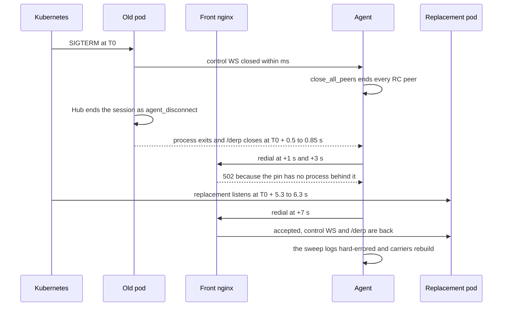

# FR-28: A pod roll freezes every relay-carried session

Status: **P1 cannot work as designed; how this FR closes is with the operator** (2026-10-31, read
on 15 production rolls). Tracking issue: `FR-28` (#865). Child of the RC-quality program; sibling of
FR-18 (carrier queue discipline).

## Where it stands (2026-10-31)

This section replaces the status, the chain and the P1 design further down. Those date from
2026-08-29 and stay as the record, along with their anchors: the `/derp` code has since moved to
`crates/modules/network/`.

The freeze is real and bigger than this spec said, and `/derp` is not where it lives. A roll does
not freeze a relay-carried session. It ends every session on the rolled pod, on any carrier, and
the `/derp` outage sits inside that.

The numbers come from `agent_logs`, `remote_sessions` and `stats_usage` for the 14 rolls of 10-26
to 10-31, plus a 15th watched live (2026-10-31 20:50Z, mostly 0.4.191).

| Question | Measured |
|---|---|
| Does a session ride out a roll? | **No: 9 of 9** sessions Active at a roll ended `agent_disconnect`, 7 on `direct` and 2 on `derp`. A new session was Active 8.4–18.6 s after the cut (median 10.9 s): `direct` 8.4–17.1 s, `derp` 17.6 s and 18.6 s. |
| Does `/derp` still drop? | Every socket, once per roll. 310 sockets: down p50 7.6 s, p90 15.9 s, p99 26.2 s. Live roll: p50 7.2 s, p90 9.4 s. |
| `relay carrier send hard-errored`? | 14–73 lines per roll on 10–15 hosts, every one a DERP carrier. Live roll: 34 lines on 15 hosts. |
| `/derp` close to `control-WS reattached`? | p50 7.7 s, p90 32 s. Live roll: p50 8.7 s, p90 9.3 s. The oldest agent on the fleet (0.4.48) takes about 60 s. |
| How long is a roll? | Live roll: 33.9 s from the first SIGTERM to the second replacement Ready. |
| How much rides a pod's `/derp`? | Nearly all DERP: 751 of 754 registrations in 3 days were on the pods, and regional PoPs only serve server-forced pins. That is about 47 % of metered relay bytes over 8 days (the rest is TURN) and about 5 % of RC sessions. |

### The chain today



The agent closes every peer on any control-WS close (`agents/roomlerd/src/signaling.rs:2983-2990`)
and the Hub ends the agent's sessions when it unregisters (`crates/modules/fleet/src/hub.rs:1159-1201`).
`docs/multi-pod-scale-out.md:182` records this; the 08-29 spec missed it.

The live roll, read from the pods and the k8s events, as seconds after each SIGTERM:

| Step | Wave 1 | Wave 2 |
|---|---|---|
| SIGTERM | 20:50:05.480 | 20:50:22.338 |
| Old pod exited | +0.5 | +0.85 |
| Replacement scheduled | +1.5 | +1.7 |
| Image pulled | +5.9 | +5.1 |
| Binary listening | +6.3 | +5.3 |
| Ready | +16.9 | +17.1 |

Almost all of the wait is Kubernetes and the image: the pull took 3–4 s, and the binary listened
under 0.4 s after its container started.

⚠️ **The per-roll `/derp` p50 measures the agent's timer as much as the pods.** It sits on the
backoff ladder (1, 2, 4, 8, 10 s; `agents/roomlerd/src/derp.rs:49`, `:522`): 3.4 s in one roll,
7.5–7.7 s in ten, 15.2–15.8 s in two, 25.9 s in one. A replacement that listens just after a step
waits for the next one. The control WS doubles the same way, up to 60 s
(`agents/roomlerd/src/signaling.rs:1303`).

A device in two orgs holds one socket per org, each pinned by its own tenant, so it can lose a
socket in each wave. That accounts for the 6–8 hosts per roll that log two closes: on the roll of
10-31 17:41Z they were six of the seven two-org devices, and every single-org host logged one.

### Why P1 as designed cannot work

1. **It cannot save the session.** The session ends on the control WS, before `/derp` closes: on
   2026-10-30 at 19:43:07.882 the Hub ended a `direct` and a `derp` session in the same millisecond,
   and both agents' `/derp` sockets closed about a second later. A perfect `/derp` swap leaves AC1
   where it is.
2. **There is no second pod to dial.** The front nginx pins `/ws` and `/derp` by tenant:
   `hash … consistent`, `max_fails=0`, `proxy_next_upstream off`. That is deliberate, since a ring
   that walked to the survivor parked long-lived sockets on the wrong pod after a roll (the
   fleet-wide "green but not online" incident of 2026-07-29). So a second dial reaches the same dying
   pod, and the replacement cannot exist until that pod is gone, because hostNetwork pods cannot
   double-bind (`maxSurge: 0`). Even a dial the old pod accepted in its last 0.5–0.85 s would die
   with it. Measured on the live roll with one dial every 200 ms at four ring positions, all hashing
   to the same pod: 492 dials answered 401 straight through the other pod's wave, then each position
   took 23 consecutive 502s over about 5 s, until the replacement listened.
3. **One peer cannot move alone.** DERP is pod-local (`docs/multi-pod-scale-out.md:141-157`), so a
   pair exchanges frames only while both sockets are on one pod. A peer that moved first would send
   into a pod where its partner is not registered, and the frame is dropped as a miss
   (`crates/modules/network/src/derp.rs:654-671`). The 08-29 design's "safe by construction" holds
   on one pod only. Moving a pair needs both peers to move in one window, or dual-send while they do,
   with C-5's convergence closing sockets under it (`crates/modules/network/src/derp_cluster.rs:126-188`).
   This point is reasoned from the code, not measured.

### What an old agent does with an unknown frame

For whoever puts the next frame on this socket: agents back to 0.4.48, the oldest on the fleet,
ignore a Text frame (the `Some(Ok(_))` arm, `agents/roomlerd/src/derp.rs:506`) and drop a Binary frame
under 32 bytes (`crates/tunnel-core/src/transport/derp.rs:559-562`). A Binary frame of 32 bytes or
more reads as a peer's frame and raises `Unrouted`. So a server-to-agent signal needs no capability
gate as long as it is Text. This was read at the tags `agent-v0.4.48` and `agent-v0.4.154`, not run.

### What is left

| Lever | Lives in | What it buys | What it costs |
|---|---|---|---|
| Redial flat on an LB 502 instead of climbing the ladder | agent, both loops | The ladder's waste: every roll lands within a second of the replacement listening | Small, default OFF, but it is the floor, and #2221's rule still binds: a server that accepts and drops must climb. This spec scoped the ladder out; that needs the operator |
| Pre-pull the image on both nodes before the roll | promote lane | 3–4 s off each wave on the live roll, likely more on a large delta | A deploy-lane change |
| An RC session survives a control-WS loss | a new FR | AC1, and whichever of the other `agent_disconnect` ends are not daemon restarts (about 5 % of sessions ended that way outside rolls in the last 7 days) | A design of its own: the Hub is pod-local, `close_all_peers` is what stops a peer leaking its sockets, and consent and kick must still reach the session |
| A per-pod `/derp` route plus dual-send | front nginx and agent | Overlay pairs keep moving through a roll. RC sessions still end | Changes the floor and undoes the strict pin for this path |
| The floor on a regional PoP | later | A roll never touches the carrier | Both peers need the PoP, and today only forced pins use one |

The first two together would put a reattach at about 2–3 s. That is an estimate from the live roll,
not a measurement.

## The measurement

Driving a live session through the browser on 2026-08-29 caught a **2436 ms
`video DC delivery gap` + decode stall on an IDLE session** — no dragging, nothing
to blame on the encoder. Correlating the agent logs against pod age gave an exact,
repeatable chain:

```
pod roll → /derp WS closed under the relay carrier → carrier rebuild
        → video DC delivery gap → decode stall → visible freeze
```

Both hosts, same second, against pods 69 s old:

| time | host | line |
|---|---|---|
| `10:26:57Z` | CORPLAP-3 | `overlay: relay carrier send hard-errored (/derp WS closed under it)` ×3 |
| `10:26:56Z` | CORPLAP-2 | `overlay: control-WS reattached — re-joined with carriers intact` |
| `10:27:01Z` | CORPLAP-3 | `overlay: control-WS reattached — re-joined with carriers intact` |

An earlier instance recovered in **~4 s** (`08:36:34 → 08:36:38`).

🔑 **DERP churn is otherwise rare** — 2–3 events per host per 6 h, *all* correlating
with rolls. So this is not a flaky-network story: it is self-inflicted, and it is
the one freeze cause that can be reproduced on demand.

## Root cause

The agent learns the `/derp` WS is gone **by failing to send on it**. Nothing tells
it in advance, so the sequence is: pod dies → agent keeps handing frames to a dead
socket → a send hard-errors → `DeathReason::HardDead`
(`crates/tunnel-core/src/overlay/runtime/establish.rs:693-702`) → carrier rebuild →
`MuxEvent::Recovered` opens the fast-walk window
(`crates/tunnel-core/src/overlay/runtime.rs:2653-2656`).

That recovery path has already been optimised once (#28: `DERP_RECOVERY_WALK_WINDOW`
+ `DERP_RECOVERY_RECHECK`, after a field case where "the WS returned in 1.5 s and the
floor still took 5 s more"). The remaining cost is upstream of it — the time spent
not knowing.

⚠️ **The pod knows it is going away and does not say so.** `main.rs:244-266` already
runs `shutdown_cleanup` on SIGTERM before axum stops accepting, and
`ws/derp.rs:80-85` already defines a **`DerpCancelRegistry`** whose entire purpose is
"fire it to rehome a socket parked on the wrong pod; the socket loop's cancel arm
breaks, teardown releases the directory record, and the client's reconnect re-lands
per the current LB map". The primitive exists and is simply not wired to shutdown.

## Design — announce the death instead of letting it be discovered

**P0. Fire every `/derp` cancel on SIGTERM.** ❌ **DISPROVEN AND REVERTED** (#867,
#874, reverted in the PR that carries this edit). In the existing shutdown hook, walk
`DerpCancelRegistry` and notify each connection before the process stops accepting.
Each agent gets a clean close at T+0 rather than discovering it at first-failed-send,
and re-lands on the surviving pod through the normal reconnect.

⚠️ This is **not** the pre-close HTTP draining that `main.rs:249-253` deliberately
rejects ("maxSurge=0 means every drained second is downtime for this node"). It adds
no delay: it is a broadcast on the way out, and the process stops accepting exactly
when it does today.

⚠️ Kill switch: `ROOMLER__DERP__DRAIN_ON_SHUTDOWN` (default on once proven; off ⇒
today's behaviour byte-for-byte).

### Why P0 failed — the premise, not the primitive

Three rolls, same three hosts, deliberate:

| roll | terminating pods | `hard-errored` |
|---|---|---|
| `11:41:01Z` | no drain (baseline) | 8 |
| `11:42:26Z` | drain via `notify_waiters` | 12 |
| `12:20:23Z` | drain via `notify_one` | **10** |

Recovery did not improve either: baseline 4-28 s, `notify_one` 16-58 s.

The first round also had a real bug — `notify_waiters` drops a signal when no task is
parked, and the socket loop rebuilds its `notified()` future every `select!` iteration,
so exactly the BUSY sockets missed it. Fixing that to `notify_one` moved the number from
12 to 10. It did not fix the freeze, because:

⚠️ **Closing the socket early IS the announcement, and any close — graceful or not —
fails the agent's in-flight sends.** That is precisely what `relay carrier send
hard-errored (/derp WS closed under it)` reports: it marks *a close*, not an *ungraceful*
one. The cost was never in DISCOVERING the death. It is in having **no carrier at all**
between the old WS closing and a replacement being up, and telling the agent sooner only
starts that window sooner.

🔑 The acceptance criterion ("the `hard-errored` line must disappear") was a good
falsifier and did its job. The reasoning it was testing was wrong.

**P1. Reconnect-before-close — the actual fix.** The agent opens the replacement `/derp`
WS and moves carriers across **while the old socket still carries**: the make-before-break
the overlay already does for carrier upgrades. Only overlap closes the gap.

The trigger should be an application-level "going away" frame, precisely because it can
be delivered **without closing anything** — which is the property P0 lacked. The server
half is small (emit the frame on SIGTERM, then behave as today); the work is agent-side:
hold two sockets, move carriers, retire the old one.

⚠️ Scope note: this is an AGENT change, so it ships on the agent release cadence and
reaches the fleet gradually, unlike P0 which was server-only. A server that emits the
frame to an agent too old to understand it must be a no-op.

## Acceptance criteria

- [ ] A deliberate `kubectl rollout restart` with a live relay-carried session
      produces **no `video DC delivery gap` > 500 ms** in the viewer console
      (today: 2436 ms measured).
- [ ] Agent-side `relay carrier send hard-errored (/derp WS closed under it)`
      **disappears** for a graceful roll — the carrier should be rebuilt from a
      clean close, not from a failed send. Its continued presence means P0 did not
      take, regardless of what the timings say.
- [ ] Time from pod SIGTERM to `control-WS reattached` drops below the ~4 s measured.
- [ ] No regression in rollout duration — the deploy must not get slower, since the
      whole reason pre-close draining was rejected is that surge is 0.
- [ ] Verified on ≥2 hosts in one roll, since the failure is fleet-wide by nature.
- [ ] Docs: `docs/overlay-communication.md` and `docs/multi-pod-scale-out.md` updated in the house
      style, with the `docs/README.md` index row.

None of the first five is met. They were written for P0, and against the measurement above:

| AC | Today | Reachable? |
|---|---|---|
| No delivery gap > 500 ms | The session ends, 9 of 9 | Not from `/derp`. It needs a session that survives a control-WS loss. ⚠️ The reader cannot show it either: `video DC delivery gap` is console-only and logs only above 1500 ms (`ui/src/composables/useRemoteControl.ts:7949`) |
| `hard-errored` disappears | 14–73 lines per roll | Not without an overlap the topology does not offer. The line marks a close, as P0 found |
| Under ~4 s to `control-WS reattached` | p50 7.7 s, p90 32 s | Possibly: the replacement listens at 5.3–6.3 s today, so it takes the first two levers above |
| Rollout not slower | Baseline 33.9 s | Yes, with nothing built |
| ≥ 2 hosts | Live roll read on 15 hosts | Yes, for whatever gets built |

## Out of scope

- The reconnect/backoff ladder itself (already tuned by #28).
- Non-graceful pod death (SIGKILL, node loss). Nothing can be announced there; that
  case keeps today's discover-by-failure path, which is why P0 cannot be the only
  defence and the existing recovery walk stays.
- Making RC sessions survive a roll without any interruption — that is a bigger
  design (session migration) and is not what this FR claims.

## Field log

| date | build | result |
|---|---|---|
| 2026-08-29 | 0.4.15 | Measured: 2436 ms delivery gap + decode stall on an idle session; chain confirmed on 2 hosts against a 69 s-old pod; ~4 s SIGTERM→reattach in an earlier instance. FR filed. |
| 2026-08-29 | 0.4.17 | **P0 DISPROVEN over three deliberate rolls** (8 / 12 / 10 `hard-errored`; recovery no better). Premise wrong: the agent was never late to notice, it was carrier-less either way. P0 reverted rather than left default-ON looking like a fix. The two notify-semantics tests are KEPT — `notify_waiters` losing a signal when nobody is parked is a general hazard wherever a `select!` loop is signalled. |
| 2026-10-31 | fleet of 10-26 to 10-31 | RED read from logs on 14 production rolls: 9 of 9 sessions ended `agent_disconnect`, 310 `/derp` sockets down p50 7.6 s, 14–73 `hard-errored` lines per roll. All of it is in "Where it stands". |
| 2026-10-31 | 0.4.191, `hosted-20261031-5281d7f` | Roll watched live at 20:50Z: 33.9 s, two waves 16.9 s apart, 34 `hard-errored` lines on 15 hosts, `/derp` down p50 7.2 s. Dial probe at four ring positions: 401 through the other pod's wave, 502 for about 5 s in their own. No session was live, so AC1 stands on the 9 above. |

## P1 — concrete design (scoped, NOT implemented)

⚠️ Superseded on 2026-10-31: this design cannot work on today's topology, for the three reasons in
"Where it stands". It stays as the record of what was proposed.

The structure is favourable. `DerpMux` already outlives its socket: *"the outbound
receiver lives for the mux's whole life (across reconnects), so a reconnect never severs
the `DerpConn`→WS path"* (`transport/derp.rs:356-361`). Carriers hang off the mux, not
off the socket, so a socket swap need not be visible to them at all.

What makes today's reconnect visible is `mark_down()` — the agent's WS loop
(`agents/roomlerd/src/derp.rs:323-363`) is shaped
`loop { connect; register; mark_up; inner select; mark_down; backoff }`, and every
iteration owns one `tx`/`rx` pair. `mark_down` is what withholds carrier builds and
ultimately drives the freeze.

**The change**: on a "going away" signal, dial and register a SECOND socket, swap `tx`,
retire the old `rx` — **without ever calling `mark_down`**. The mux stays up, carriers
never notice, and the visible outage is the swap itself (one dial, sub-second) rather
than a full down→backoff→up→walk cycle.

Server half is small: emit the frame in the existing SIGTERM hook, then behave exactly as
today. Agent half is the work: the loop must hold two sockets briefly and move the write
half across.

### ⚠️ Why this needs its own cycle, not a bolt-on

`derp.rs` IS the connectivity floor — *"with every UDP path blocked, DERP over TLS :443
still carries the mesh"* is commitment #2 in CLAUDE.md. A defect in this loop does not
degrade the mesh, it removes the floor, and on exactly the corp-VPN hosts that have no
other carrier. That earns a design pass, review, and a staged rollout of its own.

Specific hazards to design against, all visible in the current loop:

- **A failed second dial must not cost the first socket.** The old `tx` has to keep
  carrying until the new one is registered, so the swap is commit-on-success. Getting
  this backwards converts a graceful roll into a hard outage — strictly worse than today.
- **The registration frame is the first frame on a socket** (`derp.rs:217`). The new
  socket is not usable until that lands, so "registered" is the swap point, not
  "connected".
- **Both sockets are registered under the same pubkey for an instant.** The server's
  registry is last-writer-wins (`ws/derp.rs:448-451` deregisters only `if` still ours),
  so the overlap is safe by construction — but that property is load-bearing and should
  be asserted, not assumed.
- **Ungraceful death still exists.** SIGKILL and node loss cannot be announced, so the
  discover-by-failed-send path and the #28 recovery walk both stay. P1 removes the cost
  of the *graceful* case only.

### Value, stated honestly

This is worth doing, but it is not the largest RC-quality lever: it affects only sessions
live during a deploy. The measured win of this whole arc so far is the FR-22 probe cache
(#861, up to 1.9 s off a reconnect, shipped). P1 should be picked up deliberately, not
because it is the last thing left open.
